# Bölüm 1: İnternet ve Web'in Temelleri

[İçindekiler](../README.md) · [Sonraki bölüm →](02-html-temelleri.md)

> **Öğrenme Hedefleri** — Bu bölümü tamamlayan öğrenci:
>
> 1. İnternet ile Web arasındaki farkı açıklar ve Web dışındaki İnternet hizmetlerine örnek verir.
> 2. Galaktik Ağ fikrinden ARPANET'e, TCP/IP'ye ve World Wide Web'e uzanan tarihsel gelişimi ana dönüm noktalarıyla sıralar.
> 3. LAN–WAN, ağ topolojileri, paket anahtarlama, TCP/IP katmanları ve IP adresi kavramlarını tanımlar.
> 4. Bir URL'yi bileşenlerine ayırır; HTTP istek ve yanıtının yapısını ve durum kodlarının anlamını yorumlar.
> 5. Alan adlarının nasıl kiralandığını ve DNS çözümlemesinin adımlarını, TTL ve önbellek kavramlarıyla birlikte açıklar.
> 6. Adres çubuğuna yazılan bir adresin ekranda sayfaya dönüşmesine kadar geçen süreci istemci ve sunucu rolleriyle anlatır.
> 7. `ipconfig`, `tracert`, `Resolve-DnsName`/`nslookup` ve tarayıcı geliştirici araçlarıyla ağ trafiğini gözlemler.

## 1.1 Giriş: Web Kavramının Kapsamı

Günlük dilde "Web", "World Wide Web" (Dünya Çapında Ağ) ifadesinin kısaltmasıdır; site adreslerinin başındaki `www` de bu adın baş harflerinden gelir. Web kavramı yalnızca tarayıcıda görülen sayfalardan ibaret değildir. Bir web sayfasının arkasında görseller, stil dosyaları, betikler, veri servisleri, sunucular ve bunları birbirine bağlayan ağlar bulunur. Bütün bu yapının temel amacı, bilgisayarlar arasında veri aktarımı ve paylaşımı sağlamaktır.

"İnternet" ve "Web" sözcükleri gündelik konuşmada çoğu zaman birbirinin yerine kullanılsa da teknik olarak farklı kavramlardır. **İnternet**, küresel veri iletimini sağlayan, birbirine bağlı bilgisayar ağlarından oluşan temel altyapıdır. Hiçbir şirket İnternet'in sahibi değildir; İnternet, ortak standartlar ve kurallarla yürütülen bir iş birliğidir [1, s. 21]. **Web** ise bu altyapının üzerinde çalışan hizmetlerden biridir: kullanıcıların tarayıcılarıyla eriştikleri; metin, görsel, video ve diğer çoklu ortam içeriklerini barındıran ve birbirine **köprü bağlantılarla (hyperlink)** bağlanan belgelerden oluşur [2, ss. 2–3]. Web'in yanı sıra e-posta, dosya aktarımı, uzaktan oturum açma, görüntülü görüşme ve çevrim içi oyun da İnternet üzerinde çalışan hizmetlerdir (Şekil 1.1).

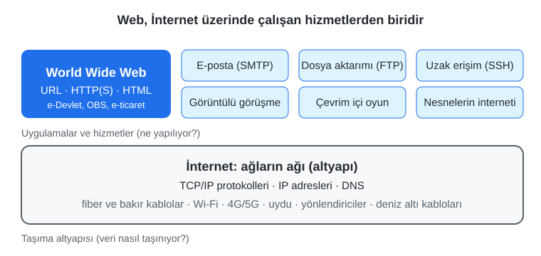

*Şekil 1.1. İnternet bir altyapıdır; Web, e-posta ve dosya aktarımı gibi hizmetler bu altyapının üzerinde çalışır.*

Bu ayrımı bir benzetmeyle somutlaştırmak mümkündür: İnternet, şehirleri birbirine bağlayan karayolu ağına; Web ise bu yollarda çalışan hizmetlerden biri olan kargo taşımacılığına benzer. Aynı yollardan otobüsler, ambulanslar ve özel araçlar da geçer. Benzer biçimde bir öğrencinin aynı İnternet bağlantısı üzerinden üniversitenin öğrenci bilgi sistemine (OBS) girmesi Web'i, e-posta uygulamasıyla ödev göndermesi e-posta hizmetini, bir video görüşmesine katılması ise gerçek zamanlı ses/görüntü aktarım protokollerini kullanır.

> [!IMPORTANT]
> Web, İnternet'in kendisi değildir; İnternet üzerinde çalışan bir hizmettir. Web'in konuşma dili (protokolü) **HTTP**'dir; **HTML** ise bir protokol değil, sayfaların içeriğini ve yapısını tanımlayan bir **işaretleme dilidir**.

Bu bölümde önce iletişimin ve İnternet'in tarihsel gelişimi, ardından ağların yapısı ve İnternet'in teknik işleyişi ele alınacaktır. Sonraki kısımlarda Web'in üç temel taşı (URL, HTTP, HTML), istemci–sunucu mimarisi, alan adları ve DNS ayrıntılı olarak incelenecek; bölüm, bir web sayfasının tasarım anatomisi ve sonraki bölümlerde kullanılacak geliştirme ortamına kısa bir köprüyle tamamlanacaktır.

## 1.2 İletişimin ve İnternet'in Kısa Tarihi

### 1.2.1 Bilgi Çağına Giden Yol

İnsanlığın başlangıcından bu yana iletişim, toplumların en temel ihtiyaçlarından biri olmuştur. Haberleşme araçlarını daha erken ve daha etkin kullanan toplumların ekonomik, askerî ve kültürel alanlarda üstünlük elde etmesi tarih boyunca tekrarlanan bir örüntüdür: Yazının, matbaanın, telgrafın ve telefonun her biri, bilginin daha hızlı ve daha geniş kitlelere ulaşmasını sağlamıştır. Tanenbaum, bilgisayar ağları üzerine klasik ders kitabına şu gözlemle başlar:

> “Son üç yüzyılın her birine tek bir teknoloji hâkim olmuştur. 18. yüzyıl, Sanayi Devrimi'ne eşlik eden büyük mekanik sistemlerin çağıydı. 19. yüzyıl buhar makinesinin çağı oldu. 20. yüzyılda ise kilit teknoloji bilginin toplanması, işlenmesi ve dağıtılmasıydı.” [3, Bl. 1]

Tanenbaum aynı bağlamda dünya çapındaki telefon ağlarının kurulmasını, radyo ve televizyonun yaygınlaşmasını, bilgisayar endüstrisinin doğuşunu ve iletişim uydularının ortaya çıkışını bu çağın başlıca gelişmeleri olarak sayar [3, Bl. 1]. Günümüzde ise bu teknolojilerin büyük bölümü tek bir ortak altyapıda, İnternet'te birleşmiştir: Telefon görüşmeleri, televizyon yayınları ve haberleşme artık çoğunlukla İnternet protokolleri üzerinden taşınmaktadır.

### 1.2.2 Fikrin Doğuşu: Licklider ve "Galaktik Ağ"

İnternet'in düşünsel kökeni, bir mühendislik projesinden çok bir vizyona dayanır. 1960'ların başında bilgisayarlar büyük salonları kaplayan, pahalı ve birbirinden yalıtılmış makinelerdi; kullanıcılar programlarını delikli kartlarla teslim eder, sonuçları saatler sonra alırdı. Massachusetts Teknoloji Enstitüsü'nden (MIT) J. C. R. Licklider (Joseph Carl Robnett Licklider), Ağustos 1962'de yazdığı bir dizi notta **"Galaktik Ağ" (Galactic Network)** adını verdiği kavramı tartışmaya açtı. Licklider, herkesin herhangi bir yerden veri ve programlara hızlı biçimde erişebildiği, küresel ölçekte birbirine bağlı bilgisayarlar öngörüyordu; bu tasavvur, özünde bugünkü İnternet'e çok yakındır [4], [2, s. 2].

Licklider, Ekim 1962'de ABD Savunma Bakanlığına bağlı İleri Araştırma Projeleri Ajansı'nda (ARPA, sonradan DARPA) bilgisayar araştırma programının ilk başkanı oldu [4]. Bu görevde kalış süresi kısa olsa da ağ fikrini kuruma yerleştirdi ve kendisinden sonra gelen Ivan Sutherland, Bob Taylor ve Lawrence G. Roberts gibi araştırmacıları bu yönde etkiledi.

> [!NOTE]
> **Düzeltme notu:** Licklider DARPA'nın başkanı değil, ARPA bünyesindeki bilgisayar araştırma programının (daha sonra Bilgi İşleme Teknikleri Ofisi, IPTO adını alan birimin) ilk başkanıdır.

### 1.2.3 Paket Anahtarlama: Veriyi Küçük Parçalarla Taşımak

Bilgisayarları birbirine bağlamanın önündeki temel teknik soru, verinin hatlar üzerinde nasıl taşınacağıydı. Dönemin telefon şebekesi **devre anahtarlama (circuit switching)** ilkesiyle çalışıyordu: Görüşme başlamadan önce iki uç arasında bir yol (devre) kurulur, bu yol görüşme boyunca yalnızca o iki tarafa ayrılır ve görüşme bitince serbest bırakılır. Bu yöntem kesintisiz ses akışı için uygundur; ancak bilgisayar trafiği "patlamalı" (bursty) bir yapıdadır: Bir dosya indirilirken veri yoğun biçimde akar, ardından uzun süre hiçbir şey gönderilmez. Devre anahtarlamada hat, veri akmadığı anlarda da başkası tarafından kullanılamaz ve kaynaklar boşa harcanır.

Bu soruna birbirinden habersiz üç araştırma grubu benzer bir yanıt geliştirdi: MIT'de Leonard Kleinrock (1961'den itibaren), RAND Corporation'da Paul Baran (1962–1965) ve İngiltere Ulusal Fizik Laboratuvarı'nda (NPL) Donald Davies (1964–1967). Ortak fikir, iletilecek veriyi **paket (packet)** adı verilen küçük birimlere bölmek ve her paketi ağ üzerinde bağımsız olarak göndermekti; "paket" terimi NPL'deki çalışmadan benimsenmiştir [4]. Baran'ın çıkış noktası, düğümlerinin bir kısmı devre dışı kalsa bile çalışmayı sürdürebilen dayanıklı bir askerî haberleşme ağıydı.

**Paket anahtarlama (packet switching)** yönteminde her paketin içinde taşınan asıl verinin (yük, payload) yanında kaynak ve hedef adresi, sıra numarası ve hata denetim bilgileri bulunur. Kaynak ile hedef arasında önceden ayrılmış bir yol yoktur; hatlar tüm kullanıcılarca ortaklaşa kullanılır. Ağdaki kavşak noktalarında bulunan **yönlendiriciler (router)** "sakla ve ilet" (store-and-forward) ilkesiyle çalışır: Gelen paketi kısa süre belleğinde tutar, hedefe giden uygun yolu seçer ve bir sonraki düğüme iletir. Bu nedenle aynı mesajın paketleri farklı yollardan gidip hedefe farklı sırayla ulaşabilir; hedefteki protokol yazılımı paketleri sıra numaralarına göre yeniden birleştirir (Şekil 1.2, Şekil 1.3).

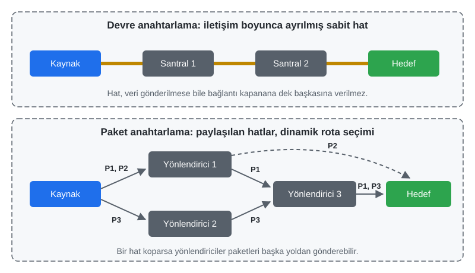

*Şekil 1.2. Devre anahtarlama ile paket anahtarlamanın karşılaştırılması.*

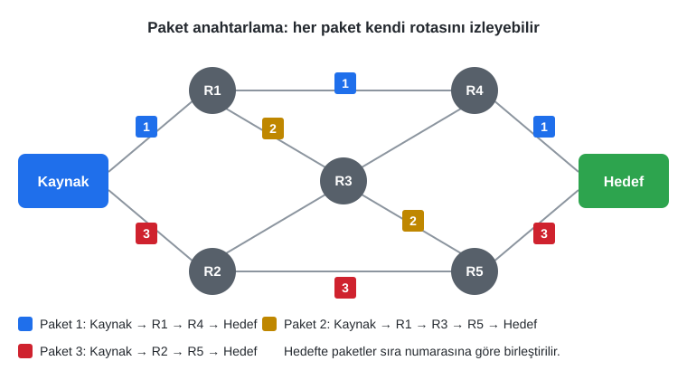

*Şekil 1.3. Paket anahtarlamada aynı mesajın paketleri farklı rotalar izleyebilir.*

*Tablo 1.1. Devre anahtarlama ile paket anahtarlamanın karşılaştırılması.*

| Ölçüt | Devre anahtarlama | Paket anahtarlama |
|---|---|---|
| Yol | İletişim başlamadan önce sabit bir yol kurulur. | Önceden kurulan yol yoktur; her paket için rota anlık olarak seçilir. |
| Bant genişliği | Bağlantıya ayrılır; kullanılmasa da başkasına verilmez. | Tüm kullanıcılar ortak kullanır; yalnızca veri akarken tüketilir. |
| İletim ilkesi | Uçtan uca doğrudan akış | Her düğümde "sakla ve ilet" |
| Dayanıklılık | Yoldaki tek bir kopukluk bağlantıyı keser. | Yönlendiriciler alternatif yol bulabilir. |
| Tıkanıklık etkisi | Hat doluysa bağlantı hiç kurulamaz. | Yoğunlukta gecikme artar, paket kaybı yaşanabilir. |
| Tipik kullanım | Geleneksel telefon şebekesi | İnternet: Web, e-posta, video akışı |

Günümüzde telefon görüşmeleri bile büyük ölçüde paket anahtarlamalı ağlar üzerinden (ör. VoLTE, VoIP) taşınmaktadır. Paket anahtarlamanın kaynakları verimli kullanması ve arızalara karşı dayanıklılığı, İnternet'in küresel ölçeğe büyüyebilmesinin temel nedenlerindendir.

### 1.2.4 ARPANET ve IMP

ARPA'nın 1960'ların ortasında bir bilgisayar ağı kurmaya karar vermesinin başlıca gerekçesi, ülkenin farklı üniversite ve araştırma merkezlerine dağılmış pahalı bilgisayarların kaynaklarını ortak kullanmaktı [2, s. 2]. 1965'te Lawrence Roberts ve Thomas Merrill, Massachusetts'teki TX-2 bilgisayarını Kaliforniya'daki Q-32 bilgisayarına düşük hızlı bir telefon hattıyla bağlayarak ilk geniş alan bilgisayar ağı denemesini gerçekleştirdi; deneme, devre anahtarlamalı telefon hattının bu iş için yetersiz olduğunu ve paket anahtarlamanın gerekliliğini gösterdi [4]. Roberts'ın 1967'de yayımladığı plan, **ARPANET (Advanced Research Projects Agency Network)** projesine dönüştü.

Ağın kalbinde, farklı üreticilerin farklı yapıdaki bilgisayarlarını ağa bağlayan **IMP (Interface Message Processor, Arayüz Mesaj İşlemcisi)** adlı özel bilgisayarlar vardı. IMP'leri Bolt Beranek and Newman (BBN) şirketinde Frank Heart liderliğindeki bir ekip geliştirdi; ağ mimarisinin tasarımında Bob Kahn önemli rol oynadı [4]. Her kurumdaki ana bilgisayar (host) kendi IMP'sine bağlanıyor, IMP'ler de kiralık hatlarla birbirine bağlanıyordu. Bu yapıda IMP'ler, bugünkü yönlendiricilerin atası sayılır: Ana bilgisayarların donanım ve yazılım farklılıklarını gizleyerek ortak bir iletişim katmanı sağlıyorlardı.

İlk IMP Eylül 1969'da Kleinrock'un UCLA'daki laboratuvarına kuruldu; ikinci düğüm Stanford Araştırma Enstitüsü (SRI) oldu. 29 Ekim 1969'da UCLA'dan SRI'ye ilk mesaj gönderilmek istendiğinde, `LOGIN` sözcüğünün yalnızca "L" ve "O" harfleri iletilebildi ve sistem çöktü; kısa süre sonra bağlantı yeniden kuruldu. Yıl sonunda Kaliforniya Üniversitesi Santa Barbara (UCSB) ve Utah Üniversitesi'nin de katılımıyla ağ dört düğüme ulaştı [4] (Şekil 1.4).

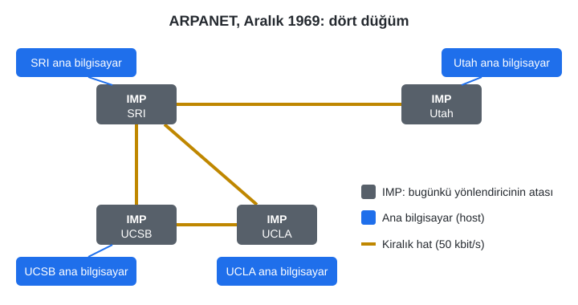

*Şekil 1.4. Aralık 1969'da ARPANET: dört kurum, dört IMP ve kiralık hatlar.*

### 1.2.5 TCP/IP'ye Geçiş ve İnternet'in Yaygınlaşması

ARPANET başlangıçta **NCP (Network Control Protocol)** adlı bir protokolle çalışıyordu. NCP, tek bir ağın içindeki ana bilgisayarların haberleşmesi için tasarlanmıştı; oysa 1970'lerde radyo ve uydu üzerinden çalışan başka paket ağları da kurulmuştu ve bu farklı ağların birbirine bağlanması (internetworking) gerekiyordu. Bob Kahn ve Vint Cerf, 1973'te bu sorun üzerinde çalışmaya başladı ve 1974'te "A Protocol for Packet Network Intercommunication" başlıklı makaleyle **TCP (Transmission Control Protocol)** tasarımını yayımladı [5]. Başlangıçta tek parça olan protokol, sonradan iki katmana ayrıldı: güvenilir uçtan uca iletimden sorumlu **TCP** ve paketlerin adreslenip yönlendirilmesinden sorumlu **IP (Internet Protocol)**. "İnternet" adı da bu "ağlar arası bağlantı" (internetwork) fikrinden gelir.

1 Ocak 1983'te ARPANET'in bütün ana bilgisayarları NCP'den TCP/IP'ye geçti [4]. Bu tarih, farklı ağların ortak bir protokol ailesiyle tek bir küresel ağ oluşturmaya başladığı an olarak sıkça "İnternet'in doğum günü" diye anılır. Aynı dönemde ağa bağlı makine sayısı arttıkça, ana bilgisayar adlarını tek bir dosyada tutma yöntemi yetersiz kaldı; USC/ISI'den Paul Mockapetris, ölçeklenebilir ve dağıtık bir ad sistemi olarak **DNS (Domain Name System)**'i geliştirdi [4]. 1980'lerin ortasında ABD Ulusal Bilim Vakfı'nın NSFNET omurgası üniversiteleri birbirine bağladı; 1990'da ARPANET kapatıldı, 1995'te ise NSFNET omurgası ticari servis sağlayıcılara devredilerek İnternet ticari kullanıma tam olarak açıldı [4], [2, s. 2]. Türkiye'nin İnternet'e ilk bağlantısı ise 1993'te ODTÜ üzerinden kurulmuştur.

Bu tarihsel süreç Şekil 1.5'te özetlenmiştir.

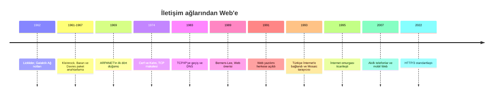

*Şekil 1.5. İletişim ağlarından Web'e uzanan zaman çizelgesi.*

## 1.3 Bilgisayar Ağları: LAN, WAN ve Topolojiler

Bir **ağ (network)**, bilgi ve hizmetlerin **düğüm (node)** ya da **ana bilgisayar (host)** adı verilen cihazlar arasında paylaşıldığı bir yapıdır; masaüstü ve dizüstü bilgisayarlar, tabletler, telefonlar ve yazıcılar en yaygın düğümlerdir [6, s. HTML 4]. Günümüzde İnternet'e bağlanan her aygıt, veri iletişimi yapabildiği için İnternet'in bir parçası hâline gelir ve bu yapı her gün büyümektedir.

### 1.3.1 Kapsama Alanına Göre Ağlar

Ağlar, kapladıkları coğrafi alana göre sınıflandırılır. Bir bina, bölüm ya da laboratuvar gibi küçük bir alanla sınırlı ağa **yerel alan ağı (Local Area Network, LAN)**; birden çok binayı, şehri ya da ülkeyi kapsayan ağa **geniş alan ağı (Wide Area Network, WAN)** denir. Geniş alan ağları genellikle birbirine bağlanmış birden çok yerel ağdan oluşur; var olan en büyük WAN ise İnternet'tir [6, s. HTML 4]. Bu iki temel sınıfın arasında ve altında başka terimler de kullanılır: Bir şehir ölçeğindeki ağlar (ör. belediye ya da kampüsler arası fiber ağlar) **MAN (Metropolitan Area Network)**, bir kişinin çevresindeki kablosuz kulaklık, akıllı saat ve telefon gibi cihazların oluşturduğu kısa menzilli ağ ise **PAN (Personal Area Network)** olarak adlandırılır.

### 1.3.2 Ağ Topolojileri

**Topoloji**, ağdaki düğümlerin birbirine hangi düzende bağlandığını tanımlar (Şekil 1.6). **Yıldız (star)** topolojide bütün cihazlar merkezdeki bir anahtara (switch) ya da kablosuz erişim noktasına bağlanır; bugün ev ve ofis ağlarının neredeyse tamamı bu yapıdadır. **Ağaç (tree)** topoloji, yıldızların hiyerarşik olarak birbirine bağlanmasıyla oluşur: Bir üniversite kampüsünde her binanın anahtarı bir dağıtım anahtarına, dağıtım anahtarları da merkezî bir omurgaya bağlanır. **Örgü (mesh)** topolojide düğümler arasında çok sayıda bağlantı ve dolayısıyla yedek yol bulunur; İnternet'in omurgası kısmen örgü yapıdadır ve bir hattın kopması iletişimi durdurmaz. **Halka (ring)** topolojide her düğüm iki komşusuna bağlıdır; bugün daha çok servis sağlayıcıların fiber halkalarında görülür. Tarihsel olarak tek bir ortak kabloyu paylaşan **yol (bus)** topolojisi de kullanılmıştır.

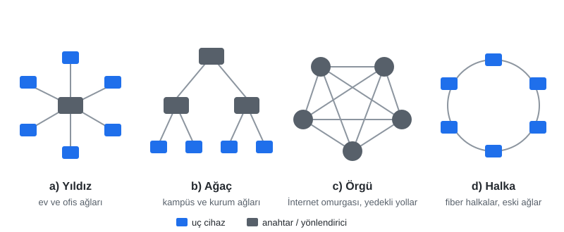

*Şekil 1.6. Temel ağ topolojileri: a) yıldız, b) ağaç, c) örgü, d) halka.*

### 1.3.3 İletim Ortamları

Veri, ağda kablolu ya da kablosuz ortamlar üzerinden taşınır. Kablolu ortamların başlıcaları Tablo 1.2'de özetlenmiştir.

*Tablo 1.2. Yaygın ağ kablosu türleri.*

| Kablo türü | Yapısı | Tipik kullanım (2026) |
|---|---|---|
| Bükümlü çift (twisted pair) | Birbirine sarılmış bakır tel çiftleri, RJ-45 konnektör; Cat5e, Cat6, Cat6A kategorileri | Yerel ağ: bilgisayar–anahtar bağlantısı. Cat5e 1 Gbit/s, Cat6A 10 Gbit/s (100 m'ye kadar). |
| Fiber optik | Işığı ileten cam lif; tek modlu (uzun mesafe) ve çok modlu (kısa mesafe) | Ev fiber bağlantısı (FTTH), kampüs omurgası, şehirlerarası ve deniz altı hatlar |
| Koaksiyel (eş eksenli) | Merkez iletken, yalıtkan, örgülü kalkan | Kablo TV ve kablo İnternet; eski Ethernet ağlarında kullanılmıştır |

Kablosuz ortamlar ise yerel ağlarda **Wi-Fi** (IEEE 802.11; güncel nesiller Wi-Fi 6/6E ve Wi-Fi 7), mobil ağlarda **4.5G/5G** ve ulaşılması güç bölgelerde **uydu** bağlantılarıdır. Kıtalar arası trafiğin büyük bölümü ise okyanus tabanına döşenmiş **deniz altı fiber kablolarıyla** taşınır; bu nedenle "kablosuz İnternet" olarak algılanan bağlantının da yolculuğunun büyük kısmı kablolar üzerinden geçer.

### 1.3.4 Bir Yerel Ağın İnternet'e Bağlanması

Şekil 1.7, tipik bir ev ya da laboratuvar ağının İnternet'e nasıl bağlandığını göstermektedir. Masaüstü bilgisayarlar ve ağ yazıcısı kabloyla bir **anahtara (switch)**, dizüstü bilgisayar ve telefon ise **kablosuz erişim noktasına** bağlanır. Anahtar, aynı yerel ağ içindeki çerçeveleri donanım (MAC) adreslerine göre ilgili cihaza iletir. Yerel ağın dışına çıkacak trafik **yönlendiriciye (router)** gider; yönlendirici çoğunlukla bir **güvenlik duvarı (firewall)** içerir, cihazlara adresleri otomatik dağıtır (DHCP) ve yerel adresleri İnternet'te görünen ortak adrese çevirir (NAT). Yönlendirici; fiber (ONT), VDSL ya da 5G modem aracılığıyla **İnternet servis sağlayıcısına (İSS)** bağlanır. Servis sağlayıcılar da birbirine ve küresel omurgaya bağlanarak İnternet'i oluşturur.

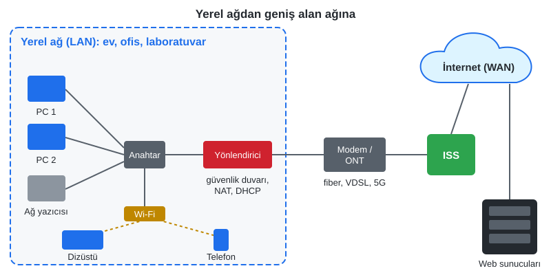

*Şekil 1.7. Yerel ağdan (LAN) geniş alan ağına (WAN): tipik bir bağlantı yapısı.*

> [!TIP]
> **Güncel hayattan:** Evdeki "modem" olarak bilinen cihaz çoğunlukla modem, yönlendirici, anahtar, Wi-Fi erişim noktası ve güvenlik duvarının tek kutuda birleştiği bir cihazdır. Şekil 1.7'deki kutular, bu cihazın içinde mantıksal olarak ayrı görevlerdir.

## 1.4 World Wide Web'in Doğuşu ve Üç Temel Taşı

### 1.4.1 Berners-Lee ve 1989 Önerisi

1980'lerin sonunda İnternet akademik çevrelerde e-posta, dosya aktarımı ve haber grupları için yaygın biçimde kullanılıyordu; ancak kullanımı karmaşık komutlar ve teknik bilgi gerektirdiğinden kitlesi bilgisayar uzmanlarıyla sınırlıydı [6, s. HTML 4]. İsviçre'nin Cenevre kentindeki Avrupa Nükleer Araştırma Merkezi'nde (CERN) çalışan İngiliz bilgisayar bilimci **Tim Berners-Lee** (Şekil 1.8), Mart 1989'da "Information Management: A Proposal" (Bilgi Yönetimi: Bir Öneri) başlıklı belgeyi hazırladı [7]. CERN'de binlerce araştırmacının ürettiği belgeler farklı bilgisayarlarda dağınık duruyor, personel değiştikçe bilgi kayboluyordu. Berners-Lee, bilgilerin **hipermetin (hypertext)** mantığıyla, yani katı bir hiyerarşi olmaksızın birbirine bağlanabileceği bir sistem önerdi. Öneride bu fikir şöyle özetlenir: “İhtiyacımız olan sistem, dairelerin ve okların her şeyi temsil edebildiği bir daireler ve oklar diyagramı gibidir.” [7]


*Şekil 1.8. Tim Berners-Lee (2005). Fotoğraf: Uldis Bojārs, Wikimedia Commons, CC BY-SA 2.0.*

Berners-Lee, Robert Cailliau ile birlikte öneriyi geliştirdi ve 1990 sonunda ilk web sunucusunu, ilk tarayıcı/düzenleyiciyi ve ilk web sayfalarını bir NeXT bilgisayarında çalışır hâle getirdi (Şekil 1.9) [1, s. 22]. Sistem 1991'de CERN dışına açıldı; CERN, 30 Nisan 1993'te Web yazılımını telif ücreti talep etmeksizin herkesin kullanımına sundu. Berners-Lee'nin buluşu, belgeleri okumak için basit bir araç (tarayıcı), belge oluşturmak için bir işaretleme dili (HTML) ve belgeleri adresleyip aktarmak için bir iletişim protokolü ile adresleme düzenini (HTTP ve URL) bir araya getirmesiydi; bu sade arayüz, İnternet'i geniş kitlelerin kullanımına açtı [8, s. 19].


*Şekil 1.9. İlk web sunucusu olarak kullanılan NeXT bilgisayarı. Kasadaki etikette "This machine is a server. DO NOT POWER IT DOWN!!" (Bu makine bir sunucudur, KAPATMAYIN!!) yazar; klavyenin üzerinde 1989 önerisinin bir kopyası durmaktadır. Fotoğraf: Coolcaesar, Wikimedia Commons, CC BY-SA 3.0.*

> [!NOTE]
> **Düzeltme notu:** 1989, HTML'in değil Web önerisinin tarihidir. HTML, HTTP ve URL bu önerinin ardından 1990–1991 yıllarında hayata geçirilmiştir. Berners-Lee, HTML'i belge yapısını tanımlamak için kullanılan SGML (Standard Generalized Markup Language) dilinin sadeleştirilmiş bir uygulaması olarak tasarlamış, ilk sürümde yalnızca başlık, paragraf ve liste gibi temel belge öğelerine yer vermiştir [8, s. 20].

### 1.4.2 Üç Temel Taş: URL, HTTP ve HTML

Web, bir **istemci–sunucu (client–server)** mimarisinde çalışır ve başlangıçtan bu yana üç temel standarda dayanır:

1. **URL (Uniform Resource Locator, Tekdüzen Kaynak Bulucu):** İnternet'teki bir kaynağın adresini belirtir; bir web sayfasının ya da dosyanın *nerede* bulunacağını ve ona *hangi protokolle* erişileceğini söyler.
2. **HTTP (Hypertext Transfer Protocol, Hipermetin Aktarım Protokolü):** Tarayıcılar ile sunucular arasındaki veri alışverişinin kurallarını tanımlar; tarayıcının sunucuyla nasıl "konuştuğunu" belirler.
3. **HTML (Hypertext Markup Language, Hipermetin İşaretleme Dili):** Web sayfalarının içeriğini ve yapısını tanımlar; hangi metnin başlık, hangisinin paragraf ya da bağlantı olduğunu, görselin nereye yerleşeceğini tarayıcıya anlatır.

Bu üç bileşen birlikte **istek–yanıt döngüsünü (request–response cycle)** oluşturur: Kullanıcı bir URL yazar ya da bir bağlantıya tıklar; tarayıcı (istemci) bu adresteki sunucuya bir HTTP **isteği (request)** gönderir; sunucu da isteğe çoğunlukla HTML biçiminde bir belge içeren bir HTTP **yanıtı (response)** ile karşılık verir (Şekil 1.10) [2, s. 3]. Tarayıcı gelen HTML'i yorumlayarak sayfayı ekrana çizer; belgede görsel, stil dosyası ya da betik gibi başka kaynaklar varsa her biri için ayrı istekler gönderir [1, s. 28].

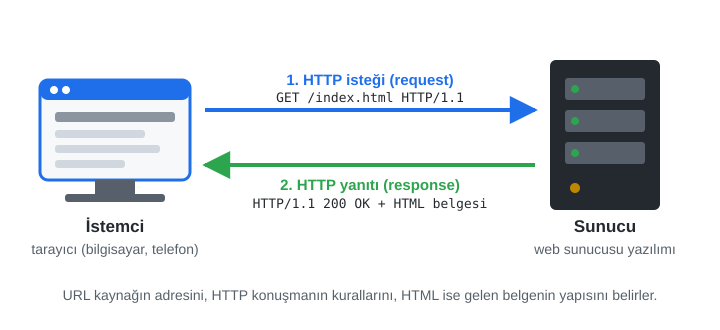

*Şekil 1.10. İstemci–sunucu modeli ve istek–yanıt döngüsü.*

URL, HTTP ve tarayıcının sayfayı işlemesi, bölümün ilerleyen kısımlarında (Kısım 1.10 ve 1.11) güncel teknik ayrıntılarıyla ele alınacaktır. HTML ise [Bölüm 2](02-html-temelleri.md)'den itibaren dersin ana konusudur.

### 1.4.3 Standartları Kim Belirler?

Web'in ilk yıllarında HTML'in kurallarını tek bir kuruluş belirlemiyordu; tarayıcı üreticileri dile kendi eklentilerini yapıyor, bir tarayıcıya göre yazılmış sayfa başka bir tarayıcıda farklı görünüyordu [6, s. HTML 5]. Bu dağınıklığı gidermek için Berners-Lee 1994'te MIT'de **W3C (World Wide Web Consortium)**'u kurdu [8, s. 20]. 2004'te tarayıcı üreticilerinin kurduğu **WHATWG (Web Hypertext Application Technology Working Group)**, HTML5 çalışmalarını başlattı; 2019'dan bu yana HTML, WHATWG tarafından sürekli güncellenen tek bir **HTML Living Standard** olarak yayımlanmaktadır [9]. CSS ve erişilebilirlik yönergeleri (WCAG) gibi standartlar W3C'de, İnternet'in protokolleri (IP, TCP, HTTP, DNS, TLS) ise **IETF (Internet Engineering Task Force)** tarafından **RFC (Request for Comments)** belgeleri olarak geliştirilir.

> [!NOTE]
> **Tarihsel not:** Web'den önce ve Web'in ilk yıllarında belgeleri menü hiyerarşisiyle sunan **Gopher** (1991, Minnesota Üniversitesi) yaygındı; Web'in esnek bağlantı yapısı karşısında kısa sürede terk edildi. 1993'te NCSA'nın geliştirdiği **Mosaic**, metin ve görselleri aynı sayfada gösteren ilk yaygın grafik tarayıcı olarak Web'i kitlelere taşıdı; ardından **Netscape Navigator** (1994) ve **Internet Explorer** arasındaki "tarayıcı savaşları" yaşandı [2, ss. 3–4]. Bu dönemde her tarayıcının kendine özgü etiketleri, bugün standartlara uyumun neden bu kadar önemsendiğini açıklar. Internet Explorer'ın desteği 2022'de sona ermiştir; günümüzün başlıca tarayıcıları Chrome, Edge, Safari ve Firefox'tur.

## 1.5 İnternet'in Tanımı ve İşleyişi

### 1.5.1 Tanım ve Yönetişim

İnternet, birbirine kablolu ya da kablosuz olarak bağlanan bilgisayar ağlarının oluşturduğu küresel **ağlar ağının (network of networks)** genel adıdır. Adı, "ağlar arası bağlantı" anlamındaki *internetwork* sözcüğünden gelir. İnternet belirli bir kuruma ya da kişiye ait değildir; ancak ağa katılan herkes, belirli kurumların koyduğu kurallara ve standartlara uymak zorundadır [1, s. 21]. Protokol standartlarını IETF, alan adları ve IP adreslerinin küresel koordinasyonunu ICANN/IANA, bölgesel IP adresi dağıtımını ise Türkiye'nin de bağlı olduğu RIPE NCC gibi bölgesel İnternet kayıt kuruluşları yürütür. İnternet'e bağlanan her aygıt veri iletişimi yapabildiği için ağın bir parçası olur; bu nedenle dünyada İnternet'e bağlı aygıt sayısı kesin olarak bilinemez, yalnızca tahmin edilebilir.

> [!NOTE]
> **Düzeltme notu:** "İnternet" sözcüğü sıkça söylendiği gibi "International Network" ifadesinin kısaltması değildir; ağları birbirine bağlama (internetworking) kavramından türemiştir.

### 1.5.2 TCP/IP Katman Modeli

Farklı donanım ve işletim sistemlerine sahip milyarlarca cihazın anlaşabilmesi, işlerin **katmanlara** bölünmesiyle mümkün olur. Her katman yalnızca kendi görevine odaklanır ve bir alt katmanın hizmetini kullanır. İnternet'in dayandığı **TCP/IP modeli** dört katmandan oluşur (Tablo 1.3, Şekil 1.11).

*Tablo 1.3. TCP/IP modelinin katmanları.*

| Katman | Görevi | Örnek protokoller | İlgili cihaz/yazılım |
|---|---|---|---|
| Uygulama (application) | Uygulamaların konuştuğu dil | HTTP, HTTPS, DNS, SMTP, IMAP, SSH | Tarayıcı, web sunucusu, e-posta istemcisi |
| Taşıma (transport) | Uçtan uca iletim; TCP'de sıralama, yeniden gönderim ve akış denetimi | TCP, UDP | İşletim sistemi (port numaraları) |
| İnternet (internet) | Adresleme ve ağlar arası yönlendirme | IP (IPv4, IPv6), ICMP | Yönlendirici |
| Bağlantı (link) | Aynı yerel ağ içinde fiziksel iletim | Ethernet, Wi-Fi | Anahtar, ağ kartı, erişim noktası |

**TCP**, uygulamadan gelen veriyi **segment** adı verilen parçalara böler, her birine sıra numarası verir, alıcının aldığını onaylamadığı parçaları yeniden gönderir ve alıcı tarafta parçaları doğru sırayla birleştirir; böylece üst katmana güvenilir bir bayt akışı sunar [10]. Bağlantı kurulmadan önce iki taraf "üçlü el sıkışma" (SYN, SYN-ACK, ACK) ile anlaşır. **UDP** ise onay ve yeniden gönderim yapmayan, daha hafif bir taşıma protokolüdür; DNS sorguları, canlı ses/görüntü ve HTTP/3'ün temelindeki QUIC gibi gecikmeye duyarlı uygulamalarda tercih edilir. **IP** ise her pakete kaynak ve hedef adresi ekler ve paketin ağlar arasında hedefe doğru yönlendirilmesini sağlar; IP, paketlerin ulaşacağını garanti etmez, bu sorumluluk üst katmandadır [11].

Gönderici tarafta veri katmanlar boyunca aşağı inerken her katman kendi **başlığını (header)** ekler; bu işleme **kapsülleme (encapsulation)** denir. Alıcı tarafta süreç tersine işler: Her katman kendi başlığını okuyup çıkarır ve kalanı bir üst katmana verir.

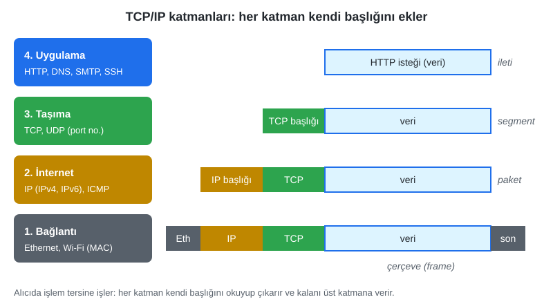

*Şekil 1.11. TCP/IP modelinde kapsülleme.*

> [!TIP]
> **Güncel hayattan:** Bir e-ticaret sitesinde "Sepete ekle" düğmesine basıldığında tarayıcı bir HTTP isteği hazırlar (uygulama), TCP bu isteği segmentlere böler ve numaralar (taşıma), IP her segmente sitenin sunucusunun adresini ekler (internet), Wi-Fi kartı ise paketleri radyo dalgalarıyla modeme iletir (bağlantı). Bu dört adım her tıklamada milisaniyeler içinde tamamlanır.

### 1.5.3 IP Adresleri: IPv4 ve IPv6

İnternet'e bağlı her arabirim, **IP adresi** adı verilen sayısal bir kimlikle tanımlanır [1, s. 22]. **IPv4** adresleri 32 bitlik sayılardır ve noktayla ayrılmış dört ondalık sayı olarak yazılır (ör. `192.0.2.10`); bu biçim yaklaşık 4,3 milyar (2³²) farklı adres sağlar [11]. İnternet'in beklenmedik büyümesi karşısında IANA'nın dağıtıma hazır IPv4 havuzu 3 Şubat 2011'de tükenmiştir [1, s. 22]. Çözüm, 128 bitlik adresler kullanan **IPv6**'dır (ör. `2001:db8::10`); 2¹²⁸ ≈ 3,4 × 10³⁸ adres, öngörülebilir her ihtiyacı karşılayacak büyüklüktedir [12]. Günümüzde iki sürüm bir arada kullanılmakta, birçok site ve mobil operatör IPv6'yı da desteklemektedir.

IPv4 adres sıkıntısının bir başka çözümü **özel (private) adres** bloklarıdır: `10.0.0.0/8`, `172.16.0.0/12` ve `192.168.0.0/16` aralıklarındaki adresler yalnızca yerel ağlarda kullanılır ve İnternet'te yönlendirilmez [13]. Evdeki ya da okuldaki bilgisayarın `192.168.1.34` gibi bir adres alması bundandır; dışarıya çıkan trafikte yönlendirici, NAT ile bu adresi kendi ortak (public) adresine çevirir. `127.0.0.1` (IPv6'da `::1`) ise her bilgisayarın kendisini gösteren **geri döngü (loopback)** adresidir; Kısım 1.13'te kullanılacak Live Server bu adres üzerinden çalışır.

*Tablo 1.4. IPv4 ile IPv6'nın karşılaştırılması.*

| Özellik | IPv4 | IPv6 |
|---|---|---|
| Adres uzunluğu | 32 bit | 128 bit |
| Yazım | `203.0.113.63` | `2001:db8:8090::63` |
| Adres sayısı | ≈ 4,3 milyar | ≈ 3,4 × 10³⁸ |
| DNS kaydı | `A` | `AAAA` |
| Not | Adresler tükendi; NAT yaygın | Her cihaza doğrudan adres verilebilir |

#### 🛠 Uygulama 1.1: Ağ Bağlantınızı Tanıyınız

**Amaç:** Bilgisayarın IP adresini, ağ geçidini ve bir siteye giden paketlerin izlediği yolu komut satırında gözlemlemek.  
**Tahmini süre:** 15 dk

1. VS Code'u açınız ve **Terminal → New Terminal** menüsüyle bir terminal açınız (Windows'ta PowerShell açılır).
2. `ipconfig` komutunu çalıştırınız. Kullandığınız bağlantının (Wi-Fi ya da Ethernet) **IPv4 Address**, **Subnet Mask** ve **Default Gateway** değerlerini not ediniz. Adresiniz özel bir bloktan mı (Kısım 1.5.3)?
3. `ping www.nku.edu.tr` komutunu çalıştırınız. Köşeli parantez içinde görünen IP adresini ve `time=` ile verilen gidiş-dönüş süresini not ediniz.
4. `tracert -d -h 15 www.nku.edu.tr` komutunu çalıştırınız. İlk satırdaki adresin 2. adımda bulduğunuz ağ geçidi olduğunu doğrulayınız. Kaç atlamada (hop) hedefe ulaşıldığını sayınız.
5. Aynı komutu yurt dışındaki bir site için (ör. `tracert -d -h 20 www.w3.org`) tekrarlayıp atlama sayılarını ve süreleri karşılaştırınız.

(macOS/Linux'ta `ipconfig` yerine `ip addr`, `tracert` yerine `traceroute -n` kullanılır.)

**Beklenen çıktı:** `ipconfig` çıktısında `192.168.x.x` ya da `10.x.x.x` biçiminde bir IPv4 adresi; `tracert` çıktısında birinci satırda ağ geçidi, son satırda hedef sunucunun adresi.

**Kendinizi sınayın:** (1) Bazı satırlarda `*` görülmesinin nedeni nedir? (2) Evden ve okuldan aldığınız `ipconfig` çıktıları neden farklıdır?

<details><summary>Örnek çözüm</summary>

Açıklamalı komutlar ve temsilî çıktılar: [`codes/01-internet-ve-web/uygulama-1-1-ag-komutlari/komutlar.md`](../codes/01-internet-ve-web/uygulama-1-1-ag-komutlari/komutlar.md)

</details>

## 1.6 Sayılarla İnternet

İnternet'in büyüklüğünü kavramanın bir yolu, kullanıcı ve cihaz sayılarına bakmaktır. Bu tür sayılar hızla eskidiğinden her zaman **tarihiyle ve kaynağıyla** birlikte okunmalıdır.

### 1.6.1 Cihaz Sayıları ve Büyüme Oranı

Cisco'nun Mart 2020'de yayımladığı *Annual Internet Report (2018–2023)*, ağa bağlı cihaz ve bağlantı sayısının 2018'deki 18,4 milyardan 2023'te 29,3 milyara çıkacağını öngörmüştür. Aynı rapora göre makineler arası (M2M) bağlantıların payı %33'ten %50'ye (14,7 milyar) yükselecek, mobil M2M bağlantıları ise 1,2 milyardan 4,4 milyara, yıllık yaklaşık %30 oranında büyüyecektir [14]. Bu rakamlar bir **öngörüdür**; yine de İnternet'in artık yalnızca insanların değil, sayaçların, araçların ve sensörlerin de ağı olduğunu açıkça gösterir.

Bu tür raporlarda sıkça geçen **CAGR (Compound Annual Growth Rate)**, Türkçede **bileşik yıllık büyüme oranı** olarak çevrilir. *n* yıllık bir dönemde başlangıç değeri *B*, bitiş değeri *S* olan bir büyüklük için

CAGR = (S / B)^(1/n) − 1

olarak hesaplanır. Cisco'nun cihaz öngörüsü için CAGR = (29,3 / 18,4)^(1/5) − 1 ≈ 0,10, yani her yıl ortalama **%10** büyüme bulunur; bu değer raporda verilen oranla örtüşür [14].

### 1.6.2 Kullanıcı Sayıları (2025–2026)

Uluslararası Telekomünikasyon Birliği'nin (ITU) Kasım 2025'te yayımladığı *Facts and Figures 2025* verilerine göre 2025'te dünyada yaklaşık **6 milyar** kişi, yani dünya nüfusunun yaklaşık **%74**'ü İnternet kullanmaktadır; yaklaşık **2,2 milyar** kişi ise hâlâ çevrim dışıdır. Kullanım oranı yüksek gelirli ülkelerde %94 iken düşük gelirli ülkelerde %23'te kalmakta; kentlerde %85, kırsalda %58'dir. Dünya genelinde 5G abonelik sayısının 3 milyara yaklaştığı tahmin edilmektedir [15]. Bu farklar, **dijital uçurum (digital divide)** olarak adlandırılır (Şekil 1.12).

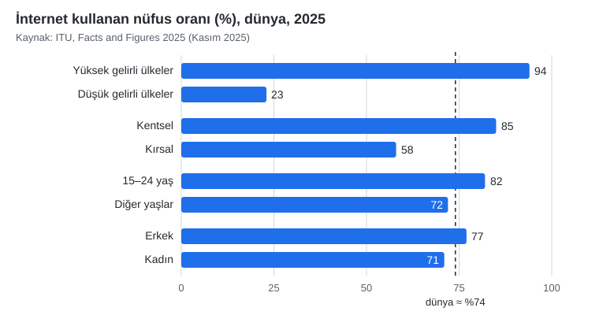

*Şekil 1.12. Dünyada gruplara göre İnternet kullanım oranları, 2025 (veri: ITU [15]).*

Türkiye'de TÜİK'in Ağustos 2026'da açıkladığı *Hanehalkı Bilişim Teknolojileri Kullanım Araştırması* sonuçlarına göre 16–74 yaş grubunda İnternet kullanım oranı 2025'teki %90,9'dan 2026'da **%92,3**'e yükselmiş; İnternet üzerinden mal veya hizmet satın alanların oranı %60'a ulaşmıştır [16]. Bir başka deyişle, bu dersi alan öğrencilerin geliştireceği sayfalar, nüfusun büyük çoğunluğunun her gün kullandığı bir ortama yayımlanacaktır.

### 1.6.3 İnternet'in Sektörel Yapısı ve Nesnelerin İnterneti

Cisco'nun 2011 tarihli bir çalışmasında İnternet'in geleceği, sektörlere ait ayrı ağların aşamalı olarak birleşmesi biçiminde resmedilmiştir: Ulaşım, enerji, eğitim, ev ve iş dünyası gibi alanlar önce kendi ağlarını kurar, sonra bu ağlar ortak protokollerle birbirine bağlanır ve en dışta güvenlik, veri analitiği ve yönetim katmanıyla sarmalanır [17] (Şekil 1.13). Bu birleşik yapıya **Nesnelerin İnterneti (Internet of Things, IoT)** denir.

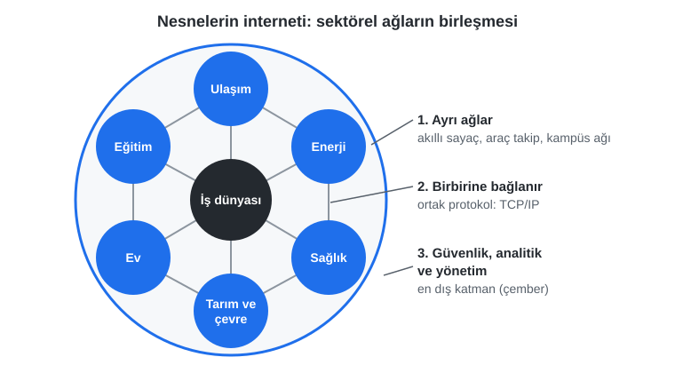

*Şekil 1.13. Nesnelerin interneti: sektörel ağların birleşmesi (Cisco IBSG, 2011 şeklinden uyarlanmıştır [17]).*

> [!TIP]
> **Güncel hayattan:** Akıllı elektrik sayaçları, kargo takip sistemleri, toplu taşımadaki "otobüs kaç dakikada gelir" ekranları, tarımda toprak nem sensörleri ve akıllı saatler IoT'nin gündelik örnekleridir. Bu cihazların topladığı veri çoğu zaman bir web paneli ya da mobil uygulama aracılığıyla kullanıcıya sunulur; yani IoT'nin "yüzü" de çoğunlukla Web teknolojileriyle yazılır.

## 1.7 İnternet Üzerindeki Temel Hizmetler

İnternet'e bağlı cihazlar arasında veri aktarmanın birçok yolu vardır; her biri kendine özgü bir uygulama katmanı protokolü kullanır. Bilgisayarlar arasında verinin hangi biçimde ve hangi sırayla aktarılacağını belirleyen bu standart yöntemlere **protokol** denir [1, s. 21].

- **World Wide Web (www):** Metinlerin ve diğer kaynakların birbirine **köprü bağlantılarla** bağlandığı (hypertext) belgelerden oluşan büyük bir ağdır. Web, **HTTP** protokolünü kullanır; belgeler **HTML** diliyle yazılır [1, s. 21].
- **E-posta:** İleti göndermek için SMTP, sunucudaki iletileri okumak için IMAP (ya da eski POP3) kullanılır. Bugün çoğu kullanıcı e-postaya web tabanlı bir arayüzle eriştiği hâlde, iletilerin sunucular arasında taşınması hâlâ SMTP ile yapılır.
- **Dosya aktarımı (FTP):** Dosyaları sunucuya yüklemek ve sunucudan indirmek için geliştirilmiş eski bir protokoldür. FTP parolaları şifrelemeden gönderdiği için günümüzde yerini SSH tabanlı **SFTP**'ye ya da HTTPS üzerinden çalışan yükleme araçlarına bırakmıştır.
- **Uzaktan erişim (SSH):** Sunucuya şifreli bir terminal bağlantısıyla bağlanmayı sağlar.
- **Ad çözümleme (DNS):** Alan adlarını IP adreslerine çevirir (Kısım 1.9).

Sunucu üzerinde aynı anda birden çok hizmet çalışabildiğinden, gelen paketin hangi hizmete ait olduğu **port numarasıyla** belirlenir (Tablo 1.5). IP adresi bir apartmanın adresine, port numarası ise daire numarasına benzetilebilir.

*Tablo 1.5. Yaygın İnternet hizmetleri ve varsayılan port numaraları.*

| Hizmet | Protokol | Taşıma | Varsayılan port |
|---|---|---|---|
| Web | HTTP | TCP | 80 |
| Güvenli web | HTTPS (HTTP + TLS) | TCP; HTTP/3'te UDP | 443 |
| Ad çözümleme | DNS | UDP (gerekirse TCP) | 53 |
| E-posta gönderimi | SMTP | TCP | 25 (sunucular arası), 587 (istemci gönderimi) |
| E-posta okuma | IMAP (TLS ile) | TCP | 993 |
| Dosya aktarımı | FTP / SFTP | TCP | 21 / 22 |
| Uzaktan erişim | SSH | TCP | 22 |

## 1.8 İstemci–Sunucu Mimarisi

### 1.8.1 Sunucu (Server)

"Sunucu" (server) sözcüğü, "hizmet etmek" anlamındaki *serve* fiilinin bilgisayar bilimine uyarlanmış hâlidir. **Sunucu**, ağdaki diğer bilgisayarlara önceden belirlenmiş bir ya da birden çok hizmeti sunan bilgisayar ya da yazılımdır; bu hizmeti alan cihaza **istemci (client)** denir [6, s. HTML 4]. Kesin konuşmak gerekirse sunucu, istekleri bekleyen ve yanıtlayan **yazılımdır**; ancak bu yazılımın çalıştığı bilgisayar için de aynı sözcük kullanılır [1, s. 22]. Bir bilgisayarın Web'in parçası olabilmesi için HTTP işlemlerini yürütebilen bir **web sunucusu yazılımı** çalıştırması gerekir; bu nedenle web sunucularına "HTTP sunucusu" da denir [1, s. 22]. Günümüzde yaygın web sunucusu yazılımları arasında **Nginx**, **Apache HTTP Server**, **Microsoft IIS** ve **Caddy** sayılabilir; JavaScript ile sunucu tarafı uygulama geliştirmek için ise **Node.js** gibi çalışma ortamları kullanılır.

Çok sayıda istemciye aynı anda hizmet verebilmek için sunucular, masaüstü bilgisayarlardan farklı donanım ve yazılımlarla çalışır. Tipik bir sunucu, 19 inçlik standart **kabinlere (rack)** yerleştirilen ince kasalarda (ör. 1U, yaklaşık 4,4 cm yüksekliğinde) bulunur ve kabinler **veri merkezlerinde** sıralar hâlinde durur. Sunucuların başlıca özellikleri şunlardır:

- 7 gün 24 saat kesintisiz çalışırlar; yedek güç kaynakları, kesintisiz güç kaynağı (UPS) ve jeneratörle desteklenirler.
- Sıcaklık ve nemi denetlenen, yangın söndürme, su baskını ve fiziksel erişim önlemleri alınmış veri merkezlerinde barındırılırlar.
- DNS kayıtlarının gösterebilmesi için **sabit (statik) IP adreslerine** sahiptirler; bulut ortamlarında bu görev çoğunlukla sabit IP'li yük dengeleyicilerce üstlenilir.
- Bir **sunucu işletim sistemi** çalıştırırlar. Günümüzde web sunucularının büyük çoğunluğu Ubuntu Server, Debian, Red Hat Enterprise Linux ya da AlmaLinux/Rocky Linux gibi **Linux** dağıtımlarında; kurumsal Microsoft ortamlarında ise **Windows Server 2025** gibi güncel sürümlerde çalışır. Solaris ve klasik Unix sistemleri ise artık daha çok tarihsel örneklerdir.
- Yüksek hızlı (çoğunlukla fiber) ağ bağlantılarına, çok çekirdekli işlemcilere, hata düzeltmeli (ECC) yüksek kapasiteli belleklere sahiptirler ve büyük veritabanlarını barındırabilirler.
- Diskler **RAID** gibi tekniklerle yedekli çalışır; bir disk arızalandığında veri kaybolmaz.
- Bir sunucu sorunla karşılaştığında ona bağlı birçok istemci etkilenir; bu nedenle kritik hizmetler birden çok sunucuya dağıtılır.

Bugün çoğu kurum fiziksel sunucularını tek tek yönetmek yerine **sanallaştırma** ve **bulut bilişim** hizmetlerinden yararlanır: Tek bir fiziksel makinede birçok sanal sunucu ya da kapsayıcı (container) çalışır; gereksinim arttığında yeni sunucular dakikalar içinde devreye alınabilir. Basit, durağan (statik) web siteleri ise GitHub Pages, Netlify ya da Cloudflare Pages gibi barındırma hizmetleriyle sunucu yönetmeye gerek kalmadan yayımlanabilir.

**İçerik dağıtım ağları (Content Delivery Network, CDN)**, bir sitenin görsel, video, stil ve betik gibi durağan dosyalarını dünyanın farklı bölgelerindeki **kenar sunuculara (edge server)** kopyalar. Kullanıcının isteği, coğrafi olarak kendisine en yakın kenar sunucudan yanıtlanır; böylece hem gecikme azalır hem de asıl sunucunun yükü hafifler. Büyük video platformları ve haber siteleri, milyonlarca kullanıcıya aynı anda bu yöntemle hizmet verir.

> [!TIP]
> **Güncel hayattan:** e-Devlet'te "4A Hizmet Dökümü" gibi bir belge sorgulandığında tarayıcı yalnızca bir istek gönderir; ancak arka planda web sunucusu, uygulama sunucusu ve ilgili kurumun veritabanı sunucusu birlikte çalışır. Kullanıcı bu zinciri görmez; yalnızca tarayıcısına gelen HTML yanıtını görür.

### 1.8.2 İstemci (Client)

Masaüstü ve dizüstü bilgisayarlar, tabletler, akıllı telefonlar, akıllı saat ve televizyonlar, yazar kasalar ve POS cihazları, bilgi kioskları, kart, parmak izi ya da yüz tanıma okuyucuları ve otomatik kontrol sistemlerine bağlı iletişim kurabilen tüm cihazlar **istemci** konumundadır. İstemciler bir veriyi ya da bir işlemin yapılmasını sunucudan talep eder. Bir istemcide sorun çıktığında genellikle yalnızca o cihaz etkilenir; diğer istemciler çalışmayı sürdürür.

Web'de istek gönderen yazılım, yani istemci, çoğunlukla bir **tarayıcıdır (browser)**; teknik belgelerde tarayıcıya **kullanıcı aracısı (user agent)** da denir [1, s. 23]. Ekran okuyucular gibi yardımcı teknolojiler de istemcinin bir parçasıdır; bu nedenle yazılan sayfaların görme, işitme ya da hareket kısıtı olan kullanıcılar dâhil herkes için erişilebilir olması gerekir [1, s. 23]. İşlemin istemcinin cihazında mı yoksa sunucuda mı yapıldığını belirtmek için **istemci tarafı (client-side)** ve **sunucu tarafı (server-side)** terimleri kullanılır: Tarayıcıda çalışan HTML, CSS ve JavaScript istemci tarafı; veritabanı sorgulayan ve sayfayı üreten programlar ise sunucu tarafıdır.

### 1.8.3 İki ve Üç Katmanlı Mimari

En yalın hâliyle Web, **iki katmanlı (two-tier)** bir istemci–sunucu sistemidir: Tarayıcı belgeleri ister, web sunucusu da bir belge deposu gibi bu belgeleri döndürür [2, ss. 16–17]. Sunucuya veritabanları ve uygulamalar eklendiğinde yapı **üç katmanlı (three-tier)** mimariye dönüşür: **İstemci katmanı** (tarayıcı) kullanıcı arayüzünü sunar; **işlem katmanı** (uygulama sunucusu) istekleri işler ve iş kurallarını uygular; **veri katmanı** ise verileri bir veritabanında saklar [2, ss. 17–18] (Şekil 1.14). İşlem ve veri katmanları aynı fiziksel bilgisayarda da bulunabilir; üç katman fiziksel değil, kavramsal bir ayrımdır.

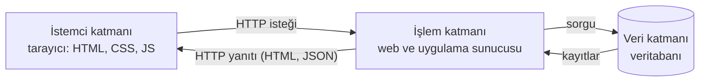

*Şekil 1.14. Üç katmanlı web mimarisi.*

> [!TIP]
> **Güncel hayattan:** Üniversitenin OBS'sinde not görüntülendiğinde tarayıcı (istemci katmanı) öğrenci numarasıyla bir istek gönderir; uygulama sunucusu (işlem katmanı) kullanıcının yetkisini denetler ve not ortalamasını hesaplar; veritabanı (veri katmanı) ise vize ve final notlarını saklar.

## 1.9 Alan Adları ve DNS

### 1.9.1 "Domain" Sözcüğünün İki Anlamı

İngilizce *domain* sözcüğünün sözlük anlamı "etki alanı, egemenlik alanı"dır; matematikte "tanım kümesi" karşılığında da kullanılır. Ağ teknolojilerinde bu sözcük iki farklı bağlamda karşımıza çıkar. Kurumsal yerel ağlarda **etki alanı (domain)**, kullanıcı hesaplarının, bilgisayarların ve güvenlik kurallarının merkezî olarak yönetildiği bir yönetim birimidir; örneğin Windows ağlarında Active Directory etki alanı sayesinde bir öğrenci, laboratuvardaki herhangi bir bilgisayarda aynı kullanıcı adı ve parolayla oturum açabilir. Birden çok etki alanı, aralarında kurulan güven ilişkileriyle birbirinin kullanıcılarını tanıyabilir. İnternet bağlamında ise *domain* sözcüğü **alan adı (domain name)** anlamında kullanılır; bu bölümün konusu bu ikinci anlamdır.

### 1.9.2 Alan Adı ve Hiyerarşisi

**Alan adı**, İnternet'te belirli bir sunucuya ya da hizmete erişimi kolaylaştıran, insanların okuyup hatırlayabileceği benzersiz bir addır. Bilgisayarlar birbirini IP adresleriyle bulur; ancak `193.255.68.63` gibi sayıları akılda tutmak zordur. **DNS (Domain Name System, Alan Adı Sistemi)**, alan adlarını ilgili IP adreslerine çeviren dağıtık bir veritabanıdır [18]. Bu nedenle DNS'e sıklıkla "İnternet'in telefon rehberi" benzetmesi yapılır. Bir sunucu, birden çok alan adına hizmet verecek biçimde de yapılandırılabilir; böylece birçok site aynı sunucuyu paylaşabilir [1, s. 22].

Alan adları, en üstünde **kök (root)** bulunan ağaç biçiminde bir ad alanında düzenlenir (Şekil 1.15). Kökün altında `com`, `org`, `net` gibi genel ve `tr`, `de`, `jp` gibi ülke kodlu **üst düzey alan adları (Top-Level Domain, TLD)** yer alır. `edu.tr`, `com.tr`, `gov.tr` ikinci düzey; `nku.edu.tr` ise kuruma ait alan adıdır. Alan adının sahibi, kendi alanının altında istediği **ana makine adlarını (host name)** ya da alt alan adlarını (`www`, `obs`, `mail`) tanımlayabilir. `www` öneki bir kural değil, bir gelenektir [1, s. 24]. Alan adları sağdan sola, genelden özele doğru okunur.

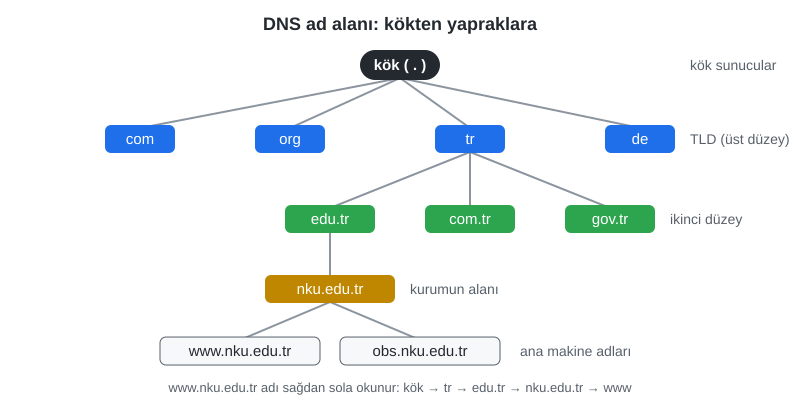

*Şekil 1.15. DNS ad alanının ağaç yapısı.*

### 1.9.3 Alan Adlarının Yönetimi: ICANN, Kayıt Operatörleri ve Kayıt Kuruluşları

Alan adı sisteminin küresel koordinasyonu, kâr amacı gütmeyen **ICANN (Internet Corporation for Assigned Names and Numbers)** tarafından yürütülür. ICANN, IANA işlevleri aracılığıyla kök bölgenin (root zone) yönetimini ve IP adresi bloklarının bölgesel kayıt kuruluşlarına dağıtımını koordine eder. Her üst düzey alan adının veritabanını bir **kayıt operatörü (registry)** işletir; son kullanıcıya alan adı satışı ise ICANN'in ya da ilgili kayıt operatörünün yetkilendirdiği **kayıt kuruluşları (registrar)** üzerinden yapılır.

Alan adları satın alınmaz, belirli bir süre için **kiralanır**. `.com` gibi genel üst düzey alan adlarında kayıt bir yıllık dilimlerle yapılır ve bir alan adının kalan kayıt süresi hiçbir anda **10 yılı aşamaz**; süre bitmeden yenilenmeyen alan adı, bekleme sürelerinin ardından yeniden kayda açılır. Türkiye'nin ülke kodu olan `.tr` uzantılı alan adları ise 1991'den bu yana ODTÜ bünyesindeki nic.tr tarafından yönetilmiş; 14 Eylül 2022'den itibaren Bilgi Teknolojileri ve İletişim Kurumu (BTK) bünyesindeki **TRABİS (.tr Ağ Bilgi Sistemi)** üzerinden, yetkilendirilmiş kayıt kuruluşları aracılığıyla tahsis edilmektedir [19]. `edu.tr` gibi bazı uzantılar yalnızca belge sunan kurumlara (bu örnekte yükseköğretim kurumlarına) verilir.

Alan adı kiralandıktan sonra, alan adının hangi IP adresine karşılık geldiği DNS kayıtları olarak sisteme girilir. Bu kayıtlar, alan adının **yetkili ad sunucularında (authoritative name server)** tutulur ve Tablo 1.6'daki türlerden oluşur.

*Tablo 1.6. Sık kullanılan DNS kayıt türleri.*

| Kayıt | Anlamı | Örnek |
|---|---|---|
| `A` | Adın IPv4 adresi | `www.nku.edu.tr → 193.255.68.63` |
| `AAAA` | Adın IPv6 adresi | `www.nku.edu.tr → 2001:a98:8090:0:193:255:68:63` |
| `CNAME` | Takma ad: başka bir ada yönlendirme | `www.example.com → example.cdn-saglayici.net` |
| `MX` | Alanın e-postasını kabul eden sunucular | `nku.edu.tr → (e-posta sunucusu adı)` |
| `NS` | Alanın yetkili ad sunucuları | `nku.edu.tr → (ad sunucusu adları)` |
| `TXT` | Serbest metin; alan doğrulama, e-posta güvenliği (SPF) | `"v=spf1 ..."` |

### 1.9.4 DNS Çözümleme Adımları

DNS'in temel görevi, alan adı olarak yazılan ifadeyi IP adresine çevirmektir; çevrilen IP adresi çoğunlukla bir web sunucusuna aittir. Bu çeviri işlemine **ad çözümleme (name resolution)** denir ve hiyerarşik olarak gerçekleşir [18], [20]. Tarayıcıya `www.nku.edu.tr` yazıldığında süreç şöyle işler (Şekil 1.16):

1. Tarayıcı ve işletim sistemi önce kendi **önbelleklerine** bakar; ad yakın zamanda çözümlendiyse yanıt hemen kullanılır.
2. Önbellekte yoksa soru, ağ ayarlarında tanımlı **özyinelemeli çözümleyiciye (recursive resolver)** gönderilir. Bu çözümleyici çoğunlukla İnternet servis sağlayıcısının, kurumun ya da `1.1.1.1`, `8.8.8.8`, `9.9.9.9` gibi ortak bir hizmetin DNS sunucusudur. Çözümleyicinin kendi önbelleğinde yanıt varsa hemen döndürülür.
3. Yoksa çözümleyici **kök sunuculardan** birine sorar. Kök sunucu yanıtı bilmez; ancak `tr` alanından sorumlu sunucuların adreslerini verir. Kök sunucular `a`'dan `m`'ye kadar 13 adla tanımlanır; her biri dünyaya dağılmış çok sayıda kopyadan (anycast) oluşur [21].
4. Çözümleyici **TLD sunucusuna** (`tr`) sorar; bu sunucu da `nku.edu.tr` alanının yetkili ad sunucularını bildirir.
5. Çözümleyici **yetkili ad sunucusuna** sorar ve kesin yanıtı (`A` kaydı: `193.255.68.63`) alır.
6. Çözümleyici yanıtı istemciye döndürür ve kaydın **TTL (Time To Live, yaşam süresi)** değeri kadar önbellekte saklar. Aynı adı soran sonraki kullanıcılar yanıtı doğrudan önbellekten alır.

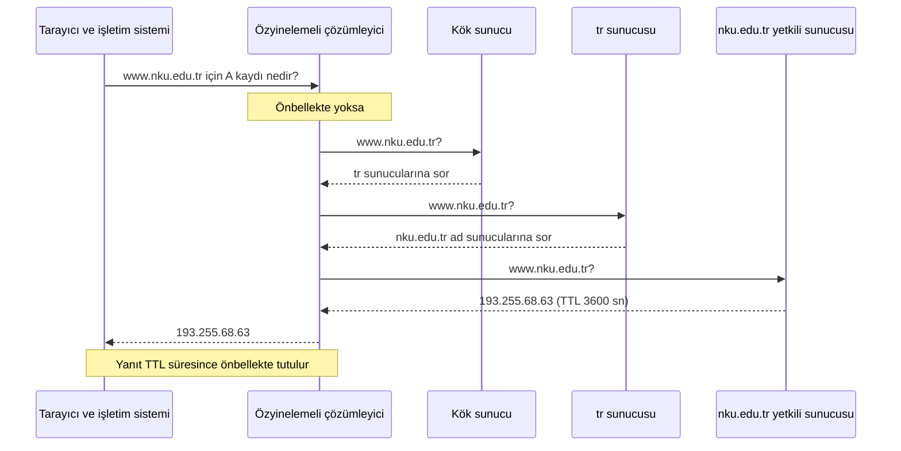

*Şekil 1.16. `www.nku.edu.tr` adının özyinelemeli çözümleyici aracılığıyla çözümlenmesi.*

**TTL ve "24 saatte yayılma" ifadesi:** Alan adı ayarları değiştirildiğinde sıkça "değişikliğin dünya çapında yayılması 24 saati (bazen 48 saati) bulabilir" denir. Gerçekte DNS'te değişikliği bir yerden bir yere "yayan" bir mekanizma yoktur. Her DNS kaydının bir TTL değeri vardır ve çözümleyiciler bir yanıtı bu süre boyunca önbellekte tutar. Bir kayıt değiştirildiğinde yetkili sunucu yeni değeri hemen vermeye başlar; ancak eski yanıtı önbelleğine almış çözümleyiciler, TTL süresi dolana kadar eski değeri kullanmayı sürdürür. Örneğin TTL değeri 86400 saniye (24 saat) olan bir kayıt değiştirildiğinde, bazı kullanıcılar en fazla 24 saat boyunca eski adrese yönlendirilebilir. Ad sunucusu (NS) değişikliklerinde ise üst alanın (ör. TLD) yetki devri kayıtlarının TTL'si de devreye girdiğinden bu süre 48 saate kadar uzayabilir. Bu nedenle sistem yöneticileri, planlı bir taşımadan birkaç gün önce TTL değerini düşürür (ör. 300 saniye), değişiklik tamamlanınca yeniden yükseltir. Hiç önbelleğe alınmamış yeni bir alan adı ise çoğunlukla kayıttan kısa süre sonra çalışmaya başlar.

> [!WARNING]
> DNS sorguları geleneksel olarak şifresiz gönderildiğinden aynı ağdaki biri, hangi sitelerin ziyaret edildiğini görebilir ya da sahte yanıtlar enjekte etmeye çalışabilir. Güncel tarayıcı ve işletim sistemleri bu riske karşı **DNS over HTTPS (DoH)** gibi şifreli DNS seçenekleri sunar; yanıtların doğruluğu ise **DNSSEC** imzalarıyla denetlenebilir.

#### 🛠 Uygulama 1.2: Bir Alan Adının IP Adresini Bulunuz

**Amaç:** DNS kayıtlarını komut satırında sorgulamak; A, AAAA, MX ve NS kayıtlarını ve TTL değerini gözlemlemek.  
**Tahmini süre:** 15 dk

1. VS Code'da bir terminal açınız (PowerShell).
2. `Resolve-DnsName www.nku.edu.tr` komutunu çalıştırınız. Çıktıdaki `A` ve `AAAA` kayıtlarını ve `TTL` sütununu not ediniz.
3. Aynı sorguyu `nslookup www.nku.edu.tr` ile yapınız. Çıktının başındaki `Server:` satırının neyi gösterdiğini açıklayınız. "Non-authoritative answer" ifadesi neden görülmektedir?
4. `Resolve-DnsName nku.edu.tr -Type MX` ve `Resolve-DnsName nku.edu.tr -Type NS` komutlarıyla üniversitenin e-posta sunucularını ve yetkili ad sunucularını listeleyiniz.
5. `Resolve-DnsName www.nku.edu.tr -Server 1.1.1.1` komutuyla aynı adı farklı bir çözümleyiciye sorunuz ve yanıtları karşılaştırınız. (Bazı kurum ağları dış çözümleyicilere erişimi engeller; bu durumda sorgu zaman aşımına uğrar. Bu adımı ev bağlantısında deneyebilirsiniz.)

(macOS/Linux'ta `nslookup` aynı biçimde çalışır; ayrıca `dig www.nku.edu.tr` komutu kullanılabilir.)

**Beklenen çıktı:** `www.nku.edu.tr` için bir IPv4 (`A`) ve bir IPv6 (`AAAA`) adresi; TTL sütununda saniye cinsinden bir değer (ör. 3600).

**Kendinizi sınayın:** (1) Komutu art arda iki kez çalıştırdığınızda TTL değeri değişiyor mu? Neden? (2) `www.w3.org` adı için bir `CNAME` kaydı var mı?

<details><summary>Örnek çözüm</summary>

Açıklamalı komutlar ve örnek çıktılar: [`codes/01-internet-ve-web/uygulama-1-2-dns-sorgulari/komutlar.md`](../codes/01-internet-ve-web/uygulama-1-2-dns-sorgulari/komutlar.md)

</details>

## 1.10 URL ve HTTP: Web'in Adresleme ve İletişim Kuralları

### 1.10.1 URL'nin Anatomisi

Web'deki her sayfa ve kaynağın kendine özgü bir adresi, yani bir **URL**'si vardır [1, s. 24]. URL, daha genel bir kavram olan **URI (Uniform Resource Identifier, Tekdüzen Kaynak Tanımlayıcısı)**'nın bir türüdür [2, s. 3]. URI'nin genel sözdizimi RFC 3986'da tanımlanmıştır [22]; tarayıcıların adresleri fiilen nasıl ayrıştırdığı ise WHATWG URL Standardı'nda belirlenir [23]. Bir URL'nin bileşenleri Şekil 1.17'de gösterilmiştir:

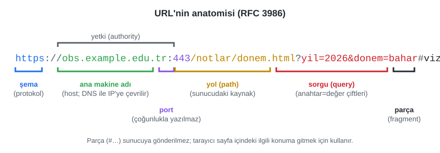

*Şekil 1.17. Bir URL'nin bileşenleri.*

- **Şema (scheme):** Kaynağa hangi protokolle erişileceğini belirtir: `https`, `http`, `ftp`, `mailto`, `file` gibi. Ardından gelen `://` ayırıcısıyla ayrılır.
- **Yetki (authority):** Ana makine adı ve isteğe bağlı port numarasından oluşur. **Ana makine adı (host)** DNS ile IP adresine çevrilir. **Port** belirtilmezse şemanın varsayılan portu kullanılır (`http` için 80, `https` için 443); bu nedenle port numarası çoğu adreste yazılmaz.
- **Yol (path):** Sunucudaki kaynağın konumunu gösterir. Eğik çizgiyle ayrılan bölümler, geleneksel olarak sunucudaki klasörleri izler; bu gelenek İnternet'in ilk bilgisayarlarının Unix kurallarından gelir [1, ss. 24–25]. Yol bir dosya adı içermiyorsa, sunucu o klasördeki **varsayılan belgeyi** (çoğunlukla `index.html`) döndürür [1, s. 25]. Günümüzde yollar her zaman gerçek bir dosyaya karşılık gelmez; sunucu tarafı uygulama, yolu yorumlayarak içeriği o anda üretebilir.
- **Sorgu (query):** `?` işaretinden sonra gelen, `&` ile ayrılmış `anahtar=değer` çiftleridir. Arama terimleri ve filtreler genellikle sorguyla iletilir (ör. bir e-ticaret sitesinde `?kategori=kitap&sirala=fiyat`).
- **Parça (fragment):** `#` işaretinden sonra gelir ve sayfa içindeki bir konumu gösterir. Parça **sunucuya gönderilmez**; tarayıcı tarafından kullanılır.

Tarayıcılar, adres çubuğuna şema yazılmadığında kullanıcıya kolaylık olsun diye şemayı kendisi ekler; güncel tarayıcılar bu durumda öncelikle `https://` dener. Ancak HTML belgesinde başka bir sunucudaki sayfaya bağlantı verilirken şemanın açıkça yazılması gerekir [1, s. 24]. Bağlantı ve göreli/mutlak yol konusu [Bölüm 2](02-html-temelleri.md)'de ayrıntılı olarak ele alınacaktır.

> [!IMPORTANT]
> URL'lerde boşluk ve Türkçe karakterler doğrudan kullanılmaz; tarayıcı bunları **yüzde kodlaması (percent-encoding)** ile dönüştürür (ör. boşluk → `%20`, `ş` → `%C5%9F`). Bu nedenle web projelerinde dosya ve klasör adları küçük harfle, Türkçe karakter ve boşluk içermeden, kelimeler `-` ile ayrılarak verilir (ör. `iletisim-formu.html`).

#### 🛠 Uygulama 1.3: Bir URL'yi Parçalarına Ayırınız

**Amaç:** URL bileşenlerini önce elle, sonra tarayıcının yerleşik `URL` nesnesini kullanan bir sayfayla belirlemek.  
**Tahmini süre:** 15 dk

1. Aşağıdaki adresi kâğıt üzerinde şema, ana makine, port, yol, sorgu ve parça olarak ayırınız:
   `https://www.example.com.tr:8443/magaza/urunler/ara?kelime=klavye&renk=siyah&sayfa=2#yorumlar`
2. [`codes/01-internet-ve-web/uygulama-1-3-url-parcalayici/`](../codes/01-internet-ve-web/uygulama-1-3-url-parcalayici/index.html) klasörünü VS Code'da açınız ve `index.html` dosyasını tarayıcıda açınız.
3. 1. adımdaki adresi kutuya yapıştırıp **Parçala** düğmesine basınız; tablo ile kendi çözümünüzü karşılaştırınız.
4. Sayfa ilk açıldığında gelen örnek adreste port `443` olarak yazıldığı hâlde tablonun port satırında neden boş göründüğünü açıklayınız.
5. Şeması olmayan bir adres (ör. `www.nku.edu.tr`) giriniz ve sonucu yorumlayınız.

**Beklenen çıktı:**

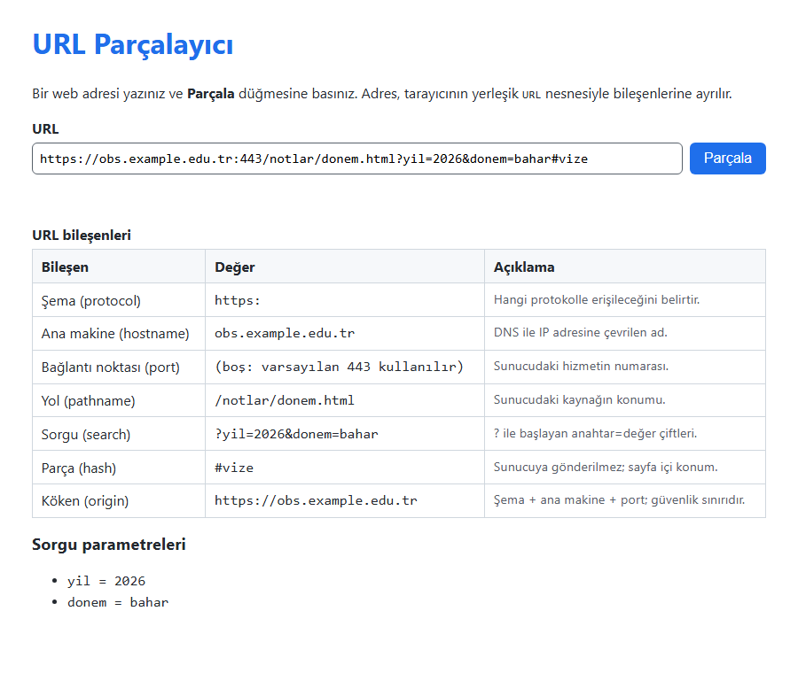

*Şekil 1.18. Uygulama 1.3'ün beklenen ekran görüntüsü.*

**Kendinizi sınayın:** (1) `https://obs.example.edu.tr/` ile `https://obs.example.edu.tr:8443/` adreslerinin **köken (origin)** değerleri aynı mıdır? (2) Sorgu dizgesine `ad=Ayşe Yılmaz` yazıldığında tarayıcı bunu nasıl kodlar?

<details><summary>Örnek çözüm</summary>

Çözüm dosyaları: [`codes/01-internet-ve-web/uygulama-1-3-url-parcalayici/`](../codes/01-internet-ve-web/uygulama-1-3-url-parcalayici/index.html) (`index.html`, `style.css`, `script.js`). 1. adımın cevabı: şema `https`, ana makine `www.example.com.tr`, port `8443`, yol `/magaza/urunler/ara`, sorgu `kelime=klavye&renk=siyah&sayfa=2`, parça `yorumlar`. 4. adım: Varsayılan port (`https` için 443) yazılsa bile URL standardı onu adresten çıkarır; `URL` nesnesi bu durumda boş dizge döndürür. 5. adım: Şemasız bir dizge mutlak URL sayılmaz; `URL` nesnesi hata verir.

</details>

### 1.10.2 HTTP İstek ve Yanıtının Yapısı

HTTP, istemci ile sunucu arasındaki konuşmanın kurallarını belirleyen, **durumsuz (stateless)** bir istek–yanıt protokolüdür: Her istek kendi başına değerlendirilir ve sunucu, aksi sağlanmadıkça önceki istekleri hatırlamaz [24]. Oturum açmış kullanıcının tanınması gibi durum bilgisi, çerezler (cookie) gibi ek mekanizmalarla taşınır. HTTP yalnızca HTML belgelerini değil; görselleri, videoları, ses dosyalarını, betikleri ve verileri de aktarır [1, s. 23].

HTTP/1.1'de bir istek; **yöntem**, **hedef yol** ve **sürüm** bilgisini içeren bir istek satırı, ardından **başlık alanları (header fields)** ve isteğe bağlı bir **gövdeden (body)** oluşur [25]. Kod 1.1, bir tarayıcının gönderdiği tipik bir isteği göstermektedir.

*Kod 1.1. Bir HTTP/1.1 isteği.*

```http
GET /notlar/donem.html?yil=2026 HTTP/1.1
Host: obs.example.edu.tr
User-Agent: Mozilla/5.0 (Windows NT 10.0; Win64; x64) ...
Accept: text/html
Accept-Language: tr-TR,tr;q=0.9,en;q=0.8
```

`Host` başlığı, aynı IP adresinde birden çok site barındırılabildiği için hangi sitenin istendiğini belirtir. `Accept-Language` başlığı, tarayıcının tercih ettiği dili bildirir; çok dilli siteler bu bilgiye göre Türkçe ya da İngilizce içerik döndürebilir. Sunucunun yanıtı ise bir **durum satırı**, başlıklar, boş bir satır ve gövdeden oluşur (Kod 1.2).

*Kod 1.2. Bir HTTP/1.1 yanıtı.*

```http
HTTP/1.1 200 OK
Date: Mon, 02 Nov 2026 09:30:00 GMT
Content-Type: text/html; charset=utf-8
Content-Length: 1534
Cache-Control: max-age=600

<!DOCTYPE html>
<html lang="tr">
...
```

`Content-Type` başlığı gövdenin türünü (**MIME türü**) ve karakter kodlamasını bildirir; tarayıcı gövdeyi HTML olarak mı, görsel olarak mı işleyeceğine bu başlığa bakarak karar verir. `Cache-Control` ise yanıtın tarayıcı önbelleğinde ne kadar süre (burada 600 saniye) yeniden kullanılabileceğini belirtir.

İstek satırındaki **yöntem (method)**, istemcinin kaynak üzerinde ne yapmak istediğini bildirir (Tablo 1.7) [24].

*Tablo 1.7. Yaygın HTTP yöntemleri.*

| Yöntem | Anlamı | Örnek |
|---|---|---|
| `GET` | Kaynağı getir (yalnızca okuma) | Bir haber sayfasını açmak |
| `POST` | Sunucuya veri gönder; yeni kayıt ya da işlem | Giriş formu, sipariş vermek |
| `PUT` / `PATCH` | Kaynağı tamamen / kısmen güncelle | Profil bilgilerini değiştirmek |
| `DELETE` | Kaynağı sil | Sepetten ürün çıkarmak (API üzerinden) |
| `HEAD` | Yalnızca başlıkları getir, gövdeyi getirme | Bir dosyanın boyutunu öğrenmek |

> [!WARNING]
> `GET` isteğinde veriler URL'nin sorgu kısmında taşındığı için tarayıcı geçmişinde, sunucu kayıtlarında ve paylaşılan bağlantılarda görünür. Parola, T.C. kimlik numarası gibi hassas veriler formlarda **`POST`** yöntemiyle ve yalnızca **HTTPS** üzerinden gönderilmelidir. Formlar [Bölüm 3](03-html-tablo-form-medya.md)'te ele alınacaktır.

### 1.10.3 HTTP Durum Kodları

Yanıtın ilk satırındaki üç basamaklı **durum kodu (status code)**, isteğin sonucunu bildirir. İlk basamak kodun sınıfını belirler (Tablo 1.8) [24], [26]. Sunucu istenen dosyayı bulamazsa en bilinen hata kodu olan **404 Not Found** döner [1, s. 30].

*Tablo 1.8. HTTP durum kodu sınıfları ve sık görülen kodlar.*

| Sınıf | Anlamı | Sık görülen kodlar |
|---|---|---|
| 1xx | Bilgilendirme | `101 Switching Protocols` |
| 2xx | Başarılı | `200 OK`, `201 Created`, `204 No Content` |
| 3xx | Yönlendirme | `301 Moved Permanently`, `302 Found`, `304 Not Modified` |
| 4xx | İstemci hatası | `400 Bad Request`, `401 Unauthorized`, `403 Forbidden`, `404 Not Found`, `429 Too Many Requests` |
| 5xx | Sunucu hatası | `500 Internal Server Error`, `502 Bad Gateway`, `503 Service Unavailable` |

> [!TIP]
> **Güncel hayattan:** Bir sitenin eski adresi (`http://...`) yazıldığında tarayıcının kendiliğinden `https://...` adresine geçmesi genellikle bir `301` yönlendirmesidir. Yoğun indirim günlerinde e-ticaret sitelerinde görülen "Şu anda hizmet veremiyoruz" sayfaları çoğu zaman `503`, çok sık istek gönderen istemcilere dönen yanıtlar ise `429` kodludur.

### 1.10.4 HTTPS ve TLS

Düz HTTP'de istek ve yanıtlar şifrelenmeden taşındığından aynı ağdaki (ör. ortak bir Wi-Fi ağındaki) biri trafiği okuyabilir ya da değiştirebilir. **HTTPS**, HTTP trafiğini **TLS (Transport Layer Security)** protokolüyle şifreler. TLS üç güvence sağlar: **gizlilik** (iletinin içeriğini yalnızca uç taraflar okuyabilir), **bütünlük** (iletinin yolda değiştirilmediği doğrulanır) ve **kimlik doğrulama** (sunucunun gerçekten iddia ettiği site olduğu, güvenilir bir sertifika otoritesinin imzaladığı **dijital sertifika** ile kanıtlanır) [27]. Güncel sürüm 2018'de yayımlanan TLS 1.3'tür; eski SSL ve TLS 1.0/1.1 sürümleri güvensiz kabul edilerek kullanımdan kaldırılmıştır. Ücretsiz sertifika sağlayan hizmetlerin yaygınlaşmasıyla bugün Web trafiğinin büyük çoğunluğu HTTPS ile taşınmaktadır; tarayıcılar HTTP ile açılan sayfaları "Güvenli değil" olarak işaretler.

> [!WARNING]
> Adres çubuğundaki kilit simgesi yalnızca bağlantının şifreli olduğunu ve sertifikanın o alan adına ait olduğunu gösterir; sitenin **güvenilir** olduğunu göstermez. Dolandırıcılık amaçlı sahte siteler de HTTPS kullanabilir. Banka ve e-Devlet gibi sitelerde alan adının doğru yazıldığı (ör. `turkiye.gov.tr`) mutlaka kontrol edilmelidir.

### 1.10.5 HTTP'nin Evrimi: HTTP/1.1'den HTTP/3'e

HTTP'nin ilk sürümü (1991'de kullanılan ve sonradan HTTP/0.9 diye anılan sürüm) yalnızca `GET` yöntemini destekleyen tek satırlık bir protokoldü. 1996'da HTTP/1.0 ile başlıklar ve durum kodları, 1997'de **HTTP/1.1** ile kalıcı bağlantılar ve zorunlu `Host` başlığı geldi. HTTP/1.1 metin tabanlıdır ve bir bağlantı üzerinden aynı anda tek bir istek–yanıt yürütür; bu yüzden tarayıcılar bir sayfanın onlarca kaynağını indirmek için birden çok paralel bağlantı açmak zorunda kalıyordu.

2015'te yayımlanan **HTTP/2**, aynı anlamı (yöntemler, başlıklar, durum kodları) korurken iletileri ikili (binary) çerçevelere böler ve tek bir TCP bağlantısı üzerinde çok sayıda isteği eş zamanlı yürütür (**çoğullama, multiplexing**); başlıkları da sıkıştırır [28]. Ancak TCP, kaybolan bir paket yeniden gönderilinceye kadar arkasındaki tüm verileri bekletir; bu durum bütün akışları yavaşlatabilir.

2022'de standartlaşan **HTTP/3**, bu sorunu çözmek için TCP yerine UDP üzerinde çalışan **QUIC** protokolünü kullanır [29], [30]. QUIC, TLS 1.3'ü kendi içinde barındırır; bağlantı kurulumu daha az gidiş-dönüş gerektirir, kaybolan bir paket yalnızca ait olduğu akışı etkiler ve telefon Wi-Fi'dan mobil ağa geçtiğinde bağlantı kopmadan sürebilir. Üç sürüm de aynı HTTP anlam modelini paylaştığından [24], web geliştiricisinin yazdığı HTML, CSS ve JavaScript sürümden bağımsız olarak aynı biçimde çalışır; sürüm seçimini tarayıcı ve sunucu kendi aralarında yapar (Şekil 1.19).

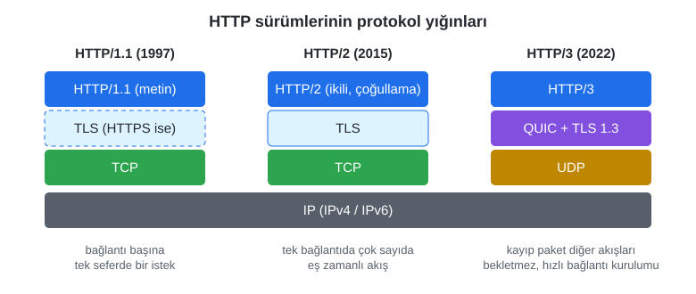

*Şekil 1.19. HTTP sürümlerinin protokol yığınları.*

#### 🛠 Uygulama 1.4: Tarayıcı Geliştirici Araçlarıyla İstekleri İnceleyiniz

**Amaç:** Bir sayfa açılırken gönderilen istekleri, durum kodlarını, başlıkları ve kullanılan HTTP sürümünü tarayıcının **Network** (Ağ) panelinde gözlemlemek.  
**Tahmini süre:** 20 dk

1. Chrome ya da Edge'de `https://www.nku.edu.tr` adresini açınız. **F12** tuşuyla geliştirici araçlarını (DevTools) açıp **Network** sekmesine geçiniz; **Disable cache** kutusunu işaretleyip sayfayı **F5** ile yenileyiniz.
2. Listede kaç istek gönderildiğini (alt bilgi çubuğundaki *requests* sayısı) ve toplam aktarılan veri miktarını not ediniz.
3. Sütun başlıklarına sağ tıklayıp **Protocol** sütununu ekleyiniz. `h2` (HTTP/2) ve `h3` (HTTP/3) değerlerini arayınız.
4. Listedeki ilk isteğe (HTML belgesi) tıklayınız. **Headers** sekmesinde *Request Method*, *Status Code*, *Remote Address* değerlerini ve yanıt başlıklarından `content-type` ile `cache-control` değerlerini bulunuz.
5. [`codes/01-internet-ve-web/uygulama-1-4-ag-incelemesi/`](../codes/01-internet-ve-web/uygulama-1-4-ag-incelemesi/index.html) klasörünü VS Code'da açınız, `index.html` dosyasına sağ tıklayıp **Open with Live Server** ile açınız. Network panelinde `ek-bilgi.html` için `200`, `olmayan-sayfa.html` için `404` durum kodunu gözlemleyiniz.
6. Sayfayı yeniden yükleyiniz (önbellek kutusu işaretsizken) ve `style.css` gibi dosyalar için `304 Not Modified` görülüp görülmediğini kontrol ediniz.

**Beklenen çıktı:**

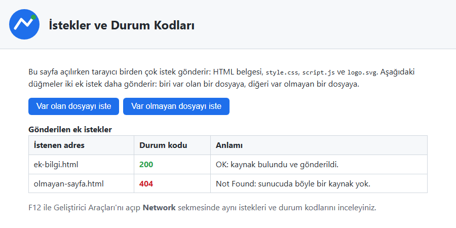

*Şekil 1.20. Uygulama 1.4'ün Live Server ile açıldığında beklenen ekran görüntüsü.*

**Kendinizi sınayın:** (1) Aynı sayfayı `file://` ile (dosyaya çift tıklayarak) açtığınızda tablo neden dolmaz? (2) 1. adımdaki sitede `content-type` değeri `text/css` olan istekleri filtreleyerek sayınız (Network panelindeki **CSS** filtresi).

<details><summary>Örnek çözüm</summary>

Çözüm dosyaları: [`codes/01-internet-ve-web/uygulama-1-4-ag-incelemesi/`](../codes/01-internet-ve-web/uygulama-1-4-ag-incelemesi/index.html). Sayfa bir sunucu üzerinden açıldığında `fetch` ile iki ek istek gönderir ve dönen durum kodlarını `textContent` ile tabloya yazar. `file://` ile açıldığında arada HTTP sunucusu olmadığı için durum kodu da yoktur; tarayıcı güvenlik nedeniyle bu tür istekleri engeller ve sayfa bir uyarı gösterir.

</details>

## 1.11 Adres Çubuğundan Ekrana: Bir Web Sayfası Nasıl Açılır?

Önceki kısımlarda ele alınan kavramlar, bir web sayfası her açıldığında birkaç yüz milisaniye içinde birlikte çalışır. `https://www.nku.edu.tr/` adresi yazılıp Enter tuşuna basıldığında olan bitenler Şekil 1.21'de özetlenmiştir [1, s. 30], [31].

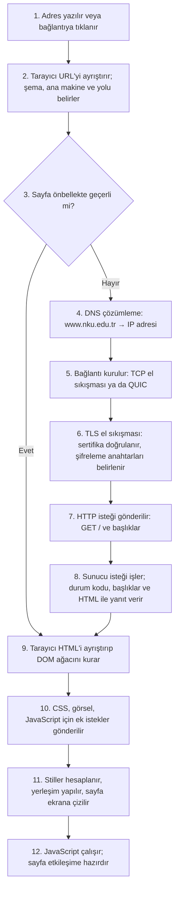

*Şekil 1.21. Adres çubuğundan ekrana: bir web sayfasının açılma adımları.*

Ağ tarafındaki adımlar (DNS, bağlantı kurulumu, TLS ve HTTP) önceki kısımlarda ele alınmıştır; sunucuya 443 numaralı port üzerinden HTTP/1.1 ve HTTP/2 için TCP, HTTP/3 için QUIC bağlantısı açılır. Yanıt geldikten sonra iş tarayıcıya geçer. Tarayıcı HTML'i baştan sona okuyarak (**ayrıştırma, parsing**) sayfanın ağaç biçimindeki modelini, yani **DOM (Document Object Model)**'u kurar ve HTML'de bağlantısı verilen stil dosyası, görsel ve betik gibi her kaynak için yeni istekler gönderir [1, s. 28]. Ardından CSS kuralları DOM öğelerine uygulanır, her öğenin boyutu ve konumu hesaplanır (**yerleşim, layout**) ve sayfa piksellere dönüştürülerek ekrana çizilir (**boyama, paint**) [31]. Son olarak JavaScript kodu çalışır ve sayfa tıklama, kaydırma ve yazma gibi kullanıcı olaylarına yanıt verir hâle gelir.

**Tarayıcının rolü:** Bu süreçte tarayıcı yalnızca bir "görüntüleyici" değil; DNS istemcisi, HTTP istemcisi, güvenlik denetçisi, HTML ayrıştırıcısı, CSS motoru ve JavaScript çalışma ortamıdır. HTML ve CSS'i okuyup biçimlendirilmiş içeriği ekrana çizen bileşene **görüntüleme motoru (rendering engine)** denir [8, s. 12]. Günümüzde Chrome, Edge ve Opera **Blink**, Firefox **Gecko**, Safari ise **WebKit** motorunu kullanır. Motorlar standartları büyük ölçüde aynı biçimde uyguladığından sayfalar çoğunlukla benzer görünür; yine de geliştirilen sayfaların birden fazla tarayıcıda ve farklı ekran boyutlarında denenmesi gerekir [8, s. 12].

> [!TIP]
> **Güncel hayattan:** Bir haber sitesinin ana sayfası açıldığında Network panelinde yüzün üzerinde istek görmek olağandır: HTML belgesi, birkaç stil dosyası, onlarca görsel, yazı tipleri, betikler ve reklam/ölçüm hizmetlerine giden istekler. Sayfanın hızlı açılması, bu isteklerin sayısının ve boyutunun azaltılmasına bağlıdır; bu konu [Bölüm 9](09-duyarli-tasarim.md)'da geliştirici araçlarıyla birlikte yeniden ele alınacaktır.

## 1.12 Web Tasarımı ve Web Sayfasının Anatomisi

### 1.12.1 Web Tasarımının Disiplinleri

"Web tasarımı" terimi, yıllar içinde birçok farklı disiplini kapsayan bir şemsiye terime dönüşmüştür. Robbins bu disiplinleri şöyle sıralar [1, s. 4]:

- **Görsel (grafik) tasarım:** Sitenin logo, renk, yazı tipi, görsel ve yerleşim gibi "görünüm ve his" (look and feel) öğelerini kurumun kimliğiyle uyumlu biçimde oluşturmak [1, s. 7].
- **Kullanıcı arayüzü ve kullanıcı deneyimi tasarımı (UI/UX):** Sitenin nasıl kullanılacağını, ziyaretçilerin içerikte nasıl dolaşacağını ve bir işi (ör. ödeme yapmak) hangi adımlarla tamamlayacağını tasarlamak; kullanıcı araştırmaları ve testlerle bu tasarımı sınamak [1, ss. 5–6].
- **Web belgesi ve stil sayfası üretimi:** İçeriği HTML ile işaretlemek ve görünümünü CSS ile tanımlamak.
- **Betik yazma ve programlama:** Tarayıcıda çalışan JavaScript ile etkileşim eklemek; sunucu tarafında veri işleyen uygulamalar geliştirmek.
- **İçerik stratejisi:** Sitede hangi içeriğin, hangi dil ve düzenle, kimin için yer alacağını planlamak.
- **Çoklu ortam (multimedya) tasarımı:** Ses, video ve animasyon içerikleri üretmek.

Günümüzde bu disiplinlere **erişilebilirlik** (WCAG 2.2 yönergelerine uygunluk) [32], **performans** ve **arama motoru görünürlüğü** de eklenmiştir. Sektörde ise roller çoğunlukla **ön yüz (front-end)** geliştirici (HTML, CSS, JavaScript), **arka yüz (back-end)** geliştirici (sunucu ve veritabanı) ve her ikisiyle çalışan **tam yığın (full-stack)** geliştirici olarak adlandırılır. Bu ders, ön yüz geliştirmenin temeli olan HTML, CSS ve JavaScript'e odaklanır.

> [!NOTE]
> **Tarihsel not:** Ders sunumunda web tasarımı araçları arasında **jQuery** de anılmaktadır. jQuery, 2006'da tarayıcılar arasındaki uyumsuzlukları gizleyerek DOM işlemlerini kolaylaştırmak için ortaya çıkmış ve uzun yıllar çok yaygın kullanılmıştır. Bugün `querySelector`, `addEventListener` ve `fetch` gibi yerel tarayıcı API'leri aynı işleri doğrudan yapabildiğinden yeni projelerde jQuery'ye gerek duyulmaz; bu derste de kullanılmayacaktır.

### 1.12.2 Web Sayfasının Anatomisi: Tel Kafes (Wireframe)

Bir site tasarlanırken renk ve yazı tipi seçilmeden önce sayfanın **nasıl çalışacağı** ve ekran alanının nasıl bölüneceği belirlenir. **Tel kafes (wireframe) diyagramı**, bir sayfanın yapısını yalnızca kutu ve çizgilerle gösterir; gezinme menüsü, arama kutusu, içerik alanları ve form öğelerinin yerini, herhangi bir görsel süsleme olmaksızın ortaya koyar. Genellikle geliştirme ekibinin neyi inşa edeceğini anlaması için açıklama notlarıyla birlikte hazırlanır [1, s. 6]. Şekil 1.22, bir e-ticaret sitesinin ana sayfası için hazırlanmış bir tel kafes örneğidir.

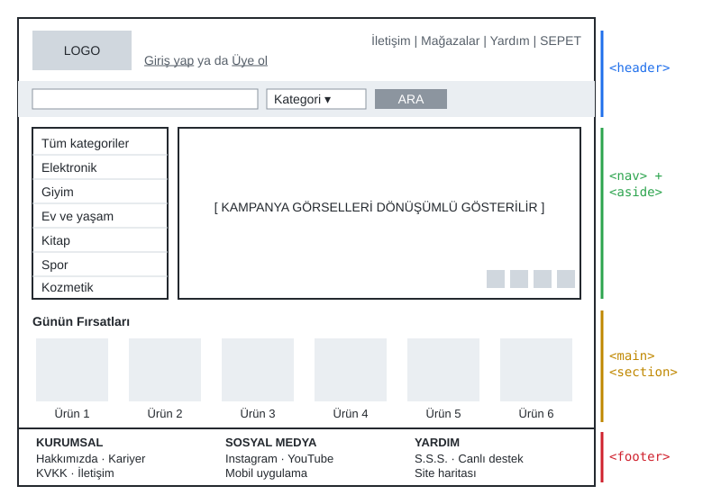

*Şekil 1.22. Bir e-ticaret ana sayfasının tel kafes diyagramı ve bölgelerin HTML karşılıkları (Robbins [1, s. 6] örneğinden uyarlanmıştır).*

Tel kafesteki bölgeler, HTML'de doğrudan anlamsal öğelere karşılık gelir: Logo ve üst bağlantılar `<header>`, kategori menüsü `<nav>`, sayfanın asıl içeriği `<main>` ve içindeki bölümler `<section>`, en alttaki kurumsal bağlantılar ise `<footer>` öğesiyle işaretlenir. Bu öğeler [Bölüm 2](02-html-temelleri.md)'de, bölgelerin yan yana ve alt alta yerleştirilmesi ise [Bölüm 6](06-css-kutu-modeli-yerlesim.md)'da ele alınacaktır. Günümüzde tel kafesler kâğıt üzerinde ya da Figma gibi tasarım araçlarında hazırlanmaktadır.

### 1.12.3 Web Sitesinin Genel Diyagramı

Tek tek sayfaların yapısını gösteren tel kafesin yanında, sitenin bütününün yapısını ve sayfaların birbiriyle ilişkisini gösteren **site diyagramı (site diagram)** da hazırlanır [1, s. 6]. Şekil 1.23, bir web tasarımcısının kişisel sitesi için hazırlanmış basit bir site diyagramıdır: Ana sayfadan iletişim formu, sık sorulan sorular, kitap tanıtımı, bilgi sayfaları, hizmetler ve özgeçmiş sayfalarına ulaşılır; özgeçmiş sayfası örnek çalışmalara, örnek çalışmalar da dış bağlantılara açılır.

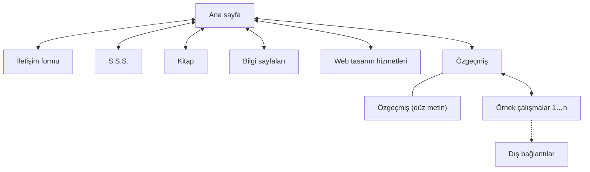

*Şekil 1.23. Basit bir site diyagramı (Robbins [1, s. 6] örneğinden uyarlanmıştır).*

Site diyagramı, gezinme menüsünde hangi bağlantıların bulunacağını, dosyaların hangi klasörlerde tutulacağını ve kullanıcının bir sayfadan diğerine kaç tıklamada ulaşacağını planlamaya yardım eder. Daha karmaşık projelerde, tipik bir kullanıcının bir işi tamamlarken izlediği yolu adım adım gösteren **senaryo panoları (storyboard)** ve **kullanıcı akış şemaları (user flow)** da hazırlanır [1, s. 7].

> [!TIP]
> **Güncel hayattan:** Bir kargo takip sitesinin site diyagramı; ana sayfa, gönderi sorgulama, şube bulucu, fiyat hesaplama ve kurumsal sayfalardan oluşabilir. "Gönderi sorgulama" sayfasının kullanıcı akışı ise takip numarasının girilmesi, sonucun gösterilmesi ve teslimat adresinin değiştirilmesi adımlarını içerir.

## 1.13 Geliştirme Ortamına Köprü

HTML belgeleri düz metin dosyalarıdır; bu nedenle ilk araç bir **metin düzenleyicidir** [6, s. HTML 6]. Bu derste ücretsiz ve çok yaygın bir kod düzenleyicisi olan **Visual Studio Code (VS Code)** kullanılacaktır. VS Code; sözdizimi renklendirme, otomatik tamamlama, Emmet kısaltmaları ve yerleşik terminal gibi özellikler sunar. Yazılan sayfaları bir web sunucusu üzerinden açmak için VS Code'un **Live Server** eklentisi kullanılacaktır. Live Server, bilgisayarda küçük bir yerel web sunucusu başlatır ve sayfayı `http://127.0.0.1:5500/` gibi bir adresten sunar; dosya kaydedildiğinde tarayıcıdaki sayfayı kendiliğinden yeniler. Sayfaların incelenmesi ve hata ayıklama için de tarayıcıların **geliştirici araçları (DevTools)** kullanılacaktır (F12).

Bir HTML dosyasının tarayıcıda iki farklı yolla açılabileceğine dikkat edilmelidir:

- **`file://` ile açmak:** Dosyaya çift tıklandığında tarayıcı dosyayı doğrudan diskten okur. Arada bir sunucu ve HTTP yoktur; adres `file:///C:/...` biçimindedir. Basit sayfalar bu yolla görüntülenebilir; ancak `fetch` ile veri isteme ve JavaScript modülleri gibi bazı özellikler güvenlik nedeniyle çalışmaz.
- **Bir web sunucusu üzerinden açmak:** Live Server ile açılan sayfa, gerçek bir web sitesi gibi HTTP isteğiyle istenir. Bu, sayfanın yayına alındığında nasıl davranacağını daha doğru yansıtır.

Bu araçların kurulumu ve kullanımı [Bölüm 2](02-html-temelleri.md)'de ayrıntılı olarak anlatılacaktır.

*Kod 1.3. İlk web sayfası (`merhaba.html`).*

```html
<!DOCTYPE html>
<html lang="tr">
<head>
  <meta charset="UTF-8">
  <meta name="viewport" content="width=device-width, initial-scale=1.0">
  <title>Merhaba Web</title>
</head>
<body>
  <h1>Merhaba Web!</h1>
  <p>Bu sayfa bir metin dosyasından ibarettir.</p>
</body>
</html>
```

#### 🛠 Uygulama 1.5: `file://` ile Live Server Arasındaki Farkı Gözlemleyiniz

**Amaç:** Aynı HTML dosyasını diskten ve yerel bir web sunucusundan açarak adres, şema ve HTTP isteği farklarını gözlemlemek.  
**Tahmini süre:** 15 dk

1. VS Code'da `calismalar/bolum-01/` klasörünü açınız (yoksa oluşturunuz) ve `merhaba.html` adlı bir dosya oluşturunuz. Kod 1.3'ü dosyaya yazınız ve kaydediniz.
2. Dosya Gezgini'nde `merhaba.html` dosyasına çift tıklayınız. Tarayıcının adres çubuğundaki adresi (`file:///...`) not ediniz. F12 → **Network** sekmesini açıp sayfayı yenileyiniz; durum kodu (Status) sütununa bakınız.
3. VS Code'da **Extensions** (Ctrl+Shift+X) panelinden **Live Server** eklentisini kurunuz (Bölüm 2'de ayrıntılı anlatılmaktadır).
4. `merhaba.html` dosyasına sağ tıklayıp **Open with Live Server** seçiniz. Adres çubuğundaki adresi (`http://127.0.0.1:5500/merhaba.html`) 2. adımdakiyle karşılaştırınız. Network panelinde belge isteğinin durum kodunu (`200`) gözlemleyiniz.
5. Paragraftaki metni değiştirip dosyayı kaydediniz (Ctrl+S). Live Server ile açılan sekmenin kendiliğinden yenilendiğini, `file://` ile açılan sekmenin ise elle yenilenmesi gerektiğini gözlemleyiniz.
6. Adres çubuğundaki `127.0.0.1` adresinin ne anlama geldiğini Kısım 1.5.3'e bakarak açıklayınız.

**Beklenen çıktı:** Örnek çözüm sayfası, açıldığı adresin bileşenlerini tablo olarak gösterir. Şekil 1.24 diskten, Şekil 1.25 yerel sunucudan açılmış hâlidir.

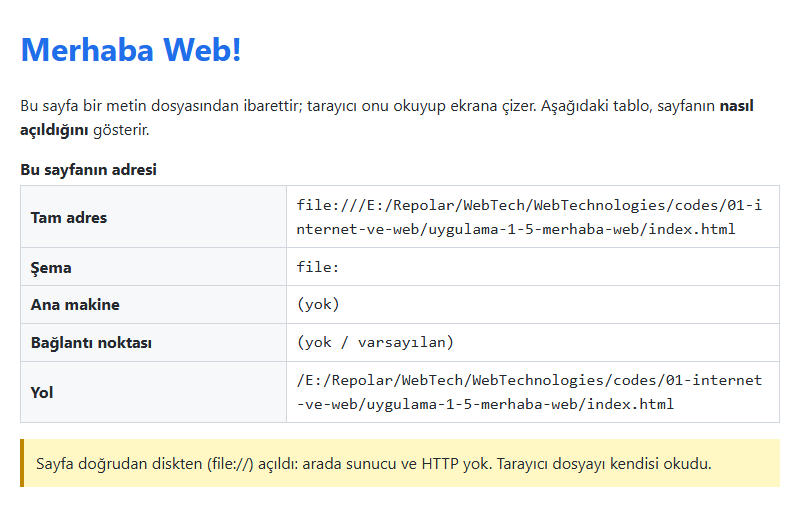

*Şekil 1.24. Uygulama 1.5 örnek çözümü: `file://` ile açılmış sayfa.*

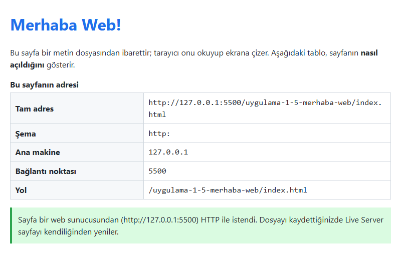

*Şekil 1.25. Uygulama 1.5 örnek çözümü: yerel web sunucusundan (`http://127.0.0.1:5500`) açılmış sayfa.*

**Kendinizi sınayın:** (1) Live Server'ın kullandığı `5500` numarası URL'nin hangi bileşenidir? (2) Aynı bilgisayardaki başka biri `http://127.0.0.1:5500` adresini kendi bilgisayarında açarsa sizin sayfanızı görebilir mi? Neden?

<details><summary>Örnek çözüm</summary>

Çözüm dosyaları: [`codes/01-internet-ve-web/uygulama-1-5-merhaba-web/`](../codes/01-internet-ve-web/uygulama-1-5-merhaba-web/index.html). Çözüm sayfası, Kod 1.3'e ek olarak tarayıcının `location` nesnesinden okuduğu adres bilgilerini tabloya yazan kısa bir betik içerir. `5500` port numarasıdır. `127.0.0.1` her bilgisayarın kendisini gösteren geri döngü adresidir; başka bir bilgisayarda bu adres o bilgisayarın kendisini gösterir, bu yüzden sizin sayfanıza ulaşılamaz.

</details>

## 1.14 Bölüm Özeti

- İnternet, TCP/IP protokolleriyle birbirine bağlanan ağların oluşturduğu küresel altyapıdır; Web ise bu altyapının üzerinde çalışan, hipermetin bağlantılı belgelerden oluşan bir hizmettir. E-posta, dosya aktarımı ve uzaktan erişim de İnternet hizmetleridir.
- İnternet'in kökleri Licklider'ın 1962'deki Galaktik Ağ vizyonuna, 1960'larda geliştirilen paket anahtarlamaya ve 1969'da dört düğümle başlayan ARPANET'e dayanır. 1 Ocak 1983'te TCP/IP'ye geçiş, ağların ağı olan İnternet'in başlangıcı kabul edilir.
- Ağlar kapsama alanına göre LAN, MAN ve WAN; bağlantı düzenine göre yıldız, ağaç, örgü ve halka topolojileri olarak sınıflandırılır. Veriler bükümlü çift, fiber optik ve koaksiyel kablolarla ya da Wi-Fi, 5G ve uydu bağlantılarıyla taşınır.
- TCP/IP modeli uygulama, taşıma, internet ve bağlantı katmanlarından oluşur. TCP güvenilir ve sıralı iletimi, IP ise adresleme ve yönlendirmeyi sağlar. IPv4 adresleri tükenmiştir; 128 bitlik IPv6 yaygınlaşmaktadır.
- Tim Berners-Lee'nin 1989 önerisiyle doğan Web, URL, HTTP ve HTML'den oluşan üç temel taşa ve istek–yanıt döngüsüne dayanır. HTML bir protokol değil, işaretleme dilidir.
- Sunucular kesintisiz çalışan, yedekli ve yüksek kapasiteli sistemlerdir; günümüzde çoğunlukla Linux tabanlıdır ve bulut, sanallaştırma ve CDN hizmetleriyle desteklenir. İstemciler, başta tarayıcılar olmak üzere hizmet talep eden cihaz ve yazılımlardır.
- Alan adları ICANN'in koordinasyonunda kayıt kuruluşlarından kiralanır; `.tr` alan adları TRABİS üzerinden tahsis edilir. DNS, adları hiyerarşik olarak (kök → TLD → yetkili sunucu) IP adreslerine çevirir; yanıtlar TTL süresince önbellekte tutulur.
- Bir URL şema, ana makine, port, yol, sorgu ve parçadan oluşur. HTTP mesajları yöntem, başlık, durum kodu ve gövde içerir; HTTPS trafiği TLS ile şifreler. HTTP/2 çoğullama, HTTP/3 ise QUIC ile daha hızlı ve dayanıklı aktarım sağlar.
- Web tasarımı görsel tasarım, UI/UX, işaretleme ve stil, programlama, içerik stratejisi ve çoklu ortamı kapsar. Tel kafes diyagramı tek bir sayfanın, site diyagramı ise sitenin bütününün yapısını gösterir.

## 1.15 Değerlendirme Soruları

1. İnternet ile Web arasındaki farkı, İnternet üzerinde çalışan en az üç farklı hizmet örneği vererek açıklayınız.
2. Devre anahtarlama ile paket anahtarlamayı bant genişliği kullanımı ve arızalara dayanıklılık açısından karşılaştırınız. İnternet için paket anahtarlamanın tercih edilmesinin nedenleri nelerdir?
3. ARPANET'te IMP'lerin görevi neydi? Bugünkü hangi ağ cihazı IMP'lerin işlevini sürdürmektedir?
4. Bir üniversite kampüs ağında hangi topolojinin kullanılması beklenir? Gerekçesiyle açıklayınız.
5. TCP/IP modelinin dört katmanını sıralayınız ve bir web sayfası isteği gönderilirken her katmanın paketi nasıl değiştirdiğini (kapsülleme) açıklayınız.
6. `ipconfig` çıktısında IPv4 adresi `10.20.30.40`, ağ geçidi `10.20.30.1` olarak görülmektedir. Bu adres İnternet'te doğrudan yönlendirilebilir mi? Bu bilgisayarın İnternet'e nasıl çıktığını açıklayınız.
7. Aşağıdaki URL'nin şema, ana makine, port, yol, sorgu ve parça bileşenlerini yazınız. Hangi bileşen sunucuya gönderilmez?
   `http://kutuphane.example.edu.tr:8080/katalog/ara?yazar=Tanenbaum&tur=kitap#sonuclar`
8. Bir alan adının IP adresi değiştirildiğinde bazı kullanıcıların bir süre daha eski adrese gitmesinin nedenini TTL ve önbellek kavramlarıyla açıklayınız. "Değişiklik 24 saatte yayılır" ifadesi neden teknik olarak eksiktir?
9. Aşağıdaki yanıtı yorumlayınız: Durum kodunun sınıfı ve anlamı nedir? Tarayıcı bu yanıtı ne kadar süre önbellekte tutabilir? Gövdenin türü nedir?

   ```http
   HTTP/1.1 404 Not Found
   Content-Type: text/html; charset=utf-8
   Cache-Control: max-age=60
   ```

10. HTTPS'in sağladığı üç güvenceyi yazınız. Adres çubuğunda kilit simgesi görülmesi bir sitenin güvenilir olduğunu kanıtlar mı?
11. HTTP/1.1, HTTP/2 ve HTTP/3'ün hangi taşıma protokolleri üzerinde çalıştığını belirtiniz. HTTP/3'ün çözmeyi amaçladığı temel sorun nedir?
12. Bir sayfanın tel kafes diyagramı ile site diyagramı arasındaki fark nedir? Üniversitenizin web sitesi için ana sayfadan başlayan beş düğümlü basit bir site diyagramı çiziniz.

## Kaynaklar

\[1\] J. N. Robbins, *Learning Web Design: A Beginner's Guide to HTML, CSS, JavaScript, and Web Graphics*, 4th ed. Sebastopol, CA, USA: O'Reilly Media, 2012.

\[2\] S. Vodnik and D. Gosselin, *JavaScript: The Web Warrior Series*, 6th ed. Boston, MA, USA: Cengage Learning, 2015.

\[3\] A. S. Tanenbaum, *Computer Networks*, 4th ed. Upper Saddle River, NJ, USA: Prentice Hall, 2003.

\[4\] B. M. Leiner *et al.*, "A brief history of the Internet," *ACM SIGCOMM Comput. Commun. Rev.*, vol. 39, no. 5, pp. 22–31, Oct. 2009.

\[5\] V. G. Cerf and R. E. Kahn, "A protocol for packet network intercommunication," *IEEE Trans. Commun.*, vol. 22, no. 5, pp. 637–648, May 1974.

\[6\] P. Carey, *New Perspectives on HTML5 and CSS3: Comprehensive*, 7th ed. Boston, MA, USA: Cengage Learning, 2017.

\[7\] T. Berners-Lee, "Information Management: A Proposal," CERN, Geneva, Switzerland, Mar. 1989. [Çevrimiçi]. Erişim: https://www.w3.org/History/1989/proposal.html (Erişim tarihi: 2 Kasım 2026).

\[8\] J. Sklar, *Principles of Web Design: The Web Warrior Series*, 6th ed. Boston, MA, USA: Cengage Learning, 2015.

\[9\] WHATWG, "HTML Living Standard." [Çevrimiçi]. Erişim: https://html.spec.whatwg.org/ (Erişim tarihi: 2 Kasım 2026).

\[10\] W. Eddy, Ed., "Transmission Control Protocol (TCP)," IETF, RFC 9293, Aug. 2022. [Çevrimiçi]. Erişim: https://www.rfc-editor.org/rfc/rfc9293

\[11\] J. Postel, "Internet Protocol," IETF, RFC 791, Sep. 1981. [Çevrimiçi]. Erişim: https://www.rfc-editor.org/rfc/rfc791

\[12\] S. Deering and R. Hinden, "Internet Protocol, Version 6 (IPv6) Specification," IETF, RFC 8200, Jul. 2017. [Çevrimiçi]. Erişim: https://www.rfc-editor.org/rfc/rfc8200

\[13\] Y. Rekhter, B. Moskowitz, D. Karrenberg, G. J. de Groot, and E. Lear, "Address Allocation for Private Internets," IETF, RFC 1918, Feb. 1996. [Çevrimiçi]. Erişim: https://www.rfc-editor.org/rfc/rfc1918

\[14\] Cisco, "Cisco Annual Internet Report (2018–2023) White Paper," Mar. 2020. [Çevrimiçi]. Erişim: https://www.cisco.com/c/en/us/solutions/collateral/executive-perspectives/annual-internet-report/white-paper-c11-741490.html (Erişim tarihi: 2 Kasım 2026).

\[15\] ITU, "Global number of Internet users increases, but disparities deepen key digital divides," Basın bülteni (Facts and Figures 2025), 17 Kas. 2025. [Çevrimiçi]. Erişim: https://www.itu.int/en/mediacentre/Pages/PR-2025-11-17-Facts-and-Figures.aspx (Erişim tarihi: 2 Kasım 2026).

\[16\] TÜİK, "Hanehalkı Bilişim Teknolojileri (BT) Kullanım Araştırması, 2026," Haber Bülteni, Ağu. 2026. [Çevrimiçi]. Erişim: https://data.tuik.gov.tr/ (Erişim tarihi: 2 Kasım 2026).

\[17\] D. Evans, "The Internet of Things: How the Next Evolution of the Internet Is Changing Everything," Cisco Internet Business Solutions Group (IBSG), White Paper, Apr. 2011.

\[18\] P. Mockapetris, "Domain names - concepts and facilities," IETF, RFC 1034, Nov. 1987. [Çevrimiçi]. Erişim: https://www.rfc-editor.org/rfc/rfc1034

\[19\] Bilgi Teknolojileri ve İletişim Kurumu, ".tr Ağ Bilgi Sistemi (TRABİS)." [Çevrimiçi]. Erişim: https://www.trabis.gov.tr/ (Erişim tarihi: 2 Kasım 2026).

\[20\] P. Mockapetris, "Domain names - implementation and specification," IETF, RFC 1035, Nov. 1987. [Çevrimiçi]. Erişim: https://www.rfc-editor.org/rfc/rfc1035

\[21\] Root Server Technical Operations Association, "Root Servers." [Çevrimiçi]. Erişim: https://root-servers.org/ (Erişim tarihi: 2 Kasım 2026).

\[22\] T. Berners-Lee, R. Fielding, and L. Masinter, "Uniform Resource Identifier (URI): Generic Syntax," IETF, RFC 3986, Jan. 2005. [Çevrimiçi]. Erişim: https://www.rfc-editor.org/rfc/rfc3986

\[23\] WHATWG, "URL Living Standard." [Çevrimiçi]. Erişim: https://url.spec.whatwg.org/ (Erişim tarihi: 2 Kasım 2026).

\[24\] R. Fielding, M. Nottingham, and J. Reschke, Eds., "HTTP Semantics," IETF, RFC 9110, Jun. 2022. [Çevrimiçi]. Erişim: https://www.rfc-editor.org/rfc/rfc9110

\[25\] R. Fielding, M. Nottingham, and J. Reschke, Eds., "HTTP/1.1," IETF, RFC 9112, Jun. 2022. [Çevrimiçi]. Erişim: https://www.rfc-editor.org/rfc/rfc9112

\[26\] Mozilla, "HTTP response status codes," *MDN Web Docs*. [Çevrimiçi]. Erişim: https://developer.mozilla.org/en-US/docs/Web/HTTP/Reference/Status (Erişim tarihi: 2 Kasım 2026).

\[27\] E. Rescorla, "The Transport Layer Security (TLS) Protocol Version 1.3," IETF, RFC 8446, Aug. 2018. [Çevrimiçi]. Erişim: https://www.rfc-editor.org/rfc/rfc8446

\[28\] M. Thomson and C. Benfield, Eds., "HTTP/2," IETF, RFC 9113, Jun. 2022. [Çevrimiçi]. Erişim: https://www.rfc-editor.org/rfc/rfc9113

\[29\] M. Bishop, Ed., "HTTP/3," IETF, RFC 9114, Jun. 2022. [Çevrimiçi]. Erişim: https://www.rfc-editor.org/rfc/rfc9114

\[30\] J. Iyengar and M. Thomson, Eds., "QUIC: A UDP-Based Multiplexed and Secure Transport," IETF, RFC 9000, May 2021. [Çevrimiçi]. Erişim: https://www.rfc-editor.org/rfc/rfc9000

\[31\] Mozilla, "Populating the page: how browsers work," *MDN Web Docs*. [Çevrimiçi]. Erişim: https://developer.mozilla.org/en-US/docs/Web/Performance/Guides/How_browsers_work (Erişim tarihi: 2 Kasım 2026).

\[32\] W3C, *Web Content Accessibility Guidelines (WCAG) 2.2*, W3C Recommendation, Oct. 2023. [Çevrimiçi]. Erişim: https://www.w3.org/TR/WCAG22/ (Erişim tarihi: 2 Kasım 2026).

[İçindekiler](../README.md) · [Sonraki bölüm →](02-html-temelleri.md)
