# Bölüm 2: HTML5 Temelleri: Belge Yapısı, Metin, Bağlantı ve Görseller

[← Önceki bölüm](01-internet-ve-web.md) · [İçindekiler](../README.md) · [Sonraki bölüm →](03-html-tablo-form-medya.md)

> **Öğrenme Hedefleri** — Bu bölümü tamamlayan öğrenci:
> 1. HTML'in 1991'den bugünkü HTML Living Standard'a uzanan gelişimini ve W3C ile WHATWG'nin rollerini açıklar.
> 2. Visual Studio Code'u kurar, Live Server ve Prettier eklentilerini ekler; Emmet ile UTF-8 kodlamalı bir HTML belgesi oluşturup tarayıcıda açar, kaynağını ve DOM ağacını geliştirici araçlarıyla inceler.
> 3. Bir HTML öğesini etiket, nitelik ve içerik bileşenlerine ayırır; geçerli bir belge iskeleti yazar ve belgenin ağaç yapısını çizer.
> 4. Metin, liste, görsel ve bağlantı öğelerini görünüşlerine göre değil anlamlarına göre seçer (ör. `strong` ile `b`, `em` ile `i` arasındaki farkı gerekçelendirir).
> 5. Mutlak ve göreli yolları (`../` dahil) kullanarak çok sayfalı bir site kurar; sayfa içi çapalar, `mailto:` ve güvenli yeni sekme bağlantıları oluşturur.
> 6. `header`, `nav`, `main`, `article`, `section`, `aside` ve `footer` öğeleriyle anlamsal bir sayfa düzeni kurar; meta etiketlerini yazar ve belgeyi W3C doğrulayıcısıyla denetler.

## 2.1 Giriş

Bir web sayfasını tarayıcıda açan kullanıcı başlıkları, paragrafları, görselleri ve tıklanabilir bağlantıları görür. Bu görüntünün arkasında, içeriğin ne olduğunu tarif eden düz metin bir dosya bulunur: **HTML (HyperText Markup Language — Hipermetin İşaretleme Dili)** belgesi. HTML bir programlama dili değil, bir **işaretleme dilidir (markup language)**; bilgisayara “şunu hesapla” demez, metnin parçalarına “bu bir başlıktır”, “bu bir listedir”, “bu başka bir sayfaya bağlantıdır” gibi anlamlar yükler [1]. Tarayıcı bu işaretleri yorumlayarak içeriği ekrana yerleştirir, ekran okuyucular sesli okur, arama motorları dizine ekler.

Web sayfası oluşturmada üç temel teknoloji birlikte çalışır: içeriğin yapısını ve anlamını **HTML**, görünümünü **CSS (Cascading Style Sheets — Basamaklı Stil Sayfaları)**, davranışını ise **JavaScript** ve onun belgeye erişim arayüzü **DOM (Document Object Model — Belge Nesne Modeli)** belirler. Bu bölümde HTML'in temelleri; [Bölüm 4](04-css-temelleri.md)'ten itibaren CSS, [Bölüm 7](07-javascript-temelleri.md) ve [Bölüm 8](08-javascript-dom-olaylar.md)'de JavaScript ve DOM ele alınmaktadır.

> [!NOTE]
> **Tarihsel not:** Ders sunumunun eski sürümlerinde dördüncü bileşen olarak **jQuery** kütüphanesi de sayılmaktaydı. jQuery, 2006–2015 döneminde tarayıcılar arası farkları gizlemek için çok yaygın kullanılmıştır. Bugün `querySelector`, `addEventListener` ve `fetch` gibi yerel DOM API'leri tüm tarayıcılarda aynı biçimde çalıştığından yeni projelerde jQuery'ye gerek duyulmamaktadır; bu nedenle derste yerel API'ler öğretilmektedir.

> [!TIP]
> **Güncel hayattan:** e-Devlet Kapısı'nda bir belge sorgulandığında, banka uygulamasında hesap özeti açıldığında ya da bir e-ticaret sitesinde ürün sayfası görüntülendiğinde, ekrana gelen içeriğin iskeleti her durumda HTML'dir. Mobil uygulamaların önemli bir kısmı da uygulama içinde web görünümü (WebView) aracılığıyla HTML sayfaları göstermektedir.

## 2.2 HTML'in Kısa Tarihi

### 2.2.1 Berners-Lee'nin HTML'i ve tarayıcı rekabeti

HTML, Tim Berners-Lee'nin 1989'da CERN'de önerdiği hipermetin tabanlı bilgi yönetim sisteminin ([Bölüm 1](01-internet-ve-web.md)) üç ayağından biridir: belgeleri adreslemek için URL, belgeleri taşımak için HTTP, belgeleri yazmak için HTML [2]. Berners-Lee, söz dizimini o yıllarda belge yayıncılığında kullanılan SGML (Standard Generalized Markup Language) dilinden esinlenerek tasarlamış; 1991'de yayımladığı ilk etiket listesi başlık, paragraf, liste ve bağlantı gibi yirmiye yakın öğeden oluşmaktaydı [3, Giriş].

HTML'in kitlelere ulaşmasında 1993'te NCSA tarafından geliştirilen **Mosaic** tarayıcısı belirleyici olmuştur; Mosaic görselleri metnin içinde gösterebilen ilk yaygın tarayıcıydı. Dilin ilk resmî tanımı olan **HTML 2.0**, Kasım 1995'te IETF tarafından RFC 1866 olarak yayımlanmıştır [4]. Ardından gelen Netscape Navigator ile Internet Explorer arasındaki “tarayıcı savaşları” döneminde her üretici dile kendi etiketlerini eklemiş; `<font>`, `<center>` gibi yalnızca görünümü belirleyen öğeler bu dönemin mirasıdır [5, Bl. 4].

### 2.2.2 W3C, HTML 4.01 ve XHTML

Berners-Lee, Ekim 1994'te MIT bünyesinde **W3C (World Wide Web Consortium)**'u kurmuştur. W3C, Ocak 1997'de HTML 3.2'yi, Aralık 1997'de HTML 4.0'ı ve Aralık 1999'da HTML 4.01'i Öneri (Recommendation) olarak yayımlamıştır. HTML 4 ile birlikte yapı ile sunumun ayrılması ilkesi öne çıkmış, görünümle ilgili işler CSS'e devredilmeye başlanmıştır [5, ss. 182–183].

> [!NOTE]
> **Tarihsel not (XHTML):** W3C, 2000 yılında HTML'i XML kurallarıyla yeniden tanımlayan **XHTML 1.0**'ı yayımlamış ve geleceğin XML tabanlı bir web olacağını öngörmüştür. XHTML'de tüm etiketler küçük harfle yazılmak, her öğe kapatılmak, boş öğeler `<br />` biçiminde yazılmak zorundaydı. Tek bir hatada sayfanın hiç gösterilmemesi (katı hata işleme) ve geriye dönük uyumsuz XHTML 2.0 taslağı tarayıcı üreticilerinden destek görmemiş; W3C 2009'da XHTML 2.0 çalışmasını sonlandırmıştır [3, Giriş]. Bugün `<br />` yazımı hâlâ geçerlidir, ancak bu derste `<br>` yazımı kullanılmaktadır.

### 2.2.3 WHATWG, HTML5 ve Yaşayan Standart

XML yönelimine katılmayan Apple, Mozilla ve Opera çalışanları Haziran 2004'te **WHATWG (Web Hypertext Application Technology Working Group)** adlı bağımsız bir grup kurmuş ve mevcut HTML'i geriye dönük uyumlu biçimde genişleten “Web Applications 1.0” ve “Web Forms 2.0” taslakları üzerinde çalışmaya başlamıştır [3, Giriş]. W3C 2007'de yeni bir HTML Çalışma Grubu kurmuş ve WHATWG'nin taslağını yeni HTML sürümünün temeli olarak kabul etmiştir. Böylece aynı belge bir süre **iki kuruluşta paralel** olarak geliştirilmiştir. HTML5'in ilk genel çalışma taslağı Ocak 2008'de yayımlanmış, HTML5 ise 28 Ekim 2014'te W3C Önerisi hâline gelmiştir.

WHATWG, 2011'de sürüm numarasını bırakarak belgeyi sürekli güncellenen bir **Yaşayan Standart (Living Standard)** olarak sürdürmeye karar vermiştir [3, Giriş]. İki ayrı HTML belgesinin varlığı karışıklık yarattığından W3C ve WHATWG 28 Mayıs 2019'da bir mutabakat zaptı imzalamış; bu tarihten itibaren HTML ve DOM için **tek yetkili metin WHATWG'nin HTML Living Standard'ıdır** ve W3C bu metnin belirli anlık görüntülerini onaylamaktadır [6]. Günlük dilde kullanılan “HTML5” ifadesi, bugün bu yaşayan standardı ve onunla birlikte gelen modern web özelliklerini anlatan genel bir ad olarak kalmıştır [1].

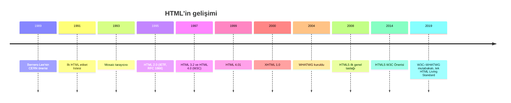

*Şekil 2.1. HTML'in 1989'dan günümüze gelişimi.*

> [!IMPORTANT]
> Sık rastlanan “W3C ile WHATWG 2007'de birleşerek HTML5'i oluşturdu” ifadesi doğru değildir. İki kuruluş birleşmemiştir: W3C 2007'de WHATWG taslağını temel almış, ancak iki kuruluş 2019'a kadar ayrı metinler yayımlamıştır. Ayrıca W3C 1998'de değil, **1994'te** kurulmuştur; HTML5 2009'da değil, taslak olarak 2008'de duyurulmuş ve 2014'te standartlaşmıştır.

HTML5 ile gelen yenilikler bu dersin pek çok konusunu oluşturur: anlamsal yapı öğeleri (`header`, `nav`, `main`, `article`…), yeni form denetimleri, eklentisiz `<video>` ve `<audio>`, `<canvas>` ile çizim ve tarayıcı tarafı depolama. 2010'da Apple'ın iPhone ve iPad'de Flash eklentisini desteklemeyeceğini açıklaması, eklentiye dayalı içerikten HTML5'e geçişi hızlandırmış; YouTube 2015'te varsayılan oynatıcısını HTML5 `<video>` öğesine taşımıştır.

## 2.3 Tarayıcılar ve Render Motorları

### 2.3.1 Tarayıcı pazar payları

**Tarayıcı (browser)**, sunucudan aldığı HTML, CSS ve JavaScript dosyalarını yorumlayarak sayfayı ekrana çizen istemci yazılımıdır. Hangi tarayıcıların ne oranda kullanıldığı, geliştiricinin test önceliklerini belirler. Şekil 2.2, StatCounter'ın Ekim 2026 verilerini (masaüstü, mobil ve tablet toplamı) göstermektedir [7], [8].

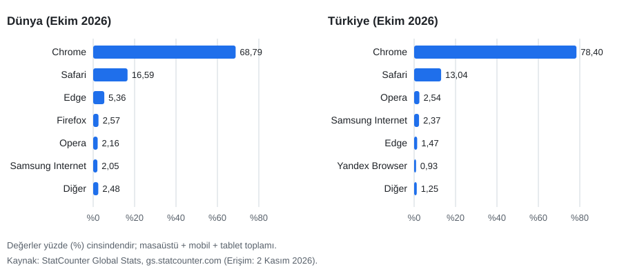

*Şekil 2.2. Dünyada ve Türkiye'de tarayıcı pazar payları, Ekim 2026 (kaynak: StatCounter; “Diğer” kalan payların toplamıdır).*

Şekilde görüldüğü gibi Chrome dünyada yaklaşık her üç kullanıcıdan ikisine, Türkiye'de ise dörtte üçten fazlasına ulaşmaktadır; ikinci sırada, iPhone ve Mac cihazlarının varsayılan tarayıcısı Safari yer almaktadır. Ders sunumundaki Mart 2023–Mart 2024 verilerinde de sıralama aynıydı (Chrome %63,84, Safari %19,69); bu tür istatistikler hızla değiştiği için her zaman tarihiyle birlikte verilmelidir. Bu sayfaları ziyaret eden insan sayısı da artmaya devam etmektedir: ITU'nun 2025 verilerine göre dünyada yaklaşık 6 milyar kişi, yani nüfusun yaklaşık dörtte üçü İnternet kullanmaktadır [9] (ayrıntı için bkz. [Bölüm 1](01-internet-ve-web.md)).

### 2.3.2 Render motorları

Tarayıcının HTML'i ayrıştırıp (parse) sayfayı çizen çekirdeğine **render motoru (rendering engine)** denir. Günümüzde üç ana motor bulunmaktadır:

| Motor | Geliştiren | Kullanan başlıca tarayıcılar |
|---|---|---|
| **Blink** | Google (Chromium projesi) | Chrome, Edge, Opera, Samsung Internet, Yandex Browser, Brave |
| **WebKit** | Apple | Safari (macOS, iOS, iPadOS) |
| **Gecko** | Mozilla | Firefox |

*Tablo 2.1. Güncel render motorları.*

Tablo 2.1'e göre pazardaki tarayıcı çeşitliliği motor düzeyinde üç aileye indirgenmektedir. Microsoft Edge 2020'den bu yana Chromium tabanlıdır; eski EdgeHTML motoru ve Internet Explorer'ın Trident motoru kullanımdan kalkmıştır. Bir sayfanın en azından bir Blink, bir WebKit ve bir Gecko tabanlı tarayıcıda denenmesi, kullanıcıların çok büyük bölümünü kapsayan pratik bir test stratejisidir.

## 2.4 Geliştirme Ortamının Kurulması

HTML belgesi düz metin olduğundan Windows'taki Not Defteri (Notepad) veya Notepad++ gibi herhangi bir metin düzenleyiciyle yazılabilir. Ancak sözdizimi renklendirme, otomatik tamamlama, hata işaretleme ve canlı önizleme sunan bir **kod düzenleyici (code editor)** öğrenme sürecini önemli ölçüde hızlandırır [10, Kitap I, Bl. 3]. Bu derste ücretsiz ve açık kaynak kodlu **Visual Studio Code (VS Code)** kullanılmaktadır.

> [!TIP]
> **Alternatif:** JetBrains'in **WebStorm** ortamı, kapsamlı yeniden düzenleme (refactoring) ve hata ayıklama araçları sunan profesyonel bir IDE'dir. JetBrains, `edu.tr` uzantılı üniversite e-posta adresiyle başvuran öğrencilere eğitim lisansını ücretsiz vermektedir. Bu notlardaki tüm adımlar WebStorm'da da benzer biçimde uygulanabilir.

### 2.4.1 VS Code'un kurulumu ve önerilen eklentiler

1. https://code.visualstudio.com/ adresinden işletim sistemine uygun sürüm indirilir ve kurulur. Windows kurulumunda **“Add ‘Open with Code’ action to Windows Explorer file context menu”** ve **“Add to PATH”** seçeneklerinin işaretlenmesi, klasörlerin sağ tık menüsünden doğrudan VS Code'da açılmasını sağlar.
2. İstenirse arayüz Türkçeleştirilebilir: Eklentiler görünümünde *Turkish Language Pack for Visual Studio Code* kurulur. (Bu notta menü adları İngilizce özgün adlarıyla verilmiştir.)
3. Sol kenardaki **Extensions (Eklentiler)** simgesine tıklanır veya <kbd>Ctrl</kbd>+<kbd>Shift</kbd>+<kbd>X</kbd> kısayolu kullanılır; aşağıdaki iki eklenti aranarak **Install** düğmesiyle kurulur:
   - **Live Server** (Ritwick Dey): Projeyi yerel bir web sunucusu üzerinden tarayıcıda açar ve dosya her kaydedildiğinde sayfayı kendiliğinden yeniler.
   - **Prettier – Code formatter**: Kodu tutarlı girinti ve satır düzeniyle biçimlendirir. Kurulumdan sonra <kbd>Shift</kbd>+<kbd>Alt</kbd>+<kbd>F</kbd> (*Format Document*) ile belge biçimlendirilir; *Settings* içinde **Format On Save** işaretlenirse her kayıtta otomatik biçimlendirme yapılır.

Ders sunumunda örnek olarak gösterilen *HTML Preview* eklentisi, sayfanın önizlemesini düzenleyicinin içinde açar. Bu da kullanılabilir; ancak sayfayı gerçek bir tarayıcıda, gerçek bir sunucu adresi (`http://127.0.0.1:5500/...`) üzerinden açtığı için Live Server tercih edilmektedir. Microsoft'un *Live Preview* eklentisi de benzer bir seçenektir.

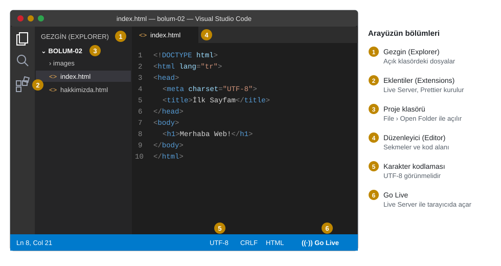

*Şekil 2.3. VS Code arayüzü: (1) Gezgin, (2) Eklentiler, (3) açık proje klasörü, (4) düzenleyici, (5) durum çubuğundaki karakter kodlaması, (6) Live Server'ın “Go Live” düğmesi.*

### 2.4.2 Klasör açma, dosya oluşturma ve UTF-8 ile kaydetme

VS Code'da tek tek dosya açmak yerine **proje klasörü** açmak gerekir; göreli bağlantılar ve Live Server bu klasörü kök kabul eder.

1. Bilgisayarda ders çalışmaları için bir klasör oluşturulur (ör. `Belgeler\calismalar\bolum-02`). Klasör adlarında boşluk ve Türkçe karakter kullanılmaması, ileride URL'lerde sorun yaşanmasını önler.
2. VS Code'da **File › Open Folder…** (<kbd>Ctrl</kbd>+<kbd>K</kbd> ardından <kbd>Ctrl</kbd>+<kbd>O</kbd>) ile bu klasör açılır. İlk açılışta “Do you trust the authors of the files in this folder?” sorusu, kendi klasörünüz için **Yes, I trust the authors** ile yanıtlanır.
3. Gezgin (Explorer) panelinde **New File** simgesine tıklanır ve dosya adı uzantısıyla yazılır: `index.html`. Bir sitenin ana sayfasının `index.html` olarak adlandırılması bir gelenektir; sunucular klasör adresi istendiğinde varsayılan olarak bu dosyayı gönderir.
4. Dosya <kbd>Ctrl</kbd>+<kbd>S</kbd> ile kaydedilir. **File › Auto Save** işaretlenirse VS Code değişiklikleri kendiliğinden kaydeder.
5. Durum çubuğunun sağ tarafında **UTF-8** yazdığı denetlenir (Şekil 2.3'te 5 numara). Farklı bir kodlama görülürse bu yazıya tıklanıp **Save with Encoding › UTF-8** seçilir.

> [!IMPORTANT]
> Dosyanın **diskteki kodlaması** ile belgenin içindeki `<meta charset="UTF-8">` bildirimi aynı olmalıdır. Dosya Windows-1254 gibi eski bir kodlamayla kaydedilip içinde UTF-8 bildirilirse “ş, ğ, ı” gibi harfler bozuk görünür. VS Code yeni dosyaları varsayılan olarak UTF-8 kaydeder; eski bir düzenleyiciden gelen dosyalarda bu denetim mutlaka yapılmalıdır.

### 2.4.3 Emmet ile belge iskeleti

VS Code, **Emmet** adlı kısaltma genişletme aracını yerleşik olarak içerir; ek kurulum gerekmez [11]. Boş bir `.html` dosyasında `!` yazıldığında açılan öneri listesinde *Emmet Abbreviation* seçeneği görünür; <kbd>Tab</kbd> veya <kbd>Enter</kbd> ile kabul edildiğinde aşağıdaki iskelet oluşur:

```html
<!DOCTYPE html>
<html lang="en">
<head>
  <meta charset="UTF-8">
  <meta name="viewport" content="width=device-width, initial-scale=1.0">
  <title>Document</title>
</head>
<body>
  
</body>
</html>
```

*Kod 2.1. Emmet'in `!` kısaltmasıyla ürettiği iskelet.*

Oluşan iskelette iki değişiklik yapılmalıdır: `lang="en"` değeri Türkçe içerik için `lang="tr"` olarak, `<title>Document</title>` ise sayfayı anlatan bir başlıkla değiştirilmelidir. Bazı Emmet sürümleri ayrıca `<meta http-equiv="X-UA-Compatible" content="IE=edge">` satırını ekler; bu satır yalnızca artık desteklenmeyen Internet Explorer için anlamlı olduğundan silinebilir. Emmet başka kısaltmaları da genişletir: `ul>li*3` yazılıp <kbd>Tab</kbd>'a basıldığında üç maddeli bir liste, `p.not` yazıldığında `class="not"` nitelikli bir paragraf oluşur. Öneri listesi açılmıyorsa ayarlarda `emmet.triggerExpansionOnTab` seçeneği etkinleştirilebilir.

### 2.4.4 Live Server ile tarayıcıda açma

Dosya kaydedildikten sonra iki yoldan biriyle tarayıcıda açılır:

- Düzenleyicide sağ tıklanıp **Open with Live Server** seçilir, ya da
- Durum çubuğundaki **Go Live** düğmesine tıklanır (Şekil 2.3'te 6 numara).

Varsayılan tarayıcıda `http://127.0.0.1:5500/index.html` adresi açılır. `127.0.0.1` bilgisayarın kendisini gösteren geri döngü (loopback) adresi, `5500` ise Live Server'ın dinlediği bağlantı noktasıdır (port). Bu andan itibaren dosyada yapılan her kayıt tarayıcıya anında yansır; profesyonel ön yüz araçlarındaki “sıcak yeniden yükleme (hot reload)” özelliği de aynı fikre dayanır. Sunucuyu durdurmak için aynı düğme (**Port: 5500**) tekrar tıklanır. Dosyaya Gezgin'de çift tıklanarak `file:///C:/...` adresiyle de açılabilir; ancak bazı özellikler (ör. JavaScript modülleri, `fetch` ile dosya okuma) yalnızca bir sunucu üzerinden çalıştığından Live Server alışkanlığı baştan edinilmelidir.

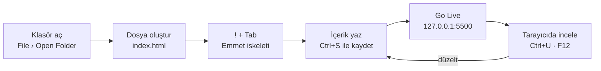

*Şekil 2.4. VS Code ile HTML geliştirme döngüsü.*

### 2.4.5 Sayfa kaynağı ve geliştirici araçları

Tarayıcı, bir sayfanın arkasındaki HTML'i görmek için iki farklı araç sunar:

- **Sayfa kaynağını görüntüle (View Page Source):** Sayfada sağ tıklanıp *Sayfa kaynağını görüntüle* seçilir veya <kbd>Ctrl</kbd>+<kbd>U</kbd> kısayolu kullanılır. Sunucudan gelen **ham HTML metni** yeni sekmede, satır numaralarıyla gösterilir. Yorum satırları da burada görünür.
- **Geliştirici araçları (DevTools) › Elements:** <kbd>F12</kbd> veya <kbd>Ctrl</kbd>+<kbd>Shift</kbd>+<kbd>I</kbd> ile açılır; bir öğeye sağ tıklanıp **İncele (Inspect)** seçilirse doğrudan o öğe seçili gelir. Elements paneli, tarayıcının HTML'den kurduğu **canlı DOM ağacını** gösterir. Burada bir öğenin üzerine gelindiğinde sayfadaki karşılığı vurgulanır; metinler ve nitelikler çift tıklanarak geçici olarak değiştirilebilir, alttaki *Styles* bölmesinde uygulanan CSS kuralları görülür. Firefox'ta aynı panelin adı *Inspector*'dır.

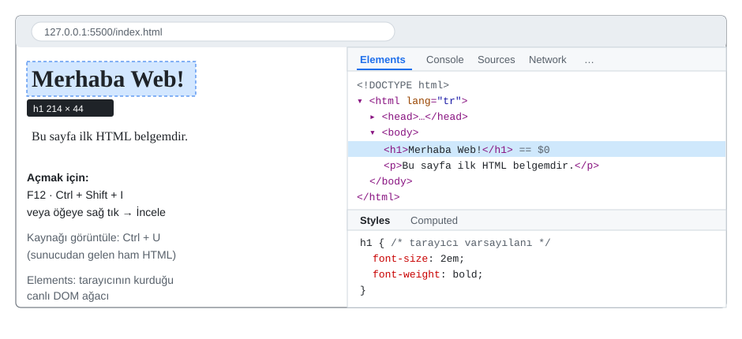

*Şekil 2.5. Geliştirici araçlarının Elements paneli: seçili `h1` satırı sayfada vurgulanır, alttaki Styles bölmesinde tarayıcının varsayılan stilleri görünür.*

İki görünüm arasındaki fark önemlidir: Kaynak görünümü dosyanın kendisini, Elements paneli ise tarayıcının o dosyadan kurduğu ve JavaScript ile değişmiş olabilecek **güncel** yapıyı gösterir. Örneğin kapanış etiketi unutulmuş bir paragraf kaynakta hatalı görünür; Elements panelinde ise tarayıcının hatayı nasıl onardığı görülür. Elements panelinde yapılan değişiklikler dosyaya kaydedilmez, sayfa yenilendiğinde kaybolur.

## 2.5 HTML Belgesinin Yapısı

### 2.5.1 Öğe anatomisi: etiket, içerik ve nitelik

Bir HTML belgesi **öğelerden (element)** oluşur. Öğelerin çoğu bir **açılış etiketi (start tag)**, bir **içerik** ve bir **kapanış etiketinden (end tag)** meydana gelir. Etiketler açılı ayraçlar (`<` ve `>`) arasına yazılan öğe adıdır; kapanış etiketinde addan önce eğik çizgi (`/`) bulunur [12, ss. 20–26]. Açılış etiketi, öğe hakkında ek bilgi veren **nitelikler (attribute)** taşıyabilir. Nitelik bir ad ve eşittir işaretiyle bağlanan, çift tırnak içindeki bir değerden oluşur; birden fazla nitelik boşlukla ayrılır.

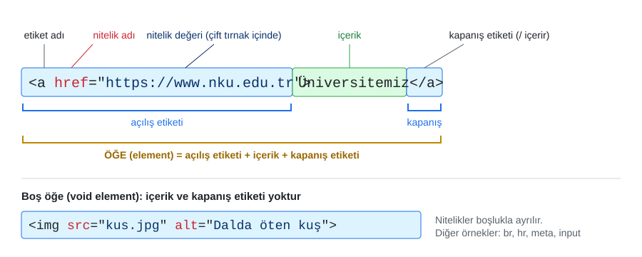

*Şekil 2.6. Bir `a` öğesinin bileşenleri (üstte) ve içeriği olmayan boş öğe `img` (altta).*

Şekil 2.6'daki `<a href="https://www.nku.edu.tr">Üniversitemiz</a>` öğesinde `a` öğe adı, `href` nitelik adı, tırnak içindeki adres nitelik değeri, “Üniversitemiz” ise öğenin içeriğidir. İçerik düz metin olabileceği gibi başka öğeler de içerebilir; bu durumda öğeler **iç içe (nested)** yerleştirilmiş olur ve **en son açılan öğe ilk kapatılmalıdır**: `<p><strong>…</strong></p>` doğru, `<p><strong>…</p></strong>` hatalıdır.

Bazı öğelerin içeriği yoktur; bunlara **boş öğe (void element)** denir: `<br>`, `<hr>`, ``, `<meta>`, `<link>`, `<input>`. Boş öğeler kapanış etiketi almaz. `<br />` biçimindeki yazım XHTML'den kalmadır ve hâlâ geçerlidir, ancak bu derste kullanılmamaktadır. HTML etiket adları büyük-küçük harfe duyarlı değildir (`<P>` ile `<p>` aynıdır); okunabilirlik ve tutarlılık için **küçük harf** kullanılması önerilir [1].

> [!IMPORTANT]
> Nitelik değerleri kodda **düz çift tırnak** (`"…"`) ile yazılmalıdır. Kelime işlemci veya sunum programlarından kopyalanan kıvrık tırnaklar (`“…”`, `‘…’`) HTML tarafından tırnak olarak tanınmaz ve `<abbr title=“Profesör”>` gibi bir yazım beklenmedik sonuç verir. Kod daima kod düzenleyicide yazılmalıdır.

### 2.5.2 Belge iskeleti

Her HTML belgesi aynı temel iskeleti paylaşır. Kod 2.2, bu dersin tüm örneklerinde kullanılan iskeleti göstermektedir.

```html
<!DOCTYPE html>
<html lang="tr">
<head>
  <meta charset="UTF-8">
  <meta name="viewport" content="width=device-width, initial-scale=1.0">
  <title>Bilgisayar Mühendisliği Bölümü</title>
</head>
<body>
  <h1>Bilgisayar Mühendisliği Bölümü</h1>
  <p>Sayfa içeriği burada yer alır.</p>
</body>
</html>
```

*Kod 2.2. Bir HTML belgesinin temel iskeleti.*

Satırların görevleri şöyledir [12, Bl. 1], [13, Öğr. 1]:

- **`<!DOCTYPE html>`**: Belge türü bildirimidir; bir öğe değil, tarayıcıya yönelik bir işarettir. Tarayıcının belgeyi standartlara uygun kipte (standards mode) işlemesini sağlar. Bildirim eksik olursa tarayıcı 1990'ların hatalı davranışlarını taklit eden “tuhaflık kipine” (quirks mode) geçer. HTML 4.01 ve XHTML'deki uzun DTD bildirimlerinin yerini bu kısa yazım almıştır.
- **`<html lang="tr">`**: Belgenin **kök öğesidir (root element)**; diğer tüm öğeler bunun içinde yer alır. `lang` niteliği içeriğin dilini bildirir. Ekran okuyucular telaffuz kurallarını, tarayıcılar heceleme denetimi ve otomatik çeviri önerisini bu değere göre seçer. WCAG 3.1.1 ölçütü, sayfa dilinin programla belirlenebilir olmasını en temel (A) düzeyde şart koşar [14]. Sık kullanılan değerler: `tr`, `en`, `de`, `en-US`.
- **`<head>`**: Belge **hakkındaki** bilgileri (meta veri) taşır; içeriği sayfada görüntülenmez. Karakter kodlaması, başlık, stil dosyaları ve betik bağlantıları buraya yazılır.
- **`<meta charset="UTF-8">`**: Karakter kodlamasını bildirir. Tarayıcı bu bildirimi belgenin ilk 1024 baytı içinde aradığından `head` içinde **ilk satır** olarak yazılmalıdır. HTML 4'te aynı iş `<meta http-equiv="Content-Type" content="text/html; charset=UTF-8">` biçiminde uzun bir satırla yapılmaktaydı.
- **`<meta name="viewport" …>`**: Mobil tarayıcıya sayfayı cihaz genişliğinde ve %100 ölçekle göstermesini söyler. Bu satır olmadan telefonlar sayfayı yaklaşık 980 piksel genişliğinde çizip küçültür; yazılar okunmaz hâle gelir. Duyarlı tasarımın ön koşuludur ([Bölüm 9](09-duyarli-tasarim.md)).
- **`<title>`**: Tarayıcı sekmesinde, yer imlerinde ve arama sonuçlarında görünen belge başlığıdır. Ekran okuyucular sayfa açıldığında önce bu başlığı okur. HTML standardına göre `title` öğesi belgede **bulunmalıdır**; doğrulayıcı eksikliğini hata olarak bildirir [1]. Başlık, sayfaya özgü ve açıklayıcı olmalıdır: “Document” veya her sayfada aynı olan “Ana Sayfa” yerine “İletişim — Çorlu Mühendislik Fakültesi” gibi.
- **`<body>`**: Tarayıcı penceresinde görünen tüm içeriği (metin, görsel, bağlantı, form) kapsar.

> [!NOTE]
> **Tarihsel not:** HTML belgeleri ilk yıllarda ASCII karakter kümesiyle yazılırdı; Türkçe sayfalar için ISO-8859-9 veya Windows-1254 kodlamaları kullanılmaktaydı. Bugün web sayfalarının çok büyük bölümü **UTF-8** ile kodlanmaktadır ve HTML standardı yeni belgeler için yalnızca UTF-8'i önermektedir [1].

### 2.5.3 Belge ağacı: DOM'a köprü

İç içe yerleştirilen öğeler bir **ağaç (tree)** veri yapısı oluşturur. `html` öğesi ağacın köküdür; `head` ve `body` onun **çocuklarıdır (child)** ve birbirlerinin **kardeşidir (sibling)**; `body` içindeki her öğe `body`'nin **soyundandır (descendant)**. Tarayıcı belgeyi okurken bu ağacı bellekte nesnelerden oluşan bir yapı olarak kurar; bu yapıya **DOM (Document Object Model)** denir [15].

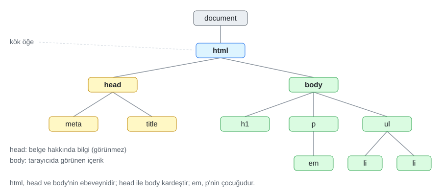

*Şekil 2.7. Kod 2.2'ye bir paragraf ve liste eklenmiş bir belgenin ağaç yapısı. Sarı düğümler `head`, yeşil düğümler `body` soyundandır.*

Ağaç modeli üç açıdan önemlidir: CSS seçicileri “`nav` içindeki `a`” gibi ilişkiler üzerinden çalışır ([Bölüm 4](04-css-temelleri.md)); JavaScript bir öğeye ağaçta gezinerek ulaşır ([Bölüm 8](08-javascript-dom-olaylar.md)); ekran okuyucular da sayfayı bu ağaçtan türetilen erişilebilirlik ağacı üzerinden okur. Şekil 2.5'teki Elements paneli, bu ağacın canlı hâlidir. Örneğin bir e-ticaret sitesinde ürün sepete eklendiğinde sayfa yenilenmeden sepet simgesindeki sayının artması, JavaScript'in DOM ağacındaki tek bir düğümün metnini güncellemesiyle gerçekleşir. Kodda tutarlı girinti kullanmak, ağaç yapısını metin üzerinde de görünür kılar.

#### 🛠 Uygulama 2.1: İlk HTML Sayfası

**Amaç:** VS Code'da Emmet ile UTF-8 kodlamalı bir HTML belgesi oluşturmak, Live Server ile açmak ve kaynağını incelemek.  
**Tahmini süre:** 15 dk

1. VS Code'u kurunuz; **Live Server** ve **Prettier** eklentilerini ekleyiniz (Bölüm 2.4.1).
2. `calismalar/bolum-02/uygulama-2-1` klasörünü oluşturup **File › Open Folder** ile açınız ve `index.html` adlı bir dosya oluşturunuz.
3. `!` yazıp <kbd>Tab</kbd> tuşuna basarak iskeleti oluşturunuz; `lang` değerini `tr`, başlığı `İlk Web Sayfam` yapınız.
4. `body` içine bir `h1` başlığı (“Merhaba Web!”), kendinizi tanıtan bir paragraf ve tüm Türkçe harfleri içeren ikinci bir paragraf yazınız.
5. Durum çubuğunda **UTF-8** yazdığını denetleyip dosyayı kaydediniz ve **Go Live** ile açınız.
6. Tarayıcıda <kbd>Ctrl</kbd>+<kbd>U</kbd> ile kaynağı, <kbd>F12</kbd> ile Elements panelini açınız; `h1` satırının üzerine gelindiğinde sayfada vurgulandığını gözlemleyiniz.

**Beklenen çıktı:**

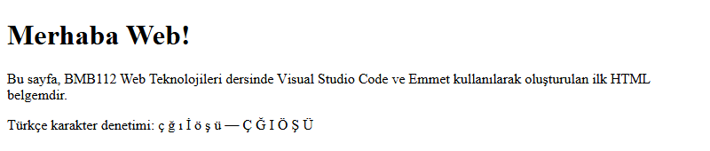

*Şekil 2.8. Uygulama 2.1'in beklenen ekran görüntüsü.*

**Kendinizi sınayın:** (1) `<meta charset="UTF-8">` satırını silip sayfayı yenileyiniz; Türkçe harflerde bir değişiklik oldu mu? Kodlama bildirilmediğinde tarayıcının kodlamayı tahmin etmek zorunda kaldığını ve sonucun tarayıcıya göre değişebileceğini not ediniz; satırı geri ekleyiniz. (2) Elements panelinde başlık metnini çift tıklayarak değiştiriniz; sayfayı yenilediğinizde ne olduğunu açıklayınız.

<details><summary>Örnek çözüm</summary>

Çözüm dosyası: [`codes/02-html-temelleri/uygulama-2-1-ilk-sayfa/index.html`](../codes/02-html-temelleri/uygulama-2-1-ilk-sayfa/index.html)

</details>

## 2.6 Metin İşaretleme

HTML'de bir metin parçası için öğe seçilirken temel soru “nasıl görünsün?” değil, **“bu içerik nedir?”** olmalıdır. İçeriği en doğru anlatan öğeyi seçmeye **anlamsal işaretleme (semantic markup)** denir [5, Bl. 4]. Görünüm her zaman CSS ile değiştirilebilir; ancak yanlış seçilmiş bir öğenin anlamı ekran okuyucuya, arama motoruna ve başka geliştiricilere yanlış iletilir. Duckett, metin öğelerini sayfanın iskeletini kuran **yapısal (structural)** işaretleme ve cümle içine ek bilgi katan **anlamsal (semantic)** işaretleme olarak iki gruba ayırır [12, ss. 41, 50]. Bu bölümde anlatılan öğelerin tamamı [`ornek-2-1-metin-etiketleri`](../codes/02-html-temelleri/ornek-2-1-metin-etiketleri/index.html) sayfasında bir arada görülebilir (Şekil 2.9).

### 2.6.1 Başlıklar: `h1`–`h6`

HTML altı başlık düzeyi tanımlar: `<h1>` en üst düzey, `<h6>` en alt düzey başlıktır. Tarayıcılar varsayılan olarak `h1`'i en büyük, `h6`'yı en küçük yazı boyutuyla gösterir; ancak düzey **önemi** ifade eder, boyutu değil.

```html
<h1>Bilgisayar Mühendisliği Bölümü</h1>
  <h2>Lisans Programı</h2>
    <h3>Birinci Sınıf Dersleri</h3>
    <h3>İkinci Sınıf Dersleri</h3>
  <h2>Araştırma Laboratuvarları</h2>
```

*Kod 2.3. Bir kitabın içindekiler tablosu gibi kurulan başlık hiyerarşisi.*

Başlıklar, belgenin **içindekiler tablosunu** oluşturur. Ekran okuyucu kullanıcıları sayfadaki başlıklar arasında tek tuşla gezinerek içeriğe göz atar; arama motorları da sayfanın konusunu büyük ölçüde başlıklardan çıkarır [12, s. 480]. Bu nedenle şu kurallara uyulmalıdır:

- Her sayfada sayfanın konusunu anlatan **bir** `h1` bulunması önerilir.
- Düzey atlanmamalıdır: `h2`'den sonra `h4`'e geçmek, kitapta 2. bölümden 2.1.1'e atlamak gibidir.
- Bir metni büyük ve kalın göstermek için başlık öğesi kullanılmamalıdır; bu bir görünüm işidir ve CSS ile yapılır. Tersine, gerçek bir başlık da `<p><b>…</b></p>` ile taklit edilmemelidir.

> [!NOTE]
> **Tarihsel not:** HTML5 taslakları, `section` ve `article` içindeki her `h1`'in otomatik olarak alt düzey sayılacağı bir “belge anahattı algoritması (outline algorithm)” tanımlamıştı [3, Bl. 2]. Hiçbir tarayıcı bu algoritmayı ekran okuyuculara yansıtmadığı için algoritma 2022'de standarttan çıkarılmıştır. Başlık düzeyi her zaman etiketteki numaraya göre belirlenir [1].

### 2.6.2 Paragraf, satır sonu ve tematik ayrım

- **`<p>`** bir **paragrafı** işaretler. Tarayıcı paragrafların üstüne ve altına boşluk bırakır. Paragraflar arasına boşluk koymak için boş `<p></p>` veya art arda `<br>` kullanılmaz; aralıklar CSS'teki `margin` özelliğiyle ayarlanır ([Bölüm 6](06-css-kutu-modeli-yerlesim.md)).
- **`<br>`** paragrafın **içinde satırı keser** (line break). Yalnızca satır sonunun içeriğin parçası olduğu yerlerde kullanılmalıdır: şiir dizeleri, posta adresi satırları gibi [12, s. 48].
- **`<hr>`** paragraf düzeyinde bir **tematik ayrımı (thematic break)** belirtir: bir hikâyede sahne değişimi, bir duyuru sayfasında konunun değişmesi gibi. Tarayıcı bunu yatay bir çizgi olarak gösterir; ancak öğenin anlamı “çizgi” değil “konu değişti”dir. Yalnızca süs amaçlı bir çizgi gerekiyorsa CSS'teki `border` özelliği kullanılır.

### 2.6.3 Boşlukların birleşmesi ve `pre`

Tarayıcı, HTML kaynağında art arda gelen boşlukları, sekmeleri ve satır sonlarını **tek bir boşluğa indirger**. Bu davranışa **boşlukların birleşmesi (white space collapsing)** denir [12, s. 47]. Aşağıdaki iki paragraf tarayıcıda aynı görünür:

```html
<p>Web Teknolojileri dersi</p>
<p>Web       Teknolojileri
   dersi</p>
```

Bu özellik sayesinde kod, girintilerle okunaklı biçimde düzenlenebilir. Metnin boşluklarıyla birlikte aynen gösterilmesi gerektiğinde **`<pre>` (preformatted text — önceden biçimlendirilmiş metin)** öğesi kullanılır. `pre` içindeki boşluk ve satır sonları korunur ve metin varsayılan olarak eş aralıklı (monospace) yazı tipiyle gösterilir. Kod listeleri, ASCII çizimleri ve hizalı metin çıktıları tipik kullanım alanlarıdır. Bir boşluğun satır sonunda kırılmaması isteniyorsa (ör. “25 °C”, “Dr. Özhan”) **bölünmez boşluk** karakter referansı `&nbsp;` kullanılır (Bölüm 2.10.1).

### 2.6.4 Vurgu ve önem: `em`, `i`, `strong`, `b`, `mark`

Dört öğe çifti tarayıcıda benzer görünür, ancak farklı anlamlar taşır [5, ss. 86–87], [1]:

| Öğe | Anlamı | Varsayılan görünüm | Örnek kullanım |
|---|---|---|---|
| `<strong>` | Güçlü **önem**, ciddiyet, aciliyet | kalın | Uyarılar: “Sınava **kimlik kartı ile** gelinmelidir.” |
| `<b>` | Önem taşımadan **dikkat çekilen** metin | kalın | Ürün adı, özetteki anahtar sözcük |
| `<em>` | Vurgu (stress emphasis): sesli okunurken üzerine basılan sözcük; vurgu yeri anlamı değiştirir | italik | “Ödevi *bugün* teslim ediniz.” |
| `<i>` | Farklı bir ses tonu: yabancı terim, gemi adı, düşünce | italik | `<i lang="la">in situ</i>` |
| `<mark>` | Bağlamdaki **ilgililik**: arama sonucunda eşleşen sözcük, alıntıda sonradan işaretlenen kısım | sarı arka plan | “Web <mark>Teknolojileri</mark>” |

*Tablo 2.2. Vurgu ve önem bildiren öğeler.*

Tablo 2.2'deki ayrım, özellikle ekran okuyucular ve ileride JavaScript ile sayfayı işleyen programlar için önemlidir. Örneğin bir e-ticaret sitesinde ürün adı `b` ile, “Stok tükenmek üzere!” uyarısı `strong` ile işaretlenir. `mark` öğesinin sarı rengi yalnızca varsayılan görünümdür; renk CSS ile değiştirilebilir. Yalnızca görsel olarak kalın veya italik yazı isteniyorsa doğru araç CSS'teki `font-weight` ve `font-style` özellikleridir ([Bölüm 5](05-css-metin-renk-arka-plan.md)).

### 2.6.5 Teknik metin: `code`, `kbd`, `samp`, `var`, `dfn`

Bilgisayar mühendisliği metinlerinde sık geçen içerik türleri için özel öğeler vardır:

- **`<code>`**: Bilgisayar kodu parçası: `<code>console.log()</code>`. Birden çok satırlık kod için `<pre><code>…</code></pre>` birlikte kullanılır.
- **`<kbd>`**: Kullanıcının klavyeden gireceği tuş veya metin: `<kbd>Ctrl</kbd> + <kbd>S</kbd>`.
- **`<samp>`**: Bir programın **ürettiği çıktı** örneği (sample output).
- **`<var>`**: Matematiksel ifadede veya programlamada bir **değişken**: alan = `<var>a</var> × <var>b</var>`.
- **`<dfn>`**: Bir terimin **tanımlandığı yer** (defining instance). Terimin açıklaması içinde bulunduğu paragrafta yer alır; öğe, “bu terim burada tanımlanıyor” bilgisini taşır.

Sunumda bu öğeler için verilen “matematiksel tanım tipinde”, “örnek tipinde yazdırır” gibi açıklamalar öğelerin görünümünü anlatmaktadır; doğru yaklaşım, öğeyi taşıdığı anlama göre seçmektir.

### 2.6.6 Üst ve alt indis; değişiklik işaretleri

**`<sup>`** üst indis (superscript), **`<sub>`** alt indis (subscript) oluşturur: `E = mc<sup>2</sup>`, `H<sub>2</sub>O`. Kare metre gibi birimlerde, dipnot numaralarında ve kimyasal formüllerde kullanılır. Karmaşık matematiksel ifadeler için HTML'in parçası olan MathML dili daha uygundur.

Belgede yapılan değişiklikleri izlemek için iki öğe çifti bulunur:

- **`<ins>`** belgeye sonradan **eklenen**, **`<del>`** belgeden **silinen** içeriği gösterir. Tarayıcı `ins`'in altını çizer, `del`'in üstünü çizer. İki öğe de değişikliğin tarihini `datetime` niteliğiyle taşıyabilir: `<del datetime="2026-03-10">10 Mart</del>`.
- **`<s>`** artık **doğru veya geçerli olmayan** içeriği gösterir (ör. indirimden önceki eski fiyat); bu bir düzeltme kaydı değil, bilgi güncelliğini yitirmiştir anlamındadır.
- **`<u>`** metne açıklanmamış bir **işaret** koyar; en yaygın meşru kullanımı yazım hatalarının işaretlenmesidir. Web'de altı çizili metin bağlantı olarak algılandığından `u` öğesinden ve yalnızca görünüm için altı çizmekten kaçınılmalıdır.

> [!NOTE]
> **Tarihsel not:** `b`, `i`, `u` ve `s` öğeleri, CSS bulunmayan ilk yıllarda doğrudan kalın, italik, altı çizili ve üstü çizili yazmak için kullanılan görünüm öğeleriydi. HTML5 bu öğeleri kaldırmamış, onlara yukarıdaki anlamsal tanımları vermiştir [5, ss. 86–87]. Yalnızca görünüm amaçlı `<font>`, `<center>`, `<big>` ve `<strike>` öğeleri ise standarttan çıkarılmıştır; eski sitelerin kaynağında görülebilirler, ancak kullanılmamalıdır.

### 2.6.7 Alıntılar ve kısaltmalar

**`<blockquote>`** başka bir kaynaktan alınan **uzun, blok düzeyinde** alıntıyı işaretler; kaynağın adresi `cite` niteliğiyle verilebilir. Tarayıcı alıntıyı içeri girintili gösterir; ancak `blockquote` yalnızca girinti elde etmek amacıyla kullanılmamalıdır [12, s. 52]. Satır içindeki **kısa alıntılar** için **`<q>`** kullanılır; tarayıcı tırnak işaretlerini kendisi ekler. **`<cite>`** öğesi bir **eserin adını** (kitap, makale, film, şarkı, internet sitesi) işaretler; kişi adları için kullanılmaz.

```html
<blockquote cite="https://www.w3.org/mission/accessibility/">
  <p>Web'in gücü evrenselliğindedir.</p>
</blockquote>
<p>— <cite>W3C Erişilebilirlik Misyonu</cite></p>
<p>Berners-Lee'ye göre <q>Web'in gücü evrenselliğindedir.</q></p>
```

*Kod 2.4. Blok alıntı, satır içi alıntı ve eser adı.*

**`<abbr>`** bir kısaltmayı işaretler; açılımı `title` niteliğine yazılır ve fare ile üzerine gelindiğinde ipucu olarak görünür: `<abbr title="World Wide Web Consortium">W3C</abbr>`. `title` ipucu dokunmatik ekranlarda ve klavye kullanıcılarında görünmediğinden, kısaltmanın açılımı metinde ilk geçtiği yerde ayrıca yazılmalıdır.

### 2.6.8 Yorum satırları

`<!--` ile `-->` arasına yazılan metin bir **yorumdur (comment)**; tarayıcı tarafından gösterilmez ve iç içe yazılamaz. Yorumlar kodun bölümlerini açıklamak veya bir satırı geçici olarak devre dışı bırakmak için kullanılır. VS Code'da <kbd>Ctrl</kbd>+<kbd>/</kbd> kısayolu seçili satırları yoruma dönüştürür.

```html
<!-- Üst menü: ana sayfa bağlantıları -->
<!-- <p>Bu paragraf geçici olarak gizlendi.</p> -->
```

> [!WARNING]
> Yorumlar ekranda görünmese de **sayfa kaynağını görüntüleyen herkes tarafından okunabilir** (Bölüm 2.4.5). Yorumlara parola, veritabanı adresi, sınav cevabı veya kişisel veri yazılmamalıdır.

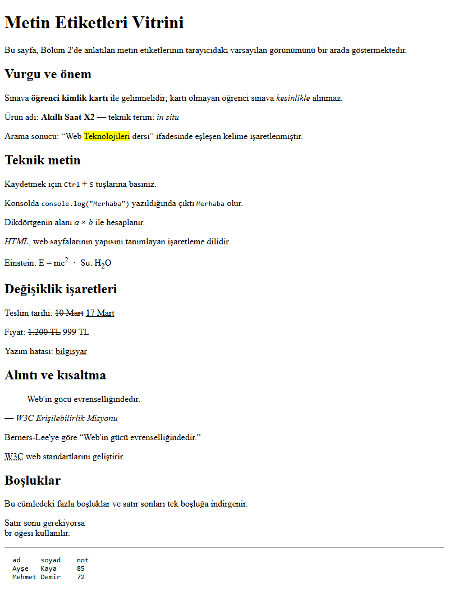

*Şekil 2.9. Bu bölümde anlatılan metin öğelerinin Chrome'daki varsayılan görünümü ([ornek-2-1-metin-etiketleri](../codes/02-html-temelleri/ornek-2-1-metin-etiketleri/index.html)).*

#### 🛠 Uygulama 2.2: Sınav Duyurusu (Metnin Anlamı)

**Amaç:** Başlık hiyerarşisini ve metin öğelerini görünüme göre değil anlama göre seçmek.  
**Tahmini süre:** 20 dk

1. `calismalar/bolum-02/uygulama-2-2` klasöründe `index.html` dosyasını Emmet ile oluşturunuz.
2. “BMB112 Web Teknolojileri — Ara Sınav Duyurusu” başlığını `h1`, “Sınav bilgileri”, “Kapsam”, “Güncelleme”, “Hocanın notu” başlıklarını `h2`, “Örnek soru” başlığını `h3` olarak yazınız.
3. Sınav tarih ve saatini `strong`, “yalnızca” sözcüğünü `em`, “HTML” ve “CSS” kısaltmalarını açılımlarıyla birlikte `abbr` ile işaretleyiniz.
4. Örnek soruda `<p>H<sub>2</sub>O ve x<sup>2</sup></p>` kodunu sayfada **kod olarak** gösteriniz (`pre` + `code`; `<` ve `>` için `&lt;` ve `&gt;` kullanınız) ve altına beklenen çıktıyı `samp` ile yazınız.
5. Salon değişikliğini `del` ve `ins` ile, hocanın notunu `blockquote` ile, “F5” tuşunu `kbd` ile işaretleyiniz; “Hocanın notu” bölümünden önce bir `hr` ekleyiniz.
6. Sayfayı Live Server ile açınız ve Şekil 2.10 ile karşılaştırınız.

**Beklenen çıktı:**

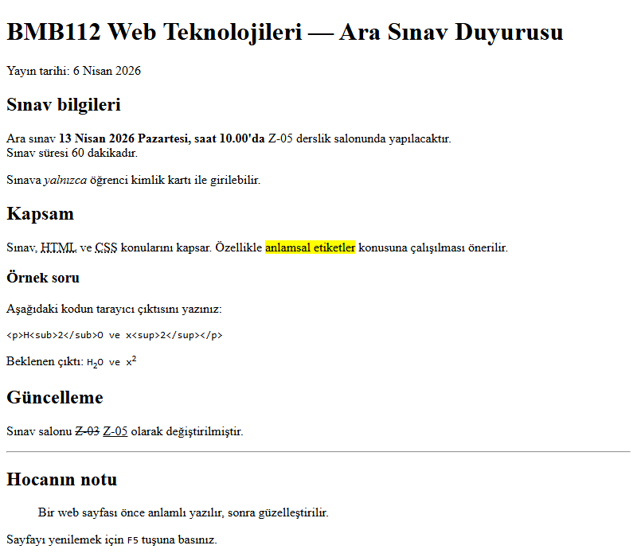

*Şekil 2.10. Uygulama 2.2'nin beklenen ekran görüntüsü.*

**Kendinizi sınayın:** (1) Bir paragrafa art arda on boşluk ve üç satır sonu ekleyip sonucu gözlemleyiniz. (2) Yayın tarihini `<time datetime="2026-04-06">` öğesi içine alınız; sayfada bir fark görünmemesinin nedenini açıklayınız.

<details><summary>Örnek çözüm</summary>

Çözüm dosyası: [`codes/02-html-temelleri/uygulama-2-2-metin-anlami/index.html`](../codes/02-html-temelleri/uygulama-2-2-metin-anlami/index.html)

</details>

## 2.7 Listeler

HTML üç liste türü sunar: sırasız, sıralı ve tanım listeleri [12, ss. 62–68]. Menüler, ürün özellikleri, adım adım talimatlar ve sözlükler gibi web içeriğinin büyük bölümü aslında birer listedir.

### 2.7.1 Sırasız liste: `ul`

**`<ul>` (unordered list)**, sıranın önemli olmadığı maddeleri gruplar. Her madde bir **`<li>` (list item)** öğesidir ve `ul`'nin doğrudan çocuğu yalnızca `li` olabilir. Tarayıcı maddelerin önüne varsayılan olarak dolu yuvarlak madde işareti koyar.

```html
<ul>
  <li>Elma</li>
  <li>Portakal</li>
  <li>Mandalina</li>
</ul>
```

Web sitelerindeki gezinme menüleri de çoğunlukla bir `ul` içindeki bağlantılardan oluşur; görünüm CSS ile yatay bir menüye dönüştürülür.

### 2.7.2 Sıralı liste: `ol`

**`<ol>` (ordered list)**, sıranın anlam taşıdığı maddeler için kullanılır: tarif adımları, kurulum talimatları, sıralama sonuçları. `ol` üç yararlı nitelik alır:

| Nitelik | Görevi | Örnek |
|---|---|---|
| `type` | Numaralama türü: `1` (varsayılan), `a`, `A`, `i`, `I` | `<ol type="A">` → A, B, C |
| `start` | Başlangıç değeri (her zaman sayı olarak yazılır) | `<ol type="A" start="3">` → C, D, E |
| `reversed` | Ters sırada numaralama (mantıksal nitelik, değer almaz) | `<ol reversed>` → 3, 2, 1 |

*Tablo 2.3. `ol` öğesinin nitelikleri.*

Tablo 2.3'teki `type` niteliği, numaralama türünün içeriğin anlamına ait olduğu durumlarda kullanılır; örneğin bir hukuk metninde maddeler (a), (b) diye anılıyorsa. Numaralama yalnızca görsel bir tercihse CSS'teki `list-style-type` özelliği yeğlenir (Bölüm 2.7.5). Tek bir maddenin numarası `<li value="10">` ile değiştirilebilir.

### 2.7.3 Tanım listesi: `dl`, `dt`, `dd`

**`<dl>` (description list)**, ad–değer çiftlerinden oluşan listeler içindir: sözlükler, SSS sayfaları, ürün teknik özellikleri. **`<dt>`** terimi, **`<dd>`** açıklamayı içerir; bir terimin birden çok açıklaması veya bir açıklamanın birden çok terimi olabilir.

```html
<dl>
  <dt>TCP/IP</dt>
  <dd>Bilgisayarlar arası veri iletimini düzenleyen protokol ailesidir.</dd>
  <dt>DNS</dt>
  <dd>Alan adlarını IP adreslerine çeviren sistemdir.</dd>
</dl>
```

> [!NOTE]
> **Tarihsel not:** HTML 4'te `dl` “definition list (tanım listesi)” olarak adlandırılıyordu. HTML5 öğeyi “description list (açıklama listesi)” olarak yeniden tanımlamış ve kullanım alanını genişletmiştir; sözlük dışındaki ad–değer çiftleri de bu öğeyle işaretlenebilir.

### 2.7.4 İç içe listeler

Bir liste maddesinin içine yeni bir liste yerleştirilebilir. İç liste, üst listenin bir **`li` öğesinin içinde** yer almalıdır; doğrudan `ul` veya `ol`'nin içine yazılamaz [12, s. 68].

```html
<ul>
  <li>Ön yüz (front-end)
    <ul>
      <li>HTML</li>
      <li>CSS</li>
    </ul>
  </li>
  <li>Arka yüz (back-end)</li>
</ul>
```

*Kod 2.5. İç içe liste: iç `ul`, “Ön yüz” maddesinin `li` öğesi kapanmadan önce yazılmıştır.*

Tarayıcı iç listelerin madde işaretini kendiliğinden değiştirir (dolu daire → boş daire → kare).

### 2.7.5 Liste stilini CSS ile değiştirmek

Ders sunumunda madde işaretleri `style` niteliğiyle değiştirilmektedir:

```html
<ul style="list-style-type: square">…</ul>
<ol style="list-style-type: upper-roman">…</ol>
```

Bu yazım çalışır; ancak `style` niteliği yalnızca o tek listeyi etkiler ve stil bilgisini içerikle karıştırır. Aynı sonuç, belgenin `head` bölümüne yazılan bir CSS kuralı ile tüm sayfa için bir kez tanımlanabilir:

```html
<style>
  .kare {
    list-style-type: square;
  }

  .roma {
    list-style-type: upper-roman;
  }
</style>
…
<ul class="kare">…</ul>
<ol class="roma">…</ol>
```

*Kod 2.6. Liste stilinin gömülü CSS ile tanımlanması.*

`list-style-type` özelliğinin sık kullanılan değerleri: `disc` (dolu daire), `circle` (boş daire), `square` (kare), `decimal` (1, 2, 3), `lower-alpha` / `upper-alpha`, `lower-roman` / `upper-roman` ve `none`. `class` niteliği ve `<style>` öğesi [Bölüm 4](04-css-temelleri.md)'te ayrıntılı ele alınmaktadır.

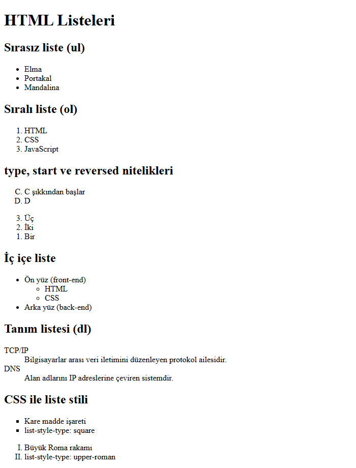

*Şekil 2.11. Sırasız, sıralı, `type`/`start`/`reversed` nitelikli, iç içe, tanım ve CSS ile biçimlendirilmiş listeler ([ornek-2-2-listeler](../codes/02-html-temelleri/ornek-2-2-listeler/index.html)).*

#### 🛠 Uygulama 2.3: Listelerle Tarif Sayfası

**Amaç:** Üç liste türünü ve iç içe listeyi içeriğin anlamına göre seçmek.  
**Tahmini süre:** 15 dk

1. `calismalar/bolum-02/uygulama-2-3/index.html` dosyasını oluşturunuz; başlığı “Menemen Tarifi” yapınız.
2. Malzemeleri `ul` ile yazınız; “Baharatlar” maddesinin içine tuz ve pul biberden oluşan iç içe bir liste ekleyiniz (Emmet: `ul>li*2`).
3. Yapılış adımlarını `ol` ile yazınız.
4. “Pişirme aşamaları” için Roma rakamlı bir liste oluşturunuz; numaralamayı `<style>` içindeki `list-style-type: upper-roman` kuralıyla veriniz.
5. Üç maddelik bir geri sayımı `<ol reversed>` ile, mutfak terimlerini (“kavurmak”, “rendelemek”) `dl` ile yazınız.

**Beklenen çıktı:**

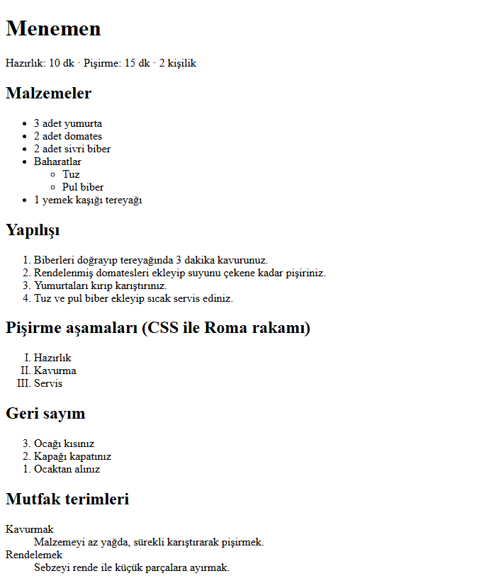

*Şekil 2.12. Uygulama 2.3'ün beklenen ekran görüntüsü.*

**Kendinizi sınayın:** (1) İç listeyi `li`'nin dışına, doğrudan `ul`'nin içine taşıyıp sayfayı doğrulayıcıda (Bölüm 2.13) denetleyiniz. (2) Yapılış listesini 5. adımdan başlatınız.

<details><summary>Örnek çözüm</summary>

Çözüm dosyası: [`codes/02-html-temelleri/uygulama-2-3-tarif-sayfasi/index.html`](../codes/02-html-temelleri/uygulama-2-3-tarif-sayfasi/index.html)

</details>

## 2.8 Görseller

### 2.8.1 `img` öğesi ve nitelikleri

Sayfaya görsel eklemek için boş bir öğe olan **``** kullanılır. Görsel, HTML dosyasının içine gömülmez; tarayıcı `src` niteliğindeki adresten ayrı bir HTTP isteğiyle indirir [12, Bl. 5].

```html

```

| Nitelik | Görevi |
|---|---|
| `src` | Görsel dosyasının yolu (source); göreli veya mutlak URL (Bölüm 2.11.1) |
| `alt` | Görsel görüntülenemediğinde veya görülemediğinde onun yerine geçen **metin alternatifi** |
| `width`, `height` | Görselin piksel cinsinden genişliği ve yüksekliği (birim yazılmaz) |
| `loading` | `lazy` değeri, ekranın dışındaki görselin kullanıcı yaklaşana kadar indirilmemesini sağlar |
| `title` | Fare ile üzerine gelindiğinde görünen ek bilgi; `alt`'ın yerini tutmaz |

*Tablo 2.4. `img` öğesinin temel nitelikleri.*

### 2.8.2 Alternatif metin (`alt`)

`alt` niteliği **zorunludur** ve erişilebilirliğin temel taşıdır [14], [12, s. 99]. Ekran okuyucu görselin yerine `alt` metnini okur; görsel yüklenemezse tarayıcı bu metni gösterir; arama motorları görselin içeriğini bu metinden anlar. İyi bir alternatif metin yazmak için şu yönergeler izlenir:

- Görselin sayfadaki **işlevini** veya **içeriğini** kısaca anlatır: “Kırmızı çatılı, iki katlı fakülte binası”. “Resim”, “görsel”, “foto1.jpg” gibi ifadeler bilgi taşımaz.
- Bağlantı olarak kullanılan bir görselde hedefi anlatır: logo bağlantısı için `alt="Ana sayfa"`.
- Görsel yalnızca **süs** amaçlıysa `alt=""` (boş) yazılır; ekran okuyucu bu görseli atlar. Nitelik hiç yazılmazsa ekran okuyucu dosya adını okuyabilir.
- Metin içeren görsellerde (ör. bir afiş) metnin tamamı `alt`'a veya sayfa metnine yazılır.

> [!TIP]
> **Güncel hayattan:** Instagram ve X (Twitter) gibi sosyal medya platformları, paylaşılan fotoğraflar için kullanıcıya “alternatif metin ekle” seçeneği sunmakta, sağlanmadığında otomatik açıklama üretmektedir. Haber siteleri ve e-ticaret siteleri ürün fotoğraflarına açıklayıcı alternatif metin yazarak hem görme engelli kullanıcılara hem de görsel aramalarına hitap etmektedir.

### 2.8.3 Boyutlar, düzen kayması ve tembel yükleme

`width` ve `height` nitelikleri yazıldığında tarayıcı, görsel henüz inmeden sayfada onun için doğru oranda yer ayırır. Yazılmazsa görsel indiğinde altındaki metin aşağı itilir; kullanıcı tam bir bağlantıya tıklamak üzereyken içeriğin kaymasına **düzen kayması (layout shift)** denir. Bu nedenle görselin gerçek boyutları her zaman yazılmalıdır; görüntüleme boyutu gerektiğinde CSS ile ayarlanır (CSS'te `max-width: 100%; height: auto;` kuralı, en–boy oranını koruyarak görseli kabına sığdırır; bkz. [Bölüm 9](09-duyarli-tasarim.md)).

`loading="lazy"` niteliği, sayfanın aşağısındaki görsellerin kullanıcı o noktaya yaklaşana kadar indirilmemesini sağlar [15]. Uzun ürün listelerinde ve haber akışlarında veri kullanımını ve sayfa açılış süresini azaltır. Sayfa açıldığında hemen görünen (ekranın üst kısmındaki) görsellere `lazy` verilmemelidir; aksi hâlde ana görselin yüklenmesi gecikir.

### 2.8.4 `figure` ve `figcaption`

**`<figure>`**, ana metinde atıf yapılan ancak kendi başına anlamlı olan bir içerik birimini (görsel, diyagram, kod listesi, şiir) gruplar. **`<figcaption>`** bu birimin **altyazısıdır** ve `figure`'ın ilk veya son çocuğu olarak yazılır [1].

```html
<figure>
  
  <figcaption>Şekil 1. Çorlu Mühendislik Fakültesi binası (temsilî çizim).</figcaption>
</figure>
```

*Kod 2.7. Görsel ve altyazısı. Öğenin adı `figcaption`'dır.*

> [!IMPORTANT]
> Sunumdaki `<figurecaption>` yazımı hatalıdır; HTML'de böyle bir öğe yoktur ve doğrulayıcı “completely-unknown element” hatası verir (Bölüm 2.13). Doğru ad **`figcaption`**'dır. Ayrıca `alt` niteliği bir “resim yazısı” değildir: altyazı `figcaption`'a, görselin metin alternatifi `alt`'a yazılır ve ikisi aynı cümle olmamalıdır.

### 2.8.5 Görsel biçimleri

| Biçim | Tür | Saydamlık | Animasyon | Tipik kullanım |
|---|---|---|---|---|
| **JPEG** (`.jpg`) | Kayıplı, raster | Yok | Yok | Fotoğraflar |
| **PNG** (`.png`) | Kayıpsız, raster | Var (alfa kanalı) | Yok (APNG hariç) | Ekran görüntüsü, keskin kenarlı grafik, saydam logo |
| **GIF** (`.gif`) | Kayıpsız, en çok 256 renk | Tek renk saydam | Var | Basit animasyon (yerini video ve WebP'ye bırakmaktadır) |
| **SVG** (`.svg`) | Vektör (XML metni) | Var | Var (CSS/JS ile) | Logo, simge, diyagram; her ölçekte keskin |
| **WebP** (`.webp`) | Kayıplı veya kayıpsız | Var | Var | Fotoğraf ve grafikler için JPEG/PNG'den genellikle daha küçük dosya |
| **AVIF** (`.avif`) | Kayıplı veya kayıpsız | Var | Var | En yüksek sıkıştırma; tüm güncel tarayıcılarda desteklenir |

*Tablo 2.5. Web'de kullanılan başlıca görsel biçimleri.*

Tablo 2.5'e göre seçim içeriğin türüne bağlıdır: fotoğraf için JPEG, WebP veya AVIF; logo ve diyagram için SVG; saydam ekran görüntüsü için PNG. Görsel, gösterileceği boyuttan çok büyük kaydedilmemelidir; 4000 piksellik bir telefon fotoğrafını 400 piksellik bir kutuda göstermek gereksiz yere megabaytlarca veri indirtir [12, ss. 107–118].

### 2.8.6 `picture` ve `srcset`'e kısa bir giriş

Aynı görselin farklı ekranlar için farklı sürümlerini sunmak mümkündür. `srcset` niteliği tarayıcıya aday dosyaların listesini verir; tarayıcı ekran genişliğine ve piksel yoğunluğuna uygun olanı seçer. `<picture>` öğesi ise farklı biçimleri yedekli sunar: tarayıcı desteklediği ilk `source`'u kullanır, hiçbirini desteklemezse içteki `img`'ye döner.

```html
<picture>
  <source srcset="kampus.avif" type="image/avif">
  <source srcset="kampus.webp" type="image/webp">
  
</picture>
```

*Kod 2.8. Biçim yedeklemeli `picture` öğesi. `alt` ve boyutlar her zaman `img` üzerine yazılır.*

Duyarlı görsellerin ayrıntıları (`sizes` niteliği, sanat yönetimi) [Bölüm 9](09-duyarli-tasarim.md)'da ele alınmaktadır.

#### 🛠 Uygulama 2.4: Görsel ve Altyazı

**Amaç:** `img` öğesini erişilebilir alternatif metin, boyut ve tembel yükleme ile kullanmak; görseli `figure`/`figcaption` ile altyazılandırmak.  
**Tahmini süre:** 15 dk

1. `uygulama-2-4` klasöründe bir `images` alt klasörü oluşturunuz ve içine bir görsel kopyalayınız (çözüm klasöründeki `kampus.svg` ve `ayrac.svg` dosyaları kullanılabilir).
2. `index.html` dosyasında görseli `width` ve `height` nitelikleriyle, açıklayıcı bir `alt` metniyle ekleyiniz; `figure` içine alıp `figcaption` ile “Şekil 1. …” altyazısı veriniz.
3. Süs amaçlı ayraç görselini `alt=""` ile ekleyiniz.
4. Aynı görseli sayfanın altına yarı boyutta ve `loading="lazy"` ile ikinci kez ekleyiniz.
5. Var olmayan bir dosyaya işaret eden bir `img` ekleyerek tarayıcının `alt` metnini nasıl gösterdiğini gözlemleyiniz.

**Beklenen çıktı:**

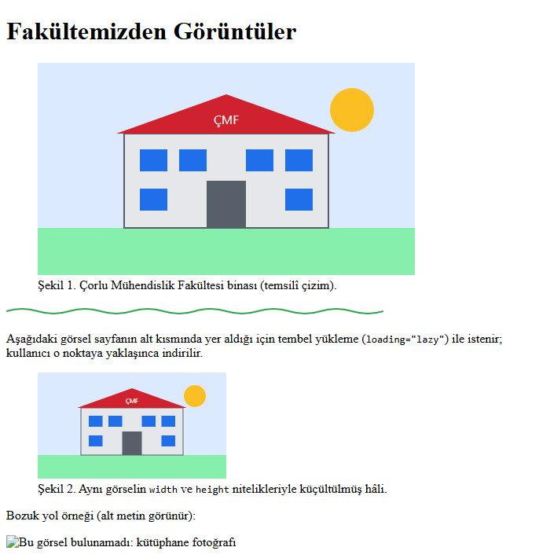

*Şekil 2.13. Uygulama 2.4'ün beklenen ekran görüntüsü; en altta yüklenemeyen görselin yerine alternatif metin görünmektedir.*

**Kendinizi sınayın:** (1) Birinci görselden `width` ve `height` niteliklerini silip DevTools › Network sekmesinde hızı “Slow 4G” yaparak sayfayı yenileyiniz; düzen kaymasını gözlemleyiniz. (2) Görseli bir bağlantı içine alınız ve `alt` metnini bağlantının hedefini anlatacak biçimde değiştiriniz.

<details><summary>Örnek çözüm</summary>

Çözüm dosyası: [`codes/02-html-temelleri/uygulama-2-4-gorsel-figure/index.html`](../codes/02-html-temelleri/uygulama-2-4-gorsel-figure/index.html)

</details>

## 2.9 Meta Veri ve Arama Motorları

### 2.9.1 `meta` öğesi

Yunanca *meta* (“ötesinde, hakkında”) sözcüğünden gelen **meta veri (metadata)**, “veri hakkındaki veri” demektir. **`<meta>`** boş bir öğedir; `head` içine yazılır, sayfada görünmez ve tarayıcıya, arama motorlarına ve sosyal medya platformlarına belge hakkında bilgi verir [12, ss. 191–192]. Üç biçimde kullanılır:

- `charset` niteliğiyle karakter kodlaması: `<meta charset="UTF-8">`
- `name` + `content` çiftiyle adlandırılmış bilgi: `<meta name="description" content="…">`
- `http-equiv` + `content` çiftiyle bir HTTP yanıt başlığının eşdeğeri (*equivalent*): `<meta http-equiv="refresh" content="30">`

### 2.9.2 Temel meta etiketleri

```html
<head>
  <meta charset="UTF-8">
  <meta name="viewport" content="width=device-width, initial-scale=1.0">
  <title>Bilgisayar Mühendisliği Bölümü | Çorlu Mühendislik Fakültesi</title>
  <meta name="description" content="TNKÜ Çorlu Mühendislik Fakültesi Bilgisayar Mühendisliği Bölümü: lisans programı, dersler, duyurular ve iletişim bilgileri.">
  <meta name="author" content="ÇMF Bilgisayar Mühendisliği Bölümü">
</head>
```

*Kod 2.9. Bir bölüm sayfası için temel meta veriler.*

> [!IMPORTANT]
> `html` öğesi belgenin köküdür ve `head` onun **içinde** yer alır. Sunumdaki örnekte `<head>` satırının `<html lang="tr">` satırından önce yazılması bir sıralama hatasıdır; doğru sıra Kod 2.2'de gösterilmiştir.

- **`description`**: Arama sonuçları sayfasında (SERP — Search Engine Results Page) başlığın altında görünebilen kısa tanıtım metnidir. Sıralamayı doğrudan etkilemez, ancak kullanıcının bağlantıya tıklayıp tıklamamasını etkiler [12, s. 480]. Her sayfa için ayrı, sayfanın içeriğini özetleyen bir veya iki cümle yazılmalıdır. Arama motorları uygun bulmadıklarında bu metin yerine sayfadan seçtikleri bir parçayı gösterebilir.
- **`author`**: Belgenin yazarını belirtir; kurumsal sitelerde içerik sahipliğini kayıt altına almak için kullanılır.
- **`viewport`** ve **`charset`**: Bölüm 2.5.2'de açıklanmıştır.

### 2.9.3 Otomatik yenileme ve yönlendirme: `http-equiv="refresh"`

```html
<meta http-equiv="refresh" content="30">
<meta http-equiv="refresh" content="5; url=https://www.nku.edu.tr/">
```

İlk satır sayfayı her 30 saniyede bir yeniler; ikinci satır 5 saniye sonra belirtilen adrese yönlendirir.

> [!WARNING]
> Otomatik yenileme ve zamanlı yönlendirme, form dolduran veya sayfayı ekran okuyucuyla dinleyen kullanıcının işini habersizce keser. WCAG 2.2.1 (Ayarlanabilir Zamanlama) ölçütü, kullanıcıya süreyi durdurma, uzatma veya kapatma olanağı verilmesini ister [14]. Kalıcı yönlendirme sunucu tarafında **HTTP 301** yanıtıyla yapılmalı; canlı skor veya borsa verisi gibi güncellenen içerikte tüm sayfa yerine yalnızca ilgili bölüm JavaScript ile güncellenmelidir ([Bölüm 8](08-javascript-dom-olaylar.md)).

### 2.9.4 Arama motoru yönergeleri: `robots`

**Tarayıcı robot (crawler)**, web'deki sayfaları bağlantıları izleyerek dolaşan ve arama motorunun dizinini (index) oluşturan programdır; Google'ınkinin adı Googlebot'tur. `robots` meta etiketi, bu programlara sayfanın nasıl işleneceğini bildirir [16]:

```html
<meta name="robots" content="noindex, nofollow">
```

| Değer | Anlamı |
|---|---|
| `all` | Kısıtlama yok; varsayılan davranıştır (`index, follow` ile eşdeğer) |
| `noindex` | Sayfa arama sonuçlarında gösterilmez |
| `nofollow` | Robot bu sayfadaki bağlantıları izlemez |
| `none` | `noindex, nofollow` ile eşdeğerdir |
| `nosnippet` | Arama sonucunda sayfadan metin parçası (snippet) veya video önizlemesi gösterilmez |
| `noimageindex` | Sayfadaki görseller görsel aramalarında dizine eklenmez |
| `unavailable_after: [tarih]` | Belirtilen tarih ve saatten sonra sayfa sonuçlardan kaldırılır; tarih ISO 8601 gibi yaygın bir biçimde yazılır: `unavailable_after: 2026-12-31` |
| `noarchive` | Eskiden Google'ın “önbellekteki kopya” bağlantısını gizlerdi; Google bu özelliği kaldırdığı için artık dikkate almamaktadır |

*Tablo 2.6. `robots` meta etiketinin değerleri.*

Tablo 2.6'daki yönergeler bir **istek** niteliğindedir; iyi niyetli arama motorları uyar, ancak kötü niyetli robotlar uymayabilir. Bu nedenle `noindex` gizli bilgiyi korumanın bir yolu değildir; gizli içerik parolayla korunmalıdır. Örneğin bir üniversitenin sınav sonuçlarını yayımladığı geçici sayfa `noindex` ile arama sonuçlarından uzak tutulabilir, ama kişisel veriler yalnızca kimlik doğrulamalı sayfalarda (ör. OBS) gösterilmelidir. Yönergelerin tüm site için verilmesi gerektiğinde kök dizindeki `robots.txt` dosyası kullanılır.

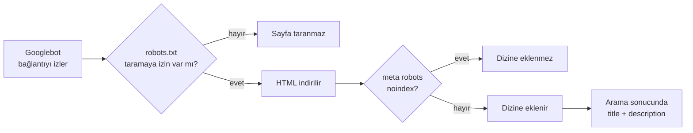

*Şekil 2.14. Bir sayfanın arama motoru dizinine girme süreci ve meta verilerin rolü.*

### 2.9.5 Sosyal medya önizlemesi: Open Graph

Bir bağlantı WhatsApp, LinkedIn veya Facebook'ta paylaşıldığında görünen başlık, açıklama ve görsel kartı, **Open Graph** protokolünün meta etiketlerinden okunur [17]. Bu etiketlerde `name` yerine `property` niteliği kullanılır:

```html
<meta property="og:title" content="Bilgisayar Mühendisliği Kulübü">
<meta property="og:description" content="Atölyeler, hackathon duyuruları ve etkinlik takvimi.">
<meta property="og:image" content="https://example.edu.tr/kulup/onizleme.png">
<meta property="og:url" content="https://example.edu.tr/kulup/">
<meta property="og:type" content="website">
```

### 2.9.6 Eskimiş uygulamalar: `keywords` ve “URL gönder” aracı

> [!NOTE]
> **Tarihsel not (`keywords`):** `<meta name="keywords" content="HTML, Bilgisayar, Çorlu">` etiketi 1990'larda arama motorlarına sayfanın anahtar sözcüklerini bildirmek için kullanılırdı. Sayfayla ilgisiz popüler sözcüklerle doldurularak kötüye kullanıldığından Google, 2009'da bu etiketi sıralamada **dikkate almadığını** açıklamıştır [18]. Etiket geçersiz değildir, ancak yeni sayfalara yazılmasının arama görünürlüğüne bir katkısı yoktur.

> [!NOTE]
> **Tarihsel not (URL gönderme):** Sunumda anlatılan `google.com/webmasters/tools/submit-url` adresi ve “Web Yöneticisi Araçları › Google gibi Getir › Dizine gönder” adımları, Google'ın eski Search Console arayüzüne aittir; bu araçlar 2018–2019 yıllarında kaldırılmıştır.

### 2.9.7 Güncel yöntem: Search Console ve site haritası

Bir sayfanın Google'da görünüp görünmediğini denetlemek ve dizine eklenmesini istemek için bugün **Google Search Console** kullanılır [19]:

1. https://search.google.com/search-console adresinde site eklenir ve sahiplik doğrulanır (ör. sitenin köküne Google'ın verdiği bir HTML dosyası yüklenerek veya alan adına DNS kaydı eklenerek).
2. Üstteki arama kutusuna sayfanın tam URL'si yazılarak **URL Denetimi (URL Inspection)** aracı çalıştırılır; araç sayfanın dizinde olup olmadığını ve sorunları gösterir.
3. Sayfa dizinde değilse veya güncellenmişse **Dizine eklenmesini iste (Request indexing)** düğmesine tıklanır. Bu bir istektir; dizine ekleme garanti edilmez ve süre değişebilir.
4. Çok sayfalı sitelerde tüm sayfaların listesini içeren bir **site haritası (sitemap.xml)** hazırlanıp **Site haritaları (Sitemaps)** bölümünden gönderilir.

Bing için aynı işlevi Bing Webmaster Tools sunmaktadır.

## 2.10 Karakter Referansları, Renkler ve Stile İlk Bakış

### 2.10.1 Karakter referansları

Bazı karakterler HTML'de özel anlam taşır: `<` bir etiketin başladığını, `&` bir karakter referansının başladığını gösterir. Bu karakterleri metin olarak göstermek veya klavyede bulunmayan simgeleri yazmak için **karakter referansları (character references)** kullanılır [12, s. 194]. Bir referans `&` ile başlar ve `;` ile biter; adlandırılmış (`&copy;`) veya sayısal (`&#169;`, onaltılık yazımla `&#xA9;`) olabilir. Sayısal değer, karakterin Unicode kod noktasıdır.

| Simge | Adlandırılmış | Sayısal | Açıklama |
|---|---|---|---|
| `<` | `&lt;` | `&#60;` | küçüktür (less than) |
| `>` | `&gt;` | `&#62;` | büyüktür (greater than) |
| `&` | `&amp;` | `&#38;` | ve işareti (ampersand) |
| `"` | `&quot;` | `&#34;` | çift tırnak |
| (boşluk) | `&nbsp;` | `&#160;` | bölünmez boşluk (non-breaking space) |
| © | `&copy;` | `&#169;` | telif hakkı |
| ® | `&reg;` | `&#174;` | tescilli marka |
| ™ | `&trade;` | `&#8482;` | ticari marka |
| ° | `&deg;` | `&#176;` | derece |
| ± | `&plusmn;` | `&#177;` | artı-eksi |
| € | `&euro;` | `&#8364;` | avro |
| ₺ | — | `&#8378;` (`&#x20BA;`) | Türk lirası |
| ¢ £ ¥ | `&cent;` `&pound;` `&yen;` | `&#162;` `&#163;` `&#165;` | sent, sterlin, yen |

*Tablo 2.7. Sık kullanılan karakter referansları.*

Tablo 2.7'deki referanslardan özellikle ilk üçü önemlidir. Bir HTML dersinde `<p>` etiketini sayfada **göstermek** için `&lt;p&gt;` yazılmalıdır; aksi hâlde tarayıcı bunu gerçek bir etiket olarak yorumlar. Belge UTF-8 ile kaydedildiğinde ©, €, ₺ ve Türkçe harfler doğrudan klavyeden yazılabilir; referanslar yalnızca özel anlamlı karakterler ve klavyede bulunmayan simgeler için gereklidir.

> [!WARNING]
> Kullanıcıdan gelen bir metin (yorum, ürün değerlendirmesi, form girdisi) sayfaya basılırken içindeki `<` ve `&` karakterleri kaçırılmazsa (escape), kullanıcının yazdığı `<script>` etiketi kod olarak çalışabilir. Bu güvenlik açığına **siteler arası betik çalıştırma (XSS — Cross-Site Scripting)** denir. JavaScript'te kullanıcı verisi bu nedenle `innerHTML` ile değil `textContent` ile yazılır ([Bölüm 8](08-javascript-dom-olaylar.md)).

### 2.10.2 Renklerin yazımı

HTML ve CSS'te renkler üç temel yolla yazılır (ayrıntı [Bölüm 5](05-css-metin-renk-arka-plan.md)):

- **Ad ile:** `red`, `navy`, `teal`… CSS 140'tan fazla renk adı tanımlar. Sunumda listelenen 16 ad (`aqua`, `black`, `blue`, `fuchsia`, `gray`, `green`, `lime`, `maroon`, `navy`, `olive`, `purple`, `red`, `silver`, `teal`, `white`, `yellow`) HTML 4'ten beri tanımlı olan temel renklerdir.
- **Onaltılık (hexadecimal) kod ile:** `#RRGGBB` biçiminde kırmızı, yeşil ve mavi bileşenlerin her biri `00`–`FF` (0–255) aralığında iki onaltılık basamakla yazılır: `#FF0000` kırmızı, `#FFFF00` sarı, `#2C3E50` koyu lacivert. Her bileşenin iki basamağı aynıysa üç basamaklı kısa yazım kullanılabilir: `#FF0` = `#FFFF00`.
- **`rgb()` işlevi ile:** Aynı bileşenler onluk sayılarla yazılır: `rgb(255, 255, 0)`. Dördüncü bir değer saydamlığı (alfa) belirtir: `rgb(255 255 0 / 50%)`.

> [!NOTE]
> **Tarihsel not:** Sunumdaki onaltılık renk tablosu, her bileşeni yalnızca `00, 33, 66, 99, CC, FF` değerlerinden oluşan 216 renklik “web güvenli palet”tir. 1990'larda yalnızca 256 renk gösterebilen ekranlarda renklerin her sistemde aynı görünmesi için kullanılırdı; bugünkü ekranlar milyonlarca renk gösterdiğinden bu kısıtlama geçerliliğini yitirmiştir.

### 2.10.3 `<style>` öğesi ve `style` niteliği

HTML yapıyı, CSS görünümü tanımlar. CSS bir belgeye üç yolla bağlanabilir: harici `.css` dosyası, `head` içindeki **`<style>` öğesi** (gömülü stil) ve öğenin **`style` niteliği** (satır içi stil). Sunumda örneklenen ilk iki yöntem şöyledir:

```html
<head>
  <style>
    h1 {
      color: red;
    }

    p {
      color: blue;
    }
  </style>
</head>
<body>
  <h1>Bu başlık kırmızı</h1>
  <p style="color: navy;">Bu paragrafın rengi yalnızca burada değiştirildi.</p>
</body>
```

*Kod 2.10. Gömülü (`<style>`) ve satır içi (`style=""`) stil.*

`<style>` içindeki `h1 { color: red; }` kuralı belgedeki **tüm** `h1` öğelerine uygulanır; `style` niteliği ise yalnızca yazıldığı öğeyi etkiler. Bir CSS bildirimi **özellik: değer;** biçimindedir; birden çok bildirim noktalı virgülle ayrılır. Satır içi stil hızlı denemeler için pratiktir, ancak bakımı zorlaştırdığından kalıcı projelerde harici stil dosyası tercih edilir ([Bölüm 4](04-css-temelleri.md)).

### 2.10.4 Sunumdaki satır içi stil örneklerinin doğru yazımı

Sunumdaki bazı `style` örnekleri CSS sözdizimi hatası içermektedir. CSS'te özellik ile değer arasında **iki nokta üst üste** (`:`) bulunur, eşittir işareti (`=`) kullanılmaz; niteliğin değeri ise tek bir çift tırnak çifti arasında kalmalıdır.

```html
<!-- Hatalı: " değer bitmeden kapanmış, = kullanılmış -->
<body style="background-image: url(granite.gif); color: navy; background-color: #FFFFCC"; background-attachment=fixed">

<!-- Doğru -->
<body style="background-image: url(doku.svg); background-color: #ffffcc; color: navy; background-attachment: fixed;">
```

```html
<!-- Hatalı: font yazı tipi adı için kısayol değil, margin-top'ta = kullanılmış -->
<p style="font:Verdana; font-size:14px; color:blue; text-align:center; margin-top=80px">

<!-- Doğru -->
<p style="font-family: Verdana, sans-serif; font-size: 14px; color: blue; text-align: center; margin-top: 80px;">
```

*Kod 2.11. Sunumdaki satır içi stil örneklerinin hatalı ve doğru yazımları.*

Doğru yazımlarda kullanılan özellikler şunlardır: `background-color` arka plan rengi, `background-image` arka plan görseli, `background-repeat: no-repeat` görselin tekrarlanmaması, `background-attachment: fixed` sayfa kaydırılırken görselin sabit kalması, `color` metin rengi, `font-family` yazı tipi ailesi (yedek aile ile birlikte), `font-size` yazı boyutu (`14px` gibi bir uzunluk veya `small`, `large`, `x-large` gibi anahtar sözcükler), `text-align` hizalama (`left`, `right`, `center`, `justify`) ve `margin-top` öğenin üstündeki dış boşluk. Arka plan rengi her zaman görselle birlikte verilmelidir; görsel yüklenemezse metin yine okunabilir kalır. Bu özellikler [Bölüm 5](05-css-metin-renk-arka-plan.md) ve [Bölüm 6](06-css-kutu-modeli-yerlesim.md)'da ayrıntılı ele alınmaktadır. Sunumdaki yatay çizgi örneği de aynı mantıkla yazılır: `<hr style="height: 3px; width: 85%; background-color: red; border: none;">`.

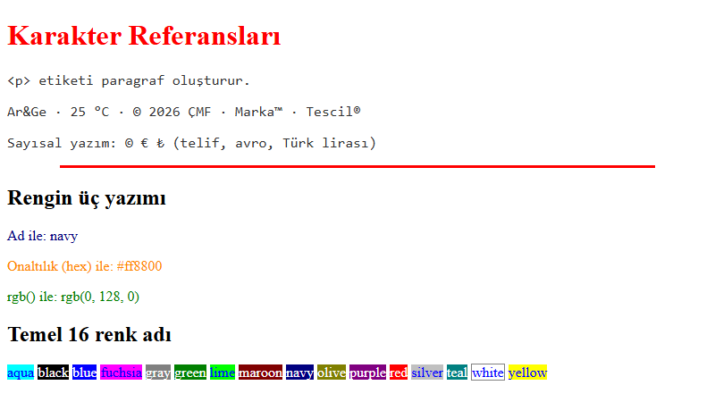

*Şekil 2.15. Karakter referansları, gömülü ve satır içi stil, üç renk yazımı ve 16 temel renk adı ([ornek-2-3-karakter-ve-renk](../codes/02-html-temelleri/ornek-2-3-karakter-ve-renk/index.html)).*

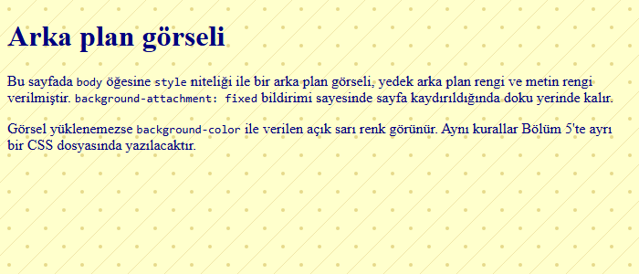

*Şekil 2.16. `body` öğesine satır içi stil ile verilmiş tekrarlanan arka plan dokusu ([ornek-2-4-arka-plan](../codes/02-html-temelleri/ornek-2-4-arka-plan/index.html)).*

> [!NOTE]
> **Tarihsel not:** Eski sayfalarda aynı görünüm `<body bgcolor="#FFFFCC" text="navy" background="granite.gif">` gibi HTML nitelikleriyle ya da `<font color="red">` öğesiyle verilirdi. Bu nitelik ve öğeler HTML5'te kullanımdan kaldırılmıştır (obsolete); görünüm yalnızca CSS ile verilir.

## 2.11 Bağlantılar

Web'i bir “ağ” yapan, belgeleri birbirine bağlayan **hipermetin bağlantılarıdır (hyperlink)**. Bağlantı **`<a>`** öğesiyle oluşturulur; adı, İngilizce *anchor* (çapa) sözcüğünün baş harfidir. Hedef adres **`href`** (hypertext reference) niteliğine, kullanıcının tıklayacağı metin ise öğenin içeriğine yazılır [12, ss. 74–88], [5, Bl. 6].

```html
<a href="https://www.nku.edu.tr/">Tekirdağ Namık Kemal Üniversitesi</a>
```

### 2.11.1 Mutlak ve göreli URL

- **Mutlak URL (absolute URL)**, kaynağın tam adresidir; şema (`https://`), alan adı ve yoldan oluşur ([Bölüm 1](01-internet-ve-web.md)'deki URL anatomisi). Başka sitelere verilen bağlantılarda kullanılır: `href="https://developer.mozilla.org/tr/"`.
- **Göreli URL (relative URL)**, hedefin **bağlantıyı içeren belgeye göre** konumunu belirtir. Aynı sitedeki sayfalar arasında kullanılır: `href="iletisim.html"`. Göreli bağlantılar, site başka bir sunucuya veya alan adına taşındığında değiştirilmeden çalışmaya devam eder [12, ss. 80–84].

> [!TIP]
> **Güncel hayattan:** Bir kargo takip sayfasındaki “Şubeler” menüsü sitenin kendi sayfasına göreli bağlantıyla, “Gümrük mevzuatı” bağlantısı ise resmî kurumun sitesine mutlak bağlantıyla verilir. Aynı site geliştirme sunucusundan (`127.0.0.1:5500`) gerçek alan adına taşındığında göreli bağlantıların hiçbiri değişmez.

### 2.11.2 Klasör yapısı: alt ve üst klasöre bağlantı

Büyük sitelerde dosyalar klasörlere ayrılır. Göreli yol yazılırken bağlantıyı içeren dosyanın bulunduğu klasörden yola çıkılır ve şu kurallar uygulanır [5, Bl. 6]:

| Durum | Yazım | Anlamı |
|---|---|---|
| Aynı klasör | `hakkimizda.html` | Yalnızca dosya adı |
| Alt klasör | `dersler/index.html` | Önce klasör adı, sonra `/` ve dosya adı |
| İki alt klasör | `dersler/web/html-notlari.html` | Her klasör için bir `/` |
| Üst klasör | `../index.html` | `../` bir üst klasöre çıkar |
| İki üst klasör | `../../index.html` | Her `../` bir düzey yukarı |
| Çık, sonra in | `../images/logo.svg` | Üst klasöre çık, oradan `images/` içine gir |
| Site köküne göre | `/images/logo.svg` | Baştaki `/` sunucunun köküdür; Live Server'da çalışır, ancak `file:///` ile açılan sayfada sürücünün köküne gider |

*Tablo 2.8. Göreli yol yazım kuralları.*

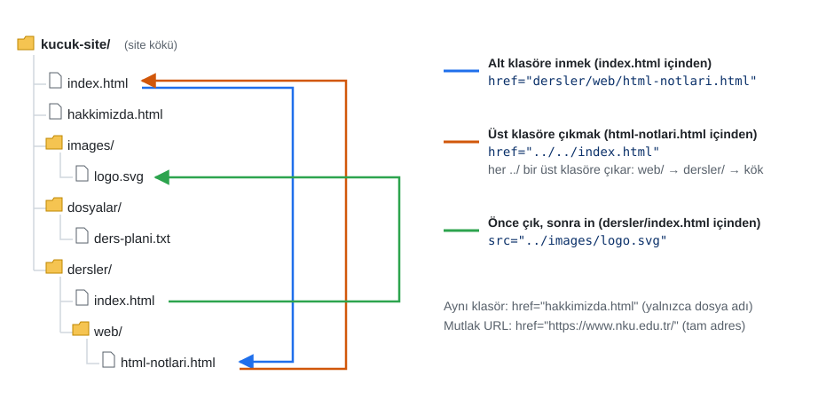

*Şekil 2.17. Uygulama 2.5'teki sitenin klasör yapısı. Mavi ok `index.html`'den iki alt klasöre iner; turuncu ok `html-notlari.html`'den `../../` ile köke çıkar; yeşil ok bir üst klasöre çıkıp `images/` klasörüne girer.*

Şekil 2.17'de görüldüğü gibi aynı `index.html` dosyasına, bağlantının yazıldığı yere göre farklı yollarla ulaşılır: kökteki bir dosyadan `index.html`, `dersler/` içinden `../index.html`, `dersler/web/` içinden `../../index.html`. Görsellerin `src` niteliği de aynı kurallara uyar. Sunumdaki “Jen's Kitchen” şeması (Robbins'in kitabından) aynı ilkeyi göstermektedir [5, Bl. 6].

> [!IMPORTANT]
> Dosya ve klasör adlarında **küçük harf**, **Türkçe karakter içermeyen** sözcükler ve boşluk yerine **tire** kullanılmalıdır (`ders-plani.html`). Windows büyük-küçük harf ayrımı yapmaz, ancak web sunucularının çoğu (Linux) yapar: Yerelde çalışan `Logo.PNG` bağlantısı, dosyanın adı `logo.png` ise sunucuda kırık görünür. URL'lerde ters eğik çizgi (`\`) değil düz eğik çizgi (`/`) kullanılır.

### 2.11.3 Yeni sekmede açma: `target` ve `rel`

Bağlantının nerede açılacağını **`target`** niteliği belirler: `_self` aynı sekme (varsayılan), `_blank` yeni sekme veya pencere, `_parent` ve `_top` ise çerçeve (iframe) içindeki sayfalarda üst ve en üst bağlamdır.

```html
<a href="https://developer.mozilla.org/tr/" target="_blank" rel="noopener noreferrer">
  MDN Web Docs (yeni sekmede açılır)
</a>
```

*Kod 2.12. Dış siteye güvenli yeni sekme bağlantısı.*

> [!WARNING]
> `target="_blank"` ile açılan sayfa, JavaScript'teki `window.opener` başvurusu üzerinden kendisini açan sekmenin adresini değiştirebilir; kötü niyetli bir site bunu kullanıcıyı sahte bir giriş sayfasına yönlendirmek için kullanabilir. Bu saldırıya **ters sekme avlama (reverse tabnabbing)** denir. **`rel="noopener"`** bu erişimi keser; **`noreferrer`** ek olarak hedef siteye hangi sayfadan gelindiği bilgisini (Referer başlığı) göndermez [15]. Güncel tarayıcılar `_blank` bağlantılarına `noopener` davranışını varsayılan olarak uygulamaktadır; yine de niyeti açıkça belirtmek ve eski tarayıcıları korumak için `rel="noopener noreferrer"` yazılması iyi bir uygulamadır.

Kullanıcının hangi sekmede çalışacağına kendisinin karar vermesi beklendiğinden yeni sekme yalnızca gerektiğinde (form doldururken açılan yardım sayfası, PDF belge) kullanılmalı ve bağlantı metninde belirtilmelidir.

### 2.11.4 E-posta, telefon ve indirme bağlantıları

`href` yalnızca web sayfalarına değil, işletim sisteminin diğer uygulamalarına da yönlendirebilir:

```html
<a href="mailto:bilgisayar@nku.edu.tr?subject=BMB112%20Sorusu">Bize ulaşın</a>
<a href="tel:+902820000000">+90 282 000 00 00</a>
<a href="dosyalar/ders-plani.pdf" download>Ders planını indir (PDF, 120 KB)</a>
```

- **`mailto:`** varsayılan e-posta uygulamasında yeni bir ileti açar; `?subject=` ile konu eklenebilir (boşluklar `%20` ile kodlanır).
- **`tel:`** mobil cihazlarda arama ekranını açar; numara uluslararası biçimde (`+90…`) boşluksuz yazılır.
- **`download`** niteliği, tarayıcının dosyayı göstermek yerine indirmesini ister. Yalnızca aynı kökenden (origin) sunulan dosyalarda dikkate alınır. Bağlantı metninde dosya türü ve boyutu belirtilmesi kullanıcı için yararlıdır.

> [!WARNING]
> Sayfaya açık metin olarak yazılan e-posta adresleri, istenmeyen e-posta (spam) gönderenlerin robotları tarafından toplanabilir. Kurumsal sitelerde kişisel adres yerine birim adresi veya iletişim formu tercih edilebilir.

### 2.11.5 Sayfa içi bağlantılar (çapalar)

Uzun bir sayfanın belirli bir bölümüne bağlantı vermek için hedef öğeye benzersiz bir **`id`** niteliği verilir ve `href` değeri `#` ile başlayan bu kimlik olarak yazılır. URL'nin `#` sonrasındaki kısmına **parça tanımlayıcı (fragment identifier)** denir [12, s. 87].

```html
<nav>
  <a href="#kayit-yenileme">Kayıt yenileme ne zaman yapılır?</a>
</nav>
…
<section id="kayit-yenileme">
  <h2>Kayıt yenileme ne zaman yapılır?</h2>
  …
  <a href="#en-ust">↑ Başa dön</a>
</section>
```

*Kod 2.13. Sayfa içi çapa ve “başa dön” bağlantısı.*

Başka bir sayfanın belirli bölümüne bağlantı vermek için dosya adı ile parça birleştirilir: `href="sss.html#kayit-yenileme"`. Wikipedia makalelerindeki içindekiler tablosu ve MDN'deki başlık bağlantıları bu mekanizmayla çalışır. Bir `id` değeri belgede **yalnızca bir kez** kullanılabilir; boşluk içeremez ve büyük-küçük harfe duyarlıdır.

> [!NOTE]
> **Tarihsel not:** Eski HTML'de hedef nokta `<a name="grafik"></a>` biçiminde, içeriği boş bir `a` öğesiyle işaretlenirdi. Sunumdaki `<h2><a id="grafik">Grafikler</a></h2>` yazımı bu alışkanlığın devamıdır. HTML5'te `a` öğesinin `name` niteliği kullanımdan kaldırılmıştır; `id` doğrudan hedef öğeye yazılır: `<h2 id="grafik">Grafikler</h2>`.

### 2.11.6 Anlamlı bağlantı metni

Ekran okuyucu kullanıcıları sayfadaki bağlantıların listesini bağlamından bağımsız olarak dinleyebilir. Bu listede beş tane “buraya tıklayın” veya “devamı” bağlantısı hiçbir bilgi vermez. Bağlantı metni, **hedefi tek başına anlatmalıdır**: “Buraya tıklayarak ders planını indirin” yerine “Ders planını indir (PDF)” [14], [12, s. 78]. Bağlantı metni olarak çıplak URL yazmaktan da kaçınılmalıdır.

#### 🛠 Uygulama 2.5: Çok Sayfalı Küçük Site ve Göreli Bağlantılar

**Amaç:** Klasörlere ayrılmış bir sitede alt ve üst klasörlere göreli bağlantılar kurmak; mutlak, e-posta, telefon ve indirme bağlantıları eklemek.  
**Tahmini süre:** 20 dk

1. Şekil 2.17'deki klasör yapısını `kucuk-site` adıyla oluşturunuz: kökte `index.html`, `hakkimizda.html`, `images/logo.svg`, `dosyalar/ders-plani.txt`; `dersler/index.html` ve `dersler/web/html-notlari.html`.
2. Dört HTML dosyasının hepsine aynı üç bağlantılı menüyü (Ana Sayfa, Hakkımızda, Dersler) ve logoyu ekleyiniz. Her dosyada yolları, **o dosyanın bulunduğu klasöre göre** yazınız (`dersler/` içinde `../`, `dersler/web/` içinde `../../`).
3. `index.html`'ye MDN'e yeni sekmede açılan güvenli bir dış bağlantı, bir `mailto:`, bir `tel:` ve `download` nitelikli bir indirme bağlantısı ekleyiniz.
4. Siteyi Live Server ile açıp tüm bağlantıları ve logonun her sayfada göründüğünü deneyiniz.

**Beklenen çıktı:**

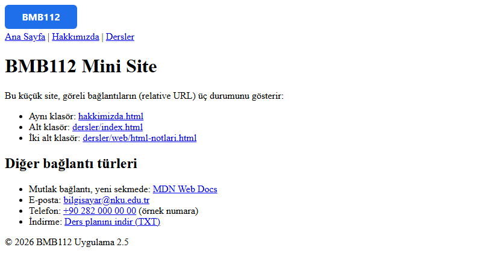

*Şekil 2.18. Uygulama 2.5 ana sayfasının beklenen ekran görüntüsü.*

**Kendinizi sınayın:** (1) `html-notlari.html` içindeki logo yolunu bilerek `../images/logo.svg` yapınız; DevTools › Console'da görülen 404 hatasını açıklayınız ve düzeltiniz. (2) `dersler/index.html`'deki bağlantıları site köküne göre (`/index.html`) yazıp sayfayı önce Live Server ile, sonra dosyaya çift tıklayarak açınız; farkı açıklayınız.

<details><summary>Örnek çözüm</summary>

Çözüm klasörü: [`codes/02-html-temelleri/uygulama-2-5-kucuk-site/`](../codes/02-html-temelleri/uygulama-2-5-kucuk-site/index.html)

</details>

#### 🛠 Uygulama 2.6: Sayfa İçi Çapalı SSS Sayfası

**Amaç:** `id` ve parça tanımlayıcılarıyla sayfa içi gezinme kurmak.  
**Tahmini süre:** 15 dk

1. “Öğrenci İşleri — Sıkça Sorulan Sorular” başlıklı bir sayfa oluşturunuz; `header` öğesine `id="en-ust"` veriniz.
2. En az beş soruyu ayrı birer `section` içinde `h2` başlığıyla yazınız ve her `section`'a anlamlı bir `id` veriniz (`kayit-yenileme`, `transkript`…).
3. Sayfanın başına, soruların bağlantılarından oluşan sıralı bir “İçindekiler” listesi ekleyiniz ve bu listeyi `<nav aria-label="Sayfa içi bağlantılar">` içine alınız.
4. Her cevabın sonuna `href="#en-ust"` ile “↑ Başa dön” bağlantısı koyunuz.
5. “Geçme koşulu” sorusunda, bu dersin kuralını yazınız: ağırlıklı ortalama = vize × 0,4 + final × 0,6; **ortalama en az 60** ise öğrenci geçer, değilse kalır. Bir geçen ve bir kalan örnek veriniz.

**Beklenen çıktı:**

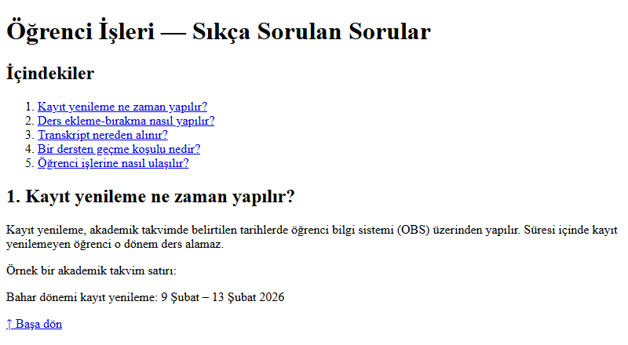

*Şekil 2.19. Uygulama 2.6'nın üst kısmı; içindekiler bağlantılarından birine tıklandığında ilgili soru pencerenin üstüne gelir ve adres çubuğunda `#…` parçası görünür.*

**Kendinizi sınayın:** (1) İki `section`'a aynı `id`'yi verip hangi bölüme gidildiğini gözlemleyiniz, ardından doğrulayıcıda denetleyiniz. (2) Başka bir sayfadan bu sayfanın “transkript” sorusuna doğrudan giden bir bağlantı yazınız.

<details><summary>Örnek çözüm</summary>

Çözüm dosyası: [`codes/02-html-temelleri/uygulama-2-6-sss-sayfasi/index.html`](../codes/02-html-temelleri/uygulama-2-6-sss-sayfasi/index.html)

</details>

## 2.12 Anlamsal Yapı

### 2.12.1 Neden anlamsal düzen?

HTML5 öncesinde bir sayfanın üst bilgi, menü, içerik, kenar çubuğu ve alt bilgi bölgeleri anlamsız birer kap olan `div` öğeleriyle kurulur, bölgeler `id` veya `class` adlarıyla ayırt edilirdi. Ancak `<div id="header">` ifadesindeki “header” sözcüğü yalnızca geliştirici için bir isimdir; geliştirici `id="ust-kisim"` veya `id="xyz"` de yazabilirdi. Tarayıcı, arama motoru ve ekran okuyucu için bu kutuların hiçbir anlamı yoktur. HTML5, web sitelerinde en sık kullanılan bölge adlarını inceleyerek bu bölgeler için **anlamsal yapı öğeleri** tanımlamıştır [3, Bl. 1], [12, ss. 428–442].

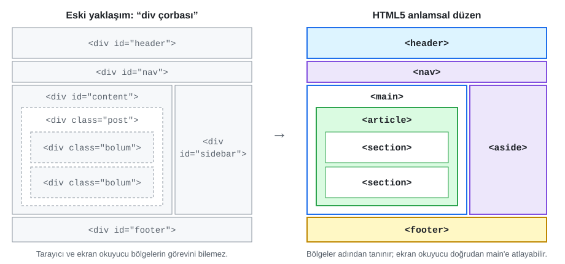

*Şekil 2.20. Solda yalnızca `div` ile kurulmuş, sağda aynı düzenin anlamsal öğelerle kurulmuş hâli.*

Anlamsal öğelerin sağladığı yararlar şunlardır:

- **Erişilebilirlik:** Ekran okuyucular `header`, `nav`, `main`, `aside` ve `footer` öğelerini **sayfa bölgeleri (landmarks)** olarak tanır. Kullanıcı tek tuşla “ana içeriğe” veya “gezinme menüsüne” atlayabilir. Yalnızca `div` kullanıldığında aynı bilgi `role="main"` gibi ARIA nitelikleriyle ayrıca eklenmelidir.
- **Arama motorları:** Ana içeriğin menü ve alt bilgiden ayırt edilmesini kolaylaştırır. Google, anlamsal öğelerin tek başına doğrudan bir sıralama etkeni olmadığını belirtmektedir; katkıları dolaylıdır.
- **Okunabilirlik ve bakım:** `</main>`, `</footer>` gibi kapanışlar kendini açıklar; iç içe geçmiş onlarca `</div>` arasında hangisinin neyi kapattığını bulma sorunu (“div çorbası”) azalır.

### 2.12.2 Yapı öğeleri

| Öğe | Anlamı | Sayfadaki tipik içerik |
|---|---|---|
| `<header>` | Sayfanın veya bir bölümün **giriş** kısmı | Logo, site adı, ana menü; bir makalede başlık ve yazar bilgisi |
| `<nav>` | **Ana gezinme** bağlantıları bloğu | Üst menü, içindekiler, sayfa numaralandırma |
| `<main>` | Sayfanın **benzersiz ana içeriği** | Sayfada bir tane bulunur; tüm sayfalarda tekrarlanan menü ve alt bilgi buraya girmez |
| `<article>` | **Kendi başına anlamlı**, başka yerde de yayımlanabilecek içerik | Blog yazısı, haber, ürün kartı, kullanıcı yorumu, forum iletisi |
| `<section>` | Bir **konu etrafında** gruplanan içerik bölümü; genellikle bir başlıkla başlar | Bir makalenin bölümleri, ana sayfadaki “Duyurular”, “Etkinlikler” alanları |
| `<aside>` | Ana içerikle **dolaylı ilgili** yan içerik | Kenar çubuğu, ilgili bağlantılar, bilgi kutusu, reklam |
| `<footer>` | Sayfanın veya bir bölümün **kapanış** bilgisi | Telif hakkı, iletişim, yazar bilgisi, ilgili belgeler |

*Tablo 2.9. HTML5 anlamsal yapı öğeleri.*

Tablo 2.9'daki öğeler kullanılırken şu ayrımlar önemlidir:

- **`article` mi `section` mı?** İçerik sayfadan koparılıp tek başına bir RSS akışında, sosyal medyada veya başka bir sitede yayımlandığında hâlâ anlamlıysa `article`'dır. Bir bütünün parçasıysa `section`'dır. Bir `article` `section`'lara bölünebilir; bir `section` da birden çok `article` içerebilir (ör. ana sayfadaki “Son Haberler” bölümü).
- **`header` ve `footer` birden fazla olabilir:** Sayfanın kendi `header`'ı dışında, her `article`'ın da yazar ve tarih bilgisini taşıyan bir `header`'ı ve etiketleri taşıyan bir `footer`'ı olabilir.
- **Her bağlantı grubu `nav` değildir:** Alt bilgideki birkaç yasal bağlantı için `nav` gerekmez; `nav` ana gezinme blokları içindir [3, Bl. 1]. Sayfada birden çok `nav` varsa `aria-label` ile adlandırılması (ör. `aria-label="Ana menü"`) ekran okuyucu kullanıcılarına yardımcı olur.
- `main` öğesi `article`, `aside`, `header`, `footer` veya `nav` içine konmamalıdır.

> [!TIP]
> **Güncel hayattan:** Bir haber sitesinin ana sayfasında logo ve kategori menüsü `header` ile `nav`'ı, her haber kartı bir `article`'ı, “En çok okunanlar” kutusu `aside`'ı, sayfanın en altındaki künye ve iletişim bilgileri `footer`'ı oluşturur. Tarayıcıların “Okuma modu (Reader view)” özelliği de ana içeriği bulmak için büyük ölçüde bu yapıdan yararlanır.

### 2.12.3 `div` ve `span`: anlamsız kaplar

**`<div>`** blok düzeyinde, **`<span>`** satır içi düzeyde **anlam taşımayan** genel amaçlı kaplardır. Hiçbir anlamsal öğenin uymadığı durumlarda, yalnızca CSS ile biçimlendirmek veya JavaScript ile seçmek amacıyla içerik gruplamak için kullanılırlar:

```html
<div class="kart-izgarasi">   <!-- yalnızca düzen için bir kap -->
  <article class="urun-karti">…</article>
  <article class="urun-karti">…</article>
</div>
<p>Kalan kota: <span class="sayac">12</span> GB</p>
```

Kural basittir: önce içeriğe uyan anlamsal bir öğe aranır; yoksa `div` veya `span` kullanılır. `div` kullanmak hata değildir, ancak `header` yerine `div` kullanmak bilgi kaybıdır.

> [!NOTE]
> **Tarihsel not:** HTML5'in ilk yıllarında Internet Explorer 8 ve öncesi yeni öğeleri tanımadığından sayfalara “HTML5 shiv” adlı bir JavaScript dosyası eklenirdi [12, s. 442]. Bugün tüm tarayıcılar bu öğeleri desteklediğinden bu betiğe gerek yoktur.

### 2.12.4 Anlamsal etiketler posteri

Derste kullanılan **HTML5 Anlamsal Yapı posteri**, Tablo 2.9'daki öğeleri renk kodlu bir sayfa düzeni üzerinde göstermektedir. Poster aynı zamanda iyi bir örnek koddur: her bölgenin etiketi, kendisini oluşturan HTML öğesinin adıdır; görünüm tamamen harici `style.css` dosyasıyla verilmiştir; dar ekranlarda `aside` alta iner.

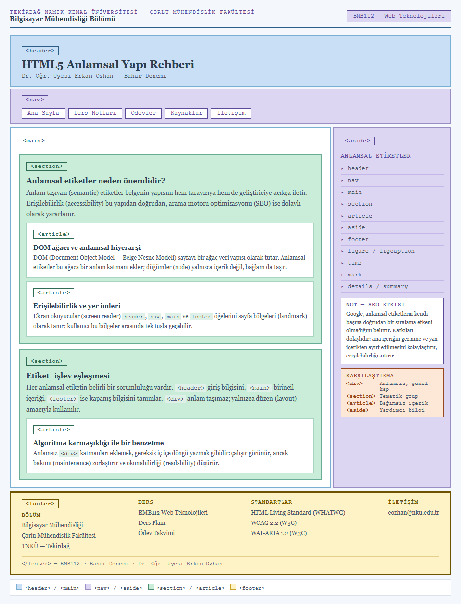

*Şekil 2.21. HTML5 anlamsal yapı posteri ([codes/02-html-temelleri/anlamsal-etiketler-posteri](../codes/02-html-temelleri/anlamsal-etiketler-posteri/index.html)). Posteri tarayıcıda açıp DevTools › Elements ile her bölgenin hangi öğe olduğunu inceleyiniz.*

#### 🛠 Uygulama 2.7: Anlamsal Düzenli Blog Sayfası

**Amaç:** Bir blog sayfasını anlamsal yapı öğeleriyle kurmak.  
**Tahmini süre:** 20 dk

1. “Kod Defteri” adlı bir öğrenci blogu için `index.html` oluşturunuz.
2. Sayfa `header`'ına blog adını (`h1`), bir alt başlık paragrafını ve `<nav aria-label="Ana menü">` içinde bir `ul` menüsünü yerleştiriniz.
3. `main` içine iki `article` ekleyiniz. Her `article`'ın kendi `header`'ında yazı başlığı (`h2`) ile `<time datetime="…">` öğeli yayın tarihi bulunsun.
4. Birinci yazıyı iki `section`'a (`h3` başlıklı) bölünüz; bir bölüme `figure` + `figcaption` içinde `pre`/`code` ile kısa bir kod parçası koyunuz; yazının sonuna etiketleri içeren bir `footer` ekleyiniz.
5. `main`'in dışına “Hakkımda” ve “Önerilen kaynaklar” içeren bir `aside`, en alta telif ve iletişim bilgili sayfa `footer`'ı ekleyiniz.
6. Sayfayı açıp DevTools › Elements ile yapıyı Şekil 2.20'nin sağ tarafıyla karşılaştırınız.

**Beklenen çıktı:**

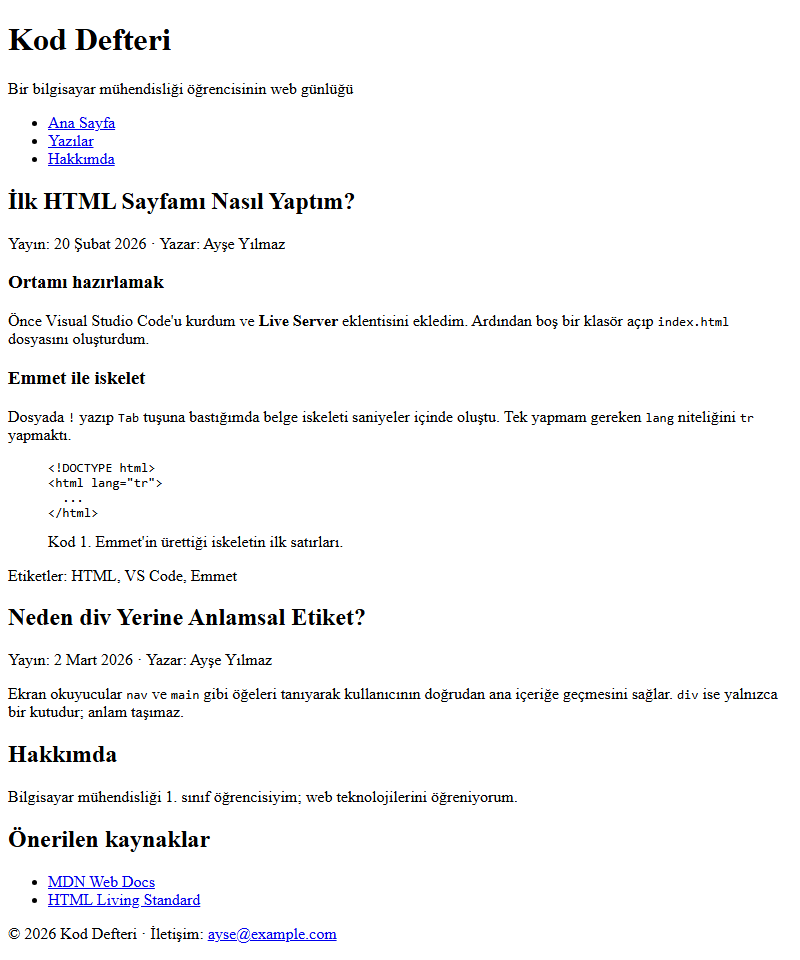

*Şekil 2.22. Uygulama 2.7'nin beklenen ekran görüntüsü. CSS uygulanmadığı için bölgeler alt alta görünür; yerleşim [Bölüm 6](06-css-kutu-modeli-yerlesim.md)'da yapılacaktır.*

**Kendinizi sınayın:** (1) Chrome'da DevTools › Elements panelinin sağındaki **Accessibility** sekmesinde (veya ekran okuyucu eklentisiyle) `main` öğesinin “main” rolüyle göründüğünü doğrulayınız. (2) Aynı sayfayı yalnızca `div`'lerle yazsaydınız ekran okuyucu kullanıcısının neyi kaybedeceğini iki cümleyle açıklayınız.

<details><summary>Örnek çözüm</summary>

Çözüm dosyası: [`codes/02-html-temelleri/uygulama-2-7-anlamsal-blog/index.html`](../codes/02-html-temelleri/uygulama-2-7-anlamsal-blog/index.html)

</details>

## 2.13 Belgenin Doğrulanması

Tarayıcılar hatalı HTML'i reddetmez; eksik kapanış etiketlerini tamamlar, yanlış iç içe geçmeleri onarmaya çalışır. Bu hoşgörü kullanıcı için yararlıdır, ancak geliştirici açısından hataların fark edilmemesine yol açar: Aynı hata farklı tarayıcılarda farklı onarılabilir, CSS ve JavaScript beklenmedik biçimde davranabilir, ekran okuyucular yanlış bilgi verebilir. **Doğrulama (validation)**, belgenin HTML standardının kurallarına uygunluğunun bir araçla denetlenmesidir [10, Kitap I, Bl. 2].

W3C'nin ücretsiz **Markup Validation Service** aracı (https://validator.w3.org/) üç yolla kullanılır [20]:

1. **Validate by URI:** Yayındaki bir sayfanın adresi girilir.
2. **Validate by File Upload:** Bilgisayardaki `.html` dosyası yüklenir.
3. **Validate by Direct Input:** Kod doğrudan metin kutusuna yapıştırılır.

Araç, HTML Living Standard'ı denetleyen **Nu Html Checker** altyapısını kullanır ve her sorunu satır–sütun numarasıyla listeler. **Error** (hata) iletileri standarda aykırılıkları, **Warning** (uyarı) iletileri ise geçerli ama sorunlu olabilecek yazımları bildirir. Bir hata, sonraki satırlarda zincirleme başka hatalara yol açabileceğinden düzeltmeye **listenin başından** başlanmalı ve her düzeltmeden sonra yeniden denetlenmelidir.

```text
Error: Start tag seen without seeing a doctype first. Expected "<!DOCTYPE html>".
Error: End tag "h3" seen, but there were open elements.
Error: End tag "b" violates nesting rules.
Error: An "img" element must have an "alt" attribute, except under certain conditions.
Error: The "figurecaption" element is a completely-unknown element that is not allowed anywhere in any HTML content.
Error: Duplicate ID "kayit".
Info:  Consider adding a "lang" attribute to the "html" start tag to declare the language of this document.
```

*Kod 2.14. Uygulama 2.8'deki `hatali.html` dosyasının W3C doğrulayıcısındaki çıktısından seçilmiş iletiler (2 Kasım 2026).*

Kod 2.14'teki iletiler bu bölümde anlatılan kuralların doğrudan karşılığıdır: belge türü bildirimi (Bölüm 2.5.2), doğru iç içe yerleştirme (Bölüm 2.5.1), `alt` niteliği (Bölüm 2.8.2), `figcaption`'ın doğru adı (Bölüm 2.8.4), `id`'nin tekliği (Bölüm 2.11.5) ve `lang` niteliği. VS Code'da yazım sırasında da bazı hatalar işaretlenir; ancak düzenleyici denetimleri doğrulayıcının yerini tutmaz. Kamu kurumlarının ve üniversitelerin sitelerinde yapılan erişilebilirlik denetimleri de genellikle geçerli HTML ile başlar; örneğin kapanmamış bir öğe, ekran okuyucunun bir menüyü ana içeriğin parçası sanmasına yol açabilir. Ancak doğrulama erişilebilirlik denetiminin de yerini tutmaz: `alt="resim"` yazımı doğrulayıcıdan geçer, ama kullanıcıya hiçbir bilgi vermez.

#### 🛠 Uygulama 2.8: Meta Etiketleri ve Doğrulayıcı

**Amaç:** Bir sayfa için eksiksiz meta veriler yazmak ve W3C doğrulayıcısıyla hatalı bir belgeyi düzeltmek.  
**Tahmini süre:** 20 dk

1. “Bilgisayar Mühendisliği Kulübü” için bir `index.html` oluşturunuz. `head` bölümüne sırasıyla `charset`, `viewport`, anlamlı bir `title`, 150–160 karakteri aşmayan bir `description`, `author`, `<meta name="robots" content="index, follow">` ve beş Open Graph etiketi (`og:title`, `og:description`, `og:type`, `og:url`, `og:image`) ekleyiniz.
2. Sayfayı https://validator.w3.org/ adresinde **Validate by File Upload** ile denetleyiniz; “Document checking completed. No errors or warnings to show.” iletisini görünüz.
3. Çözüm klasöründeki [`hatali.html`](../codes/02-html-temelleri/uygulama-2-8-meta-dogrulama/hatali.html) dosyasını indirip doğrulayıcıya yükleyiniz. Kod 2.14'tekine benzer iletileri **sırayla** düzeltiniz; her düzeltmeden sonra yeniden denetleyiniz.
4. Düzeltilmiş dosyadan `keywords` meta etiketini neden kaldırabileceğinizi bir yorum satırıyla açıklayınız.

**Beklenen çıktı:** Her iki dosya için de doğrulayıcı “No errors or warnings to show” iletisini vermeli; `index.html` tarayıcıda yalnızca başlık, etkinlik bilgisi ve alt bilgiyi göstermeli, meta etiketleri ise yalnızca <kbd>Ctrl</kbd>+<kbd>U</kbd> ile görülmelidir.

**Kendinizi sınayın:** (1) Sayfa adresini bir mesajlaşma uygulamasında paylaşılmış gibi düşünerek hangi meta etiketlerinin önizleme kartında görüneceğini listeleyiniz. (2) `<meta http-equiv="refresh" content="10">` satırını ekleyip kaldırınız; bu satırın neden erişilebilirlik sorunu oluşturduğunu WCAG 2.2.1'e atıfla açıklayınız.

<details><summary>Örnek çözüm</summary>

Çözüm dosyası: [`codes/02-html-temelleri/uygulama-2-8-meta-dogrulama/index.html`](../codes/02-html-temelleri/uygulama-2-8-meta-dogrulama/index.html) · Düzeltilecek dosya: [`hatali.html`](../codes/02-html-temelleri/uygulama-2-8-meta-dogrulama/hatali.html)

</details>

## 2.14 Bölüm Özeti

- HTML, içeriğin yapısını ve anlamını tanımlayan bir işaretleme dilidir. 1991'deki ilk etiket listesinden HTML 2.0 (1995), HTML 4.01 (1999), XHTML ve HTML5 (2014) aşamalarıyla gelişmiş; 2019'dan bu yana WHATWG'nin **HTML Living Standard** belgesi tek yetkili HTML standardıdır.
- Tarayıcılar Blink, WebKit ve Gecko olmak üzere üç render motoruna dayanır; Ekim 2026 itibarıyla Chrome dünyada yaklaşık %69, Türkiye'de yaklaşık %78 paya sahiptir.
- Geliştirme ortamı olarak VS Code, Live Server ve Prettier kullanılır. Emmet'in `!` kısaltması belge iskeletini üretir; dosyalar UTF-8 ile kaydedilir; sayfa kaynağı <kbd>Ctrl</kbd>+<kbd>U</kbd>, canlı DOM ağacı <kbd>F12</kbd> › Elements ile incelenir.
- Bir öğe açılış etiketi, içerik ve kapanış etiketinden oluşur; nitelikler açılış etiketine yazılır; boş öğelerin kapanış etiketi yoktur. Belge iskeleti `<!DOCTYPE html>`, `html lang`, `head` (`meta charset`, `viewport`, `title`) ve `body`'den oluşur; öğeler bir ağaç (DOM) oluşturur.
- Metin öğeleri görünüme göre değil anlama göre seçilir: `strong`/`b`, `em`/`i`, `del`/`s`, `ins`/`u` çiftleri benzer görünür ama farklı anlam taşır. Başlık düzeyleri atlanmaz; boşluklar birleştirilir, `pre` boşlukları korur.
- Listeler `ul`, `ol` (`type`, `start`, `reversed`) ve `dl` ile kurulur; iç liste bir `li` içinde yer alır; madde işaretleri CSS'teki `list-style-type` ile değiştirilir.
- `img` öğesinde anlamlı bir `alt`, gerçek `width`/`height` ve uygun yerlerde `loading="lazy"` kullanılır; altyazı `figure` içinde **`figcaption`** ile verilir.
- Meta veriler arama ve paylaşım görünümünü belirler; `keywords` Google tarafından dikkate alınmaz, dizine ekleme isteği Search Console'un URL Denetimi aracıyla yapılır.
- Bağlantılarda göreli yollar (`../` ile üst klasöre çıkma), güvenli yeni sekme (`rel="noopener noreferrer"`), `mailto:`/`tel:`/`download` ve `id` tabanlı sayfa içi çapalar kullanılır.
- `header`, `nav`, `main`, `article`, `section`, `aside` ve `footer` sayfa bölgelerine anlam kazandırır; `div` ve `span` yalnızca uygun anlamsal öğe yoksa kullanılır. Belge W3C doğrulayıcısıyla denetlenmelidir.

## 2.15 Değerlendirme Soruları

1. W3C ile WHATWG'nin HTML'in gelişimindeki rollerini karşılaştırınız. 2007, 2014 ve 2019 yıllarında ne olmuştur? “HTML5” ifadesi bugün neyi anlatır?
2. Bir web sayfasının sayfa kaynağı (<kbd>Ctrl</kbd>+<kbd>U</kbd>) ile geliştirici araçlarındaki Elements panelinin gösterdiği yapı neden farklı olabilir? İki örnek veriniz.
3. `<meta charset="UTF-8">` satırı neden `head`'in ilk satırı olarak yazılır? Dosya Windows-1254 ile kaydedilmiş ve bu satır bulunuyorsa ne olur?
4. Aşağıdaki kodun belge ağacını çiziniz ve `em` öğesinin ebeveynini, `li` öğelerinin kardeşlerini belirtiniz:
   ```html
   <body><h1>Başlık</h1><p>Bir <em>önemli</em> not</p><ul><li>A</li><li>B</li></ul></body>
   ```
5. `strong` ile `b`, `em` ile `i`, `del` ile `s` arasındaki anlam farklarını birer örnek cümleyle açıklayınız.
6. Aşağıdaki kodun tarayıcı çıktısını yazınız ve gerekçelendiriniz:
   ```html
   <p>Ad:      Ayşe
      Soyad:   Kaya</p>
   <ol type="i" start="4" reversed><li>x</li><li>y</li></ol>
   ```
7. Bir haber sitesindeki (a) logo bağlantısı, (b) yalnızca süs amaçlı bir ayraç çizgisi, (c) içinde metin bulunan bir kampanya afişi için `alt` metinlerini nasıl yazarsınız?
8. `img` öğesine `width` ve `height` yazılmadığında ortaya çıkan sorunu ve `loading="lazy"` niteliğinin hangi görsellerde kullanılmaması gerektiğini açıklayınız.
9. `site/dersler/web/notlar.html` dosyasından `site/images/logo.png` ve `site/index.html` dosyalarına verilecek göreli yolları yazınız.
10. `target="_blank"` kullanılan dış bağlantılarda `rel="noopener noreferrer"` neden önerilir? `noopener` ile `noreferrer`'ın farkı nedir?
11. Aşağıdaki kodda bulunan hataları bulunuz ve düzeltilmiş hâlini yazınız:
    ```html
    <head><html lang="tr">
    <meta name="keywords" content="html">
    <figure><figurecaption>Logo</figurecaption></figure>
    <h2><a name="grafik">Grafikler</a></h2>
    <p style="font:Verdana; margin-top=80px">Metin</p>
    ```
12. Bir üniversite bölüm sayfasının (logo, ana menü, duyurular listesi, her biri bağımsız haber kartları, “hızlı bağlantılar” kenar kutusu, iletişim alt bilgisi) anlamsal iskeletini HTML öğeleriyle yazınız; `article` ile `section` seçimlerinizi gerekçelendiriniz.

## Kaynaklar

[1] WHATWG, "HTML Living Standard." [Çevrimiçi]. Erişim: https://html.spec.whatwg.org/ (Erişim tarihi: 2 Kasım 2026).  
[2] T. Berners-Lee, "Information Management: A Proposal," CERN, Geneva, Switzerland, Mar. 1989.  
[3] B. Lawson and R. Sharp, *Introducing HTML5*, 2nd ed. Berkeley, CA, USA: New Riders, 2012.  
[4] T. Berners-Lee and D. Connolly, "Hypertext Markup Language - 2.0," IETF, RFC 1866, Nov. 1995. [Çevrimiçi]. Erişim: https://www.rfc-editor.org/rfc/rfc1866  
[5] J. N. Robbins, *Learning Web Design: A Beginner's Guide to HTML, CSS, JavaScript, and Web Graphics*, 4th ed. Sebastopol, CA, USA: O'Reilly Media, 2012.  
[6] W3C and WHATWG, "Memorandum of Understanding Between W3C and WHATWG," May 28, 2019. [Çevrimiçi]. Erişim: https://www.w3.org/2019/04/WHATWG-W3C-MOU.html (Erişim tarihi: 2 Kasım 2026).  
[7] StatCounter, "Browser Market Share Worldwide," StatCounter Global Stats. [Çevrimiçi]. Erişim: https://gs.statcounter.com/browser-market-share (Erişim tarihi: 2 Kasım 2026).  
[8] StatCounter, "Browser Market Share in Turkey," StatCounter Global Stats. [Çevrimiçi]. Erişim: https://gs.statcounter.com/browser-market-share/all/turkey (Erişim tarihi: 2 Kasım 2026).  
[9] ITU, *Measuring Digital Development: Facts and Figures 2025*. Geneva, Switzerland: International Telecommunication Union, Nov. 2025. [Çevrimiçi]. Erişim: https://www.itu.int/itu-d/reports/statistics/facts-figures-2025/ (Erişim tarihi: 2 Kasım 2026).  
[10] A. Harris, *HTML5 and CSS3 All-in-One For Dummies*, 3rd ed. Hoboken, NJ, USA: Wiley, 2014.  
[11] Microsoft, "Emmet in Visual Studio Code," Visual Studio Code Documentation. [Çevrimiçi]. Erişim: https://code.visualstudio.com/docs/languages/emmet (Erişim tarihi: 2 Kasım 2026).  
[12] J. Duckett, *HTML and CSS: Design and Build Websites*. Indianapolis, IN, USA: Wiley, 2011.  
[13] P. Carey, *New Perspectives on HTML5 and CSS3: Comprehensive*, 7th ed. Boston, MA, USA: Cengage Learning, 2017.  
[14] W3C, *Web Content Accessibility Guidelines (WCAG) 2.2*, W3C Recommendation, Oct. 2023. [Çevrimiçi]. Erişim: https://www.w3.org/TR/WCAG22/  
[15] Mozilla, *MDN Web Docs*. [Çevrimiçi]. Erişim: https://developer.mozilla.org/ (Erişim tarihi: 2 Kasım 2026).  
[16] Google Search Central, "Robots meta tag, data-nosnippet, and X-Robots-Tag specifications." [Çevrimiçi]. Erişim: https://developers.google.com/search/docs/crawling-indexing/robots-meta-tag (Erişim tarihi: 2 Kasım 2026).  
[17] "The Open Graph protocol." [Çevrimiçi]. Erişim: https://ogp.me/ (Erişim tarihi: 2 Kasım 2026).  
[18] M. Cutts, "Google does not use the keywords meta tag in web ranking," Google Search Central Blog, Sep. 21, 2009. [Çevrimiçi]. Erişim: https://developers.google.com/search/blog/2009/09/google-does-not-use-keywords-meta-tag  
[19] Google, "URL Inspection tool," Search Console Help. [Çevrimiçi]. Erişim: https://support.google.com/webmasters/answer/9012289 (Erişim tarihi: 2 Kasım 2026).  
[20] W3C, "The W3C Markup Validation Service." [Çevrimiçi]. Erişim: https://validator.w3.org/ (Erişim tarihi: 2 Kasım 2026).

[← Önceki bölüm](01-internet-ve-web.md) · [İçindekiler](../README.md) · [Sonraki bölüm →](03-html-tablo-form-medya.md)
