# Bölüm 3: HTML5: Tablolar, Formlar ve Gömülü İçerik

[← Önceki bölüm](02-html-temelleri.md) · [İçindekiler](../README.md) · [Sonraki bölüm →](04-css-temelleri.md)

> **Öğrenme Hedefleri** — Bu bölümü tamamlayan öğrenci:
>
> 1. Tablosal veriyi `table`, `caption`, `thead`, `tbody`, `tfoot`, `tr`, `th` ve `td` öğeleriyle anlamsal ve erişilebilir biçimde işaretler; `colspan` ve `rowspan` ile hücre birleştirir.
> 2. Tabloları CSS ile biçimlendirir ve eskimiş tablo niteliklerinin CSS karşılıklarını açıklar.
> 3. `iframe` ile harita ve video gibi dış içerikleri `title`, `loading`, `sandbox` ve `allow` nitelikleriyle güvenli ve erişilebilir biçimde gömer.
> 4. Formun istemci ve sunucu taraflarını ayırt eder; `GET` ve `POST` yöntemlerini veri görünürlüğü ve güvenlik açısından karşılaştırır, URL kodlamasını yorumlar.
> 5. `label`, `fieldset`, `legend` ve HTML5 giriş tipleriyle erişilebilir formlar oluşturur; yerleşik doğrulamayı uygular ve istemci doğrulamasının sınırlarını açıklar.
> 6. `video` ve `audio` öğelerini çoklu kaynak, doğru MIME türü, otomatik oynatma kuralları ve WebVTT altyazılarıyla kullanır.

## 3.1 Giriş

[Bölüm 2](02-html-temelleri.md)'de belge yapısı, metin, bağlantı ve görsel öğeleri ele alınmıştır. Günlük hayatta kullanılan web uygulamaları ise bundan fazlasını yapar: Üniversitenin öğrenci bilgi sistemi (OBS) ders programını ve sınav sonuçlarını tablo olarak gösterir, e-Devlet kapısındaki bir başvuru formla yapılır, e-ticaret sitesinde ürün videosu izlenir, kargo şubesinin konumu gömülü bir haritada görülür. Bu bölümde bu ihtiyaçları karşılayan üç yapı incelenmektedir: **tablolar**, **formlar** ve **gömülü içerik** (`iframe`, `video`, `audio`). HTML'in yapıyı, CSS'in görünümü üstlendiği ilke korunmakta; eskimiş yapılar yalnızca "Tarihsel not" kutularında anılmaktadır. CSS sözdizimi [Bölüm 4](04-css-temelleri.md)'te ele alındığından buradaki CSS örnekleri tablo ve form biçimlendirmesiyle sınırlıdır.

## 3.2 Tablolar

### 3.2.1 Ne zaman tablo kullanılır?

Tablo, veriyi satır ve sütunlardan oluşan bir ızgarada sunar; her hücrenin anlamı, satırının ve sütununun başlığından gelir. Spor müsabakalarının puan durumu, borsa verileri, ulaşım tarifeleri, ders programları ve sınav sonuçları bu tür verilere örnektir [1, ss. 126–127]. Bir içeriğin tablosal olup olmadığını anlamak için "Bir hücredeki değeri anlamak için hem satır hem sütun başlığına bakmak gerekiyor mu?" sorusu sorulabilir.

Tablolar sayfa yerleşimi (layout) için kullanılmamalıdır. HTML Living Standard, yerleşim amaçlı tabloların özellikle ekran okuyucu (screen reader) kullanıcıları için ciddi sorunlar yarattığını belirtir [2]: Ekran okuyucu "tablo, 3 sütun, 5 satır" bilgisini verir ve hücreleri başlıklarıyla birlikte seslendirir; menüsü ve içeriği tablo hücrelerine yerleştirilmiş bir sayfada bu bilgiler yanıltıcıdır. Yerleşim için CSS Flexbox ve Grid kullanılır ([Bölüm 6](06-css-kutu-modeli-yerlesim.md)).

> [!NOTE]
> **Tarihsel not:** 1990'ların sonu ile 2000'lerin başında CSS desteği yetersiz olduğundan sayfaların iskeleti iç içe tablolarla kurulurdu. Bu yöntem kodun bakımını ve erişilebilirliği zorlaştırdığından terk edilmiştir [3, s. 134].

### 3.2.2 Temel yapı: `table`, `tr`, `th`, `td`

Bir tablo dört temel öğeyle kurulur: Tabloyu `table` sarar; her yatay satır bir `tr` (table row) öğesidir; satırdaki hücreler ya başlık hücresi `th` (table header) ya da veri hücresi `td` (table data) öğesidir [1, s. 131]. Sütunlar ayrıca işaretlenmez; sütun sayısı satırlardaki hücre sayısından çıkar [3, s. 136]. Şekil 3.1 bir stok tablosunun görsel yapısını, Kod 3.1 ise HTML karşılığını göstermektedir.

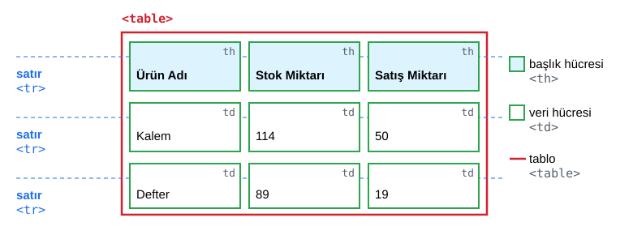

*Şekil 3.1. Bir tablonun satır (`tr`), başlık hücresi (`th`) ve veri hücresi (`td`) yapısı.*

*Kod 3.1. En yalın tablo yapısı.*

```html
<table>
  <tr>
    <th>Ürün Adı</th>
    <th>Stok Miktarı</th>
    <th>Satış Miktarı</th>
  </tr>
  <tr>
    <td>Kalem</td>
    <td>114</td>
    <td>50</td>
  </tr>
</table>
```

`th` ile `td` arasındaki fark yalnızca görsel değildir. Tarayıcı `th` içeriğini kalın ve ortalı gösterir; ancak asıl önemli olan, `th` öğesinin "başlık" anlamı taşımasıdır. Ekran okuyucu bir veri hücresine gelindiğinde ilgili başlığı da okur ("Stok Miktarı, 114"). Bu nedenle başlıklar, kalın yazılmış `td` hücreleriyle taklit edilmemelidir [3, s. 139].

Hücreler her zaman bir `tr` içinde yer alır. Kaynakta `tbody` yazılmasa bile tarayıcı ayrıştırma (parsing) sırasında satırları kendiliğinden bir `tbody` öğesine yerleştirir; bu durum F12 → **Elements** sekmesinde görülebilir. JavaScript'te `tablo.children[0]` ifadesinin ilk satırı değil `tbody`'yi döndürmesinin nedeni budur; satırlara `tablo.rows` ile erişilir ([Bölüm 8](08-javascript-dom-olaylar.md)).

### 3.2.3 Başlık ve satır grupları: `caption`, `thead`, `tbody`, `tfoot`

`caption` tabloya bir başlık verir ve `table`'ın **ilk çocuğu** olarak yazılır [2]. Ekran okuyucular tabloya girildiğinde önce bu metni okur; görsel konumu CSS'teki `caption-side` ile değiştirilebilir. Satırlar ise üç mantıksal gruba ayrılabilir: başlık satırları için `thead`, veri satırları için `tbody`, toplam ve ortalama gibi özet satırları için `tfoot` [1, s. 135]. Gruplama CSS ile ayrı stil vermeyi kolaylaştırır, uzun tablolar yazdırılırken başlık ve alt satırların her sayfada yinelenmesini sağlar ve yardımcı teknolojilerin başlıkları ayırt etmesine yardım eder. Öğelerin yazım sırası Şekil 3.2'de gösterilmiştir.

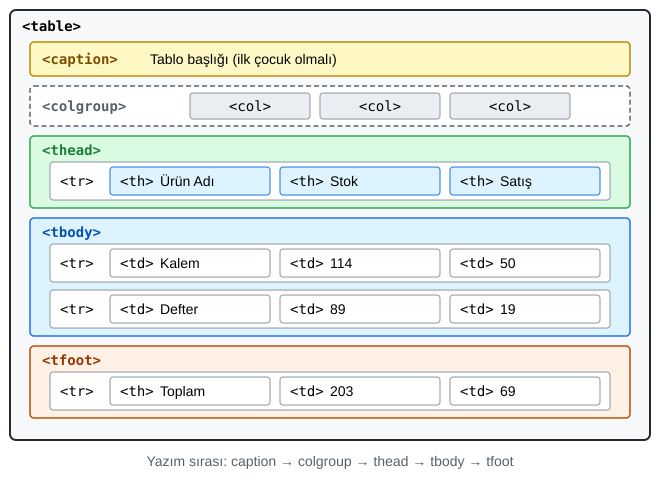

*Şekil 3.2. Tablo öğelerinin iç içe yapısı ve yazım sırası.*

Başlığın hangi hücreleri nitelediği `scope` niteliğiyle belirtilir: `scope="col"` alttaki sütunu, `scope="row"` sağdaki satırı, `rowgroup`/`colgroup` ise bir grubu niteler [3, s. 144]. Kod 3.2'de her satırın ilk hücresi (ürün adı) de satır başlığı olarak işaretlenmiştir.

*Kod 3.2. `caption`, satır grupları ve `scope` (tam örnek: [codes/03-html-tablo-form-medya/ornek-3-1-stok-tablosu/](../codes/03-html-tablo-form-medya/ornek-3-1-stok-tablosu/index.html)).*

```html
<table>
  <caption>Tablo: Mart ayı stok ve satış miktarları (adet)</caption>
  <thead>
    <tr>
      <th scope="col">Ürün Adı</th>
      <th scope="col">Stok Miktarı</th>
      <th scope="col">Satış Miktarı</th>
    </tr>
  </thead>
  <tbody>
    <tr>
      <th scope="row">Kalem</th>
      <td>114</td>
      <td>50</td>
    </tr>
    <!-- Defter ve Silgi satırları -->
  </tbody>
  <tfoot>
    <tr>
      <th scope="row">Toplam</th>
      <td>413</td>
      <td>167</td>
    </tr>
  </tfoot>
</table>
```

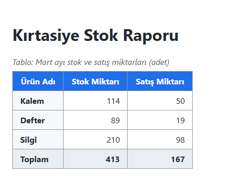

*Şekil 3.3. Örnek 3.1'in tarayıcıdaki görünümü.*

### 3.2.4 Hücre birleştirme: `colspan` ve `rowspan`

Sunumda "etiket" olarak geçen `colspan` ve `rowspan` aslında `th`/`td` öğelerine yazılan **nitelik**lerdir. İngilizcedeki *span*, bir köprünün iki ayağı arasındaki açıklık gibi "uzanım" anlamına gelir:

- **`colspan`** (sütun yayılımı) hücreyi sağa doğru belirtilen sayıda sütuna yayar.
- **`rowspan`** (satır yayılımı) hücreyi aşağı doğru belirtilen sayıda satıra yayar.

En sık yapılan hata, yayılan hücrenin kapladığı konum için ayrıca hücre yazmaktır: `colspan="3"` olan satırda o üç sütun için tek hücre bulunur; `rowspan="2"` olan hücrenin altındaki satırda o sütuna hücre yazılmaz [3, ss. 140–141]. Fazladan hücre tabloyu sağa taşırır. Şekil 3.4 her iki durumu kodlarıyla göstermektedir. Karmaşık tablolarda ızgarayı önce kâğıda çizmek ve her satırın yayılmalar dâhil aynı sütun sayısına ulaştığını denetlemek önerilir [4, s. HTML 447].

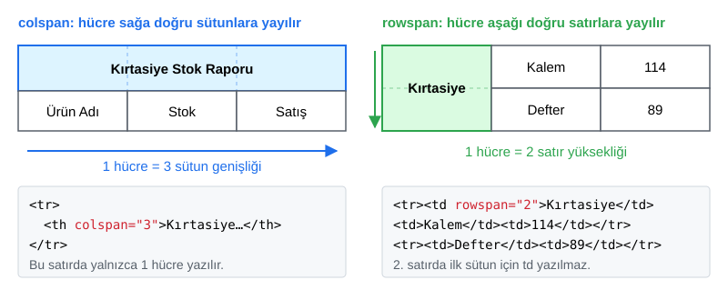

*Şekil 3.4. `colspan` ile yatay, `rowspan` ile dikey hücre birleştirme.*

### 3.2.5 Sütun grupları: `colgroup` ve `col`

Tablolar satır temelli kurulduğundan bir sütunun tamamına stil vermek için `colgroup` ve `col` öğeleri kullanılır [4, s. HTML 464]. `colgroup`, `caption`'dan sonra ve satırlardan önce yazılır; her `col` bir sütunu, `span` niteliği verilmiş `col` ise ardışık birden çok sütunu temsil eder. Sütun öğelerine yalnızca `background`, `border`, `width` ve `visibility` özellikleri uygulanabilir; metin hizası gibi özellikler hücre seçicileriyle verilir.

*Kod 3.3. İlk sütunu ve iki sayısal sütunu gruplayan `colgroup`.*

```html
<colgroup>
  <col class="urun">
  <col span="2" class="sayi">
</colgroup>
```

### 3.2.6 Erişilebilir tablo tasarımı

W3C Web Erişilebilirliği Girişimi'nin (WAI) tablo öğreticisi temel kuralları şöyle özetler [5]: Başlıklar `th` ile işaretlenmeli, basit tablolarda `scope` kullanılmalı, çok düzeyli başlıklı karmaşık tablolarda başlıklara `id` verilip veri hücrelerinde `headers="id1 id2"` ile bağlanmalı, tablonun konusu `caption` ile açıklanmalıdır. Ayrıca karmaşık tablolar mümkünse birden çok basit tabloya bölünmeli, boşluk için boş satır veya sütun eklenmemeli, anlam yalnızca renkle verilmemelidir ("Kaldı" bilgisi kırmızı renkle birlikte metinle de yazılır). Eski HTML'deki `<table summary="…">` niteliği güncel standartta geçersizdir; açıklama `caption` içinde verilir [2].

#### 🛠 Uygulama 3.1: Haftalık Ders Programı Tablosu

**Amaç:** `rowspan`, `colspan`, `caption`, `thead`/`tbody` ve `scope` ile birleştirilmiş hücreli bir ders programı oluşturmak.  
**Tahmini süre:** 20 dk

1. VS Code'da `calismalar/bolum-03/` klasörünü açınız (yoksa oluşturunuz) ve `ders-programi.html` dosyasını oluşturunuz. `!` + `Tab` ile Emmet iskeletini oluşturup `lang="tr"` yapınız.
2. Tabloya bir `caption` ekleyiniz. `thead` içinde iki satır yazınız: İlk satırda `rowspan="2"` ile "Saat" ve `colspan="5"` ile "Günler" başlığı; ikinci satırda Pazartesi–Cuma (`th scope="col"`).
3. `tbody` içinde 09:00–16:00 arası her saat için bir satır açınız; ilk hücre `th scope="row"` olsun. Çok saatli dersleri `rowspan` ile birleştiriniz; 12:00'deki "Öğle arası" hücresini `colspan="5"` ile yayınız.
4. Her satırda, yukarıdan gelen `rowspan` hücrelerini hesaba katarak doğru sayıda `td` yazdığınızı kontrol ediniz.
5. Kenarlıkları CSS ile veriniz ve sayfayı **Live Server** ile açınız (sağ tık → *Open with Live Server*); sonucu Şekil 3.5 ile karşılaştırınız.

**Beklenen çıktı:**

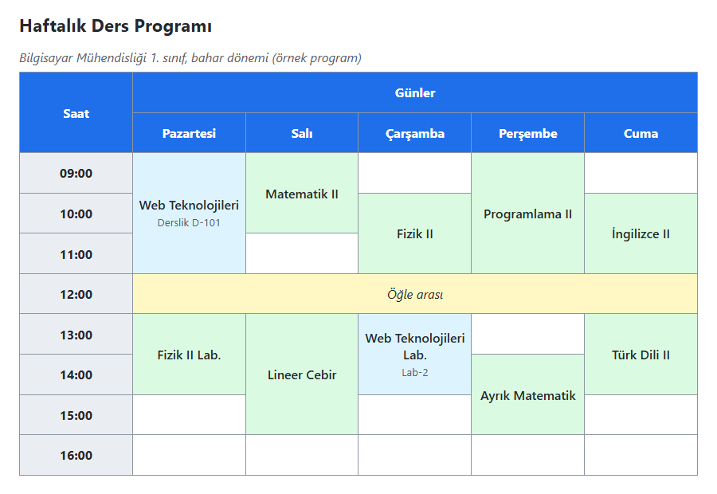

*Şekil 3.5. Uygulama 3.1'in beklenen ekran görüntüsü.*

**Kendinizi sınayın:** (1) Perşembe 13:00'e bir saatlik yeni bir ders ekleyiniz; hangi satırda kaç `td` gerektiğini önce kâğıt üzerinde hesaplayınız. (2) Geliştirici Araçları'nda `tbody` satır sayısını kontrol ediniz.

<details><summary>Örnek çözüm</summary>

Çözüm dosyası: [`codes/03-html-tablo-form-medya/uygulama-3-1-ders-programi/index.html`](../codes/03-html-tablo-form-medya/uygulama-3-1-ders-programi/index.html)

</details>

## 3.3 Tabloları CSS ile Biçimlendirme

### 3.3.1 Kenarlık, iç dolgu ve hücre aralığı

Tablolar varsayılan olarak kenarlıksızdır; kenarlık ve boşluklar CSS ile verilir [1, ss. 337–340]. Sunumdaki stil örneği bu yaklaşımın doğru bir başlangıcıdır (Kod 3.4).

*Kod 3.4. Tablo ve hücrelere kenarlık veren temel CSS.*

```css
table {
  border: 1px solid black;
  border-collapse: collapse;
}

th,
td {
  border: 1px solid #ccc;
  padding: 0.5rem 0.75rem;
}
```

- **`padding`** (iç dolgu): Hücre içeriği ile hücre kenarlığı arasındaki boşluk; `th`/`td`'ye uygulanır.
- **`border-spacing`** (kenarlık aralığı): Komşu hücre kenarlıkları arasındaki boşluk; `table`'a uygulanır ve yalnızca varsayılan `border-collapse: separate` modelinde etkilidir.
- **`border-collapse: collapse`**: Komşu kenarlıkları tek çizgide birleştirir; bu modelde `border-spacing` etkisizdir.

Bir apartman benzetmesiyle: Her hücre bir dairedir; `padding` eşyalar ile duvar arasındaki boşluk, `border-spacing` iki komşu dairenin duvarları arasındaki mesafedir; `collapse` modelinde komşular ortak duvarı paylaşır (Şekil 3.6, Şekil 3.7).

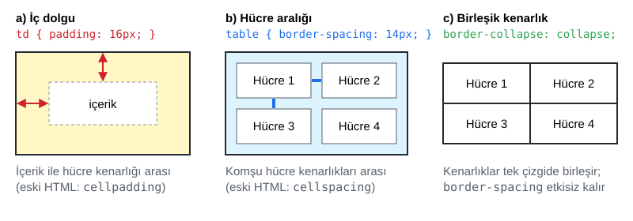

*Şekil 3.6. `padding`, `border-spacing` ve `border-collapse` özelliklerinin etkisi.*

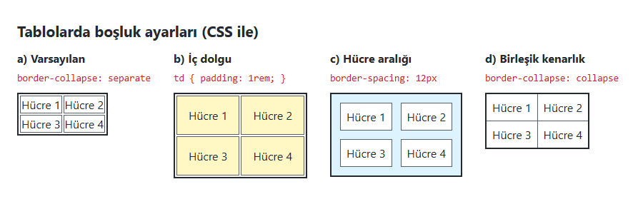

*Şekil 3.7. Aynı tablonun dört CSS ayarıyla görünümü (Örnek 3.2: [codes/03-html-tablo-form-medya/ornek-3-2-bosluk-ayarlari/](../codes/03-html-tablo-form-medya/ornek-3-2-bosluk-ayarlari/index.html)).*

### 3.3.2 Okunabilirlik: hizalama, zebra satırlar, yapışkan başlık

Hücrelerin yatay hizası `text-align`, dikey hizası `vertical-align` ile verilir. Metin sütunları sola, sayısal sütunlar sağa yaslanmalıdır; `font-variant-numeric: tabular-nums` rakamları eşit genişlikte çizerek basamakların alt alta gelmesini sağlar. Uzun tablolarda satırlara dönüşümlü arka plan vermek ("zebra deseni") gözün satırı izlemesini kolaylaştırır [1, s. 338]. Tablo aşağı kaydırıldığında başlığın görünür kalması için başlık hücrelerine `position: sticky` verilir; geniş tabloların dar ekranlarda sayfayı yatay olarak taşırmaması için ise tablo kaydırılabilir bir sarmalayıcıya alınır [4, s. HTML 474]. Kod 3.5 bu teknikleri birleştirmektedir; seçicilerin ayrıntısı [Bölüm 4](04-css-temelleri.md)'te, `position` özelliği [Bölüm 6](06-css-kutu-modeli-yerlesim.md)'da ele alınmaktadır.

*Kod 3.5. Zebra satırlar, yapışkan başlık ve kaydırmalı sarmalayıcı (Uygulama 3.2'den).*

```html
<div class="tablo-kutusu" tabindex="0" role="region" aria-labelledby="tablo-basligi">
  <table>
    <caption id="tablo-basligi">Sınav sonuçları</caption>
    <!-- thead, tbody, tfoot -->
  </table>
</div>
```

```css
.tablo-kutusu {
  max-height: 22rem;
  overflow: auto;              /* gerektiğinde kaydırma çubuğu */
}

thead th {
  position: sticky;            /* kaydırırken üstte kalır */
  top: 0;
  background: #1f6feb;         /* alttan geçen satırları örter */
  color: #ffffff;
}

tbody tr:nth-child(even) {
  background-color: #f6f8fa;   /* zebra deseni */
}
```

Sarmalayıcıdaki `tabindex="0"` klavye kullanıcılarının alana odaklanıp ok tuşlarıyla kaydırabilmesini, `role="region"` ve `aria-labelledby` ise ekran okuyucuların bölgeyi adlandırmasını sağlar.

> [!NOTE]
> **Tarihsel not:** CSS yaygınlaşmadan önce tablo görünümü öğelere yazılan sunum nitelikleriyle ayarlanırdı [1, s. 137]. Sunumdaki şu satır bu dönemin tipik örneğidir:
>
> ```html
> <table border="1" cellpadding="20" style="width:300px" bgcolor="#CCCCCC"
>        bordercolor="#CC0000" height="400" hspace="80" border:"1px">
> ```
>
> Bu niteliklerin hiçbiri güncel standarda uygun değildir [2]; `bordercolor` ve tablo için `hspace` ise hiç standart olmamış, belirli tarayıcılara özgü eklentilerdir. Sondaki `border:"1px"` ise geçerli bir sözdizimi değildir: HTML niteliği `ad="değer"` biçiminde yazılır, `ad: değer` biçimi CSS'e aittir; tarayıcı bu ifadeyi anlamsız bir nitelik adı olarak yok sayar. Karşılıklar Tablo 3.1'de verilmiştir.

*Tablo 3.1. Eskimiş tablo nitelikleri ve CSS karşılıkları.*

| Eski HTML niteliği | Görevi | CSS karşılığı |
|---|---|---|
| `border="1"` | Tablo ve hücre kenarlığı | `table, th, td { border: 1px solid #000; }` |
| `cellpadding="20"` | Hücre içi boşluk | `th, td { padding: 20px; }` |
| `cellspacing="5"` | Hücreler arası boşluk | `table { border-spacing: 5px; }` veya `border-collapse: collapse` |
| `bgcolor="#CCCCCC"` | Arka plan rengi | `background-color: #ccc;` |
| `bordercolor="#CC0000"` | Kenarlık rengi (standart dışı) | `border-color: #c00;` |
| `width="300"` | Genişlik | `width: 300px;` (duyarlı tasarımda `max-width: 100%`) |
| `height="400"` | Yükseklik (standart dışı) | `height: 400px;` |
| `hspace="80"` | Yatay dış boşluk (standart dışı) | `margin-inline: 80px;` |
| `align="center"` | Tabloyu ortalama | `margin-inline: auto;` |
| `valign="top"` | Hücrede dikey hiza | `vertical-align: top;` |

#### 🛠 Uygulama 3.2: Sınav Sonuç Tablosu

**Amaç:** Anlamsal bir tabloyu zebra satırlar, yapışkan başlık ve kaydırmalı sarmalayıcıyla biçimlendirmek.  
**Tahmini süre:** 20 dk

1. `calismalar/bolum-03/` klasöründe `sinav-sonuclari.html` ve `sinav-sonuclari.css` dosyalarını oluşturup bağlayınız.
2. "Sıra, Öğrenci No, Ad Soyad, Vize, Final, Ortalama, Durum" sütunlu; `caption`, `thead`, `tbody`, `tfoot` içeren bir tablo yazınız; en az 12 öğrenci ekleyiniz.
3. Ortalamayı **vize × 0,4 + final × 0,6** ile hesaplayınız. Ortalaması **en az 60** olan öğrenci "Geçti", diğerleri "Kaldı" olsun. Ortalaması tam 60 olan bir öğrenci (ör. vize 30, final 80) ekleyerek sınır değerin "Geçti" sayıldığını sınayınız.
4. `tfoot`'ta "Sınıf ortalaması" hücresini `colspan="5"` ile yayınız. Tabloyu Kod 3.5'teki sarmalayıcıya alıp `border-collapse`, `padding`, zebra ve yapışkan başlık kurallarını yazınız; sayısal sütunları sağa yaslayınız.
5. Sayfayı Live Server ile açınız; tablo içinde kaydırarak başlığın sabit kaldığını, pencereyi daraltarak yatay kaydırma çubuğunun belirdiğini gözlemleyiniz.

**Beklenen çıktı:**

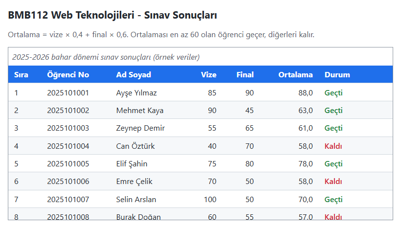

*Şekil 3.8. Uygulama 3.2'nin beklenen ekran görüntüsü.*

**Kendinizi sınayın:** (1) Fareyle üzerine gelinen satırı vurgulayan `tbody tr:hover` kuralını ekleyiniz. (2) `caption`'ı tablonun altına taşıyan CSS bildirimini yazınız.

<details><summary>Örnek çözüm</summary>

Çözüm dosyası: [`codes/03-html-tablo-form-medya/uygulama-3-2-sinav-sonuclari/index.html`](../codes/03-html-tablo-form-medya/uygulama-3-2-sinav-sonuclari/index.html)

</details>

## 3.4 Gömülü İçerik: `iframe`

### 3.4.1 Sayfa içinde sayfa

`iframe` (inline frame, satır içi çerçeve), bir sayfanın içinde başka bir HTML belgesini kendi penceresi olan bir alanda gösterir; Duckett bu öğeyi sayfaya açılmış küçük bir pencereye benzetir [1, s. 189]. Gömülü belge bağımsız olarak yüklenir, kendi CSS'i ve betikleri vardır, sığmayan içerik için kendi kaydırma çubuğunu gösterir. Sunumdaki örnek `liste.html` belgesini 400 × 250 piksellik bir alanda gösterir [3, s. 131]; Kod 3.6'da bu örneğe bir `title` eklenmiştir. Ekran okuyucular çerçeveye gelindiğinde bu adı okur; `title` yoksa kullanıcı yalnızca "çerçeve" duyar [6].

*Kod 3.6. Aynı klasördeki bir belgenin gömülmesi (tam örnek: [codes/03-html-tablo-form-medya/ornek-3-3-iframe-liste/](../codes/03-html-tablo-form-medya/ornek-3-3-iframe-liste/index.html)).*

```html
<iframe src="liste.html" width="400" height="250"
        title="Web geliştirme araçları listesi"></iframe>
```

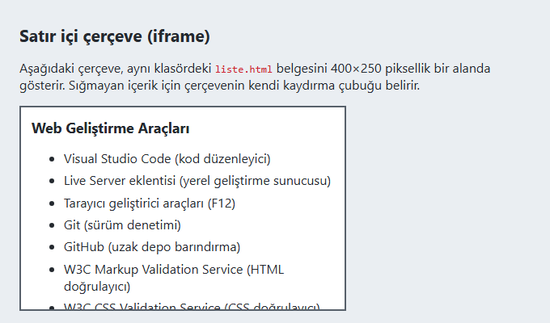

*Şekil 3.9. `iframe` içinde gösterilen `liste.html`; sığmayan içerik çerçevenin içinde kaydırılır.*

*Tablo 3.2. `iframe` öğesinin başlıca nitelikleri.*

| Nitelik | Görevi |
|---|---|
| `src` / `srcdoc` | Gömülecek belgenin adresi / doğrudan nitelik içinde verilen küçük HTML içeriği. |
| `width`, `height` | Piksel cinsinden boyut; duyarlı tasarımda CSS ile `width: 100%` ve `aspect-ratio` tercih edilir. |
| `title` | Çerçevenin erişilebilir adı; her çerçevede bulunmalıdır. |
| `loading="lazy"` | Çerçeve görünür alana yaklaşana kadar yüklenmez; ilk açılışı hızlandırır. |
| `sandbox` | Gömülen içeriğe kısıtlama uygular; boşsa tüm kısıtlamalar etkindir, `allow-scripts`, `allow-forms` gibi belirteçler izinleri tek tek geri verir. |
| `allow` | İzin politikası (Permissions Policy): `fullscreen`, `picture-in-picture`, `geolocation` gibi özelliklere izin. |
| `allowfullscreen` | Tam ekrana izin; `allow="fullscreen"` ile eşdeğer eski yazım. |
| `referrerpolicy` | Gömülen siteye gönderilecek başvuran (Referer) bilgisinin kapsamı. |

### 3.4.2 Güncel hayattan: video ve harita gömme

> [!TIP]
> **Güncel hayattan:** Restoran sitelerindeki konum haritaları, haber sitelerindeki YouTube videoları ve randevu takvimleri çoğunlukla `iframe` ile gömülür. Bu hizmetler "Paylaş → Yerleştir" (Share → Embed) menüsünde hazır `iframe` kodu üretir; geliştiricinin koda `title` ve `loading="lazy"` eklemesi yeterlidir.

Kod 3.7'de bir OpenStreetMap haritası ve bir YouTube videosu gömülmüştür. `youtube-nocookie.com` adresi, kullanıcı videoyu oynatana kadar izleme çerezlerini sınırlayan "gizliliği geliştirilmiş mod"dur. Çerçevelerin genişliği kapsayıcıya uydurulmuş, en-boy oranı `aspect-ratio` ile korunmuştur.

*Kod 3.7. Harita ve video gömme (Uygulama 3.3'ten).*

```html
<iframe class="genis"
  src="https://www.openstreetmap.org/export/embed.html?bbox=27.760%2C41.140%2C27.840%2C41.180&amp;layer=mapnik"
  title="Çorlu çevresini gösteren OpenStreetMap haritası"
  loading="lazy"></iframe>

<iframe class="genis video"
  src="https://www.youtube-nocookie.com/embed/aqz-KE-bpKQ"
  title="Big Buck Bunny - Blender Foundation kısa filmi"
  loading="lazy"
  allow="encrypted-media; picture-in-picture; fullscreen"
  referrerpolicy="strict-origin-when-cross-origin"
  allowfullscreen></iframe>
```

```css
.genis { width: 100%; height: auto; aspect-ratio: 4 / 3; }
.genis.video { aspect-ratio: 16 / 9; }
```

> [!IMPORTANT]
> Bazı video ve harita hizmetleri gömülü içeriği yalnızca bir web sunucusu (`http://`, `https://`) üzerinden açılan sayfalarda gösterir; `file:///` adresiyle açılan sayfada video oynatılamayabilir. Bu tür örnekler **Live Server** ile açılmalıdır.

### 3.4.3 Güvenlik: `sandbox`, tıklama korsanlığı ve çerçeveleme denetimi

Gömülen dış içerik kullanıcının tarayıcısında çalışır. `sandbox` niteliği en az yetki ilkesini uygular: Boş `sandbox` betik çalıştırmayı, form göndermeyi, açılır pencereyi ve üst sayfanın adresini değiştirmeyi engeller, belgeyi ayrı bir köken (origin) gibi ele alır. Gerekli izinler belirteçlerle geri verilir:

*Kod 3.8. `sandbox` kullanımı.*

```html
<!-- Yalnızca statik içerik: tüm kısıtlamalar etkin -->
<iframe src="duyurular.html" title="Bölüm duyuruları" sandbox></iframe>

<!-- Betik ve form gönderimine izin verilir, diğer kısıtlamalar sürer -->
<iframe src="https://anket.ornek.com/form" title="Memnuniyet anketi"
        sandbox="allow-scripts allow-forms"></iframe>
```

> [!WARNING]
> Aynı kökenden gelen bir belgede `allow-scripts` ile `allow-same-origin` birlikte verilirse gömülen betik `sandbox`'ı kendi kendine kaldırabilir; bu ikili yalnızca tamamen güvenilen içerikte kullanılmalıdır [6].

Çerçeveleme ters yönde bir saldırı aracı da olabilir. **Tıklama korsanlığı** (clickjacking) saldırısında kötü niyetli bir site, örneğin bir bankanın onay sayfasını görünmez bir `iframe` içine yerleştirir ve üzerine sahte bir düğme koyar; kullanıcı aslında görünmeyen "Onayla" düğmesine tıklar. Bir sitenin çerçevelenmesini engellemek sunucunun işidir: Sunucu yanıta `X-Frame-Options: DENY` veya `SAMEORIGIN` başlığını ekler [7]; güncel ve daha esnek yöntem ise İçerik Güvenliği Politikası'nın (CSP) `frame-ancestors` yönergesidir, örneğin `Content-Security-Policy: frame-ancestors 'self'` [8]. Bankacılık ve e-Devlet sayfalarının başka sitelerde çerçeve içinde açılmamasının nedeni budur.

> [!NOTE]
> **Tarihsel not:** HTML 4'teki `frameset` ve `frame` öğeleri tarayıcı penceresini birden çok bağımsız belgeye bölerdi (ör. solda sabit menü). Sayfaların yer imine eklenememesi, arama motorlarının çerçeveleri ayrı sayfalar olarak dizinlemesi ve ekran okuyucularda gezinme güçlükleri nedeniyle bu öğeler HTML5'te kaldırılmıştır [2]. `iframe`'in `frameborder`, `scrolling`, `marginwidth` nitelikleri de geçersizdir (yerine CSS); Duckett'in andığı `seamless` niteliği ise standarda hiç girmemiştir.

#### 🛠 Uygulama 3.3: Harita ve Video Gömme

**Amaç:** `iframe` ile yerel bir belgeyi, bir haritayı ve bir videoyu erişilebilir ve güvenli biçimde gömmek.  
**Tahmini süre:** 15 dk

1. `calismalar/bolum-03/gomme/` klasöründe `index.html` ve kısa bir duyuru listesi içeren `duyurular.html` dosyalarını oluşturunuz; `duyurular.html`'i `title` ve boş `sandbox` nitelikli bir `iframe` ile gösteriniz.
2. [openstreetmap.org](https://www.openstreetmap.org) adresinde ilçenizi bulup **Paylaş** panelinden HTML gömme kodunu alınız; koda `title` ve `loading="lazy"` ekleyiniz.
3. YouTube'da bir eğitim videosunun **Paylaş → Yerleştir** kodunu alınız; alan adını `www.youtube-nocookie.com` yapınız, anlamlı bir `title` ve `loading="lazy"` ekleyiniz.
4. Kod 3.7'deki CSS ile çerçeveleri kapsayıcı genişliğine uydurunuz. Sayfayı Live Server ile açıp Şekil 3.10 ile karşılaştırınız; pencereyi daraltarak taşma olmadığını doğrulayınız.

**Beklenen çıktı:**

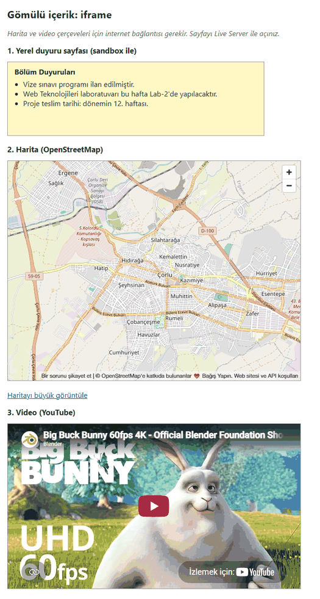

*Şekil 3.10. Uygulama 3.3'ün beklenen ekran görüntüsü.*

**Kendinizi sınayın:** (1) `duyurular.html`'e `<script>alert("Merhaba")</script>` ekleyiniz; `sandbox` varken ve yokken davranışı karşılaştırınız. (2) **Network** sekmesinde, sayfa aşağı kaydırılmadan video çerçevesinin yüklenip yüklenmediğini gözlemleyiniz.

<details><summary>Örnek çözüm</summary>

Çözüm dosyası: [`codes/03-html-tablo-form-medya/uygulama-3-3-iframe-gomme/index.html`](../codes/03-html-tablo-form-medya/uygulama-3-3-iframe-gomme/index.html)

</details>

## 3.5 Formlar

### 3.5.1 Formun iki tarafı

Form, kullanıcıdan bilgi toplamak için hazırlanmış bir şablondur. HTML, basılı formdaki "doldurulacak boşluk" kavramını metin kutuları, düğmeler, açılır menüler gibi **form denetimlerinden** (form controls) oluşan etkileşimli bir arayüze taşımıştır [1, s. 145]. Arama kutuları, banka giriş ekranları, ödeme sayfaları ve ders seçim ekranları birer formdur. Bir form iki parçadan oluşur [3, s. 148]:

1. **İstemci tarafı (arayüz):** Tarayıcıda görünen, HTML ile yazılmış kısım.
2. **Sunucu tarafı (işleyici):** Gönderilen veriyi alan, işleyen (kaydetme, e-posta gönderme, arama) ve yanıt sayfası üreten program. PHP, Python, Java, C#, Node.js gibi teknolojilerle yazılır; HTML'in görevi değildir.

Tarayıcı form gönderildiğinde her denetimin adını ve değerini `ad=değer` çiftleri hâlinde paketleyip formun `action` adresine bir HTTP isteğiyle iletir; sunucunun yanıtı yeni bir sayfa olarak görüntülenir [1, ss. 149–150]. Şekil 3.11, sunumdaki e-bülten kayıt örneği üzerinden bu akışı göstermektedir.

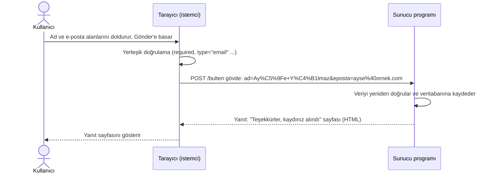

*Şekil 3.11. Form gönderiminden yanıt sayfasının görüntülenmesine kadar istemci–sunucu akışı.*

Bu bölümde yalnızca istemci tarafı ele alınmakta, örneklerde gerçek bir sunucu yerine verinin nasıl paketlendiğini gözlemlemeyi sağlayan teknikler kullanılmaktadır. Formların JavaScript ile işlenmesi [Bölüm 8](08-javascript-dom-olaylar.md)'de anlatılmaktadır.

### 3.5.2 `form` öğesi: `action`, `method`, `enctype`

Tüm form denetimleri bir `form` öğesinin içinde yer alır. Bir sayfada birden çok form bulunabilir, ancak formlar iç içe yazılamaz: Bir form kapatılmadan diğeri başlatılmamalıdır [2]. `form` öğesinin üç temel niteliği vardır:

- **`action`**: Verinin gönderileceği sunucu programının adresi. Boş bırakılırsa veri formun bulunduğu sayfanın kendi adresine gönderilir [3, s. 150].
- **`method`**: `get` veya `post`; belirtilmezse `get`. Sunumda "action özniteliğinin GET ve POST özelliği" olarak anılan bu ayar ayrı bir niteliktir.
- **`enctype`**: POST verisinin kodlama biçimi. Varsayılan `application/x-www-form-urlencoded`'dır; dosya yükleyen formlarda `multipart/form-data` zorunludur.

*Kod 3.9. E-bülten kayıt formunun iskeleti.*

```html
<form action="/bulten-kayit" method="post">
  <!-- form denetimleri -->
</form>
```

> [!TIP]
> **Güncel hayattan:** `action` adresindeki program sitenin sunucusunda çalışır. GitHub Pages gibi statik barındırma hizmetleri sunucu programı çalıştırmaz; bu sitelerde formlar ayrı bir arka uç (back-end) uygulamasına veya form verisi kabul eden hizmetlere yönlendirilir. Sunumdaki "hosting seçimine dikkat" uyarısı bu nedenledir [3, s. 150].

### 3.5.3 `GET` ve `POST` yöntemleri

**GET yönteminde** veri, URL'nin sonuna `?` karakterinden sonra eklenir; bu eke **sorgu dizgesi** (query string) denir. Çiftler `&` ile ayrılır ve URL'de güvenle taşınamayan karakterler kodlanır [3, s. 151] (Şekil 3.12).

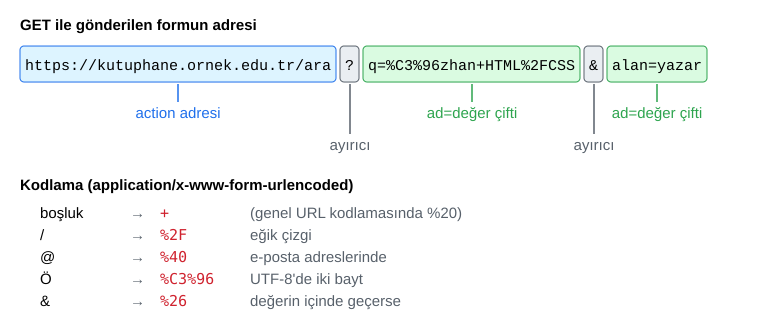

*Şekil 3.12. GET ile gönderilen bir formun oluşturduğu adres ve karakter kodlaması.*

Form verisinin varsayılan kodlaması olan `application/x-www-form-urlencoded` biçiminde harf, rakam ve `* - . _` karakterleri olduğu gibi kalır; boşluk `+` işaretine, diğer karakterler UTF-8 baytlarının yüzde kodlamasına (percent-encoding) dönüşür [9]: `/` → `%2F`, `@` → `%40`, iki baytlık `Ö` → `%C3%96`. Sunumdaki "boşluk → `%20`" gösterimi URL'lerin genel yüzde kodlamasına aittir [10]; form gönderiminde tarayıcılar boşluğu `+` yazar, sunucu kütüphaneleri ise her ikisini aynı karaktere çözer. Kodlamayı tarayıcı kendiliğinden yapar.

**POST yönteminde** veri aynı kodlamayla HTTP isteğinin **gövdesinde** (body) taşınır; adres çubuğunda, geçmişte ve yer imlerinde görünmez.

> [!WARNING]
> Sunumdaki "POST yönteminde veri yalnızca sunucu tarafından görülür, bu nedenle kredi kartı gibi bilgileri göndermek güvenilirdir" ifadesi düzeltilmelidir: **POST veriyi şifrelemez.** Gövde düz metin olarak iletilir; ağı izleyebilen biri (ör. şifresiz bir halka açık Wi-Fi'da) onu okuyabilir, geliştirici araçlarının **Network** sekmesinde de açıkça görülür. Verinin yol boyunca gizliliğini sağlayan, bağlantının **HTTPS** (TLS üzerinden HTTP) olmasıdır [11]. Doğru kural: Parola, kimlik numarası, kart bilgisi gibi hassas veriler **POST ile ve yalnızca HTTPS üzerinden** gönderilir.

GET verisinin görünürlüğü adres çubuğuyla sınırlı değildir: Sorgu dizgesi tarayıcı geçmişine ve yer imlerine kaydedilir, sunucunun erişim günlüklerine (access logs) yazılır ve başvuran (Referer) bilgisiyle başka sitelere sızabilir. Bu nedenle parola, HTTPS olsa bile GET ile gönderilmez. HTTP'de GET bir **güvenli yöntem**dir (safe method): Sunucuda durum değiştirmemesi, yalnızca bilgi istemesi beklenir [12]. Bu sayede arama sonuçları yer imine eklenip paylaşılabilir [3, s. 151]; kayıt, sipariş, mesaj gönderme gibi iz bırakan işlemler ise POST ile yapılır. Sunumda GET için belirtilen "karakter sınırı" HTTP'de tanımlı değildir, ancak tarayıcı ve sunucular URL uzunluğunu pratikte sınırlar; HTTP/1.1 tanımı en az 8000 sekizlik (octet) istek satırının desteklenmesini önerir [13].

*Tablo 3.3. GET ve POST yöntemlerinin karşılaştırılması.*

| Ölçüt | GET | POST |
|---|---|---|
| Verinin yeri | URL'deki sorgu dizgesi | HTTP istek gövdesi |
| Adres çubuğu, geçmiş, yer imi, sunucu günlüğü | Görünür, kaydedilir | Görünmez, genellikle kaydedilmez |
| Şifreleme | Yok (HTTPS ile taşıma sırasında şifrelenir) | Yok (HTTPS ile taşıma sırasında şifrelenir) |
| Uzunluk ve dosya | Pratik URL sınırı; dosya gönderilemez | Büyük veri; `multipart/form-data` ile dosya |
| Sayfa yenileme | Sorunsuz tekrarlanır | "Formu yeniden gönder" uyarısı |
| Tipik kullanım | Arama, filtreleme, sıralama, sayfalama | Giriş, kayıt, sipariş, ödeme, yorum, dosya yükleme |

#### 🛠 Uygulama 3.4: GET ile Sorgu Dizgesini Gözlemleme

**Amaç:** GET ile gönderilen form verisinin URL'ye nasıl dizildiğini ve kodlandığını gözlemlemek.  
**Tahmini süre:** 15 dk

1. `calismalar/bolum-03/sorgu/index.html` dosyasında `action=""` ve `method="get"` nitelikli bir form yazınız; form, sayfanın kendisine gönderilecektir.
2. `label`'lı şu alanları ekleyiniz: arama ifadesi (`type="search"`, `name="q"`), arama alanı (`select`, `name="alan"`), en eski basım yılı (`type="number"`, `name="yil"`), isteğe bağlı e-posta (`type="email"`, `name="eposta"`) ve **Ara** düğmesi.
3. Sayfayı Live Server ile açıp arama kutusuna `Özhan HTML/CSS`, e-posta alanına `ogrenci@ornek.edu.tr` yazarak gönderiniz. Adres çubuğunda boşluğun `+`, `/`'nin `%2F`, `@`'nin `%40`, `Ö`'nün `%C3%96` olduğunu; `name`'i olmayan bir alanın adreste yer almadığını gözlemleyiniz.
4. Çözüm klasöründeki `script.js` dosyasını `<script src="script.js" defer></script>` ile bağlayınız; betik sorgu dizgesini ve çözülmüş çiftleri sayfada gösterir (ayrıntısı Bölüm 8'de).
5. `method="post"` ile yeniden gönderiniz; sorgu dizgesinin oluşmadığını, verinin **Network** sekmesindeki isteğin **Payload** bölümünde göründüğünü doğrulayınız (Live Server POST'a hata yanıtı verebilir; amaç yalnızca isteği gözlemlemektir).

**Beklenen çıktı:**

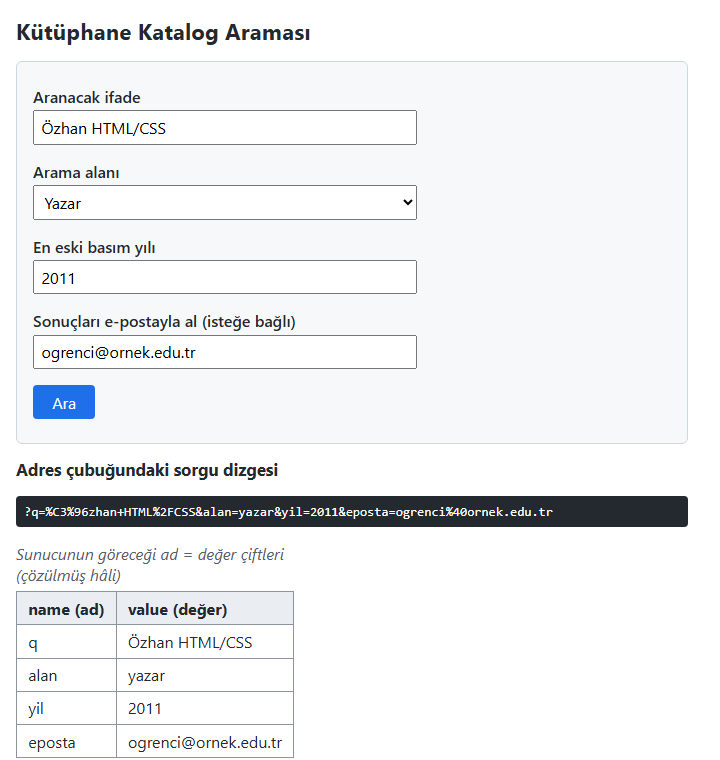

*Şekil 3.13. Uygulama 3.4'ün form gönderildikten sonraki görünümü.*

**Kendinizi sınayın:** (1) Arama ifadesine `C# & Java` yazınız; `#` ve `&` karakterlerinin neden kodlandığını açıklayınız. (2) Adres çubuğunda `yil=1990` yazıp Enter'a basınız; formun yeni değerle dolması, istemciden gelen veriye güvenilmemesi gerektiği konusunda ne söylemektedir?

<details><summary>Örnek çözüm</summary>

Çözüm dosyası: [`codes/03-html-tablo-form-medya/uygulama-3-4-sorgu-dizgesi/index.html`](../codes/03-html-tablo-form-medya/uygulama-3-4-sorgu-dizgesi/index.html)

</details>

### 3.5.4 Denetim adları ve etiketler: `name`, `value`, `label`

Robbins form denetimini bir değişkene benzetir: `name` değişkenin adı, kullanıcının girdiği veya seçtiği veri ise değeridir (`value`) [3, s. 151]. `name`'i olmayan denetim gönderilmez. `id` ise yalnızca sayfa içinde (CSS, JavaScript, `label`) kullanılır ve sunucuya gitmez. Sunucu programı belirli adları beklediğinden çalışan bir formdaki `name` değerleri sunucu tarafıyla anlaşılmadan değiştirilmemelidir [1, s. 150].

`label` öğesi denetime görünür ve erişilebilir bir ad verir; iki biçimde kullanılır:

*Kod 3.10. `label`'ın açık (`for`/`id`) ve kapsayan kullanımı.*

```html
<!-- Açık bağlantı: for değeri ile id değeri aynıdır -->
<label for="adsoyad">Ad soyad</label>
<input type="text" id="adsoyad" name="adsoyad">

<!-- Kapsayan bağlantı: denetim label'ın içindedir -->
<label><input type="checkbox" name="bulten" value="evet"> Bültene abone ol</label>
```

Bağlantının iki kazancı vardır: Ekran okuyucu alana gelindiğinde etiketi okur ("Ad soyad, düzenleme alanı"); etikete tıklamak alana odaklanır veya onay kutusunu işaretler. Bu, küçük denetimlerde ve dokunmatik ekranlarda kullanımı kolaylaştırır [14].

> [!IMPORTANT]
> `placeholder` bir etiket değildir: Yazmaya başlanınca kaybolur, çoğunlukla düşük kontrastla gösterilir ve bazı yardımcı teknolojilerce okunmaz. Her alanın görünür bir `label`'ı olmalı; `placeholder` yalnızca kısa biçim ipuçları için kullanılmalıdır [14].

### 3.5.5 Gruplama: `fieldset` ve `legend`

İlişkili denetimler `fieldset` ile gruplanır; tarayıcı grubun çevresine çerçeve çizer. `legend`, `fieldset`'in ilk çocuğu olarak gruba başlık verir [1, s. 164]. Bir sipariş formunda "Teslimat adresi" ve "Fatura adresi" grupları aynı tür alanlar içerir; `legend` olmadan ekran okuyucu kullanıcısı hangi "İl" alanını doldurduğunu ayırt edemez. Seçenek düğmesi gruplarında ekran okuyucu önce `legend` metnini ("Yaş grubunuz, gruplama"), sonra seçeneği okur. Form öğelerinin ilişkisi Şekil 3.14'te özetlenmiştir.

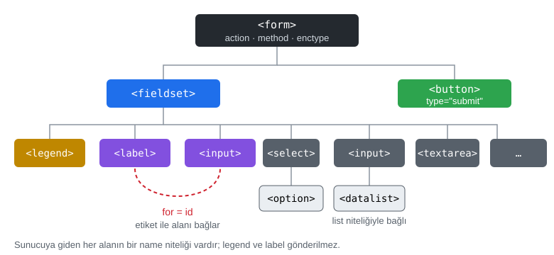

*Şekil 3.14. Form öğelerinin hiyerarşisi ve `label`–`input` bağlantısı.*

### 3.5.6 Metin girişi: `text`, `password`, `textarea`

Denetimlerin çoğu, görünüm ve davranışı `type` niteliğiyle belirlenen boş (void) bir öğe olan `input` ile oluşturulur. Bu bölüm, sunumdaki sırayı izlemektedir: metin girişi, özel metin tipleri, sayı/tarih/renk, seçim denetimleri, dosya ve gizli alanlar, düğmeler.

- **`type="text"`** tek satırlık metin alır; `value` başlangıç değerini, `maxlength` en fazla karakter sayısını belirler [1, s. 152].
- **`type="password"`** karakterleri maskeler. Maskeleme yalnızca ekrana bakan birine karşı korur, veriyi şifrelemez; parola içeren formlar POST ve HTTPS ile gönderilir.
- **`textarea`** çok satırlı metin alır; kapanış etiketi vardır ve etiketler arasındaki metin başlangıç içeriğidir. `rows`/`cols` görünür boyutu belirler; kullanıcı alanı köşesinden büyütebilir (CSS'teki `resize` ile denetlenir).

*Kod 3.11. Metin, parola ve çok satırlı metin alanları.*

```html
<label for="sehir">Şehir</label>
<input type="text" id="sehir" name="sehir" value="Tekirdağ" maxlength="50">

<label for="parola">Parola</label>
<input type="password" id="parola" name="parola" minlength="8" autocomplete="current-password">

<label for="mesaj">Mesajınız</label>
<textarea id="mesaj" name="mesaj" rows="5" cols="50">Dersi faydalı buldum.</textarea>
```

### 3.5.7 HTML5 özel metin tipleri: `email`, `tel`, `url`, `search`

Sunumdaki "HTML5, 13 yeni etiket sunmuştur" ifadesi, HTML5'in tanıttığı 13 yeni **giriş tipine** karşılık gelir: `search`, `email`, `tel`, `url`, `number`, `range`, `date`, `time`, `datetime`, `datetime-local`, `month`, `week`, `color` [15, ss. 80–87]. Bunlardan `datetime` sonradan standarttan çıkarılmış, yerini `datetime-local` almıştır. Yeni tipler masaüstünde `text`'e benzer görünür; farkları üç noktadadır [15, s. 81], [4, s. HTML 514]:

1. **Doğrulama:** `email` değerin `ad@alan` biçiminde, `url` ise şemayla (`https://`) başlayan bir adres olup olmadığını denetler.
2. **Sanal klavye:** Mobilde `email` için `@`, `tel` için sayısal tuş takımı, `url` için `.com` ve `/`, `search` için "Ara" tuşu öne çıkar (sunumdaki iPhone ekran görüntüleri).
3. **Otomatik doldurma:** Tarayıcı alanın türünü bildiğinden kayıtlı e-posta ve telefonları önerebilir.

`tel` tipi, ülkelere göre biçim değiştiği için içeriği doğrulamaz; gerekirse `pattern` kullanılır. Bilinmeyen tipler eski tarayıcılarda `text` olarak gösterildiğinden bu tipler güvenle kullanılabilir.

*Kod 3.12. Özel metin tipleri.*

```html
<label for="e">E-posta</label>     <input type="email" id="e" name="eposta" autocomplete="email">
<label for="t">Telefon</label>     <input type="tel" id="t" name="telefon" autocomplete="tel">
<label for="w">Web sitesi</label>  <input type="url" id="w" name="site" placeholder="https://">
<label for="s">Sitede ara</label>  <input type="search" id="s" name="q">
```

### 3.5.8 Sayı, tarih-saat ve renk

- **`number`** yalnızca sayı kabul eder; `min`, `max`, `step` aralığı ve adımı belirler (varsayılan adım 1; ondalık için ör. `step="0.01"`).
- **`range`** kesin değerin önemsiz olduğu durumlar (memnuniyet, ses düzeyi) için kaydırıcıdır; değeri ekranda yazılmaz.
- **`date`, `time`, `datetime-local`, `month`, `week`** yerleşik takvim/saat seçicilerini açar. Ekranda yerel biçim (ör. `16.03.2026`) görünse de gönderilen değer standarttır: `2026-03-16`, `09:30`, `2026-03-16T09:30`, `2026-03`, `2026-W12`. Böylece sunucu tarihi kullanıcının dil ayarından bağımsız yorumlar.
- **`color`** renk seçici açar; değer `#rrggbb` biçiminde gönderilir.

*Kod 3.13. Sunumdaki misafir sayısı ve memnuniyet örneklerinin Türkçe karşılığı ve tarih/renk alanları.*

```html
<label for="misafir">Misafir sayısı</label>
<input type="number" id="misafir" name="misafir" min="1" max="6" value="2">

<label for="memnuniyet">Memnuniyet (0-10)</label>
<input type="range" id="memnuniyet" name="memnuniyet" min="0" max="10" step="1">

<label for="randevu">Randevu tarihi</label>
<input type="date" id="randevu" name="randevu" min="2026-03-01" max="2026-06-30">

<label for="renk">En sevdiğiniz renk</label>
<input type="color" id="renk" name="renk" value="#1f6feb">
```

> [!TIP]
> **Güncel hayattan:** Bilet satış siteleri gidiş tarihi alanında `min` niteliğiyle geçmiş tarihlerin seçilmesini engeller; randevu sistemleri saatleri `type="time"` ve `step="900"` (15 dakika) ile sunabilir.

### 3.5.9 Seçim denetimleri: `radio`, `checkbox`, `select`, `datalist`

**Seçenek düğmeleri** (`type="radio"`) birbirini dışlayan seçenekler içindir; adlarını, birine basınca öncekinin kalktığı eski radyo istasyon tuşlarından alırlar. Düğmeleri tek grup yapan şey **aynı `name` değeridir**. `value` gönderilecek değeri, `checked` başlangıçta seçili düğmeyi belirtir [1, s. 155]. **Onay kutuları** (`type="checkbox"`) bağımsızdır: Hiçbiri, biri veya birkaçı işaretlenebilir. Aynı `name` ile işaretlenen kutular aynı adı birden çok kez gönderir (`tur=halk&tur=pop`); işaretlenmeyen kutu hiç gönderilmez, `value`'su olmayan kutu `on` gönderir (Şekil 3.15).

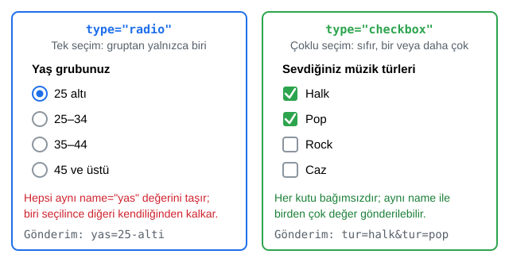

*Şekil 3.15. Seçenek düğmesi ile onay kutusunun karşılaştırılması.*

Sunumdaki yaş grubu ve müzik türü örneklerinde seçenekler `ol`/`ul` listelerine yazılmış, soru bir `p` paragrafında verilmiştir. Bu yazımda soru ile düğmeler arasında yardımcı teknolojilerin anlayacağı bir bağ yoktur ve metne tıklamak düğmeyi seçmez. Kod 3.14 bu eksiklikleri `fieldset`, `legend` ve `label` ile giderir.

*Kod 3.14. Sunumdaki seçenek düğmesi ve onay kutusu örneklerinin erişilebilir yazımı.*

```html
<fieldset>
  <legend>Kaç yaşındasınız?</legend>
  <label><input type="radio" name="yas" value="25-alti" checked> 25 altı</label>
  <label><input type="radio" name="yas" value="25-34"> 25-34</label>
  <label><input type="radio" name="yas" value="35-44"> 35-44</label>
  <label><input type="radio" name="yas" value="45-ustu"> 45 ve üstü</label>
</fieldset>

<fieldset>
  <legend>Hangi tür müzikleri dinlersiniz?</legend>
  <label><input type="checkbox" name="tur" value="halk" checked> Halk</label>
  <label><input type="checkbox" name="tur" value="pop" checked> Pop</label>
  <label><input type="checkbox" name="tur" value="rock"> Rock</label>
  <label><input type="checkbox" name="tur" value="caz"> Caz</label>
</fieldset>
```

**Açılır liste** (`select`) çok sayıda seçeneği az yer kaplayarak sunar. Her seçenek bir `option`'dır: `value` gönderilen değeri, içerik görünen metni belirler; `selected` önceden seçili seçeneği, `optgroup` (`label` nitelikli) seçenek gruplarını tanımlar; `multiple` çoklu seçime, `size` görünen satır sayısına izin verir [4, s. HTML 531]. İlk seçeneğin `value=""` ile "Seçiniz" yazılıp `select`'e `required` verilmesi bilinçli seçimi zorunlu kılar. **Öneri listesi** (`datalist`) ise bir metin alanına `list` niteliği aracılığıyla öneriler bağlar; `select`'ten farkı, kullanıcının listede olmayan bir değer de yazabilmesidir [15, ss. 87–88], [4, s. HTML 553].

*Kod 3.15. `optgroup`'lu açılır liste ve sunumdaki öğrenim düzeyi örneğinin `datalist` ile Türkçe yazımı.*

```html
<label for="bolum">Bölümünüz</label>
<select id="bolum" name="bolum" required>
  <option value="">Seçiniz</option>
  <optgroup label="Mühendislik Fakültesi">
    <option value="bilgisayar" selected>Bilgisayar Mühendisliği</option>
    <option value="makine">Makine Mühendisliği</option>
  </optgroup>
</select>

<label for="egitim">Tamamlanan öğrenim</label>
<input type="text" id="egitim" name="egitim" list="duzeyler">
<datalist id="duzeyler">
  <option value="Lise"></option>
  <option value="Lisans"></option>
  <option value="Yüksek lisans"></option>
  <option value="Doktora"></option>
</datalist>
```

> [!TIP]
> **Güncel hayattan:** Kargo ve e-ticaret sitelerinin adres formlarında il seçimi, geçerli değerler sınırlı ve yazım hatası istenmediği için `select` ile yapılır. Arama kutusunun altında beliren "popüler aramalar" ise `datalist` mantığıyla çalışır: Öneri sunulur, ancak kullanıcı istediğini yazabilir.

### 3.5.10 Dosya, gizli alan ve düğmeler

**Dosya seçme** (`type="file"`) denetiminde `accept` kabul edilen türleri (`.pdf`, `image/*`), `multiple` çoklu seçimi belirler. Dosya içeriğinin gönderilmesi için form `method="post"` ve `enctype="multipart/form-data"` niteliklerine sahip olmalıdır; GET ile yalnızca dosya adı gider [1, s. 159], [3, s. 166].

*Kod 3.16. Dosya yükleme formu.*

```html
<form action="/odev-yukle" method="post" enctype="multipart/form-data">
  <label for="odev">Ödev dosyası (PDF)</label>
  <input type="file" id="odev" name="odev" accept=".pdf" required>
  <button type="submit">Yükle</button>
</form>
```

**Gizli alan** (`type="hidden"`) görünmez ama değeri gönderilir; formun kaynağı veya sunucunun ürettiği bir oturum belirteci gibi bilgileri taşır. Değer kaynak kodda açıkça görünür ve geliştirici araçlarıyla değiştirilebilir; bu nedenle fiyat, yetki gibi güvenilmesi gereken bilgiler gizli alanda tutulmaz, sunucu bunları kendi kayıtlarından okur.

**Düğmeler**: `input type="submit"` formu gönderir, `reset` alanları başlangıç değerlerine döndürür, `button` ise yalnızca JavaScript ile işlev kazanır; yazı `value` ile verilir. Aynı işlevler, içine simge veya biçimli içerik de alabilen `button` öğesiyle yazılabilir ve güncel uygulamalarda bu öğe tercih edilir: `<button type="submit">Gönder</button>`.

> [!IMPORTANT]
> Form içindeki `button` öğesinin varsayılan tipi `submit`'tir. JavaScript ile başka bir iş yapacak düğmeye `type="button"` yazılmazsa tıklama formu da gönderir. `reset` düğmesi ise kullanıcının tüm emeğini tek tıklamayla silebileceğinden, kullanılacaksa "Gönder"den belirgin biçimde ayrılmalıdır.

*Tablo 3.4. `input` öğesinin başlıca `type` değerleri ve gönderilen değer örnekleri [16].*

| Tip | Görünüm / davranış | Gönderilen değer örneği |
|---|---|---|
| `text`, `search` | Tek satır metin / arama kutusu | `sehir=Tekirda%C4%9F`, `q=web+teknolojileri` |
| `password` | Maskelenmiş metin | yalnızca POST + HTTPS ile |
| `email`, `url` | Biçim denetimi, uygun klavye | `eposta=ali%40ornek.com`, `site=https%3A%2F%2Fornek.com` |
| `tel` | Sayısal klavye (biçim denetimi yok) | `tel=05001234567` |
| `number`, `range` | Sayı alanı / kaydırıcı | `adet=3`, `puan=7` |
| `date`, `time`, `datetime-local` | Tarih / saat seçici | `tarih=2026-03-16`, `saat=09%3A30` |
| `month`, `week` | Ay / hafta seçici | `ay=2026-03`, `hafta=2026-W12` |
| `color` | Renk seçici | `renk=%231f6feb` |
| `checkbox`, `radio` | Çoklu / tekli seçim | `tur=halk&tur=pop`, `yas=25-34` |
| `file` | Dosya seçici | dosya içeriği (`multipart/form-data`) |
| `hidden` | Görünmez | `form_kaynagi=vitrin` |
| `submit`, `reset`, `button` | Düğmeler | yalnızca `name`'li `submit` değer gönderir |

#### 🛠 Uygulama 3.5: HTML5 Giriş Tipleri Vitrini

**Amaç:** `input` öğesinin farklı `type` değerlerini tek sayfada görmek ve tarayıcı denetimlerini karşılaştırmak.  
**Tahmini süre:** 15 dk

1. `calismalar/bolum-03/vitrin/` klasöründe `index.html` ve `style.css` oluşturunuz. `action="#"` ve `method="post"` nitelikli bir form yazınız (parola alanı içerdiği için POST).
2. Tablo 3.4'teki her tip için bir "kart" (`div class="kart"`) oluşturunuz; her kartta `label` (`for`/`id` eşleşmeli), ilgili `input` (anlamlı `name` ve gerekirse örnek `value`) ve tip adını gösteren bir `code` bulunsun.
3. Kartları `display: grid; grid-template-columns: repeat(auto-fill, minmax(14rem, 1fr));` ile sütunlara diziniz (Grid ayrıntıları Bölüm 6'dadır).
4. Sayfayı Live Server ile açınız; tarih, saat ve renk seçicilerini inceleyip Şekil 3.16 ile karşılaştırınız. Sayfayı aynı ağdaki telefonunuzda açarak `email`, `tel`, `url`, `number` klavyelerini karşılaştırınız.

**Beklenen çıktı:**

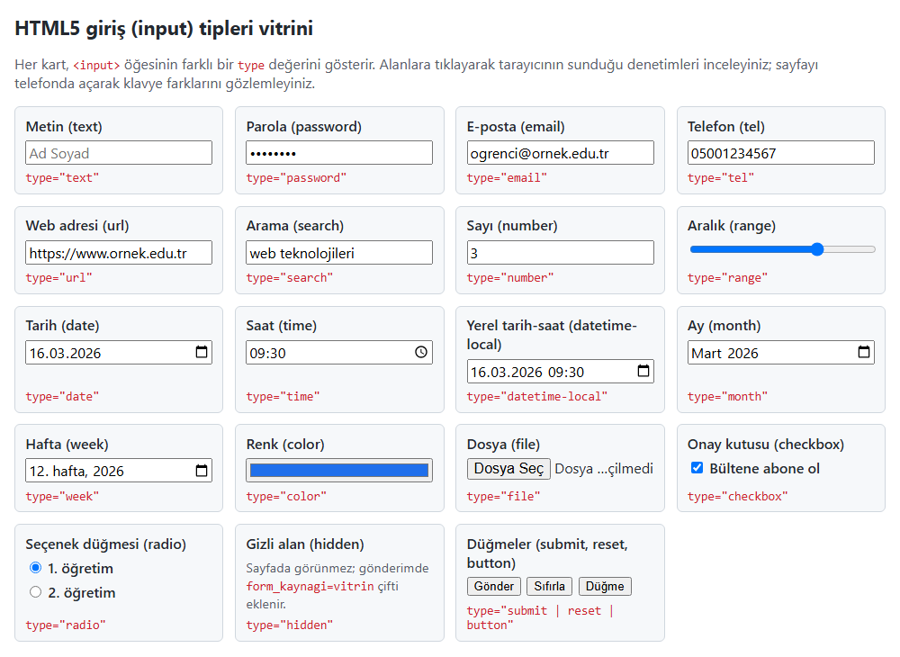

*Şekil 3.16. Uygulama 3.5'in beklenen ekran görüntüsü (tarih biçimleri tarayıcının dil ayarına göre değişir).*

**Kendinizi sınayın:** (1) `email` alanına `ali@` yazıp **Gönder**'e basınız; tarayıcı uyarısını not ediniz. (2) `number` alanına `max`'tan büyük bir sayı yazıp aynı denemeyi yapınız.

<details><summary>Örnek çözüm</summary>

Çözüm dosyası: [`codes/03-html-tablo-form-medya/uygulama-3-5-giris-tipleri/index.html`](../codes/03-html-tablo-form-medya/uygulama-3-5-giris-tipleri/index.html)

</details>

### 3.5.11 Tarayıcının yerleşik doğrulaması

HTML5 öncesinde "alan boş mu?", "telefon 11 hane mi?" gibi denetimler JavaScript ile yazılırdı; HTML5 bunların çoğunu niteliklerle bildirimsel olarak tanımlamayı sağlar [1, s. 165], [15, ss. 87–92]. Tarayıcı gönderimden önce kısıtları denetler; geçersiz alan varsa gönderimi durdurur, alana odaklanır ve kullanıcının dilinde uyarı gösterir (Tablo 3.5).

*Tablo 3.5. Doğrulama ve davranış nitelikleri.*

| Nitelik | Anlamı |
|---|---|
| `required` | Alan boş bırakılamaz; radyo grubunda tek düğmeye yazılması yeterlidir. |
| `min`, `max`, `step` | Sayı ve tarih tiplerinde izin verilen aralık ve adım. |
| `minlength`, `maxlength` | Metin uzunluğu sınırları; `maxlength` fazlasının yazılmasını engeller. |
| `pattern` | Değerin **tamamının** uyması gereken düzenli ifade (regular expression). |
| `placeholder` | Boş alandaki kısa ipucu; etiketin yerini tutmaz. |
| `autocomplete` | Otomatik doldurma ipucu: `name`, `email`, `tel`, `street-address`, `current-password`, `new-password`, `off` … |
| `disabled` | Alan etkisizdir; odaklanılamaz, **değeri gönderilmez**. |
| `readonly` | Düzenlenemez ama odaklanılabilir, **değeri gönderilir**. |
| `checked` / `selected` | Başlangıçta seçili seçenek (`radio`, `checkbox` / `option`). |
| `novalidate` / `formnovalidate` | Doğrulamayı formda / belirli bir gönder düğmesinde kapatır (ör. "taslak kaydet"). |

`pattern="05[0-9]{9}"` yalnızca `05` ile başlayan 11 haneli değerleri kabul eder; `^` ve `$` yazmak gerekmez. Beklenen biçim, `title` niteliğine güvenmek yerine alanın altında görünür bir ipucuyla anlatılmalı ve `aria-describedby` ile alana bağlanmalıdır. `autocomplete` ise bir erişilebilirlik gereğidir: WCAG 2.2'nin 1.3.5 "Girdi Amacını Belirleme" ölçütü, kullanıcıya ait bilgileri toplayan alanların amacının programatik olarak belirlenebilmesini ister [17].

Geçersiz alanlar CSS'te `:invalid` ile seçilebilir; ancak `:invalid` sayfa açılır açılmaz geçerli olduğundan boş zorunlu alanlar kullanıcı bir şey yazmadan kırmızı görünür. Güncel tarayıcıların desteklediği `:user-invalid` ise yalnızca kullanıcı alanla etkileşime girdikten veya göndermeyi denedikten sonra eşleşir [18].

*Kod 3.17. Doğrulama nitelikleri ve `:user-invalid` (Uygulama 3.6'dan).*

```html
<label for="adsoyad">Ad soyad *</label>
<input type="text" id="adsoyad" name="adsoyad" required minlength="3" maxlength="60" autocomplete="name">

<label for="telefon">Cep telefonu</label>
<input type="tel" id="telefon" name="telefon" pattern="05[0-9]{9}" autocomplete="tel"
       aria-describedby="telefon-ipucu">
<small id="telefon-ipucu">05 ile başlayan 11 hane, boşluksuz (05xxxxxxxxx)</small>
```

```css
input:user-invalid,
select:user-invalid,
textarea:user-invalid {
  border: 2px solid #cf222e;
  background: #ffebe9;
}
```

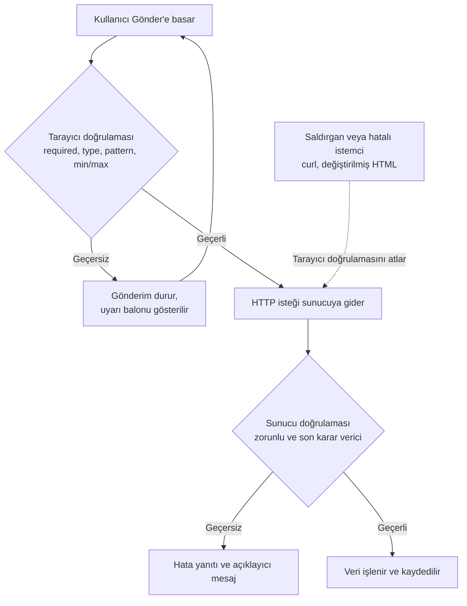

*Şekil 3.17. İstemci ve sunucu doğrulamasının birlikte çalışması: İstemci doğrulaması atlanabilir, sunucu doğrulaması atlanamaz.*

> [!WARNING]
> **İstemci doğrulaması sunucu doğrulamasının yerini tutmaz.** Tarayıcı denetimleri yalnızca dürüst kullanıcıya yardımcı bir kolaylıktır. Kullanıcı geliştirici araçlarıyla `required` veya `maxlength`'i silebilir, `pattern`'i değiştirebilir ya da formu hiç kullanmadan `curl` gibi bir araçla doğrudan sunucuya istek gönderebilir. Sunucu her veriyi kendi kurallarıyla yeniden doğrulamalıdır; örneğin bir not girişinde 0–100 aralığı hem formda (`min="0" max="100"`) hem sunucuda denetlenir.

Doğrulamanın JavaScript ile özelleştirilmesi (`setCustomValidity()` vb.) [Bölüm 8](08-javascript-dom-olaylar.md)'de ele alınmaktadır.

#### 🛠 Uygulama 3.6: Doğrulamalı İletişim Formu

**Amaç:** `label`, `fieldset`/`legend`, uygun giriş tipleri, doğrulama nitelikleri ve `:user-invalid` ile erişilebilir bir iletişim formu oluşturmak.  
**Tahmini süre:** 20 dk

1. `calismalar/bolum-03/iletisim/` klasöründe `index.html` ve `style.css` oluşturunuz. `action="#"` ve `method="post"` nitelikli bir form yazınız; gerçek uygulamada `action`'ın HTTPS üzerindeki sunucu programı olacağını bir yorumla not ediniz.
2. "Kişisel bilgiler" grubuna ad soyad (`required`, `minlength="3"`, `autocomplete="name"`), e-posta (`email`, `required`) ve cep telefonu (`tel`, `pattern="05[0-9]{9}"`, `aria-describedby` ile bağlı ipucu) ekleyiniz.
3. "Mesaj" grubuna konu (`select`, ilk seçenek `value=""`, `required`), mesaj (`textarea`, `required`, `minlength="20"`, `maxlength="500"`) ve zorunlu bir kişisel veri onay kutusu ekleyiniz. Zorunlu alan etiketlerine `*` koyup anlamını formun başında açıklayınız.
4. Kod 3.17'deki `:user-invalid` kuralını ekleyiniz. Sayfayı Live Server ile açıp formu boş göndermeyi deneyiniz; tarayıcının ilk geçersiz alana odaklandığını gözlemleyiniz.
5. Çözüm klasöründeki `script.js`'i bağlayınız; betik, form geçerliyse gönderimi durdurup bir teşekkür mesajı gösterir.

**Beklenen çıktı:**

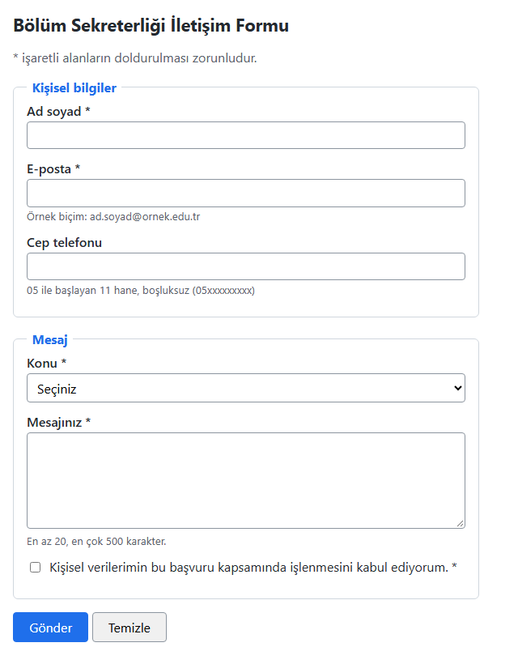

*Şekil 3.18. Uygulama 3.6'nın ilk açılıştaki görünümü.*

**Kendinizi sınayın:** (1) Geliştirici Araçları'nda ad soyad alanından `required`'ı silip formu gönderiniz; bu deneyin sunucu doğrulaması hakkında gösterdiğini bir cümleyle açıklayınız. (2) `:user-invalid` yerine `:invalid` yazıp farkı gözlemleyiniz.

<details><summary>Örnek çözüm</summary>

Çözüm dosyası: [`codes/03-html-tablo-form-medya/uygulama-3-6-iletisim-formu/index.html`](../codes/03-html-tablo-form-medya/uygulama-3-6-iletisim-formu/index.html)

</details>

### 3.5.12 Erişilebilir form tasarımı: özet ilkeler

WAI form öğreticisi ve WCAG 2.2 birlikte değerlendirildiğinde iyi bir form şu ilkelere uyar [14], [17]: Her denetimin görünür ve programatik olarak bağlı bir `label`'ı vardır, ilişkili denetimler `fieldset`/`legend` ile gruplanır; zorunlu alanlar yalnızca renkle değil metin veya simgeyle belirtilir; beklenen biçim yazmaya başlamadan önce görünür bir ipucuyla verilir; hata mesajları hatanın yerini ve çözümünü söyler ("Geçersiz giriş" yerine "Telefon numarası 05 ile başlamalı ve 11 haneli olmalıdır"); form yalnızca klavyeyle doldurulabilir ve odaklanılan alan görsel olarak belirgindir; kişisel bilgi alanlarında uygun `autocomplete` değerleri kullanılır.

> [!TIP]
> **Güncel hayattan:** Banka mobil uygulamalarının ve e-Devlet kapısının giriş formlarında kimlik numarası alanı yalnızca rakam kabul eder, parola alanında "parolayı göster" düğmesi bulunur ve hatalı girişte hangi alanın hatalı olduğu açıkça belirtilir.

#### 🛠 Uygulama 3.7: Ders Değerlendirme Anketi

**Amaç:** Seçenek düğmeleri, onay kutuları, `optgroup`'lu liste, `datalist` ve `range`'i bir ankette birlikte kullanmak; POST gövdesini gözlemlemek.  
**Tahmini süre:** 20 dk

1. `calismalar/bolum-03/anket/` klasöründe `index.html` ve `style.css` oluşturunuz; `action="#"` ve `method="post"` nitelikli bir form yazınız.
2. "Kaçıncı sınıftasınız?" sorusunu `fieldset`/`legend` içinde, aynı `name="sinif"`'i paylaşan dört seçenek düğmesiyle yazınız; ilk düğmeye `required` ekleyiniz.
3. "En faydalı bulduğunuz konular" için aynı `name="konu"`'yu paylaşan dört onay kutusu ekleyiniz.
4. İki `optgroup`'lu bir "Bölümünüz" listesi, beş il öneren bir `datalist`'e bağlı "Memleketiniz" alanı, 0–10 aralığında bir memnuniyet kaydırıcısı ve bir öneri `textarea`'sı ekleyiniz.
5. Çözüm klasöründeki `script.js`'i bağlayınız; gönderimde POST gövdesine yazılacak kodlanmış metin sayfanın altında gösterilir. İki kutu işaretlendiğinde `konu`'nun iki kez yer aldığını, işaretlenmeyenlerin gönderilmediğini gözlemleyiniz.

**Beklenen çıktı:**

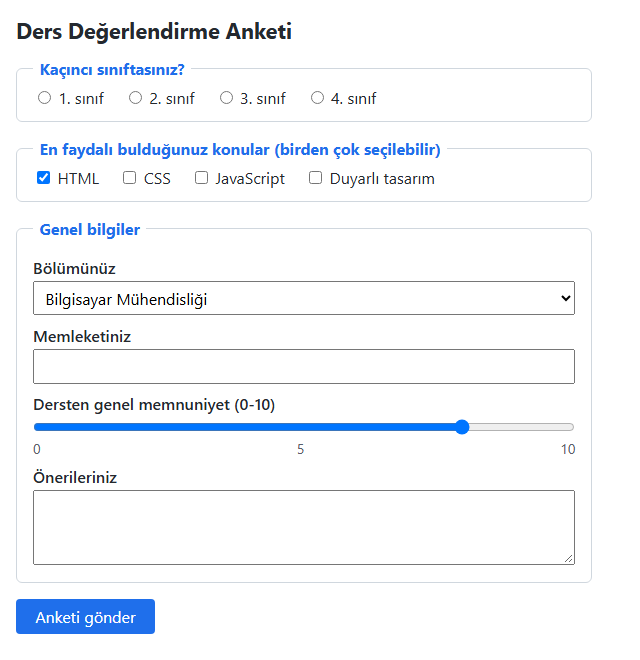

*Şekil 3.19. Uygulama 3.7'nin beklenen ekran görüntüsü.*

**Kendinizi sınayın:** (1) Bir seçenek düğmesinin `name`'ini `sinif2` yapınız; iki düğmenin aynı anda seçilebilmesinin nedenini açıklayınız. (2) Kaydırıcının değerini yanında göstermek için hangi öğe ve teknolojinin gerektiğini araştırınız.

<details><summary>Örnek çözüm</summary>

Çözüm dosyası: [`codes/03-html-tablo-form-medya/uygulama-3-7-anket-formu/index.html`](../codes/03-html-tablo-form-medya/uygulama-3-7-anket-formu/index.html)

</details>

## 3.6 Ses ve Video

### 3.6.1 Eklentilerden yerel medya öğelerine

Web'in ilk yıllarında ses ve video Flash, QuickTime, RealPlayer gibi tarayıcı eklentileriyle (plug-in) oynatılırdı; eklentilerin ayrıca kurulması gerekiyor, güvenlik açıklarına ve pil tüketimine yol açıyor, bazı akıllı telefonlarda hiç çalışmıyordu [1, ss. 204–206]. HTML5'in `video` ve `audio` öğeleri medyayı tarayıcının yerel olarak oynatmasını sağlamış; medya, CSS ile biçimlendirilebilen, JavaScript ile denetlenebilen ve klavyeyle kullanılabilen sıradan bir içerik hâline gelmiştir [15, s. 110].

> [!NOTE]
> **Tarihsel not:** Adobe Flash, 2000'li yıllarda web'deki animasyon ve videoların başlıca aracıydı. Mobil desteğin olmaması, güvenlik sorunları ve HTML5 medya öğelerinin olgunlaşmasıyla kullanımı azaldı; Adobe, Flash Player desteğini 31 Aralık 2020'de sona erdirdi. Eski kaynaklardaki, `video` içine yedek olarak Flash oynatıcı koyan `object`/`embed` kalıpları [3, s. 197] artık kullanılmaz.

### 3.6.2 `video` öğesi ve nitelikleri

Sunumdaki üç video örneği `controls` ve `autoplay` niteliklerinin birleşimlerini gösterir; ancak hepsinde `height="480 poster=...` biçiminde kapanmamış bir tırnak vardır. Tarayıcı `480 poster=` metnini `height` değerinin parçası sayar ve `poster` niteliği hiç tanınmaz. Ayrıca `muted` olmadan yazılan `autoplay` güncel tarayıcılarda çoğunlukla çalışmaz (bkz. 3.6.3). Düzeltilmiş hâli Kod 3.18'dedir.

*Kod 3.18. Sunumdaki video örneklerinin düzeltilmiş hâli.*

```html
<!-- 1. Kontroller var, otomatik başlamaz (önerilen kullanım) -->
<video src="tanitim.mp4" width="640" height="360" poster="kapak.jpg" controls></video>

<!-- 2. Kontroller var, sessiz olarak otomatik başlar -->
<video src="tanitim.mp4" width="640" height="360" poster="kapak.jpg"
       controls autoplay muted playsinline></video>

<!-- 3. Kontrolsüz, sessiz, döngülü dekoratif arka plan videosu -->
<video src="arka-plan.mp4" autoplay muted loop playsinline aria-hidden="true"></video>
```

Niteliklerin çoğu **mantıksal (boolean)** niteliktir: Yazılması "açık", yazılmaması "kapalı" demektir; `controls="false"` yazmak kontrolleri kapatmaz.

*Tablo 3.6. `video` ve `audio` öğelerinin başlıca nitelikleri [2], [1, s. 214].*

| Nitelik | `video` | `audio` | Anlamı |
|---|---|---|---|
| `src` | ✓ | ✓ | Medya dosyasının adresi (tek kaynakta). |
| `controls` | ✓ | ✓ | Oynat/duraklat, ilerleme, ses ve tam ekran denetimleri. |
| `autoplay` | ✓ | ✓ | Sayfa açılınca oynatmayı dener; tarayıcı politikalarına tabidir. |
| `muted` | ✓ | ✓ | Sessiz başlatır. |
| `loop` | ✓ | ✓ | Bitince başa döner. |
| `preload` | ✓ | ✓ | `none`, `metadata` (yalnızca süre/boyut), `auto` (tarayıcı karar verir). |
| `poster` | ✓ | — | Oynatma öncesi kapak görseli. |
| `width`, `height` | ✓ | — | Görüntü alanı boyutu; yüklenirken yerleşim kaymasını önler. |
| `playsinline` | ✓ | — | iPhone'larda tam ekrana geçmeden sayfa içinde oynatma. |

`width`/`height` videonun en-boy oranıyla uyumlu olmalıdır: Günümüz videolarının çoğu 16:9'dur (ör. 640 × 360); sunumdaki 640 × 480 eski 4:3 oranıdır ve 16:9 bir videoda siyah bantlar oluşturur. `video { max-width: 100%; height: auto; }` kuralı videonun kapsayıcıdan taşmasını önler.

### 3.6.3 Otomatik oynatma politikaları

Sayfa açılınca beklenmedik biçimde ses çalması rahatsız edicidir ve ekran okuyucu kullananların kendi okuyucularını duymasını engeller. Lawson konuyu şakayla karışık şöyle özetler: “Kontrolleri sunmak, videoyu otomatik oynatmaktan yaklaşık yüzde 764 daha iyidir.” [15, s. 114]. Günümüz tarayıcılarında **sesli otomatik oynatma genellikle engellenir, sessiz (`muted`) otomatik oynatmaya izin verilir**; kullanıcının sitede önceden etkileşimde bulunması bu kuralı değiştirebilir ve ayrıntılar tarayıcıya göre farklıdır [19]. WCAG 2.2'nin 1.4.2 "Ses Denetimi" ölçütü de kendiliğinden başlayan ve 3 saniyeden uzun süren her ses için durdurma veya ses düzeyi ayarlama olanağı ister [17]. Pratik kural: Ses içeren medya kullanıcı başlatana kadar oynatılmaz; otomatik oynatma yalnızca sessiz, kısa ve dekoratif videolar içindir.

### 3.6.4 Çoklu kaynak, kapsayıcı ve kodek

Bir video dosyası **kapsayıcı biçim** (container: MP4, WebM) ve içindeki görüntü/ses akışlarını sıkıştıran **kodeklerden** (codec: H.264, VP9, AV1, AAC, Opus) oluşur [4, s. HTML 588]. Tarayıcıların desteklediği kodekler lisans ve patent nedenleriyle tarihsel olarak farklılık göstermiştir [15, ss. 117–119]. Bu nedenle `video` içine birden çok `source` yazılır; tarayıcı listeyi yukarıdan aşağıya okur ve **oynatabildiği ilk kaynağı** seçer [1, s. 215]. `type` niteliğinde MIME türü (ve isteğe bağlı `codecs`) belirtilmesi, oynatılamayacak dosyanın indirilmeden atlanmasını sağlar (Şekil 3.20).

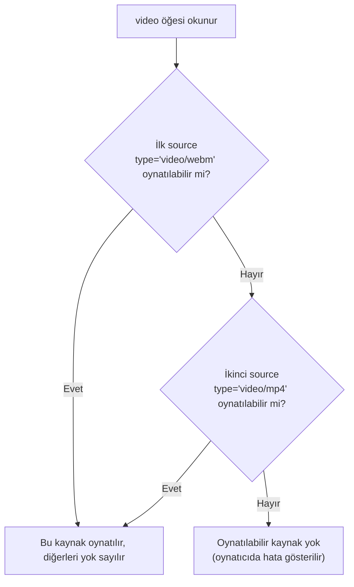

*Şekil 3.20. Tarayıcının birden çok `source` arasından oynatılacak kaynağı seçmesi.*

*Kod 3.19. Çoklu kaynaklı video (güncel kodeklerle).*

```html
<video controls preload="metadata" width="640" height="360" poster="kapak.jpg">
  <source src="tanitim.webm" type='video/webm; codecs="av01.0.05M.08, opus"'>
  <source src="tanitim.mp4"  type='video/mp4; codecs="avc1.42E01E, mp4a.40.2"'>
  <p>Tarayıcınız video öğesini desteklemiyor. <a href="tanitim.mp4">Videoyu indiriniz</a>.</p>
</video>
```

Önce daha verimli sıkıştırma sunan WebM/AV1, ardından neredeyse evrensel desteğe sahip MP4/H.264 verilmiştir; `type` içinde çift tırnak bulunduğundan nitelik tek tırnakla yazılmıştır (Tablo 3.7) [20].

*Tablo 3.7. Web için yaygın medya biçimleri.*

| Kapsayıcı | MIME türü | Tipik kodekler | Not |
|---|---|---|---|
| MP4 | `video/mp4` | H.264 + AAC | En geniş destek; yedek kaynak olarak önerilir. |
| WebM | `video/webm` | VP9 veya AV1 + Opus | Açık ve telifsiz; aynı kalitede daha küçük dosya. |
| MP3 | `audio/mpeg` | MP3 | Ses için en yaygın biçim. |
| AAC / M4A | `audio/mp4` | AAC | Mobil cihazlarda yaygın. |
| Ogg | `audio/ogg` | Vorbis, Opus | Ses için açık biçim. |
| WAV | `audio/wav` | PCM (sıkıştırmasız) | Kısa efektler; dosyalar büyüktür. |

> [!NOTE]
> **Tarihsel not:** Sunumdaki örnekte üçüncü kaynak `video/ogg; codecs="theora, vorbis"` (Ogg/Theora), WebM kaynağı ise `VP8, vorbis` kodekleriyle verilmiştir. Bunlar 2010'ların başında telifli H.264'e karşı geliştirilen açık alternatiflerdi [15, ss. 117–118]. Günümüzde Theora kullanılmamakta, VP8'in yerini VP9 ve AV1 almaktadır; yeni projelerde WebM (VP9/AV1) + MP4 (H.264) yeterlidir. Sunumun belirttiği gibi sunucunun dosyaları doğru MIME türüyle sunması da önemlidir [3, s. 198].

`video`/`audio` etiketleri arasına yazılan yedek içerik yalnızca bu öğeleri hiç tanımayan çok eski tarayıcılarda görünür; güncel bir tarayıcı kaynağı oynatamazsa yedek içerik gösterilmez, oynatıcıda hata oluşur. Bu nedenle indirme bağlantıları, sunumun ses örneğindeki gibi öğenin dışında da verilebilir.

> [!TIP]
> **Güncel hayattan:** YouTube ve Netflix videoyu tek dosya yerine farklı kalitelerde küçük parçalar hâlinde sunar ve bağlantı hızına göre kaliteyi anlık değiştirir (uyarlanabilir akış: HLS, MPEG-DASH). Bu teknik ek altyapı gerektirdiğinden küçük sitelerde ya `video` ile tek dosya ya da bir video platformunun `iframe` gömme kodu (Bölüm 3.4.2) tercih edilir [1, s. 206], [4, s. HTML 618].

### 3.6.5 Altyazı ve erişilebilirlik: `track` ve WebVTT

Videodaki konuşmalar işitme engelliler, videoyu sessiz ortamda izleyenler ve dili bilmeyenler için metin olarak da sunulmalıdır; WCAG 2.2'nin 1.2.2 ölçütü önceden kaydedilmiş videolar için altyazıyı en temel (A) düzeyde şart koşar [17]. Altyazılar `video` içine yazılan `track` öğeleriyle eklenir; dosya biçimi **WebVTT**'dir (Web Video Text Tracks, `.vtt`) [21], [4, ss. HTML 607–608]. `track`'in nitelikleri `src`, `kind`, `srclang` (dil kodu), `label` (menüde görünen ad) ve `default`'tur. `kind` değerleri: `subtitles` (dili bilmeyen izleyici için çeviri/döküm), `captions` ("[kapı çarpar]" gibi ses bilgilerini de içeren, işitme engelliler için döküm), `descriptions` (görüntünün metin açıklaması), `chapters` (bölüm başlıkları).

*Kod 3.20. Türkçe ve İngilizce altyazılı video ve WebVTT dosyası (Uygulama 3.8'den).*

```html
<video controls preload="metadata" playsinline width="640" height="360" poster="kapak.svg">
  <source src="https://interactive-examples.mdn.mozilla.net/media/cc0-videos/flower.webm" type="video/webm">
  <source src="https://interactive-examples.mdn.mozilla.net/media/cc0-videos/flower.mp4" type="video/mp4">
  <track kind="subtitles" src="altyazi-tr.vtt" srclang="tr" label="Türkçe" default>
  <track kind="subtitles" src="altyazi-en.vtt" srclang="en" label="English">
</video>
```

```text
WEBVTT

00:00:00.000 --> 00:00:01.800
Kırmızı bir çiçek tomurcuğu.

00:00:01.800 --> 00:00:03.500
Taç yapraklar yavaş yavaş açılıyor.
```

WebVTT dosyası `WEBVTT` satırıyla başlar; her altyazı parçası (cue) bir zaman aralığı satırı (`başlangıç --> bitiş`) ve metinden oluşur, parçalar boş satırla ayrılır. Dosya UTF-8 kaydedilmeli ve `text/vtt` MIME türüyle sunulmalıdır.

> [!IMPORTANT]
> Tarayıcılar `track` dosyalarını yalnızca sayfayla aynı kökenden (ya da CORS izniyle) yükler. `file:///` adresiyle açılan sayfada Chrome gibi tarayıcılar altyazıyı yüklemez; altyazılı örnekler Live Server ile açılmalıdır.

### 3.6.6 `audio` öğesi

`audio`, `video` ile aynı mantığı paylaşır; görüntü alanı olmadığından `poster`, `width`, `height` ve `playsinline` nitelikleri yoktur [1, ss. 219–220]. Sunumdaki `<audio src="soundtrack.mp3" autoplay loop>` örneği üç nedenle önerilmez: Sesli otomatik oynatma büyük olasılıkla engellenir; engellenmezse `controls` olmadığından kullanıcı sesi durduramaz (WCAG 1.4.2'ye aykırı); `audio` öğesi `controls` olmadan sayfada hiç görünmez. Sunumdaki ikinci örnekte ise MP3 için `type="audio/mp3"` yazılmıştır; doğru MIME türü `audio/mpeg`'dir (Kod 3.21). Podcast gibi uzun ses içerikleri için metin dökümü (transcript) de sunulmalıdır.

*Kod 3.21. Çoklu kaynaklı ses oynatıcı ve öğenin dışında indirme bağlantıları.*

```html
<audio controls preload="none">
  <source src="muzik.ogg" type="audio/ogg">
  <source src="muzik.mp3" type="audio/mpeg">
  <p>Tarayıcınız ses öğesini desteklemiyor.</p>
</audio>

<p>Parçayı indiriniz: <a href="muzik.mp3">MP3</a> · <a href="muzik.ogg">Ogg Vorbis</a></p>
```

#### 🛠 Uygulama 3.8: Altyazılı Video ve Ses Oynatıcı

**Amaç:** Çoklu kaynaklı, kapak görselli ve iki dilde altyazılı bir video oynatıcı ile bir ses oynatıcı oluşturmak.  
**Tahmini süre:** 20 dk

1. `calismalar/bolum-03/medya/` klasöründe `index.html`, `style.css`, `altyazi-tr.vtt` ve `altyazi-en.vtt` dosyalarını oluşturunuz; kapak için küçük bir SVG veya JPEG hazırlayınız.
2. `figure` içine `controls`, `preload="metadata"`, `playsinline`, `width="640"`, `height="360"` ve `poster` nitelikli bir `video` ekleyiniz; Kod 3.20'deki MDN CC0 `flower.webm` ve `flower.mp4` adreslerini iki `source` olarak yazınız.
3. WebVTT dosyalarını hazırlayıp iki `track` ekleyiniz (Türkçe olan `default`); `figcaption` ile videonun kaynağını ve lisansını belirtiniz.
4. İkinci bir `figure` içine `https://interactive-examples.mdn.mozilla.net/media/cc0-audio/t-rex-roar.mp3` dosyasını oynatan, `controls` ve `preload="none"` nitelikli bir `audio` ekleyiniz; `type`'ı doğru MIME türüyle yazınız.
5. Videoya `max-width: 100%; height: auto;` veriniz. Sayfayı **Live Server** ile açıp videoyu oynatınız, altyazı menüsünden dil değiştiriniz ve Şekil 3.21 ile karşılaştırınız.

**Beklenen çıktı:**

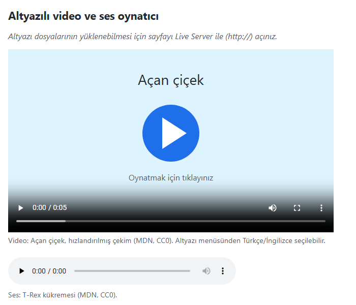

*Şekil 3.21. Uygulama 3.8'in oynatma öncesi görünümü.*

**Kendinizi sınayın:** (1) `video`'ya `autoplay` ekleyiniz; `muted` olmadan ve `muted` ile davranışı karşılaştırınız. (2) Sayfayı `file:///` adresiyle açıp altyazıların görünmediğini doğrulayınız ve nedenini açıklayınız.

<details><summary>Örnek çözüm</summary>

Çözüm dosyası: [`codes/03-html-tablo-form-medya/uygulama-3-8-medya-oynatici/index.html`](../codes/03-html-tablo-form-medya/uygulama-3-8-medya-oynatici/index.html)

</details>

## 3.7 Bölüm Özeti

- Tablolar yalnızca **tablosal veri** içindir; yerleşim CSS ile yapılır. Yapı `table` → `tr` → `th`/`td` biçimindedir; `caption` konuyu, `thead`/`tbody`/`tfoot` satır gruplarını, `colgroup`/`col` sütunları tanımlar. `colspan` sağa, `rowspan` aşağı yayar; yayılan konumlara ayrıca hücre yazılmaz. `scope` erişilebilirliği artırır.
- Tablo görünümü CSS ile verilir: `border`, `border-collapse`, `padding` (eski `cellpadding`), `border-spacing` (eski `cellspacing`), zebra satırlar, `position: sticky` başlık ve kaydırmalı sarmalayıcı. `bgcolor`, `bordercolor`, `hspace` gibi nitelikler eskimiş veya hiç standart olmamıştır.
- `iframe` başka bir belgeyi gömer; her çerçeveye `title` verilir, dış içerik `loading="lazy"`, `sandbox`, `allow` ile sınırlandırılır. Bir sitenin çerçevelenmesi sunucunun `X-Frame-Options` veya CSP `frame-ancestors` başlıklarıyla engellenir.
- Formun istemci tarafı HTML, sunucu tarafı ayrı bir programdır. `action` hedefi, `method` yöntemi, `enctype` kodlamayı belirler. GET veriyi URL'de taşır ve durum değiştirmeyen işlemler içindir; POST veriyi gövdede taşır ama **şifrelemez**; gizlilik HTTPS ile sağlanır.
- `name`'i olmayan denetim gönderilmez; `label`, `fieldset` ve `legend` erişilebilirliğin temelidir; `placeholder` etiket değildir. HTML5 giriş tipleri doğrulama, uygun mobil klavye ve otomatik doldurma sağlar; seçenek düğmeleri aynı `name` ile gruplanır.
- `required`, `min`/`max`/`step`, `minlength`/`maxlength`, `pattern`, `autocomplete` yerleşik doğrulamayı sağlar; `:user-invalid` hataları kullanıcı dostu vurgular. **İstemci doğrulaması sunucu doğrulamasının yerini tutmaz.**
- `video` ve `audio` medyayı eklentisiz oynatır; WebM ve MP4 çoklu `source` ile sunulur, MIME türü doğru yazılır (MP3: `audio/mpeg`). Sesli otomatik oynatma engellenir; otomatik oynatma yalnızca `muted` ve dekoratif içerik içindir. `track` ve WebVTT ile altyazı bir erişilebilirlik gereğidir.

## 3.8 Değerlendirme Soruları

1. Bir verinin tabloyla sunulmasının uygun olup olmadığına nasıl karar verilir? Tabloların yerleşim için kullanılmasının erişilebilirlik açısından sakıncalarını açıklayınız.
2. Aşağıdaki tabloda ikinci satırda neden yalnızca iki hücre vardır? Tarayıcıdaki görünümü ızgara olarak çiziniz.

   ```html
   <table>
     <tr><th rowspan="2">Kırtasiye</th><td>Kalem</td><td>114</td></tr>
     <tr><td>Defter</td><td>89</td></tr>
   </table>
   ```

3. `scope="col"` ve `scope="row"` değerlerinin anlamını bir örnekle açıklayınız. Başlık hücresini kalın yazılmış bir `td` ile taklit etmek neden yanlıştır?
4. `<table cellpadding="10" cellspacing="0" bgcolor="#eee" border="1">` satırını standartlara uygun HTML ve CSS ile yeniden yazınız. `border-collapse: collapse` kullanıldığında `border-spacing` neden etkisizdir?
5. Bir bankanın internet şubesi sayfalarının başka sitelerde `iframe` içinde açılmasını neden engeller? Bu engelleme hangi HTTP başlıklarıyla yapılır?
6. Boş `sandbox` nitelikli bir `iframe`'e hangi kısıtlamalar uygulanır? `allow-scripts allow-same-origin` ikilisinin birlikte kullanılmasının riski nedir?
7. "POST ile gönderdiğim için parolam güvende" ifadesini değerlendiriniz. GET ile gönderilen verinin görünebileceği en az üç yeri sayınız.
8. `action="/ara"` ve `method="get"` olan bir formda `name="q"` alanına `Çorlu kargo` yazılıp gönderildiğinde oluşacak adresi yazınız; hangi karakterlerin neden kodlandığını açıklayınız.
9. Aşağıdaki formda kullanıcı "Önizle" düğmesine tıkladığında ne olur? Sorunu düzeltiniz.

   ```html
   <form action="/yorum" method="post">
     <textarea name="yorum"></textarea>
     <button>Önizle</button>
     <button type="submit">Gönder</button>
   </form>
   ```

10. Aşağıdaki seçenek düğmelerinde kullanıcı iki seçeneği aynı anda işaretleyebilmektedir. Hatanın nedenini bulunuz ve grubu `fieldset`, `legend` ve `label` ile yeniden yazınız.

    ```html
    <p>Öğretim türü</p>
    <input type="radio" name="ogretim1" value="1"> Birinci öğretim
    <input type="radio" name="ogretim2" value="2"> İkinci öğretim
    ```

11. `disabled` ile `readonly` arasındaki iki farkı yazınız. `placeholder` neden `label`'ın yerini tutamaz?
12. `<video src="film.mp4" width="640" height="480 poster="kapak.jpg" controls autoplay>` satırındaki sözdizimi hatasını ve güncel tarayıcılarda beklenen davranışı açıklayıp satırı düzeltiniz. Videoya Türkçe altyazı eklemek için gereken öğeyi ve dosya biçimini belirtiniz.

## Kaynaklar

[1] J. Duckett, *HTML and CSS: Design and Build Websites*. Indianapolis, IN, USA: Wiley, 2011.

[2] WHATWG, "HTML Living Standard." [Çevrimiçi]. Erişim: https://html.spec.whatwg.org/ (Erişim tarihi: 2 Kasım 2026).

[3] J. N. Robbins, *Learning Web Design: A Beginner's Guide to HTML, CSS, JavaScript, and Web Graphics*, 4th ed. Sebastopol, CA, USA: O'Reilly Media, 2012.

[4] P. Carey, *New Perspectives on HTML5 and CSS3: Comprehensive*, 7th ed. Boston, MA, USA: Cengage Learning, 2017.

[5] W3C Web Accessibility Initiative, "Tables Tutorial." [Çevrimiçi]. Erişim: https://www.w3.org/WAI/tutorials/tables/ (Erişim tarihi: 2 Kasım 2026).

[6] Mozilla, "&lt;iframe&gt;: The Inline Frame element," *MDN Web Docs*. [Çevrimiçi]. Erişim: https://developer.mozilla.org/en-US/docs/Web/HTML/Reference/Elements/iframe (Erişim tarihi: 2 Kasım 2026).

[7] D. Ross and T. Gondrom, "HTTP Header Field X-Frame-Options," IETF, RFC 7034, Oct. 2013. [Çevrimiçi]. Erişim: https://www.rfc-editor.org/rfc/rfc7034

[8] W3C, "Content Security Policy Level 3," W3C Working Draft, Oct. 2026. [Çevrimiçi]. Erişim: https://www.w3.org/TR/CSP3/ (Erişim tarihi: 2 Kasım 2026).

[9] WHATWG, "URL Living Standard." [Çevrimiçi]. Erişim: https://url.spec.whatwg.org/ (Erişim tarihi: 2 Kasım 2026).

[10] T. Berners-Lee, R. Fielding, and L. Masinter, "Uniform Resource Identifier (URI): Generic Syntax," IETF, RFC 3986, Jan. 2005. [Çevrimiçi]. Erişim: https://www.rfc-editor.org/rfc/rfc3986

[11] E. Rescorla, "The Transport Layer Security (TLS) Protocol Version 1.3," IETF, RFC 8446, Aug. 2018. [Çevrimiçi]. Erişim: https://www.rfc-editor.org/rfc/rfc8446

[12] R. Fielding, M. Nottingham, and J. Reschke, "HTTP Semantics," IETF, RFC 9110, Jun. 2022. [Çevrimiçi]. Erişim: https://www.rfc-editor.org/rfc/rfc9110

[13] R. Fielding, M. Nottingham, and J. Reschke, "HTTP/1.1," IETF, RFC 9112, Jun. 2022. [Çevrimiçi]. Erişim: https://www.rfc-editor.org/rfc/rfc9112

[14] W3C Web Accessibility Initiative, "Forms Tutorial." [Çevrimiçi]. Erişim: https://www.w3.org/WAI/tutorials/forms/ (Erişim tarihi: 2 Kasım 2026).

[15] B. Lawson and R. Sharp, *Introducing HTML5*, 2nd ed. Berkeley, CA, USA: New Riders, 2012.

[16] Mozilla, "&lt;input&gt;: The HTML Input element," *MDN Web Docs*. [Çevrimiçi]. Erişim: https://developer.mozilla.org/en-US/docs/Web/HTML/Reference/Elements/input (Erişim tarihi: 2 Kasım 2026).

[17] W3C, *Web Content Accessibility Guidelines (WCAG) 2.2*, W3C Recommendation, Oct. 2023. [Çevrimiçi]. Erişim: https://www.w3.org/TR/WCAG22/

[18] Mozilla, ":user-invalid," *MDN Web Docs*. [Çevrimiçi]. Erişim: https://developer.mozilla.org/en-US/docs/Web/CSS/Reference/Selectors/:user-invalid (Erişim tarihi: 2 Kasım 2026).

[19] Mozilla, "Autoplay guide for media and Web Audio APIs," *MDN Web Docs*. [Çevrimiçi]. Erişim: https://developer.mozilla.org/en-US/docs/Web/Media/Guides/Autoplay (Erişim tarihi: 2 Kasım 2026).

[20] Mozilla, "Web video codec guide," *MDN Web Docs*. [Çevrimiçi]. Erişim: https://developer.mozilla.org/en-US/docs/Web/Media/Guides/Formats/Video_codecs (Erişim tarihi: 2 Kasım 2026).

[21] W3C, "WebVTT: The Web Video Text Tracks Format," W3C Candidate Recommendation Draft, May 2026. [Çevrimiçi]. Erişim: https://www.w3.org/TR/webvtt1/ (Erişim tarihi: 2 Kasım 2026).

[← Önceki bölüm](02-html-temelleri.md) · [İçindekiler](../README.md) · [Sonraki bölüm →](04-css-temelleri.md)
