# Bölüm 4: CSS Temelleri: Sözdizimi, Basamaklama ve Seçiciler

[← Önceki bölüm](03-html-tablo-form-medya.md) · [İçindekiler](../README.md) · [Sonraki bölüm →](05-css-metin-renk-arka-plan.md)

> **Öğrenme Hedefleri** — Bu bölümü tamamlayan öğrenci:
>
> - HTML, CSS ve JavaScript'in bir web sayfasındaki yapı, sunum ve davranış katmanlarını birbirinden ayırt eder; CSS'in tarihsel gelişimini ve güncel modül yapısını açıklar.
> - Bir CSS kuralını seçici, bildirim bloğu, özellik ve değer parçalarına ayırır; sözdizimi hatalarını (eksik noktalı virgül, `2 em` gibi geçersiz değerler, `//` yorumları) tespit eder.
> - Stilleri satır içi, gömülü ve harici yöntemlerle uygular; çok sayfalı bir site için uygun yöntemi gerekçesiyle seçer.
> - Kalıtılan ve kalıtılmayan özellikleri ayırt eder; `inherit`, `initial`, `unset` ve `revert` anahtar sözcüklerinin etkisini öngörür.
> - Basamaklama algoritmasını (köken ve önem, satır içi stil, katmanlar, özgüllük, kaynak sırası) uygulayarak çakışan kurallardan hangisinin kazanacağını hesaplar.
> - Tür, sınıf, kimlik, birleştirici, nitelik, sözde sınıf ve sözde öğe seçicileriyle belge ağacındaki hedef öğeleri seçer; `class` ve `id` kullanımını ve adlandırmayı doğru biçimde yapar.
> - Tarayıcı geliştirici araçlarının **Styles** ve **Computed** panellerinde basamaklamanın sonucunu izler ve stil hatalarını ayıklar.

## 4.1 Giriş

CSS (Cascading Style Sheets, Türkçede *basamaklı stil sayfaları*), HTML ile yapılandırılmış bir belgenin ekranda, kâğıtta veya başka bir ortamda nasıl sunulacağını tanımlayan bir stil dilidir. CSS kendi sözdizimine sahip ayrı bir dildir; HTML belgesinin içine yazılabilse de HTML'in bir parçası değildir. Kuralları W3C (World Wide Web Consortium) bünyesindeki CSS Çalışma Grubu tarafından belirlenir [1]. Bir CSS dosyası, belgedeki öğeleri seçen ve bu öğelerin nasıl görüneceğini bildiren kurallardan oluşur; tarayıcı sayfayı çizerken her öğe için bu kuralları birleştirerek nihai görünümü hesaplar [2, ss. 229–232].

Modern bir web sayfası üç katmanın birlikte çalışmasıyla oluşur (Şekil 4.1). **HTML** sayfada *ne* olduğunu, yani içeriğin yapısını ve anlamını tanımlar: bir başlık, bir ürün listesi, bir form. **CSS** bu içeriğin *nasıl görüneceğini* belirler: renkler, yazı tipleri, boşluklar ve yerleşim. **JavaScript** ise sayfanın *ne yapacağını*, yani davranışını tanımlar: düğmeye basıldığında ürünü sepete eklemek, bir formu göndermeden önce denetlemek gibi. Bu ayrıma *ilgilerin ayrılması* (separation of concerns) denir ve her katmanın ayrı dosyada (`index.html`, `style.css`, `script.js`) tutulması bakım kolaylığı sağlar.

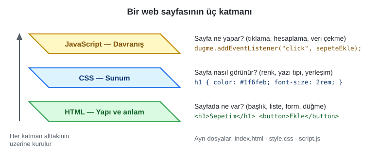

*Şekil 4.1. Bir web sayfasının üç katmanı: HTML yapı, CSS sunum, JavaScript davranış.*

Ders sunumunda bu ayrım bir yemek sunumu benzetmesiyle anlatılmaktadır: aynı tatlı, farklı tabaklarda farklı süslemelerle sunulduğunda içeriği değişmez, yalnızca sunumu değişir. HTML tabaktaki yemek, CSS ise sunumdur. Bu benzetme, CSS öğrenimine başlarken önerilen üç adımlı yaklaşımla da örtüşür: (1) önce yalnızca HTML ile anlamlı bir sayfa hazırlanır; (2) stil kuralları uygulanmış sayfalar incelenir; (3) sayfaya adım adım stil kuralları eklenerek her kuralın tarayıcıdaki etkisi gözlemlenir.

Şekil 4.2'de aynı HTML belgesi iki farklı biçimde görülmektedir. Soldaki görünümde belgeye hiçbir stil sayfası bağlanmamıştır; başlıkların büyük ve kalın, listelerin madde işaretli görünmesi tarayıcının kendi varsayılan stillerinden (user agent stylesheet) kaynaklanır. Sağdaki görünümde HTML'e tek satır bile dokunulmadan yalnızca bir `style.css` dosyası bağlanmıştır.

<p>
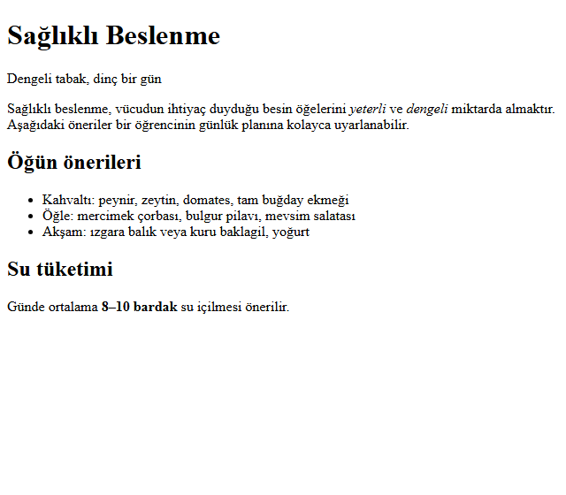
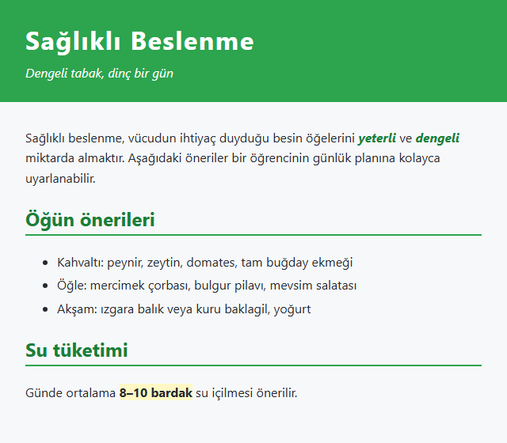
</p>

*Şekil 4.2. Aynı HTML belgesi: (solda) yalnızca tarayıcının varsayılan stilleriyle, (sağda) harici bir stil sayfasıyla (Örnek 4.1: [`codes/04-css-temelleri/ornek-4-1-saglikli-beslenme/`](../codes/04-css-temelleri/ornek-4-1-saglikli-beslenme/index.html)).*

> [!TIP]
> **Güncel hayattan:** Bir e-ticaret sitesinin masaüstü sayfası ile aynı sitenin telefondaki görünümü çoğu zaman aynı HTML içeriğinden üretilir; farkı CSS kuralları yaratır. Benzer biçimde YouTube'un açık ve koyu temaları arasında geçiş yapıldığında içerik değişmez, yalnızca sunum katmanı değişir. Bir haber sitesinde "Yazdır" komutu verildiğinde menülerin ve reklam alanlarının kâğıda basılmaması da baskı ortamına özel CSS kurallarıyla sağlanır.

## 4.2 CSS'in Kısa Tarihi ve Güncel Durumu

Web'in ilk yıllarında HTML'in görünümü büyük ölçüde tarayıcıya bırakılmıştı. Sayfa yazarları görünümü denetleyebilmek için `<font>`, `<center>` gibi sunuma yönelik etiketlere ve tablolarla sayfa yerleşimine başvurdu; bu da yapıyla sunumun iç içe geçtiği, bakımı zor belgeler üretti. Håkon Wium Lie, 10 Ekim 1994'te CERN'de çalışırken "Cascading HTML Style Sheets" başlıklı bir öneri yayımladı [3]. Önerinin temel fikri, belgeye birden fazla kaynaktan (yazar, kullanıcı, tarayıcı) gelen stil tercihlerinin belirli bir öncelik düzeni içinde birleştirilmesiydi; dilin adındaki *cascading* (basamaklı, çağlayan gibi akan) sözcüğü bu birleştirme düzenini anlatır.

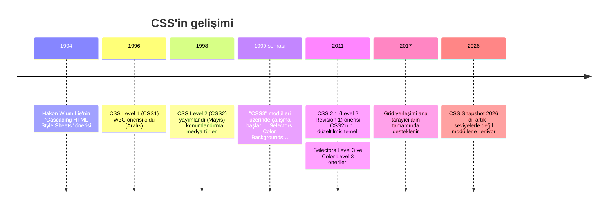

*Şekil 4.3. CSS'in gelişim çizelgesi.*

CSS1 Aralık 1996'da W3C önerisi (Recommendation) olarak yayımlandı [4]; yazı tipi, renk, metin hizalama ve kutu boşlukları gibi temel özellikleri tanımlıyordu. Mayıs 1998'de yayımlanan CSS2, konumlandırma (positioning), medya türleri ve tablo biçimlendirme gibi yetenekler ekledi [5]. Ancak CSS2'nin bazı bölümleri tarayıcılarca hiçbir zaman tutarlı biçimde uygulanmadı; bu nedenle W3C, uygulamadaki gerçek durumu yansıtan düzeltilmiş bir sürüm hazırladı. *CSS Level 2 Revision 1* (CSS 2.1) adlı bu belge Haziran 2011'de öneri durumuna ulaştı ve bugün hâlâ dilin çekirdeğini oluşturur [6].

CSS2.1'den sonra W3C, dili tek ve dev bir belge yerine bağımsız **modüller** hâlinde geliştirmeye başladı: *Selectors*, *Color*, *Backgrounds and Borders*, *Flexible Box Layout*, *Grid Layout*, *Cascading and Inheritance* gibi. Halk arasında "CSS3" olarak anılan şey, CSS2.1'in üzerine modül modül eklenen bu belgelerin toplamıdır. Her modül kendi seviye numarasıyla ilerler; örneğin *Selectors Level 4* veya *CSS Color Level 4*, "CSS4" adlı bir sürümün parçası değildir. W3C'nin her yıl yayımladığı *CSS Snapshot* belgesi bu durumu açıkça belirtir: "CSS Level 4 diye bir şey yoktur"; dil artık seviyelerle değil, olgunlaşan modüllerin yıllık anlık görüntüleriyle tanımlanır [1]. Hangi modülün hangi aşamada (Çalışma Taslağı, Aday Öneri, Öneri) olduğu W3C'nin "CSS Current Work" sayfasından izlenebilir.

> [!NOTE]
> **Tarihsel not:** Sunumda "Tüm tarayıcılar CSS seviye 2 ve 3'ü destekler" ifadesi yer almaktadır. "CSS3" tek bir belge olmadığından bu ifade ancak kabaca doğrudur: CSS2.1 güncel tarayıcıların tamamında desteklenir, ancak modüllerin ve yeni özelliklerin desteği tarayıcıdan tarayıcıya ve sürümden sürüme değişir. Bir özelliğin kullanılabilirliği MDN sayfalarındaki uyumluluk tablosundan ve "Baseline" etiketinden denetlenmelidir.

### 4.2.1 CSS Zen Garden: aynı içerik, binlerce tasarım

CSS'in gücünü gösteren en bilinen örneklerden biri Dave Shea'nın 2003'te başlattığı **CSS Zen Garden** projesidir [7]. Projede tek bir HTML belgesi yayımlanmış, tasarımcılardan bu belgeye yalnızca kendi CSS dosyalarını yazarak görsel bir tasarım kazandırmaları istenmiştir. Ortaya çıkan yüzlerce tasarımın tamamı birebir aynı HTML kaynağını kullanır; değişen yalnızca stil sayfasıdır [8, s. 208]. Robbins'in belirttiği gibi site artık güncellenmemekte ve web standartlarının benimsenmesinde bir dönüm noktasını belgeleyen tarihî bir arşiv olarak görülmektedir; yine de CSS'in neler yapabileceğini tek bakışta gösteren bir derstir [8, s. 208].

### 4.2.2 Avantajlar ve dezavantajlar

Sunum, CSS'in avantajlarını sıralayıp dezavantajları bir soru olarak bırakmaktadır. Tablo 4.1 her iki tarafı birlikte özetlemektedir.

| Avantajlar | Dezavantajlar ve sınırlılıklar |
|---|---|
| **Hassas tipografi ve yerleşim denetimi:** Yazı tipi, satır aralığı, boşluk, renk ve yerleşim HTML'in hiçbir zaman sağlayamadığı ayrıntıda denetlenir. | **Tarayıcı desteği farkları:** Yeni özellikler tarayıcılara farklı zamanlarda gelir; eski tarayıcılar için yedek (fallback) düşünmek gerekebilir. |
| **Az emek, tek noktadan bakım:** Yüzlerce sayfa tek bir `.css` dosyasına bağlanır; kurumsal renk bir satırda değiştirilir. | **Küresel kapsam ve çakışmalar:** Her kural tüm belgeye uygulanabilir; büyük projelerde aynı sınıf adı farklı amaçlarla kullanılınca beklenmedik çakışmalar doğar. |
| **Daha hafif HTML ve önbellek:** Sunum bilgisi HTML'den çıkar; tarayıcı CSS dosyasını bir kez indirip önbelleğe alır, sonraki sayfalar daha hızlı açılır. | **Basamaklama ve özgüllüğün öğrenme eğrisi:** "Kuralım neden uygulanmıyor?" sorusunun cevabı çoğu zaman basamaklamadadır; kuralların anlaşılması zaman alır. |
| **Erişilebilirlik ve cihaz uyumu:** İçerik sırası sunumdan bağımsız kalır; kullanıcı kendi yazı boyutu ve kontrast tercihlerini uygulayabilir; ekran, yazıcı ve mobil cihaz için ayrı kurallar yazılabilir. | **Oluşturmayı engelleme (render-blocking):** Tarayıcı, bağlı stil sayfası inmeden sayfayı çizmez; büyük veya yavaş yüklenen CSS ilk görüntülemeyi geciktirir. Dosya hiç yüklenemezse sayfa stilsiz görünür. |
| **Tutarlılık ve tema:** Tüm sayfalarda aynı görünüm sağlanır; açık/koyu tema gibi seçenekler yalnızca CSS değiştirilerek sunulabilir. | **Hata ayıklama güçlüğü:** CSS hata mesajı vermez; geçersiz bir bildirim sessizce yok sayılır. Hataları bulmak için geliştirici araçlarını kullanmak gerekir. |

*Tablo 4.1. CSS'in avantajları ve dezavantajları.*

Dezavantajların çoğu, dilin kendisinden çok büyüyen projelerin yönetiminden kaynaklanır. Bu bölümde anlatılan basamaklama kuralları, anlamlı sınıf adlandırması ve `@layer` gibi araçlar bu sorunları hafifletmek için geliştirilmiştir.

> [!TIP]
> **Güncel hayattan:** Bir alışveriş sitesinin kampanya döneminde sitedeki tüm "Sepete ekle" düğmelerini maviden turuncuya çevirmesi, harici stil dosyasında tek bir renk değerinin değiştirilmesiyle yapılabilir. Aynı değişiklik 1990'ların yöntemiyle, her düğmenin HTML'ine yazılmış `<font color="…">` etiketleriyle yapılsaydı binlerce sayfanın tek tek düzenlenmesi gerekirdi.

## 4.3 CSS Kural Sözdizimi

Bir stil sayfası, her biri belirli öğeleri seçip bu öğelerin nasıl görüneceğini bildiren bir veya daha fazla **kural** (rule veya rule set) içerir [2, s. 231]. Aşağıdaki iki kural, sunumdaki ilk örnektir:

```css
h1 { color: green; }
p { font-size: small; font-family: sans-serif; }
```

*Kod 4.1. İki basit CSS kuralı.*

### 4.3.1 Kuralın parçaları

Bir kural iki ana bölümden oluşur (Şekil 4.4):

- **Seçici (selector):** Kuralın hangi öğelere uygulanacağını belirtir. Yukarıdaki örnekte `h1` ve `p`, belgedeki tüm `<h1>` ve `<p>` öğelerini seçen **tür seçicileridir** (type selector).
- **Bildirim bloğu (declaration block):** Küme parantezleri `{ }` arasında kalan kısımdır ve bir veya daha fazla **bildirim** (declaration) içerir. Her bildirim bir **özellik** (property) ile bir **değerden** (value) oluşur; ikisi iki nokta `:` ile ayrılır. Bildirimler birbirinden noktalı virgül `;` ile ayrılır.

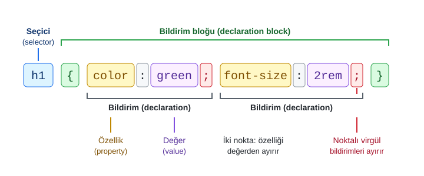

*Şekil 4.4. Bir CSS kuralının anatomisi.*

Değerin biçimi özelliğe bağlıdır: bazı özellikler uzunluk (`16px`, `2em`, `1.5rem`), bazıları renk (`green`, `#1f6feb`), bazıları da önceden tanımlı anahtar sözcükler (`bold`, `center`, `none`) alır. Bir özelliği kullanmadan önce hangi değerleri kabul ettiğini bilmek gerekir; her özelliğin kabul ettiği değerler ilgili W3C modülünde ve MDN'de "Formal syntax" başlığı altında listelenir.

### 4.3.2 Boşluklar, noktalı virgül ve hata toleransı

CSS, belirteçler arasındaki boşluk, sekme ve satır sonlarını önemsemez; bu nedenle aynı kural tek satırda veya okunabilirlik için her bildirim ayrı satırda yazılabilir [9, s. HTML 95]. Bu derste, kılavuz üslubuna uygun olarak her bildirim ayrı satırda ve iki boşluk girintiyle yazılmaktadır:

```css
p {
  font-size: small;
  font-family: sans-serif;
}
```

Boşluğun önemsiz olmasının tek ama kritik bir istisnası vardır: **bir sayı ile birimi arasına boşluk konulamaz.** `margin: 2em;` geçerlidir; `margin: 2 em;` ise geçersizdir, çünkü ayrıştırıcı bunu "2" sayısı ve "em" adlı bir anahtar sözcük olarak okur ve `margin` özelliği böyle bir değer kabul etmez [10]. Değer `0` olduğunda birim yazılmayabilir (`margin: 0;`).

Noktalı virgül bildirimleri **ayırır**; bu nedenle bloğun son bildiriminden sonra yazılması zorunlu değildir, ancak sonradan yeni satır eklenirken hata yapılmaması için her zaman yazılması önerilir. Sunumda "noktalı virgülü unutursanız o bildirge gözardı edilir" denmektedir; gerçek davranış biraz daha geniş kapsamlıdır. Aşağıdaki örnekte ilk bildirimin sonundaki noktalı virgül unutulmuştur:

```css
p {
  color: red
  font-size: 16px;
}
```

Ayrıştırıcı bir sonraki noktalı virgüle kadar olan her şeyi `color` özelliğinin değeri sanar: `red font-size: 16px`. Bu değer geçersiz olduğundan **iki bildirim birden** kaybolur. CSS, geçersiz bir bildirimle karşılaştığında hata mesajı vermez; o bildirimi atlayıp bir sonrakiyle devam eder [11]. Tanımadığı bir özellik adı veya değerle karşılaşan tarayıcının bunu sessizce yok sayması, aslında bilinçli bir tasarım kararıdır: eski bir tarayıcı, henüz bilmediği yeni bir özelliği gördüğünde sayfanın geri kalanını bozmadan yoluna devam eder. Ne var ki aynı özellik yazım hatalarını da görünmez kılar; bu tür hatalar geliştirici araçlarında üstü çizili ve uyarı simgeli olarak görülür (bkz. Bölüm 4.9).

Büyük/küçük harf duyarlılığı konusunda da dikkatli olunmalıdır. Özellik adları ve anahtar sözcükler büyük/küçük harfe duyarlı değildir (`COLOR: Green` çalışır, ancak alışkanlık küçük harftir). HTML belgelerinde tür seçicileri de duyarsızdır. Buna karşılık **sınıf ve kimlik adları büyük/küçük harfe duyarlıdır**: `.Duyuru` seçicisi `class="duyuru"` olan öğeyi seçmez [2, s. 237].

### 4.3.3 Yorumlar

CSS'te yorumlar `/*` ile başlar ve `*/` ile biter; tek satırlık veya çok satırlık olabilir [9, s. HTML 95]. Yorumlar, dosyanın bölümlerini açıklamanın yanı sıra bir kuralı silmeden geçici olarak devre dışı bırakmak için de kullanışlıdır:

```css
/* ===== Başlıklar ===== */
h1 {
  color: green;
  /* font-size: 3rem;  geçici olarak kapatıldı */
}
```

> [!IMPORTANT]
> CSS'te `//` ile başlayan tek satırlık yorum **yoktur**. Sunumdaki gruplanmış seçici örneğinde kuralların yanına `// 5 elemanın hepsini kural etkiler` biçiminde açıklama yazılmıştır; bu satırlar bir stil dosyasına aynen kopyalanırsa `//` ve ardından gelen metin bir sonraki kuralın seçicisine karışır ve o kural tamamen geçersiz sayılır. Açıklamalar her zaman `/* … */` içinde yazılmalıdır. Benzer biçimde HTML yorumu olan `<!-- -->` da CSS içinde yorum değildir.

> [!TIP]
> **Güncel hayattan:** VS Code, `.css` dosyalarında bilinmeyen özellik adlarını, eksik parantezleri ve hatalı değerleri dalgalı çizgiyle işaretler; imleç bir özelliğin üzerine getirildiğinde MDN kaynaklı kısa bir açıklama ve tarayıcı desteği gösterilir. Tarayıcının sessizce yok saydığı hataları daha yazarken yakalamak için bu uyarılar dikkate alınmalıdır.

## 4.4 CSS'i Belgeye Uygulamanın Yolları

Stil kuralları bir HTML belgesine üç yolla bağlanabilir: öğenin `style` niteliğiyle (satır içi), belgenin `<head>` bölümündeki `<style>` öğesiyle (gömülü) ve ayrı bir `.css` dosyasını `<link>` öğesiyle bağlayarak (harici) [2, ss. 235–236]. Bunlara ek olarak bir stil sayfası `@import` kuralıyla başka bir stil sayfasını içe aktarabilir.

### 4.4.1 Satır içi stil (`style` niteliği)

Bildirimler doğrudan öğenin açılış etiketindeki `style` niteliğine yazılır. Seçici ve küme parantezi yoktur, çünkü stilin hangi öğeye uygulanacağı zaten bellidir:

```html
<h1 style="color: red;">Sağlıklı Beslenme</h1>
<h1 style="color: red; margin-top: 2em;">Sağlıklı Beslenme</h1>
```

Satır içi stil yalnızca o öğeyi etkiler. Basamaklamada normal yazar stilleri arasında en yüksek önceliğe sahiptir (bkz. Bölüm 4.6). Ancak yapı ile sunumu yeniden iç içe geçirdiği, aynı stilin onlarca yere kopyalanmasına yol açtığı, `:hover` gibi durumlar ve medya sorguları için kullanılamadığı için yalnızca hızlı denemelerde ve JavaScript'in çalışma anında tek bir öğenin stilini değiştirdiği durumlarda tercih edilir. Duckett de bu yöntemin yalnızca eski kodlarda karşılaşılabileceği için tanınması gerektiğini, yeni sayfalarda kullanılmamasını önerir [2, s. 236].

> [!WARNING]
> Güvenlik amacıyla İçerik Güvenliği Politikası (Content Security Policy, CSP) uygulayan sitelerde satır içi stiller ve `<style>` blokları varsayılan olarak engellenebilir. Bankacılık ve kamu hizmeti sunan sitelerde sık rastlanan bu politika, stilleri harici dosyalarda tutmanın bir başka gerekçesidir.

### 4.4.2 Gömülü stil (`<style>` öğesi)

Kurallar, belgenin `<head>` bölümündeki bir `<style>` öğesinin içine yazılır. Sunumdaki "Sağlıklı Beslenme" sayfası bu yöntemi kullanır:

```html
<head>
  <meta charset="UTF-8">
  <title>Sağlıklı Beslenme</title>
  <style>
    /* CSS stilleri buraya yazılır */
    h1 {
      color: green;
    }

    p {
      font-size: 16px;
      font-family: Arial, sans-serif;
    }
  </style>
</head>
```

*Kod 4.2. Gömülü stil sayfası.*

Gömülü stil yalnızca bulunduğu belgeyi etkiler. Tek sayfalık örnekler, ders denemeleri ve yalnızca bir sayfaya özgü birkaç kural için uygundur [2, s. 236]. Eski kodlarda görülen `type="text/css"` niteliği artık gerekli değildir; HTML'de `<style>` öğesinin varsayılan dili CSS'tir [12].

### 4.4.3 Harici stil sayfası (`<link>` öğesi)

Kurallar uzantısı `.css` olan ayrı bir metin dosyasına yazılır ve her HTML belgesinin `<head>` bölümünde `<link>` öğesiyle bağlanır:

```html
<head>
  <link rel="stylesheet" href="style.css">
</head>
```

`rel="stylesheet"` niteliği bağlanan kaynağın bir stil sayfası olduğunu, `href` ise dosyanın yolunu belirtir. Yol, HTML dosyasının konumuna göre çözümlenir; `css/style.css` gibi bir alt klasör de kullanılabilir. Harici dosyanın içinde `<style>` etiketi **bulunmaz**; dosya yalnızca CSS kurallarından oluşur. İsteğe bağlı `media` niteliğiyle bir stil sayfası yalnızca belirli bir ortam için bağlanabilir (`<link rel="stylesheet" href="baski.css" media="print">`).

Harici stil sayfası en güçlü ve önerilen yöntemdir: aynı dosya sitenin tüm sayfaları tarafından paylaşılır, tarayıcı dosyayı bir kez indirip önbelleğe alır ve tasarımdaki bir değişiklik tek dosyada yapılarak tüm siteye yansır [2, s. 235]. Dosyayı oluşturup VS Code'da bağlama adımları [Bölüm 5](05-css-metin-renk-arka-plan.md)'te ayrıca gösterilmektedir.

### 4.4.4 `@import` kuralı

Bir stil sayfası, başka bir stil sayfasını `@import` kuralıyla içe aktarabilir:

```css
/* style.css — @import kuralları dosyanın en başında yer almalıdır */
@import url("renkler.css");

body {
  font-family: "Segoe UI", Arial, sans-serif;
}
```

`@import` kuralları, `@charset` ve `@layer` bildirimleri dışında stil sayfasındaki diğer tüm kurallardan önce yazılmalıdır; aksi hâlde yok sayılır [13]. İçe aktarılan dosyanın kuralları, `@import` satırının bulunduğu yere yazılmış gibi işlem görür [9, s. HTML 96].

> [!IMPORTANT]
> **Performans notu:** Tarayıcı, `@import` ile içe aktarılan dosyanın varlığını ancak onu çağıran CSS dosyasını indirip okuduktan sonra öğrenir. Bu, dosyaların paralel değil **ardışık** indirilmesine yol açar ve sayfanın ilk görüntülenmesini geciktirir. Birden fazla stil sayfası gerekiyorsa her biri için ayrı bir `<link>` yazmak veya dosyaları yayın öncesinde birleştirmek daha iyidir.

### 4.4.5 Hangi yöntem, ne zaman?

| Yöntem | Yazım yeri | Etki alanı | Ne zaman? |
|---|---|---|---|
| Satır içi | Öğenin `style` niteliği | Yalnızca o öğe | Hızlı deneme; JavaScript'in tek öğeye stil vermesi |
| Gömülü | `<head>` içinde `<style>` | Yalnızca o belge | Tek sayfalık örnek; sayfaya özgü birkaç kural |
| Harici | Ayrı `.css` dosyası + `<link>` | Dosyayı bağlayan tüm belgeler | Çok sayfalı siteler; **varsayılan tercih** |
| `@import` | Bir stil sayfasının başı | İçe aktaran sayfanın kapsamı | Küçük projelerde dosya düzeni; performans nedeniyle sınırlı |

*Tablo 4.2. CSS'i belgeye uygulama yöntemlerinin karşılaştırması.*

Elli veya daha fazla sayfadan oluşan bir üniversite sitesi düşünüldüğünde tercih açıktır: kurumsal renk ve yazı tipi tek bir harici dosyada tanımlanır, tüm sayfalar bu dosyaya bağlanır. Kurumsal kimlik güncellendiğinde değiştirilen tek dosya `style.css` olur; elli HTML dosyasının tek tek açılması gerekmez.

> [!TIP]
> **Güncel hayattan:** Bir üniversitenin öğrenci bilgi sistemi, ders kayıt ekranından transkript sayfasına kadar yüzlerce sayfadan oluşur ve hepsinde aynı üst menü, aynı yazı tipi ve aynı renkler görülür. Bu tutarlılık, tüm sayfaların aynı harici stil dosyalarını paylaşmasıyla sağlanır. Tarayıcı bu dosyayı ilk sayfada indirip önbelleğe aldığından sonraki sayfalar daha hızlı açılır.

#### 🛠 Uygulama 4.1: Üç Yöntem Aynı Sayfada

**Amaç:** Satır içi, gömülü ve harici stil yöntemlerini ve `@import` kuralını aynı sayfada uygulayarak her birinin etki alanını gözlemlemek.  
**Tahmini süre:** 15 dk

1. VS Code'da `calismalar/bolum-04/uygulama-4-1/` klasörünü oluşturunuz; içinde `index.html`, `style.css` ve `renkler.css` adlı üç dosya açınız.
2. `index.html` dosyasında `!` yazıp `Tab` tuşuna basarak iskeleti oluşturunuz ve `lang` niteliğini `tr` yapınız. `<body>` içine bir `<h1>Kampüs Duyuru Panosu</h1>` ve `class="pano"` olan bir `<div>` ekleyiniz; bu `div` içine her biri bir `<h2>` ve bir `<p>` içeren dört `<article class="kart">` yazınız. Kartlara sırasıyla `harici`, `ice-aktarilan`, `gomulu` ve `satir-ici` sınıflarını da ekleyiniz.
3. `style.css` dosyasının **ilk satırına** `@import url("renkler.css");` yazınız. Ardından `body`, `.pano` ve `.kart` için genel kuralları ve `.harici h2 { color: #1f6feb; }` kuralını ekleyiniz. `renkler.css` içinde `.ice-aktarilan h2` başlığını mor yapınız.
4. `<head>` içine, `<link rel="stylesheet" href="style.css">` satırından **sonra** bir `<style>` öğesi ekleyip `.gomulu h2` başlığını yeşil yapınız. Dördüncü kartın `<h2>` öğesine `style="color: #cf222e;"` niteliğini yazınız.
5. Dosyayı **Live Server** ile açınız (sağ tık → *Open with Live Server*) ve sonucu Şekil 4.5 ile karşılaştırınız.

**Beklenen çıktı:**

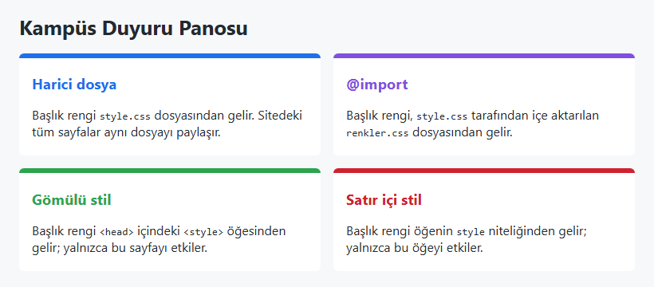

*Şekil 4.5. Uygulama 4.1'in beklenen ekran görüntüsü.*

**Kendinizi sınayın:** (1) `@import` satırını dosyanın sonuna taşıyınız; mor renk neden kayboldu? (2) `<style>` öğesini `<link>` satırının **önüne** taşıyınız ve `style.css` içine `.gomulu h2 { color: gray; }` ekleyiniz. Hangi renk kazandı ve neden? (İpucu: Bölüm 4.6.3.)

<details><summary>Örnek çözüm</summary>

Çözüm dosyası: [`codes/04-css-temelleri/uygulama-4-1-uc-yontem/index.html`](../codes/04-css-temelleri/uygulama-4-1-uc-yontem/index.html)

</details>

## 4.5 Belge Ağacı ve Kalıtım

### 4.5.1 Belge ağacı ve akrabalık terimleri

Tarayıcı bir HTML belgesini okurken öğeleri iç içe geçme ilişkilerine göre bir **ağaç** yapısında düzenler (bkz. [Bölüm 2](02-html-temelleri.md)). Bir öğe başka bir öğenin içinde yer alıyorsa içteki öğeye **çocuk** (child), kapsayan öğeye **ebeveyn** (parent) denir. Bir öğenin içindeki her derinlikteki öğe o öğenin **torunu** (descendant), onu kapsayan tüm öğeler ise **ataları**dır (ancestor). Aynı ebeveyni paylaşan öğeler birbirinin **kardeşi**dir (sibling). Sunumdaki "ast/bağımlı" ve "üst" terimleri sırasıyla çocuk ve ebeveyn karşılığında kullanılmaktadır. Bu terimler hem kalıtımın hem de birleştirici seçicilerin (Bölüm 4.7.3) dayandığı temel kavramlardır.

### 4.5.2 Kalıtım nedir?

CSS'te bazı özelliklerin değeri, öğenin kendisine bir kural yazılmamışsa ebeveynden çocuğa aktarılır; buna **kalıtım** (inheritance) denir [13]. Sunumdaki örnek bunu gösterir:

```css
p {
  font-size: small;
  font-family: sans-serif;
}
```

```html
<p>Merhaba <em>Dünya</em></p>
```

Stil sayfasında `em` için hiçbir kural olmamasına rağmen "Dünya" sözcüğü de küçük ve sans-serif görünür; çünkü `font-size` ve `font-family` kalıtılan özelliklerdir ve `<em>`, değerlerini ebeveyni olan `<p>` öğesinden alır. Şekil 4.6, sunumdaki belge ağacı üzerinde bu durumu göstermektedir.

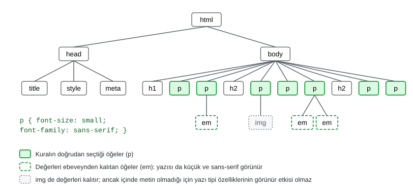

*Şekil 4.6. Belge ağacında kalıtım: `p` kuralı paragrafları seçer, paragrafların içindeki `em` öğeleri değerleri kalıtır.*

Sunumda aynı şekil üzerinden "`img` etiketi `p` içerisinde olmasına rağmen aynı tipte veri ile çalışmadığı için bu kurala uymayacaktır" denmektedir. Bu açıklamanın düzeltilmesi gerekir: `img` öğesi de `font-size` ve `font-family` değerlerini ebeveyninden **kalıtır**; kalıtım, öğenin türüne bakılmaksızın işler. Ancak bir görselin içinde çizilecek metin bulunmadığı için bu değerlerin ekranda **görünür bir etkisi olmaz**. Kalıtılan `font-size` değeri yine de hesaba katılır; örneğin görselin genişliği `em` birimiyle verilseydi bu değer kullanılırdı.

### 4.5.3 Hangi özellikler kalıtılır?

Genel bir kural olarak metinle ilgili özellikler kalıtılır, kutu ve yerleşimle ilgili özellikler kalıtılmaz [2, s. 240], [14, ss. 234–235]. Bu ayrım mantıklıdır: bir `div` öğesine verilen kenarlığın içindeki her paragrafa da çizilmesi istenmez; ancak sayfa genelinde aynı yazı tipinin kullanılması istenir. Her özelliğin kalıtılıp kalıtılmadığı W3C belgelerinde ve MDN'de özelliğin tanım tablosundaki "Inherited: yes/no" satırında belirtilir.

| Kalıtılan (örnekler) | Kalıtılmayan (örnekler) |
|---|---|
| `color` | `margin`, `padding` |
| `font-family`, `font-size`, `font-weight`, `font-style` | `border` ve tüm kenarlık özellikleri |
| `line-height`, `letter-spacing`, `word-spacing` | `background-color`, `background-image` |
| `text-align`, `text-indent`, `text-transform` | `width`, `height` |
| `list-style`, `visibility`, `cursor` | `display`, `position` |

*Tablo 4.3. Kalıtılan ve kalıtılmayan özelliklere örnekler.*

Kalıtım, stil sayfalarını büyük ölçüde sadeleştirir. Sayfanın temel yazı tipi ve rengi `body` öğesinde bir kez tanımlanır; başlıklar, paragraflar, listeler ve tablolar bu değerleri kendiliğinden alır:

```css
body {
  font-family: "Segoe UI", Arial, sans-serif;
  color: #24292f;
}
```

> [!TIP]
> **Güncel hayattan:** Bir haber sitesinde yüzlerce başlık, özet ve paragrafın aynı yazı tipiyle görünmesi için yazı tipinin her öğede ayrı ayrı tanımlanması gerekmez; `body` üzerindeki tek bir bildirim kalıtımla tüm metne ulaşır. Pek çok sitedeki koyu tema düğmesinin yalnızca kök öğenin renklerini değiştirerek sayfadaki bütün metni etkileyebilmesi de kalıtımın sonucudur.

> [!IMPORTANT]
> **Kalıtılan değer, en zayıf kurala bile yenilir.** Kalıtım yalnızca öğe için **hiçbir bildirim bulunmadığında** devreye girer. `p { color: red; }` kuralı varken içteki `<span>` için `* { color: gray; }` gibi en düşük özgüllükte bir kural bile yazılmışsa `span` gri görünür; çünkü ebeveynden gelen kırmızı bir "kural" değil, yalnızca bir varsayılandır. Benzer biçimde tarayıcılar `<button>`, `<input>` ve `<select>` gibi form denetimlerine kendi yazı tipini atadığından bu öğeler `body` yazı tipini kalıtmaz; birçok projede bu nedenle `button, input, select, textarea { font: inherit; }` kuralı yazılır.

### 4.5.4 Genel anahtar sözcükler: `inherit`, `initial`, `unset`, `revert`

CSS'te her özellik, değer olarak dört genel anahtar sözcüğü (CSS-wide keywords) kabul eder [13]:

| Anahtar sözcük | Etkisi | Örnek |
|---|---|---|
| `inherit` | Değeri ebeveynden almaya zorlar; kalıtılmayan özelliklerde de çalışır. | `.kutu { padding: inherit; }` ebeveynin dolgusunu alır [2, s. 240]. |
| `initial` | Özelliğin standartta tanımlanan **başlangıç değerine** döner. | `color: initial` siyaha döner; `display: initial` ise `div`'i bile `inline` yapar. |
| `unset` | Kalıtılan özelliklerde `inherit`, kalıtılmayanlarda `initial` gibi davranır. | `a { color: unset; }` bağlantı ebeveynin rengini alır. |
| `revert` | Yazarın kurallarını geri alır; değeri tarayıcı (veya kullanıcı) stilinin vereceği değere döndürür. | `a { color: revert; }` bağlantı tarayıcının varsayılan mavisine döner. |

*Tablo 4.4. CSS'in genel anahtar sözcükleri.*

`initial` ile `revert` arasındaki fark sık karıştırılır: `initial` özelliğin *spesifikasyondaki* başlangıç değeridir ve tarayıcının o öğe için uyguladığı varsayılan stilden habersizdir. `display` özelliğinin başlangıç değeri `inline` olduğundan `div { display: initial; }` yazmak `div` öğesini satır içi hâle getirir; `revert` ise tarayıcının `div` için tanımladığı `display: block` değerine döner. Tüm özellikleri birden sıfırlamak için `all` kısayolu kullanılabilir (`all: unset;`).

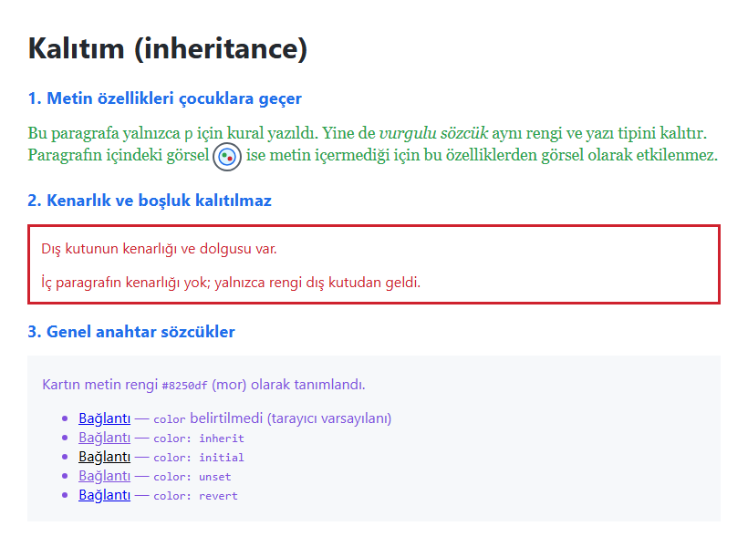

*Şekil 4.7. Kalıtım ve genel anahtar sözcükler (Örnek 4.2: [`codes/04-css-temelleri/ornek-4-2-kalitim/`](../codes/04-css-temelleri/ornek-4-2-kalitim/index.html)).*

Şekil 4.7'nin üçüncü bölümünde kartın metin rengi mor olarak tanımlanmıştır. `color` belirtilmeyen bağlantı tarayıcının bağlantı rengini alır (tarayıcı `a` öğesi için doğrudan bir kural uyguladığından kalıtım devreye girmez). `inherit` ve `unset` mor rengi ebeveynden alır, `initial` siyaha döner, `revert` ise yine tarayıcının bağlantı rengine geri döner.

## 4.6 Basamaklama (Cascade)

Bir öğenin aynı özelliği için birden fazla bildirim bulunabilir: tarayıcının varsayılan stili başlığı siyah yapar, harici dosya mavi, gömülü stil yeşil, öğenin `style` niteliği kırmızı yapmak ister. Bu çakışmalarda hangi bildirimin uygulanacağına karar veren algoritmaya **basamaklama** (cascade) denir [13]. Robbins'in ifadesiyle stil bilgisi, daha fazla ağırlığa sahip bir stil komutu tarafından geçersiz kılınana kadar yukarıdan aşağıya "çağlayarak" aktarılır [8, s. 217]. Basamaklamayı anlamak, "kuralım neden uygulanmıyor?" sorusunun cevabını bulmanın tek yoludur.

Basamaklama, aynı öğe ve aynı özellik için yarışan bildirimleri sırasıyla şu ölçütlere göre karşılaştırır; bir ölçütte fark varsa karar verilir ve sonraki ölçütlere bakılmaz [13]:

1. **Köken ve önem** (origin and importance): Bildirim tarayıcıdan mı, kullanıcıdan mı, sayfa yazarından mı geliyor; `!important` ile işaretlenmiş mi?
2. **Öğeye bağlı stil**: Bildirim öğenin `style` niteliğinde mi?
3. **Katmanlar** (cascade layers): Bildirim hangi `@layer` katmanında?
4. **Özgüllük** (specificity): Seçici ne kadar özgül?
5. **Kaynak sırası** (order of appearance): Hangi bildirim belgede daha sonra geliyor?

Hiçbir bildirim yoksa değer kalıtımla (kalıtılan özelliklerde) veya özelliğin başlangıç değeriyle belirlenir.

### 4.6.1 Köken ve önem

Bir sayfaya uygulanan stiller üç kökenden gelir [8, s. 217], [9, s. HTML 86]:

- **Kullanıcı aracısı (user agent) stilleri:** Tarayıcının yerleşik stil sayfasıdır. Başlıkların büyük ve kalın, bağlantıların mavi ve altı çizili görünmesi bu kökenden gelir.
- **Kullanıcı (user) stilleri:** Sayfayı ziyaret eden kişinin tarayıcı veya işletim sistemi aracılığıyla yaptığı tercihlerdir: varsayılan yazı boyutu, asgari yazı boyutu, yüksek kontrast teması gibi.
- **Yazar (author) stilleri:** Sayfanın geliştiricisinin yazdığı stillerdir. Satır içi, gömülü, harici ve `@import` ile gelen kuralların **hepsi** yazar kökenlidir.

Normal bildirimlerde öncelik sırası *yazar > kullanıcı > kullanıcı aracısı* biçimindedir: geliştirici tarayıcının varsayılanlarını değiştirebilir. Bir bildirimin değerinden sonra `!important` yazıldığında bildirim "önemli" olarak işaretlenir ve **sıra tersine döner**: önemli kullanıcı bildirimleri önemli yazar bildirimlerini yener [9, s. HTML 95]. Bu tasarım bilinçlidir. Görme güçlüğü olan bir kullanıcı, okuyabilmek için yüksek kontrastlı renkleri ve büyük yazıyı `!important` ile zorladığında, sayfa yazarının kendi `!important` bildirimleri bu ihtiyacı ezememelidir.

| Öncelik (yüksekten düşüğe) | Köken ve önem | Örnek |
|---|---|---|
| 1 | Kullanıcı aracısı `!important` | Tarayıcının vazgeçilmez kabul ettiği az sayıdaki kural |
| 2 | Kullanıcı `!important` | Okuma güçlüğü çeken kullanıcının zorladığı yazı boyutu ve renkler |
| 3 | Yazar `!important` | `.uyari { color: red !important; }` |
| 4 | Yazar normal | Geliştiricinin tüm normal kuralları (satır içi, `<style>`, `<link>`, `@import`) |
| 5 | Kullanıcı normal | Tarayıcı ayarlarındaki varsayılan yazı boyutu |
| 6 | Kullanıcı aracısı normal | `h1` öğesinin büyük ve kalın görünmesi |

*Tablo 4.5. Basamaklamada köken ve önem sırası (CSS animasyonları ve geçişleri bu sıraya ayrıca yerleşir; bu derste ele alınmamıştır).*

> [!WARNING]
> `!important` "bu kural her zaman kazanır" anlamına gelmez; yalnızca bildirimi bir üst önem düzeyine taşır. İki yazar bildirimi de `!important` ise aralarındaki yarış yine özgüllük ve kaynak sırasıyla belirlenir. `!important` alışkanlık hâline geldiğinde onu yenmek için yeni `!important`'lar yazılır ve stil sayfası yönetilemez hâle gelir. Tasarımcıların bu anahtar sözcüğü kullanmaktan genel olarak kaçınması önerilir [9, s. HTML 95]; sorun önce özgüllüğü düzenleyerek çözülmelidir.

> [!TIP]
> **Güncel hayattan:** Kullanıcı stilleri günümüzde çoğunlukla tarayıcının "Yazı tipi boyutu" ve "Asgari yazı tipi boyutu" ayarları ile işletim sisteminin yüksek kontrast (Windows'ta *Kontrast temaları*) modu aracılığıyla devreye girer. Yüksek kontrast modu açık bir bilgisayarda bir banka sitesinin özenle seçilmiş renklerinin yerini sistemin siyah-beyaz-sarı renklerinin alması, kullanıcı tercihlerinin yazar stillerinin önüne geçebildiğini gösterir.

### 4.6.2 Satır içi stil ve özgüllük

Aynı köken ve önem düzeyindeki yazar bildirimleri arasında, öğenin `style` niteliğinde yazılmış bildirim seçicilerle uygulanan tüm bildirimleri yener [13]. Sunumdaki "`<style>` arasında tanımlanmış iken etiket içerisinde ayrı bir tanımlama yaparsanız etiket içerisindeki dikkate alınacaktır" ifadesi bu kuralı anlatır. Bazı kaynaklar bu durumu özgüllüğe dördüncü bir basamak ekleyerek (1,0,0,0) gösterir; güncel standart ise satır içi stili seçicilerden ayrı bir aşama olarak ele alır. Pratik sonuç aynıdır: hiçbir seçici, ne kadar özgül olursa olsun, satır içi normal bir bildirimi yenemez; satır içi stili yalnızca `!important` yenebilir.

Seçicilerle uygulanan bildirimler arasında karar **özgüllükle** (specificity) verilir: daha özgül, yani hedefini daha dar tanımlayan seçici kazanır [2, s. 239]. Özgüllük üç basamaklı bir sayı gibi hesaplanır ve (A, B, C) biçiminde yazılır [15]:

- **A:** Seçicideki kimlik (`#id`) seçicilerinin sayısı.
- **B:** Sınıf (`.sinif`), nitelik (`[type="email"]`) ve sözde sınıf (`:hover`, `:nth-child()`) seçicilerinin sayısı.
- **C:** Tür (`p`, `li`) ve sözde öğe (`::before`) seçicilerinin sayısı.

Evrensel seçici `*` ve birleştiriciler (boşluk, `>`, `+`, `~`) özgüllüğe katkıda bulunmaz. İki seçici karşılaştırılırken önce A basamağına bakılır; eşitse B'ye, o da eşitse C'ye geçilir. Bu bir toplam değil, basamak karşılaştırmasıdır: tek bir kimlik seçicisi (1,0,0), on sınıf seçicisinden (0,10,0) daha özgüldür.

![Şekil 4.8 Özgüllük tablosu: p (0,0,1), ul li (0,0,2), .menu (0,1,0), li:nth-child(2) (0,1,1), nav .menu a:hover (0,2,2), input[type="email"] (0,1,1), #duyuru (1,0,0), #ana-menu .aktif > a (1,1,1)](../images/04-css-temelleri/ozgulluk-hesabi.svg)

*Şekil 4.8. Özgüllüğün (A, B, C) biçiminde hesaplanması.*

Mantıksal sözde sınıfların özgüllüğü bir istisnadır: `:not()`, `:is()` ve `:has()` kendileri puan getirmez, parantez içindeki en özgül seçicinin puanını alır; `:where()` ise her zaman sıfır puan taşır [15], [16]. `:where()`, bu özelliği sayesinde kolayca ezilebilen varsayılan stiller yazmak için kullanılır.

Robbins, başlangıç için yeterli olan sıralamayı şöyle özetler: kimlik seçicileri sınıf seçicilerinden, sınıf seçicileri bağlamsal (torun) seçicilerden, bağlamsal seçiciler de tek başına tür seçicilerinden daha özgüldür [8, ss. 246–247]. Özgüllük stratejik biçimde kullanılabilir: önce tüm paragraflar için genel bir kural yazılır, istisnalar daha özgül seçicilerle ezilir:

```css
p { line-height: 1.6; }                 /* (0,0,1) tüm paragraflar */
blockquote p { line-height: 1.4; }      /* (0,0,2) alıntı içindekiler */
p.ozet { line-height: 1.8; }            /* (0,1,1) özet sınıfı her yerde */
```

*Kod 4.3. Özgüllükle genel kuraldan istisnaya gitmek.*

### 4.6.3 Kaynak sırası: "Kazanan kim?"

Köken, önem, katman ve özgüllük bakımından eşit olan iki bildirimden **belgede daha sonra gelen** kazanır [2, s. 239], [8, s. 219]. Sunumdaki iki soru bu kuralı sınar:

```html
<style>
  p { color: red; }
  p { color: blue; }
  p { color: green; }
</style>
```

```html
<style>
  p {
    color: red;
    color: blue;
    color: green;
  }
</style>
```

Her iki durumda da kazanan **yeşildir**. İlk örnekte üç kural da (0,0,1) özgüllüğe sahiptir ve sonuncusu kazanır; ikinci örnekte aynı bildirim bloğunda aynı özellik üç kez yazılmıştır ve yine son bildirim geçerli olur. İkinci yazımın bilinçli bir kullanımı vardır: yeni bir değeri desteklemeyen tarayıcılar için önce eski bir değer, ardından yeni değer yazılır; yeni değeri anlamayan tarayıcı onu yok sayıp ilkini kullanır.

Kaynak sırası yalnızca tek bir dosyanın içinde değil, belgeye bağlanan tüm yazar stilleri arasında geçerlidir. Tarayıcı `<link>` ve `<style>` öğelerini `<head>` içindeki sıralarıyla, `@import` ile içe aktarılan kuralları da `@import` satırının bulunduğu yerde okur. Dolayısıyla gömülü stil ile harici stil arasında **köken farkı yoktur**; hangisinin kazanacağını (özgüllükler eşitse) yalnızca sıraları belirler:

```html
<head>
  <style>
    h1 { color: purple; }               /* önce gelir */
  </style>
  <link rel="stylesheet" href="style.css">  <!-- style.css: h1 { color: red; } -->
</head>
```

Bu belgede başlık **kırmızı** görünür, çünkü harici dosya gömülü stilden sonra okunmuştur. Bazı ders kitaplarında gömülü stillerin harici stillerden "daha ağır" olduğu belirtilir [8, s. 217]; bu sonuç yalnızca `<style>` öğesinin, alışkanlıkla, `<link>` satırından sonra yazılmasından kaynaklanır.

### 4.6.4 Basamak katmanları (`@layer`)

Büyük projelerde hazır bir CSS kütüphanesinin kurallarıyla projenin kendi kuralları arasındaki çakışmaları özgüllük yarışına girmeden çözmek için **basamak katmanları** (cascade layers) kullanılır [13]. Katmanlar `@layer` ile tanımlanır; ilk satırda katmanların sırası bildirilebilir:

```css
@layer temel, bilesenler;

@layer temel {
  a { color: #1f6feb; }
}

@layer bilesenler {
  .menu a { color: #ffffff; }
}

/* Katmansız kural: tüm katmanları yener */
a.ozel { color: #cf222e; }
```

*Kod 4.4. Basamak katmanları.*

Katman sırası özgüllükten **önce** değerlendirilir: sonra bildirilen katmandaki bir kural, önceki katmandaki daha özgül bir kuralı yener; hiçbir katmana ait olmayan (katmansız) kurallar ise tüm katmanlardaki normal kuralları yener. Böylece bir kütüphane düşük öncelikli bir katmana yerleştirilerek projenin kendi kurallarının, özgüllükleri düşük olsa bile kazanması sağlanır. `!important` bildirimlerde bu sıra da tersine döner. `@layer` 2022'den bu yana güncel tarayıcıların tamamında desteklenmektedir; giriş düzeyindeki projelerde kullanılması zorunlu değildir ancak var olduğunun bilinmesi, karşılaşılan kodu okumak için önemlidir.

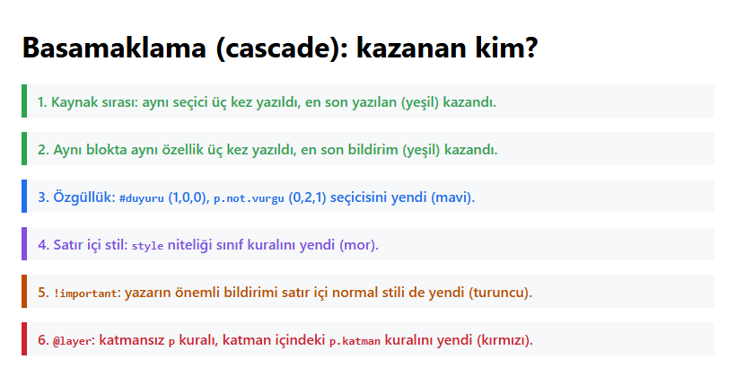

*Şekil 4.9. Basamaklamanın altı ölçütünün tarayıcıdaki sonucu (Örnek 4.3: [`codes/04-css-temelleri/ornek-4-3-basamaklama/`](../codes/04-css-temelleri/ornek-4-3-basamaklama/index.html)).*

### 4.6.5 Basamaklama karar akışı

Şekil 4.10, bir öğenin bir özelliği için değerin nasıl belirlendiğini adım adım göstermektedir.

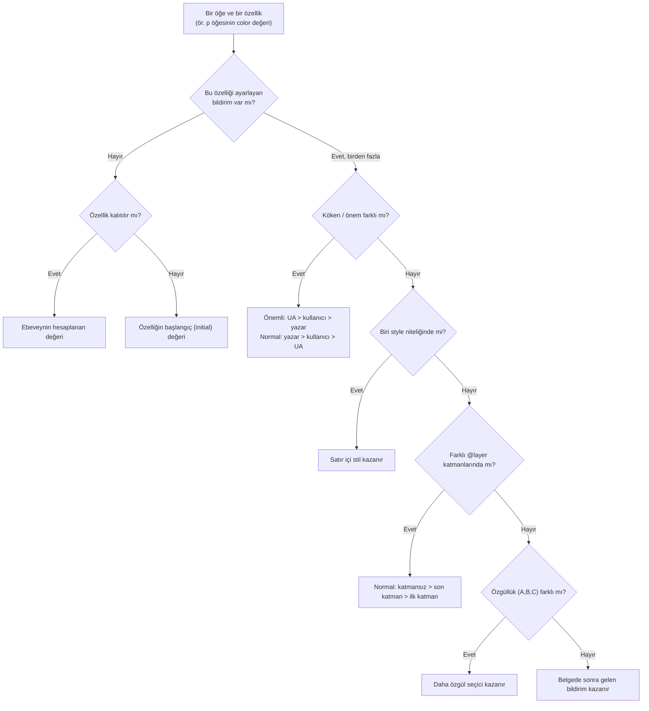

*Şekil 4.10. Basamaklama karar akış diyagramı.*

### 4.6.6 Sunumdaki öncelik tablosunun düzeltilmiş hâli

Sunumda "CSS Hiyerarşisi (veya Öncelik Sırası)" başlığıyla sekiz maddelik bir tablo verilmektedir. Tablo, basamaklamayı akılda tutmayı kolaylaştıran bir basitleştirmedir; ancak üç noktada yanıltıcıdır: (1) gömülü `<style>`, `@import` ve harici `<link>` ayrı öncelik düzeyleri olarak sıralanmıştır, oysa üçü de **aynı yazar kökenidir** ve aralarındaki sıra yalnızca belgedeki konumlarından doğar; (2) tabloda **özgüllük** hiç yer almaz, oysa harici dosyadaki bir `#kimlik` kuralı, gömülü stildeki bir `p` kuralını belgede nerede olursa olsun yener; (3) "kullanıcının tarayıcı stilleri" maddesi yalnızca normal kullanıcı bildirimlerini kapsar. Tablo 4.6 sunumdaki maddelerin doğru konumunu göstermektedir.

| Sunumdaki sıra | Sunumdaki madde | Doğru model |
|---|---|---|
| 1 | `!important` (kullanıcı tarafı) | Doğru: önemli kullanıcı bildirimleri önemli yazar bildirimlerini yener. |
| 2 | `!important` (geliştirici tarafı) | Doğru: yazar önemli bildirimleri tüm normal bildirimleri (satır içi dahil) yener. Kendi aralarında özgüllük ve sıra uygulanır. |
| 3 | Satır içi stiller | Doğru: normal yazar bildirimleri arasında en güçlüsüdür. |
| 4 | Gömülü stiller (`<style>`) | **Ayrı bir düzey değildir.** 4, 5 ve 6. maddeler tek bir "yazar normal" düzeyinde birleşir; aralarında önce **özgüllük**, eşitlikte **kaynak sırası** belirleyicidir. |
| 5 | `@import` ile içe aktarılan stiller | İçe aktarılan kurallar `@import` satırının bulunduğu yerde okunur; bu nedenle genellikle aynı dosyanın sonraki kurallarından önce gelir. Ayrı bir düzey değildir. |
| 6 | Harici stil dosyaları (`<link>`) | `<head>` içindeki konumuna göre `<style>`'dan önce veya sonra okunur; köken farkı yoktur. |
| 7 | Kullanıcının tanımladığı tarayıcı stilleri | Doğru (normal kullanıcı bildirimleri): yazar stilleri tarafından ezilir. |
| 8 | Tarayıcı varsayılan stilleri | Doğru: en düşük düzeydir. Bunun da altında, hiçbir bildirim yoksa kalıtım ve başlangıç değeri gelir. |

*Tablo 4.6. Sunumdaki sekiz maddelik öncelik tablosunun basamaklama modeline göre düzeltilmesi.*

Bu düzeltmeyle birlikte sunumdaki tablonun doğru özeti şöyle yazılabilir: **önemli kullanıcı > önemli yazar > satır içi yazar > (katmansız > katmanlı) > özgüllük > kaynak sırası > kullanıcı > tarayıcı > kalıtım/başlangıç değeri.**

#### 🛠 Uygulama 4.2: Özgüllük Yarışması — Hangi Renk Kazanır?

**Amaç:** Basamaklama ölçütlerini kullanarak çakışan kurallardan hangisinin kazanacağını önceden tahmin etmek ve tarayıcıda doğrulamak.  
**Tahmini süre:** 15 dk

1. `calismalar/bolum-04/uygulama-4-2/` klasöründe `index.html` ve `style.css` dosyalarını oluşturunuz; `style.css` dosyasını `<link>` ile bağlayınız.
2. Sayfaya altı `<section class="soru">` ekleyiniz. Her bölümde bir `<h2>`, kuralları gösteren bir `<pre>` ve "Ben hangi renkteyim?" metnini taşıyan bir `<p>` bulunsun. Paragraflara sırasıyla şu nitelikleri veriniz: `class="s1"`; `class="s2 vurgu"`; `id="s3" class="s3"`; `class="s4"` (bu bölümün `section` öğesine ek olarak `kutu` sınıfı veriniz); `class="s5" style="color: purple;"`; `class="s6"` (içine bir `<span>` koyunuz).
3. `style.css` dosyasına aşağıdaki yarışma kurallarını yazınız. Sayfayı açmadan **önce** her soru için tahmininizi ve gerekçenizi (özgüllük puanı, kaynak sırası vb.) bir kâğıda yazınız.

```css
p   { color: red; }
.s1 { color: blue; }
p   { color: green; }

.vurgu { color: green; }
.s2    { color: purple; }

#s3       { color: orange; }
main p.s3 { color: blue; }

.kutu p   { color: green; }
p.s4      { color: red; }
section p { color: blue; }

.s5 { color: green !important; }

.s6 { color: red; }
*   { color: gray; }
```

4. Sayfayı Live Server ile açınız ve tahminlerinizi kontrol ediniz. Yanlış tahmin ettiğiniz her soru için F12 → **Elements** → **Styles** panelinde hangi bildirimin üstünün çizildiğine bakınız.

**Beklenen çıktı:** Altı soru kartından oluşan, her kartta paragrafın kazanan renkle göründüğü bir sayfa. Cevapları görmemek için ekran görüntüsü örnek çözümün içine yerleştirilmiştir.

**Kendinizi sınayın:** (1) Soru 3'te mavi rengin kazanması için `main p.s3` seçicisine ne eklenmelidir? Yeni seçicinin özgüllüğünü hesaplayınız. (2) Soru 6'da `span` öğesinin kırmızı görünmesi için `*` kuralını silmeden ne yazılabilir?

<details><summary>Örnek çözüm</summary>

Cevaplar: 1 mavi, 2 mor, 3 turuncu, 4 kırmızı, 5 yeşil, 6 gri. Gerekçeler `style.css` dosyasındaki yorumlarda verilmiştir.

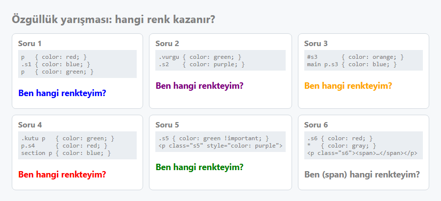

*Şekil 4.11. Uygulama 4.2'nin çözüm ekranı.*

Çözüm dosyası: [`codes/04-css-temelleri/uygulama-4-2-ozgulluk-yarismasi/index.html`](../codes/04-css-temelleri/uygulama-4-2-ozgulluk-yarismasi/index.html)

</details>


## 4.7 Seçiciler

Seçici, bir kuralın belge ağacındaki hangi öğelere uygulanacağını belirleyen kalıptır. CSS'in gücünün büyük kısmı seçicilerden gelir: iyi seçilmiş seçiciler sayesinde HTML'e gereksiz sınıflar eklemeden istenen öğeye ulaşılabilir. Seçiciler W3C'nin *Selectors* modülünde tanımlanır; güncel sürüm *Selectors Level 4*'tür [15]. Aynı seçiciler JavaScript'te `document.querySelector()` ve `querySelectorAll()` yöntemleriyle de kullanılır (bkz. [Bölüm 8](08-javascript-dom-olaylar.md)); bu nedenle seçicileri iyi öğrenmek iki dil için birden kazanç sağlar.

### 4.7.1 Temel seçiciler

**Evrensel seçici (`*`)** belgedeki tüm öğeleri seçer [2, s. 238]. Sunumdaki `* { color: gray; }` örneği sayfadaki her öğenin metnini gri yapar. Evrensel seçici, kalıtımla zaten aktarılacak değerleri her öğeye ayrı ayrı uyguladığı için dikkatli kullanılmalıdır; Uygulama 4.2'nin altıncı sorusunda görüldüğü gibi kalıtımı da bozar. Günümüzde en yaygın kullanımı, tüm öğelerin kutu boyutu hesabını değiştiren `*, *::before, *::after { box-sizing: border-box; }` kuralıdır (bkz. [Bölüm 6](06-css-kutu-modeli-yerlesim.md)).

**Tür seçicisi** (type selector) bir HTML öğesinin adını kullanır ve o türdeki tüm öğeleri seçer: `h1`, `p`, `li`, `table`.

**Sınıf seçicisi** (class selector) bir nokta ve ardından sınıf adıyla yazılır; `class` niteliğinde o adı taşıyan tüm öğeleri seçer. Bir sınıf istenen sayıda öğeye, bir öğe de boşlukla ayrılmış birden fazla sınıfa sahip olabilir. Sunumdaki örnek:

```html
<p class="paragraflar">Birinci paragraf</p>
<p class="paragraflar">İkinci paragraf</p>
```

```css
.paragraflar {
  font-size: 15px;
  font-family: sans-serif;
  margin-left: 100px;
}
```

Tür ve sınıf birleştirilebilir: `p.not` yalnızca `not` sınıfına sahip **paragrafları** seçer; aynı sınıfı taşıyan bir `div` seçilmez [2, s. 238]. Bir öğenin birden fazla sınıfı varsa sınıflar boşluksuz zincirlenerek hepsini taşıyan öğe seçilebilir: `.kart.secili`.

**Kimlik seçicisi** (ID selector) bir diyez (`#`) ve ardından kimlik adıyla yazılır; `id` niteliği bu değere sahip öğeyi seçer. Sunumdaki örnekte bir ürün listesindeki tek bir öğe kimliğiyle seçilmektedir:

```html
<li id="catalog1234">Happy Face T-shirt</li>
```

```css
#catalog1234 { color: red; }
li#catalog1234 { color: red; }
```

İki kural da aynı öğeyi seçer; ikincisi tür seçicisi içerdiği için bir puan daha özgüldür (1,0,1). Bir `id` değeri belgede **yalnızca bir kez** kullanılabilir [12].

**Gruplama** (selector list): Aynı bildirimler birden fazla seçiciye uygulanacaksa seçiciler virgülle ayrılarak tek kural yazılır. Sunumdaki örnek beş türün hepsine aynı kenarlığı verir:

```css
h1, h2, p, em, img {
  border: 1px solid blue;
}
```

Gruplamada her seçici bağımsızdır ve kendi özgüllüğünü taşır. Listedeki seçicilerden biri geçersizse (örneğin yazım hatalı bir sözde sınıf) **tüm kural** yok sayılır; bu nedenle yeni ve desteği belirsiz seçiciler ayrı kurallarda yazılmalıdır.

### 4.7.2 `class` ile `id` arasındaki fark ve adlandırma

| Ölçüt | `class` | `id` |
|---|---|---|
| Belgede tekrar | İstenen sayıda öğe aynı sınıfı taşıyabilir | Değer belgede benzersiz olmalıdır |
| Bir öğede birden çok değer | Evet: `class="kart secili indirimli"` | Hayır: tek değer |
| Seçici | `.kart` | `#ana-menu` |
| Özgüllük | (0,1,0) | (1,0,0) — ezilmesi zordur |
| Tipik kullanım | Stil vermek, yeniden kullanılabilir bileşenler | Sayfa içi bağlantı hedefi (`href="#iletisim"`), `<label for="…">` eşleştirmesi, JavaScript ile tek öğeye erişim |

*Tablo 4.7. `class` ve `id` niteliklerinin karşılaştırılması.*

Pratikte **stil vermek için sınıflar** tercih edilir. Kimlik seçicilerinin yüksek özgüllüğü, ileride o öğenin görünümünü değiştirmek isteyen her kuralın da kimlik içermesini gerektirir ve özgüllük yarışını başlatır. MDN de özgüllüğün mümkün olduğunca düşük tutulmasını önerir [16]; kimlikler sayfa içi gezinme, form etiketleri ve JavaScript erişimi için ayrılmalıdır.

Sınıf ve kimlik adlarında şu kurallara uyulması önerilir:

- Adlar **ne işe yaradığını** anlatmalı, nasıl göründüğünü değil: `.uyari` iyi bir addır; `.kirmizi-yazi` ise tasarım değiştiğinde (uyarılar turuncu olduğunda) yanıltıcı olur.
- Kelimeler küçük harfle yazılıp kısa çizgiyle ayrılır (**kebab-case**): `.urun-listesi`, `#ana-menu`. Bu, CSS özellik adlarının (`font-size`, `background-color`) yazımıyla da tutarlıdır.
- Adlar harfle başlamalı, boşluk içermemelidir (boşluk iki ayrı sınıf anlamına gelir). Türkçe karakterler teknik olarak geçerli olsa da farklı klavye ve araçlarla sorun yaşamamak için İngiliz alfabesi harfleri tercih edilir.
- Sınıf ve kimlik adları büyük/küçük harfe duyarlıdır; tutarlılık için yalnızca küçük harf kullanılır.

Büyük projelerde adlandırmaya sistem getirmek için çeşitli yöntemler geliştirilmiştir. Bunlardan en bilineni **BEM**'dir (Block, Element, Modifier) [17]. BEM'de bağımsız bir bileşen *blok* (`.urun-kart`), bloğun parçası *öğe* (`.urun-kart__baslik`), bir blok veya öğenin farklı bir hâli ise *değiştirici* (`.urun-kart__fiyat--indirimli`) olarak adlandırılır. BEM'in resmî belgelerindeki klasik yazımda değiştirici tek alt çizgiyle (`blok__oge_degistirici`) ayrılır; burada kullanılan çift tireli biçim, aynı belgelerde "Two Dashes" adıyla tanımlanan ve yaygın olarak tercih edilen alternatif yazımdır [17]. Bu adlar uzun görünse de her kuralın tek bir sınıf seçicisiyle (0,1,0) yazılmasını sağlar; böylece özgüllük düşük ve eşit kalır, çakışmalar azalır. Uygulama 4.4'te BEM tarzı adlandırma kullanılmaktadır.

### 4.7.3 Birleştiriciler (combinators)

Birleştiriciler, iki seçici arasındaki akrabalık ilişkisine göre seçim yapar [2, s. 238], [9, s. HTML 108]. Dört birleştirici vardır:

- **Torun birleştiricisi (boşluk):** `li em`, bir `li` öğesinin içinde **herhangi bir derinlikte** bulunan tüm `em` öğelerini seçer. Aradaki başka öğeler (ör. `<strong>`) seçimi engellemez.
- **Çocuk birleştiricisi (`>`):** `p > em`, yalnızca bir `p` öğesinin **doğrudan çocuğu** olan `em` öğelerini seçer. `<p><strong><em>…</em></strong></p>` yapısındaki `em` seçilmez, çünkü ebeveyni `strong`'dur.
- **Bitişik kardeş birleştiricisi (`+`):** `h1 + p`, bir `h1` öğesinden **hemen sonra gelen** ve onunla aynı ebeveyni paylaşan ilk `p` öğesini seçer. İkinci ve üçüncü paragraflar seçilmez.
- **Genel kardeş birleştiricisi (`~`):** `h1 ~ h2`, bir `h1` öğesinden **sonra gelen** ve aynı ebeveyni paylaşan **tüm** `h2` öğelerini seçer. Aralarında başka öğeler bulunabilir; `h1`'den önce gelen `h2` öğeleri ise seçilmez.

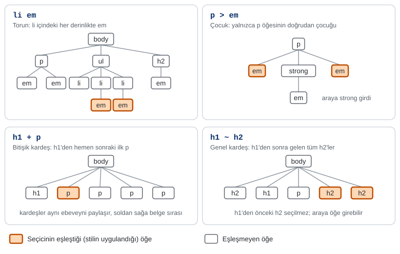

*Şekil 4.12. Birleştiricilerin belge ağacında hedeflediği öğeler (turuncu: seçilen öğe).*

Sunumda `h1 ~ h2` için "devamında olması, araya başka hiçbir etiketin girmemesidir" denmektedir; bu tanım `+` birleştiricisine aittir. `~` birleştiricisinde araya başka öğeler girebilir; tek koşul, öğelerin aynı ebeveyne sahip olması ve hedefin belgede sonra gelmesidir. Benzer biçimde `p > em` için "sadece paragraf içerisindeki `em` etiketleri" ifadesi eksiktir: paragrafın içinde olup başka bir öğenin içine yerleştirilmiş `em` öğeleri seçilmez; bu davranış `p em` (torun) seçicisine aittir.

Birleştiriciler gruplamayla birlikte kullanılabilir. Sunumdaki `h1 em, h2 em, h3 em { color: red; }` kuralı üç başlık düzeyinin içindeki vurguları kırmızı yapar; modern CSS'te aynı kural `:is()` ile kısaltılabilir: `:is(h1, h2, h3) em { color: red; }`.

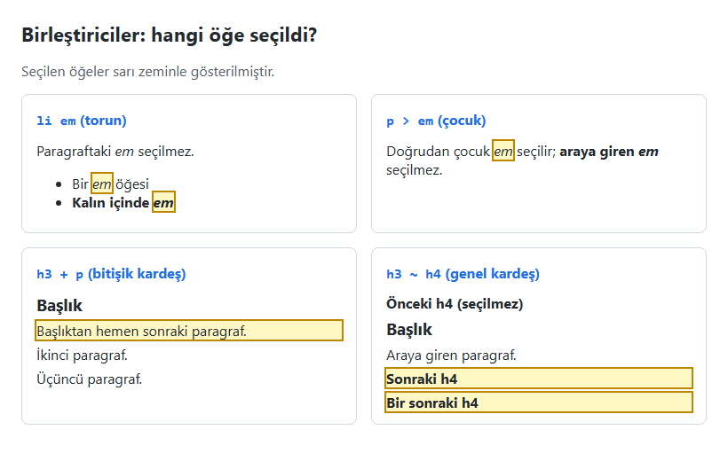

*Şekil 4.13. Birleştiricilerin tarayıcıdaki sonucu (Örnek 4.4: [`codes/04-css-temelleri/ornek-4-4-birlestiriciler/`](../codes/04-css-temelleri/ornek-4-4-birlestiriciler/index.html)). Örnekte geçerli bir başlık hiyerarşisi korumak için `h1` yerine `h3` kullanılmıştır.*

### 4.7.4 Nitelik seçicileri

Nitelik seçicileri (attribute selectors), öğeleri bir niteliğin varlığına veya değerine göre seçer ve köşeli parantezle yazılır [9, s. HTML 111], [15].

| Seçici | Seçtiği öğeler | Örnek kullanım |
|---|---|---|
| `[nitelik]` | Niteliği taşıyan (değeri ne olursa olsun) | `input[required]` |
| `[nitelik="d"]` | Değeri tam olarak `d` olan | `input[type="email"]` |
| `[nitelik^="d"]` | Değeri `d` ile **başlayan** | `a[href^="https://"]` dış bağlantılar |
| `[nitelik$="d"]` | Değeri `d` ile **biten** | `a[href$=".pdf"]` PDF bağlantıları |
| `[nitelik*="d"]` | Değeri içinde `d` **geçen** | `a[href*="youtube"]` |
| `[nitelik~="d"]` | Boşlukla ayrılmış değer listesinde `d` sözcüğü olan | `[class~="kart"]` (`.kart` ile eşdeğer) |
| `[nitelik\|="d"]` | Değeri `d` olan veya `d-` ile başlayan | `[lang\|="tr"]` |

*Tablo 4.8. Nitelik seçicileri.*

Değerin sonuna boşlukla ayrılmış `i` eklendiğinde karşılaştırma büyük/küçük harfe duyarsız yapılır: `a[href$=".pdf" i]` hem `.pdf` hem `.PDF` uzantılı bağlantıları seçer. Nitelik seçicileri özellikle formlarda kullanışlıdır; her `input` öğesine ayrı sınıf vermek yerine türüne göre stil verilebilir.

### 4.7.5 Sözde sınıflar (pseudo-classes)

Sözde sınıflar, öğeleri HTML kaynağında yazılı olmayan bir **durumlarına** veya **konumlarına** göre seçer ve tek iki noktayla yazılır [15]. En sık kullanılanlar Tablo 4.9'da özetlenmiştir.

| Grup | Sözde sınıf | Seçtiği öğe |
|---|---|---|
| Kullanıcı etkileşimi | `:hover` | Fare imlecinin üzerinde bulunduğu öğe |
| | `:focus` | Klavye veya fareyle odaklanılmış öğe (ör. içine yazılan `input`) |
| | `:focus-visible` | Odak, tarayıcıya göre görünür olmalıysa (genellikle klavyeyle gezinmede) |
| | `:active` | Tıklandığı (basılı tutulduğu) anda öğe |
| Bağlantı | `:link`, `:visited` | Ziyaret edilmemiş / edilmiş bağlantılar |
| Yapısal | `:first-child`, `:last-child` | Ebeveyninin ilk / son çocuğu olan öğe |
| | `:nth-child(n)` | Ebeveyni içinde n. sıradaki öğe: `2`, `odd`, `even`, `3n+1` |
| | `:nth-of-type(n)` | Kendi türündeki kardeşleri arasında n. sırada olan öğe |
| Mantıksal | `:not(s)` | `s` seçicisine **uymayan** öğe |
| | `:is(s1, s2)`, `:where(…)` | Listedeki seçicilerden birine uyan öğe |
| | `:has(s)` | İçinde (veya ardında) `s` seçicisine uyan bir öğe bulunan öğe |
| Form | `:checked`, `:disabled`, `:required`, `:invalid` | Form denetimlerinin durumları (bkz. [Bölüm 3](03-html-tablo-form-medya.md)) |

*Tablo 4.9. Sık kullanılan sözde sınıflar.*

Bağlantı durumları birlikte kullanılırken sıranın önemi vardır. Hepsi aynı özgüllükte olduğundan sonra yazılan kazanır; bu nedenle `:link`, `:visited`, `:hover`, `:active` sırası (İngilizce kısaltmasıyla *LVHA*) korunmalıdır. Aksi hâlde örneğin ziyaret edilmiş bağlantılarda `:hover` etkisi görünmez. Gizlilik nedeniyle tarayıcılar `:visited` ile yalnızca renk özelliklerinin değiştirilmesine izin verir.

`:nth-child()` ifadesindeki `n` 0'dan başlayan bir sayaçtır: `2n` çift sıradakileri (2, 4, 6…), `2n+1` tek sıradakileri, `-n+3` ilk üç öğeyi seçer. Uzun tablolarda satırları dönüşümlü renklendirmek (zebra deseni) için `tbody tr:nth-child(even)` kullanılır.

`:has()` sözde sınıfı, bir öğeyi **içerdiği** öğelere göre seçebildiği için uzun yıllar "ebeveyn seçicisi" olarak beklenmişti ve 2023 sonundan itibaren tüm güncel tarayıcılarda desteklenmektedir. Örneğin `.kart:has(img)` yalnızca görsel içeren kartları, `label:has(input:invalid)` geçersiz giriş içeren etiketleri seçer.

> [!TIP]
> **Güncel hayattan:** Bir e-ticaret sitesinin sepet sayfasında "Sepetiniz boş" mesajı, JavaScript kullanmadan yalnızca CSS ile gösterilebilir: `.sepet:not(:has(.urun)) .bos-mesaj { display: block; }`. Bir ürün tablosunda fiyatların bulunduğu son sütunu sağa hizalamak için ise her hücreye sınıf vermek yerine `td:last-child { text-align: right; }` yazmak yeterlidir.

> [!WARNING]
> **Erişilebilirlik:** Klavye kullanıcıları sayfada `Tab` tuşuyla gezinir ve hangi öğenin odakta olduğunu tarayıcının çizdiği odak çerçevesinden anlar. Görünümü "çirkin" bulunduğu için `:focus { outline: none; }` yazmak klavye kullanıcılarını sayfada kör bırakır ve WCAG 2.2'nin 2.4.7 *Görünür Odak* ölçütünü ihlal eder [18]. Odak stili değiştirilecekse kaldırılmamalı, `:focus-visible` ile en az onun kadar belirgin bir stil verilmelidir.

### 4.7.6 Sözde öğeler (pseudo-elements)

Sözde öğeler, belge ağacında gerçek bir öğe olarak bulunmayan bir **parçayı** seçer veya **oluşturur**; standart yazımları çift iki noktadır [15]:

- `::before` ve `::after`: Öğenin içeriğinin başına veya sonuna, `content` özelliğiyle belirtilen içeriği ekler. `content` yazılmazsa sözde öğe oluşmaz. Süs simgeleri, tırnak işaretleri ve etiketler eklemek için kullanılır.
- `::first-line`: Bloğun yalnızca **ilk satırını** seçer; satırın uzunluğu pencere genişliğine göre değiştiğinden bu seçim de dinamik olarak değişir.
- `::first-letter`: İlk harfi seçer (gazete ve dergilerdeki büyük baş harf etkisi).
- `::placeholder`, `::marker`, `::selection`: Sırasıyla form yer tutucu metni, liste madde işareti ve kullanıcının seçtiği metin.

```css
a[href$=".pdf"]::before {
  content: "PDF";
  margin-right: 6px;
  padding: 0 4px;
  background-color: #cf222e;
  color: #ffffff;
}

.giris::first-line {
  font-weight: bold;
}
```

*Kod 4.5. Nitelik seçicisiyle birlikte `::before` ve `::first-line`.*

CSS2'de sözde öğeler de tek iki noktayla (`:before`) yazılıyordu; tarayıcılar geriye dönük uyumluluk için bu yazımı hâlâ kabul eder, ancak sözde sınıflarla karışmaması için güncel kodda çift iki nokta kullanılır.

> [!WARNING]
> `::before` ve `::after` ile eklenen metin bazı ekran okuyucular tarafından okunur, bazıları tarafından okunmaz; kopyalanıp yapıştırılamaz ve arama motorları için güvenilir içerik değildir. Bu nedenle sözde öğeler yalnızca **süsleme** amaçlı kullanılmalı; fiyat, uyarı, talimat gibi anlamlı bilgiler HTML'de yazılmalıdır.

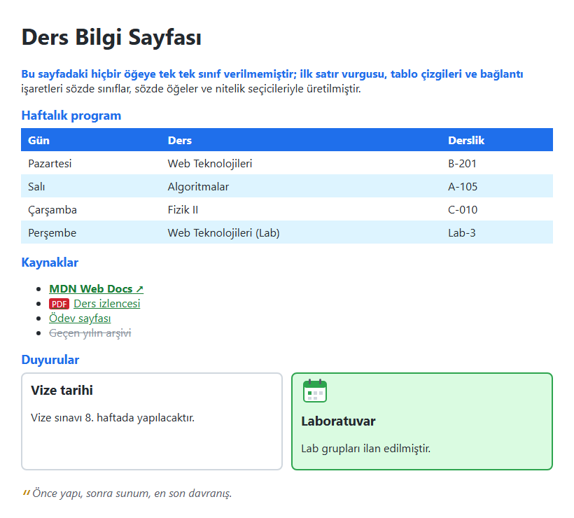

*Şekil 4.14. Nitelik seçicileri, sözde sınıflar ve sözde öğeler (Örnek 4.5: [`codes/04-css-temelleri/ornek-4-5-sozde-siniflar/`](../codes/04-css-temelleri/ornek-4-5-sozde-siniflar/index.html)). HTML'de hiçbir satıra veya bağlantıya ayrı sınıf verilmemiştir.*

### 4.7.7 İç içe CSS (nesting)

2023'ten bu yana güncel tarayıcılar, önceden yalnızca Sass gibi ön işlemcilerde bulunan **iç içe kural** (nesting) yazımını doğrudan desteklemektedir [19]. Bir kuralın içine yazılan kural, dıştaki seçicinin torunlarına uygulanır; `&` işareti dıştaki seçiciyi temsil eder:

```css
.kart {
  padding: 1rem;

  & h2 {
    color: #1f6feb;
  }

  &:hover {
    background-color: #f6f8fa;
  }
}
```

Bu yazım, `.kart h2` ve `.kart:hover` kurallarını ayrı ayrı yazmakla eşdeğerdir ve ilgili kuralları bir arada tutar. Ancak iç içe geçme arttıkça seçicilerin özgüllüğü de arttığından, iki-üç düzeyi aşmaması önerilir. Bu derste örnekler, okunabilirlik ve eski kodlarla uyum için düz (iç içe olmayan) yazımla verilmektedir.

### 4.7.8 Seçici özet tablosu

| Seçici | Örnek | Seçtiği öğeler | Özgüllük |
|---|---|---|---|
| Evrensel | `*` | Tüm öğeler | (0,0,0) |
| Tür | `p` | Tüm `<p>` öğeleri | (0,0,1) |
| Sınıf | `.duyuru` | `class` niteliğinde `duyuru` olanlar | (0,1,0) |
| Kimlik | `#ana-menu` | `id="ana-menu"` olan öğe | (1,0,0) |
| Gruplama | `h1, h2` | `h1` ve `h2` öğeleri | Her biri ayrı |
| Torun | `nav a` | `nav` içindeki tüm `a` öğeleri | (0,0,2) |
| Çocuk | `ul > li` | `ul` öğesinin doğrudan çocuğu olan `li` | (0,0,2) |
| Bitişik kardeş | `h2 + p` | `h2`'den hemen sonraki `p` | (0,0,2) |
| Genel kardeş | `h2 ~ p` | `h2`'den sonra gelen tüm kardeş `p` | (0,0,2) |
| Nitelik | `a[target="_blank"]` | Yeni sekmede açılan bağlantılar | (0,1,1) |
| Sözde sınıf | `li:first-child` | Ebeveyninin ilk çocuğu olan `li` | (0,1,1) |
| Sözde öğe | `p::first-line` | Paragrafın ilk satırı | (0,0,2) |

*Tablo 4.10. Seçici türlerinin özeti.*

#### 🛠 Uygulama 4.3: Seçici Avı — Öğrenci Bilgi Sistemi

**Amaç:** HTML'e dokunmadan, yalnızca farklı seçici türleriyle bir öğrenci bilgi sistemi sayfasının belirli öğelerine stil vermek.  
**Tahmini süre:** 20 dk

1. `calismalar/bolum-04/uygulama-4-3/` klasöründe `index.html` ve `style.css` dosyalarını oluşturunuz. HTML iskeletini çözüm klasöründeki [`index.html`](../codes/04-css-temelleri/uygulama-4-3-secici-avi/index.html) dosyasından kopyalayınız (bir `nav#ana-menu`, duyuru paragrafı, not tablosu, iç içe ders listesi ve iki alanlı bir form içerir). Bu dosyada **hiçbir değişiklik yapmayınız**.
2. `style.css` dosyasında aşağıdaki görevlerin her birini belirtilen seçici türüyle çözünüz:
   1. Tür: `h1` başlığını lacivert yapınız.
   2. Gruplama: `h2` ve `h3` başlıklarına aynı mavi rengi veriniz.
   3. Sınıf: `.duyuru` paragrafına sarı zemin ve sol kenarlık veriniz.
   4. Kimlik: `#ana-menu` çubuğuna koyu lacivert zemin veriniz.
   5. Torun: menüdeki bağlantıları beyaz ve alt çizgisiz yapınız.
   6. Çocuk: ders listesinde yalnızca **dış** listenin öğelerini kalın yapınız (iç listedeki dersler normal kalmalıdır; kalınlığın kalıtıldığını unutmayınız).
   7. Bitişik kardeş: "Not listesi" başlığından hemen sonraki açıklama paragrafını italik yapınız.
   8. Genel kardeş: duyurudan sonra gelen kardeş paragrafları gri yapınız.
   9. Nitelik: yeni sekmede açılan bağlantının sonuna `::after` ile "↗" ekleyiniz; e-posta alanına mavi kenarlık veriniz.
   10. Sözde sınıf: tablonun tek sıradaki satırlarını açık gri yapınız; ilk sütun dışındaki hücreleri ortalayınız.
   11. `:has()`: "Kaldı" hücresi içeren satırların metnini kırmızı yapınız.
   12. Sözde öğe: duyurunun başına kalın "Duyuru: " metnini ekleyiniz.
3. Sayfayı Live Server ile açınız ve Şekil 4.15 ile karşılaştırınız.

**Beklenen çıktı:**

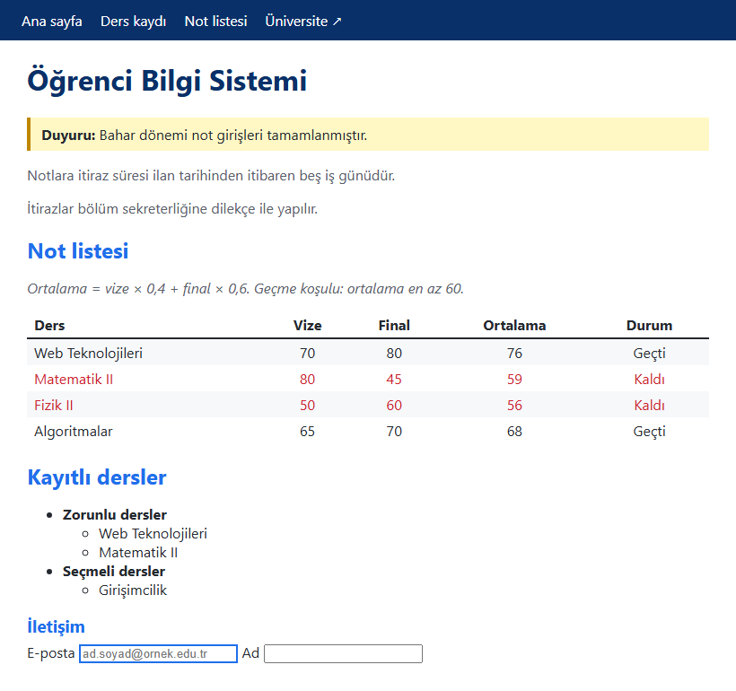

*Şekil 4.15. Uygulama 4.3'ün beklenen ekran görüntüsü.*

**Kendinizi sınayın:** (1) 8. görevde "Not listesi" başlığından sonraki açıklama paragrafı da gri oldu. Neden? Yalnızca duyurudan hemen sonraki iki paragrafı seçmek için seçiciyi nasıl değiştirirsiniz? (2) Tablodaki notlara bakarak Matematik II dersinin ortalamasının nasıl 59 bulunduğunu gösteriniz ve vize notu değişmeseydi bu dersi geçmek için finalden en az kaç alınması gerekeceğini hesaplayınız.

<details><summary>Örnek çözüm</summary>

Çözüm dosyası: [`codes/04-css-temelleri/uygulama-4-3-secici-avi/style.css`](../codes/04-css-temelleri/uygulama-4-3-secici-avi/style.css)

</details>

## 4.8 `div` ve `span`: Anlamsız Kapsayıcılar

Sunumda geniş yer ayrılan `<div>` (division, bölme) öğesi, HTML'in **genel amaçlı blok kapsayıcısıdır**. Kendi başına hiçbir anlam taşımaz: içine konan içerik tarayıcılar, arama motorları ve ekran okuyucular için "bu bir başlık" veya "bu bir gezinme menüsü" gibi bir anlam kazanmaz. Varsayılan olarak blok düzeyindedir, yani yeni bir satırda başlar ve kapsayıcısının tüm genişliğini kaplar; tarayıcı ona herhangi bir renk, kenarlık veya boşluk vermez [12]. `<span>` ise aynı işlevin **satır içi** karşılığıdır: bir paragrafın içindeki birkaç sözcüğü, satırı bölmeden gruplamak için kullanılır.

Bu iki öğe, kendilerine ait bir görünümleri olmadığı için CSS ve JavaScript açısından ideal birer **kancadır** (hook): `class` veya `id` verilerek bir içerik grubuna stil uygulanır veya JavaScript ile erişilir. `div` başlıca dört amaçla kullanılır: ilişkili içeriği gruplamak, bir gruba ortak stil vermek, bir gruba JavaScript ile erişmek ve sayfa yerleşimi (Flexbox, Grid) için kapsayıcı oluşturmak.

```html
<div class="urun-kart">
  <h2 class="urun-kart__baslik">Kablosuz Kulaklık</h2>
  <p>Kargo durumu: <span class="durum durum--yolda">Yolda</span></p>
</div>
```

HTML5 ile birlikte `header`, `nav`, `main`, `article`, `section`, `aside` ve `footer` gibi **anlamsal öğeler** gelmiştir (bkz. [Bölüm 2](02-html-temelleri.md)). Gruplanan içerik bu öğelerden birinin anlamına uyuyorsa `div` yerine o öğe kullanılmalıdır; bu hem erişilebilirliği hem arama motoru optimizasyonunu hem de kodun okunabilirliğini artırır. `div`, ancak uygun bir anlamsal öğe bulunmadığında, yalnızca stil veya yerleşim amaçlı bir kapsayıcı olarak tercih edilir. Yukarıdaki ürün kartı bağımsız bir içerik birimi olduğundan `<article class="urun-kart">` olarak yazılması daha doğrudur.

> [!IMPORTANT]
> **"Div çorbasından" kaçınılmalıdır.** Her şeyin anlamsız `div`'lerle sarıldığı, beş-altı düzey iç içe geçmiş ve çoğunun hiçbir işlevi olmayan yapılara "div çorbası" (div soup) denir. Bu tür kod okunması, bakımı ve stil verilmesi zor bir yapı üretir; ekran okuyucu kullanıcıları için de sayfanın yapısını belirsizleştirir. Her `div`'in bir amacı (gruplama veya stil kancası) olmalı; anlamlı `class` adları (`class="urun-listesi"`, `id="ana-menu"`) verilmelidir.

> [!TIP]
> **Güncel hayattan:** Bir kargo takip sayfasında gönderinin durumunu gösteren "Dağıtımda", "Teslim edildi" gibi küçük renkli etiketler genellikle bir paragrafın içinde `<span>` öğeleriyle işaretlenir ve durumuna göre farklı sınıflar (`durum--yolda`, `durum--teslim`) alır. Durum değiştiğinde JavaScript yalnızca sınıfı değiştirir, renk değişikliğini CSS yapar.

#### 🛠 Uygulama 4.4: Sınıf ve Kimlikle Ürün Kartları

**Amaç:** Bir e-ticaret vitrini için BEM tarzı sınıf adlarıyla yeniden kullanılabilir ürün kartları tasarlamak ve tek bir kartı kimlik seçicisiyle öne çıkarmak.  
**Tahmini süre:** 20 dk

1. `calismalar/bolum-04/uygulama-4-4/` klasöründe `index.html` ve `style.css` oluşturunuz. Ürün görselleri için çözüm klasöründeki üç küçük SVG dosyasını (`defter.svg`, `kulaklik.svg`, `termos.svg`) kopyalayabilir veya kendi görsellerinizi kullanabilirsiniz.
2. `<main>` içine bir `<h1>` ve `class="vitrin"` olan bir `div` ekleyiniz. Vitrine üç `<article class="urun-kart">` yerleştiriniz. Her kartta `urun-kart__gorsel` sınıflı bir `` (anlamlı `alt` metniyle), `urun-kart__baslik` sınıflı bir `<h2>`, `urun-kart__fiyat` sınıflı bir `<p>` ve `urun-kart__dugme` sınıflı bir `<a>` bulunsun.
3. İkinci karta `id="gunun-firsati"` veriniz; fiyat paragrafına ek olarak `urun-kart__fiyat--indirimli` sınıfını ekleyip eski fiyatı `<del>` içinde yazınız.
4. `style.css` dosyasında `.vitrin` için `display: flex; gap: 16px;` yazınız (ayrıntısı [Bölüm 6](06-css-kutu-modeli-yerlesim.md)'da). `.urun-kart` için beyaz zemin, ince kenarlık, yuvarlatılmış köşe ve ortalanmış metin; düğme için mavi zemin ve beyaz yazı tanımlayınız. Düğmeye `:hover` durumunda daha koyu bir mavi veriniz.
5. `#gunun-firsati` kuralıyla bu karta sarı zemin ve turuncu kenarlık; `#gunun-firsati::before` ile kartın üst kenarına "Günün fırsatı" rozeti ekleyiniz. İndirimli fiyatı `.urun-kart__fiyat--indirimli` ile kırmızı yapınız.
6. Live Server ile açıp Şekil 4.16 ile karşılaştırınız.

**Beklenen çıktı:**

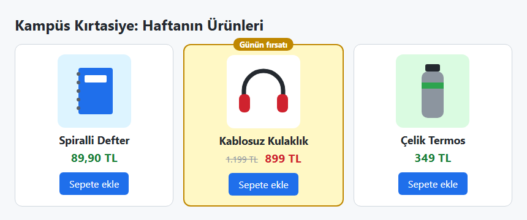

*Şekil 4.16. Uygulama 4.4'ün beklenen ekran görüntüsü.*

**Kendinizi sınayın:** (1) Üçüncü kartı da günün fırsatı yapmak isteseydiniz `id` yerine nasıl bir yol izlerdiniz? (2) `.urun-kart` kuralına `background-color: white;` ekleyip `#gunun-firsati` kuralından önce ve sonra yazmayı deneyiniz; sıra sonucu değiştirdi mi? Neden?

<details><summary>Örnek çözüm</summary>

Çözüm dosyası: [`codes/04-css-temelleri/uygulama-4-4-urun-karti/index.html`](../codes/04-css-temelleri/uygulama-4-4-urun-karti/index.html)

</details>

## 4.9 CSS Kaynakları ve Geliştirici Araçları

### 4.9.1 Başvuru kaynakları

CSS çok sayıda modülden oluşan ve sürekli gelişen bir dil olduğundan hiçbir kitap veya ders notu her özelliği ayrıntısıyla kapsayamaz. Güvenilir başvuru kaynaklarını tanımak ve kullanmak bu nedenle temel bir beceridir:

- **MDN Web Docs** (developer.mozilla.org): Her özellik, seçici ve değer için açıklama, sözdizimi, örnek ve tarayıcı uyumluluk tablosu içerir. Sayfalardaki "Baseline" etiketi, özelliğin tüm ana tarayıcılarda desteklenip desteklenmediğini gösterir [20].
- **web.dev Learn CSS**: Google'ın Chrome ekibinin hazırladığı, kutu modelinden basamaklamaya kadar konuları sırayla anlatan ücretsiz bir kurstur [21].
- **W3C CSS sayfaları**: Standartların kendisi ve "CSS Current Work" sayfası; bir özelliğin kesin tanımına ihtiyaç duyulduğunda başvurulur. W3C'nin CSS Doğrulayıcısı (jigsaw.w3.org/css-validator) stil dosyalarındaki sözdizimi hatalarını listeler.
- **CSS-Tricks**, **A List Apart** gibi topluluk siteleri ve tarayıcı eklentileri (ör. Chris Pederick'in *Web Developer* eklentisi) de yararlıdır; ancak eski tarihli makalelerdeki bilgilerin güncelliği MDN'den denetlenmelidir. W3Schools hızlı örnekler için kullanılabilir, ancak birincil kaynak olarak MDN ve W3C tercih edilmelidir.

### 4.9.2 Geliştirici araçlarında basamaklamayı izlemek

Tüm güncel tarayıcılar, `F12` tuşuyla veya bir öğeye sağ tıklayıp **İncele** (Inspect) seçilerek açılan geliştirici araçlarına (DevTools) sahiptir [9, s. HTML 93]. **Elements** sekmesinde bir öğe seçildiğinde sağdaki iki panel CSS hata ayıklamasının temel araçlarıdır [22]:

- **Styles paneli:** Seçili öğeye uygulanan **tüm** kuralları basamaklama önceliğine göre yukarıdan aşağıya listeler. En üstte `element.style` (satır içi stil), en altta *user agent stylesheet* (tarayıcı varsayılanları) ve ebeveynlerden kalıtılan değerler (*Inherited from …*) yer alır. Kaybeden bildirimlerin **üstü çizilidir**; geçersiz bildirimler ayrıca sarı bir uyarı simgesiyle gösterilir. Her kuralın yanında hangi dosyanın kaçıncı satırından geldiği yazar. Bildirimlerin yanındaki onay kutularıyla bir bildirim geçici olarak kapatılabilir, değerler çift tıklanarak canlı olarak değiştirilebilir; bu değişiklikler kaydedilmez, yalnızca deneme içindir. `:hov` düğmesi, `:hover` veya `:focus` durumunu fareyi kullanmadan zorlamaya yarar.
- **Computed paneli:** Basamaklama ve kalıtım tamamlandıktan sonra öğede kullanılan **son değerleri** gösterir. Bir değerin yanındaki ok, o değeri hangi kuralın sağladığına götürür.


*Şekil 4.17. Uygulama 4.5'teki sıcaklık değeri için Styles ve Computed panelleri (temsilî çizim; arayüz tarayıcıya ve sürüme göre farklılık gösterebilir).*

> [!TIP]
> **Güncel hayattan:** Sık kullanılan bir haber sitesinin veya bir video platformunun herhangi bir düğmesine sağ tıklayıp **İncele** seçildiğinde, o düğmenin rengini ve yazı tipini belirleyen kuralların hangi dosyalardan geldiği ve hangilerinin ezildiği aynı yöntemle görülebilir. Styles panelinde yapılan değişiklikler yalnızca o tarayıcı sekmesinde ve sayfa yenilenene kadar geçerlidir; siteye hiçbir zarar vermez.

#### 🛠 Uygulama 4.5: DevTools ile Basamaklamayı İzleme

**Amaç:** Geliştirici araçlarının Styles ve Computed panellerini kullanarak hangi kuralın neden kazandığını bulmak ve bilerek bırakılmış bir sözdizimi hatasını tespit etmek.  
**Tahmini süre:** 15 dk

1. Çözüm klasöründeki [`uygulama-4-5-devtools`](../codes/04-css-temelleri/uygulama-4-5-devtools/index.html) klasörünü `calismalar/bolum-04/` altına kopyalayınız ve `index.html` dosyasını Live Server ile açınız. Sayfada İstanbul ve Tekirdağ için iki hava durumu kartı görülür (Şekil 4.18).
2. İstanbul kartındaki "18°C" yazısına sağ tıklayıp **İncele** seçiniz. Styles panelinde `color` bildirimlerini yukarıdan aşağıya sayınız: hangileri üstü çizili? Kazanan bildirim nereden geliyor (`element.style`, `index.html`, `style.css`)?
3. Aynı işlemi Tekirdağ kartının sıcaklığı için yapınız. Burada satır içi stil olmadığına göre hangi kural kazandı? Gömülü stildeki `.kart .sicaklik` ile harici dosyadaki `.sicaklik` arasında kararı özgüllük mü yoksa kaynak sırası mı verdi?
4. `.sicaklik` kuralındaki sarı uyarı simgeli bildirimi bulunuz. Neden geçersiz sayıldığını açıklayınız ve `style.css` dosyasında düzelterek (ör. `font-size: 3rem;`) sonucu gözlemleyiniz.
5. "Parçalı bulutlu" yazısını inceleyiniz. Rengini hangi bildirim belirliyor? Gömülü stildeki `.durum` kuralına `color: black;` ekleseydiniz sonuç değişir miydi?
6. **Computed** sekmesine geçip `color` ve `font-size` değerlerinin son hâlini not ediniz; değerin yanındaki oka tıklayarak kaynağına gidiniz.

**Beklenen çıktı:**

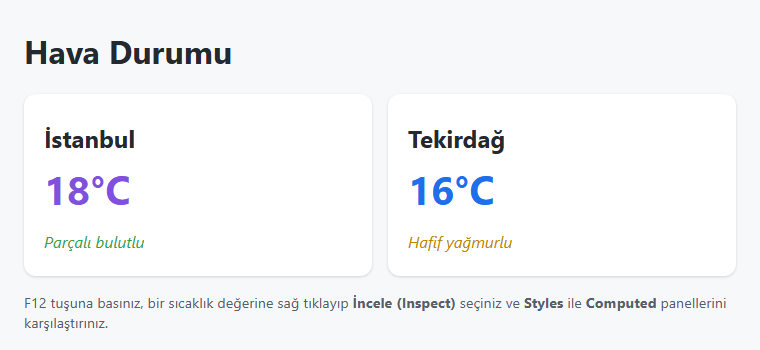

*Şekil 4.18. Uygulama 4.5'in başlangıç ekranı.*

**Kendinizi sınayın:** (1) Styles panelinde İstanbul'un sıcaklığındaki `element.style` bildiriminin onay kutusunu kaldırınız; yazı hangi renge döndü ve neden? (2) `<style>` öğesini `<link>` satırının üstüne taşıyınız; Tekirdağ'ın rengi değişti mi? Neden?

<details><summary>Örnek çözüm</summary>

İstanbul: `element.style` (mor) kazanır; `.kart .sicaklik`, `.sicaklik` ve `p` kurallarının `color` bildirimleri üstü çizilidir. Tekirdağ: `.kart .sicaklik` (0,2,0) özgüllüğüyle `.sicaklik` (0,1,0) kuralını yener; karar **özgüllükle** verilmiştir, bu yüzden `<style>` öğesinin yeri değiştirilse de renk mavi kalır. `font-size: 3 em` sayı ile birim arasındaki boşluk nedeniyle geçersizdir; önceki `2.5rem` değeri kullanılır. İstanbul'un durum metni `#istanbul .durum` kuralındaki `!important` nedeniyle yeşildir; gömülü stile eklenecek normal bir `color` bildirimi bunu değiştiremez.

Çözüm dosyası: [`codes/04-css-temelleri/uygulama-4-5-devtools/index.html`](../codes/04-css-temelleri/uygulama-4-5-devtools/index.html)

</details>

## 4.10 Bölüm Özeti

- CSS, HTML ile yapılandırılmış içeriğin sunumunu tanımlayan ayrı bir dildir. HTML yapı ve anlamı, CSS görünümü, JavaScript davranışı üstlenir; katmanlar ayrı dosyalarda tutulur.
- CSS1 (1996), CSS2 (1998) ve CSS 2.1 (2011) tek parça belgelerdi; sonrasında dil bağımsız modüller hâlinde gelişmektedir. "CSS3" bu modüllerin ortak adıdır; "CSS4" diye bir sürüm yoktur. Güncel durum yıllık CSS Snapshot belgelerinde özetlenir.
- Bir kural seçici ve bildirim bloğundan oluşur; bildirimler `özellik: değer` çiftleridir ve noktalı virgülle ayrılır. Sayı ile birim arasında boşluk bırakılamaz; geçersiz bildirimler sessizce yok sayılır; yorumlar yalnızca `/* … */` ile yazılır.
- Stiller satır içi (`style`), gömülü (`<style>`) ve harici (`<link>`) olarak uygulanabilir; çok sayfalı sitelerde harici dosya tercih edilir. `@import` dosyaların ardışık indirilmesine yol açtığı için performansı düşürür.
- Metinle ilgili özellikler (renk, yazı tipi) kalıtılır; kutu özellikleri (kenarlık, boşluk, arka plan) kalıtılmaz. `inherit`, `initial`, `unset` ve `revert` bu davranışı denetler. Kalıtılan değer, öğeyi doğrudan hedefleyen en zayıf kurala bile yenilir.
- Basamaklama sırasıyla köken ve önem, satır içi stil, katmanlar, özgüllük ve kaynak sırasına bakar. `!important` sırayı tersine çevirir; gömülü ve harici stiller arasında köken farkı yoktur. Özgüllük (A, B, C) biçiminde basamak basamak karşılaştırılır.
- Seçiciler; evrensel, tür, sınıf, kimlik, gruplama, dört birleştirici (boşluk, `>`, `+`, `~`), nitelik seçicileri, sözde sınıflar (`:hover`, `:nth-child()`, `:not()`, `:has()`) ve sözde öğelerden (`::before`, `::first-line`) oluşur.
- Stil için sınıflar, sayfa içi bağlantı ve JavaScript için kimlikler kullanılır. `div` ve `span` anlamsız kapsayıcılardır; uygun anlamsal öğe varsa o tercih edilmelidir.
- Geliştirici araçlarının Styles paneli basamaklamanın sonucunu üstü çizili bildirimlerle, Computed paneli ise son değerleri gösterir.

## 4.11 Değerlendirme Soruları

1. "HTML yapı katmanı, CSS sunum katmanıdır" ifadesini CSS Zen Garden örneği üzerinden açıklayınız. Bu ayrımın büyük bir kurumsal web sitesine iki somut yararını yazınız.
2. "CSS4" adlı bir sürümün neden bulunmadığını, modül seviyeleri ve CSS Snapshot kavramlarıyla açıklayınız.
3. Aşağıdaki kuralda hangi bildirimler uygulanır? Gerekçesiyle açıklayınız.
   ```css
   h2 {
     color: navy
     margin: 2 em;
     padding: 1rem;
   }
   ```
4. Elli sayfalık bir bölüm sitesi için stillerin nasıl düzenleneceğini satır içi, gömülü, harici ve `@import` yöntemlerini karşılaştırarak gerekçelendiriniz.
5. Bir `div` öğesine `border: 2px solid red; color: red;` verildiğinde içindeki paragrafın hangi özellikleri devraldığını açıklayınız. `div { display: initial; }` ile `div { display: revert; }` yazımlarının sonuçları neden farklıdır?
6. Aşağıdaki seçicilerin özgüllüğünü (A, B, C) biçiminde hesaplayınız ve en özgülden en az özgüle sıralayınız: `ul#menu li.aktif a`, `.menu a:hover`, `nav > ul > li > a`, `#menu a`, `a[href^="https"]`.
7. Aşağıdaki belgede paragraf hangi renkte görünür? Sunumdaki sekiz maddelik öncelik tablosunun bu soruya neden yanlış cevap verdirebileceğini açıklayınız.
   ```html
   <head>
     <style> p { color: green; } </style>
     <link rel="stylesheet" href="stil.css"> <!-- stil.css: p { color: blue; } -->
   </head>
   ```
8. Kullanıcı `!important` bildirimlerinin yazar `!important` bildirimlerini yenmesinin erişilebilirlik açısından gerekçesini açıklayınız.
9. `h2 + p`, `h2 ~ p`, `article p` ve `article > p` seçicilerinin her birinin seçtiği öğeleri, bir `article` içinde `h2`, `p`, `div > p`, `p` sırasıyla yer alan bir yapı üzerinde gösteriniz.
10. `a[href$=".pdf"]`, `tbody tr:nth-child(odd)`, `.kart:has(img)` ve `p::first-line` seçicilerinin her biri için birer kullanım senaryosu yazınız.
11. Stil vermek için `id` yerine `class` kullanılmasının nedenlerini özgüllük açısından tartışınız. `.kirmizi-baslik` ve `.bolum-basligi` sınıf adlarından hangisi neden daha iyidir?
12. Geliştirici araçlarının Styles panelinde bir bildirimin üstü çizili görünmesinin ve sarı uyarı simgesi taşımasının ne anlama geldiğini açıklayınız.

## Kaynaklar

[1] T. Atkins Jr., E. J. Etemad, F. Rivoal, C. Lilley, and S. Zartner, Eds., "CSS Snapshot 2026," W3C Group Note, 22 Jun. 2026. [Çevrimiçi]. Erişim: https://www.w3.org/TR/css-2026/ (Erişim tarihi: 2 Kasım 2026).

[2] J. Duckett, *HTML and CSS: Design and Build Websites*. Indianapolis, IN, USA: Wiley, 2011.

[3] H. W. Lie, "Cascading HTML style sheets — a proposal," CERN, Geneva, Switzerland, 10 Oct. 1994. [Çevrimiçi]. Erişim: https://www.w3.org/People/howcome/p/cascade.html (Erişim tarihi: 2 Kasım 2026).

[4] H. W. Lie and B. Bos, "Cascading Style Sheets, level 1," W3C Recommendation, 17 Dec. 1996. [Çevrimiçi]. Erişim: https://www.w3.org/TR/CSS1/ (Erişim tarihi: 2 Kasım 2026).

[5] B. Bos, H. W. Lie, C. Lilley, and I. Jacobs, "Cascading Style Sheets, level 2 (CSS2) Specification," W3C Recommendation, 12 May 1998. [Çevrimiçi]. Erişim: https://www.w3.org/TR/1998/REC-CSS2-19980512/ (Erişim tarihi: 2 Kasım 2026).

[6] B. Bos, T. Çelik, I. Hickson, and H. W. Lie, "Cascading Style Sheets Level 2 Revision 1 (CSS 2.1) Specification," W3C Recommendation, 7 Jun. 2011. [Çevrimiçi]. Erişim: https://www.w3.org/TR/CSS21/ (Erişim tarihi: 2 Kasım 2026).

[7] D. Shea, "CSS Zen Garden: The beauty of CSS design." [Çevrimiçi]. Erişim: https://www.csszengarden.com/ (Erişim tarihi: 2 Kasım 2026).

[8] J. N. Robbins, *Learning Web Design: A Beginner's Guide to HTML, CSS, JavaScript, and Web Graphics*, 4th ed. Sebastopol, CA, USA: O'Reilly Media, 2012.

[9] P. Carey, *New Perspectives on HTML5 and CSS3: Comprehensive*, 7th ed. Boston, MA, USA: Cengage Learning, 2017.

[10] W3C, "CSS Values and Units Module Level 4," W3C Working Draft. [Çevrimiçi]. Erişim: https://www.w3.org/TR/css-values-4/ (Erişim tarihi: 2 Kasım 2026).

[11] W3C, "CSS Syntax Module Level 3." [Çevrimiçi]. Erişim: https://www.w3.org/TR/css-syntax-3/ (Erişim tarihi: 2 Kasım 2026).

[12] WHATWG, "HTML Living Standard." [Çevrimiçi]. Erişim: https://html.spec.whatwg.org/ (Erişim tarihi: 2 Kasım 2026).

[13] W3C, "CSS Cascading and Inheritance Level 5," W3C Candidate Recommendation. [Çevrimiçi]. Erişim: https://www.w3.org/TR/css-cascade-5/ (Erişim tarihi: 2 Kasım 2026).

[14] A. Harris, *HTML5 and CSS3 All-in-One For Dummies*, 3rd ed. Hoboken, NJ, USA: Wiley, 2014.

[15] W3C, "Selectors Level 4," W3C Working Draft. [Çevrimiçi]. Erişim: https://www.w3.org/TR/selectors-4/ (Erişim tarihi: 2 Kasım 2026).

[16] Mozilla, "Specificity," *MDN Web Docs*. [Çevrimiçi]. Erişim: https://developer.mozilla.org/en-US/docs/Web/CSS/CSS_cascade/Specificity (Erişim tarihi: 2 Kasım 2026).

[17] BEM, "Naming convention," *BEM Methodology*. [Çevrimiçi]. Erişim: https://bem.info/en/methodology/naming-convention/ (Erişim tarihi: 2 Kasım 2026).

[18] W3C, *Web Content Accessibility Guidelines (WCAG) 2.2*, W3C Recommendation, Oct. 2023. [Çevrimiçi]. Erişim: https://www.w3.org/TR/WCAG22/ (Erişim tarihi: 2 Kasım 2026).

[19] W3C, "CSS Nesting Module," W3C Working Draft. [Çevrimiçi]. Erişim: https://www.w3.org/TR/css-nesting-1/ (Erişim tarihi: 2 Kasım 2026).

[20] Mozilla, "CSS: Cascading Style Sheets," *MDN Web Docs*. [Çevrimiçi]. Erişim: https://developer.mozilla.org/en-US/docs/Web/CSS (Erişim tarihi: 2 Kasım 2026).

[21] Google, "Learn CSS," *web.dev*. [Çevrimiçi]. Erişim: https://web.dev/learn/css (Erişim tarihi: 2 Kasım 2026).

[22] Google, "CSS features reference," *Chrome for Developers: Chrome DevTools*. [Çevrimiçi]. Erişim: https://developer.chrome.com/docs/devtools/css/reference (Erişim tarihi: 2 Kasım 2026).

---

[← Önceki bölüm](03-html-tablo-form-medya.md) · [İçindekiler](../README.md) · [Sonraki bölüm →](05-css-metin-renk-arka-plan.md)
