# Bölüm 5: CSS ile Metin, Renk ve Arka Plan

[← Önceki bölüm](04-css-temelleri.md) · [İçindekiler](../README.md) · [Sonraki bölüm →](06-css-kutu-modeli-yerlesim.md)

> **Öğrenme Hedefleri** — Bu bölümü tamamlayan öğrenci:
>
> - `font-family` ile jenerik aileyle biten bir yazı tipi yığını yazar; Google Fonts ve `@font-face` ile web yazı tipi ekler ve bu yöntemlerin performans ve gizlilik sonuçlarını açıklar.
> - `px`, `em`, `rem` ve `%` birimlerini karşılaştırır; erişilebilirlik gerekçesiyle yazı boyutlarını `rem` cinsinden tanımlar.
> - `font-weight`, `font-style`, `font-variant` ve `font` kısayolunu doğru sırayla kullanır.
> - `line-height`, `text-align`, `text-decoration`, `text-transform`, `letter-spacing` ve `text-shadow` gibi metin özellikleriyle okunaklı bir metin düzeni kurar; Türkçe büyük harf dönüşümünde `lang` niteliğinin rolünü açıklar.
> - Bir rengi ad, onaltılık, `rgb()`, `hsl()` ve `oklch()` gösterimleriyle yazar; `opacity` ile yarı saydam renk arasındaki farkı ayırt eder ve WCAG 2.2 kontrast oranını denetler.
> - CSS özel özellikleriyle (`--ana-renk`, `var()`) değiştirilebilir bir renk teması oluşturur.
> - Arka plan rengi, görseli, gradyanı ve çoklu arka plan katmanlarını `background` özellikleri ve kısayoluyla uygular; harici bir CSS dosyasını sayfaya bağlar.

## 5.1 Giriş

[Bölüm 4](04-css-temelleri.md)'te CSS kuralının anatomisi, seçiciler ve basamaklama (cascade) incelenmiştir. Bu bölümde, seçilen öğelere uygulanan ilk ve en sık kullanılan özellik grupları ele alınmaktadır: yazı tipleri (fonts), metin biçimlendirme, renkler ve arka planlar. Bir web sayfasında ziyaretçinin gördüğü şeyin büyük bölümü metindir; bu nedenle tipografi ve renk seçimleri, sayfanın hem estetiğini hem de kullanılabilirliğini doğrudan belirler.

Gündelik kullanılan uygulamalar bu etkinin somut örnekleridir. Bir haber sitesinde başlık, özet ve gövde metni farklı yazı tipi boyutu ve kalınlığıyla ayrıştırılır; okur, sayfanın hiyerarşisini metni okumadan önce görsel olarak kavrar. e-Devlet Kapısı gibi kamu hizmeti sunan sitelerde yüksek kontrastlı, sade bir renk düzeni tercih edilir; çünkü sayfayı her yaştan ve farklı görme düzeyine sahip kullanıcılar ziyaret eder. Banka mobil uygulamalarının çoğu, cihazın koyu mod ayarını algılayarak aynı arayüzü koyu bir renk paletiyle gösterir; bu da renklerin tek bir yerde, değişken olarak tanımlanmasıyla mümkün olur. Bu bölümde bu tekniklerin her birinin CSS karşılığı incelenecektir.

Tasarım kitaplarında web tipografisi için tekrarlanan temel öneriler şöyle özetlenir: az sayıda yazı tipi ve boyut kullanmak, yaygın olarak bulunabilen yazı tiplerini seçmek, okunaklılık için tasarlamak ve metni görsel (resim) olarak üretmekten kaçınmak [1, Bl. 5]. Bölüm boyunca anlatılan özellikler, bu ilkeleri uygulamaya geçirmenin araçlarıdır.

## 5.2 Yazı Tipleri ve `font-family`

Sunumdaki "Font ile ilgili alt özellikler" slaytında yazı tipiyle ilgili altı özellik listelenmektedir: `font-family`, `font-size`, `font-weight`, `font-style`, `font-variant` ve bunların kısayolu olan `font`. Bu özelliklerin tamamı W3C'nin *CSS Fonts* modülünde tanımlanır [2] ve tamamı kalıtılır (inherited); yani `body` öğesine verilen bir yazı tipi, aksi belirtilmedikçe sayfadaki bütün metne uygulanır.

> [!NOTE]
> Sunumda bu özellikler için "font tagı" ifadesi kullanılmaktadır. CSS'te `font-family`, `font-size` gibi yapılar **özellik** (property) olarak adlandırılır; "etiket" (tag) terimi yalnızca HTML'deki `<p>`, `<h1>` gibi yapılar için kullanılır.

### 5.2.1 Yazı tipi yığını ve jenerik aileler

`font-family` özelliği tek bir yazı tipi adı yerine virgülle ayrılmış bir liste alır. Bu listeye **yazı tipi yığını** (font stack) denir. Tarayıcı listeyi soldan sağa okur ve kullanıcının cihazında bulunan (ya da `@font-face` ile indirilmiş) ilk yazı tipini kullanır; hiçbiri bulunamazsa listenin sonundaki **jenerik aile** (generic family) devreye girer [3, s. 269], [4, s. 229]. Bu nedenle doğru sıralama şudur: önce tercih edilen özel yazı tipi adları, en sonda mutlaka bir jenerik aile.

```css
body {
  font-family: "Segoe UI", Roboto, "Helvetica Neue", Arial, sans-serif;
}

h1 {
  font-family: Georgia, "Times New Roman", serif;
}
```

*Kod 5.1. Jenerik aileyle biten iki yazı tipi yığını.*

Boşluk içeren yazı tipi adları (`"Times New Roman"`, `"Segoe UI"`) tırnak içinde yazılmalıdır; tek sözcüklü adlarda tırnak gerekmez. Jenerik aile adları ise birer anahtar sözcük oldukları için **asla** tırnağa alınmaz: `"serif"` yazıldığında tarayıcı bunu "serif adlı bir yazı tipi" olarak arar ve jenerik aile işlevini kaybeder [2].

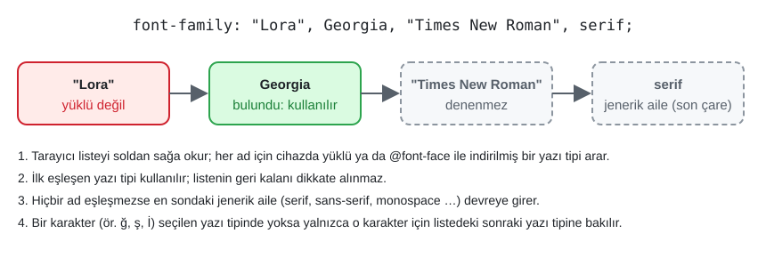

*Şekil 5.1. Yazı tipi yığınının çalışma biçimi: ilk bulunan yazı tipi kullanılır, en sondaki jenerik aile son çaredir.*

Şekil 5.1'deki dördüncü madde Türkçe için özellikle önemlidir: Tarayıcı yazı tipi seçimini karakter bazında yapar. Seçilen yazı tipinde `ğ`, `ş` veya `İ` gibi bir karakter yoksa yalnızca o karakter listedeki sonraki yazı tipiyle çizilir. Bu durum, Türkçe karakter desteği zayıf bir yazı tipiyle hazırlanmış başlıklarda harflerin "yamalı" görünmesine yol açar; yazı tipi seçilirken Türkçe karakter kapsamı mutlaka denetlenmelidir.

CSS'te tanımlı başlıca jenerik aileler Tablo 5.1'de özetlenmiştir.

*Tablo 5.1. Başlıca jenerik yazı tipi aileleri.*

| Jenerik aile | Özellik | Tipik örnekler |
|---|---|---|
| `serif` | Harf uçlarında küçük çıkıntılar (tırnak) bulunur; basılı metin geleneği | Times New Roman, Georgia |
| `sans-serif` | Tırnaksız, sade harfler; ekran metninde en yaygın aile | Arial, Verdana, Segoe UI |
| `monospace` | Her karakter eşit genişlikte; kod ve tablo verisi için | Consolas, Courier New |
| `cursive` | El yazısını andıran, bitişik biçimler | Comic Sans MS, Apple Chancery |
| `fantasy` | Süsleyici, dekoratif biçimler; öngörülemez sonuç verir | Impact, Papyrus |
| `system-ui` | İşletim sisteminin arayüz yazı tipi | Windows'ta Segoe UI, macOS'ta San Francisco |

Şekil 5.2, aynı Türkçe pangramın yalnızca jenerik aile adıyla biçimlendirildiğinde Windows üzerindeki Chrome'da nasıl göründüğünü göstermektedir. Son satırda yığının ilk adı (`"Yok Böyle Font"`) bulunamadığı için tarayıcı ikinci ad olan Georgia'ya geçmiştir.

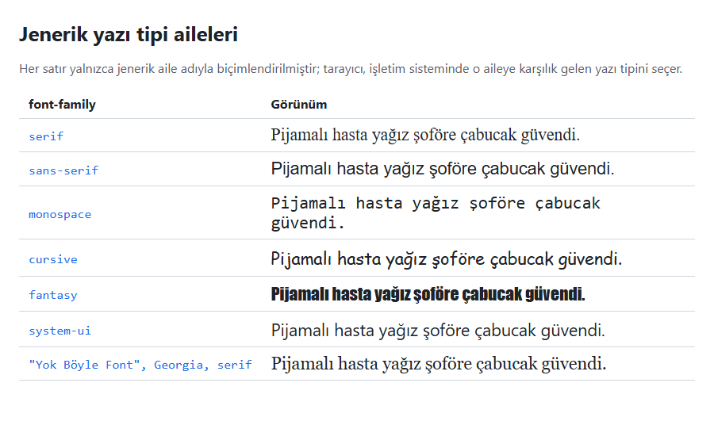

*Şekil 5.2. Jenerik aileler ve bir yazı tipi yığını (Örnek 5.1: [`codes/05-css-metin-renk-arka-plan/ornek-5-1-jenerik-aileler/`](../codes/05-css-metin-renk-arka-plan/ornek-5-1-jenerik-aileler/index.html)).*

Sunumdaki `font-family: Comic Sans, cursive;` kuralında yazı tipinin sistemdeki adı aslında **Comic Sans MS**'tir; `Comic Sans` hiçbir yazı tipiyle eşleşmediğinden tarayıcı doğrudan `cursive` ailesine düşer. Doğru yazım `font-family: "Comic Sans MS", cursive;` biçimindedir. Aynı slayttaki `!important` [Bölüm 4](04-css-temelleri.md)'te, `border-bottom` [Bölüm 6](06-css-kutu-modeli-yerlesim.md)'da ele alınmaktadır; `!important` "hiçbir kuralın ezemeyeceği" mutlak bir öncelik değildir.

### 5.2.2 Web-güvenli yazı tipleri

Web'in ilk yıllarında tasarımcı yalnızca ziyaretçinin bilgisayarında yüklü olan yazı tiplerini kullanabiliyordu. Bu nedenle Windows, macOS ve Linux'ta büyük olasılıkla bulunan Arial, Verdana, Georgia, Times New Roman, Courier New, Trebuchet MS gibi yazı tiplerine **web-güvenli** (web-safe) yazı tipleri denmiştir [4, s. 231]. Sunumda bağlantısı verilen "font stack" makaleleri de bu dönemin ürünüdür.

Günümüzde bu kavram iki nedenle önemini kısmen yitirmiştir. Birincisi, `@font-face` ile istenen yazı tipi sunucudan indirilebilmektedir (bkz. 5.2.4). İkincisi, mobil cihazlar (Android, iOS) masaüstü yazı tiplerinin çoğunu içermez; örneğin bir Android telefonda Verdana bulunmaz. Bu nedenle yığının sonundaki jenerik aile hâlâ vazgeçilmezdir. Yalnızca sistem yazı tiplerini kullanmak isteyen sayfalarda `system-ui` ile başlayan bir "sistem yığını" yaygın bir tercihtir: Hiçbir dosya indirilmeden her platformda doğal görünen bir metin elde edilir.

### 5.2.3 Web yazı tipleri: Google Fonts

Google Fonts, açık lisanslı yüzlerce yazı tipini ücretsiz sunan bir servistir. Sayfanın `<head>` bölümüne servisin ürettiği CSS dosyası bağlanır; ardından yazı tipi adı `font-family` yığınının başına yazılır.

```html
<link rel="preconnect" href="https://fonts.googleapis.com">
<link rel="preconnect" href="https://fonts.gstatic.com" crossorigin>
<link rel="stylesheet"
      href="https://fonts.googleapis.com/css2?family=Inter:wght@400;700&family=Lora:wght@600&display=swap">
<link rel="stylesheet" href="style.css">
```

```css
body { font-family: "Inter", system-ui, Arial, sans-serif; }
h1 { font-family: "Lora", Georgia, serif; }
```

*Kod 5.2. Google Fonts'tan iki yazı tipinin yüklenmesi ve kullanılması.*

Adresteki `css2` servisin güncel CSS API'sidir. `family=Inter:wght@400;700` Inter ailesinin yalnızca 400 ve 700 ağırlıklarını ister; birden çok aile için `family` parametresi tekrarlanır, değişken yazı tiplerinde `wght@100..900` biçiminde aralık da istenebilir. `display=swap`, yazı tipi dosyası inene kadar metnin yedek yazı tipiyle hemen gösterilmesini sağlar ve yavaş bağlantılarda metnin bir süre hiç görünmemesini (FOIT, *flash of invisible text*) önler [5]. `preconnect` ise tarayıcıya iki sunucuyla bağlantı kurmaya erkenden başlamasını söyleyen bir performans ipucudur; yazı tipi dosyaları başka bir kökenden CORS kipinde indirildiği için ikinci satırda `crossorigin` gerekir. Sunumdaki `family=Marko+One&display=swap` örneği bu yapının tek aileli hâlidir; addaki boşluk `+` ile yazılır. İşleyiş Şekil 5.3'te gösterilmiştir.

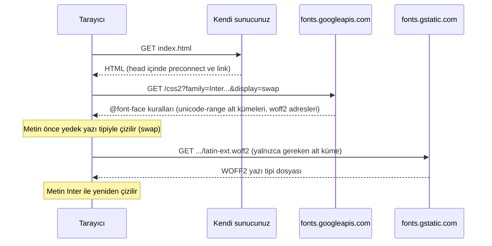

*Şekil 5.3. Google Fonts ile bir yazı tipinin yüklenme sırası.*

Servisin döndürdüğü CSS, yazı tipini `latin`, `latin-ext` gibi Unicode alt kümelerine böler ve tarayıcı yalnızca sayfada geçen karakterlerin dosyalarını indirir. Türkçeye özgü `ğ`, `ş`, `ı`, `İ` karakterleri `latin-ext` alt kümesindedir.

### 5.2.4 `@font-face` ve WOFF2 ile kendi sunucunda barındırma

Yazı tipi dosyası sitenin kendi sunucusuna konup `@font-face` kuralıyla tanımlanabilir [6, s. HTML 118], [3, s. 271]. `@font-face` bir **at-kuralıdır** (at-rule): Sayfaya yeni bir yazı tipi adı kazandırır, kendisi hiçbir öğeyi biçimlendirmez.

```css
@font-face {
  font-family: "Kampus Sans";
  src: url("fonts/kampus-sans-regular.woff2") format("woff2");
  font-weight: 400;
  font-display: swap;
}

@font-face {
  font-family: "Kampus Sans";
  src: url("fonts/kampus-sans-bold.woff2") format("woff2");
  font-weight: 700;
  font-display: swap;
}

body {
  font-family: "Kampus Sans", system-ui, sans-serif;
}
```

*Kod 5.3. Aynı aile adı altında normal ve kalın iki yazı tipi dosyası.*

Günümüzde tek başına sıkıştırılmış **WOFF2** biçimi yeterlidir; eski kaynaklardaki `.eot`, `.svg`, `.ttf` yedekli uzun `src` listeleri artık gerekmez. Aynı aile adı farklı `font-weight` değerleriyle tanımlandığında tarayıcı kalın metin için kalın dosyayı seçer; kalın dosya yoksa harfleri yapay olarak kalınlaştırır ve sonuç çoğu zaman kötü görünür [6, s. HTML 119]. `url()` yolu CSS dosyasının konumuna göre çözülür (bkz. 5.7.2). Her yazı tipi web'de kullanılmak üzere lisanslanmamıştır; dosya sunucuya konmadan önce lisansı okunmalıdır [6, s. HTML 118]. Google Fonts'taki yazı tipleri SIL Open Font License gibi açık lisanslarla dağıtıldığından kendi sunucuda barındırılabilir.

> [!TIP]
> **Güncel hayattan:** Kurumsal kimliği güçlü bankalar, e-ticaret siteleri ve yayın platformları, kendilerine özel tasarlatılmış yazı tiplerini `@font-face` ile kendi sunucularından sunar; böylece logodaki karakter ile sitedeki başlıklar aynı görünür.

### 5.2.5 Değişken yazı tipleri

Geleneksel yöntemde her ağırlık (300, 400, 700 …) ve her eğik sürüm ayrı bir dosyadır. **Değişken yazı tipleri** (variable fonts) ise ağırlık (`wght`), genişlik (`wdth`), eğim (`slnt`) gibi tasarım eksenlerini tek bir dosyada barındırır; tarayıcı bu eksenler üzerindeki herhangi bir ara değeri (ör. `font-weight: 550`) çizebilir [2]. Birden fazla ağırlık kullanan bir sayfada tek değişken dosya, birkaç ayrı dosyadan genellikle daha az veri indirir. `@font-face` içinde bir değişken yazı tipi, ağırlık aralığı verilerek tanımlanır:

```css
@font-face {
  font-family: "Inter";
  src: url("fonts/inter-variable.woff2") format("woff2");
  font-weight: 100 900;
  font-display: swap;
}
```

### 5.2.6 Gizlilik: yazı tiplerini kendi sunucunda barındırmak

Google Fonts bağlantısı içeren bir sayfa açıldığında, ziyaretçinin tarayıcısı Google'ın sunucularına doğrudan istek gönderir; bu istekle birlikte ziyaretçinin IP adresi de üçüncü bir tarafa iletilmiş olur. Münih Bölge Mahkemesi (LG München I), 20 Ocak 2022 tarihli kararında, bir web sitesinin Google Fonts'u ziyaretçinin onayı olmadan Google sunucularından yüklemesinin ziyaretçinin IP adresini Google'a aktardığı için Avrupa Birliği Genel Veri Koruma Tüzüğü'ne (GDPR) aykırı olduğuna hükmetmiş ve site işletmecisini 100 avro tazminat ödemeye mahkûm etmiştir. Kararın gerekçelerinden biri, aynı yazı tiplerinin ziyaretçiyi Google'a bağlamadan, yani kendi sunucudan da kullanılabilmesidir [7].

Türkiye'de kişisel verilerin işlenmesi ve yurt dışına aktarılması 6698 sayılı Kişisel Verilerin Korunması Kanunu (KVKK) ile düzenlenmektedir [8]. Belirli bir kullanım biçiminin hukuki değerlendirmesi bu dersin kapsamı dışındadır; ancak mühendislik açısından şu sonuç çıkarılabilir: Yazı tipi dosyalarını indirip kendi sunucusunda `@font-face` ile barındıran bir site, ziyaretçi verisini gereksiz yere üçüncü taraflarla paylaşmaz, ek bir alan adına bağlantı kurmak zorunda kalmaz ve dış servisin erişilemez olduğu durumlardan etkilenmez. Bu nedenle kurumsal ve kamu sitelerinde yazı tiplerini kendi sunucusunda barındırmak önerilen yaklaşımdır. Ders kapsamındaki küçük alıştırmalarda kolaylık için Google Fonts bağlantısı kullanılabilir.

#### 🛠 Uygulama 5.1: Google Fonts ile Duyuru Sayfası Tipografisi

**Amaç:** Google Fonts'tan iki yazı tipi yükleyip başlık ve gövde metnine farklı yazı tipi yığınları uygulamak.  
**Tahmini süre:** 15 dk

1. VS Code'da `calismalar/bolum-05/uygulama-5-1/` klasörünü (yoksa) oluşturunuz; içinde `index.html` ve `style.css` dosyalarını açınız. `!` + `Tab` ile iskeleti kurup `lang` niteliğini `tr` yapınız.
2. `<body>` içine bir `<article>` ekleyiniz; içinde bir üst başlık (`<p class="ust-baslik">`), `<h1>`, özet paragrafı (`<p class="ozet">`), iki gövde paragrafı, bir `<blockquote>` ve tarih paragrafı bulunsun.
3. [fonts.google.com](https://fonts.google.com) adresinden **Inter** (400, 700) ve **Lora** (600) ailelerini seçiniz. Servisin verdiği `preconnect` ve `stylesheet` bağlantılarını kendi `style.css` bağlantınızdan **önce** `<head>` içine ekleyiniz; adreste `display=swap` bulunmalıdır.
4. `body` için `"Inter", system-ui, "Segoe UI", Arial, sans-serif`; `h1` ve `blockquote` için `"Lora", Georgia, "Times New Roman", serif` yığınını yazınız. Gövdeye `line-height: 1.6`, üst başlığa `text-transform: uppercase; letter-spacing: 0.12em;`, alıntıya `font-style: italic` veriniz.
5. Dosyayı **Live Server** ile açınız (sağ tık → *Open with Live Server*) ve Şekil 5.4 ile karşılaştırınız. F12 → **Network** sekmesinde *Font* filtresiyle indirilen `.woff2` dosyalarını inceleyiniz.

**Beklenen çıktı:**

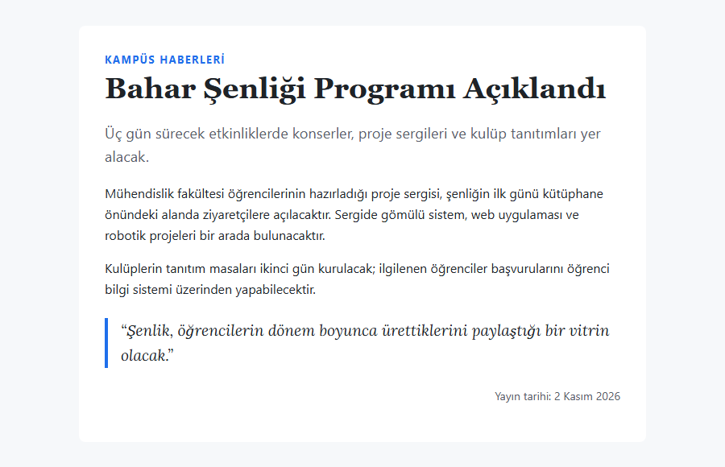

*Şekil 5.4. Uygulama 5.1'in beklenen ekran görüntüsü.*

**Kendinizi sınayın:** (1) Google Fonts bağlantısını yorum satırına alınız; sayfa hangi yazı tiplerine düştü? (2) Network sekmesinde bağlantıyı *Slow 4G* yapıp `display=swap` olan ve olmayan sürümleri karşılaştırınız.

<details><summary>Örnek çözüm</summary>

Çözüm dosyası: [`codes/05-css-metin-renk-arka-plan/uygulama-5-1-tipografi/index.html`](../codes/05-css-metin-renk-arka-plan/uygulama-5-1-tipografi/index.html)

</details>

## 5.3 Yazı Boyutu: `font-size` ve Birimler

`font-size` özelliği metnin boyutunu belirler. Değer bir sayı ve hemen bitişiğindeki bir birimden oluşur. Sayı ile birim arasında **boşluk bırakılamaz**: `font-size: 1.5em;` geçerlidir, `font-size: 1.5 em;` geçersizdir ve tarayıcı bu bildirimi tamamen yok sayar [9]. Bu kural [Bölüm 4](04-css-temelleri.md)'te `margin: 2em` örneğiyle de vurgulanmıştır ve tüm uzunluk değerleri için geçerlidir. CSS birimleri iki gruba ayrılır: mutlak birimler ve göreli birimler [6, ss. HTML 121–123].

*Tablo 5.2. `font-size` için kullanılan başlıca birimler.*

| Birim | Tür | Neye göre? | Tipik kullanım |
|---|---|---|---|
| `px` | Mutlak | CSS pikseli (1px = 1/96 inç) | Kenarlık kalınlığı, küçük ayrıntılar |
| `pt` | Mutlak | Punto (1pt = 1/72 inç; 12pt = 16px) | Baskı stil sayfaları |
| `pc` | Mutlak | Pika (1pc = 12pt = 16px) | Matbaacılık; web'de nadir |
| `em` | Göreli | `font-size` içinde: ebeveynin yazı boyutu; diğer özelliklerde: öğenin kendi yazı boyutu | Bileşen içi boşluklar |
| `%` | Göreli | `font-size` içinde: ebeveynin yazı boyutu | `html { font-size: 100%; }` |
| `rem` | Göreli | Kök öğenin (`html`) yazı boyutu | Yazı boyutları, genel boşluklar |
| `vw` | Göreli | Görüntü alanı (viewport) genişliğinin %1'i | Akışkan başlıklar (`clamp()` ile) |

### 5.3.1 Mutlak birimler: `px`, `pt`, `pc`

CSS'teki `px`, ekrandaki fiziksel bir nokta değil, **referans pikseldir** (reference pixel): 1/96 inç olarak tanımlanır ve yüksek çözünürlüklü ekranlarda birden çok fiziksel noktaya karşılık gelir [9]. Bu tanım sayesinde `16px`, sıradan bir monitörde de yüksek yoğunluklu bir telefon ekranında da benzer okunabilir boyutta görünür. Aynı tanımdan `pt` ile ilişki çıkar: 96px = 72pt olduğundan **16px = 12pt** olur. `pt` ve `pc` birimleri matbaacılıktan gelir; web'de ekran için değil, `@media print` ile yazılan baskı stil sayfalarında anlamlıdır.

### 5.3.2 Göreli birimler: `em`, `%` ve `rem`

`font-size` içinde kullanılan `em` ve `%` birimleri **ebeveyn öğenin yazı boyutuna** göre hesaplanır. Tarayıcıların varsayılan yazı boyutu çoğunlukla 16px olduğundan `body` içinde `1.5em` = `150%` = 24px olur; sunumdaki "Varsayılan 20px ise %50 → 10px" örneği de aynı kuralın uygulamasıdır.

`em` biriminin önemli yan etkisi, iç içe öğelerde **bileşik büyüme** (compounding) göstermesidir: `li { font-size: 1.2em; }` kuralı iç içe listelerde 19,2px → 23,04px → 27,65px şeklinde büyüyen yazılar üretir (Şekil 5.5). Eski kaynaklarda bu sorun her düzey için "hedef ÷ bağlam" hesabıyla çözülür [4, ss. 235–236]; CSS3 ile gelen `rem` (root em) birimi ise her zaman **kök öğenin** (`html`) yazı boyutuna göre hesaplandığından bu hesabı gereksiz kılar [6, s. HTML 122].

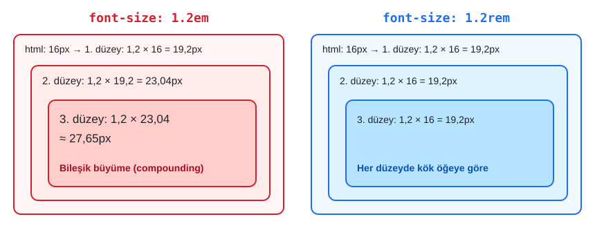

*Şekil 5.5. `em` ile bileşik büyüme ve `rem` ile kök öğeye bağlı sabit boyut.*

Günümüzde yazı boyutları ve genel boşluklar için `rem`, bir bileşenin kendi yazı boyutuyla orantılı kalması gereken iç boşluklar (ör. düğmenin `padding` değeri) için `em` kullanmak yaygın bir uygulamadır:

```css
html { font-size: 100%; }    /* kullanıcının tarayıcı ayarı (çoğunlukla 16px) */
h1 { font-size: 2rem; }      /* 32px */
.not { font-size: 0.875rem; } /* 14px */

.dugme {
  font-size: 1.125rem;
  padding: 0.5em 1em;        /* düğmenin kendi yazı boyutuna göre: 9px 18px */
}
```

*Kod 5.4. `rem` ile yazı boyutları, `em` ile bileşen içi boşluk.*

> [!NOTE]
> **Tarihsel not:** 2012 tarihli kaynaklarda `rem`'in Internet Explorer 8 ve öncesinde desteklenmediği, bu nedenle önce `px` cinsinden yedek değer yazılması gerektiği belirtilir [4, s. 237]. Bu tarayıcılar artık kullanılmadığından `rem` doğrudan kullanılabilir.

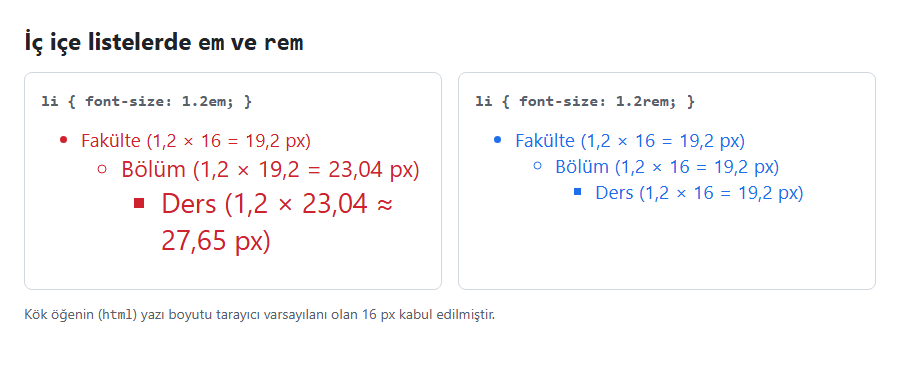

*Şekil 5.6. İç içe listelerde `1.2em` ve `1.2rem` (Örnek 5.2: [`codes/05-css-metin-renk-arka-plan/ornek-5-2-em-rem/`](../codes/05-css-metin-renk-arka-plan/ornek-5-2-em-rem/index.html)).*

Görüntü alanına bağlı `vw` birimi ekranla büyüyen başlıklar için kullanılır; çok dar veya çok geniş ekranlarda aşırı değerler üretmemesi için `clamp()` ile sınırlandırılır: `h1 { font-size: clamp(1.75rem, 4vw, 3rem); }`. Bu teknik [Bölüm 9](09-duyarli-tasarim.md)'da yeniden ele alınacaktır.

### 5.3.3 Erişilebilirlik: kullanıcının yazı boyutu ayarı

Sunumda `px` için "tarayıcı ayarlarından etkilenmez" denmektedir; bu ifade bir ayrım gerektirir. **Sayfa yakınlaştırma** (Ctrl + +) `px` dahil her şeyi orantılı büyütür. **Varsayılan yazı boyutu ayarı** (Chrome'da *Ayarlar → Görünüm → Yazı tipi boyutu*) ise yalnızca kök yazı boyutunu değiştirir; `rem`, `em` ve `%` ile verilen boyutlar bu ayara uyar, **`px` ile verilen yazı boyutları uymaz.** Görme güçlüğü yaşayan pek çok kullanıcı tüm sitelerde kalıcı olan bu ikinci yolu kullanır. WCAG 2.2'nin 1.4.4 *Metni Yeniden Boyutlandırma* ölçütü metnin içerik kaybı olmadan %200'e kadar büyütülebilmesini ister [10]. Bu nedenle kök boyut `html { font-size: 100%; }` bırakılmalı, `16px` veya `62.5%` gibi değerlerle sabitlenmemelidir.

### 5.3.4 Anahtar sözcükler

`font-size` sayısal değer yerine anahtar sözcük de alabilir:

- **Mutlak boyut anahtar sözcükleri:** `xx-small`, `x-small`, `small`, `medium`, `large`, `x-large`, `xx-large`, `xxx-large`. Varsayılan değer `medium`'dur ve kullanıcının tarayıcı ayarına karşılık gelir (çoğunlukla 16px). Sunumdaki `xxlarge` yazımı hatalıdır; doğrusu kısa çizgili `xx-large` biçimindedir.
- **Göreli anahtar sözcükler:** `smaller` ve `larger`, ebeveyne göre bir adım küçük veya büyük boyut verir.
- **Genel anahtar sözcükler:** `inherit` (ebeveynin değerini al), `initial` (özelliğin başlangıç değerine dön), `unset` (kalıtılan özelliklerde `inherit`, diğerlerinde `initial` gibi davran). Bu sözcükler yalnızca `font-size`'a özgü değildir; her CSS özelliğinde kullanılabilir ve ayrıntıları [Bölüm 4](04-css-temelleri.md)'te kalıtım konusunda anlatılmıştır.

#### 🛠 Uygulama 5.2: `rem` ve `em` ile Ölçeklenen Sepet Düğmeleri

**Amaç:** Yazı boyutunu `rem`, iç boşluğu `em` ile vererek orantılı ölçeklenen düğmeler oluşturmak ve `em`'in bileşik büyümesini gözlemlemek.  
**Tahmini süre:** 15 dk

1. `calismalar/bolum-05/uygulama-5-2/` klasöründe `index.html` ve `style.css` dosyalarını oluşturup birbirine bağlayınız.
2. "Favorilere ekle", "Sepete ekle", "Hemen satın al" yazılı üç `<button type="button">` ekleyiniz; üçüne `dugme`, birincisine ek olarak `kucuk`, üçüncüsüne `buyuk` sınıfını veriniz.
3. `html { font-size: 100%; }` yazınız. `.dugme` için `font-size: 1rem; padding: 0.5em 1.25em; border-radius: 0.4em;`, `.kucuk` için `font-size: 0.875rem`, `.buyuk` için `font-size: 1.375rem` tanımlayınız.
4. Altına iç içe üç `<div class="em-kutu">` ve iç içe üç `<div class="rem-kutu">` ekleyip sırasıyla `font-size: 1.25em` ve `font-size: 1.25rem` veriniz.
5. Sayfayı Live Server ile açıp Şekil 5.7 ile karşılaştırınız. Chrome'da yazı tipi boyutu ayarını **Çok büyük** yapıp sayfayı yenileyiniz; sonra ayarı **Orta** konumuna geri getiriniz.

**Beklenen çıktı:**

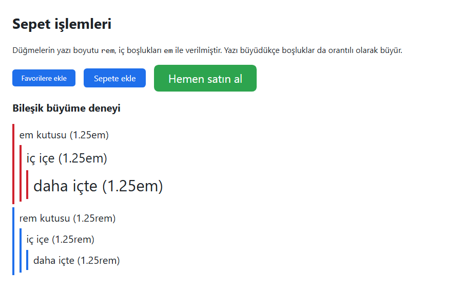

*Şekil 5.7. Uygulama 5.2'nin beklenen ekran görüntüsü.*

**Kendinizi sınayın:** (1) `.dugme` için `padding: 8px 20px` yazınız; büyük düğme neden sıkışık göründü? (2) `html { font-size: 16px; }` yazdığınızda tarayıcı yazı boyutu ayarı hâlâ etkili midir?

<details><summary>Örnek çözüm</summary>

Çözüm dosyası: [`codes/05-css-metin-renk-arka-plan/uygulama-5-2-rem-em/index.html`](../codes/05-css-metin-renk-arka-plan/uygulama-5-2-rem-em/index.html)

</details>

## 5.4 Kalınlık, Eğim ve `font` Kısayolu

### 5.4.1 `font-weight`

`font-weight` özelliği harflerin kalınlığını belirler; `normal`, `bold`, göreli `bolder` / `lighter` sözcüklerini veya 100–900 arasındaki sayıları alır [2], [3, s. 279]. Yaygın adlarıyla 100 *Thin*, 300 *Light*, 400 *Regular* (`normal`), 500 *Medium*, 600 *Semi Bold*, 700 *Bold* (`bold`), 900 *Black* değerleridir. Sayısal ağırlığın görünmesi için o ağırlığın dosyasının yüklenmiş olması gerekir: Uygulama 5.1'de Inter yalnızca 400 ve 700 ile yüklendiğinden `font-weight: 300` yazılırsa en yakın mevcut ağırlık (400) kullanılır. Değişken yazı tiplerinde aralıktaki her değer çizilebilir.

### 5.4.2 `font-style`

`font-style` özelliği `normal`, `italic` veya `oblique` değerlerini alır [3, s. 280]. `italic`, tasarımcının ayrıca çizdiği el yazısı karakterli eğik harfleri; `oblique` ise normal harflerin geometrik olarak eğilmiş hâlini ifade eder. Yazı tipinin italik dosyası yoksa tarayıcı her iki değerde de yapay eğim uygular.

Bu noktada HTML ile CSS arasındaki görev ayrımı hatırlanmalıdır: `<em>` vurgu, `<strong>` güçlü önem bildiren **anlamsal** öğelerdir; tarayıcılar bunları varsayılan olarak italik ve kalın gösterir. Yalnızca görünüm için eğik veya kalın yazı gerekiyorsa anlamsal öğe yerine CSS (`font-style`, `font-weight`) kullanılmalıdır. Sunumdaki `strong { font-style: italic; }` örneği teknik olarak geçerlidir: Bu kural `<strong>` öğesinin varsayılan kalınlığını korur ve ona ayrıca eğiklik ekler.

### 5.4.3 `font-variant`

`font-variant` özelliğinin en çok bilinen değeri `small-caps`'tir: küçük harfler, büyük harf biçiminde ama küçük harf yüksekliğinde çizilir. Kısaltmalarda ve başlık üstü etiketlerde kullanılır. CSS Fonts Level 4 bu özelliği `font-variant-numeric` (ör. tablo rakamları için `tabular-nums`) ve `font-variant-ligatures` gibi alt özelliklere genişletmiştir [2].

```css
.kisaltma {
  font-variant: small-caps;
}

.fiyat-tablosu td {
  font-variant-numeric: tabular-nums; /* rakamlar eşit genişlikte, sütunlar hizalı */
}
```

### 5.4.4 `font` kısayolu

`font` kısayol özelliği (shorthand), yazı tipiyle ilgili birçok özelliği tek bildirimde toplar:

```css
/* font: [style] [variant] [weight] size[/line-height] family; */
p {
  font: italic bold 1rem/1.5 "Inter", Arial, sans-serif;
}
```

*Kod 5.5. `font` kısayolunun yapısı.*

Kısayolun kuralları şunlardır [2]:

- `font-size` ve `font-family` **zorunludur**; biri eksikse bildirim tamamen geçersiz olur.
- `font-style`, `font-variant` ve `font-weight` isteğe bağlıdır ve `font-size`'dan **önce** gelmelidir (bu üçü kendi aralarında herhangi bir sırada yazılabilir).
- `line-height` istenirse `font-size`'dan hemen sonra eğik çizgiyle (`/`) yazılır.
- `font-family` her zaman **en sonda** yer alır.
- Kısayolda yazılmayan alt özellikler başlangıç değerlerine (`normal`) **sıfırlanır**. Örneğin önce `line-height: 1.8;`, sonra `font: 1rem Arial, sans-serif;` yazılırsa satır aralığı `normal`'e döner. Bu, kısayolların genel bir özelliğidir ve 5.7.7'de `background` kısayolunda da karşımıza çıkacaktır.

## 5.5 Metin Biçimlendirme Özellikleri

Yazı tipinin kendisinden bağımsız olarak, satırların ve harflerin yerleşimi de CSS ile denetlenir. Bu özellikler *CSS Text* ve *CSS Text Decoration* modüllerinde tanımlanır [11], [12]. Şekil 5.9'da bu bölümde anlatılan özelliklerin çoğu tek sayfada gösterilmektedir.

### 5.5.1 `line-height`

`line-height` özelliği satır yüksekliğini, dolayısıyla ardışık satırlar arasındaki aralığı belirler; matbaacılıkta bu aralığa *leading* denir [3, s. 283]. Uzun gövde metinlerinde 1,4–1,7 arası bir değer okunabilirliği artırır. WCAG 2.2'nin 1.4.12 *Metin Aralığı* ölçütü de kullanıcının satır yüksekliğini yazı boyutunun en az 1,5 katına çıkardığı durumda içeriğin bozulmamasını ister [10].

Sunumda satır aralığı için üç yazım eş değer gibi verilmiştir: `line-height: 2;`, `line-height: 2em;` ve `line-height: 200%;`. Bu üç değer **tek bir öğe için** aynı sonucu verir; fark, değerin çocuk öğelere nasıl kalıtıldığında ortaya çıkar [13]:

- **Birimsiz sayı (`2`):** Çocuk öğeye bir **çarpan** olarak geçer; her öğe bu çarpanı kendi yazı boyutuyla çarpar.
- **`2em` veya `200%`:** Ebeveynde bir **piksel değerine** dönüştürülür ve çocuk öğeye bu sabit piksel değeri kalıtılır.

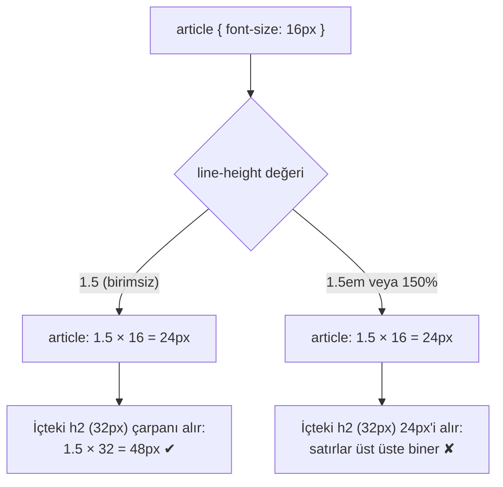

*Şekil 5.8. `line-height` değerinin birimsiz ve birimli yazımlarda kalıtılma farkı.*

Bu nedenle `line-height` için birimsiz değer önerilir [13]:

```css
body {
  line-height: 1.6;   /* önerilen: birimsiz */
}

h1,
h2 {
  line-height: 1.2;   /* büyük başlıklarda daha sıkı */
}
```

### 5.5.2 `text-indent` ve `text-align`

`text-indent` bir bloğun **yalnızca ilk satırını** içeri (pozitif değer) veya dışarı (negatif değer) kaydırır: `p { text-indent: 2em; }` [6, s. HTML 125]. Web'de paragraflar genellikle girinti yerine aralarındaki boşlukla ayrılır; girinti daha çok kitap benzeri uzun metinlerde kullanılır.

`text-align` satırları yatayda hizalar: `left`, `right`, `center`, `justify` (iki yana yaslı; son satır hariç) ve yazı yönüne göre çalışan **mantıksal** `start` / `end` değerleri [6, s. HTML 128], [11]. Sunumdaki "5 seçenek" listesinde yer alan `inherit` bir hizalama türü değil, her özellikte kullanılabilen genel bir anahtar sözcüktür. Soldan sağa yazılan Türkçede `start` sola, Arapçada sağa karşılık geldiği için çok dilli sitelerde `start` / `end` önerilir. `text-align` yalnızca öğenin **içindeki** satır içi içeriği hizalar; kutunun kendisini ortalamak [Bölüm 6](06-css-kutu-modeli-yerlesim.md)'nın konusudur.

> [!IMPORTANT]
> `justify` dar sütunlarda kelimeler arasında göze batan boşluklar oluşturabilir; uzun sözcükleri olan Türkçede bu etki belirgindir. `<html lang="tr">` ile birlikte `hyphens: auto;` tarayıcının heceleme yapmasını sağlayabilir, ancak sonuç denetlenmelidir.

### 5.5.3 `text-decoration`

`text-decoration`, metne çizgi süslemesi ekleyen bir kısayoldur ve dört alt özelliği vardır [12], [3, s. 282]: `text-decoration-line` (`none`, `underline`, `overline`, `line-through`; birden fazlası birlikte yazılabilir), `text-decoration-style` (`solid`, `double`, `dotted`, `dashed`, `wavy`), `text-decoration-color` (varsayılan: metin rengi) ve `text-decoration-thickness`.

```css
a {
  text-decoration: underline;
  text-decoration-thickness: 2px;
  text-underline-offset: 3px;   /* çizgiyi harflerden uzaklaştırır */
}

.hata { text-decoration: underline wavy #cf222e; }
.eski-fiyat { text-decoration: line-through; }
```

*Kod 5.6. `text-decoration` kullanım örnekleri.*

Sunumda `linethrough` olarak geçen değerin doğru yazımı `line-through`'dur. En sık rastlanan bildirim, bağlantıların alt çizgisini kaldıran `a { text-decoration: none; }` kuralıdır.

> [!WARNING]
> Alt çizgisi kaldırılan bağlantı çevresindeki metinden yalnızca renkle ayrılır; bu, renk körlüğü olan kullanıcılar için yetersizdir. WCAG 2.2'nin 1.4.1 *Rengin Kullanımı* ölçütü bilginin yalnızca renkle aktarılmamasını ister [10]. Gövde metnindeki bağlantılarda alt çizgi korunmalı, menü gibi yerlerde kaldırılırsa `:hover` ve `:focus-visible` durumlarında görsel bir değişiklik sağlanmalıdır.

> [!NOTE]
> **Tarihsel not:** Sunumdaki `blink` değeri metni yanıp söndürmek için tanımlanmıştı. Kullanıcıyı rahatsız ettiği ve ışığa duyarlı kişilerde sağlık riski oluşturabildiği için tarayıcılar bu değeri uygulamaz; standart da yanıp sönme efekti gösterilmemesine izin verir [12]. HTML'deki `<blink>` öğesi de tamamen kaldırılmıştır.

### 5.5.4 `text-transform` ve Türkçe büyük harf dönüşümü

`text-transform`, kaynak metni değiştirmeden görüntülenen metnin harf durumunu dönüştürür: `uppercase` (TÜMÜ BÜYÜK), `lowercase` (tümü küçük), `capitalize` (Her Sözcüğün İlk Harfi Büyük) ve kalıtılan dönüşümü iptal eden `none` [4, ss. 252–253], [3, s. 281]. Dönüşüm yalnızca görünümü değiştirdiğinden ekran okuyucular ve kopyalama işlemi özgün metni kullanır; başlıkları kaynakta büyük harfle yazmak yerine bu özelliği kullanmak daha doğrudur.

Türkçede `i` → `İ`, `ı` → `I` dönüşümü yapılırken İngilizcede `i` → `I` yapılır. CSS standardı dönüşümün öğenin **diline** göre yapılmasını öngörür [11]; dil HTML'deki `lang` niteliğinden okunur. `<html lang="tr">` tanımlanmamış ya da `lang="en"` bırakılmışsa "istanbul" sözcüğü "ISTANBUL" olarak, yani Türkçe okur için "ıstanbul"un büyük hâli olarak görüntülenir.

```html
<p lang="tr" class="buyuk">istanbul, izmir, ılgaz</p>  <!-- İSTANBUL, İZMİR, ILGAZ -->
<p lang="en" class="buyuk">istanbul, izmir, ılgaz</p>  <!-- ISTANBUL, IZMIR, ILGAZ -->
```

Şekil 5.9'daki "text-transform" kutusu bu farkı göstermektedir. Aynı kutunun son satırı ayrıca dikkat çekicidir: Ekran görüntüsünün alındığı Chrome 156'da `capitalize`, `lang="tr"` tanımlı olmasına karşın "iğneada" sözcüğünü "Iğneada" olarak dönüştürmüştür; `uppercase` Türkçe kurala uyarken `capitalize` uymamaktadır. Türkçe içerikte `capitalize` kullanılacaksa sonuç farklı tarayıcılarda denetlenmeli, gerekirse ilk harfler kaynakta doğru yazılmalıdır.

> [!IMPORTANT]
> Türkçe sayfalarda `<html lang="tr">` yalnızca arama motorları ve ekran okuyucular için değil, `text-transform` ve `hyphens` gibi dile duyarlı CSS davranışları için de gereklidir.

### 5.5.5 `letter-spacing` ve `word-spacing`

`letter-spacing` harfler arasındaki, `word-spacing` sözcükler arasındaki boşluğa **eklenen** miktarı belirler; varsayılan değer `normal`'dir [3, s. 284]. Değer negatif de olabilir. Değeri `em` cinsinden vermek, aralığın yazı boyutuyla orantılı kalmasını sağlar.

```css
.ust-baslik {
  text-transform: uppercase;
  letter-spacing: 0.12em;   /* büyük harfli kısa etiketlerde okunabilirliği artırır */
}

h1 {
  letter-spacing: -0.01em;  /* büyük başlıklarda hafif sıkılaştırma */
}
```

Büyük harfle yazılmış kısa metinlerde (menü, etiket, üst başlık) hafif bir harf aralığı okunabilirliği artırır; gövde metninde ise harf aralığıyla oynamaktan genellikle kaçınılır.

### 5.5.6 `text-shadow`

`text-shadow` özelliği metne gölge ekler. Değer sırası şöyledir: yatay kayma, dikey kayma, isteğe bağlı bulanıklık yarıçapı ve renk [12]:

```css
h1 {
  text-shadow: 2px 2px 4px rgb(0 0 0 / 0.4);
  /*           yatay dikey bulanıklık renk */
}
```

Pozitif yatay değer gölgeyi sağa, pozitif dikey değer aşağıya kaydırır; bulanıklık yazılmazsa gölge keskin olur. Virgülle ayrılan **birden çok gölge** tek öğeye uygulanabilir; ilk yazılan gölge en üstte çizilir. Sunumdaki örnekler (çoklu gölge, dış parıltı, kabartma ve gömme görünümü) bu çoklu gölge tekniğine dayanır [4, ss. 254–256]:

- **Dış parıltı (glow):** Kayması sıfır, bulanıklığı büyük tek gölge: `0 0 0.4em #8250df`.
- **Kabartma (raised):** Sol-üste açık renk, sağ-alta koyu renk gölge; ışığın sol üstten geldiği izlenimi verir.
- **Gömme (embossed):** Kabartmanın tersi; sol-üste koyu, sağ-alta açık renk gölge.

Sunumda `text-shadow`'un "CSS3 ile ortaya çıktığı" belirtilmektedir. Daha kesin ifadeyle bu özellik ilk olarak 1998'de CSS2'de tanımlanmış, tarayıcı desteği yetersiz kaldığı için CSS 2.1'den çıkarılmış ve CSS3 döneminde *CSS Text Decoration* modülüyle yeniden standartlaşarak yaygın destek kazanmıştır.

> [!WARNING]
> Gölge, metnin okunabilirliğini artırmak (ör. fotoğraf üzerindeki beyaz yazının arkasına koyu, yumuşak bir gölge) için kullanıldığında yararlıdır. Gövde metnine uygulanan belirgin gölgeler ise harfleri bulanıklaştırır ve okumayı zorlaştırır.

### 5.5.7 `white-space` ve `text-overflow`

HTML'de ardışık boşluklar ve satır sonları tek bir boşluğa indirgenir. `white-space` özelliği bu davranışı değiştirir: `nowrap` metnin satır sonunda kırılmasını engeller, `pre` boşlukları ve satır sonlarını kaynak koddaki gibi korur, `pre-wrap` hem korur hem de gerektiğinde satırı kaydırır.

`text-overflow: ellipsis` ise kutusuna sığmayan tek satırlık metnin sonunu üç noktayla (…) keser. E-ticaret sitelerinde uzun ürün adlarının listede tek satırda gösterilmesi bu yöntemle yapılır. Çalışması için üç bildirim birlikte gerekir:

```css
.urun-adi {
  white-space: nowrap;      /* tek satırda tut */
  overflow: hidden;         /* taşan kısmı gizle (Bölüm 6) */
  text-overflow: ellipsis;  /* kesilen yere … koy */
}
```

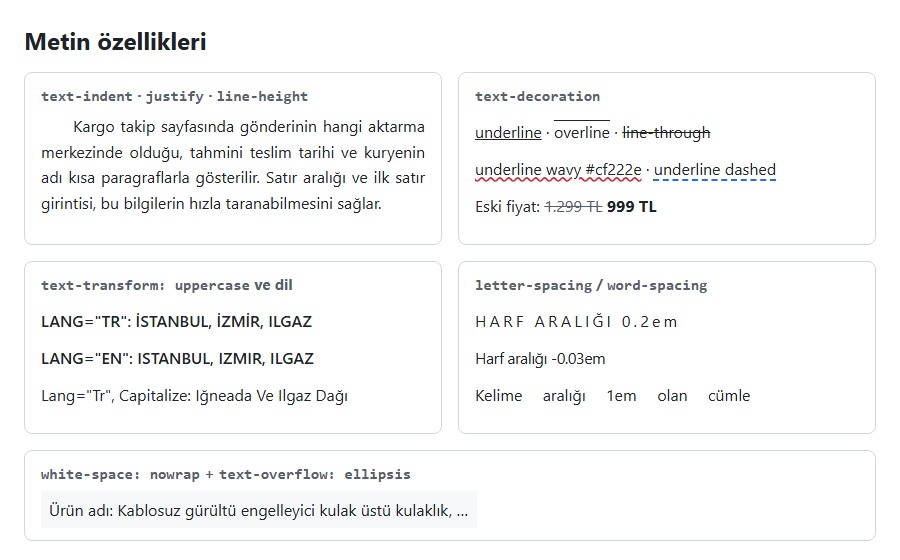

*Şekil 5.9. Metin özellikleri (Örnek 5.3: [`codes/05-css-metin-renk-arka-plan/ornek-5-3-metin-ozellikleri/`](../codes/05-css-metin-renk-arka-plan/ornek-5-3-metin-ozellikleri/index.html)).*

#### 🛠 Uygulama 5.3: `text-shadow` ile Başlık Efektleri

**Amaç:** Tek ve çoklu `text-shadow` değerleriyle altı farklı başlık efekti üretmek.  
**Tahmini süre:** 15 dk

1. `calismalar/bolum-05/uygulama-5-3/` klasöründe `index.html` ve `style.css` dosyalarını oluşturunuz.
2. `<main class="izgara">` içine altı `<section>` ekleyiniz; her birinde "Kampüs Radyosu" yazan bir `<h2>` ve gölge değerini gösteren bir `<p><code>…</code></p>` bulunsun. İlk üçüne `acik`, sonraki ikisine `leylak`, sonuncusuna `koyu` sınıfını veriniz.
3. `.izgara` için `display: grid; grid-template-columns: repeat(3, 1fr); gap: 16px;` yazınız (ızgara Bölüm 6'da anlatılacaktır). `.leylak` için `background-color: thistle;`, `.koyu` için `background-color: #0d1117;` veriniz.
4. Başlıklara sırasıyla şu gölgeleri uygulayınız: basit `2px 2px 4px rgb(0 0 0 / 0.4)`; çoklu `-0.07em -0.05em 0.02em silver, 0.02em 0.02em 0.01em gray`; parıltı `0 0 0.4em #8250df`; kabartma `-0.05em -0.05em 0.05em #fff, 0.03em 0.03em 0.05em #6e40c9`; gömme (kabartmanın renkleri yer değiştirmiş hâli); neon `0 0 4px #fff, 0 0 12px #1f6feb, 0 0 24px #1f6feb` (beyaz metinle).
5. Sonucu Live Server ile açıp Şekil 5.10 ile karşılaştırınız.

**Beklenen çıktı:**

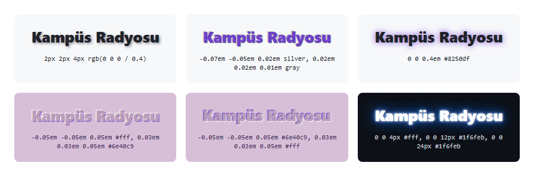

*Şekil 5.10. Uygulama 5.3'ün beklenen ekran görüntüsü.*

**Kendinizi sınayın:** (1) Neon efektindeki gölgelerin sırasını tersine çevirince görünüm değişiyor mu? (2) Gölge kaymalarını `px` ile yazıp başlığın `font-size` değerini iki katına çıkarınız; hangi yazım ölçeklenmeye daha uygun?

<details><summary>Örnek çözüm</summary>

Çözüm dosyası: [`codes/05-css-metin-renk-arka-plan/uygulama-5-3-metin-golgesi/index.html`](../codes/05-css-metin-renk-arka-plan/uygulama-5-3-metin-golgesi/index.html)

</details>

## 5.6 Renkler

CSS'te metin rengi `color`, arka plan rengi `background-color` özelliğiyle verilir; kenarlık, gölge ve çizgi renkleri de aynı renk değerlerini kullanır. Renk değerleri W3C'nin *CSS Color* modülünde tanımlanmıştır [14]. Ekranlar rengi kırmızı (R), yeşil (G) ve mavi (B) ışığın karışımıyla oluşturur; CSS'teki renk gösterimlerinin çoğu bu üç bileşeni farklı biçimlerde yazmanın yollarıdır [3, ss. 246–251].

*Tablo 5.3. Aynı rengin (royalblue) farklı CSS gösterimleri.*

| Gösterim | Örnek | Not |
|---|---|---|
| Ad | `royalblue` | 148 tanımlı ad |
| Onaltılık | `#4169e1` | `#RRGGBB` |
| Kısa onaltılık | `#46e` | `#RGB` → `#4466ee` (yalnızca yakın bir ton) |
| Alfalı onaltılık | `#4169e180` | `#RRGGBBAA`; `80` ≈ %50 opaklık |
| `rgb()` | `rgb(65 105 225)` | Eski yazım: `rgb(65, 105, 225)` |
| `rgb()` + alfa | `rgb(65 105 225 / 50%)` | Eski yazım: `rgba(65, 105, 225, 0.5)` |
| `hsl()` | `hsl(225 73% 57%)` | Ton, doygunluk, açıklık |
| `oklch()` | `oklch(57.5% 0.188 267)` | Algısal açıklık, kroma, ton |

### 5.6.1 Adlandırılmış renkler

CSS, `red`, `navy`, `coral`, `royalblue`, `rebeccapurple` gibi **148 adlandırılmış renk** tanımlar [14]. Kitaplarda bu sayı 140 olarak geçer [4, s. 267]; aradaki fark, sonradan eklenen `rebeccapurple` ve bazı eş anlamlı adlardan (`grey` / `gray` gibi) kaynaklanır. Adlar hızlı denemeler için kullanışlıdır ancak marka renkleri gibi belirli tonlar için yetersizdir; bu nedenle gerçek projelerde sayısal gösterimler tercih edilir.

### 5.6.2 Onaltılık (hex) gösterim

Onaltılık gösterimde renk `#` işaretinden sonra üç çift onaltılık basamakla yazılır: `#RRGGBB`. Her çift, ilgili bileşenin 0 (`00`) ile 255 (`FF`) arasındaki değeridir [3, s. 249]. Şekil 5.11'de `#1F6FEB` kodunun çözümlenmesi gösterilmiştir.

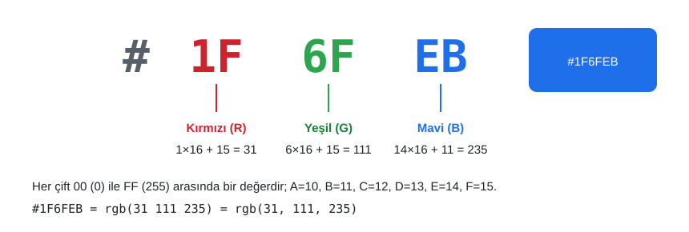

*Şekil 5.11. `#1F6FEB` kodunun anatomisi.*

Her çiftin iki basamağı aynıysa kısa yazım kullanılabilir: `#666666` → `#666`, `#ffcc00` → `#fc0`. Sunumdaki `color: #666;` örneği bu kısaltmadır ve `gray` ile aynı değildir: `gray` = `#808080` iken `#666` daha koyu bir gridir. CSS Color Level 4 ile dördüncü bir çift eklenerek alfa (opaklık) bileşeni de yazılabilir: `#RRGGBBAA` veya kısa `#RGBA` [14]. Onaltılık gösterimde büyük/küçük harf farkı yoktur.

> [!NOTE]
> **Tarihsel not:** 1990'larda pek çok ekran yalnızca 256 renk gösterebildiğinden tasarımcılar her bileşeni yalnızca `00`, `33`, `66`, `99`, `CC` ve `FF` değerlerinden biri olan 216 renklik **web-güvenli palete** (web-safe palette) bağlı kalırdı [15, s. 139]. Günümüz ekranları milyonlarca renk gösterdiğinden bu kısıt geçerliliğini yitirmiştir.

### 5.6.3 `rgb()` ve alfa kanalı

`rgb()` fonksiyonu üç bileşeni ondalık sayılarla (0–255) veya yüzdeyle alır. CSS Color Level 4 ile virgülsüz, boşlukla ayrılmış yeni bir sözdizimi tanımlanmıştır; alfa değeri eğik çizgiden sonra 0–1 arası bir sayı ya da yüzde olarak yazılır [14]:

```css
h1 { color: rgb(31 111 235); }               /* güncel yazım */
h1 { color: rgb(31, 111, 235); }             /* eski (virgüllü) yazım, hâlâ geçerli */
.ortu { background-color: rgb(0 0 0 / 0.6); } /* %60 opak siyah */
.ortu { background-color: rgba(0, 0, 0, 0.6); } /* aynı rengin eski yazımı */
```

Alfa (alpha) kanalı rengin opaklığını belirler: 0 tamamen saydam, 1 tamamen opaktır [4, s. 271], [3, s. 254]. Eski sözdizimindeki `rgba()` ve `hsla()` fonksiyonları güncel standartta `rgb()` ve `hsl()`'nin eş anlamlısıdır; yeni kodda doğrudan `rgb(… / alfa)` yazılabilir.

### 5.6.4 `hsl()` ve `oklch()`

`hsl()` gösteriminde renk, insanın rengi algılama biçimine daha yakın üç bileşenle tanımlanır [6, s. HTML 99], [3, ss. 255–256]:

- **Ton (hue):** Renk çemberindeki açı, 0–360 derece (0 kırmızı, 120 yeşil, 240 mavi).
- **Doygunluk (saturation):** %0 gri, %100 tam canlı renk.
- **Açıklık (lightness):** %0 siyah, %50 saf renk, %100 beyaz.

`hsl()`'nin pratik avantajı, aynı tonun açık ve koyu varyasyonlarını kolayca üretebilmesidir: `hsl(215 80% 45%)` ana renk, `hsl(215 80% 92%)` aynı mavinin çok açık bir arka plan tonu olarak kullanılabilir. Pek çok tasarımcı bu nedenle renk şemalarını HSL ile kurar [6, s. HTML 104].

HSL'nin bir zayıflığı, "açıklık" değerinin insan gözünün algısıyla tutarlı olmamasıdır: `hsl(60 100% 50%)` (sarı) ile `hsl(240 100% 50%)` (mavi) aynı açıklık değerine sahip olduğu hâlde sarı çok daha parlak algılanır. CSS Color Level 4 ile gelen **`oklch()`** fonksiyonu algısal olarak tekdüze (perceptually uniform) bir renk uzayı kullanır: Açıklık (L) değeri aynı olan renkler göze de eşit parlaklıkta görünür; kroma (C) renk canlılığını, ton (H) açıyı belirtir [14]. Bu özellik, erişilebilir kontrastlı renk paletleri üretmeyi kolaylaştırır. `oklch()` 2023'ten bu yana tüm güncel tarayıcılarda desteklenmektedir; giriş düzeyinde `hsl()` bilmek yeterlidir.

### 5.6.5 `currentColor` ve `transparent`

İki özel renk anahtar sözcüğü sıkça kullanılır [14]:

- **`currentColor`:** Öğenin o anki `color` değerini ifade eder. Kenarlık, ikon veya çizgi rengini metin rengine bağlamak için kullanılır; metin rengi değiştiğinde bunlar da otomatik olarak değişir: `.etiket { color: #1f6feb; border: 2px solid currentColor; }`. Bir değer yazılmadığında `border-color` ve `text-decoration-color` zaten varsayılan olarak `currentColor` kullanır.
- **`transparent`:** Tamamen saydam renk (`rgb(0 0 0 / 0)`); `background-color` özelliğinin başlangıç değeridir.

### 5.6.6 `opacity` ile yarı saydam renk arasındaki fark

`opacity` özelliği bir öğeyi **içeriğiyle birlikte** saydamlaştırır; değer 0 (görünmez) ile 1 (tam opak) arasındadır [14], [3, s. 254]. Sunumdaki örnekte (`opacity: .25`, `.5`, `1`) yeşil başlığın hem arka planı hem de metni birlikte soluklaşmaktadır. Bu davranış çoğu zaman istenen sonuç değildir: Yalnızca arka planın saydam olması, metnin ise tam okunaklı kalması gerekir. Bu durumda `opacity` yerine **alfalı bir arka plan rengi** kullanılmalıdır.

```css
/* Kutu, metin ve içindeki her şey %50 saydam */
.kart-a {
  background-color: #ffffff;
  opacity: 0.5;
}

/* Yalnızca arka plan %50 saydam; metin tam opak */
.kart-b {
  background-color: rgb(255 255 255 / 0.5);
}
```

*Kod 5.7. `opacity` ve alfalı arka plan rengi.*

`opacity` çocuk öğelere bir **kalıtım** gibi değil, bir **birleştirme** (compositing) işlemi olarak etki eder: Öğe ve tüm çocukları önce birlikte çizilir, sonra tek bir katman olarak saydamlaştırılır. Bu nedenle çocuk öğeye `opacity: 1` yazmak onu yeniden opak yapmaz. Şekil 5.12'nin alt bölümünde bu fark görülmektedir: Soldaki kartta kırmızı "Yeni" rozeti de soluklaşmış, sağdaki kartta ise yalnızca arka plan saydamlaşmıştır.

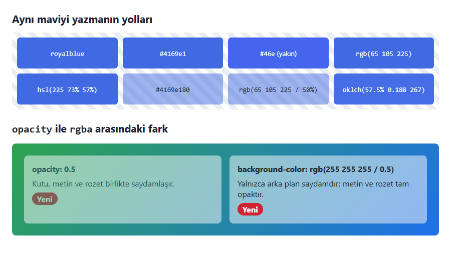

*Şekil 5.12. Renk gösterimleri ile `opacity` ve `rgb(… / alfa)` farkı (Örnek 5.4: [`codes/05-css-metin-renk-arka-plan/ornek-5-4-renk-yazimlari/`](../codes/05-css-metin-renk-arka-plan/ornek-5-4-renk-yazimlari/index.html)).*

### 5.6.7 Kontrast ve erişilebilirlik (WCAG 2.2)

Metin ile arka plan arasında yeterli **kontrast** bulunmaması okunabilirliği en sık bozan tasarım hatasıdır [3, s. 253]. WCAG 2.2'nin 1.4.3 *Kontrast (Asgari)* ölçütü (AA düzeyi) kontrast oranının normal metinde **en az 4,5:1**, büyük metinde (en az 18 punto ≈ 24px veya kalın 14 punto ≈ 18,66px) **en az 3:1** olmasını ister; AAA düzeyindeki 1.4.6 ölçütü bu sınırları 7:1 ve 4,5:1'e yükseltir. Oran, iki rengin göreli parlaklıklarından hesaplanır ve 1:1 ile 21:1 (siyah–beyaz) arasında değişir [10]. Örneğin beyaz zemin üzerinde `#767676` gri yaklaşık 4,5:1 ile sınırı ancak geçerken `#999999` yaklaşık 2,8:1 ile gövde metni için yetersizdir.

Kontrast oranı tarayıcıda doğrudan ölçülebilir: Chrome'da öğe seçilip **Styles** panelindeki renk kutucuğuna tıklandığında açılan renk seçici, oranı ve AA/AAA eşiklerini gösterir. Sunumda renk kodu almak için önerilen harici "color picker" siteleri yerine bu yerleşik araç kullanılabilir [3, s. 251].

> [!WARNING]
> Kontrast, arka plan görseli ve gradyan üzerindeki metinlerde de sağlanmalıdır. Görselin en açık bölgesi yeterli kontrast vermiyorsa metnin arkasına yarı saydam koyu bir katman (`rgb(0 0 0 / 0.5)`) veya yarı saydam açık bir kutu konmalıdır (bkz. Uygulama 5.6).

> [!TIP]
> **Güncel hayattan:** Kamu kurumlarının ve bankaların sitelerinde sıkça görülen "yüksek kontrast" ve "yazıyı büyüt" düğmeleri, genellikle CSS değişkenlerinin değerlerini değiştirerek çalışır (bkz. 5.6.8).

### 5.6.8 CSS özel özellikleri ile renk teması

Bir sitede aynı renk onlarca kuralda tekrarlanır; rengi değiştirmek için her kuralı düzeltmek zahmetli ve hataya açıktır. **CSS özel özellikleri** (custom properties), yaygın adıyla **CSS değişkenleri**, bu sorunu çözer [16]:

```css
:root {                     /* 1. Değişkenler kök öğede tanımlanır */
  --ana-renk: #0969da;
  --metin: #1f2328;
  --zemin: #ffffff;
}

body {                      /* 2. var() ile kullanılır */
  color: var(--metin);
  background-color: var(--zemin);
}

.dugme {
  background-color: var(--ana-renk);
}

.koyu {                     /* 3. Bir kapsamda yeniden tanımlanır */
  --metin: #e6edf3;
  --zemin: #0d1117;
  --ana-renk: #4493f8;
}
```

*Kod 5.8. CSS özel özellikleriyle renk teması.*

Özel özellik adı iki kısa çizgiyle başlar ve büyük/küçük harfe duyarlıdır. `:root` belge kökünü (`html`) seçer; burada tanımlanan değişkenler kalıtım yoluyla tüm sayfada kullanılabilir. `var(--ad, yedek)` biçiminde, değişken tanımlı değilse kullanılacak bir yedek değer verilebilir. Değişkenler kalıtıldığı için `.koyu` gibi bir kapsayıcıda yeniden tanımlanan değerler yalnızca o kapsayıcının içini etkiler; Uygulama 5.4'te aynı bileşenin açık ve koyu iki kopyası bu yöntemle yan yana gösterilmektedir.

Temanın işletim sisteminin koyu mod ayarına göre seçilmesi için `prefers-color-scheme` ortam sorgusu kullanılır [17]: `@media (prefers-color-scheme: dark) { :root { --metin: #e6edf3; --zemin: #0d1117; } }`. Değişkenlerin JavaScript ile değiştirilerek bir "tema düğmesi" yapılması [Bölüm 8](08-javascript-dom-olaylar.md)'de, ortam sorguları [Bölüm 9](09-duyarli-tasarim.md)'da ele alınmaktadır.

#### 🛠 Uygulama 5.4: CSS Değişkenleriyle Açık ve Koyu Tema

**Amaç:** Bir banka hesap kartının renklerini CSS özel özellikleriyle tanımlamak ve yalnızca değişkenleri değiştirerek koyu tema üretmek.  
**Tahmini süre:** 20 dk

1. `calismalar/bolum-05/uygulama-5-4/` klasöründe `index.html` ve `style.css` dosyalarını oluşturunuz.
2. `yan-yana` sınıflı bir `<div>` içine iki `<section class="ekran">` ekleyiniz; ikincisine ek olarak `koyu` sınıfını veriniz. Her bölümde aynı kartı oluşturunuz: "Vadesiz Hesap" etiketi, `12.450,75 TL` bakiye, son işlem açıklaması ve "Para gönder" / "Fatura öde" bağlantıları.
3. `:root` içinde `--zemin`, `--yuzey`, `--metin`, `--ikincil-metin`, `--ana-renk`, `--ana-renk-ustu`, `--kenar` değişkenlerini açık tema değerleriyle tanımlayınız; `.koyu` kuralında **yalnızca** aynı değişkenleri koyu değerlerle yeniden tanımlayınız.
4. Bileşen kurallarında sabit renk kodu kullanmadan yalnızca `var(--…)` ile renk veriniz; ikincil düğmenin arka planını `transparent`, metin rengini `var(--ana-renk)` yapınız.
5. Live Server ile açıp Şekil 5.13 ile karşılaştırınız; renk seçiciyle ikincil metin renginin kontrast oranının 4,5:1'in üzerinde olduğunu doğrulayınız.

**Beklenen çıktı:**

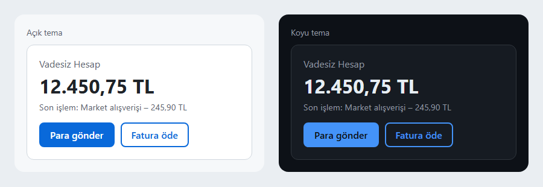

*Şekil 5.13. Uygulama 5.4'ün beklenen ekran görüntüsü.*

**Kendinizi sınayın:** (1) `--ana-renk` değerini yeşil bir tonla değiştiriniz; kaç kuralı düzenlemeniz gerekti? (2) `prefers-color-scheme: dark` sorgusunu ekleyip işletim sisteminizi koyu moda alarak sonucu gözlemleyiniz.

<details><summary>Örnek çözüm</summary>

Çözüm dosyası: [`codes/05-css-metin-renk-arka-plan/uygulama-5-4-renk-temasi/index.html`](../codes/05-css-metin-renk-arka-plan/uygulama-5-4-renk-temasi/index.html)

</details>

## 5.7 Arka Plan

Her öğenin içerik, iç boşluk (padding) ve kenarlık alanının arkasında bir arka plan katmanı bulunur. Bu katman bir renk, bir veya daha fazla görsel ya da gradyan içerebilir. Arka plan özellikleri W3C'nin *CSS Backgrounds and Borders* modülünde tanımlanmıştır [18]; hiçbiri kalıtılmaz.

> [!IMPORTANT]
> **İçerik görseli mi, dekoratif görsel mi?** Ürün fotoğrafı, haber görseli, grafik gibi sayfanın anlamına katkıda bulunan görseller HTML'de `` öğesiyle ve anlamlı `alt` metniyle eklenir. CSS arka plan görselleri ise yalnızca **dekoratif** amaçlıdır: Ekran okuyucular bunları duyurmaz ve bunlara alternatif metin verilemez [4, s. 284]. Bir bilginin yalnızca arka plan görselinde bulunması erişilebilirlik hatasıdır.

### 5.7.1 `background-color`

`background-color`, öğenin arka planını tek bir renkle doldurur; başlangıç değeri `transparent`'tır. Bu bölümde anlatılan her renk gösterimi burada kullanılabilir: `background-color: #b4dbe6;`. `body` öğesine verilen arka plan rengi (ve görseli) tarayıcı tarafından tüm tuvale (canvas) yayılır; bu nedenle `body` içeriği kısa olsa bile pencerenin tamamı boyanır. Sunumdaki "Body kısmına eklenirse sayfanın tamamına … ekler" ifadesi bu davranışı anlatmaktadır.

### 5.7.2 `background-image` ve `url()` yolları

`background-image` özelliği öğenin arka planına bir görsel yerleştirir: `background-image: url("images/desen.svg");`. `url()` içindeki tırnaklar isteğe bağlıdır ancak yolda boşluk veya parantez varsa zorunludur; tutarlılık için her zaman tırnak kullanılması önerilir.

Arka plan görselinin "görünmemesinin" en sık nedeni yanlış göreli yoldur. Kural şudur: **Harici bir CSS dosyasındaki `url()` yolu, HTML dosyasının değil CSS dosyasının konumuna göre çözülür** [9]. Aşağıdaki tipik proje yapısında CSS dosyası `css/` klasöründe olduğu için görsele ulaşmak üzere önce bir üst klasöre (`../`) çıkılmalıdır:

```text
proje/
├── index.html
├── css/
│   └── style.css      ← url("../images/arkaplan.svg")
└── images/
    └── arkaplan.svg
```

```css
/* css/style.css */
body {
  background-image: url("../images/arkaplan.svg");
}
```

Aynı kural HTML içindeki `<style>` öğesine veya `style` niteliğine yazılsaydı yol HTML dosyasına göre çözüleceği için `url("images/arkaplan.svg")` yazılması gerekirdi. Örnek 5.5 bu klasör düzeniyle hazırlanmıştır.

Görsel yüklenemezse veya saydam bölgeler içeriyorsa arkadaki renk görünür. Bu nedenle bir arka plan görseli tanımlarken, görselin baskın tonuna yakın bir `background-color` da verilmesi iyi bir uygulamadır; böylece görsel yüklenene kadar metin okunur kalır.

### 5.7.3 `background-repeat`

Varsayılan olarak arka plan görseli, öğeyi dolduruncaya kadar hem yatayda hem dikeyde **döşenir** (tiling) [4, s. 285]. `background-repeat` özelliği bu davranışı denetler:

| Değer | Davranış |
|---|---|
| `repeat` | Her iki yönde tekrarlar (varsayılan); kenarlarda görsel kesilebilir |
| `repeat-x` | Yalnızca yatayda tekrarlar |
| `repeat-y` | Yalnızca dikeyde tekrarlar |
| `no-repeat` | Görsel bir kez yerleştirilir |
| `space` | Görseli kesmeden tekrarlar, artan alanı aralara boşluk olarak dağıtır |
| `round` | Görseli kesmeden tekrarlar, tam sayıda kopya sığacak şekilde ölçekler |

Sunumda geçen `norepeat` yazımı hatalıdır; doğrusu `no-repeat` biçimindedir. `space` ve `round` değerleri sunumda yer almayan CSS3 eklemeleridir.

### 5.7.4 `background-position`

`background-position`, görselin (ilk kopyasının) öğe içindeki konumunu belirler. İki değer alır: önce yatay (x), sonra dikey (y) konum. Değerler `left`, `center`, `right`, `top`, `bottom` anahtar sözcükleri, uzunluklar (`20px`, `2rem`) veya yüzdeler olabilir; başlangıç değeri `0% 0%`'dır (sol üst).

```css
.kampanya {
  background-image: url("../images/rozet.svg");
  background-repeat: no-repeat;
  background-position: right 1rem bottom 1rem;  /* sağdan ve alttan 1rem içeride */
}
```

Yüzde değerleri özel bir anlam taşır: `50% 50%` görselin **kendi** orta noktasını kutunun orta noktasına hizalar; bu nedenle `center` ile eş değerdir. Sunumdaki `background-position: center 300px;` örneği görseli yatayda ortalar ve üst kenardan 300px aşağı yerleştirir.

### 5.7.5 `background-size`

`background-size` özelliği görselin boyutunu belirler ve özellikle tam ekran arka planlarda belirleyicidir [18]:

| Değer | Davranış |
|---|---|
| `auto` | Görselin doğal boyutu (varsayılan) |
| `cover` | Oranı koruyarak alanı **tamamen kaplar**; taşan kısımlar kırpılır |
| `contain` | Oranı koruyarak görselin **tamamını sığdırır**; boşluk kalabilir |
| `300px 200px` | Genişlik ve yükseklik açıkça verilir; oran bozulabilir |
| `100% auto` | Genişlik kutuya eşit, yükseklik orana göre |

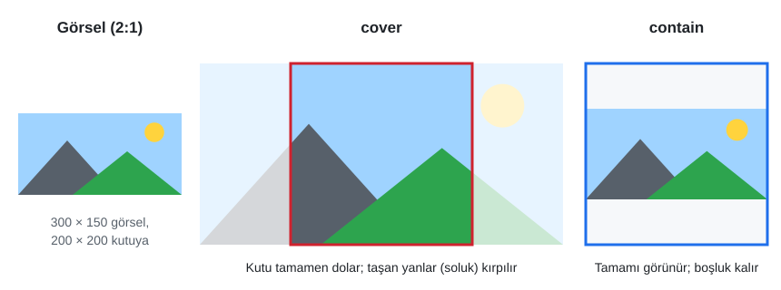

*Şekil 5.14. `cover` ve `contain` karşılaştırması.*

Kapak fotoğraflı başlık bantlarında (hero) `cover`, logo veya illüstrasyonun tamamının görünmesi gereken alanlarda `contain` tercih edilir. `cover` kullanıldığında görselin hangi bölümünün kırpılacağı `background-position` ile seçilir; örneğin bir manzara fotoğrafında ufuk çizgisinin korunması için `background-position: center bottom` yazılabilir.

> [!TIP]
> **Güncel hayattan:** Video platformlarının ana sayfasındaki tanıtım bantlarında ve e-ticaret sitelerinin kampanya alanlarında görsel, `background-size: cover` ile her ekran genişliğinde alanı dolduracak biçimde ölçeklenir; üzerindeki başlığın okunabilmesi için görselin üstüne yarı saydam bir gradyan katmanı eklenir (bkz. 5.7.9).

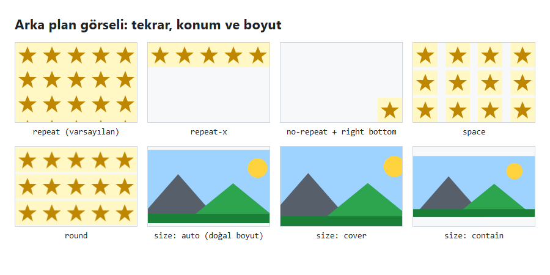

*Şekil 5.15. Tekrar, konum ve boyut değerleri (Örnek 5.5: [`codes/05-css-metin-renk-arka-plan/ornek-5-5-arka-plan/`](../codes/05-css-metin-renk-arka-plan/ornek-5-5-arka-plan/index.html)).*

### 5.7.6 `background-attachment`

`background-attachment`, sayfa veya öğe kaydırıldığında arka planın nasıl davranacağını belirler:

- **`scroll`** (varsayılan): Arka plan öğeye bağlıdır; sayfa kaydırıldığında öğeyle birlikte hareket eder.
- **`fixed`:** Arka plan görüntü alanına (viewport) sabitlenir; içerik kaydırılırken görsel yerinde kalır. Uzun sayfalarda derinlik hissi veren *parallax* benzeri etkiler bu değerle elde edilir. Sunumdaki "en uygun biçimde sabitlenir" ifadesinin kesin karşılığı budur: Sabitleme, öğeye değil pencereye göre yapılır.
- **`local`:** Arka plan öğenin **içeriğine** bağlıdır; öğenin kendi kaydırma çubuğu varsa (ör. `overflow: auto` olan bir kutu) içerikle birlikte kayar.

> [!NOTE]
> `fixed` değeri bazı mobil tarayıcılarda performans nedeniyle `scroll` gibi davranabilir. Bu nedenle `fixed` arka plan bir süsleme olarak düşünülmeli, tasarımın işlevi buna bağlanmamalıdır.

### 5.7.7 `background` kısayolu

Tüm arka plan özellikleri `background` kısayoluyla tek bildirimde yazılabilir:

```css
/* background: [renk] [görsel] [konum] [/ boyut] [tekrar] [ek] */
body {
  background: #9fd3ff url("images/manzara.svg") center bottom / cover no-repeat fixed;
}
```

*Kod 5.9. `background` kısayolu.*

Kısayolda değerlerin sırası büyük ölçüde serbesttir; tarayıcı her değerin türünü (renk, görsel, anahtar sözcük) kendisi tanır. İki kural kesindir [18]:

1. `background-size` değeri yalnızca `background-position` değerinden **hemen sonra** ve aralarına eğik çizgi (`/`) konularak yazılabilir. Hem konum hem boyut uzunluk alabildiği için, eğik çizgi olmadan `center 50%` gibi bir ifadenin hangi özelliğe ait olduğu belirsiz kalırdı.
2. Kısayolda yazılmayan alt özellikler **başlangıç değerlerine sıfırlanır.**

İkinci kural, sunumdaki şu örnekte önemli bir sonuç doğurur:

```css
h1, h2, h3 { background: red url("dots.gif") repeat-x; }
h3 { background: green; }
```

İkinci kural yalnızca rengi değiştiriyor gibi görünse de `background` bir kısayol olduğu için `background-image` değerini de `none`'a sıfırlar. Sonuçta `<h3>` başlıkları noktalı deseni kaybeder ve düz yeşil görünür. Yalnızca renk değiştirilmek isteniyorsa `h3 { background-color: green; }` yazılmalıdır.

### 5.7.8 Çoklu arka plan

CSS3 ile bir öğeye virgülle ayrılmış **birden çok arka plan katmanı** verilebilir [18]. Listede **ilk yazılan katman en üstte**, sonraki katmanlar sırayla onun altında çizilir; arka plan rengi her zaman en alttadır ve kısayolda yalnızca son katmana yazılabilir (Şekil 5.16).

```css
body {
  background:
    url("image1.png") left top no-repeat,
    url("image2.png") center center no-repeat,
    url("image3.png") right bottom no-repeat,
    #f6f8fa;
}
```

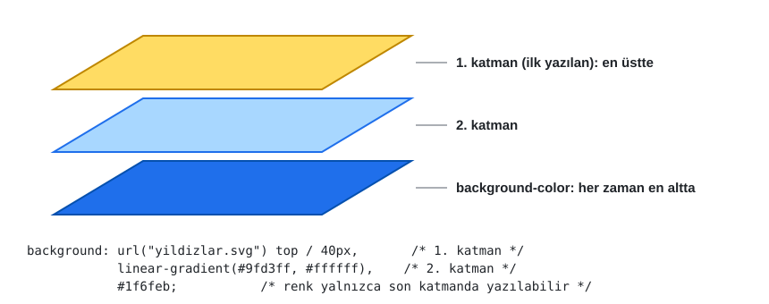

*Şekil 5.16. Çoklu arka planda katman sırası.*

Uzun biçimde yazıldığında her alt özellik de virgülle ayrılmış bir liste alır ve listelerin elemanları katmanlarla sırasıyla eşleşir: `background-repeat: no-repeat, repeat-x;` ifadesinde ilk değer birinci katmana, ikinci değer ikinci katmana uygulanır.

### 5.7.9 Gradyanlar

**Gradyan** (gradient), renkler arasında yumuşak geçiş üreten ve tarayıcının o anda çizdiği bir **görseldir**; bu nedenle `background-color`'a değil `background-image`'a (veya `background` kısayoluna) yazılır [4, s. 296], [3, s. 419]. Doğrusal ve dairesel gradyanlar W3C'nin *CSS Images Level 3*, konik gradyan ise *CSS Images Level 4* modülünde tanımlanır [19], [20]. Dosya indirmeyi gerektirmedikleri ve her çözünürlükte keskin kaldıkları için dekoratif arka planlarda görsel dosyalarının yerini büyük ölçüde almışlardır.

```css
.bant-1 { background-image: linear-gradient(to bottom, #ffff00, #00ff00); }
.bant-2 { background-image: linear-gradient(135deg, #1f6feb, #8250df); }
.bayrak { background-image: linear-gradient(to right, #cf222e 0 33%, #ffffff 33% 66%, #2da44e 66%); }
.isik   { background-image: radial-gradient(circle at 30% 30%, #ffffff, #1f6feb); }
.pasta  { background-image: conic-gradient(#cf222e 0 25%, #bf8700 0 50%, #2da44e 0 75%, #1f6feb 0); }
.serit  { background-image: repeating-linear-gradient(45deg, #fff8c5 0 12px, #bf8700 12px 24px); }
```

*Kod 5.10. Gradyan türleri.*

Yön `to bottom` (varsayılan), `to right` gibi sözcüklerle veya açıyla verilir; `0deg` yukarıyı, `90deg` sağı gösterir. Her rengin yanına isteğe bağlı bir **renk durağı** (color stop) konumu yazılabilir; aynı noktada biten ve başlayan iki durak (`33% 33%`) keskin bir sınır oluşturur. `radial-gradient` şekil ve merkez (`circle at 30% 30%`), `conic-gradient` ise merkez etrafında açısal duraklar alır.

Gradyan çoklu arka planla birleştirildiğinde, fotoğraf üzerindeki metnin okunabilirliğini artırmanın en yaygın yolu ortaya çıkar: Görselin üstüne yarı saydam bir gradyan katmanı konur.

```css
.hero {
  background:
    linear-gradient(rgb(0 0 0 / 0.55), rgb(0 0 0 / 0.2)),  /* üstte: koyulaştırıcı katman */
    url("../images/kampus.jpg") center / cover;              /* altta: fotoğraf */
  color: #ffffff;
}
```

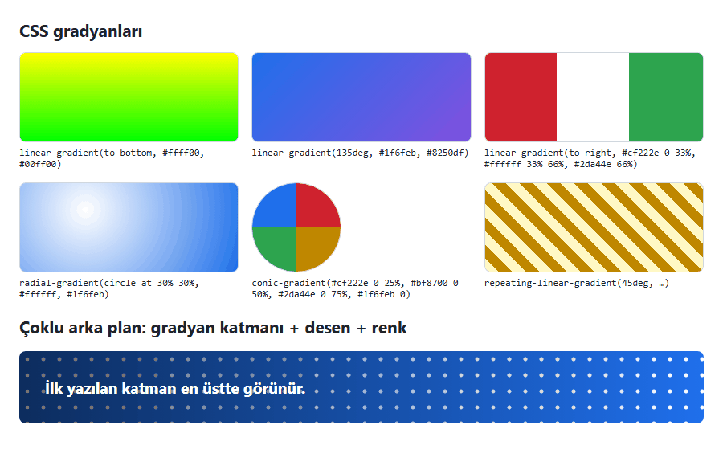

*Şekil 5.17. Gradyan türleri ve çoklu arka plan (Örnek 5.6: [`codes/05-css-metin-renk-arka-plan/ornek-5-6-gradyanlar/`](../codes/05-css-metin-renk-arka-plan/ornek-5-6-gradyanlar/index.html)).*

> [!NOTE]
> **Tarihsel not:** Sunumda, çevrim içi gradyan editörlerinin ürettiği şu türden bir blok yer almaktadır:
>
> ```css
> background: #ffff00; /* Old browsers */
> background: -moz-linear-gradient(top, #ffff00 0%, #00ff00 100%); /* FF3.6+ */
> background: -webkit-gradient(linear, left top, left bottom, color-stop(0%,#ffff00), color-stop(100%,#00ff00));
> background: -webkit-linear-gradient(top, #ffff00 0%, #00ff00 100%);
> background: -o-linear-gradient(top, #ffff00 0%, #00ff00 100%);
> background: -ms-linear-gradient(top, #ffff00 0%, #00ff00 100%);
> background: linear-gradient(to bottom, #ffff00 0%, #00ff00 100%); /* W3C */
> filter: progid:DXImageTransform.Microsoft.gradient(startColorstr='#ffff00', endColorstr='#00ff00', GradientType=0); /* IE6-9 */
> ```
>
> 2010'ların başında gradyanlar standartlaşmamıştı; her tarayıcı özelliği kendi **satıcı önekiyle** (vendor prefix: `-moz-` Firefox, `-webkit-` Chrome/Safari, `-o-` Opera, `-ms-` Internet Explorer) ve kendine özgü sözdizimiyle destekliyor, IE 6–9 ise standart dışı `filter:` özelliğini kullanıyordu. Bugün bu bloğun tamamı tek satıra iner: `background: linear-gradient(to bottom, #ffff00, #00ff00);`. Eski önekli yazımda yön geçişin **başladığı** yerle (`top`), standart yazımda ise **gittiği** yönle (`to bottom`) belirtildiğinden eski koddan kopyalanan yönler ters sonuç verebilir. Gradyan editörleri hâlâ kullanılabilir; ancak çıktılarından yalnızca standart satır alınmalıdır. Önek gerektiren özel durumlar günümüzde elle değil, *Autoprefixer* gibi araçlarla çözülür.

#### 🛠 Uygulama 5.5: Gradyanlı Başlık Bandı (Hero)

**Amaç:** Çoklu arka plan katmanlarıyla (iki `radial-gradient` + bir `linear-gradient`) bir duyuru bandı oluşturmak ve gradyan desteklenmediğinde kullanılacak yedek rengi tanımlamak.  
**Tahmini süre:** 15 dk

1. `calismalar/bolum-05/uygulama-5-5/` klasöründe `index.html` ve `style.css` dosyalarını oluşturunuz.
2. `hero` sınıflı bir `<header>` içine bir üst yazı (`<p class="ust-yazi">`), bir `<h1>`, bir açıklama paragrafı ve `dugme` sınıflı bir bağlantı ekleyiniz; altına kısa bir `<main>` paragrafı koyunuz.
3. `.hero` kuralında önce `background-color: #0b3d91;`, hemen ardından `background` kısayoluyla üç katman yazınız: `radial-gradient(circle at 15% 20%, rgb(255 255 255 / 0.25), transparent 30%)`, `radial-gradient(circle at 85% 80%, rgb(255 211 61 / 0.35), transparent 35%)` ve en altta `linear-gradient(135deg, #0b3d91 0%, #1f6feb 55%, #8250df 100%)`.
4. Bandın metnini beyaz ve ortalı yapınız; `<h1>`'e `text-shadow: 0 2px 6px rgb(0 0 0 / 0.35)`, üst yazıya `text-transform: uppercase; letter-spacing: 0.15em;` veriniz. Düğmeyi beyaz zemin, koyu mavi metin, `border-radius: 999px` ve `text-decoration: none` ile biçimlendiriniz.
5. Live Server ile açıp Şekil 5.18 ile karşılaştırınız.

**Beklenen çıktı:**

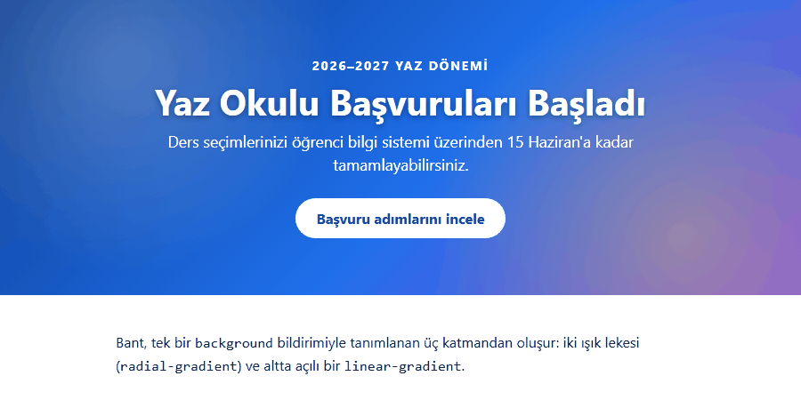

*Şekil 5.18. Uygulama 5.5'in beklenen ekran görüntüsü.*

**Kendinizi sınayın:** (1) `linear-gradient` katmanını listenin başına alınca ışık lekeleri neden kayboldu? (2) Beyaz açıklama metninin bandın en açık bölgesindeki kontrast oranını ölçünüz.

<details><summary>Örnek çözüm</summary>

Çözüm dosyası: [`codes/05-css-metin-renk-arka-plan/uygulama-5-5-hero-gradyan/index.html`](../codes/05-css-metin-renk-arka-plan/uygulama-5-5-hero-gradyan/index.html)

</details>

Bu uygulamadaki `background-color` + `background` ikilisi **aşamalı geliştirme** (progressive enhancement) yaklaşımının bir örneğidir: Önce her tarayıcının anlayacağı basit bildirim, ardından yeni özelliği kullanan bildirim yazılır. Yeni sözdizimini tanımayan tarayıcı ikinci bildirimi yok sayar; tanıyan tarayıcı ise kaynak sırası gereği ikincisini uygular [6, s. HTML 104].

## 5.8 Harici CSS Dosyası Oluşturma ve Bağlama

[Bölüm 4](04-css-temelleri.md)'te CSS'in satır içi, gömülü ve harici olarak uygulanabildiği ve çok sayfalı sitelerde harici dosyanın tercih edildiği açıklanmıştır; bu bölümdeki tüm örnekler harici `style.css` ile hazırlanmıştır. Sunumun son slaytındaki adımlar VS Code ile şöyle uygulanır:

1. Proje klasörü açılır (*File → Open Folder*); Explorer panelinde **New File** ile `style.css` oluşturulur (gerekirse önce **New Folder** ile `css/` klasörü).
2. Dosyaya yalnızca CSS kuralları yazılır; harici CSS dosyasında `<style>` etiketi **bulunmaz**.
3. HTML dosyasının `<head>` bölümünde `link:css` yazıp `Tab` tuşuna basılır; Emmet `<link rel="stylesheet" href="style.css">` satırını üretir ve `href` gerçek yola göre düzeltilir (ör. `css/style.css`).
4. Sayfa Live Server ile açılır; CSS dosyasındaki her kayıt sayfayı otomatik yeniler.

```html
<link rel="stylesheet" href="css/style.css">
```

```css
/* css/style.css: <style> etiketi yazılmaz */
p {
  font-family: Georgia, serif;
  line-height: 1.6;
}
```

*Kod 5.11. Harici CSS dosyasının bağlanması ve içeriği.*

Stiller uygulanmıyorsa `href` yolu (Linux sunucular dosya adlarında büyük/küçük harfe duyarlıdır), `rel="stylesheet"` niteliği, dosyada yanlışlıkla bırakılmış bir `<style>` etiketi ve geliştirici araçlarının **Network** sekmesinde `404` hatası denetlenmelidir. Dosya yükleniyor ama değer görünmüyorsa **Elements → Styles** panelindeki üstü çizili bildirimler hangi kuralın basamaklamayı kazandığını gösterir ([Bölüm 4](04-css-temelleri.md)).

#### 🛠 Uygulama 5.6: Arka Plan Görseli Üzerinde Okunaklı Metin

**Amaç:** Harici CSS dosyasıyla tam sayfa bir arka plan görseli (`cover`, `fixed`) uygulamak, görsel üzerindeki metni yarı saydam bir kutuyla okunaklı kılmak ve bölümdeki metin özelliklerini tek sayfada birleştirmek.  
**Tahmini süre:** 20 dk

1. `calismalar/bolum-05/uygulama-5-6/` klasöründe `index.html`, `style.css` ve `images/` klasörünü oluşturunuz; çözüm klasöründeki `images/manzara.svg` dosyasını (veya kendi fotoğrafınızı) `images/` içine kopyalayınız.
2. `kapsayici` sınıflı bir `<div>` içine bir `<h1>` ve iki paragraf ekleyiniz; bir ifadeyi `<span class="vurgulu">` ile işaretleyiniz.
3. `body` için `margin: 0; min-height: 100vh; background-color: #9fd3ff;` ve ardından `background-image: url("images/manzara.svg"); background-repeat: no-repeat; background-position: center bottom; background-size: cover; background-attachment: fixed;` yazınız.
4. `.kapsayici` için `width: 80%; max-width: 48rem; margin: 3rem auto; padding: 2rem; border-radius: 12px;`, arka plan olarak `rgb(255 255 255 / 0.88)` ve metin için `line-height: 1.8; text-align: justify; letter-spacing: 0.02em; word-spacing: 0.1em;` tanımlayınız.
5. `<h1>`'i ortalayıp büyük harfe dönüştürünüz ve hafif bir `text-shadow` veriniz; paragraflara `text-indent: 2em; font-size: 1.125rem;`, `.vurgulu` için `text-decoration: underline overline;` ve kırmızı `text-decoration-color` uygulayınız.
6. Live Server ile açıp Şekil 5.19 ile karşılaştırınız; pencereyi daraltıp genişleterek `cover`'ın görseli nasıl kırptığını gözlemleyiniz.

**Beklenen çıktı:**

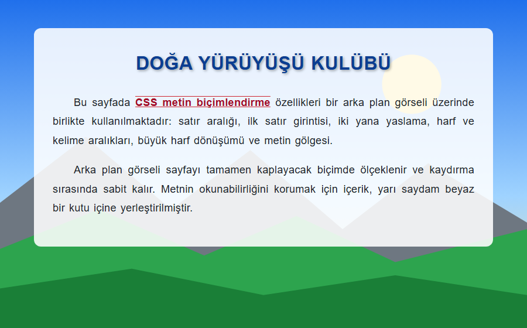

*Şekil 5.19. Uygulama 5.6'nın beklenen ekran görüntüsü.*

**Kendinizi sınayın:** (1) Kutuda `rgb(255 255 255 / 0.88)` yerine `background-color: #ffffff; opacity: 0.88;` yazınız; metinde ne değişti? (2) `style.css` dosyasını `css/` alt klasörüne taşıyınız; `url()` yolunu ve `<link>` öğesini nasıl değiştirmeniz gerekir?

<details><summary>Örnek çözüm</summary>

Çözüm dosyası: [`codes/05-css-metin-renk-arka-plan/uygulama-5-6-arka-plan-gorseli/index.html`](../codes/05-css-metin-renk-arka-plan/uygulama-5-6-arka-plan-gorseli/index.html)

</details>

## 5.9 Bölüm Özeti

- `font-family` bir **yazı tipi yığını** alır; tarayıcı ilk bulduğunu kullanır. Yığın tırnaksız bir **jenerik aileyle** bitmeli, boşluklu adlar tırnakla yazılmalıdır.
- Web yazı tipleri Google Fonts (`css2`, `display=swap`, `preconnect`) veya kendi sunucuda **WOFF2** ve `@font-face` ile eklenir; kendi sunucuda barındırma ziyaretçi verisini üçüncü taraflarla paylaşmaz (GDPR, KVKK).
- `em` ebeveyne göre hesaplanır ve iç içe öğelerde bileşik büyür; `rem` kök öğeye göredir. `rem` ile verilen yazı boyutları kullanıcının tarayıcı yazı boyutu ayarına uyar, `px` uymaz.
- `font` kısayolunda `font-size` ve `font-family` zorunludur, `font-family` en sonda yer alır; kısayollar yazılmayan alt özellikleri sıfırlar.
- `line-height` için birimsiz değer önerilir. `text-transform` dönüşümü `lang` niteliğine göre yapılır; Türkçe `i/İ` için `<html lang="tr">` gerekir.
- Renkler ad, onaltılık, `rgb()`, `hsl()` ve `oklch()` ile yazılır; alfa `rgb(r g b / a)` biçiminde verilir. `opacity` öğeyi içeriğiyle birlikte saydamlaştırır, alfalı renk yalnızca arka planı.
- WCAG 2.2'ye göre kontrast normal metinde en az **4,5:1**, büyük metinde **3:1** olmalıdır. Renklerin `--ana-renk` gibi CSS değişkenleriyle tanımlanması tema değişikliğini tek noktaya indirir.
- `url()` yolu CSS dosyasına göre çözülür; `cover` alanı kaplayıp kırpar, `contain` görselin tamamını sığdırır; çoklu arka planda ilk katman en üsttedir. Gradyanlar birer görseldir ve önekli eski yazımların yerini tek satırlık standart sözdizimi almıştır.

## 5.10 Değerlendirme Soruları

1. `font-family: "Segoe UI", Roboto, sans-serif;` bildiriminde tarayıcının yazı tipi seçme sürecini adım adım açıklayınız. `sans-serif` neden tırnak içinde yazılmamalıdır?
2. Sunumdaki `font-family: Comic Sans, cursive;` kuralı Windows'ta hangi yazı tipiyle görüntülenir? Kuralın doğru yazımı nedir?
3. Google Fonts bağlantısındaki `display=swap` parametresinin ve `<link rel="preconnect">` öğesinin işlevlerini açıklayınız.
4. Bir kurumsal sitenin yazı tiplerini Google sunucularından yüklemek yerine `@font-face` ile kendi sunucusunda barındırmasının performans ve kişisel veri açısından gerekçelerini tartışınız.
5. Kök yazı boyutu 16px olan bir sayfada `article { font-size: 0.875rem; }` ve `article p { font-size: 1.5em; }` kuralları uygulanmıştır. Paragrafın yazı boyutu kaç pikseldir? `1.5em` yerine `1.5rem` yazılsaydı sonuç ne olurdu?
6. "`px` ile verilen yazı boyutları tarayıcı ayarlarından etkilenmez" ifadesini sayfa yakınlaştırma ve varsayılan yazı boyutu ayarı açısından değerlendiriniz. Bu fark erişilebilirliği nasıl etkiler?
7. Aşağıdaki bildirimlerden hangileri geçersizdir? Nedenlerini belirtiniz: (a) `font: bold 1rem/1.5 Arial, sans-serif;` (b) `font: Arial 1rem;` (c) `font-size: 1.2 em;` (d) `font: italic 600 1.25rem Georgia, serif;`
8. `body { font-size: 16px; line-height: 1.5em; }` kuralı olan bir sayfada `font-size: 2.5rem` olan bir `<h1>`'in satırları neden üst üste biner? Sorun nasıl giderilir?
9. `lang="en"` tanımlı bir sayfada `text-transform: uppercase` uygulanan "bilişim" sözcüğü nasıl görüntülenir? Doğru sonucu elde etmek için ne yapılmalıdır?
10. `#1f6feb80` renk değerini `rgb()` sözdizimiyle yazınız. Bu renk ile `opacity: 0.5` uygulanmış `#1f6feb` arka planlı bir kutu arasındaki fark nedir?
11. Aşağıdaki kodda `<h3>` başlıklarının görünümü nedir? Açıklayınız ve yalnızca rengi değiştiren doğru kuralı yazınız.
    ```css
    h1, h2, h3 { background: red url("dots.gif") repeat-x; }
    h3 { background: green; }
    ```
12. `css/style.css` dosyasında yazılmış `background-image: url("images/desen.png");` bildirimi, `images/` klasörü proje kökünde olduğu hâlde neden çalışmaz? Doğru yazımı veriniz.

## Kaynaklar

[1] J. Sklar, *Principles of Web Design: The Web Warrior Series*, 6th ed. Boston, MA, USA: Cengage Learning, 2015.

[2] W3C, "CSS Fonts Module Level 4," W3C Working Draft. [Çevrimiçi]. Erişim: https://www.w3.org/TR/css-fonts-4/ (Erişim tarihi: 2 Kasım 2026).

[3] J. Duckett, *HTML and CSS: Design and Build Websites*. Indianapolis, IN, USA: Wiley, 2011.

[4] J. N. Robbins, *Learning Web Design: A Beginner's Guide to HTML, CSS, JavaScript, and Web Graphics*, 4th ed. Sebastopol, CA, USA: O'Reilly Media, 2012.

[5] Google, "CSS API update," *Google Fonts for Developers*. [Çevrimiçi]. Erişim: https://developers.google.com/fonts/docs/css2 (Erişim tarihi: 2 Kasım 2026).

[6] P. Carey, *New Perspectives on HTML5 and CSS3: Comprehensive*, 7th ed. Boston, MA, USA: Cengage Learning, 2017.

[7] Landgericht München I, Endurteil v. 20.01.2022, Az. 3 O 17493/20. [Çevrimiçi]. Erişim: https://www.gesetze-bayern.de/Content/Document/Y-300-Z-GRURRS-B-2022-N-612 (Erişim tarihi: 2 Kasım 2026).

[8] "Kişisel Verilerin Korunması Kanunu," Kanun No. 6698, *T.C. Resmî Gazete*, sayı 29677, 7 Nis. 2016. [Çevrimiçi]. Erişim: https://www.mevzuat.gov.tr/mevzuatmetin/1.5.6698.pdf (Erişim tarihi: 2 Kasım 2026).

[9] W3C, "CSS Values and Units Module Level 4," W3C Working Draft. [Çevrimiçi]. Erişim: https://www.w3.org/TR/css-values-4/ (Erişim tarihi: 2 Kasım 2026).

[10] W3C, *Web Content Accessibility Guidelines (WCAG) 2.2*, W3C Recommendation, Oct. 2023. [Çevrimiçi]. Erişim: https://www.w3.org/TR/WCAG22/ (Erişim tarihi: 2 Kasım 2026).

[11] W3C, "CSS Text Module Level 3." [Çevrimiçi]. Erişim: https://www.w3.org/TR/css-text-3/ (Erişim tarihi: 2 Kasım 2026).

[12] W3C, "CSS Text Decoration Module Level 3." [Çevrimiçi]. Erişim: https://www.w3.org/TR/css-text-decor-3/ (Erişim tarihi: 2 Kasım 2026).

[13] Mozilla, "line-height," *MDN Web Docs*. [Çevrimiçi]. Erişim: https://developer.mozilla.org/en-US/docs/Web/CSS/line-height (Erişim tarihi: 2 Kasım 2026).

[14] W3C, "CSS Color Module Level 4," W3C Candidate Recommendation Draft. [Çevrimiçi]. Erişim: https://www.w3.org/TR/css-color-4/ (Erişim tarihi: 2 Kasım 2026).

[15] A. Harris, *HTML5 and CSS3 All-in-One For Dummies*, 3rd ed. Hoboken, NJ, USA: Wiley, 2014.

[16] W3C, "CSS Custom Properties for Cascading Variables Module Level 1," W3C Candidate Recommendation. [Çevrimiçi]. Erişim: https://www.w3.org/TR/css-variables-1/ (Erişim tarihi: 2 Kasım 2026).

[17] W3C, "Media Queries Level 5." [Çevrimiçi]. Erişim: https://www.w3.org/TR/mediaqueries-5/ (Erişim tarihi: 2 Kasım 2026).

[18] W3C, "CSS Backgrounds and Borders Module Level 3," W3C Candidate Recommendation Draft. [Çevrimiçi]. Erişim: https://www.w3.org/TR/css-backgrounds-3/ (Erişim tarihi: 2 Kasım 2026).

[19] W3C, "CSS Images Module Level 3." [Çevrimiçi]. Erişim: https://www.w3.org/TR/css-images-3/ (Erişim tarihi: 2 Kasım 2026).

[20] W3C, "CSS Images Module Level 4." [Çevrimiçi]. Erişim: https://www.w3.org/TR/css-images-4/ (Erişim tarihi: 2 Kasım 2026).

---

[← Önceki bölüm](04-css-temelleri.md) · [İçindekiler](../README.md) · [Sonraki bölüm →](06-css-kutu-modeli-yerlesim.md)
