# Bölüm 6: CSS Kutu Modeli ve Sayfa Yerleşimi

[← Önceki bölüm](05-css-metin-renk-arka-plan.md) · [İçindekiler](../README.md) · [Sonraki bölüm →](07-javascript-temelleri.md)

> **Öğrenme Hedefleri** — Bu bölümü tamamlayan öğrenci:
>
> 1. Kutu modelinin dört katmanını (içerik, dolgu, kenarlık, kenar boşluğu) adlandırır ve bir öğenin ekranda kapladığı genişliği `content-box` ve `border-box` için ayrı ayrı hesaplar.
> 2. `margin`, `padding` ve `border` özelliklerini tek kenar ve kısayol biçimleriyle yazar; dikey kenar boşluğu çökmesini örnek üzerinde açıklar.
> 3. `border-radius`, `outline` ve `box-shadow` ile kutuyu biçimlendirir; klavye odağının görünür kalmasını sağlar.
> 4. `overflow`, `display` ve `position` değerlerinin öğenin akıştaki davranışını nasıl değiştirdiğini karşılaştırır.
> 5. Flexbox ile tek boyutlu, CSS Grid ile iki boyutlu yerleşimler kurar ve hangi durumda hangisinin seçileceğini gerekçelendirir.
> 6. Tarayıcı geliştirici araçlarındaki kutu modeli panelini kullanarak yerleşim hatalarını bulur.

## 6.1 Giriş

Bir web sayfası tarayıcı tarafından çizilirken her HTML öğesi dikdörtgen bir kutuya dönüştürülür. Başlıklar, paragraflar, görseller, bağlantılar ve hatta tek bir kelimeyi saran `<span>` öğesi, CSS açısından birer kutudur [1]. Sayfa düzeni (layout) denilen şey, aslında bu kutuların boyutlarının, aralarındaki boşlukların ve birbirlerine göre konumlarının belirlenmesinden ibarettir. Duckett bu durumu, CSS'in her HTML öğesini kendi kutusu varmış gibi ele alması olarak özetler [2, s. 361].

[Bölüm 5](05-css-metin-renk-arka-plan.md)'te kutunun *içindeki* metnin ve arka planın nasıl biçimlendirildiği incelenmişti. Bu bölümde kutunun kendisine odaklanılmaktadır: kutunun katmanları, kenarlıkları, taşma davranışı, görüntülenme türü ve sayfadaki konumu. Bölümün ikinci yarısında ise bugünkü web sayfalarının neredeyse tamamında kullanılan iki yerleşim sistemi, **Flexbox** ve **CSS Grid**, ele alınmaktadır.

> [!TIP]
> **Güncel hayattan:** Bir e-ticaret sitesindeki ürün kartı düşünülsün. Kartın etrafındaki ince gri çizgi kenarlıktır (`border`), ürün adının kart kenarına yapışmamasını sağlayan iç boşluk dolgudur (`padding`), kartları birbirinden ayıran aralık kenar boşluğudur (`margin`) ya da ızgara aralığıdır (`gap`). Sol üst köşedeki "%20 indirim" etiketi `position: absolute` ile, kartların yan yana dizilmesi ise CSS Grid ile sağlanır. Bu bölümün sonunda böyle bir sayfa adım adım kurulacaktır.

Web sayfası yerleşim teknikleri yıllar içinde köklü biçimde değişmiştir. Aşağıdaki zaman çizelgesi bu değişimi özetlemektedir:

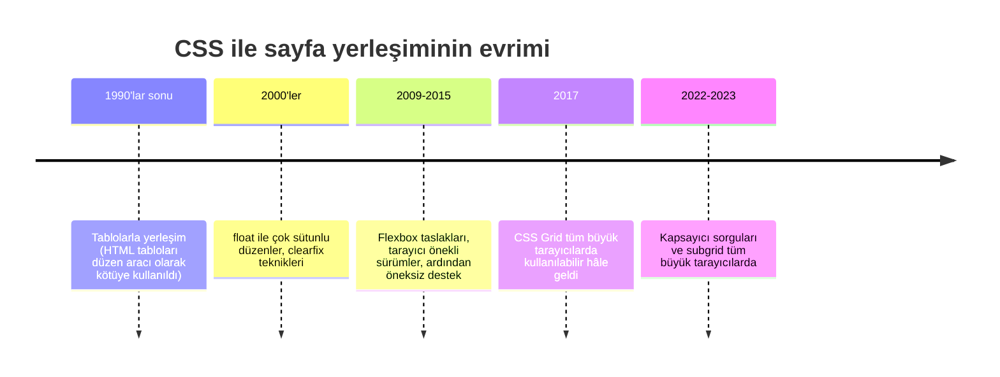

*Şekil 6.1. CSS ile sayfa yerleşimi tekniklerinin tarihsel gelişimi.*

## 6.2 Kutu Modeli

### 6.2.1 Kutunun Katmanları

CSS kutu modeli (box model), her kutuyu içten dışa doğru dört katmandan oluşan bir yapı olarak tanımlar [1], [3, ss. 305–306]:

- **İçerik (content):** Metnin, görselin veya alt öğelerin yer aldığı alandır. `width` ve `height` özellikleri varsayılan olarak bu alanın boyutunu belirler.
- **Dolgu (padding):** İçerik ile kenarlık arasındaki boşluktur. Öğenin arka plan rengi ve arka plan görseli dolgu alanına da yayılır.
- **Kenarlık (border):** Dolguyu çevreleyen çizgidir. Kalınlığı, stili ve rengi ayarlanabilir; kalınlığı sıfır da olabilir.
- **Kenar boşluğu (margin):** Kenarlığın dışında kalan, kutuyu komşu kutulardan ayıran saydam alandır. Arka plan rengi bu alana uygulanmaz.

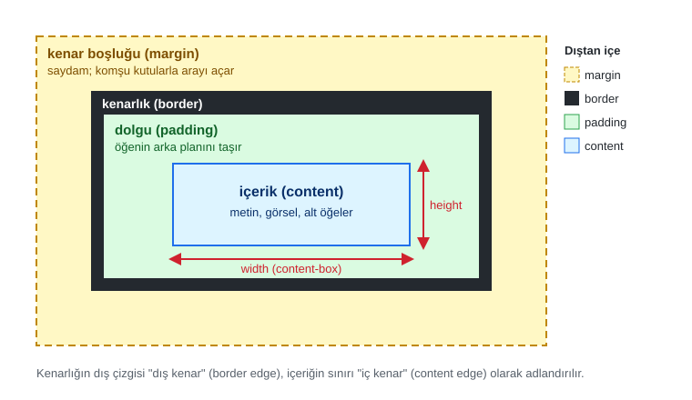

*Şekil 6.2. CSS kutu modeli: içten dışa içerik, dolgu, kenarlık ve kenar boşluğu.*

Sunumdaki kutu şemasında kenar boşluğu alanı "sayfa kenarına göre boşluklar" olarak etiketlenmiştir. Bu ifade yanıltıcıdır: kenar boşluğu sayfa kenarına göre değil, **kutunun kendi kenarlığına göre** ölçülür ve kutu ile komşuları (kardeş öğeler veya kapsayıcı öğenin içeriği) arasındaki mesafeyi belirler. Bir paragrafın `margin-left: 2em` değeri, paragrafı sayfanın solundan değil, onu içeren öğenin içerik alanının solundan 2em uzaklaştırır.

### 6.2.2 Genişlik, Yükseklik ve `box-sizing`

`width` ve `height` özellikleri bir kutunun boyutunu belirler; ancak *hangi katmanın* boyutunun belirlendiği `box-sizing` özelliğine bağlıdır [4]. Bu özelliğin iki değeri vardır:

- `content-box` (varsayılan): `width` yalnızca içerik alanının genişliğidir. Dolgu ve kenarlık bu değerin **dışına eklenir**.
- `border-box`: `width` kenarlık dahil kutunun tamamının genişliğidir. Dolgu ve kenarlık bu değerin **içinden düşülür**; içerik alanı kendiliğinden küçülür.

Varsayılan `content-box` modelinde bir kutunun ekranda görünen ve sayfada kapladığı genişlik şöyle hesaplanır [2, s. 307], [5, ss. 267–268]:

```text
Görünen genişlik  = width + padding-left + padding-right + border-left + border-right
Kaplanan genişlik = görünen genişlik + margin-left + margin-right
```

Aynı kural yükseklik için `height`, üst/alt dolgu, üst/alt kenarlık ve üst/alt kenar boşluğu ile uygulanır. Bir örnekle açıklamak gerekirse:

```css
.kutu {
  width: 300px;
  padding: 20px;
  border: 5px solid #1f6feb;
  margin: 10px;
}
```

| `box-sizing` | İçerik genişliği | Görünen genişlik | Kaplanan genişlik |
|---|---|---|---|
| `content-box` | 300 px | 300 + 2×20 + 2×5 = **350 px** | 350 + 2×10 = **370 px** |
| `border-box` | 300 − 40 − 10 = **250 px** | **300 px** | 300 + 2×10 = **320 px** |

*Tablo 6.1. Aynı bildirimlerin iki kutu boyutlandırma modelindeki sonucu.*

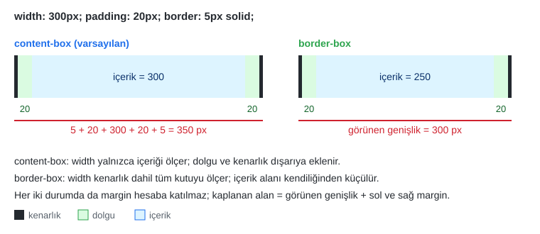

*Şekil 6.3. `width: 300px` değerinin `content-box` ve `border-box` modellerinde ölçtüğü alan.*

Şekil 6.4, aynı hesabın tarayıcıdaki gerçek sonucunu göstermektedir. Kırmızı cetvel 300 pikseldir; yeşil kutu cetvelle aynı genişlikteyken mavi kutu 50 piksel taşmaktadır.

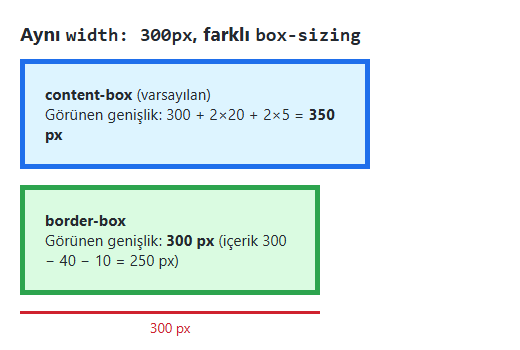

*Şekil 6.4. Örnek 6.1'in ekran görüntüsü ([codes/06-css-kutu-modeli-yerlesim/ornek-6-1-box-sizing/](../codes/06-css-kutu-modeli-yerlesim/ornek-6-1-box-sizing/index.html)).*

`content-box` modelinde kutuya dolgu eklemek kutuyu genişlettiği için, örneğin `width: 50%` verilmiş iki sütun dolgu eklendiği anda yan yana sığmaz hâle gelir. Bu nedenle güncel projelerin çok büyük bölümü, stil dosyasının en başında tüm öğeleri `border-box` modeline geçiren şu sıfırlama kuralıyla başlar [6]:

```css
*,
*::before,
*::after {
  box-sizing: border-box;
}
```

`*` evrensel seçicisi tüm öğeleri, `::before` ve `::after` sözde öğeleri (pseudo-elements) ise CSS ile üretilen içerik kutularını kapsar. Bu bölümdeki uygulamaların çoğu bu kuralla başlamaktadır.

> [!IMPORTANT]
> `box-sizing` yalnızca dolgu ve kenarlığın `width` değerine dahil edilip edilmeyeceğini belirler. **Kenar boşluğu (margin) hiçbir modelde `width` değerine dahil değildir.** Sunumdaki örnekte `width: 500;` biçiminde birimsiz yazılan değer de geçersizdir; sıfır dışındaki uzunluklarda birim (`px`, `em`, `rem`, `%` …) zorunludur, aksi hâlde tarayıcı bildirimi yok sayar.

> [!NOTE]
> **Tarihsel not:** Sunumda `box-sizing` için `-webkit-box-sizing` ve `-moz-box-sizing` önekli yazımların da eklenmesi önerilmektedir. Bu önekler 2010'ların başında, özellik henüz standartlaşmamışken gerekliydi; bugün tüm güncel tarayıcılar öneksiz `box-sizing` özelliğini desteklemektedir ve önekli satırlar gereksizdir [6]. Benzer biçimde Internet Explorer'ın eski sürümleri, belge `<!DOCTYPE>` bildirimi olmadan açıldığında genişliği `border-box` mantığıyla hesaplıyordu; bu tutarsızlık uzun süre "IE kutu modeli sorunu" olarak anıldı [2, s. 316].

`width` ve `height` değerleri verilmezse varsayılan değer `auto` olur. Blok düzeyindeki bir öğe `width: auto` iken kapsayıcısının içerik genişliğini doldurur; yüksekliği ise içeriği kadardır. Bu nedenle sabit `height` vermek çoğu zaman gereksizdir ve içerik büyüdüğünde taşmaya yol açar (bkz. Bölüm 6.6).

#### 🛠 Uygulama 6.1: Kutu Modelini Hesaplama ve DevTools ile Doğrulama

**Amaç:** Bir kutunun görünen ve kapladığı genişliği elle hesaplamak, ardından tarayıcının geliştirici araçlarıyla doğrulamak.  
**Tahmini süre:** 15 dk

1. VS Code'da `calismalar/bolum-06/` klasörünü açınız (yoksa oluşturunuz), `kutu.html` ve `kutu.css` dosyalarını oluşturunuz; HTML iskeletini Emmet ile (`!` + `Tab`) üretiniz ve `lang="tr"` yapınız.
2. Sayfaya `id="duyuru"` olan bir `<div>` ekleyiniz; içine bir `<strong>` başlık ve bir paragraf yazınız (ör. üniversite OBS'sinden bir duyuru).
3. `kutu.css` içinde bu öğeye `width: 260px; padding: 16px; border: 4px solid #1f6feb; margin: 24px;` veriniz. **Henüz `box-sizing` kuralı eklemeyiniz.**
4. Kâğıt üzerinde görünen genişliği ve kapladığı yatay alanı hesaplayınız.
5. Sayfayı Live Server ile açınız, kutuya sağ tıklayıp **İncele** (Inspect) seçiniz. Elements panelinde sağdaki **Computed** sekmesinde yer alan kutu modeli çizimini (Şekil 6.5) bulunuz; değerleri hesabınızla karşılaştırınız. Çizimin katmanları üzerine gelindiğinde sayfada ilgili alanın renkle vurgulandığını gözlemleyiniz.
6. Son olarak kutuya `box-sizing: border-box;` ekleyerek içerik genişliğinin kaç piksele düştüğünü panelden okuyunuz.

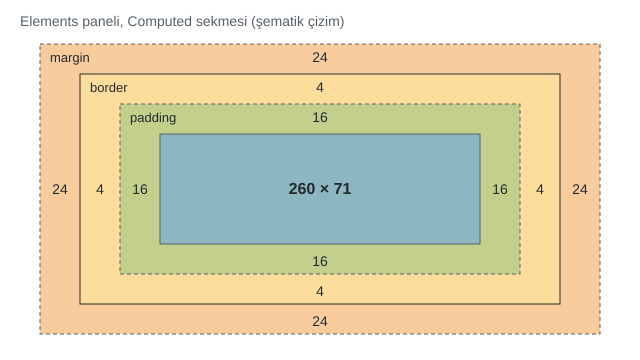

*Şekil 6.5. Elements → Computed sekmesindeki kutu modeli çiziminin şematik gösterimi (içerik yüksekliği yazı tipine göre değişebilir).*

**Beklenen çıktı:**

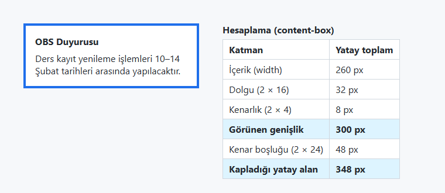

*Şekil 6.6. Uygulama 6.1'in beklenen ekran görüntüsü: görünen genişlik 300 px, kaplanan yatay alan 348 px.*

**Kendinizi sınayın:** (1) Dolguyu `2em` yaparsanız görünen genişlik neye bağlı hâle gelir? (2) `border-box` modelinde dolgu 140 piksele çıkarılırsa ne olur? İçerik alanı negatif olabilir mi?

<details><summary>Örnek çözüm</summary>

Çözüm dosyası: [`codes/06-css-kutu-modeli-yerlesim/uygulama-6-1-kutu-hesaplama/index.html`](../codes/06-css-kutu-modeli-yerlesim/uygulama-6-1-kutu-hesaplama/index.html)

</details>

## 6.3 Kenar Boşluğu (`margin`)

### 6.3.1 Dört Kenar ve Kısayol Yazımı

Kenar boşluğu her kenar için ayrı bir özellikle verilebilir: `margin-top` (üst), `margin-right` (sağ), `margin-bottom` (alt) ve `margin-left` (sol). Değer bir uzunluk (`px`, `em`, `rem`), bir yüzde ya da `auto` olabilir [1]. Yüzde değerler, öğeyi içeren kapsayıcı bloğun (containing block) **genişliğine** göre hesaplanır; bu kural üst ve alt kenar boşlukları için de geçerlidir.

Dört kenarı tek bildirimde yazmak için `margin` kısayol özelliği (shorthand) kullanılır. Değer sayısına göre yorum Şekil 6.7'da gösterilmiştir. Robbins, dört değerin sırasını akılda tutmak için İngilizce "TRouBLe" (Top, Right, Bottom, Left) kısaltmasını önerir [3, s. 382]; Türkçede "üstten başla, saat yönünde dön" kuralı aynı işi görür.

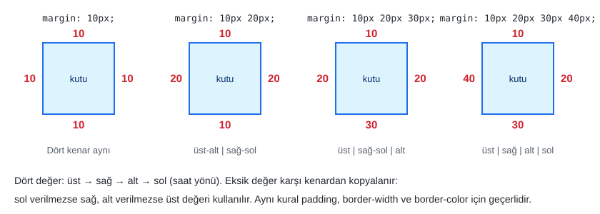

*Şekil 6.7. `margin` (ve `padding`) kısayolunda değer sayısına göre kenarlara dağılım.*

```css
p#a { margin: 2em; }                   /* dört kenar 2em */
p#b { margin: 1em 120px 1em 4em; }     /* üst, sağ, alt, sol */
body { margin: 0 15%; }                /* üst-alt 0, sağ-sol %15 */
```

Sunumdaki örnek (slayt 157) bu yazımların etkisini göstermektedir. Şekil 6.8'de aynı örneğin Türkçe içerikli yeniden üretimi yer almaktadır; kesikli mavi çerçeve paragrafı saran kapsayıcıdır, aradaki şerit ise paragrafın kenar boşluğudur.

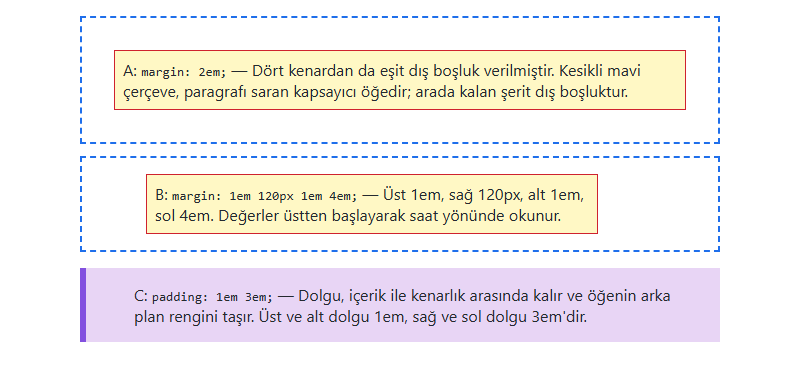

*Şekil 6.8. Örnek 6.2: dört kenarda eşit kenar boşluğu (A), dört farklı kenar boşluğu (B) ve yatay/dikey dolgu (C) ([codes/06-css-kutu-modeli-yerlesim/ornek-6-2-margin-padding/](../codes/06-css-kutu-modeli-yerlesim/ornek-6-2-margin-padding/index.html)).*

> [!NOTE]
> Sunumdaki aynı örnekte `background-color: #;` bildirimi yer almaktadır. `#` işaretinden sonra onaltılık bir renk kodu (ör. `#fcf2be`) yazılmadığı için bu bildirim geçersizdir ve tarayıcı tarafından yok sayılır.

### 6.3.2 `auto` ile Yatay Ortalama

Genişliği belirlenmiş bir blok öğenin sol ve sağ kenar boşlukları `auto` yapıldığında tarayıcı kalan yatay alanı iki kenara eşit paylaştırır; öğe kapsayıcısının ortasına yerleşir [2, s. 315]:

```css
.sayfa {
  max-width: 960px;
  margin: 0 auto;    /* üst-alt 0, sağ-sol eşit */
}
```

Bu kalıp, haber sitelerinden üniversite sayfalarına kadar pek çok sitede içeriğin geniş ekranda ortada sabit genişlikli bir sütun olarak durmasını sağlar. `auto` değeri yalnızca genişliği belli blok öğelerde yatay ortalama yapar; dikey ortalama için Flexbox veya Grid kullanılır (bkz. Bölüm 6.10).

### 6.3.3 Negatif Kenar Boşluğu

Kenar boşluğu negatif değer alabilir. Negatif `margin-top` öğeyi yukarı çeker, negatif `margin-left` sola kaydırır; böylece öğeler birbirinin üzerine binebilir [5, s. 246]. Float tabanlı eski düzenlerde sütun sırasını değiştirmek için yaygın biçimde kullanılan bu teknik [3, ss. 389–391], bugün yerini büyük ölçüde Grid ve Flexbox'a bırakmıştır. Negatif değerler yalnızca kenar boşluğunda geçerlidir; **dolgu ve kenarlık negatif olamaz**.

### 6.3.4 Dikey Kenar Boşluğu Çökmesi

Normal akışta alt alta gelen iki blok kutunun dikey kenar boşlukları toplanmaz; büyük olan değer uygulanır. Bu davranışa kenar boşluğu çökmesi (margin collapsing) denir [7], [5, s. 247]. Örneğin paragraflara `margin-top: 15px; margin-bottom: 25px;` verildiğinde iki paragraf arasındaki boşluk 40 değil 25 pikseldir (Şekil 6.9).

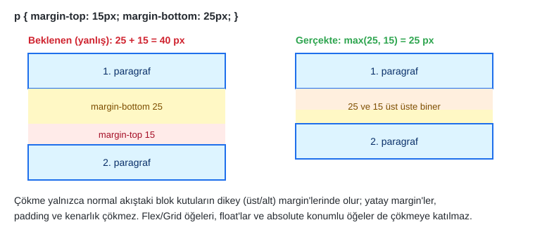

*Şekil 6.9. Dikey kenar boşluğu çökmesi.*

Çökme şu durumlarda **gerçekleşmez**: yatay kenar boşluklarında; dolgu veya kenarlıkla ayrılmış kutularda; esnek (flex) ve ızgara (grid) öğelerinde; yüzen (float) ve mutlak konumlu öğelerde. Sık karşılaşılan bir sürpriz, ilk alt öğenin üst kenar boşluğunun kapsayıcısının dışına "taşması"dır: kapsayıcının üst dolgusu veya kenarlığı yoksa çocuk `<h1>` öğesinin `margin-top` değeri kapsayıcının üst kenar boşluğuyla çöker. Robbins, aralıkların beklenmedik davrandığı durumlarda ilk şüphelenilmesi gereken nedenin bu olduğunu belirtir [3, s. 330]. Çözüm olarak kapsayıcıya küçük bir `padding-top` verilebilir ya da kapsayıcı `display: flow-root` ile yeni bir blok biçimlendirme bağlamına (block formatting context) dönüştürülebilir.

> [!TIP]
> **Güncel hayattan:** Bir haber sitesinde makale başlıkları ve paragraflar arasında tutarlı bir dikey ritim, çoğunlukla yalnızca `margin-bottom` kullanılarak sağlanır. Hem üst hem alt kenar boşluğu verip çökmeye güvenmek yerine tek yönlü boşluk kullanmak, hesabı öngörülebilir kılar.

## 6.4 Dolgu (`padding`)

Dolgu, öğenin içeriği ile kendi kenarlığı arasındaki boşluktur. Sunumda dolgunun "sayfa kenarına göre değil, öğenin kendisine göre" verildiği vurgulanmaktadır; daha doğru bir ifadeyle, **dolgu öğenin içinde, kenar boşluğu ise öğenin dışında** kalır. İkisi de sayfa kenarıyla ilgili değildir. Dolgunun pratikteki iki sonucu vardır: (1) öğenin arka plan rengi dolgu alanını da kaplar, dolayısıyla dolgu "renkli boşluk"tur; (2) `content-box` modelinde dolgu kutunun görünen boyutunu büyütür [2, s. 313].

Dolgu da kenar boşluğu gibi dört ayrı özellikle (`padding-top`, `padding-right`, `padding-bottom`, `padding-left`) veya Şekil 6.7'daki kurala uyan `padding` kısayoluyla yazılır. Değer uzunluk veya yüzde olabilir; `auto` ve negatif değer alamaz. Sunumdaki alıntı bloğu örneği (slayt 166) şu biçimde kısaltılabilir:

```css
blockquote {
  padding: 1em 3em;              /* üst-alt 1em, sağ-sol 3em */
  background-color: #d098d4;
}
```

> [!TIP]
> **Güncel hayattan:** Mobil bankacılık uygulamalarındaki "Para gönder" düğmesi, yazının etrafındaki geniş dolgu sayesinde parmakla rahat dokunulabilir bir hedef hâline gelir. WCAG 2.2, işaretçi hedefleri için en az 24×24 CSS pikselini AA düzeyinde, 44×44 CSS pikselini ise AAA düzeyinde önermektedir [8]. Dokunma hedefini büyütmenin en kolay yolu yazı boyutunu değil, dolguyu artırmaktır.

## 6.5 Kenarlık, Köşe Yuvarlatma, Dış Çizgi ve Gölge

### 6.5.1 Kenarlık Stili: `border-style`

Bir kenarlığın görünmesi için en az stilinin belirtilmesi gerekir; `border-style` özelliğinin varsayılan değeri `none` olduğundan yalnızca renk veya kalınlık vermek kenarlık çizdirmez [9]. Her kenar için ayrı stil `border-top-style`, `border-right-style`, `border-bottom-style` ve `border-left-style` ile verilir. Alabileceği değerler Tablo 6.2'de, görünümleri Şekil 6.10'da verilmiştir.

| Değer | Görünüm |
|---|---|
| `none` | Kenarlık yok (varsayılan); kalınlık sıfır kabul edilir |
| `hidden` | `none` ile aynı; tablo hücrelerinde kenarlık çakışmasında önceliklidir |
| `dotted` | Noktalı çizgi |
| `dashed` | Kesikli çizgi |
| `solid` | Düz, kesintisiz çizgi |
| `double` | Çift çizgi (iki çizgi + aradaki boşluk toplam kalınlığa eşittir) |
| `groove` | Oyuk (içe oyulmuş) görünüm |
| `ridge` | Sırt (dışa çıkıntılı) görünüm |
| `inset` | Kutu içe basılmış gibi görünür |
| `outset` | Kutu dışa kabarık gibi görünür |

*Tablo 6.2. `border-style` değerleri.*

`groove`, `ridge`, `inset` ve `outset` stilleri, kenarlık rengini açık ve koyu tonlara ayırarak üç boyut yanılsaması üretir; görünümleri tarayıcıdan tarayıcıya hafifçe farklılık gösterebilir.

Sunumdaki değer listesinde soru işaretiyle bırakılan `inherit`, aslında kenarlığa özgü bir stil değil, **tüm CSS özelliklerinin alabildiği genel bir anahtar sözcüktür**: öğenin, söz konusu özelliğin değerini ebeveyninden almasını sağlar. Kenarlık özellikleri varsayılan olarak kalıtılmadığı için (bkz. [Bölüm 4](04-css-temelleri.md)) `border-style: inherit` yazıldığında kalıtım açıkça istenmiş olur. `initial` (özelliğin başlangıç değeri) ve `unset` de aynı türden genel anahtar sözcüklerdir.

### 6.5.2 Kenarlık Kalınlığı ve Rengi

Kalınlık `border-width` (veya `border-top-width` gibi tek kenar özellikleri) ile verilir. Değer bir uzunluk ya da `thin`, `medium`, `thick` anahtar sözcüklerinden biridir; anahtar sözcüklerin karşılığı güncel tarayıcılarda sırasıyla 1, 3 ve 5 pikseldir [9]. Renk `border-color` (veya `border-top-color` …) ile verilir; belirtilmezse öğenin metin rengi (`currentColor`) kullanılır. Kalınlık ve renk kısayolları da Şekil 6.7'daki saat yönü kuralına uyar:

```css
#dort-kalinlik {
  border-style: solid;
  border-width: thin medium thick 12px;          /* üst, sağ, alt, sol */
}

#dort-renk {
  border: 8px solid;
  border-color: #1f6feb #2da44e #bf8700 #cf222e;  /* üst, sağ, alt, sol */
}
```

### 6.5.3 `border` Kısayolu ve Tek Kenar Kenarlıklar

Kalınlık, stil ve renk tek bildirimde `border` kısayoluyla yazılır; sıra serbesttir ancak alışılmış yazım "kalınlık stil renk" biçimindedir. Yalnızca bir kenara kenarlık vermek için `border-top`, `border-right`, `border-bottom`, `border-left` kısayolları kullanılır:

```css
.kart     { border: 1px solid #d0d7de; }
.vurgu    { border-left: 6px solid #8250df; }   /* yalnızca sol şerit */
.baslik   { border-bottom: 2px dashed #57606a; }
```

Kısayol yazılırken belirtilmeyen alt özellikler başlangıç değerlerine döner. Örneğin önce `border-color: red;` yazılıp ardından `border: 2px solid;` yazılırsa renk yeniden `currentColor` olur. Bu nedenle kısayol önce, ayrıntı sonra yazılmalıdır.

#### 🛠 Uygulama 6.2: Kenarlık Stilleri Galerisi

**Amaç:** Dokuz `border-style` değerini ve tek kenar özelliklerini karşılaştırmalı olarak görmek.  
**Tahmini süre:** 15 dk

1. `calismalar/bolum-06/kenarlik.html` ve `kenarlik.css` dosyalarını oluşturunuz.
2. Dokuz adet `<div class="kutu …">` ekleyiniz; her birine sınıf adı olarak bir stil (`none`, `dotted`, `dashed`, `solid`, `double`, `groove`, `ridge`, `inset`, `outset`) veriniz ve içine stilin adını yazınız.
3. Kutuları saran öğeye `display: grid; grid-template-columns: repeat(3, 150px); gap: 18px;` uygulayınız (Grid ayrıntıları Bölüm 6.11'de).
4. Tüm kutulara `border-width: 6px` ve uygun bir `border-color` verip her sınıfta yalnızca `border-style` değerini değiştiriniz.
5. Galerinin altına üç kutu daha ekleyiniz: dört kenarı dört farklı stil (`border-top-style` …), dört farklı kalınlık (`thin medium thick 12px`) ve dört farklı renk taşısın.

**Beklenen çıktı:**

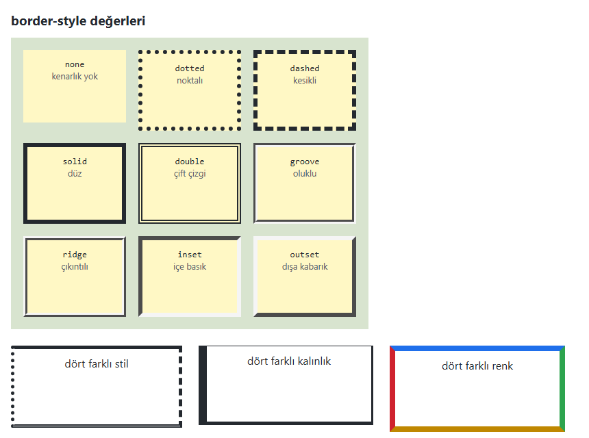

*Şekil 6.10. Uygulama 6.2'nin beklenen ekran görüntüsü.*

**Kendinizi sınayın:** (1) `.solid` kutusundaki `border-style` satırını silip yalnızca `border-color` bırakınız; ne gözlemlediniz? (2) `double` stili 2 piksel kalınlıkta neden tek çizgi gibi görünür?

<details><summary>Örnek çözüm</summary>

Çözüm dosyası: [`codes/06-css-kutu-modeli-yerlesim/uygulama-6-2-kenarlik-galerisi/index.html`](../codes/06-css-kutu-modeli-yerlesim/uygulama-6-2-kenarlik-galerisi/index.html)

</details>

### 6.5.4 Köşe Yuvarlatma: `border-radius`

`border-radius` özelliği kutunun köşelerini yuvarlatır; kenarlık olmasa bile arka plan rengi ve görsel yuvarlatılmış köşeye göre kırpılır [9]. Tek köşe için `border-top-left-radius`, `border-top-right-radius`, `border-bottom-right-radius` ve `border-bottom-left-radius` özellikleri kullanılır. Kısayolda değerler **sol üst köşeden başlayarak saat yönünde** (sol üst, sağ üst, sağ alt, sol alt) okunur.

```css
.r1 { border-top-right-radius: 50px; }
.r6 { border-radius: 36px 40px 60px 20px; }   /* sol üst, sağ üst, sağ alt, sol alt */
.r3 { border-radius: 5px 20px / 40px 60px; }  /* yatay yarıçaplar / dikey yarıçaplar */
.daire { width: 100px; height: 100px; border-radius: 50%; }
.hap   { border-radius: 999px; }               /* kısa kenarın yarısını aşan değer: hap biçimi */
```

Eğik çizgi (`/`) ile ayrılan yazımda ilk grup yatay, ikinci grup dikey yarıçapları verir; böylece köşeler çeyrek daire yerine çeyrek elips olur. Kare bir öğeye `border-radius: 50%` verildiğinde daire, dikdörtgen bir öğeye verildiğinde elips elde edilir. Yarıçap kısa kenarın yarısından büyük verildiğinde tarayıcı değeri ölçekleyerek iki ucu tam yarım daire olan "hap" (pill) biçimini üretir.

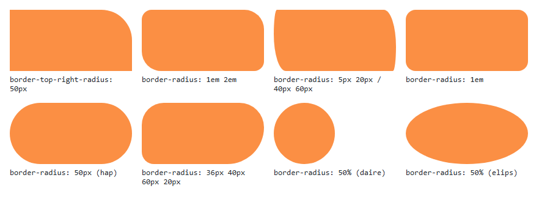

*Şekil 6.11. Örnek 6.3: `border-radius` değerlerinin etkisi ([codes/06-css-kutu-modeli-yerlesim/ornek-6-3-border-radius/](../codes/06-css-kutu-modeli-yerlesim/ornek-6-3-border-radius/index.html)).*

> [!NOTE]
> **Tarihsel not:** Sunumda eski tarayıcılar için `-webkit-border-top-left-radius` ve `-moz-border-radius-topleft` önekli özelliklerin kullanılması önerilmektedir. Bu yazımlar 2008–2011 yıllarında, `border-radius` henüz deneysel iken gerekliydi; dikkat edilirse eski Firefox önekinde köşe adı bile farklı (`topleft`) yazılıyordu. Öneksiz `border-radius` uzun zamandır tüm tarayıcılarda desteklenmektedir; önekli satırlar artık yazılmaz [6]. Sunumdaki şekil altı yazısında geçen `border-radius: 5px 20px; 40px 60px` ifadesindeki noktalı virgül de hatalıdır; eliptik köşe için doğru yazım `5px 20px / 40px 60px` biçimindedir.

### 6.5.5 Dış Çizgi (`outline`) ve Odak Görünürlüğü

`outline` özelliği kenarlığın dışına bir çizgi çizer; görünüm olarak kenarlığa benzese de iki önemli farkı vardır: **yer kaplamaz** (kutunun boyutunu ve komşuların yerini değiştirmez) ve kenarlar için ayrı ayrı tanımlanamaz. `outline-offset` ile çizginin kutudan uzaklığı ayarlanabilir [6].

Tarayıcılar, klavyeyle (`Tab` tuşu) gezinen kullanıcıya hangi bağlantının veya düğmenin seçili olduğunu göstermek için odaklanan öğeye varsayılan bir dış çizgi uygular. Tasarım kaygısıyla yazılan `outline: none;` bildirimi bu göstergeyi kaldırır ve klavye kullanıcılarının sayfada nerede olduklarını görememesine yol açar. WCAG 2.2'nin 2.4.7 "Odak Görünürlüğü" (Focus Visible) başarı ölçütü, klavyeyle kullanılabilen her arayüzde odak göstergesinin görünür olmasını şart koşar [8].

```css
/* Yanlış: odağı tamamen gizler */
a:focus { outline: none; }

/* Doğru: yalnızca klavye odağında belirgin bir çizgi göster */
.dugme:focus-visible {
  outline: 3px solid #f2cc60;
  outline-offset: 3px;
}
```

`:focus-visible` sözde sınıfı, tarayıcının odak göstergesine gerçekten ihtiyaç duyulduğuna karar verdiği durumlarda (çoğunlukla klavye ile gezinmede) eşleşir; fare ile tıklamada çerçeve görünmez.

> [!WARNING]
> **Erişilebilirlik:** `outline: none` yazıldıysa yerine mutlaka eşdeğer bir odak stili tanımlanmalıdır. WCAG 2.2 ile eklenen 2.4.11 "Odak Gizlenmez (En Az)" (Focus Not Obscured) ölçütü ayrıca, odaklanan öğenin yapışkan menü veya çerez bildirimi gibi yazar tarafından eklenen içerikler tarafından tamamen örtülmemesini ister [8]. Bu durum Bölüm 6.8'deki `position: sticky` ve `fixed` kullanımında göz önünde tutulmalıdır.

### 6.5.6 Kutu Gölgesi: `box-shadow`

`box-shadow` kutuya bir veya daha fazla gölge ekler. Değerler sırasıyla yatay kayma, dikey kayma, bulanıklık yarıçapı, yayılma (isteğe bağlı) ve renktir; başa `inset` yazılırsa gölge kutunun içine düşer [9]:

```css
.kart       { box-shadow: 0 4px 12px rgba(0, 0, 0, 0.12); }
.kart:hover { box-shadow: 0 8px 20px rgba(0, 0, 0, 0.20); }
.cukur      { box-shadow: inset 0 2px 4px rgba(0, 0, 0, 0.25); }
```

Gölge de dış çizgi gibi yer kaplamaz. Yumuşak, düşük opaklıklı gölgeler kart tasarımlarında derinlik algısı oluşturur; koyu ve keskin gölgeler ise genellikle eski görünümlü bir izlenim bırakır.

#### 🛠 Uygulama 6.3: Profil Kartı

**Amaç:** Dolgu, kenarlık, köşe yuvarlatma, gölge ve odak stilini tek bir bileşende birlikte kullanmak.  
**Tahmini süre:** 20 dk

1. `calismalar/bolum-06/profil/` klasöründe `index.html`, `style.css` ve 96×96 boyutlu bir profil görseli (kendi fotoğrafınız veya basit bir SVG) hazırlayınız.
2. `<article class="kart">` içine görsel, `<h1>` ad soyad, unvan paragrafı, kısa bir tanıtım, `<ul class="etiketler">` ile üç ilgi alanı ve `mailto:` bağlantılı bir "İletişime geç" düğmesi ekleyiniz.
3. `style.css` dosyasını `box-sizing: border-box` sıfırlamasıyla başlatınız.
4. Karta `max-width: 320px; margin: 0 auto; padding: 24px;`, `border-radius: 12px`, ince gri bir kenarlık ve üst kenara 6 piksel kalınlığında renkli bir `border-top` veriniz; yumuşak bir `box-shadow` ekleyiniz.
5. Görseli `border-radius: 50%` ile daire yapınız; etiketleri `display: inline-block` ve `border-radius: 999px` ile hap biçimine getiriniz.
6. Düğmeye `:hover` ve `:focus-visible` stilleri tanımlayınız. Sayfada `Tab` tuşuyla gezinerek odak çerçevesinin göründüğünü doğrulayınız.

**Beklenen çıktı:**

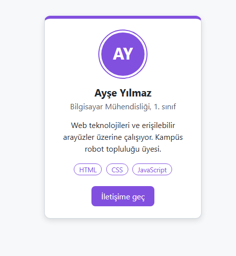

*Şekil 6.12. Uygulama 6.3'ün beklenen ekran görüntüsü.*

**Kendinizi sınayın:** (1) Karttaki `border-top` satırını `border` kısayolundan *önce* yazarsanız ne olur? Neden? (2) Görseldeki beyaz halka (`border`) ile mor halkanın (`outline`) kutu boyutuna etkisini DevTools ile karşılaştırınız.

<details><summary>Örnek çözüm</summary>

Çözüm dosyası: [`codes/06-css-kutu-modeli-yerlesim/uygulama-6-3-profil-karti/index.html`](../codes/06-css-kutu-modeli-yerlesim/uygulama-6-3-profil-karti/index.html)

</details>

## 6.6 Taşma ve Boyut Sınırları

### 6.6.1 `overflow`

İçerik, kendisine verilen kutuya sığmadığında ne olacağını `overflow` özelliği belirler [10], [2, s. 306]:

| Değer | Davranış |
|---|---|
| `visible` | Varsayılan. Taşan içerik kutunun dışına çizilir; komşu öğelerle çakışabilir. |
| `hidden` | Taşan kısım kırpılır ve görünmez; kullanıcı kaydıramaz. |
| `scroll` | İçerik taşsın taşmasın kaydırma çubukları her zaman gösterilir. |
| `auto` | Kaydırma çubuğu yalnızca içerik taştığında gösterilir. |
| `clip` | `hidden` gibi kırpar; ancak programla da kaydırılamaz. |

*Tablo 6.3. `overflow` değerleri.*

Yatay ve dikey taşma `overflow-x` ve `overflow-y` ile ayrı ayrı denetlenebilir. Örneğin geniş bir tabloyu dar ekranda kendi içinde yatay kaydırmak için tabloyu saran öğeye `overflow-x: auto` verilir (bkz. [Bölüm 9](09-duyarli-tasarim.md)). Tek satıra sığmayan bir metni üç noktayla kesmek için üç özellik birlikte kullanılır:

```css
.tek-satir {
  white-space: nowrap;       /* satır kaydırma yok */
  overflow: hidden;          /* taşanı gizle */
  text-overflow: ellipsis;   /* kesilen yere … koy */
}
```

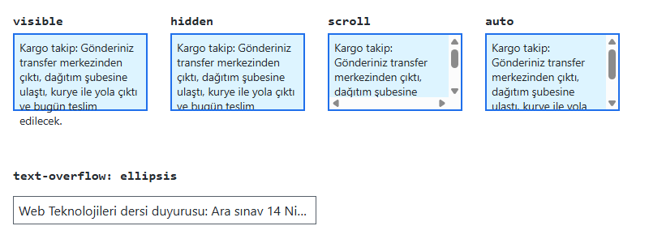

*Şekil 6.13. Örnek 6.4: aynı kargo takip metninin dört `overflow` değerindeki görünümü ve `text-overflow: ellipsis` ([codes/06-css-kutu-modeli-yerlesim/ornek-6-4-overflow/](../codes/06-css-kutu-modeli-yerlesim/ornek-6-4-overflow/index.html)).*

> [!WARNING]
> `overflow: hidden` içeriği yalnızca görsel olarak gizler; kullanıcı metni hiçbir şekilde okuyamaz. Önemli bilgi içeren alanlarda `hidden` yerine `auto` tercih edilmeli, ayrıca sabit `height` vermekten kaçınılmalıdır. Kullanıcı tarayıcıda yazı boyutunu %200'e büyüttüğünde sabit yükseklikli kutular metni kesebilir; bu da WCAG 2.2'nin 1.4.4 "Metni Yeniden Boyutlandırma" ölçütüyle çelişir [8].

### 6.6.2 `min-width`, `max-width`, `min-height`, `max-height` ve `aspect-ratio`

Sabit boyut yerine sınır vermek, farklı ekran genişliklerine uyum sağlamanın en basit yoludur [4]:

```css
.makale {
  max-width: 70ch;        /* geniş ekranda satırlar okunamayacak kadar uzamasın */
}
.duyuru {
  min-height: 120px;      /* içerik azsa en az 120 px, çoksa büyüyebilir */
}
img {
  max-width: 100%;        /* görsel kapsayıcısından taşmasın */
  height: auto;           /* en-boy oranı korunsun */
}
.video-kapak {
  aspect-ratio: 16 / 9;   /* genişlik değişse de oran sabit */
  object-fit: cover;      /* görsel kutuyu doldursun, taşan kırpılsın */
}
```

`min-height`, `height` yerine kullanıldığında içerik arttıkça kutu da büyür ve taşma oluşmaz. `aspect-ratio` özelliği video çerçeveleri, ürün görselleri ve harita kutuları gibi oranı sabit kalması gereken alanlarda, eskiden kullanılan "yüzde dolgu hilesi"nin yerini almıştır [6].

## 6.7 Görüntülenme Türü: `display`

### 6.7.1 Normal Akış: Blok ve Satır İçi Kutular

CSS'te özel bir yerleşim kuralı verilmediğinde öğeler **normal akış** (normal flow) içinde, HTML kaynağındaki sıralarına göre yerleşir [3, s. 341], [2, s. 365]. Normal akışta iki temel kutu türü vardır (Şekil 6.14):

- **Blok düzeyi (block-level) kutular** (`<div>`, `<p>`, `<h1>`–`<h6>`, `<ul>`, `<section>` …) yeni bir satırda başlar, varsayılan olarak kapsayıcının tüm genişliğini kaplar ve yukarıdan aşağıya dizilir.
- **Satır içi (inline) kutular** (`<span>`, `<a>`, `<strong>`, `<em>`, `` …) metin gibi soldan sağa akar; satır dolunca alt satıra geçer. `width` ve `height` değerleri satır içi kutularda yok sayılır, dikey kenar boşlukları da satır yüksekliğini etkilemez.

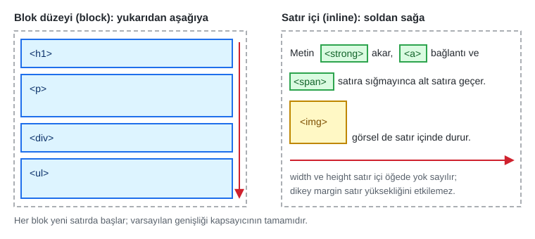

*Şekil 6.14. Normal akış: blok düzeyi ve satır içi kutular.*

`display` özelliği, bir öğenin hangi tür kutu ürettiğini değiştirir [11]. Sunumda bu özellik "katman içerisinde üretilmiş kutunun tipini tanımlar" biçiminde ifade edilmiştir; daha açık bir ifadeyle `display`, öğenin **dışarıya karşı** (çevresindeki akışta) nasıl davranacağını ve **içindeki** alt öğeleri hangi kurala göre yerleştireceğini belirler. Örneğin `display: flex` öğeyi dışarıya karşı blok gibi davrandırır, içindeki çocukları ise Flexbox kurallarına göre dizer.

### 6.7.2 Temel Değerler

| Değer | Davranış | Tipik kullanım |
|---|---|---|
| `block` | Yeni satırda başlar, tüm genişliği kaplar, boyutlandırılabilir | `<span>` veya `<a>` öğesini blok yapmak |
| `inline` | Satır içinde akar; `width`/`height` yok sayılır | `<li>` öğelerini yan yana dizmek (eski yöntem) |
| `inline-block` | Satır içinde akar ama `width`/`height`/dikey `margin` uygulanır | Etiket, rozet, küçük düğme |
| `none` | Öğe hiç üretilmez; yer kaplamaz, ekran okuyucu da okumaz | Kapalı menü, gizli sekme içeriği |
| `list-item` | Blok kutu + liste imi (`<li>` varsayılanı) | Liste olmayan öğeye im eklemek |
| `flex` / `inline-flex` | İçeriği Flexbox ile dizer | Menü, kart içi hizalama (Bölüm 6.10) |
| `grid` / `inline-grid` | İçeriği ızgara ile dizer | Sayfa iskeleti, kart ızgarası (Bölüm 6.11) |
| `contents` | Öğenin kendi kutusu kaybolur; çocukları ebeveynin düzenine katılır | İleri düzey ızgara düzenleri |

*Tablo 6.4. Sık kullanılan `display` değerleri.*

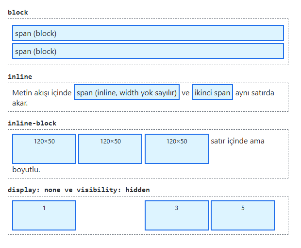

*Şekil 6.15. Örnek 6.5: aynı `<span>` öğelerinin farklı `display` değerleriyle görünümü; en altta 2 numaralı kutu `visibility: hidden` ile görünmez olsa da yerini korur, 4 numaralı kutu `display: none` ile tamamen kaybolur ([codes/06-css-kutu-modeli-yerlesim/ornek-6-5-display/](../codes/06-css-kutu-modeli-yerlesim/ornek-6-5-display/index.html)).*

**`display: none` ile `visibility: hidden` farkı:** `display: none` öğeyi düzenden tamamen çıkarır; sayfa öğe hiç yokmuş gibi çizilir. `visibility: hidden` ise öğeyi görünmez yapar ancak kapladığı alan korunur; geride boşluk kalır. Her ikisinde de öğe ekran okuyuculara sunulmaz. Yalnızca görsel olarak gizleyip ekran okuyucuya okutmak gereken durumlarda (ör. simge düğmesinin metin etiketi) farklı bir "yalnızca ekran okuyucu" (visually hidden) tekniği kullanılır [6].

`table`, `table-row`, `table-cell`, `table-caption`, `inline-table`, `table-header-group` gibi değerler, HTML tablo öğelerinin varsayılan davranışlarını CSS ile tanımlar ve tablo olmayan öğelerin tablo gibi dizilmesini sağlar. Flexbox ve Grid yaygınlaşmadan önce dikey ortalama ve eşit yükseklikli sütunlar için `display: table-cell` sıkça kullanılırdı; bugün bu amaçla Flexbox veya Grid tercih edilir. `ruby`, `ruby-base`, `ruby-text` değerleri ise Doğu Asya dillerinde sözcüklerin üstüne okunuş notu yazmak için kullanılan `<ruby>` öğesinin kutularını tanımlar.

> [!NOTE]
> **Tarihsel not:** Sunumda "CSS3 ile yeni gelen" değerler arasında `run-in` ve `compact` sayılmaktadır. `compact`, CSS 2 taslağında yer alıp CSS 2.1'de kaldırılmış; `run-in` ise CSS Display Level 3 taslağında tanımlı olmasına karşın güncel tarayıcıların hiçbirinde desteklenmemektedir [11], [6]. Bu değerler gerçek projelerde kullanılmaz.

> [!IMPORTANT]
> Bir öğeye `position: absolute`, `position: fixed` veya `float` verildiğinde tarayıcı, öğenin `display` değerini blok düzeyine dönüştürür (blockification). Bu nedenle satır içi bir `<span>` öğesine bu özelliklerden biri verildiğinde ayrıca `display: block` yazmadan `width` ve `height` uygulanabilir [11].

## 6.8 Konumlandırma: `position`

### 6.8.1 Beş Değer

`position` özelliği, öğenin normal akış içindeki yerinin nasıl hesaplanacağını belirler ve beş değer alır [12], [13, ss. 226–230]. `top`, `right`, `bottom`, `left` ofset özellikleri (offset properties) öğenin yerini ince ayarlamak için kullanılır; ancak bu özellikler **yalnızca `static` dışındaki değerlerde** etkilidir.

- **`static`:** Varsayılan değerdir; CSS'te ayrıca yazılmasına gerek yoktur. Öğe normal akıştaki yerinde durur, ofset özellikleri yok sayılır.
- **`relative` (göreli):** Öğe, *kendi normal konumuna göre* kaydırılır. Sunumdaki benzetmeyle öğe "eski yerinde hâlâ oturuyor ama hafifçe ötelenmiş"tir: akıştaki asıl yeri korunur, diğer öğeler oraya girmez. `left: 30px`, öğeyi sol kenarından 30 piksel **sağa** iter. `relative` en sık, içindeki `absolute` öğeler için referans noktası oluşturmak amacıyla kullanılır.
- **`absolute` (mutlak):** Öğe normal akıştan tamamen çıkar; yeri boşalır ve diğer öğeler sanki yokmuş gibi yerleşir. Konumu, **en yakın konumlandırılmış ataya** (positioned ancestor), yani `position` değeri `static` dışında olan en yakın üst öğeye göre hesaplanır. Böyle bir ata yoksa başlangıç kapsayıcı bloğu (initial containing block; pratikte sayfanın ilk görünüm alanı boyutundaki dikdörtgen) referans alınır [3, s. 359].
- **`fixed` (sabit):** Öğe akıştan çıkar ve tarayıcı penceresinin görünür alanına (viewport) göre konumlanır; sayfa kaydırılsa da ekrandaki yerinden oynamaz [2, ss. 363–364].
- **`sticky` (yapışkan):** Öğe, kaydırma belirtilen eşiğe ulaşana kadar normal akışta `relative` gibi davranır; eşik aşılınca `fixed` gibi o noktaya yapışır. `fixed` öğeden farkı, yalnızca **kendi kapsayıcısının sınırları içinde** yapışık kalması ve akıştaki yerini korumasıdır. Yapışmanın gerçekleşmesi için en az bir eşik (ör. `top: 0`) verilmelidir.

```css
.menu    { position: sticky; top: 0; }                    /* kaydırınca üste yapışır */
.kart    { position: relative; }                          /* rozet için referans */
.rozet   { position: absolute; top: 12px; left: -8px; }   /* kartın sol üstüne */
.yukari  { position: fixed; right: 16px; bottom: 16px; }  /* pencerenin sağ altında */
```

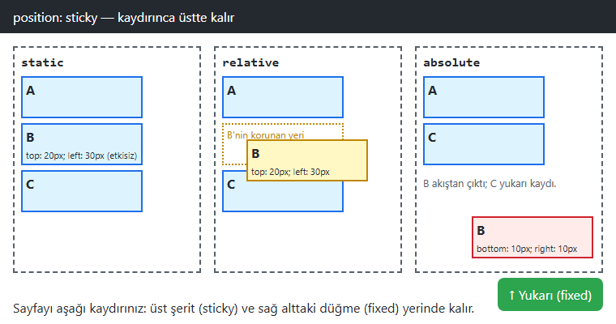

*Şekil 6.16. Örnek 6.6: `static` kutuda ofsetler etkisizdir; `relative` kutu kaydırılmış ama asıl yeri (noktalı çerçeve) korunmuştur; `absolute` kutu akıştan çıkıp kapsayıcısının sağ alt köşesine yerleşmiştir. Üstteki koyu şerit `sticky`, sağ alttaki yeşil düğme `fixed` konumludur ([codes/06-css-kutu-modeli-yerlesim/ornek-6-6-position/](../codes/06-css-kutu-modeli-yerlesim/ornek-6-6-position/index.html)).*

Mutlak konumlu bir öğenin referans aldığı kutuyu bulmak için tarayıcının izlediği yol Şekil 6.17'daki gibi özetlenebilir:

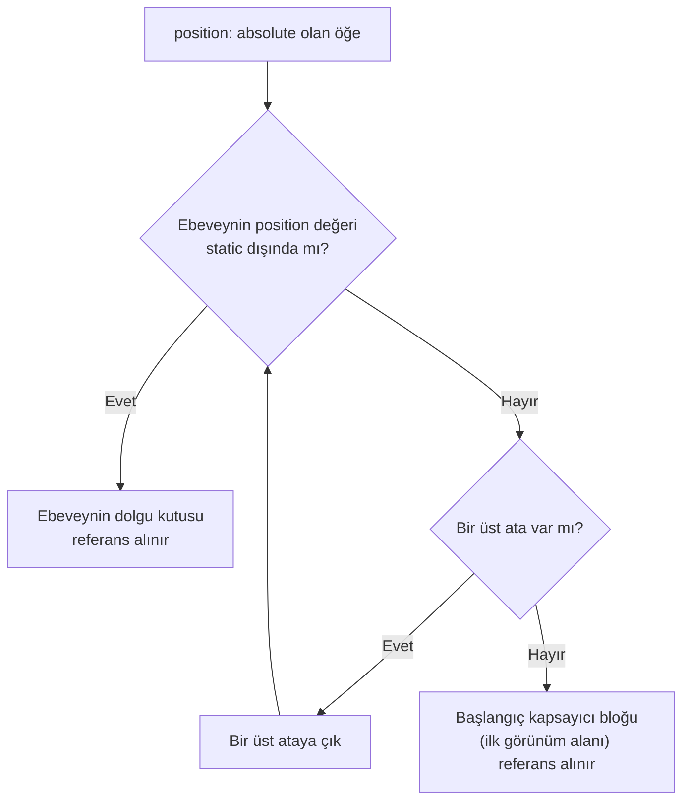

*Şekil 6.17. `position: absolute` öğenin kapsayıcı bloğunun belirlenmesi.*

`top`, `right`, `bottom` ve `left` dört ofsetin tamamı tek bildirimde `inset` kısayoluyla yazılabilir. Örneğin `inset: 0;` öğeyi referans kutusunun dört kenarına yaslar; bu, bir görselin üzerine yarı saydam bir katman yerleştirmek için sık kullanılan bir kalıptır.

### 6.8.2 Üst Üste Binme: `z-index` ve İstif Bağlamı

Normal akıştan çıkan öğeler birbirinin üzerine binebilir. Varsayılan olarak HTML'de sonra gelen öğe üstte çizilir. `z-index` özelliği, konumlandırılmış öğelerin (ve esnek/ızgara öğelerinin) ekrana dik eksendeki sırasını belirler; büyük değer üstte görünür [3, s. 368], [12].

`z-index` değerleri sayfanın tamamında tek bir sıralama oluşturmaz. `z-index` değeri verilmiş konumlu bir öğe, `opacity` değeri 1'den küçük bir öğe veya `transform` uygulanmış bir öğe gibi pek çok durum yeni bir **istif bağlamı** (stacking context) oluşturur; bu bağlamın içindeki çocukların `z-index` değerleri yalnızca kendi aralarında karşılaştırılır [6]. Bu nedenle `z-index: 9999` verilen bir açılır menünün yine de başka bir öğenin altında kalması, çoğunlukla ebeveyninin ayrı bir istif bağlamı oluşturmasından kaynaklanır.

> [!TIP]
> **Güncel hayattan:** Harita uygulamalarında haritanın üzerinde duran yakınlaştırma düğmeleri ve konum işareti (`absolute`), e-ticaret sitelerinde aşağı kaydırıldığında üstte kalan arama çubuğu (`sticky`), mobil sitelerde sağ altta duran "canlı destek" balonu (`fixed`) ve bunların hepsinin üzerinde açılan çerez onay penceresi (`z-index`) bu bölümün konularıdır.

#### 🛠 Uygulama 6.4: Rozet ve Yapışkan Menü

**Amaç:** `relative`–`absolute` çiftiyle rozet konumlandırmak ve `sticky` ile kaydırmada üstte kalan bir menü yapmak.  
**Tahmini süre:** 20 dk

1. `calismalar/bolum-06/kitabevi/` klasöründe `index.html` ve `style.css` oluşturunuz.
2. Sayfaya bir `<header>` (site adı), `<nav aria-label="Ana menü">` içinde dört bağlantı (sonuncusu "Sepet") ve `<main>` içinde bir ürün kartı (`<article class="urun">`) ekleyiniz. `<main>` öğesine `min-height: 1200px` vererek sayfayı kaydırılabilir yapınız.
3. Menüye `position: sticky; top: 0; z-index: 100;` uygulayınız; bağlantıları yan yana dizmek için menüye `display: flex` veriniz.
4. Sepet bağlantısına `position: relative` ve `aria-label="Sepet, 3 ürün"` veriniz; içine eklediğiniz `<span class="sayac" aria-hidden="true">3</span>` öğesini `position: absolute; top: -2px; right: -8px;` ile sağ üst köşeye yerleştiriniz ve `border-radius` ile yuvarlak yapınız.
5. Ürün kartına `position: relative` veriniz; içindeki "%20 indirim" etiketini `position: absolute; top: 12px; left: -8px;` ile kartın sol kenarından taşacak biçimde konumlandırınız.
6. Sayfayı kaydırarak menünün üste yapıştığını, rozetlerin ise kendi kapsayıcılarıyla birlikte hareket ettiğini gözlemleyiniz. Ardından karttan `position: relative` satırını silip rozetin nereye gittiğini inceleyiniz.

**Beklenen çıktı:**

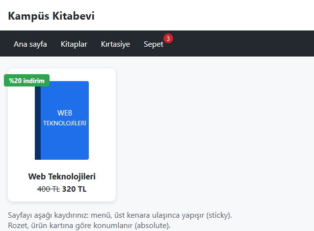

*Şekil 6.18. Uygulama 6.4'ün beklenen ekran görüntüsü.*

**Kendinizi sınayın:** (1) Menüde `sticky` yerine `fixed` kullanırsanız `<main>` içeriğinin ilk satırına ne olur, nasıl düzeltirsiniz? (2) Sepet bağlantısındaki `aria-label` ile sayaçtaki `aria-hidden="true"` niteliği ekran okuyucu kullanıcısı için ne sağlar?

<details><summary>Örnek çözüm</summary>

Çözüm dosyası: [`codes/06-css-kutu-modeli-yerlesim/uygulama-6-4-rozet-ve-yapiskan-menu/index.html`](../codes/06-css-kutu-modeli-yerlesim/uygulama-6-4-rozet-ve-yapiskan-menu/index.html)

</details>

## 6.9 Yüzdürme: `float` ve `clear`

`float` özelliği (`left`, `right`, `none`), bir öğeyi kapsayıcısının sol veya sağ kenarına yaslar ve öğeyi normal akıştan kısmen çıkarır: sonraki blok kutular yüzen öğe yokmuş gibi yerleşir, ancak bu kutulardaki **metin ve satır içi içerik yüzen öğenin etrafından akar** [3, ss. 342–347], [2, ss. 370–375]. `clear` özelliği (`left`, `right`, `both`) ise bir öğenin, belirtilen yönde yüzen öğelerin altından başlamasını sağlar.

```css
.sola {
  float: left;
  margin: 0 14px 8px 0;   /* metin görsele yapışmasın */
}
.temiz {
  clear: both;            /* yüzen görselin altından başla */
}
```

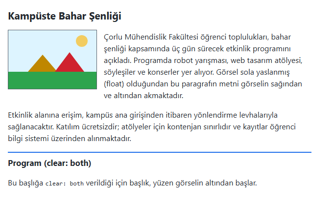

*Şekil 6.19. Örnek 6.7: `float: left` ile görselin etrafından akan metin ve `clear: both` ([codes/06-css-kutu-modeli-yerlesim/ornek-6-7-float/](../codes/06-css-kutu-modeli-yerlesim/ornek-6-7-float/index.html)).*

`float` özelliği aslında yalnızca bu amaç, yani gazete ve dergilerdeki gibi metni bir görselin etrafında akıtmak için tasarlanmıştır. Bugün de **meşru ve önerilen kullanımı budur**.

> [!NOTE]
> **Tarihsel not:** 2000'li ve 2010'lu yıllarda çok sütunlu sayfa düzenleri, sütunların `float: left` ile yan yana dizilmesiyle kuruluyordu [3, ss. 382–391], [13, s. 202]. Bu yöntem, kapsayıcının yüzen çocuklarını içermemesi ("çöken kapsayıcı") gibi sorunlar nedeniyle `clearfix` adı verilen ek kurallar gerektiriyordu. Flexbox ve Grid yaygınlaştıktan sonra float tabanlı düzen terk edilmiştir. Kapsayıcının yüzen öğeleri içermesi gerektiğinde bugün kısa ve standart çözüm `display: flow-root` bildirimidir [11].

## 6.10 Esnek Kutu Düzeni: Flexbox

### 6.10.1 Temel Kavramlar

Esnek kutu düzeni (Flexible Box Layout, kısaca Flexbox), öğeleri **tek bir eksen boyunca**, yani bir satır veya bir sütun hâlinde dizmek, aralarındaki boşluğu paylaştırmak ve hizalamak için tasarlanmıştır [14], [13, s. 374]. Bir öğeye `display: flex` verildiğinde bu öğe **esnek kapsayıcı** (flex container), doğrudan çocukları ise **esnek öğe** (flex item) olur.

Flexbox'ın anlaşılmasında iki eksen kavramı merkezidir (Şekil 6.20):

- **Ana eksen (main axis):** Öğelerin dizildiği yöndür. `flex-direction: row` (varsayılan) iken soldan sağa yataydır; `column` iken yukarıdan aşağıya dikeydir. Ana eksendeki hizalamayı `justify-content` yönetir.
- **Çapraz eksen (cross axis):** Ana eksene diktir. Çapraz eksendeki hizalamayı `align-items` yönetir.

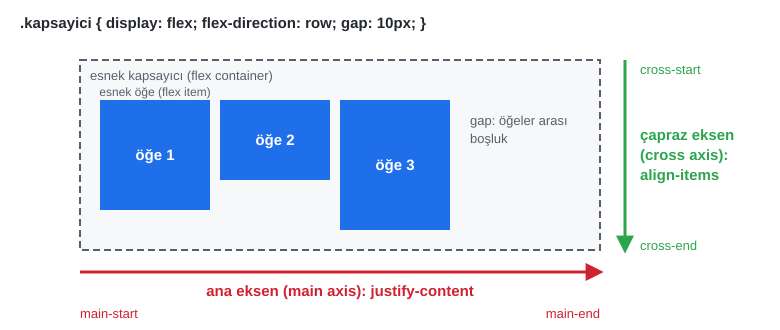

*Şekil 6.20. Flexbox'ta ana eksen, çapraz eksen ve ilgili hizalama özellikleri.*

### 6.10.2 Kapsayıcı Özellikleri

| Özellik | Sık kullanılan değerler | Görevi |
|---|---|---|
| `flex-direction` | `row`, `column`, `row-reverse`, `column-reverse` | Ana eksenin yönü |
| `flex-wrap` | `nowrap` (varsayılan), `wrap` | Sığmayan öğeler alt satıra geçsin mi? |
| `justify-content` | `flex-start`, `center`, `flex-end`, `space-between`, `space-around`, `space-evenly` | Ana eksende hizalama ve boşluk dağıtımı |
| `align-items` | `stretch` (varsayılan), `flex-start`, `center`, `flex-end`, `baseline` | Çapraz eksende hizalama |
| `gap` | `12px`, `1rem 2rem` | Öğeler arasındaki boşluk (kenarlara eklenmez) |

*Tablo 6.5. Esnek kapsayıcı özellikleri.*

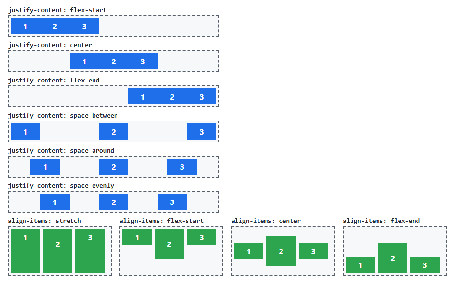

*Şekil 6.21. Örnek 6.8: `justify-content` değerleri (üstte) ve `align-items` değerleri (altta) ([codes/06-css-kutu-modeli-yerlesim/ornek-6-8-flexbox/](../codes/06-css-kutu-modeli-yerlesim/ornek-6-8-flexbox/index.html)).*

Flexbox'ın en çok sevilen yanlarından biri, uzun yıllar zor bir sorun olarak bilinen yatay ve dikey ortalamayı üç satırda çözmesidir:

```css
.ortala {
  display: flex;
  justify-content: center;   /* yatay (ana eksen) */
  align-items: center;       /* dikey (çapraz eksen) */
}
```

### 6.10.3 Öğe Özellikleri ve `flex: 1`

Esnek öğelerin kapsayıcıdaki boş alanı nasıl paylaşacağını üç özellik belirler: `flex-grow` (boş alan varken büyüme payı), `flex-shrink` (alan yetmezken küçülme payı) ve `flex-basis` (paylaştırma öncesi başlangıç boyutu). Bu üçü genellikle `flex` kısayoluyla yazılır [14]:

```css
.arama-kutusu { flex: 1; }       /* kalan tüm alanı kapla (flex: 1 1 0) */
.kenar-cubugu { flex: 0 0 240px; } /* büyüme yok, küçülme yok, 240 px sabit */
```

`flex: 1` verilen birden fazla öğe, boş alanı eşit paylaşır; birine `flex: 2` verilirse o öğe diğerlerinin iki katı pay alır. Tek bir öğenin çapraz eksendeki hizası `align-self` ile, görsel sırası ise `order` ile değiştirilebilir.

> [!WARNING]
> **Erişilebilirlik:** `order` ve `flex-direction: row-reverse` yalnızca *görsel* sırayı değiştirir; ekran okuyucuların okuma sırası ve `Tab` tuşuyla gezinme sırası HTML kaynağındaki sırada kalır. Görsel sıranın kaynak sırasından çok farklı olması klavye kullanıcılarının kafasını karıştırır. Anlamlı sıra değişikliği gerekiyorsa HTML'deki sıra değiştirilmelidir.

#### 🛠 Uygulama 6.5: Flexbox ile Gezinme Çubuğu

**Amaç:** Logo, menü ve giriş düğmesinden oluşan üst çubuğu Flexbox ile hizalamak.  
**Tahmini süre:** 15 dk

1. `calismalar/bolum-06/gezinme/` klasöründe `index.html` ve `style.css` oluşturunuz.
2. `<header class="ust-cubuk">` içine sırasıyla bir logo bağlantısı, `<nav aria-label="Ana menü">` içinde dört öğeli bir `<ul class="menu">` ve "OBS Giriş" bağlantısı ekleyiniz. Etkin sayfanın bağlantısına `aria-current="page"` niteliği veriniz.
3. `.ust-cubuk` öğesine `display: flex; justify-content: space-between; align-items: center; gap: 12px;` uygulayınız.
4. `.menu` öğesini de esnek kapsayıcı yapınız (`display: flex; gap: 4px; list-style: none; margin: 0; padding: 0;`).
5. Bağlantılara dolgu ve `border-radius` veriniz; `:hover`, `:focus-visible` ve `[aria-current="page"]` durumlarına arka plan rengi tanımlayınız.
6. `.ust-cubuk` öğesine `flex-wrap: wrap` ekleyip tarayıcı penceresini daraltınız; öğelerin alt satıra nasıl geçtiğini gözlemleyiniz (Şekil 6.22, alt).

**Beklenen çıktı:**

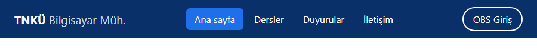

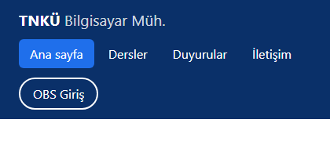

*Şekil 6.22. Uygulama 6.5: 900 piksel genişlikte (üstte) ve 420 piksel genişlikte `flex-wrap: wrap` ile sarılmış hâli (altta).*

**Kendinizi sınayın:** (1) `justify-content: space-between` yerine menüye `margin-left: auto` vererek aynı düzeni kurunuz. (2) `align-items: center` satırını silince ne değişti?

<details><summary>Örnek çözüm</summary>

Çözüm dosyası: [`codes/06-css-kutu-modeli-yerlesim/uygulama-6-5-flex-gezinme/index.html`](../codes/06-css-kutu-modeli-yerlesim/uygulama-6-5-flex-gezinme/index.html)

</details>

## 6.11 Izgara Düzeni: CSS Grid

### 6.11.1 Sütunlar, Satırlar ve `fr` Birimi

CSS Izgara Düzeni (Grid Layout), öğeleri **satırlar ve sütunlar** hâlinde, yani iki boyutta yerleştirmek için tasarlanmıştır [15], [13, ss. 219–221]. Bir öğeye `display: grid` verildiğinde bu öğe ızgara kapsayıcısı (grid container), doğrudan çocukları ızgara öğesi (grid item) olur. Izgaranın sütunları `grid-template-columns`, satırları `grid-template-rows` ile tanımlanır; hücreler arasındaki boşluk `gap` ile verilir.

Grid ile birlikte gelen `fr` (fraction, pay) birimi, sabit ölçüler ve boşluklar düşüldükten sonra **kalan alanın bir payını** ifade eder:

```css
.a { grid-template-columns: 200px 1fr 2fr; }               /* 200 px; kalan alan 1:2 paylaşılır */
.b { grid-template-columns: repeat(4, 1fr); gap: 12px; }   /* dört eşit sütun */
.b .genis { grid-column: span 2; }                         /* iki sütun kaplayan öğe */
.c { grid-template-columns: repeat(auto-fit, minmax(140px, 1fr)); }
```

- `repeat(4, 1fr)` ifadesi `1fr 1fr 1fr 1fr` yazımının kısaltmasıdır.
- `minmax(140px, 1fr)` bir sütunun en az 140 piksel, en çok bir pay genişliğinde olabileceğini söyler.
- `repeat(auto-fit, minmax(140px, 1fr))` kalıbı, kapsayıcıya en az 140 piksellik kaç sütun sığıyorsa o kadar sütun oluşturur; **medya sorgusu yazmadan** sütun sayısının ekran genişliğine göre değişmesini sağlar. `auto-fill` ise boş kalan sütun izlerini de korur. Bu kalıp [Bölüm 9](09-duyarli-tasarim.md)'da duyarlı tasarım bağlamında yeniden ele alınmaktadır.

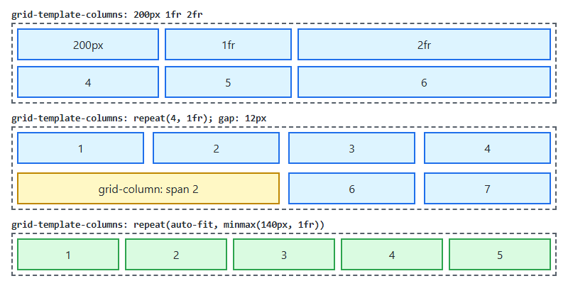

*Şekil 6.23. Örnek 6.9: sabit ve `fr` sütunlar, `repeat()` ile eşit sütunlar ve `span 2`, `auto-fit` ile kendiliğinden sütun sayısı ([codes/06-css-kutu-modeli-yerlesim/ornek-6-9-grid/](../codes/06-css-kutu-modeli-yerlesim/ornek-6-9-grid/index.html)).*

### 6.11.2 Adlandırılmış Alanlar: `grid-template-areas`

`grid-template-areas` özelliği ızgarayı adeta bir çizim gibi tarif etmeyi sağlar. Her tırnak içindeki dizge bir satırı, dizgedeki her sözcük bir hücreyi temsil eder; aynı adın tekrarlanması o alanın birden fazla hücreye yayıldığını gösterir. Öğeler daha sonra `grid-area` özelliğiyle bu alanlara atanır:

```css
.sayfa {
  display: grid;
  grid-template-columns: 180px 1fr 220px;
  grid-template-rows: auto 1fr auto;
  grid-template-areas:
    "header header header"
    "nav    main   aside"
    "footer footer footer";
  gap: 12px;
  min-height: 100vh;
}
header { grid-area: header; }
nav    { grid-area: nav; }
main   { grid-area: main; }
aside  { grid-area: aside; }
footer { grid-area: footer; }
```

Bu yaklaşımın önemli bir yararı, HTML'de anlamsal öğelerin (`<header>`, `<nav>`, `<main>`, `<aside>`, `<footer>`) mantıksal sırada kalabilmesi, görsel yerleşimin ise tamamen CSS'e bırakılmasıdır. Dar ekranda tek sütuna geçmek için yalnızca `grid-template-areas` ve `grid-template-columns` değerlerini bir medya sorgusu içinde yeniden tanımlamak yeterlidir.

> [!TIP]
> **Güncel hayattan:** YouTube veya Netflix gibi video platformlarının ana sayfasındaki küçük resim ızgaraları, pencere daraldıkça sütun sayısını azaltır; bu davranış `repeat(auto-fill, minmax(…))` kalıbıyla kolayca elde edilebilir. Üniversite bilgi sistemlerinin "üst bilgi + sol menü + içerik + alt bilgi" iskeleti ise tipik bir `grid-template-areas` uygulamasıdır.

#### 🛠 Uygulama 6.6: Grid ile Anlamsal Sayfa İskeleti

**Amaç:** `header`, `nav`, `main`, `aside`, `footer` öğelerinden oluşan bir sayfa iskeletini `grid-template-areas` ile kurmak.  
**Tahmini süre:** 20 dk

1. `calismalar/bolum-06/iskelet/` klasöründe `index.html` ve `style.css` oluşturunuz.
2. `<div class="sayfa">` içine sırasıyla `<header>`, `<nav aria-label="Ana menü">`, `<main>`, `<aside>` ve `<footer>` öğelerini ekleyiniz; içeriği bir hava durumu portalı gibi doldurunuz.
3. `.sayfa` öğesine yukarıdaki `grid-template-columns`, `grid-template-rows` ve `grid-template-areas` bildirimlerini yazınız; her anlamsal öğeye `grid-area` atayınız.
4. `.sayfa` öğesine `max-width: 1100px; margin: 0 auto;` vererek geniş ekranda ortalayınız.
5. Dosyanın sonuna `@media (width < 700px) { … }` bloğu ekleyiniz ve içinde ızgarayı tek sütuna (`"header" "nav" "main" "aside" "footer"`) çeviriniz. Medya sorgularının ayrıntıları [Bölüm 9](09-duyarli-tasarim.md)'da anlatılmaktadır.
6. DevTools Elements panelinde `.sayfa` öğesinin yanındaki **grid** rozetine tıklayarak ızgara çizgilerini ve alan adlarını sayfa üzerinde görüntüleyiniz.

**Beklenen çıktı:**

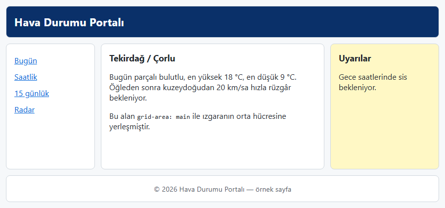

*Şekil 6.24. Uygulama 6.6'nın 900 piksel genişlikteki beklenen ekran görüntüsü.*

**Kendinizi sınayın:** (1) `aside` alanını sayfanın solunda, `nav` alanını sağında gösteriniz; HTML'yi değiştirmeniz gerekti mi? (2) `grid-template-rows` değerindeki `1fr` ne işe yaramaktadır?

<details><summary>Örnek çözüm</summary>

Çözüm dosyası: [`codes/06-css-kutu-modeli-yerlesim/uygulama-6-6-grid-sayfa-iskeleti/index.html`](../codes/06-css-kutu-modeli-yerlesim/uygulama-6-6-grid-sayfa-iskeleti/index.html)

</details>

## 6.12 Flexbox mı, Grid mi?

İki sistem birbirinin rakibi değil, tamamlayıcısıdır. Temel ayrım boyut sayısıdır: Flexbox **tek boyutlu** (bir satır *ya da* bir sütun), Grid **iki boyutlu** (satırlar *ve* sütunlar birlikte) yerleşim içindir [15], [14]. İkinci bir ölçüt yerleşimin yönüdür: Flexbox'ta öğelerin içerik boyutları düzeni belirler (içerikten dışarıya), Grid'de ise önce ızgara tanımlanır ve öğeler bu ızgaraya yerleştirilir (düzenden içeriğe).

| Ölçüt | Flexbox | CSS Grid |
|---|---|---|
| Boyut | Tek boyut (satır veya sütun) | İki boyut (satır ve sütun) |
| Yaklaşım | İçerik boyutu düzeni belirler | Önce ızgara tanımlanır |
| Tipik kullanım | Menü, düğme grubu, kart içi dikey dizilim, ortalama | Sayfa iskeleti, kart ızgarası, galeri, form düzeni |
| Satırlar arası hizalama | Her satır kendi içinde bağımsızdır | Sütunlar tüm satırlarda hizalı kalır |

*Tablo 6.6. Flexbox ile Grid'in karşılaştırılması.*

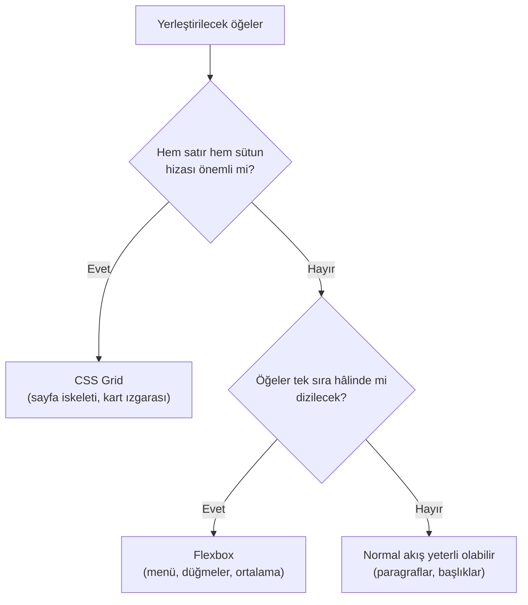

*Şekil 6.25. Yerleşim yöntemi seçimi için basit karar akışı.*

Gerçek sayfalarda iki sistem iç içe kullanılır: sayfa iskeleti ve kart ızgarası Grid ile, her kartın içindeki görsel–başlık–fiyat–düğme dizilimi ise Flexbox ile kurulur. Uygulama 6.7 tam olarak bu birlikteliği göstermektedir.

#### 🛠 Uygulama 6.7: Ürün Kartları Izgarası

**Amaç:** Grid ile kendiliğinden sütun sayısı değişen bir kart ızgarası, Flexbox ile de kart içinde alta yaslanan fiyat ve düğme kurmak.  
**Tahmini süre:** 20 dk

1. `calismalar/bolum-06/urunler/` klasöründe `index.html` ve `style.css` oluşturunuz; beş ürün için basit SVG görseller hazırlayınız (veya Örnek çözümdekileri kullanınız).
2. `<section class="urunler">` içine beş adet `<article class="kart">` ekleyiniz. Her kartta `loading="lazy"` nitelikli, `alt` metni olan bir ``, bir `<h2>`, bir açıklama paragrafı, `class="fiyat"` paragrafı ve "Sepete ekle" düğmesi (`<button type="button">`) bulunsun. Açıklamaları bilerek farklı uzunlukta yazınız.
3. `.urunler` öğesine `display: grid; grid-template-columns: repeat(auto-fill, minmax(200px, 1fr)); gap: 16px;` veriniz.
4. Kartı dikey esnek kapsayıcı yapınız (`display: flex; flex-direction: column;`). Metin bölümüne `flex: 1` ve yine `flex-direction: column` veriniz; fiyata `margin-top: auto` vererek fiyat ve düğmeyi kartın altına itiniz.
5. Görsellere `width: 100%; height: auto; aspect-ratio: 4 / 3; object-fit: cover;` uygulayınız; karta `overflow: hidden` ve `border-radius` vererek görselin köşelerini kartla uyumlu hâle getiriniz.
6. Kartlara `:hover` durumunda gölge ve `transform: translateY(-3px)` ekleyiniz. Pencereyi daraltıp genişleterek sütun sayısının nasıl değiştiğini gözlemleyiniz.

**Beklenen çıktı:**

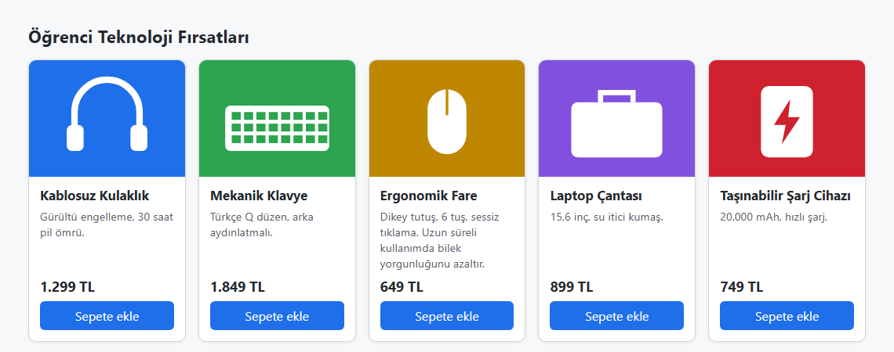

*Şekil 6.26. Uygulama 6.7'nin beklenen ekran görüntüsü: açıklama uzunlukları farklı olsa da fiyatlar ve düğmeler aynı hizadadır.*

**Kendinizi sınayın:** (1) `auto-fill` yerine `auto-fit` yazıp yalnızca iki ürünle deneyiniz; fark nedir? (2) Fiyattaki `margin-top: auto` satırını silince ne oldu?

<details><summary>Örnek çözüm</summary>

Çözüm dosyası: [`codes/06-css-kutu-modeli-yerlesim/uygulama-6-7-urun-kartlari/index.html`](../codes/06-css-kutu-modeli-yerlesim/uygulama-6-7-urun-kartlari/index.html)

</details>

## 6.13 Bölüm Özeti

- Her HTML öğesi; içerik, dolgu (`padding`), kenarlık (`border`) ve kenar boşluğundan (`margin`) oluşan bir kutudur. Arka plan dolguya kadar uzanır, kenar boşluğu saydamdır.
- Varsayılan `content-box` modelinde `width` yalnızca içeriği ölçer; dolgu ve kenarlık eklenir. Güncel uygulamada tüm öğeler `*, *::before, *::after { box-sizing: border-box; }` kuralıyla `border-box` modeline alınır. Kenar boşluğu hiçbir modelde `width` değerine dahil değildir.
- `margin` ve `padding` kısayolları üstten başlayıp saat yönünde okunur; `margin: 0 auto` genişliği belli blok öğeyi yatay ortalar. Normal akışta alt alta gelen blokların dikey kenar boşlukları çöker ve büyük olan uygulanır.
- Kenarlığın görünmesi için `border-style` gereklidir; `border-radius` köşeleri yuvarlatır, `outline` ve `box-shadow` yer kaplamaz. Klavye odağı `:focus-visible` ile görünür tutulmalıdır.
- `overflow` taşmayı, `min-/max-width` ve `aspect-ratio` boyut sınırlarını yönetir; sabit `height` yerine `min-height` tercih edilmelidir.
- `display` kutunun akıştaki davranışını belirler: `block`, `inline`, `inline-block`, `none`, `flex`, `grid` en sık kullanılanlardır. `display: none` yer kaplamaz, `visibility: hidden` yerini korur. `run-in` ve `compact` güncel tarayıcılarda desteklenmez.
- `position` beş değer alır: `static`, `relative`, `absolute` (en yakın konumlandırılmış ataya göre), `fixed` (görünüm alanına göre) ve `sticky`. `z-index` yalnızca aynı istif bağlamı içinde karşılaştırılır.
- `float` bugün yalnızca metni görsel etrafında akıtmak için kullanılır; sayfa düzeni için Flexbox (tek boyut) ve Grid (iki boyut) kullanılır ve ikisi çoğunlukla birlikte çalışır.

## 6.14 Değerlendirme Soruları

1. `width: 400px; padding: 10px 20px; border: 3px solid; margin: 15px auto;` bildirimlerine sahip bir `<div>` öğesinin görünen genişliğini ve kapladığı yatay alanı `content-box` ve `border-box` modelleri için ayrı ayrı hesaplayınız.
2. `margin: 5px 10px 15px;` bildiriminde sol kenar boşluğu kaç pikseldir? Gerekçesiyle açıklayınız.
3. Art arda gelen iki paragraftan ilkinin `margin-bottom` değeri 30 piksel, ikincisinin `margin-top` değeri 20 pikseldir. Aradaki boşluk kaç pikseldir? Paragraflar `display: flex` olan bir kapsayıcının çocukları olsaydı sonuç ne olurdu?
4. Aşağıdaki kuralın neden hiçbir kenarlık çizmediğini açıklayınız ve düzeltiniz: `.kutu { border-width: 4px; border-color: #1f6feb; }`
5. `outline` ile `border` arasındaki iki farkı yazınız. `a:focus { outline: none; }` kuralı hangi kullanıcı grubunu, hangi WCAG ölçütü bağlamında olumsuz etkiler?
6. `display: none`, `visibility: hidden` ve `overflow: hidden` bildirimlerinin her biri öğeyi veya içeriğini hangi anlamda "gizler"? Yer kaplama açısından karşılaştırınız.
7. Aşağıdaki kodda kırmızı kutu sayfanın neresinde görünür? `.kart` kuralına `position: relative` eklenirse ne değişir?
   ```html
   <div class="kart" style="margin: 100px; width: 300px; height: 200px;">
     <span style="position: absolute; top: 0; right: 0; background: red;">Yeni</span>
   </div>
   ```
8. `position: sticky` ile `position: fixed` arasındaki farkı akıştaki yer ve kapsayıcı sınırları açısından açıklayınız. Yapışkan bir başlığın hiç yapışmamasının olası iki nedenini yazınız.
9. `grid-template-columns: 250px repeat(2, 1fr);` bildirimi 850 piksel genişliğindeki ve `gap: 25px` olan bir kapsayıcıda sütunları kaç piksel genişliğinde oluşturur?
10. Bir e-ticaret sitesinin (a) üst gezinme çubuğu, (b) ürün kartları ızgarası ve (c) kart içindeki fiyat–düğme dizilimi için Flexbox ve Grid'den hangisini seçerdiniz? Her biri için gerekçe veriniz.
11. `float` özelliğinin bugün hâlâ meşru kabul edilen kullanımı nedir? Float ile sütun düzeni kurmanın neden terk edildiğini iki gerekçeyle açıklayınız.

## Kaynaklar

[1] W3C, "CSS Box Model Module Level 3." [Çevrimiçi]. Erişim: https://www.w3.org/TR/css-box-3/ (Erişim tarihi: 2 Kasım 2026).

[2] J. Duckett, *HTML and CSS: Design and Build Websites*. Indianapolis, IN, USA: Wiley, 2011.

[3] J. N. Robbins, *Learning Web Design: A Beginner's Guide to HTML, CSS, JavaScript, and Web Graphics*, 4th ed. Sebastopol, CA, USA: O'Reilly Media, 2012.

[4] W3C, "CSS Box Sizing Module Level 3." [Çevrimiçi]. Erişim: https://www.w3.org/TR/css-sizing-3/ (Erişim tarihi: 2 Kasım 2026).

[5] J. Sklar, *Principles of Web Design: The Web Warrior Series*, 6th ed. Boston, MA, USA: Cengage Learning, 2015.

[6] Mozilla, *MDN Web Docs*. [Çevrimiçi]. Erişim: https://developer.mozilla.org/ (Erişim tarihi: 2 Kasım 2026).

[7] W3C, "Cascading Style Sheets Level 2 Revision 1 (CSS 2.1) Specification," W3C Recommendation, Jun. 2011. [Çevrimiçi]. Erişim: https://www.w3.org/TR/CSS21/

[8] W3C, *Web Content Accessibility Guidelines (WCAG) 2.2*, W3C Recommendation, Oct. 2023. [Çevrimiçi]. Erişim: https://www.w3.org/TR/WCAG22/

[9] W3C, "CSS Backgrounds and Borders Module Level 3." [Çevrimiçi]. Erişim: https://www.w3.org/TR/css-backgrounds-3/ (Erişim tarihi: 2 Kasım 2026).

[10] W3C, "CSS Overflow Module Level 3." [Çevrimiçi]. Erişim: https://www.w3.org/TR/css-overflow-3/ (Erişim tarihi: 2 Kasım 2026).

[11] W3C, "CSS Display Module Level 3." [Çevrimiçi]. Erişim: https://www.w3.org/TR/css-display-3/ (Erişim tarihi: 2 Kasım 2026).

[12] W3C, "CSS Positioned Layout Module Level 3." [Çevrimiçi]. Erişim: https://www.w3.org/TR/css-position-3/ (Erişim tarihi: 2 Kasım 2026).

[13] P. Carey, *New Perspectives on HTML5 and CSS3: Comprehensive*, 7th ed. Boston, MA, USA: Cengage Learning, 2017.

[14] W3C, "CSS Flexible Box Layout Module Level 1." [Çevrimiçi]. Erişim: https://www.w3.org/TR/css-flexbox-1/ (Erişim tarihi: 2 Kasım 2026).

[15] W3C, "CSS Grid Layout Module Level 2." [Çevrimiçi]. Erişim: https://www.w3.org/TR/css-grid-2/ (Erişim tarihi: 2 Kasım 2026).

---

[← Önceki bölüm](05-css-metin-renk-arka-plan.md) · [İçindekiler](../README.md) · [Sonraki bölüm →](07-javascript-temelleri.md)
