# Bölüm 7: JavaScript Temelleri

[← Önceki bölüm](06-css-kutu-modeli-yerlesim.md) · [İçindekiler](../README.md) · [Sonraki bölüm →](08-javascript-dom-olaylar.md)

> **Öğrenme Hedefleri** — Bu bölümü tamamlayan öğrenci:
>
> 1. JavaScript'in web sayfasındaki rolünü HTML ve CSS ile karşılaştırarak açıklar; dilin tarihini ve ECMAScript standardıyla ilişkisini özetler.
> 2. İki ve üç katmanlı istemci–sunucu mimarisini çizer; istemci taraflı ve sunucu taraflı betiklerin görev paylaşımını bir örnek üzerinde gösterir.
> 3. Bir HTML sayfasına JavaScript'i satır içi ve harici dosya olarak ekler; `defer`, `async` ve `type="module"` niteliklerinin etkisini ayırt eder.
> 4. Geliştirici Araçları'nın Console ve Sources panellerini kullanarak çıktı alır, hata mesajlarını yorumlar ve kesme noktasıyla hata ayıklar.
> 5. `let`/`const` ile değişken tanımlar; temel veri türlerini, tür dönüşümünü ve `==`/`===` farkını doğru kullanır.
> 6. Operatörleri, koşul yapılarını ve döngüleri kullanarak gerçek hayattan problemleri (sepet toplamı, not ortalaması, parola gücü) çözen fonksiyonlar yazar.
> 7. Dizileri ve nesneleri oluşturur, temel dizi metotlarıyla işler ve JSON biçimine dönüştürür.

## 7.1 Giriş

Önceki bölümlerde bir web sayfasının içeriğinin HTML ile, görünümünün ise CSS ile nasıl tanımlandığı ele alınmıştır. Bu iki dil ile hazırlanan bir sayfa, tarayıcıda görüntülendikten sonra kendiliğinden değişmez; kullanıcı bir düğmeye bastığında hesap yapmaz, bir form alanının boş bırakıldığını fark etmez, sepete eklenen ürünle birlikte toplam tutarı güncellemez. Sayfaya bu tür **davranışları** kazandıran dil JavaScript'tir.

### 7.1.1 JavaScript Nedir?

JavaScript, web sayfalarına davranış katmak için tasarlanmış, bugün ise genel amaçlı hâle gelmiş üst düzey bir programlama dilidir. Flanagan, web geliştiricinin öğrenmesi gereken üç teknolojiyi şöyle özetler: HTML sayfanın **içeriğini**, CSS **sunumunu**, JavaScript ise **davranışını** belirler [1, s. 1]. Bu ayrım, katmanlı tasarımın da temelidir: Her katman kendi dosyasında tutulur, birindeki değişiklik diğerlerini mümkün olduğunca etkilemez (Şekil 7.1).

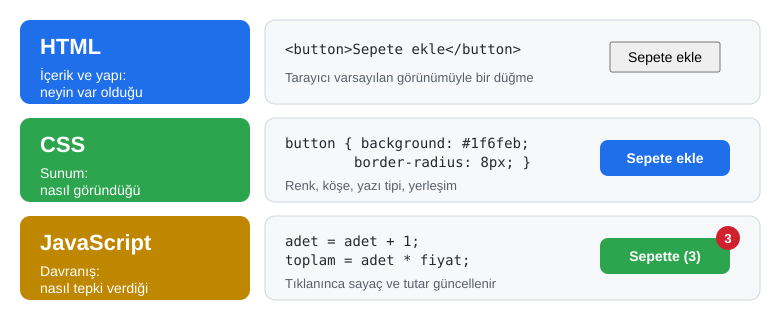

*Şekil 7.1. Web sayfasının üç katmanı. Aynı "Sepete ekle" düğmesi HTML ile var edilir, CSS ile biçimlendirilir, JavaScript ile tepki verir hâle getirilir.*

JavaScript masaüstü, tablet ve telefon tarayıcılarının tümünde yerleşik olarak bulunur; programı çalıştırmak için ayrı bir kurulum gerekmez, bir metin düzenleyici (ör. VS Code) ve bir tarayıcı yeterlidir. Dilin asıl gücü, çıktının sabit olmamasından gelir: Betik, sayfa yüklendikten sonra saate, konuma, kullanıcının yaptığı seçime ya da sunucudan gelen veriye göre farklı içerik üretebilir. Aynı adrese giren iki kullanıcının farklı sayfa görmesi bu sayede mümkün olur.

> [!TIP]
> **Güncel hayattan:** Bir e-ticaret sitesinde ürün adedini artırdığınızda sepet tutarının sayfa yenilenmeden değişmesi, harita uygulamasında haritanın fareyle sürüklenmesi, üniversite bilgi sisteminde (OBS) ders seçimi sırasında kontenjanın anında gösterilmesi ve bir hava durumu sayfasının konumunuza göre güncellenmesi, tarayıcıda çalışan JavaScript'in tipik örnekleridir.

### 7.1.2 Java ile Karıştırmayın

Java ve JavaScript yalnızca ad benzerliği taşır. Java, Sun Microsystems'in geliştirdiği, derlenerek kendi sanal makinesinde çalışan bağımsız bir programlama dilidir; Java programları genellikle tarayıcıdan bağımsız uygulamalardır. JavaScript ise kaynak kodu doğrudan tarayıcıya gönderilen ve tarayıcının içinde çalışan bir dildir. Flanagan'ın ifadesiyle "yüzeysel bir sözdizimi benzerliği dışında JavaScript, Java programlama dilinden tamamen farklıdır" [1, s. 1]. Adın seçilmesi teknik değil, pazarlamaya yönelik bir karardır (bkz. 7.2.1).

JavaScript **çok paradigmalı** (multi-paradigm) bir dildir: Komutların sırayla yazıldığı buyurgan (imperative) tarzı, nesne yönelimli (object-oriented) tarzı ve fonksiyonların değer gibi aktarılabildiği fonksiyonel (functional) tarzı birlikte destekler. Dil, sözdizimini Java'dan, birinci sınıf fonksiyon (first-class function) anlayışını Scheme'den, prototip tabanlı kalıtımı ise Self dilinden almıştır [1, s. 1], [2].

## 7.2 Kısa Tarih ve ECMAScript Standardı

### 7.2.1 Mocha'dan JavaScript'e

1990'ların ortasında kullanıcıların çoğu İnternet'e yavaş modemlerle bağlanıyordu. Bir formun yalnızca boş bırakılmış bir alanı nedeniyle sunucuya gönderilip hata sayfasıyla geri dönmesi, kullanıcı için dakikalar süren bir bekleme anlamına geliyordu. Netscape, bu tür basit denetimleri tarayıcıda yapabilecek bir betik dili arayışına girdi [3, s. 2].

Netscape'te çalışan Brendan Eich, dilin ilk sürümünü Mayıs 1995'te yaklaşık on günde geliştirdi; dilin ilk kod adı **Mocha** idi. Dil, Eylül 1995'te Navigator 2.0'ın beta sürümünde **LiveScript** adıyla yer aldı. Aralık 1995'te Netscape ile Sun Microsystems'in ortak duyurusuyla adı **JavaScript** olarak değiştirildi [2]. Netscape bu dönemde Sun ile bir iş birliği yürütüyordu ve ad değişikliğinin amacı, basında çok konuşulan Java'nın popülerliğinden yararlanmaktı [3, s. 2]. "JavaScript" adı bu nedenle Sun'ın, Sun'ın 2010'da satın alınmasından sonra da Oracle'ın tescilli markasıdır; dilin standart adının "ECMAScript" olmasının bir nedeni de budur.

> [!NOTE]
> **Tarihsel not:** Netscape tarayıcısının kaynak kodunun 1998'de açılmasıyla Mozilla projesi doğdu; Firefox bu projenin ürünüdür. Bu nedenle Netscape, bugünkü Mozilla'nın atası olarak anılır. Eich'in Netscape için yazdığı motorun soyundan gelen **SpiderMonkey**, bugün Firefox'ta çalışmaktadır.

### 7.2.2 Tarayıcı Savaşları ve JScript

Microsoft, Ağustos 1996'da çıkardığı Internet Explorer 3 ile birlikte JavaScript'in kendi uyarlamasını **JScript** adıyla sundu [3, s. 2]. İki uyarlama arasındaki farklar o kadar büyüktü ki programcılar Navigator ve Internet Explorer için neredeyse tamamen farklı programlar yazmak zorunda kalıyordu [4, s. 20]. "Tarayıcı savaşları" (browser wars) olarak anılan bu dönem, ortak bir standarda olan ihtiyacı açıkça ortaya koydu.

### 7.2.3 ECMAScript Standardı

Netscape, Kasım 1996'da dilin tanımını Avrupa merkezli standart kuruluşu **Ecma**'ya sundu [2]. Kuruluş bünyesinde oluşturulan 39 numaralı teknik komite (TC39), Netscape, Sun, Microsoft ve başka firmaların temsilcileriyle çalışarak **ECMA-262** standardını hazırladı; standartta tanımlanan dile **ECMAScript** adı verildi [3, s. 2]. JavaScript, bu standardın en yaygın uygulamasıdır; tarayıcı üreticileri ECMAScript'i uygulayarak birbiriyle uyumlu JavaScript motorları geliştirir.

> [!NOTE]
> **Tarihsel not:** ECMA adı başlangıçta *European Computer Manufacturers Association* (Avrupa Bilgisayar Üreticileri Derneği) sözcüklerinin kısaltmasıydı. Kuruluş, küresel bir yapıya dönüşmesini yansıtmak için 1994'te adını **Ecma International** olarak değiştirdi; bugün "Ecma" bir kısaltma olarak açılmaz.

Standardın sürümleri "baskı" (edition) olarak adlandırılır. 1999'da yayımlanan üçüncü baskı (ES3), bugün kullanılan temel sözdiziminin büyük bölümünü yerleştirdi. Dördüncü baskı, dili kökten değiştirmeye çalışan büyük kapsamı nedeniyle uzlaşma sağlanamayınca 2008'de terk edildi. 2009'daki ES5, katı mod (strict mode) ve yerleşik JSON desteği getirdi [3, s. 4]. 2015'te yayımlanan altıncı baskı (**ES2015**, yaygın adıyla **ES6**) modern JavaScript'in dönüm noktasıdır: `let`, `const`, ok fonksiyonları, şablon dizgeleri, sınıflar ve modüller bu baskıyla dile girdi [2]. ES2015'ten itibaren standart her yıl Haziran ayında yenilenmekte ve baskılar yıl adıyla anılmaktadır. Bu not yazıldığı sırada (Kasım 2026) en güncel baskı, Haziran 2026'da kabul edilen **ECMAScript 2026** (ECMA-262, 17. baskı) idi; bir önceki ECMAScript 2025 ise 16. baskıdır [5].

*Tablo 7.1. ECMAScript'in önemli baskıları.*

| Baskı | Yıl | Öne çıkan yenilikler |
|---|---|---|
| ES1 | 1997 | İlk standart; Netscape JavaScript 1.1 temel alındı |
| ES3 | 1999 | Düzenli ifadeler, `try/catch`, gelişmiş dizge işlemleri |
| ES4 | — | 2008'de terk edildi, yayımlanmadı |
| ES5 | 2009 | Katı mod (`"use strict"`), yerleşik `JSON`, `forEach`/`map`/`filter` gibi dizi metotları |
| ES2015 (ES6) | 2015 | `let`, `const`, ok fonksiyonları, şablon dizgeleri, sınıflar, modüller, `for…of` |
| ES2016 – ES2026 | her yıl | Yıllık küçük eklemeler: `**` (2016), `async/await` (2017), `?.` ve `??` (2020), `at()` (2022) … |

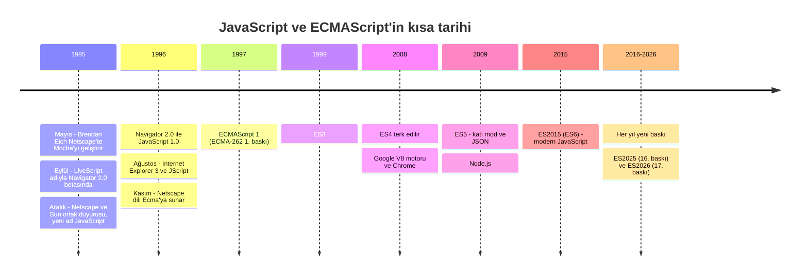

*Şekil 7.2. JavaScript ve ECMAScript'in kısa tarihi [2], [3], [5].*

## 7.3 JavaScript Nasıl Çalışır? Betik Motorları

### 7.3.1 Derleyici, Yorumlayıcı ve Betik Dili

İnsanın okuyabileceği kaynak kodun bilgisayarda çalışabilmesi için makinenin anlayacağı biçime çevrilmesi gerekir. Geleneksel olarak iki yaklaşım ayırt edilir:

- **Derleyici (compiler):** Kaynak kodun tamamını, program çalıştırılmadan önce makine koduna çevirir. C ve C++ bu modeli kullanır; programcı derleme adımını açıkça başlatır ve kullanıcıya derlenmiş program dağıtılır.
- **Yorumlayıcı (interpreter):** Kodu çalışma zamanında çevirerek yürütür; ayrı bir derleme adımı yoktur.

"Betik dili" (scripting language) terimi başlangıçta Java veya C++ gibi dillerin gelişmiş özelliklerini içermeyen, görece basit diller için kullanılıyordu. Web bağlamında ise bir web sayfasını programla denetleyebilen ya da tarayıcıya bir yanıt döndürebilen her dil için kullanılır; bugünün web betik dilleri ise hiç de basit değildir [4, s. 19]. Tarayıcının betik kodunu çalıştıran bölümüne **betik motoru** (scripting engine) denir; betik motoru bir tür yorumlayıcıdır [4, ss. 19–20].

### 7.3.2 Günümüz Motorları: Ayrıştırma, Bayt Kodu ve JIT

JavaScript'in "kodu satır satır çeviren bir yorumlayıcıyla çalıştığı" anlatımı, dilin ilk yıllarındaki motorlar için kabaca doğru olsa da günümüz motorlarını tam olarak yansıtmaz. Bugünkü başlıca motorlar Chrome, Edge ve Opera'daki **V8**, Firefox'taki **SpiderMonkey** ve Safari'deki **JavaScriptCore**'dur. Bu motorlar betiği aşağıdaki aşamalardan geçirir (Şekil 7.3):

1. **Ayrıştırma (parsing):** Betiğin tamamı okunur ve sözdizimi denetlenir; kod, soyut sözdizimi ağacı (abstract syntax tree, AST) adı verilen bir veri yapısına dönüştürülür. Betiğin herhangi bir yerinde tek bir sözdizimi hatası bulunursa betiğin **hiçbir satırı çalışmaz**. Bu davranış, "satır satır yorumlama" anlatımının neden eksik olduğunu gösterir.
2. **Bayt kodu (bytecode) üretimi ve yorumlama:** AST, makineden bağımsız ve daha sade bir ara koda çevrilir ve yorumlayıcı tarafından çalıştırılmaya başlanır. V8'de bu işi **Ignition** adlı yorumlayıcı yapar [6].
3. **Anında derleme (Just-In-Time, JIT):** Çok sık çalışan ("sıcak") kod parçaları, çalışma sırasında toplanan tür bilgisi kullanılarak optimize eden bir derleyiciyle doğrudan makine koduna çevrilir. V8'de bu derleyici **TurboFan**'dır [6]. Varsayımlar bozulursa (ör. hep sayı alan bir fonksiyona bir gün metin gönderilirse) motor optimize edilmiş kodu bırakıp bayt koduna geri döner (deoptimizasyon).

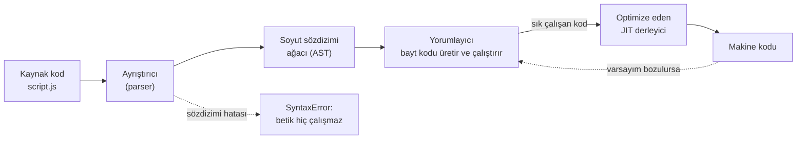

*Şekil 7.3. Günümüz JavaScript motorlarında bir betiğin yolu (V8 örneği [6]).*

Önemli olan nokta şudur: Bütün bu aşamalar tarayıcının içinde, sayfa yüklenirken otomatik olarak gerçekleşir. Geliştirici JavaScript için **ayrı bir derleme adımı başlatmaz**; kaynak kod (`.js` dosyası) olduğu gibi tarayıcıya gönderilir. 2008'de Google'ın açık kaynaklı V8 motorunu yayımlaması, JavaScript'in hızını önemli ölçüde artırmış ve büyük web uygulamalarının önünü açmıştır [4, s. 21].

### 7.3.3 Tarayıcı Dışında JavaScript: Node.js

ECMAScript standardı dilin kendisini tanımlar; ekrana yazı yazmak, dosya okumak ya da bir düğmeyi seçmek gibi işlemler dilin değil, dilin çalıştığı **ev sahibi ortamın** (host environment) sağladığı olanaklardır [3, s. 3]. Tarayıcı bu ortamlardan yalnızca biridir. 2009'da ortaya çıkan **Node.js**, V8 motorunu tarayıcı dışına taşıyarak JavaScript'in sunucuda, komut satırı araçlarında ve masaüstü uygulamalarında kullanılmasını sağlamıştır. Node.js bu dersin kapsamı dışındadır; bu notlarda JavaScript yalnızca tarayıcıda (istemci tarafında) ele alınır.

### 7.3.4 API ve Kütüphane

**API** (Application Programming Interface — Uygulama Programlama Arayüzü), bir sistemin dışarıya sunduğu hazır işlevler kümesidir. Tarayıcıdaki JavaScript; sayfadaki öğelere erişim (DOM), ağ istekleri (Fetch), tarayıcı belleğinde veri saklama (`localStorage`), konum bilgisi (Geolocation) gibi **Web API'lerine** dayanır. **Kütüphane** (library) ise geliştiriciler arasında paylaşılan, yeniden kullanılabilir kod topluluğudur; React, Vue veya Angular gibi çatılar (framework) büyük uygulamalar için hazır bir yapı sunar.

> [!NOTE]
> **Tarihsel not:** 2006–2015 arasında tarayıcı farklılıklarını gizlemek için en çok kullanılan kütüphane **jQuery** idi. Tarayıcıların standartlara uyumu arttıkça ve `querySelector`, `addEventListener`, `fetch` gibi yerel (native) API'ler yaygınlaştıkça jQuery'ye olan gereksinim büyük ölçüde ortadan kalktı. Bu notlarda yalnızca yerel API'ler kullanılır.

## 7.4 İstemci–Sunucu Mimarisi

JavaScript'in neyi yapıp neyi yapamadığını anlamak için onun web uygulamasının hangi parçasında çalıştığını bilmek gerekir. Bu bölümdeki anlatım büyük ölçüde Vodnik ve Gosselin'in istemci–sunucu modeli çerçevesine dayanmaktadır [4, ss. 16–23]; HTTP isteği ve yanıtının ayrıntıları [Bölüm 1](01-internet-ve-web.md)'de ele alınmıştır.

### 7.4.1 İki Katmanlı Mimari

Geleneksel istemci–sunucu mimarisinde **sunucu** (server), istemcinin bilgi istediği bir kaynaktır; isteği karşılayıp yanıtı döndürür. Bir istemci ve bir sunucudan oluşan sisteme **iki katmanlı sistem** (two-tier system) denir [4, s. 16].

- **İstemci (client) / ön uç (front-end):** Kullanıcıya arayüz sunar; kullanıcıdan bilgi toplar, sunucuya iletir, dönen sonucu biçimlendirerek gösterir. HTML, CSS ve tarayıcıdaki JavaScript bu katmana aittir.
- **Sunucu (server) / arka uç (back-end):** Veri depolama, verinin yönetimi ve dış hizmetlerle iletişimden sorumludur.

Web, iki katmanlı bir istemci–sunucu sistemi üzerine kuruludur: Web tarayıcısı (istemci) bir web sunucusundan belge ister; sunucu belgeyi döndürdükten sonra belgeyi biçimlendirip kullanıcıya sunmak tarayıcının görevidir. Tarayıcı ile sunucu arasındaki istek ve yanıtlar HTTP (Hypertext Transfer Protocol) ile taşınır [4, s. 17]. Geleneksel olarak ağır hesaplamalar sunucuda yapılırdı; ancak bilgisayar, tablet ve telefonlar güçlendikçe işlem yükünün giderek artan bir kısmı istemciye, yani tarayıcıda çalışan JavaScript'e kaymıştır [4, s. 17].

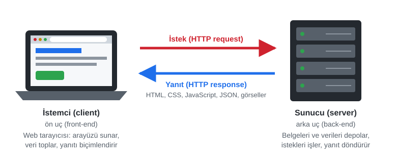

*Şekil 7.4. İki katmanlı istemci–sunucu sistemi.*

### 7.4.2 Üç Katmanlı (n Katmanlı) Mimari

Web sunucusuna veritabanları ve başka uygulamalar eklendiğinde sistem, **üç katmanlı** (three-tier) mimariye dönüşür. Bu yapı **çok katmanlı** (multitier) ya da **n katmanlı** (n-tier) istemci–sunucu sistemi olarak da adlandırılır ve üç ayrı parçadan oluşur [4, s. 17]:

1. **İstemci katmanı** (client tier): Kullanıcı arayüzü, yani web tarayıcısı.
2. **İşlem katmanı** (processing tier) ya da **orta katman** (middle tier): Tarayıcı ile veri depolama katmanı arasındaki etkileşimi yönetir; istemciden gelen isteğe göre gerekli hesaplamaları yapar, veri katmanından okur ya da oraya yazar ve sonucu istemciye döndürür.
3. **Veri depolama katmanı** (data storage tier): Verileri bir veritabanında saklar ve işlem katmanının isteklerine yanıt verir.

İşlemin yalnızca orta katmanda yapılmadığına dikkat edilmelidir: Tarayıcı sayfayı oluşturur (bu da işlem gerektirir), veritabanı da sorguları işler [4, s. 18]. İki katmanlı mimari, istemci ile sunucunun iki ayrı bilgisayar olduğu **fiziksel** bir düzenlemedir; üç katmanlı mimari ise daha çok **kavramsaldır**, çünkü işlem ve veri depolama katmanları aynı sunucuda bulunabilir [4, s. 18] (Şekil 7.5).

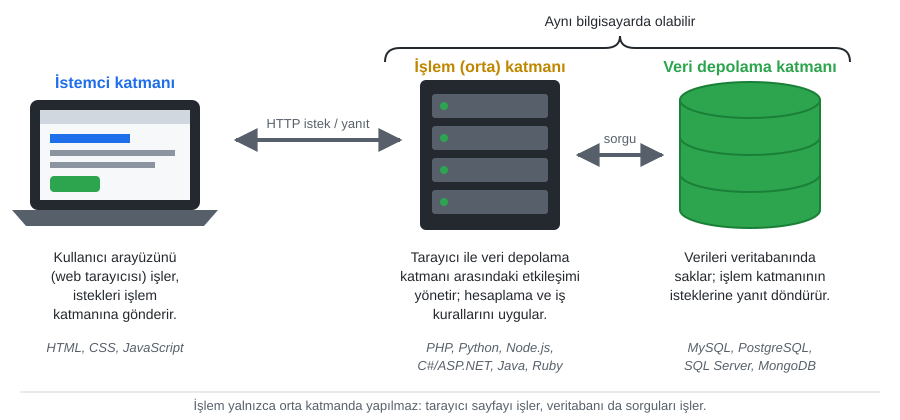

*Şekil 7.5. Üç katmanlı (n katmanlı) istemci–sunucu sistemi.*

### 7.4.3 İstemci Taraflı ve Sunucu Taraflı Betik

JavaScript, web sayfası yazarlarının etkileşimli sayfalar ve siteler geliştirmesini sağlayan **istemci taraflı** bir betik dilidir. İstemci taraflı betik (client-side scripting), web sunucusunda (işlem katmanında) değil, yerel tarayıcıda (istemci katmanında) çalışan bir betik diliyle programlama anlamına gelir [4, s. 19].

**Sunucu taraflı betik** (server-side scripting) ise web sunucusunda yürütülen betik dilleriyle programlamadır. Yaygın sunucu taraflı diller ve ortamlar arasında PHP, Python, Ruby, Java, C# (ASP.NET çatısıyla) ve Node.js çalışma ortamıyla JavaScript sayılabilir. Sunucu taraflı dil kullanmanın başlıca nedeni, bir veritabanıyla iletişim kuran etkileşimli bir site geliştirmektir; alışveriş sepetleri, arama motorları, e-posta sistemleri, kimlik doğrulama ve içerik yönetim sistemleri bu türdendir [4, s. 21]. Sunucu taraflı betik yalnızca sunucuda çalışır ve tarayıcıyı doğrudan denetleyemez; sunucu betiği çalıştırır ve yalnızca ürettiği çıktıyı (HTML ya da JSON verisi) istemciye gönderir. **İstemci, sunucu taraflı kodu hiçbir zaman görmez** [4, s. 22] (Şekil 7.6).

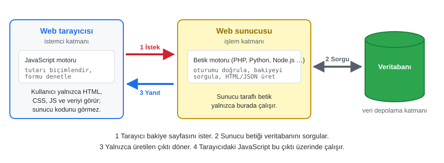

*Şekil 7.6. Sunucu taraflı betiğin işlenişi ve istemci taraflı betikle iş bölümü.*

Hangi işin istemcide, hangisinin sunucuda yapılacağı tasarımın temel sorularındandır. Tarayıcıyı denetlemek gerekiyorsa JavaScript; sunucudaki bir veritabanına erişmek gerekiyorsa sunucu taraflı betik zorunludur. Form doğrulama ve hesaplama gibi bazı işler her iki tarafta da yapılabilir [4, s. 22]. Tablo 7.2 iki yaklaşımı karşılaştırmaktadır.

*Tablo 7.2. İstemci taraflı ve sunucu taraflı betiğin karşılaştırılması.*

| Ölçüt | İstemci taraflı (tarayıcıda JavaScript) | Sunucu taraflı (PHP, Python, Node.js, C#, Java …) |
|---|---|---|
| Çalıştığı yer | Kullanıcının tarayıcısı | Web/uygulama sunucusu |
| Kodun görünürlüğü | Kaynak kod kullanıcıya gönderilir, herkes okuyabilir | Kullanıcı yalnızca çıktıyı görür |
| Tipik görev | Arayüz etkileşimi, anlık denetim, hesaplama, sayfa güncelleme | Veritabanı, kimlik doğrulama, iş kuralları, ödeme |
| Hız | Sunucuya gitmeden anında tepki | Her işlemde ağ gidiş-dönüşü |
| Güvenilirlik | Kullanıcı kodu değiştirebilir ya da devre dışı bırakabilir | Kurallar sunucuda zorlanır |

> [!WARNING]
> İstemci taraflı denetim, sunucu taraflı denetimin **yerini tutmaz**. Tarayıcıda çalışan kod kullanıcının elindedir; Geliştirici Araçları ile değiştirilebilir ya da tümüyle atlanabilir. Bu nedenle fiyat, bakiye, not gibi kritik değerler her zaman sunucuda yeniden denetlenmelidir. Aynı nedenle JavaScript koduna parola, API anahtarı gibi gizli bilgiler **yazılmaz**.

### 7.4.4 Örnek: Bankacılık Uygulamasında İş Bölümü

Bir bankanın web ya da mobil uygulamasından para transferi yapıldığını düşünelim. Havale formu tarayıcıda çalışır; JavaScript tutar alanının boş olmadığını, IBAN'ın doğru uzunlukta olduğunu anında denetleyerek kullanıcıyı bekletmeden uyarır. Hesap bakiyesini tutan veritabanı ve "bakiye yeterli mi, günlük limit aşıldı mı" kararı ise sunucudadır (Şekil 7.7).

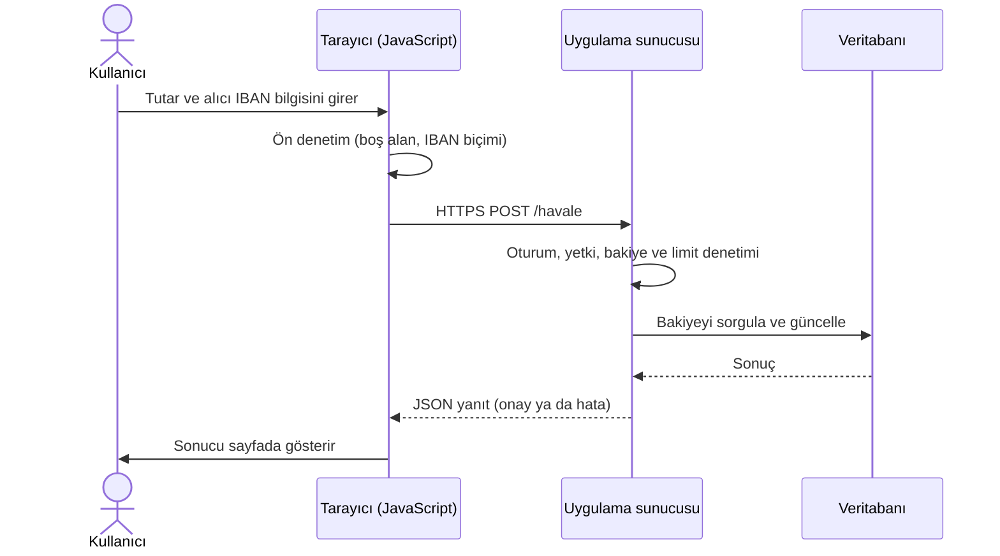

*Şekil 7.7. Bankacılık uygulamasında istemci, işlem ve veri katmanlarının iş bölümü.*

### 7.4.5 JavaScript'in Yapabildikleri ve Sınırları

JavaScript programları web sayfasının öğeleriyle bütünleşik çalıştığından dil, geliştiriciye şu olanakları verir [4, s. 20]:

- Durağan (static) sayfaları oyun veya hesap makinesi gibi uygulamalara dönüştürmek,
- Tarayıcı sayfayı görüntüledikten sonra sayfanın içeriğini değiştirmek,
- Animasyon gibi görsel efektler oluşturmak,
- Tarayıcı penceresinin kendisini (adres, geçmiş, pencere boyutu) denetlemek,
- Cihazın bildirdiği yön, hız ve konum gibi bilgilerle (kullanıcının izniyle) çalışmak.

Güvenlik nedeniyle tarayıcıdaki JavaScript, bir **kum havuzu** (sandbox) içinde çalışır. Kötü niyetli bir betiğin kullanıcının bilgilerini çalmasını ya da dosyalarına zarar vermesini önlemek için JavaScript sistem komutlarını çalıştıramaz ve istemci bilgisayarda program başlatamaz [4, s. 21]. Kullanıcının dosya sistemine doğrudan erişemez; yalnızca kullanıcının bir dosya seçme penceresiyle (`<input type="file">`) açıkça seçtiği dosyaları okuyabilir. Tarayıcı belleğine (çerezler, `localStorage`) yazabilir; ancak tarayıcılar bu belleği sıkı biçimde denetler ve bir sitenin sakladığı veriye başka bir siteden erişilmesine izin vermez [4, s. 21].

Bu son kural, **aynı köken politikası** (same-origin policy) olarak bilinen genel güvenlik ilkesinin bir parçasıdır. İki adres yalnızca protokolleri, alan adları ve bağlantı noktaları (port) aynıysa aynı kökendendir (ör. `https://obs.ornek.edu.tr` ile `https://ornek.edu.tr` farklı kökenlerdir). Bir kökenden yüklenen betik, başka bir kökendeki sayfanın içeriğini ya da verisini, o köken açıkça izin vermedikçe (CORS) okuyamaz [7]. Böylece açık bırakılmış bir sekmedeki kötü niyetli bir site, bankacılık sekmesindeki bilgileri okuyamaz.

## 7.5 JavaScript'i HTML'e Eklemek

JavaScript kodu bir HTML belgesine `<script>` öğesiyle eklenir. Tarayıcı, HTML'i yukarıdan aşağıya ayrıştırırken bir `<script>` öğesiyle karşılaştığında içindeki kodu betik motoruna verir [4, ss. 23–24], [8].

### 7.5.1 Satır İçi Betik

Kod, doğrudan `<script>` ile `</script>` etiketleri arasına yazılabilir:

```html
<body>
  <h1>Merhaba</h1>
  <script>
    console.log("Sayfa yüklendi.");
  </script>
</body>
```

*Kod 7.1. Satır içi (inline) betik.*

### 7.5.2 Harici Betik Dosyası

Daha iyi bir yöntem, kodu `.js` uzantılı ayrı bir dosyada tutup `src` niteliğiyle bağlamaktır. Böylece HTML ile JavaScript birbirinden ayrılır, aynı dosya birden çok sayfada kullanılabilir ve tarayıcı dosyayı önbelleğe (cache) alarak sonraki sayfalarda yeniden indirmez [9, ss. 89–99].

```html
<script src="js/uygulama.js" defer></script>
```

*Kod 7.2. Harici betik dosyasının `defer` niteliğiyle bağlanması (bu notlardaki tüm örneklerde kullanılan biçim).*

`src` niteliği olan bir `<script>` öğesinin içine kod yazılmaz; yazılırsa yok sayılır.

### 7.5.3 Betiğin Yeri: `</body>` Öncesi, `defer` ve `async`

Niteliksiz bir `<script src="…">` öğesi, **ayrıştırmayı durdurur**: Tarayıcı, betik indirilip çalıştırılana kadar HTML'in geri kalanını işlemez [8]. Bunun iki olumsuz sonucu vardır: Sayfanın görünmesi gecikir ve `<head>` içindeki betik, henüz ayrıştırılmamış öğelere (ör. `<body>` içindeki bir tabloya) erişemez. Bu nedenle uzun yıllar boyunca betikler `</body>` kapanış etiketinin hemen önüne yerleştirildi: Önce bütün içerik görüntülenir, betik en son çalışır. Ancak bu yöntemde betiğin indirilmesi de en sona kalır.

HTML standardı bu sorunu iki nitelikle çözer [8]:

- **`defer`** (ertele): Betik, HTML ayrıştırılırken arka planda indirilir ve ayrıştırma **tamamlandıktan sonra**, belgedeki sırasıyla çalıştırılır. Betik çalıştığında bütün öğeler hazırdır. Sayfanın öğeleriyle çalışan betikler için önerilen yöntemdir.
- **`async`** (zaman uyumsuz): Betik arka planda indirilir ve **indirilir indirilmez** çalıştırılır; bu sırada ayrıştırma kısa bir süre durur. Çalışma sırası garanti edilmez. Sayfadan bağımsız betikler (ör. ziyaret istatistiği toplayan kodlar) için uygundur.

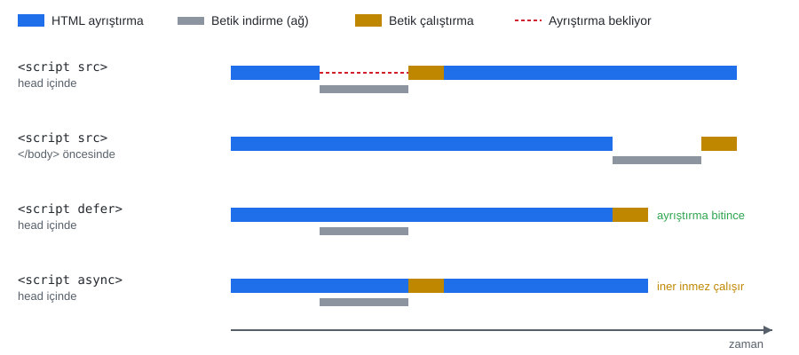

*Şekil 7.8. Betik yükleme biçimlerinin karşılaştırılması.*

Her iki nitelik de yalnızca `src` niteliği olan harici betiklerde etkilidir; satır içi betiklerde `defer` dikkate alınmaz [8]. Örnek 7.1, dört farklı yerleşimin çalışma sırasını gösterir (Şekil 7.9).

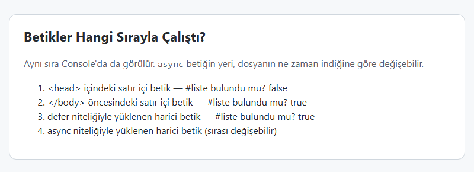

*Şekil 7.9. Örnek 7.1: Betiklerin çalışma sırası. Kod: [`codes/07-javascript-temelleri/ornek-7-1-script-yerlesimi/`](../codes/07-javascript-temelleri/ornek-7-1-script-yerlesimi/index.html)*

**Modüller.** `<script type="module" src="…">` biçiminde yüklenen betik bir **ES modülüdür**: `import`/`export` ile başka dosyalardaki kodu kullanabilir, kendi kapsamına sahiptir, otomatik olarak katı modda çalışır ve `defer` gibi ertelenerek yüklenir [8]. Modüller, güvenlik kuralları gereği `file://` ile açılan sayfalarda çalışmaz; VS Code'daki **Live Server** gibi bir yerel sunucu üzerinden açılmaları gerekir. Bu bölümde modül kullanılmamaktadır.

> [!NOTE]
> **Tarihsel not:** Eski belgelerde `<script type="text/javascript">` yazımı sık görülür. HTML5 ile birlikte varsayılan betik türü JavaScript olduğundan `type` niteliğini bu amaçla yazmak gereksizdir. Yine eski kaynaklarda görülen `document.write()` ile sayfaya içerik yazma yöntemi, ayrıştırmayı bozduğu ve sayfa yüklendikten sonra çağrıldığında tüm belgeyi sildiği için kullanılmaz; `<button onclick="…">` biçimindeki satır içi olay nitelikleri yerine de [Bölüm 8](08-javascript-dom-olaylar.md)'de anlatılan `addEventListener` tercih edilir.

## 7.6 Geliştirici Araçları: Console ve Sources

Tüm güncel tarayıcılarda **Geliştirici Araçları** (Developer Tools, DevTools) bulunur. Chrome, Edge ve Firefox'ta `F12` tuşuyla (ya da sayfada sağ tık → *İncele / Inspect*) açılır; Chrome ve Edge'de `Ctrl+Shift+J` doğrudan Console'u açar. Safari'de önce ayarlardan geliştirici menüsünün etkinleştirilmesi gerekir. Bu bölümde iki panel kullanılmaktadır: **Console** ve **Sources** [9, ss. 279–296].

### 7.6.1 Console'a Yazdırma

Console paneli iki işe yarar: Betiğin ürettiği iletileri ve hataları gösterir; ayrıca alttaki komut satırına JavaScript ifadeleri yazılarak anında denenebilir. Örneğin Console'a `2 ** 10` yazıp `Enter` tuşuna basıldığında `1024` sonucu görülür. Betikten Console'a çıktı göndermek için `console` nesnesinin metotları kullanılır (Tablo 7.3).

*Tablo 7.3. Sık kullanılan `console` metotları.*

| Metot | İşlevi |
|---|---|
| `console.log(değer, …)` | Genel amaçlı çıktı; birden çok değeri boşlukla ayırarak yazar |
| `console.info(…)` | Bilgi iletisi |
| `console.warn(…)` | Sarı renkli uyarı iletisi |
| `console.error(…)` | Kırmızı renkli hata iletisi (yığın izi ile) |
| `console.table(dizi)` | Nesne dizisini satır ve sütunlu tablo olarak gösterir |
| `console.clear()` | Console'u temizler |

```js
console.log("Toplam:", 120, "TL");
console.warn("Stok azaldı");
console.table([
  { urun: "Defter", fiyat: 45 },
  { urun: "Kalem", fiyat: 20 }
]);
```

*Kod 7.3. Console'a farklı türde çıktı gönderme.*

> [!IMPORTANT]
> `console.log` geliştiricinin aracıdır; kullanıcı Console'u görmez. Kullanıcıya gösterilecek sonuçlar sayfaya yazılır ([Bölüm 8](08-javascript-dom-olaylar.md)). Bu bölümün uygulamalarında sonuçlar hem Console'a hem de sayfadaki bir kutuya yazdırılmaktadır; sayfaya yazma işini yapan küçük `yaz()` fonksiyonu Bölüm 8'de ayrıntılı açıklanacak olan `textContent` özelliğini kullanır. Eski kaynaklarda sık görülen `alert()` iletişim kutusu ise sayfanın akışını durdurduğu için yalnızca çok basit denemelerde kullanılmalıdır.

### 7.6.2 Hata Mesajlarını Okumak

Bir betik hata verdiğinde Console'da kırmızı bir ileti belirir. İletinin üç parçası vardır: **hata türü** (ör. `TypeError`), **açıklama** ve sağ tarafta **dosya adı ile satır numarası** (ör. `script.js:14`). Satır numarasına tıklandığında Sources panelinde ilgili satır açılır. Hatalar genel olarak üçe ayrılır [4, Bl. 4]: Kodun kurallara uymadığı **sözdizimi hataları** (betik hiç çalışmaz), betik çalışırken ortaya çıkan **çalışma zamanı hataları** ve kodun çalıştığı ama yanlış sonuç ürettiği **mantık hataları**. Mantık hataları Console'da ileti üretmez; bunlar için kesme noktası kullanılır (7.6.3).

*Tablo 7.4. Chrome Console'da sık görülen hata iletileri ve olası nedenleri.*

| İleti | Olası neden |
|---|---|
| `Uncaught SyntaxError: Unexpected token '}'` | Eksik ya da fazla parantez/süslü parantez; betiğin hiçbir satırı çalışmaz |
| `Uncaught ReferenceError: toplm is not defined` | Değişken adı yanlış yazılmış ya da tanımlanmamış |
| `Uncaught TypeError: Cannot read properties of null (reading 'textContent')` | Seçilmek istenen öğe bulunamamış (yanlış seçici ya da `defer` eksik) |
| `Uncaught TypeError: hesapla is not a function` | Fonksiyon olmayan bir değer çağrılmış ya da ad yanlış |
| `Uncaught TypeError: Assignment to constant variable.` | `const` ile tanımlanmış değişkene yeniden değer atanmış |
| `Uncaught RangeError: Maximum call stack size exceeded` | Fonksiyon kendini durmaksızın çağırıyor |

### 7.6.3 Sources Paneli ve Kesme Noktası

`console.log` ile değişkenlerin değerini yazdırmak basit bir hata ayıklama yöntemidir; ancak her değişken için satır eklemek zahmetlidir. Daha güçlü yöntem **kesme noktasıdır** (breakpoint). Sources panelinde betik dosyası açılıp bir satır numarasına tıklandığında o satıra kesme noktası konur; sayfa yenilendiğinde betik o satıra geldiğinde **duraklatılır** [10]. Duraklatma sırasında:

- **Scope** bölümü, o anda geçerli değişkenlerin değerlerini gösterir;
- **Step over** (adımla) düğmesi geçerli satırı çalıştırıp bir sonrakinde durur, **Step into** (içine gir) düğmesi çağrılan fonksiyonun içine girer;
- **Resume** (devam) düğmesi betiği bir sonraki kesme noktasına kadar çalıştırır;
- **Call Stack** bölümü, o satıra hangi fonksiyon çağrıları üzerinden gelindiğini gösterir [10].

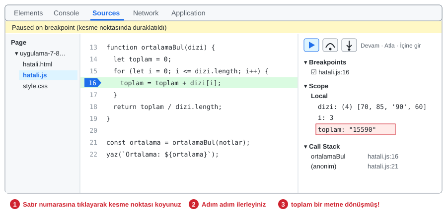

*Şekil 7.10. Sources panelinde kesme noktası ile duraklatılmış bir betik (şematik çizim). Uygulama 7.8'de bu hata adım adım bulunacaktır.*

#### 🛠 Uygulama 7.1: İlk Betik ve Console

**Amaç:** Harici bir betik dosyasını `defer` ile bağlamak, Console'a farklı türde çıktı göndermek ve bir hata iletisini okumak.  
**Tahmini süre:** 15 dk

1. VS Code'da `calismalar/bolum-07/uygulama-7-1/` klasörünü oluşturunuz; içine `index.html` ve `script.js` dosyalarını ekleyiniz.
2. `index.html` dosyasında Emmet ile (`!` + `Tab`) iskeleti oluşturunuz, `lang="tr"` yapınız ve `<head>` içine `<script src="script.js" defer></script>` satırını ekleyiniz. `<body>` içine bir başlık ile `<pre id="konsol"></pre>` öğesini koyunuz.
3. `script.js` dosyasına Kod 7.3'teki satırları ve aşağıdaki selamlama kodunu yazınız:

   ```js
   const saat = new Date().getHours();
   let selam;
   if (saat < 12) {
     selam = "Günaydın";
   } else if (saat < 18) {
     selam = "İyi günler";
   } else {
     selam = "İyi akşamlar";
   }
   console.log(`${selam}! 2 + 3 * 4 = ${2 + 3 * 4}`);
   ```

4. Sayfayı **Live Server** ile açınız, `F12` → **Console** sekmesine geçiniz ve iletilerin renklerini, `console.table` çıktısını inceleyiniz.
5. `console.log` satırındaki kapanış parantezini bilerek siliniz, kaydediniz ve Console'daki `SyntaxError` iletisini okuyunuz. İletinin yanındaki dosya adı ve satır numarasına tıklayınız; ardından hatayı düzeltiniz.

**Beklenen çıktı:**

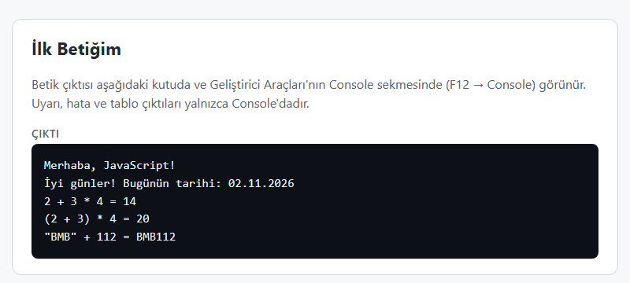

*Şekil 7.11. Uygulama 7.1'in beklenen ekran görüntüsü (çözüm dosyası sonuçları sayfadaki kutuya da yazar).*

**Kendinizi sınayın:** (1) Console'un komut satırına `selam` yazınız; değer neden görünüyor? (2) `defer` niteliğini kaldırıp betiği `<head>` içinde bırakırsanız çözüm dosyasında hangi hata oluşur? Tablo 7.4'ten nedenini bulunuz.

<details><summary>Örnek çözüm</summary>

Çözüm dosyası: [`codes/07-javascript-temelleri/uygulama-7-1-ilk-betik/index.html`](../codes/07-javascript-temelleri/uygulama-7-1-ilk-betik/index.html)

</details>

## 7.7 Sözdizimi Temelleri

### 7.7.1 Deyimler ve Noktalı Virgül

Bir JavaScript programı **deyimlerden** (statement) oluşur; her deyim bilgisayara verilen bir komuttur ve genellikle noktalı virgül (`;`) ile biter. Deyimler yukarıdan aşağıya sırayla çalıştırılır. Süslü parantezler (`{ }`) birden çok deyimi bir **blok** hâlinde gruplar.

JavaScript, satır sonlarında unutulan noktalı virgülleri çoğu durumda kendiliğinden ekler (automatic semicolon insertion, ASI) [1, ss. 25–27]. Ancak bu kural bazen beklenmedik sonuçlar doğurur:

```js
function birimFiyat() {
  return        // ASI buraya noktalı virgül ekler!
    { fiyat: 45 };
}
console.log(birimFiyat());   // undefined
```

*Kod 7.4. Otomatik noktalı virgül eklemenin yol açtığı bir hata: `return` ile döndürülecek değer aynı satırda başlamalıdır.*

Bu notlarda, kılavuz kural olarak her deyimin sonuna noktalı virgül yazılmaktadır.

### 7.7.2 Yorumlar

Yorumlar (comment), kodu okuyan insanlar için yazılan ve tarayıcının yok saydığı açıklamalardır [9, ss. 101–106]:

```js
// Tek satırlık yorum: satırın geri kalanı yok sayılır
const KDV_ORANI = 0.20;   // satır sonuna da yazılabilir

/*
  Çok satırlı yorum.
  Kodun bir bölümünü geçici olarak devre dışı bırakmak için de kullanılır.
*/
```

*Kod 7.5. Tek satırlı ve çok satırlı yorumlar.*

Yorum, kodun *ne* yaptığını değil, *neden* öyle yazıldığını açıklamalıdır. VS Code'da `Ctrl+/` kısayolu seçili satırları yorum satırına çevirir.

### 7.7.3 Büyük/Küçük Harf Duyarlılığı ve Adlandırma

JavaScript büyük/küçük harfe duyarlıdır (case-sensitive): `toplam`, `Toplam` ve `TOPLAM` üç farklı addır; `console.log` yerine `Console.log` yazmak hataya yol açar [1, s. 21]. Değişken ve fonksiyon adları (tanımlayıcılar, identifier) şu kurallara uyar [11, Bl. 2]:

- Bir harf, alt çizgi (`_`) ya da dolar işaretiyle (`$`) başlar; rakamla başlayamaz (`2toplam` geçersizdir).
- Harf, rakam, `_` ve `$` içerebilir; boşluk ve tire (`-`) içeremez.
- Ayrılmış sözcükler ad olarak kullanılamaz.

Yaygın gelenek, birden çok sözcükten oluşan adlarda **camelCase** (deve hörgücü) yazımıdır: İlk sözcük küçük harfle başlar, sonraki sözcüklerin ilk harfi büyük yazılır (`araToplam`, `ogrenciSayisi`, `notHesapla`). Programın başında bir kez belirlenip hiç değişmeyen sabitler için ise `KDV_ORANI` gibi büyük harfli ve alt çizgili yazım tercih edilir. Standart, adlarda Türkçe karakterlere (`öğrenci`) izin verse de klavye ve dosya kodlaması sorunlarını önlemek için ASCII karakterler önerilir. Adlar kısa olmaktan çok **anlamlı** olmalıdır: `x` yerine `sepetToplami`.

### 7.7.4 Ayrılmış Sözcükler

Dilin kendi yapıları için ayırdığı sözcükler (reserved words) değişken ya da fonksiyon adı olarak kullanılamaz [1, s. 23]. Başlıcaları şunlardır: `break`, `case`, `catch`, `class`, `const`, `continue`, `debugger`, `default`, `delete`, `do`, `else`, `export`, `extends`, `false`, `finally`, `for`, `function`, `if`, `import`, `in`, `instanceof`, `let`, `new`, `null`, `return`, `super`, `switch`, `this`, `throw`, `true`, `try`, `typeof`, `var`, `void`, `while`, `with`, `yield`; ayrıca ileride kullanılmak üzere ayrılmış `enum`, `await`, `implements`, `interface`, `package`, `private`, `protected`, `public`, `static`.

## 7.8 Değişkenler

**Değişken** (variable; Latince *variabilis*: değişebilen), bir değeri saklayan adlandırılmış bir bellek alanıdır. Değişken önce **bildirilir** (declare), sonra ona değer **atanır** (assign); bu iki işlem tek satırda da yapılabilir [9, ss. 13–17].

### 7.8.1 `let` ve `const`

```js
let sepetAdedi = 0;       // bildirim + ilk değer ataması
sepetAdedi = 3;           // yeniden atama: let ile serbest

const KDV_ORANI = 0.20;
// KDV_ORANI = 0.18;      // TypeError: Assignment to constant variable.

let indirimKodu;          // değer atanmadı
console.log(indirimKodu); // undefined
```

*Kod 7.6. `let` ve `const` ile değişken bildirimi.*

- **`const`** (constant, sabit): Bildirim sırasında değer verilmesi zorunludur ve değişkene **yeniden değer atanamaz**. Değeri değişmeyecek her değişken için ilk tercih `const` olmalıdır; bu, kodu okuyana "bu ad hep aynı değeri gösterir" güvencesi verir.
- **`let`**: Değeri sonradan değişecek değişkenler (sayaçlar, toplamlar, döngü değişkenleri) için kullanılır.

> [!IMPORTANT]
> `const`, değişkenin gösterdiği **değeri değil, bağlantıyı** sabitler. Değişken bir dizi ya da nesne tutuyorsa dizinin/nesnenin içeriği değiştirilebilir; yalnızca değişkene yeni bir dizi/nesne atanamaz:
>
> ```js
> const sepet = ["defter"];
> sepet.push("kalem");      // geçerli: içerik değişti
> // sepet = [];            // TypeError: değişkene yeni dizi atanamaz
> ```

### 7.8.2 Blok Kapsamı

Bir değişkenin kullanılabildiği kod bölgesine **kapsam** (scope) denir. `let` ve `const` ile bildirilen değişkenler **blok kapsamlıdır**: Yalnızca bildirildikleri `{ }` bloğunun içinde geçerlidir.

```js
const ortalama = 72;
if (ortalama >= 60) {
  const mesaj = "Tebrikler";   // yalnızca bu blokta yaşar
  console.log(mesaj);
}
// console.log(mesaj);          // ReferenceError: mesaj is not defined
```

*Kod 7.7. Blok kapsamı.*

### 7.8.3 `var`: Tarihsel Bildirim Biçimi

ES2015 öncesinde değişkenler yalnızca `var` ile bildiriliyordu ve eski kaynaklarda bu yazım hâlâ yaygındır. `var` iki noktada `let`/`const`'tan farklı davranır [1, ss. 53–56]:

1. **Fonksiyon kapsamı:** `var` blokları tanımaz; bir `if` ya da `for` bloğunda bildirilen `var` değişkeni bloğun dışından da görülebilir.
2. **Yukarı taşıma (hoisting):** `var` bildirimleri, bulundukları fonksiyonun başına taşınmış gibi davranır; bu yüzden değişken, bildirildiği satırdan önce kullanıldığında hata vermez, `undefined` verir. `let`/`const` ile aynı durum `ReferenceError` üretir ve hatayı hemen görünür kılar.

```js
console.log(a);   // undefined (hata yok, sessizce yanlış)
var a = 5;

console.log(b);   // ReferenceError: Cannot access 'b' before initialization
let b = 5;

for (var i = 0; i < 3; i++) { }
console.log(i);   // 3: döngü değişkeni dışarı sızdı
```

*Kod 7.8. `var` ile `let` arasındaki kapsam ve yukarı taşıma farkı.*

> [!NOTE]
> **Tarihsel not:** `var` bugün de çalışır ve eski kodu okuyabilmek için tanınmalıdır. Ancak sessiz hatalara yol açtığı için yeni kodda kullanılmaz; kural olarak önce `const`, gerekirse `let` tercih edilir.

*Tablo 7.5. Değişken bildirim biçimlerinin karşılaştırılması.*

| | `const` | `let` | `var` (tarihsel) |
|---|---|---|---|
| Kapsam | Blok | Blok | Fonksiyon |
| Yeniden atama | Hayır | Evet | Evet |
| Aynı adla yeniden bildirim | Hayır | Hayır | Evet (hataya açık) |
| Bildirimden önce kullanım | `ReferenceError` | `ReferenceError` | `undefined` |

## 7.9 Veri Türleri

JavaScript **dinamik türlü** (dynamically typed) bir dildir: Değişkenin türü bildirimde yazılmaz; değişken hangi değeri tutuyorsa o türdedir ve aynı değişken zamanla farklı türde değerler tutabilir. Dilde yedi **ilkel** (primitive) tür ve bir **nesne** (object) türü vardır [5], [12] (Şekil 7.12).

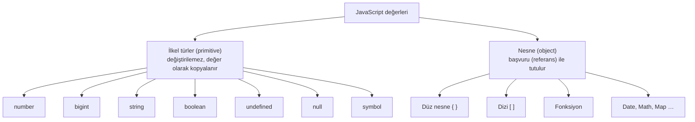

*Şekil 7.12. JavaScript'teki veri türleri.*

### 7.9.1 Sayılar: `number` ve `bigint`

JavaScript'te tam sayılar ile ondalık sayılar ayrı türler değildir; hepsi `number` türündedir ve IEEE 754 standardındaki 64 bitlik kayan noktalı (floating-point) biçimde saklanır [1, s. 31]. Ondalık ayırıcı olarak **nokta** kullanılır (`3.14`; `3,14` yazılmaz).

```js
const adet = 42;          // tam sayı da number
const fiyat = 129.90;     // ondalık sayı
const sicaklik = -4.5;

console.log(10 / 3);      // 3.3333333333333335
console.log(10 / 0);      // Infinity
console.log("abc" * 2);   // NaN (Not a Number: sayısal olmayan sonuç)
console.log(0.1 + 0.2);   // 0.30000000000000004
```

*Kod 7.9. `number` türünün özel değerleri.*

- **`NaN`** (Not a Number), sayısal sonucu tanımsız işlemlerde ortaya çıkar. İlginç biçimde `typeof NaN` sonucu `"number"`'dır ve `NaN` kendisine bile eşit değildir; bir değerin `NaN` olup olmadığı `Number.isNaN(deger)` ile denetlenir.
- **`Infinity`** ve **`-Infinity`**, sınırları aşan sonuçları gösterir.
- **`0.1 + 0.2` sorunu:** İkili kayan noktalı biçim, 0,1 gibi ondalık kesirleri tam olarak gösteremez; sonuç çok küçük bir yuvarlama hatası içerir [1, ss. 34–35]. Bu bir JavaScript hatası değil, aynı biçimi kullanan neredeyse tüm dillerin ortak özelliğidir. Para hesaplarında sonuç kuruşa yuvarlanmalı (`Math.round(tutar * 100) / 100`) ya da hesap kuruş cinsinden tam sayılarla yapılmalıdır.

`number` türü, `Number.MAX_SAFE_INTEGER` (9 007 199 254 740 991) değerine kadar tam sayıları kesin olarak gösterebilir. Daha büyük tam sayılar için ES2020'de eklenen **`bigint`** türü kullanılır; sayının sonuna `n` yazılır (`12345678901234567890n`). `bigint` ile `number` aynı işlemde karıştırılamaz. Bu türe gündelik web uygulamalarında nadiren gerek duyulur.

### 7.9.2 Dizgeler: `string`

Metin değerlerine **dizge** (string) denir. Dizgeler tek tırnak (`'…'`), çift tırnak (`"…"`) ya da ters tırnak (`` `…` ``) arasına yazılır; tek ve çift tırnak arasında fark yoktur, önemli olan bir projede tutarlı davranmaktır.

ES2015 ile gelen **şablon dizgeleri** (template literals) ters tırnakla yazılır ve `${…}` içine herhangi bir ifadenin yerleştirilmesine izin verir; ayrıca birden çok satıra yayılabilir. `+` ile birleştirmeye göre çok daha okunaklıdır:

```js
const ad = "Zeynep";
const ortalama = 79;

const eski = "Sayın " + ad + ", ortalamanız " + ortalama + ".";   // + ile birleştirme
const yeni = `Sayın ${ad}, ortalamanız ${ortalama}.`;            // şablon dizgesi
const durum = `Sonuç: ${ortalama >= 60 ? "Geçti" : "Kaldı"}`;     // ifade de yazılabilir

console.log(yeni.length);              // karakter sayısı
console.log(ad.toUpperCase());         // ZEYNEP
console.log("istanbul".toLocaleUpperCase("tr-TR"));   // İSTANBUL
console.log("Web Teknolojileri".includes("Web"));     // true
```

*Kod 7.10. Dizge oluşturma, şablon dizgeleri ve sık kullanılan dizge özellik/metotları.*

> [!IMPORTANT]
> `toUpperCase()` ve `toLowerCase()` İngilizce kurallarını uygular: `"istanbul".toUpperCase()` sonucu `"ISTANBUL"` olur (noktasız I). Türkçe metinlerde `toLocaleUpperCase("tr-TR")` ve `toLocaleLowerCase("tr-TR")` kullanılmalıdır.

### 7.9.3 `boolean`, `undefined`, `null` ve `symbol`

- **`boolean`** (mantıksal): Yalnızca `true` (doğru) ve `false` (yanlış) değerlerini alır; karşılaştırmaların sonucudur (`5 > 3` → `true`).
- **`undefined`**: Bildirilmiş ama değer atanmamış değişkenin, var olmayan bir nesne özelliğinin ya da değer döndürmeyen bir fonksiyonun sonucudur. "Henüz değer yok" anlamını taşır.
- **`null`**: Programcının bilerek atadığı "boş" değerdir; "değer yok ve bu kasıtlı" anlamını taşır (ör. henüz seçilmemiş kargo seçeneği: `let secilenKargo = null;`) [9, ss. 195–197].
- **`symbol`**: Her biri benzersiz olan tanımlayıcılar üretir (`Symbol("id") === Symbol("id")` sonucu `false`). İleri düzey nesne programlamada kullanılır; bu derste ayrıntısına girilmez.

### 7.9.4 Nesneler ve `typeof` İşleci

İlkel türlerin dışında kalan her değer bir **nesnedir** (object): Birden çok değeri adlandırılmış özellikler hâlinde tutan düz nesneler (`{ ad: "Ayşe", yas: 19 }`), sıralı değer listeleri olan diziler (`[70, 85, 90]`) ve fonksiyonlar bu gruptadır. Diziler ve nesneler 7.13'te ayrıntılı ele alınmaktadır.

Bir değerin türü `typeof` işleciyle öğrenilir; sonuç bir dizgedir (Tablo 7.6).

*Tablo 7.6. `typeof` işlecinin sonuçları.*

| İfade | `typeof` sonucu | Not |
|---|---|---|
| `42`, `3.14`, `NaN` | `"number"` | `NaN` de bir sayı değeridir |
| `10n` | `"bigint"` | |
| `"Merhaba"`, `` `x` `` | `"string"` | |
| `true` | `"boolean"` | |
| `undefined` | `"undefined"` | |
| `null` | `"object"` | Dilin ilk sürümünden kalan, geriye uyumluluk için düzeltilmeyen bir tutarsızlık [2] |
| `Symbol("id")` | `"symbol"` | |
| `{ ad: "Ayşe" }`, `[1, 2]` | `"object"` | Dizi olup olmadığı `Array.isArray()` ile anlaşılır |
| `function () {}` | `"function"` | Fonksiyonlar da nesnedir |

### 7.9.5 Tür Dönüşümü

Formlardan, adres çubuğundan ya da sunucudan gelen veriler çoğunlukla **metin** olarak gelir. Bir form alanına yazılan "85", JavaScript'e `"85"` dizgesi olarak ulaşır ve hesaba katılmadan önce sayıya dönüştürülmelidir. Bu işleme **açık tür dönüşümü** (explicit conversion) denir [1, ss. 45–49]:

```js
Number("85");          // 85
Number("85.5");        // 85.5
Number("");            // 0    (dikkat: boş metin 0 olur)
Number("85 puan");     // NaN  (metnin tamamı sayı olmalı)
parseInt("85 puan");   // 85   (baştaki sayıyı okur, ondalığı atar)
parseFloat("3.75 kg"); // 3.75
String(2026);          // "2026"
(129.9).toFixed(2);    // "129.90" (iki basamaklı metin)
```

*Kod 7.11. Açık tür dönüşümü.*

JavaScript farklı türleri bir işlemde karşılaştığında **örtük dönüşüm** (implicit conversion, type coercion) de yapar. Kurallar tutarlı görünmediği için başlangıç düzeyinde sık hata kaynağıdır:

```js
"5" + 3      // "53"  (+ işlecinde taraflardan biri metinse birleştirme yapılır)
"5" - 3      // 2     (- işleci metni sayıya çevirir)
"5" * "2"    // 10
true + 1     // 2     (true → 1)
"" == 0      // true  (her iki taraf sayıya çevrilir)
```

*Kod 7.12. Örtük dönüşümün tuzakları.*

**`==` ve `===`:** Gevşek eşitlik işleci `==`, karşılaştırmadan önce türleri dönüştürür; bu yüzden `"5" == 5` ve `"" == 0` ifadeleri `true` verir. Katı eşitlik işleci `===` ise hem değeri hem türü karşılaştırır ve dönüştürme yapmaz: `"5" === 5` sonucu `false`'tur [9, ss. 189–193]. Aynı ayrım `!=` ve `!==` için de geçerlidir.

> [!IMPORTANT]
> Karşılaştırmalarda her zaman `===` ve `!==` kullanınız. Farklı türden bir değerle karşılaştırma gerekiyorsa önce açık dönüşüm yapınız: `Number(girilen) === 100`.

**Doğrusal ve yanlışsal değerler.** Koşul gerektiren yerlerde (`if`, `&&`, `||`) her değer bir mantıksal değere dönüştürülür. Şu sekiz değer `false` sayılır ve **yanlışsal** (falsy) olarak adlandırılır: `false`, `0`, `-0`, `0n`, `""` (boş dizge), `null`, `undefined`, `NaN`. Bunların dışındaki her değer, `"0"` ve `"false"` dizgeleri ile boş dizi `[]` dahil, **doğrusal** (truthy) kabul edilir [11, Bl. 4].

#### 🛠 Uygulama 7.2: Değişken ve Tür Keşfi

**Amaç:** `typeof` işleciyle farklı değerlerin türünü gözlemlemek; açık ve örtük dönüşümün sonuçlarını karşılaştırmak.  
**Tahmini süre:** 15 dk

1. `calismalar/bolum-07/uygulama-7-2/` klasöründe `index.html` ve `script.js` oluşturunuz; betiği `defer` ile bağlayınız.
2. `script.js` içinde Tablo 7.6'daki her değeri bir değişkene atayınız ve `console.log(typeof degisken)` ile türünü yazdırınız.
3. Aşağıdaki ifadelerin sonuçlarını **önce tahmin edip** bir kâğıda yazınız, sonra Console'da deneyiniz: `Number("42px")`, `parseInt("42px")`, `"5" + 3`, `"5" - 3`, `true + 1`, `0.1 + 0.2`, `"" == 0`, `"" === 0`, `null == undefined`, `null === undefined`.
4. Tahminleriniz ile sonuçları karşılaştırınız; yanıldığınız her ifade için Kod 7.11–7.12'deki ilgili kuralı bulunuz.
5. Değerleri nesne dizisi hâline getirip `console.table()` ile tablo olarak yazdırınız.

**Beklenen çıktı:**

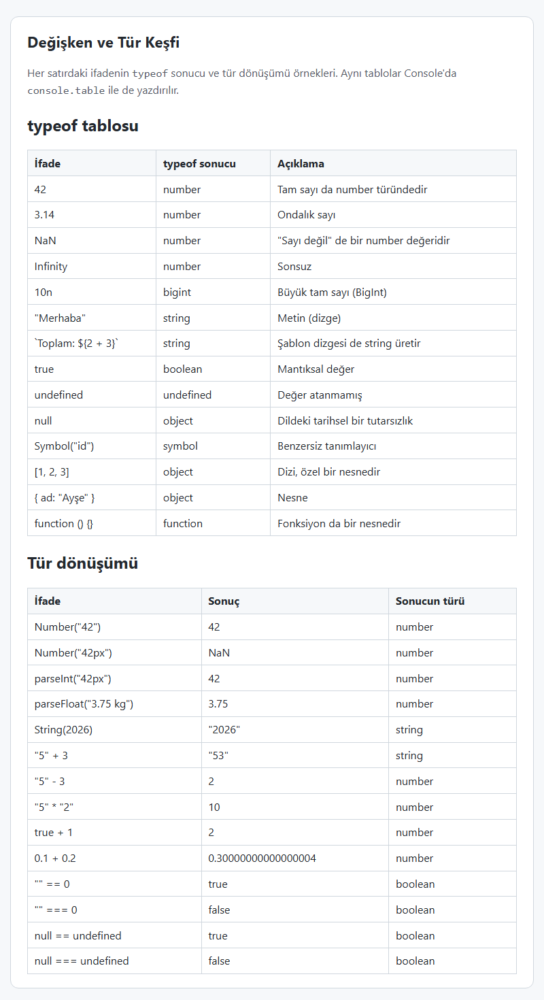

*Şekil 7.13. Uygulama 7.2'nin beklenen ekran görüntüsü.*

**Kendinizi sınayın:** (1) `typeof typeof 42` ifadesinin sonucu nedir, neden? (2) Bir form alanından gelen `"0"` değeri `if` koşulunda doğrusal mı yanlışsal mı sayılır?

<details><summary>Örnek çözüm</summary>

Çözüm dosyası: [`codes/07-javascript-temelleri/uygulama-7-2-tur-kesfi/index.html`](../codes/07-javascript-temelleri/uygulama-7-2-tur-kesfi/index.html)

</details>

## 7.10 Operatörler

**İşleç** (operator), bir ya da daha çok değer (işlenen, operand) üzerinde işlem yapan simgedir. İşleçler ve işlenenlerden oluşan, bir değer üreten yapıya **ifade** (expression) denir [4, s. 39].

### 7.10.1 Aritmetik ve Atama İşleçleri

```js
const a = 17;
const b = 5;
a + b;    // 22   toplama (metinlerde birleştirme)
a - b;    // 12   çıkarma
a * b;    // 85   çarpma
a / b;    // 3.4  bölme (tam sayı bölmesi yoktur)
a % b;    // 2    kalan (mod): çift/tek denetiminde kullanılır
a ** 2;   // 289  üs alma (ES2016)

let puan = 10;
puan += 5;   // puan = puan + 5  → 15
puan -= 3;   // 12
puan *= 2;   // 24
puan++;      // 25 (bir artır)
puan--;      // 24 (bir azalt)
```

*Kod 7.13. Aritmetik ve bileşik atama işleçleri.*

İşlem önceliği matematikteki gibidir: `**`, sonra `*`, `/`, `%`, sonra `+`, `-`. `2 + 3 * 4` ifadesi 14 verir; farklı bir sıra isteniyorsa parantez kullanılır: `(2 + 3) * 4` → 20. Okunabilirlik için öncelikten emin olunmayan her yerde parantez kullanılması önerilir.

### 7.10.2 Karşılaştırma ve Mantıksal İşleçler

Karşılaştırma işleçleri (`===`, `!==`, `<`, `>`, `<=`, `>=`) her zaman `true` ya da `false` döndürür. Birden çok koşulu birleştirmek için mantıksal işleçler kullanılır:

*Tablo 7.7. Mantıksal işleçler.*

| İşleç | Ad | Sonuç | Örnek |
|---|---|---|---|
| `&&` | VE (AND) | İki taraf da doğruysa doğru | `vize >= 0 && vize <= 100` |
| `\|\|` | VEYA (OR) | Taraflardan en az biri doğruysa doğru | `not < 0 \|\| not > 100` |
| `!` | DEĞİL (NOT) | Değeri tersine çevirir | `!uyeMi` |

`&&` ve `||` **kısa devre** (short-circuit) değerlendirilir: `&&` işlecinde sol taraf yanlışsa, `||` işlecinde sol taraf doğruysa sağ taraf hiç hesaplanmaz.

### 7.10.3 `??` ve `?.` İşleçleri

ES2020 ile gelen iki işleç, eksik verilerle çalışmayı kolaylaştırır:

- **Boş birleştirme** (nullish coalescing) `??`: Sol taraf `null` ya da `undefined` ise sağdaki varsayılan değeri verir. `||` işlecinden farkı, `0` ve `""` gibi geçerli ama yanlışsal değerleri korumasıdır.
- **İsteğe bağlı zincirleme** (optional chaining) `?.`: Bir nesne zincirinde ara değerlerden biri `null`/`undefined` ise hata vermek yerine `undefined` döndürür.

```js
const indirim = 0;
console.log(indirim || 10);   // 10  (0 yanlışsal olduğu için yanlışlıkla değişti)
console.log(indirim ?? 10);   // 0   (0 geçerli bir değer olarak korundu)

const kullanici = { ad: "Ali" };              // adres bilgisi yok
console.log(kullanici.adres?.sehir);          // undefined (hata yok)
console.log(kullanici.adres?.sehir ?? "Belirtilmemiş");
// kullanici.adres.sehir                      // TypeError: Cannot read properties of undefined
```

*Kod 7.14. `??` ve `?.` işleçleri.*

### 7.10.4 Üçlü Koşul İşleci

Üçlü koşul işleci (ternary operator) `koşul ? değer1 : değer2`, koşul doğruysa ilk, yanlışsa ikinci değeri üretir. Basit iki seçenekli atamalar için `if/else`'in kısa biçimidir:

```js
const kargoUcreti = sepetTutari >= 750 ? 0 : 49.90;
const durum = ortalama >= 60 ? "Geçti" : "Kaldı";
```

*Kod 7.15. Üçlü koşul işleci.*

İç içe üçlü işleç kullanmak kodu okunaksız hâle getirir; ikiden çok seçenek varsa `if/else if` ya da `switch` tercih edilmelidir.

## 7.11 Kontrol Yapıları

Programın deyimleri varsayılan olarak yukarıdan aşağıya sırayla çalışır. **Kontrol yapıları** bu sırayı değiştirir: Koşul yapıları bir koşula göre farklı yollardan birini seçer, döngüler ise bir bloğu tekrarlar [1, Bl. 5], [11, Bl. 4].

### 7.11.1 `if`, `else if`, `else`

```js
const saat = new Date().getHours();
let selam;

if (saat < 12) {
  selam = "Günaydın";
} else if (saat < 18) {
  selam = "İyi günler";
} else {
  selam = "İyi akşamlar";
}
```

*Kod 7.16. `if / else if / else` zinciri.*

Koşullar yukarıdan aşağıya denenir; **ilk doğru** koşulun bloğu çalışır ve zincirin geri kalanı atlanır (Şekil 7.14). Bu nedenle aralık denetimlerinde koşulların sırası önemlidir: Önce en dar ya da en yüksek eşik denetlenmelidir. Tek deyimli bloklarda bile süslü parantez yazılması, sonradan satır eklendiğinde oluşabilecek hataları önler.

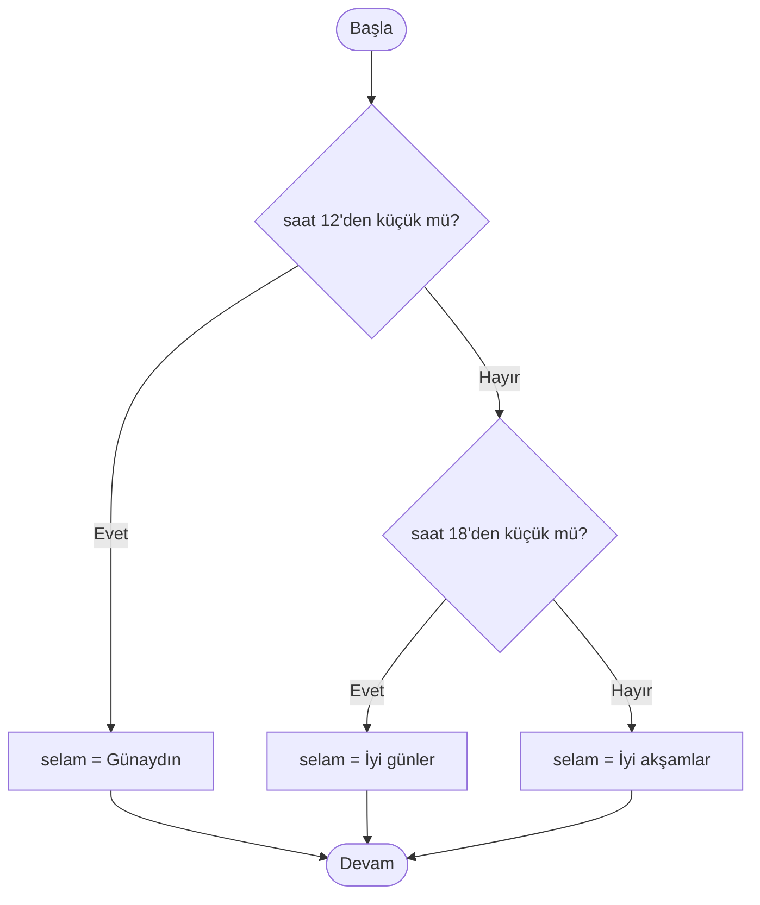

*Şekil 7.14. `if / else if / else` zincirinin akış diyagramı.*

### 7.11.2 `switch`

Tek bir değerin birçok olası karşılığına göre dallanma yapılacaksa `switch` daha okunaklıdır. `switch`, değeri her `case` ile **katı eşitlik** (`===`) kullanarak karşılaştırır. Eşleşen `case`'ten itibaren kod çalışır ve `break` görülene kadar **sonraki `case`'lere de geçer** (fall-through). Hiçbir `case` eşleşmezse `default` bloğu çalışır.

```js
const gun = new Date().getDay();   // 0 = Pazar, 1 = Pazartesi, …, 6 = Cumartesi
let kargoMesaji;

switch (gun) {
  case 0:
  case 6:
    kargoMesaji = "Siparişiniz pazartesi kargoya verilecek.";
    break;
  case 5:
    kargoMesaji = "Saat 15.00'e kadar verilen siparişler bugün kargoda.";
    break;
  default:
    kargoMesaji = "Siparişiniz bugün kargoya verilecek.";
}
```

*Kod 7.17. `switch` ile birden çok `case`'in aynı bloğu paylaşması.*

> [!IMPORTANT]
> `break` unutulursa eşleşen `case`'in ardından gelen `case`'lerin kodları da çalışır. Bilerek yapılmayan her geçiş bir hatadır.

### 7.11.3 `for` Döngüsü

Tekrar sayısı baştan belli olduğunda `for` döngüsü kullanılır. Döngü başlığı noktalı virgülle ayrılmış üç parçadan oluşur: **başlatma**, **koşul** ve **artırma** (Şekil 7.15).

```js
for (let i = 1; i <= 10; i++) {
  console.log(`7 x ${i} = ${7 * i}`);
}
```

*Kod 7.18. `for` döngüsüyle 7'nin çarpım tablosu.*

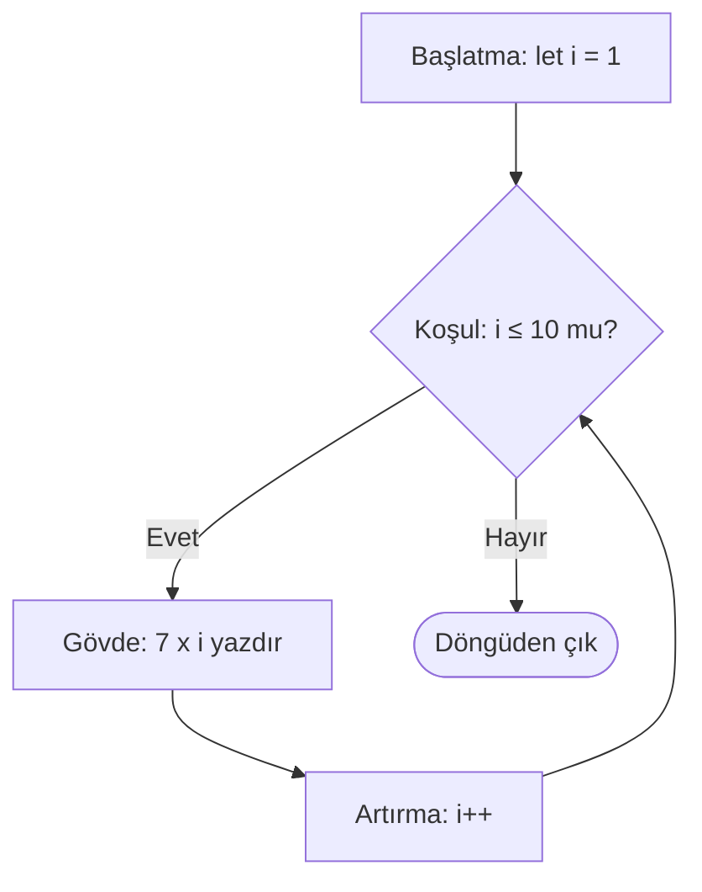

*Şekil 7.15. `for` döngüsünün akış diyagramı.*

### 7.11.4 `while` ve `do…while`

Tekrar sayısı önceden bilinmiyor, yalnızca durma koşulu biliniyorsa `while` kullanılır: Koşul **önce** denetlenir, doğru olduğu sürece gövde çalışır. `do…while` ise gövdeyi **önce** çalıştırır, koşulu sonra denetler; bu nedenle gövde en az bir kez çalışır (Şekil 7.16).

```js
// Aylık %3 faizle 10 000 TL kaç ayda 12 000 TL'yi geçer?
let bakiye = 10000;
let ay = 0;
while (bakiye <= 12000) {
  bakiye *= 1.03;
  ay++;
}
console.log(`${ay} ay sonra: ${bakiye.toFixed(2)} TL`);

// do…while: gövde en az bir kez çalışır
let zar;
do {
  zar = Math.floor(Math.random() * 6) + 1;
  console.log("Atılan zar:", zar);
} while (zar !== 6);
```

*Kod 7.19. `while` ve `do…while` döngüleri.*

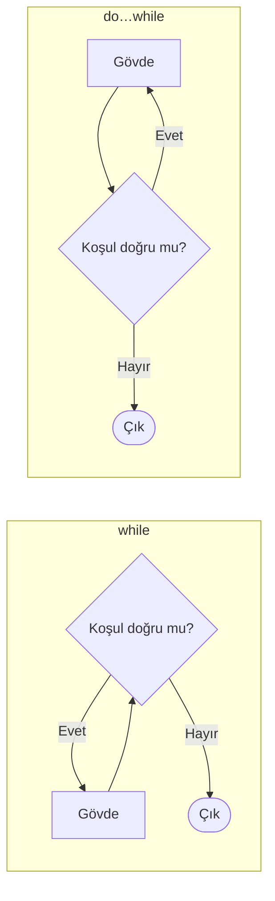

*Şekil 7.16. `while` ile `do…while` arasındaki fark: koşulun denetlendiği yer.*

> [!WARNING]
> Döngü koşulunun bir noktada mutlaka yanlış olması gerekir. Koşulu etkileyen değişken gövdede değişmiyorsa **sonsuz döngü** oluşur ve sekme yanıt veremez hâle gelir; böyle bir durumda sekme kapatılarak kod düzeltilir.

### 7.11.5 `for…of`, `break` ve `continue`

ES2015 ile gelen `for…of` döngüsü, bir dizinin (ya da dizgenin) elemanlarını indisle uğraşmadan sırayla dolaşır. `break` döngüyü tamamen sonlandırır; `continue` yalnızca o turu atlayıp bir sonraki tura geçer.

```js
const notlar = [72, 45, 88, -5, 91];

for (const not of notlar) {
  if (not < 0) {
    console.log("Geçersiz not bulundu, döngü durduruldu.");
    break;
  }
  if (not < 50) {
    continue;            // 50'nin altındakileri atla
  }
  console.log(not);      // 72, 88
}
```

*Kod 7.20. `for…of`, `break` ve `continue`.*

Nesnelerin özellik adlarını dolaşmak için `for…in` döngüsü de vardır (7.13.2); diziler için `for…in` yerine `for…of` kullanılmalıdır.

#### 🛠 Uygulama 7.3: Döngülerle Çarpım Tablosu

**Amaç:** `for` ve `while` döngülerini, iç içe döngüyü ve `if` koşulunu birlikte kullanmak.  
**Tahmini süre:** 15 dk

1. `calismalar/bolum-07/uygulama-7-3/` klasöründe `index.html` ve `script.js` oluşturunuz.
2. Kod 7.18'i yazarak 7'nin çarpım tablosunu Console'a yazdırınız; `carpan` adlı bir `const` değişken tanımlayıp 7 yerine onu kullanınız.
3. Bir `while` döngüsüyle `carpan`'ın katlarından 50'yi aşan ilkini bulunuz.
4. İç içe iki `for` döngüsüyle 10 × 10'luk çarpım tablosunu üretiniz: Dış döngü satırları, iç döngü sütunları dolaşsın. Her satırı `console.log` ile yazdırınız (çözüm dosyası tabloyu sayfaya HTML tablosu olarak da yazar).
5. Satır ve sütun numarası eşit olan hücreleri (kare sayıları) `if` ile ayırt ediniz.

**Beklenen çıktı:**

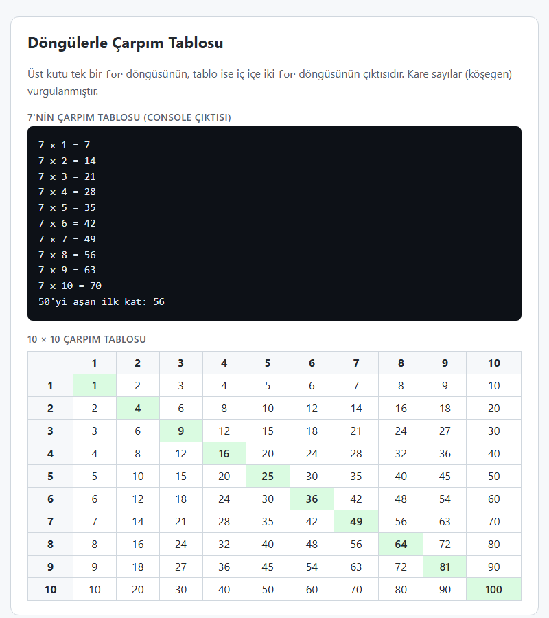

*Şekil 7.17. Uygulama 7.3'ün beklenen ekran görüntüsü.*

**Kendinizi sınayın:** (1) Tablonun yalnızca köşegenin üstünde kalan yarısını yazdırınız (`continue` kullanarak). (2) 1–100 arasında hem 3'e hem 5'e bölünebilen sayıları `%` işleciyle bulunuz.

<details><summary>Örnek çözüm</summary>

Çözüm dosyası: [`codes/07-javascript-temelleri/uygulama-7-3-carpim-tablosu/index.html`](../codes/07-javascript-temelleri/uygulama-7-3-carpim-tablosu/index.html)

</details>

## 7.12 Fonksiyonlar

**Fonksiyon** (function), belirli bir işi yapan, bir kez tanımlanıp gerektiği kadar çağrılabilen adlandırılmış kod bloğudur. Fonksiyonlar aynı kodun tekrar tekrar yazılmasını önler (DRY: *Don't Repeat Yourself*), programı anlamlı parçalara ayırır ve her parçanın ayrı ayrı sınanmasını kolaylaştırır [9, ss. 19–29], [1, Bl. 8].

### 7.12.1 Bildirim, Parametre ve `return`

```js
function kdvEkle(tutar, oran) {        // tutar ve oran: parametreler
  const kdv = tutar * oran;
  return tutar + kdv;                  // sonucu çağırana döndürür
}

const fiyat = kdvEkle(250, 0.20);      // 250 ve 0.20: argümanlar
console.log(fiyat);                    // 300
```

*Kod 7.21. Fonksiyon bildirimi (function declaration).*

- **Parametre** (parameter), fonksiyon tanımındaki ad; **argüman** (argument), çağrı sırasında gönderilen gerçek değerdir.
- `return` deyimi fonksiyonu **hemen sonlandırır** ve değeri çağırana döndürür. `return` olmayan ya da değersiz `return;` ile biten fonksiyon `undefined` döndürür.
- Eksik gönderilen argüman `undefined` olur. Bunun yerine **varsayılan parametre** (default parameter) tanımlanabilir:

```js
function kdvEkle(tutar, oran = 0.20) {
  return tutar * (1 + oran);
}
kdvEkle(250);         // 300  (oran verilmedi, 0.20 kullanıldı)
kdvEkle(250, 0.10);   // 275
```

*Kod 7.22. Varsayılan parametre.*

Fonksiyonun **tanımlanması** onu çalıştırmaz; fonksiyon adının ardından parantez yazılarak **çağrılması** gerekir: `kdvEkle(250)`. Parantezsiz yazılan `kdvEkle`, fonksiyonun kendisini (bir değer olarak) gösterir.

### 7.12.2 Fonksiyon İfadesi ve Ok Fonksiyonu

Fonksiyonlar JavaScript'te birer değerdir; bir değişkene atanabilir, başka bir fonksiyona argüman olarak verilebilir. Bir fonksiyonun bir değişkene atanmasına **fonksiyon ifadesi** (function expression) denir. ES2015 ile gelen **ok fonksiyonu** (arrow function) ise bunun kısa yazımıdır:

```js
// Fonksiyon ifadesi
const celsiusaCevir = function (fahrenheit) {
  return (fahrenheit - 32) * 5 / 9;
};

// Ok fonksiyonu: tek ifadeli gövdede süslü parantez ve return gerekmez
const fahrenheitaCevir = (celsius) => celsius * 9 / 5 + 32;

// Tek parametrede parantez isteğe bağlı, çok satırlı gövdede süslü parantez + return
const karesi = x => x * x;
const mutlak = (x) => {
  if (x < 0) {
    return -x;
  }
  return x;
};
```

*Kod 7.23. Fonksiyon ifadesi ve ok fonksiyonu.*

Fonksiyon bildirimleri (Kod 7.21) yukarı taşınır (hoisting); dosyanın başında, tanımdan önce çağrılabilir. Fonksiyon ifadeleri ve ok fonksiyonları ise `const` değişkenine atandığından ancak tanımdan sonra kullanılabilir. Ok fonksiyonlarının kendi `this` değeri yoktur (7.13.2); bu nedenle nesne metotlarında normal fonksiyon yazımı tercih edilir.

### 7.12.3 Kapsam

Fonksiyonun içinde bildirilen değişkenler (ve parametreler) **yerel** (local) değişkenlerdir; yalnızca o fonksiyonun içinde vardır ve fonksiyon her çağrıldığında yeniden oluşturulur. Hiçbir fonksiyonun ya da bloğun içinde olmayan değişkenler ise **genel** (global) kapsamdadır ve her yerden erişilebilir [9, ss. 67–76].

```js
const KDV_ORANI = 0.20;               // genel: her yerden okunabilir

function satirTutari(fiyat, adet) {
  const tutar = fiyat * adet;         // yerel: yalnızca fonksiyon içinde
  return tutar * (1 + KDV_ORANI);
}

console.log(satirTutari(45, 3));      // 162
// console.log(tutar);                // ReferenceError: tutar is not defined
```

*Kod 7.24. Genel ve yerel kapsam.*

Genel değişkenler programın her yerinden değiştirilebildiği için hataları izlemeyi zorlaştırır. İyi bir fonksiyon, ihtiyaç duyduğu veriyi **parametre** olarak alır ve sonucu **`return`** ile verir; dışarıdaki değişkenleri değiştirmez.

### 7.12.4 Geri Çağırma (Callback) Fonksiyonlarına Giriş

Fonksiyonlar değer olduğuna göre bir fonksiyona argüman olarak başka bir fonksiyon verilebilir. Argüman olarak verilen ve "işi gelince" çağrılan bu fonksiyona **geri çağırma fonksiyonu** (callback) denir.

```js
function tabloYaz(degerler, donusturucu) {
  for (const deger of degerler) {
    console.log(deger, "→", donusturucu(deger));   // callback burada çağrılır
  }
}

tabloYaz([0, 25, 100], fahrenheitaCevir);   // parantezsiz: fonksiyonun kendisi verilir
tabloYaz([1, 2, 3], (x) => x * 10);         // anında yazılmış ok fonksiyonu
```

*Kod 7.25. Geri çağırma fonksiyonu.*

Bu kavram JavaScript'in her yerindedir: Dizi metotları (`forEach`, `map`, `filter`; 7.13.1), zamanlayıcılar (`setTimeout`) ve [Bölüm 8](08-javascript-dom-olaylar.md)'de ele alınacak olay dinleyicileri (`addEventListener`) hep geri çağırma fonksiyonu alır.

#### 🛠 Uygulama 7.4: Sıcaklık Dönüştürücü

**Amaç:** Fonksiyon bildirimi, fonksiyon ifadesi, ok fonksiyonu, varsayılan parametre ve geri çağırma fonksiyonunu kullanmak.  
**Tahmini süre:** 15 dk

1. `calismalar/bolum-07/uygulama-7-4/` klasöründe `index.html` ve `script.js` oluşturunuz.
2. Celsius'u Fahrenheit'a çeviren `fahrenheitaCevir(celsius)` fonksiyonunu **bildirim** olarak, ters dönüşümü yapan `celsiusaCevir` fonksiyonunu **fonksiyon ifadesi** olarak, Kelvin'e çeviren `kelvineCevir` fonksiyonunu **ok fonksiyonu** olarak yazınız (F = C × 9/5 + 32; K = C + 273,15).
3. `yuvarla(sayi, basamak = 1)` adlı, varsayılan olarak bir ondalık basamağa yuvarlayan bir fonksiyon yazınız (`Math.round(sayi * 10 ** basamak) / 10 ** basamak`).
4. 25 °C, 98,6 °F ve −40 °C değerlerini dönüştürüp Console'a yazdırınız. −40 sonucunun neden ilginç olduğunu açıklayınız.
5. Kod 7.25'teki `tabloYaz` fonksiyonunu yazıp −10'dan 40'a kadar onar derecelik bir dönüşüm tablosu üretiniz.

**Beklenen çıktı:**

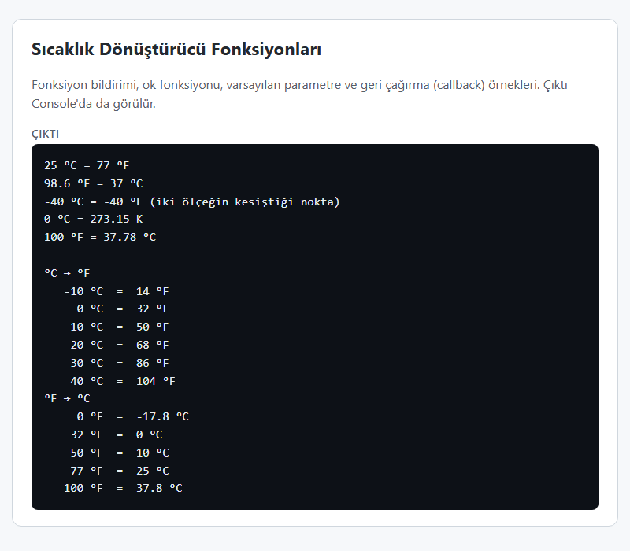

*Şekil 7.18. Uygulama 7.4'ün beklenen ekran görüntüsü.*

**Kendinizi sınayın:** (1) `tabloYaz` fonksiyonuna Kelvin dönüşümünü ok fonksiyonu olarak doğrudan yazarak geçiriniz. (2) `yuvarla(celsiusaCevir(100))` ile `yuvarla(celsiusaCevir(100), 2)` neden farklı sonuç verir?

<details><summary>Örnek çözüm</summary>

Çözüm dosyası: [`codes/07-javascript-temelleri/uygulama-7-4-sicaklik-donusturucu/index.html`](../codes/07-javascript-temelleri/uygulama-7-4-sicaklik-donusturucu/index.html)

</details>

#### 🛠 Uygulama 7.5: Not Ortalaması ve Harf Notu

**Amaç:** Koşul yapılarını (`if/else if`, `switch`, mantıksal işleçler) fonksiyonlarla birleştirerek bir not değerlendirme mantığı kurmak.  
**Tahmini süre:** 20 dk

Bu derste kullanılan değerlendirme kuralı şöyledir: Ağırlıklı ortalama = vize × 0,4 + final × 0,6; **ortalama ≥ 60** ise öğrenci "Geçti", aksi hâlde "Kaldı" sayılır. Notlar 0–100 aralığında olmalıdır (Şekil 7.19). Harf ölçeği yalnızca örnek amaçlıdır; gerçek ölçek üniversitenin yönetmeliğine göre değişir.

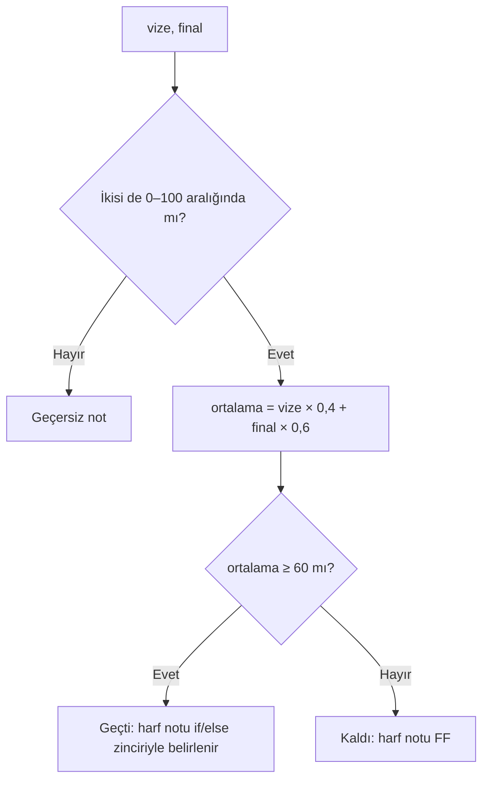

*Şekil 7.19. Not değerlendirme mantığının akış diyagramı.*

1. `calismalar/bolum-07/uygulama-7-5/` klasöründe `index.html` ve `script.js` oluşturunuz.
2. Aşağıdaki fonksiyonları yazınız:

   ```js
   function notGecerliMi(not) {
     return typeof not === "number" && not >= 0 && not <= 100;
   }

   function ortalamaHesapla(vize, final) {
     return vize * 0.4 + final * 0.6;
   }

   function gectiMi(ortalama) {
     return ortalama >= 60;
   }
   ```

3. `harfNotu(ortalama)` fonksiyonunu `if/else if` zinciriyle yazınız: ortalama ≥ 90 → `AA`, ≥ 85 → `BA`, ≥ 75 → `BB`, ≥ 70 → `CB`, ≥ 60 → `CC`, diğerleri → `FF`. Harf notu yalnızca ortalamaya bağlı olduğundan 60'ın altındaki her ortalama `FF` alır ve "Kaldı" durumuyla tutarlıdır.
4. Harf notunu 4'lük katsayıya çeviren `katsayi(harf)` fonksiyonunu `switch` ile yazınız (AA 4,0; BA 3,5; BB 3,0; CB 2,5; CC 2,0; diğerleri 0).
5. Şu öğrencileri bir nesne dizisinde tutup her biri için ortalama, harf, katsayı ve durumu Console'a yazdırınız: Ayşe (70, 85), Mehmet (90, 45), Zeynep (40, 70), Can (55, 65), Elif (95, 92), Deniz (120, 80).
6. Zeynep'in final notu Mehmet'inkinden yüksek olduğu hâlde neden kaldığını (ağırlıkların etkisini) ve Deniz için neden hesap yapılmaması gerektiğini açıklayınız.

**Beklenen çıktı:**

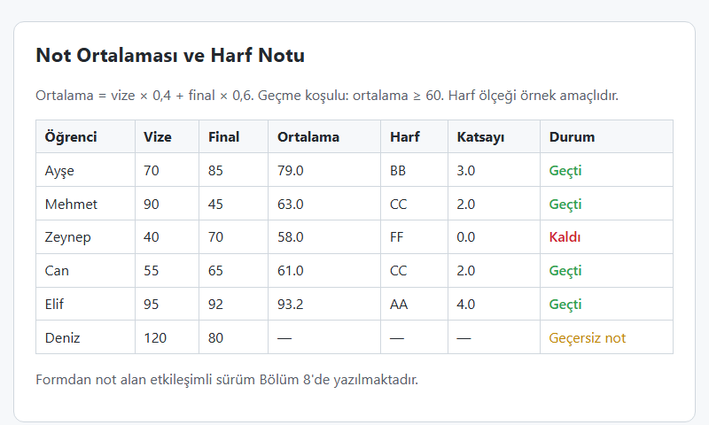

*Şekil 7.20. Uygulama 7.5'in beklenen ekran görüntüsü.*

**Kendinizi sınayın:** (1) Bütünleme sınavı yapıldığında final yerine bütünleme notunun kullanılacağını varsayarak `ortalamaHesapla` fonksiyonuna üçüncü, varsayılan değeri `null` olan bir parametre ekleyiniz. (2) `katsayi` fonksiyonunu `switch` yerine bir nesne kullanarak yazınız.

<details><summary>Örnek çözüm</summary>

Çözüm dosyası: [`codes/07-javascript-temelleri/uygulama-7-5-not-ortalamasi/index.html`](../codes/07-javascript-temelleri/uygulama-7-5-not-ortalamasi/index.html)

Bu bölümde notlar kod içinde verilmektedir. Notları kullanıcıdan bir formla alan, `submit` olayını dinleyen ve sonucu sayfada gösteren **not hesaplayıcı formu** [Bölüm 8](08-javascript-dom-olaylar.md)'de aynı fonksiyonlar kullanılarak yazılmaktadır.

</details>

## 7.13 Diziler, Nesneler ve JSON

### 7.13.1 Diziler

**Dizi** (array), birden çok değeri sıralı bir liste olarak tek bir değişkende tutan nesnedir. Dizi değişmezi (array literal) köşeli parantezle yazılır; elemanlara **sıfırdan başlayan** indislerle erişilir ve `length` özelliği eleman sayısını verir [9, ss. 139–148], [1, Bl. 7]:

```js
const sepet = ["defter", "kalem", "silgi"];

console.log(sepet[0]);                 // "defter"  (ilk eleman)
console.log(sepet.length);             // 3
console.log(sepet[sepet.length - 1]);  // "silgi"   (son eleman)
console.log(sepet.at(-1));             // "silgi"   (ES2022 kısa yazımı)
console.log(sepet[5]);                 // undefined (olmayan indis hata vermez)

sepet[1] = "tükenmez kalem";           // elemanı değiştirme
```

*Kod 7.26. Dizi oluşturma ve elemanlara erişim.*

Dizilerin en sık kullanılan metotları Tablo 7.8'de özetlenmiştir. Bir kısmı diziyi **yerinde değiştirir**, bir kısmı ise diziye dokunmadan **yeni bir dizi** ya da değer döndürür.

*Tablo 7.8. Sık kullanılan dizi metotları.*

| Metot | İşlevi | Diziyi değiştirir mi? |
|---|---|---|
| `push(x)` / `pop()` | Sona eleman ekler / sondaki elemanı çıkarıp döndürür | Evet |
| `unshift(x)` / `shift()` | Başa eleman ekler / baştaki elemanı çıkarır | Evet |
| `includes(x)` | Eleman dizide var mı? (`true`/`false`) | Hayır |
| `indexOf(x)` | Elemanın indisi; yoksa `-1` | Hayır |
| `join(", ")` | Elemanları araya ayırıcı koyarak tek dizgede birleştirir | Hayır |
| `forEach(fn)` | Her eleman için `fn` fonksiyonunu çağırır | Hayır |
| `map(fn)` | Her elemanı `fn` ile dönüştürüp **yeni dizi** döndürür | Hayır |
| `filter(fn)` | `fn` ile doğru dönen elemanlardan **yeni dizi** döndürür | Hayır |
| `find(fn)` | `fn` ile doğru dönen **ilk** elemanı döndürür | Hayır |

`forEach`, `map` ve `filter` metotları birer geri çağırma fonksiyonu alır (7.12.4). Metot, dizinin her elemanı için bu fonksiyonu çağırır ve ona sırasıyla elemanı ve indisini verir:

```js
const fiyatlar = [349.90, 89.50, 42.75, 64.90];

fiyatlar.forEach((fiyat, i) => console.log(`${i + 1}. ürün: ${fiyat} TL`));

const kdvli = fiyatlar.map((fiyat) => fiyat * 1.20);         // yeni dizi
const pahali = fiyatlar.filter((fiyat) => fiyat > 100);      // [349.9]
console.log(fiyatlar.includes(42.75));                       // true
```

*Kod 7.27. `forEach`, `map`, `filter` ve `includes`.*

Bir dizinin elemanlarından tek bir değer (toplam gibi) üretmek için `for…of` döngüsü ya da `reduce` metodu kullanılır; `reduce` ilerleyen derslerde ele alınacaktır.

#### 🛠 Uygulama 7.6: Dizi Metotlarıyla Alışveriş Sepeti

**Amaç:** Bir alışveriş sepetini nesne dizisi olarak modellemek; `push`, `pop`, `forEach`, `map`, `filter` ve `includes` metotlarıyla ara toplam, KDV ve genel toplamı hesaplamak.  
**Tahmini süre:** 20 dk

1. `calismalar/bolum-07/uygulama-7-6/` klasöründe `index.html` ve `script.js` oluşturunuz.
2. `KDV_ORANI = 0.20`, `UCRETSIZ_KARGO_SINIRI = 750` ve `KARGO_UCRETI = 49.90` sabitlerini tanımlayınız (değerler örnek amaçlıdır).
3. Her elemanı `{ ad, fiyat, adet }` biçiminde bir nesne olan `sepet` dizisini oluşturunuz (fiyatlar KDV hariç). `push` ile iki ürün ekleyip `pop` ile sonuncuyu çıkarınız.
4. `forEach` ile her ürünü sıra numarası, adet, birim fiyat ve satır tutarıyla yazdırınız.
5. `map` ile satır tutarlarından oluşan yeni bir dizi üretip `for…of` ile ara toplamı hesaplayınız. KDV'yi, KDV dahil tutarı, kargo ücretini (üçlü koşul işleciyle) ve genel toplamı bulunuz. Her tutarı kuruşa yuvarlayınız.
6. Tutarları Türk lirası biçiminde göstermek için şu fonksiyonu kullanınız: `tutar.toLocaleString("tr-TR", { style: "currency", currency: "TRY" })`.
7. `filter` ile 100 TL'den pahalı ürünleri, `includes` ile sepette "Defter" olup olmadığını bulunuz.

**Beklenen çıktı:**

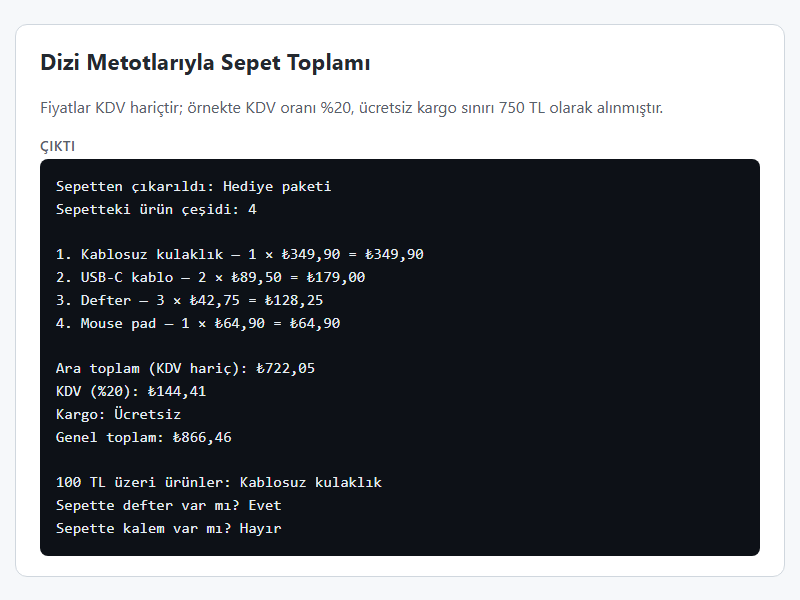

*Şekil 7.21. Uygulama 7.6'nın beklenen ekran görüntüsü.*

**Kendinizi sınayın:** (1) "BMB10" kodlu %10 indirim kuponunu uygulayan bir `indirimUygula(tutar, kupon)` fonksiyonu yazınız; geçersiz kuponda tutar değişmemelidir. (2) Sepetteki toplam ürün adedini (çeşit sayısını değil) hesaplayınız.

<details><summary>Örnek çözüm</summary>

Çözüm dosyası: [`codes/07-javascript-temelleri/uygulama-7-6-alisveris-listesi/index.html`](../codes/07-javascript-temelleri/uygulama-7-6-alisveris-listesi/index.html)

</details>

> [!WARNING]
> Gerçek bir e-ticaret sitesinde fiyat, indirim ve toplam tutar tarayıcıda hesaplanıp gösterilebilir; ancak ödeme alınmadan önce **sunucuda yeniden hesaplanmalıdır**. Tarayıcıdaki bir değişkeni Console'dan değiştirerek 1 TL'ye ürün satın almak mümkün olmamalıdır (bkz. 7.4.3).

### 7.13.2 Nesneler

**Nesne** (object), birbiriyle ilişkili verileri **anahtar–değer** (key–value) çiftleri hâlinde tutan yapıdır. Her çifte **özellik** (property) denir. Nesne değişmezi (object literal) süslü parantezle yazılır [9, ss. 161–168], [1, Bl. 6]:

```js
const ogrenci = {
  ad: "Zeynep",
  soyad: "Kaya",
  numara: "2025123456",
  sinif: 1,
  dersler: ["Web Teknolojileri", "Fizik II"],   // değer bir dizi olabilir
  notlar: { vize: 72, final: 81 }               // değer bir nesne olabilir
};

console.log(ogrenci.ad);              // nokta gösterimi: "Zeynep"
console.log(ogrenci["soyad"]);        // köşeli parantez gösterimi: "Kaya"
console.log(ogrenci.notlar.final);    // iç içe erişim: 81
console.log(ogrenci.eposta);          // olmayan özellik: undefined

ogrenci.sinif = 2;                    // değiştirme
ogrenci.eposta = "zkaya@ornek.edu.tr";// ekleme
delete ogrenci.eposta;                // silme

const alan = "numara";
console.log(ogrenci[alan]);           // özellik adı bir değişkendeyse köşeli parantez
```

*Kod 7.28. Nesne değişmezi ve özellik erişimi.*

Değeri bir fonksiyon olan özelliğe **metot** (method) denir. Metodun içinde **`this`** anahtar sözcüğü, metodu çağıran nesneyi gösterir; böylece metot, nesnenin kendi özelliklerine ulaşabilir:

```js
const ogrenci = {
  ad: "Zeynep",
  soyad: "Kaya",
  notlar: { vize: 72, final: 81 },
  tamAd() {                            // kısa metot yazımı
    return `${this.ad} ${this.soyad}`;
  },
  ortalama() {
    return this.notlar.vize * 0.4 + this.notlar.final * 0.6;
  }
};

console.log(ogrenci.tamAd());          // "Zeynep Kaya"
console.log(ogrenci.ortalama());       // 77.4
```

*Kod 7.29. Metot ve `this`.*

`this`'in değeri fonksiyonun **nasıl çağrıldığına** göre belirlenir; bu derste yalnızca `nesne.metot()` biçimindeki kullanımı yeterlidir. Ok fonksiyonlarının kendi `this` değeri olmadığından metot tanımlarken kullanılmamalıdır.

Bir nesnenin bütün anahtarları `Object.keys(nesne)` ile dizi olarak alınabilir ya da `for…in` döngüsüyle dolaşılabilir. Uygulamalarda en sık karşılaşılan yapı ise **nesne dizileridir**: Sepetteki ürünler, bir dersin öğrenci listesi, bir API'den gelen hava durumu tahminleri böyle tutulur (Uygulama 7.5 ve 7.6).

### 7.13.3 JSON'a Giriş

**JSON** (JavaScript Object Notation), JavaScript nesne değişmezi sözdizimine dayanan, metin tabanlı bir veri değişim biçimidir. Tarayıcı ile sunucu arasındaki veri alışverişinin (Şekil 7.7'deki "JSON yanıt"), yapılandırma dosyalarının ve tarayıcı belleğinde saklanan verilerin büyük bölümü JSON biçimindedir. JSON yazımı JavaScript'ten daha katıdır:

- Anahtarlar **çift tırnak** içinde yazılmalıdır (`{"ad": "Ali"}`); tek tırnak kullanılamaz.
- Değerler yalnızca dizge, sayı, `true`/`false`, `null`, dizi ya da nesne olabilir; fonksiyon ve `undefined` bulunamaz.
- Yorum satırı ve son elemandan sonra virgül kullanılamaz.

JavaScript'te yerleşik `JSON` nesnesi iki yönlü dönüşümü sağlar (ES5):

```js
// Nesne → JSON metni (sunucuya göndermek ya da saklamak için)
const metin = JSON.stringify({ ad: "Ali", notlar: [70, 85] });
console.log(metin);            // '{"ad":"Ali","notlar":[70,85]}'
console.log(typeof metin);     // "string"

// JSON metni → nesne (sunucudan gelen yanıtı kullanmak için)
const yanit = '{"sehir":"Tekirdağ","sicaklik":18.5,"yagis":false}';
const hava = JSON.parse(yanit);
console.log(hava.sehir, hava.sicaklik);   // Tekirdağ 18.5
```

*Kod 7.30. `JSON.stringify` ve `JSON.parse`.*

`JSON.stringify(nesne, null, 2)` biçimindeki çağrı, çıktıyı iki boşluk girintili, okunaklı biçimde üretir. Hatalı bir JSON metni `JSON.parse` ile çözülmeye çalışıldığında `SyntaxError` oluşur; dışarıdan gelen veri çözülürken bu hata `try…catch` bloğuyla yakalanabilir. JSON'un sunucudan `fetch` ile alınması ve `localStorage`'da saklanması [Bölüm 8](08-javascript-dom-olaylar.md)'de ele alınmaktadır.

#### 🛠 Uygulama 7.7: Öğrenci Nesnesi ve JSON

**Amaç:** Nesne değişmezi, metot ve `this` kullanmak; nesneyi JSON'a dönüştürüp geri çözmek.  
**Tahmini süre:** 15 dk

1. `calismalar/bolum-07/uygulama-7-7/` klasöründe `index.html` ve `script.js` oluşturunuz.
2. Kod 7.28–7.29'daki gibi `ad`, `soyad`, `numara`, `bolum`, `sinif`, `dersler` (dizi) ve `notlar` (nesne) özelliklerine; `tamAd()` ve `ortalama()` metotlarına sahip bir `ogrenci` nesnesi oluşturunuz.
3. Özelliklere nokta ve köşeli parantez gösterimiyle erişip Console'a yazdırınız; `eposta` özelliğini ekleyip `sinif` değerini değiştiriniz ve `Object.keys()` ile anahtarları listeleyiniz.
4. `JSON.stringify(ogrenci, null, 2)` çıktısını yazdırınız. Metotların JSON'da yer alıp almadığını gözlemleyiniz.
5. OBS'den gelmiş gibi düşünülen şu metni `JSON.parse` ile nesneye çevirip her dersin kodunu ve harf notunu `for…of` ile yazdırınız: `'{"numara":"2025123456","donem":"2025-2026 Bahar","dersler":[{"kod":"BMB112","harf":"BA"},{"kod":"FIZ102","harf":"CB"}]}'`
6. Anahtarları tek tırnaklı bir metni (`"{ad: 'Ali'}"`) çözmeye çalışınız ve Console'daki hatayı okuyunuz.

**Beklenen çıktı:**

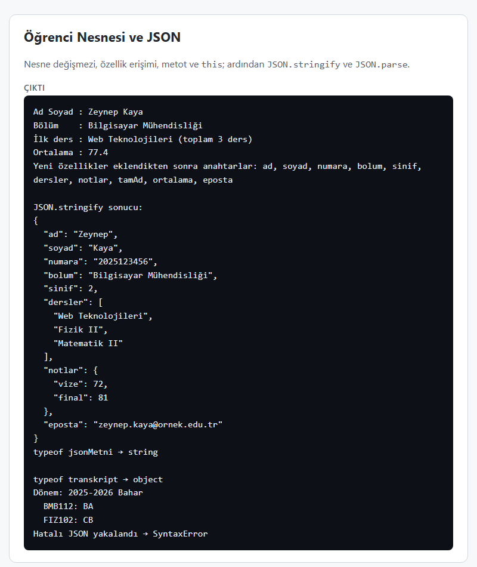

*Şekil 7.22. Uygulama 7.7'nin beklenen ekran görüntüsü.*

**Kendinizi sınayın:** (1) `JSON.stringify` çıktısında `tamAd` ve `ortalama` neden yok? (2) `JSON.parse(JSON.stringify(ogrenci))` ile elde edilen nesnede `ogrenci.tamAd()` çağrılabilir mi?

<details><summary>Örnek çözüm</summary>

Çözüm dosyası: [`codes/07-javascript-temelleri/uygulama-7-7-ogrenci-json/index.html`](../codes/07-javascript-temelleri/uygulama-7-7-ogrenci-json/index.html)

</details>

### 7.13.4 `Math` ve `Date` Nesnelerine Kısa Giriş

**`Math`**, matematiksel sabitleri ve fonksiyonları içeren yerleşik bir nesnedir [9, ss. 154–159]:

```js
Math.round(4.5);    // 5   en yakın tam sayıya yuvarlar
Math.floor(4.9);    // 4   aşağı yuvarlar
Math.ceil(4.1);     // 5   yukarı yuvarlar
Math.max(72, 85, 64);   // 85
Math.min(72, 85, 64);   // 64
Math.abs(-7);       // 7
Math.sqrt(144);     // 12
Math.PI;            // 3.141592653589793
Math.random();      // 0 (dahil) ile 1 (hariç) arasında rastgele sayı

// 1–6 arası rastgele tam sayı (zar)
const zar = Math.floor(Math.random() * 6) + 1;
```

*Kod 7.31. `Math` nesnesinin sık kullanılan üyeleri.*

> [!WARNING]
> `Math.random()` tahmin edilebilir sayılar üretir; oyun ve örnekler için yeterlidir, ancak parola, doğrulama kodu ya da güvenlik anahtarı üretmek için kullanılmaz. Bu amaçla tarayıcının `crypto.getRandomValues()` API'si vardır.

**`Date`**, tarih ve saatle çalışmayı sağlar. `new Date()` o anın tarih ve saatini içeren bir nesne oluşturur:

```js
const simdi = new Date();
simdi.getFullYear();                    // 2026
simdi.getMonth();                       // 0–11 (dikkat: Ocak = 0)
simdi.getDate();                        // ayın günü, 1–31
simdi.getDay();                         // haftanın günü, 0 = Pazar
simdi.getHours();                       // 0–23
simdi.toLocaleDateString("tr-TR");      // "02.11.2026"
```

*Kod 7.32. `Date` nesnesine giriş.*

Ayların sıfırdan başlaması (`getMonth()` Kasım için 10 döndürür) sık yapılan bir hatadır. Tarih farkı, geri sayım ve canlı saat gibi uygulamalar [Bölüm 8](08-javascript-dom-olaylar.md)'de ele alınmaktadır.

## 7.14 Hepsi Bir Arada: Gerçek Hayattan Problemler

Bu bölümde öğrenilen yapılar, gündelik web uygulamalarında karşılaşılan pek çok problemin çözümüne yeter. Aşağıdaki örnekler, Console tabanlı ya da sayfaya basit bir tablo yazan biçimde hazırlanmıştır; aynı fonksiyonların formlar ve olaylarla etkileşimli hâle getirilmesi Bölüm 8'in konusudur.

### 7.14.1 Sepet Toplamı ve KDV

Uygulama 7.6'da kurulan sepet modeli, bir e-ticaret sitesinin sepet sayfasının çekirdeğidir: Ürünler nesne dizisinde tutulur, satır tutarları `map` ile, ara toplam döngüyle, KDV ve kargo ise koşullu ifadelerle hesaplanır. Aynı model; bir yemek siparişi uygulamasındaki porsiyon seçimi, bir sinema bilet sitesindeki öğrenci indirimi ya da bir kargo firmasının desi hesabı için de kullanılabilir.

### 7.14.2 Not Ortalaması

Uygulama 7.5'teki `ortalamaHesapla`, `gectiMi` ve `harfNotu` fonksiyonları, bir öğrenci bilgi sisteminin not ekranındaki hesabın basitleştirilmiş bir modelidir. Fonksiyonların ekranla hiçbir bağı olmadığından (veriyi parametreyle alıp sonucu `return` ile verdiklerinden) aynı fonksiyonlar Bölüm 8'deki formda hiç değiştirilmeden yeniden kullanılacaktır. Mantığı arayüzden ayırmanın bu yararı, iyi fonksiyon tasarımının en önemli gerekçelerinden biridir.

### 7.14.3 Parola Gücü Denetimi

Üyelik formlarında yazılan parolanın gücünü anında gösteren göstergeler de bir fonksiyondur: Parola bir dizge olarak alınır, `for…of` ile karakter karakter incelenir ve kurallara göre bir puan hesaplanır. Örnek 7.2'deki `parolaGucu` fonksiyonu uzunluğu, küçük/büyük harf, rakam ve özel karakter kullanımını puanlar ve sık kullanılan parolaları (`123456`, `qwerty` …) doğrudan reddeder. Türkçe harflerin (ç, ğ, ı, İ, ö, ş, ü) de harf sayılabilmesi için bir karakterin harf olup olmadığı, karakterin Türkçe kurala göre büyük ve küçük biçimlerinin farklı olup olmamasıyla anlaşılır:

```js
function harfMi(karakter) {
  return karakter.toLocaleLowerCase("tr-TR") !== karakter.toLocaleUpperCase("tr-TR");
}
```

*Kod 7.33. Türkçe harfleri de tanıyan harf denetimi (Örnek 7.2'den).*

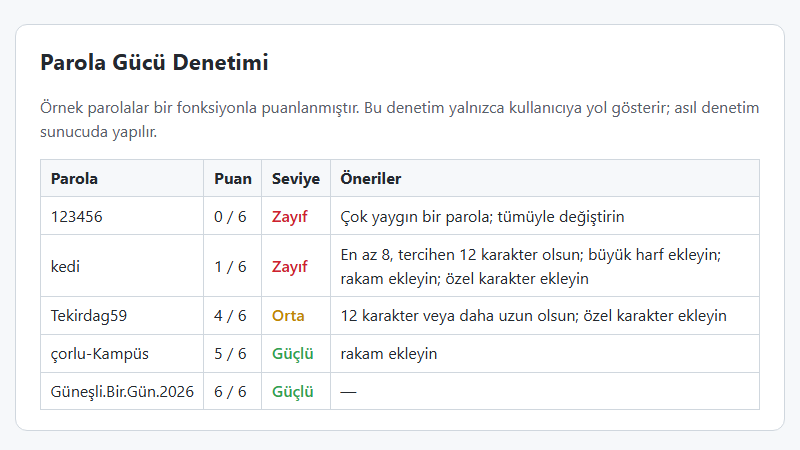

*Şekil 7.23. Örnek 7.2: Parola gücü denetimi. Kod: [`codes/07-javascript-temelleri/ornek-7-2-sifre-gucu/`](../codes/07-javascript-temelleri/ornek-7-2-sifre-gucu/index.html)*

> [!WARNING]
> Tarayıcıdaki parola gücü göstergesi yalnızca kullanıcıya yol gösterir; parola kuralları sunucuda da denetlenmelidir. Parola alanları `type="password"` ile oluşturulur, form `POST` yöntemiyle ve HTTPS üzerinden gönderilir. Gerçek kullanıcı parolaları hiçbir zaman `console.log` ile yazdırılmaz ya da `localStorage`'da saklanmaz. Güncel güvenlik yönergeleri, karmaşık karakter kurallarından çok **uzunluğu** ve sık kullanılan parolaların engellenmesini öne çıkarmaktadır.

#### 🛠 Uygulama 7.8: Kesme Noktasıyla Hata Bulma

**Amaç:** Console'da hata iletisi üretmeyen bir mantık hatasını Sources panelindeki kesme noktası ve adım adım çalıştırma ile bulmak.  
**Tahmini süre:** 20 dk

Aşağıdaki betik dört notun ortalamasını hesaplamalıdır; beklenen sonuç **76.25**'tir. Betik hata iletisi vermez, ancak sayfada `Ortalama: NaN` yazar. Kodda **iki** hata vardır.

```js
// Üçüncü not bir formdan metin olarak gelmiştir
const notlar = [70, 85, "90", 60];

function ortalamaBul(dizi) {
  let toplam = 0;
  for (let i = 0; i <= dizi.length; i++) {
    toplam = toplam + dizi[i];
  }
  return toplam / dizi.length;
}

const ortalama = ortalamaBul(notlar);
console.log(`Ortalama: ${ortalama}`);
```

*Kod 7.34. Bilerek hatalı yazılmış ortalama betiği (`hatali.js`).*

1. Çözüm klasöründeki `hatali.html` ve `hatali.js` dosyalarını `calismalar/bolum-07/uygulama-7-8/` klasörüne kopyalayınız ve `hatali.html` sayfasını Live Server ile açınız. Sayfada `Ortalama: NaN` yazdığını görünüz (Şekil 7.24).
2. `F12` → **Sources** paneline geçiniz; sol taraftaki dosya ağacından `hatali.js` dosyasını açınız.
3. `toplam = toplam + dizi[i];` satırının numarasına tıklayarak kesme noktası koyunuz ve sayfayı yenileyiniz (`F5`). Betik bu satırda duraklayacaktır.
4. Sağdaki **Scope → Local** bölümünde `i` ve `toplam` değerlerini izleyiniz. **Resume** (`F8`) düğmesine her bastığınızda döngü bir tur ilerler. Her turdaki değerleri bir tabloya yazınız (Şekil 7.10).
5. `toplam` değerinin hangi turda sayıdan metne dönüştüğünü ve son turda `dizi[i]` değerinin neden `undefined` olduğunu belirleyiniz.
6. İki hatayı düzeltiniz: Döngü koşulunu `i < dizi.length` yapınız ve toplama sırasında değeri `Number(dizi[i])` ile sayıya dönüştürünüz. Kesme noktasını satır numarasına yeniden tıklayarak kaldırınız ve sonucun 76.25 olduğunu doğrulayınız.

**Beklenen çıktı:**

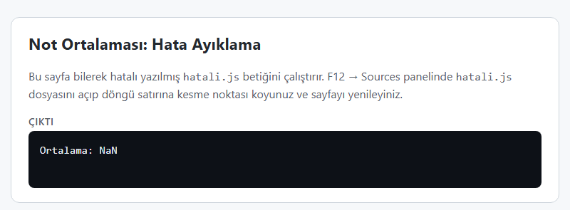

*Şekil 7.24. Hatalı sürümün çıktısı: Hata iletisi yok, ama sonuç yanlış.*

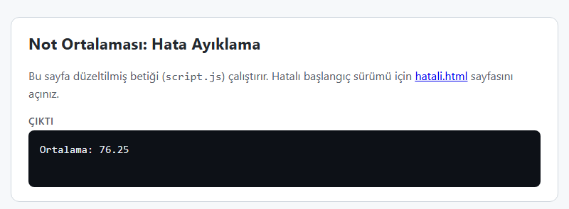

*Şekil 7.25. Düzeltilmiş sürümün beklenen çıktısı.*

**Kendinizi sınayın:** (1) Kesme noktası yerine döngü içine `debugger;` deyimini yazıp DevTools açıkken sayfayı yenileyiniz; ne oluyor? (2) Notlar dizisi boş (`[]`) olsaydı düzeltilmiş fonksiyon ne döndürürdü? Bu durumu `if` ile ele alınız.

<details><summary>Örnek çözüm</summary>

Çözüm klasörü: [`codes/07-javascript-temelleri/uygulama-7-8-hata-ayiklama/`](../codes/07-javascript-temelleri/uygulama-7-8-hata-ayiklama/index.html) — `hatali.html`/`hatali.js` başlangıç sürümü, `index.html`/`script.js` düzeltilmiş sürümdür.

Açıklama: Üçüncü turda `155 + "90"` işlemi, `+` işlecinin taraflardan biri metin olduğunda birleştirme yapması nedeniyle `"15590"` metnini üretir (Kod 7.12). Döngü koşulundaki `<=` nedeniyle son turda var olmayan `dizi[4]` okunur ve `undefined` eklenir; metnin 4'e bölünmesi de `NaN` verir.

</details>

## 7.15 Bölüm Özeti

- JavaScript, web sayfasının **davranış** katmanıdır; HTML içeriği, CSS sunumu belirler. Java ile adı dışında ilişkisi yoktur; buyurgan, nesne yönelimli ve fonksiyonel tarzları destekleyen çok paradigmalı bir dildir.
- Dil 1995'te Brendan Eich tarafından Netscape'te Mocha → LiveScript → JavaScript adlarıyla geliştirildi; Microsoft'un JScript'iyle başlayan uyumsuzluklar, Ecma'nın **ECMA-262 (ECMAScript)** standardıyla çözüldü. ES2015 modern JavaScript'in dönüm noktasıdır; standart 2015'ten bu yana her yıl yenilenmektedir (güncel: ECMAScript 2026, 17. baskı).
- V8, SpiderMonkey ve JavaScriptCore gibi motorlar betiği **ayrıştırır**, **bayt koduna** çevirip yorumlar ve sık çalışan kodu **JIT** ile makine koduna derler. Geliştirici ayrı bir derleme adımı yürütmez; tek bir sözdizimi hatası betiğin hiçbir satırının çalışmamasına yol açar.
- Web, **iki katmanlı** istemci–sunucu sistemine dayanır; veritabanı eklendiğinde **üç katmanlı** (istemci, işlem, veri) mimari ortaya çıkar. JavaScript istemci taraflıdır; veritabanı ve güvenlik kararları sunucu taraflı dillerle (PHP, Python, Node.js, C#, Java, Ruby …) sunucuda verilir. İstemci denetimi sunucu denetiminin yerini tutmaz.
- Tarayıcıdaki JavaScript bir **kum havuzunda** çalışır: Dosya sistemine doğrudan erişemez, program çalıştıramaz ve **aynı köken politikasıyla** başka sitelerin verisini okuyamaz.
- Betikler harici dosyada tutulup `<script src="…" defer>` ile bağlanır; `defer` ayrıştırma bittikten sonra sırayla, `async` indirilir indirilmez çalıştırır; `type="module"` modülleri yükler. `type="text/javascript"` gereksizdir.
- **Console** çıktı ve hata iletileri için, **Sources** paneli kesme noktası ile adım adım hata ayıklamak için kullanılır.
- Değişkenler önce `const`, gerekirse `let` ile bildirilir; ikisi de blok kapsamlıdır. `var` tarihseldir.
- Yedi ilkel tür (`number`, `bigint`, `string`, `boolean`, `undefined`, `null`, `symbol`) ve nesne türü vardır. Formdan gelen veriler metindir ve `Number()`/`parseFloat()` ile açıkça dönüştürülür; karşılaştırmada `===` kullanılır.
- Kontrol yapıları (`if`, `switch`, `for`, `while`, `do…while`, `for…of`) ve fonksiyonlar (bildirim, ifade, ok fonksiyonu, varsayılan parametre, geri çağırma) programın temel yapı taşlarıdır.
- Diziler sıralı listeleri, nesneler anahtar–değer çiftlerini tutar; `JSON.stringify`/`JSON.parse` nesne ile JSON metni arasında dönüşüm yapar.

## 7.16 Değerlendirme Soruları

1. Bir web sayfasının üç katmanını, bir kargo takip sayfasından örnek vererek açıklayınız. Her katmanın ayrı dosyada tutulmasının yararları nelerdir?
2. "JavaScript, Java'nın tarayıcıda çalışan basit bir sürümüdür" ifadesindeki yanlışları tarihsel ve teknik açıdan düzeltiniz.
3. ECMAScript ile JavaScript arasındaki ilişkiyi açıklayınız. ES2015 neden bir dönüm noktası olarak kabul edilir?
4. "JavaScript, kodu satır satır çeviren bir yorumlayıcıyla çalışır" ifadesi günümüz motorları için neden eksiktir? Betiğin sonundaki bir sözdizimi hatası, betiğin ilk satırını nasıl etkiler?
5. Üç katmanlı mimarinin katmanlarını bir üniversite öğrenci bilgi sistemi üzerinden açıklayınız. Hangi denetimler istemcide, hangileri mutlaka sunucuda yapılmalıdır? Neden?
6. Aynı köken politikası nedir? `https://obs.ornek.edu.tr` ile `http://obs.ornek.edu.tr` aynı kökenden midir?
7. `<head>` içinde `defer` niteliği olmadan bağlanan bir betikte `document.querySelector("#tablo").textContent = "…"` satırı hangi hatayı verir? Sorunu iki farklı yolla çözünüz.
8. Aşağıdaki kodun Console çıktısını satır satır yazınız ve her satırı gerekçelendiriniz:

   ```js
   const a = "10";
   const b = 5;
   console.log(a + b);
   console.log(a - b);
   console.log(a == 10, a === 10);
   console.log(typeof (a * b));
   ```

9. `const sepet = [];` ile tanımlanmış bir diziye `sepet.push("kalem")` yapılabilirken `sepet = ["kalem"]` neden hata verir?
10. Aşağıdaki fonksiyon hangi değerleri döndürür? `||` yerine `??` kullanılsaydı sonuç nasıl değişirdi?

    ```js
    function kargoUcreti(ucret) {
      return ucret || 49.90;
    }
    console.log(kargoUcreti(0), kargoUcreti(29.90), kargoUcreti());
    ```

11. Bir dersin geçme kuralı "vize × 0,4 + final × 0,6 ≥ 60" olduğuna göre vize 100, final 40 alan öğrencinin ve vize 100, final 30 alan öğrencinin durumu nedir? Vize ve final notlarını alıp `true`/`false` döndüren bu kuralı tek satırlık bir ok fonksiyonu olarak yazınız.
12. `map` ile `forEach` arasındaki farkı, bir ürün fiyatları dizisine KDV ekleme örneği üzerinden açıklayınız. Hangisi yeni dizi döndürür?

## Kaynaklar

[1] D. Flanagan, *JavaScript: The Definitive Guide*, 6th ed. Sebastopol, CA, USA: O'Reilly Media, 2011.

[2] A. Wirfs-Brock and B. Eich, "JavaScript: The first 20 years," *Proc. ACM Program. Lang.*, vol. 4, no. HOPL, pp. 77:1–77:189, Jun. 2020.

[3] N. C. Zakas, *Professional JavaScript for Web Developers*, 3rd ed. Indianapolis, IN, USA: Wiley, 2012.

[4] S. Vodnik and D. Gosselin, *JavaScript: The Web Warrior Series*, 6th ed. Boston, MA, USA: Cengage Learning, 2015.

[5] Ecma International, *ECMAScript® 2026 Language Specification* (ECMA-262, 17th ed.), Jun. 2026. [Çevrimiçi]. Erişim: https://262.ecma-international.org/17.0/ (Erişim tarihi: 2 Kasım 2026).

[6] V8 Team, "Launching Ignition and TurboFan," *V8 Blog*, May 2017. [Çevrimiçi]. Erişim: https://v8.dev/blog/launching-ignition-and-turbofan (Erişim tarihi: 2 Kasım 2026).

[7] Mozilla, "Same-origin policy," *MDN Web Docs*. [Çevrimiçi]. Erişim: https://developer.mozilla.org/en-US/docs/Web/Security/Same-origin_policy (Erişim tarihi: 2 Kasım 2026).

[8] WHATWG, "HTML Living Standard — 4.12.1 The script element." [Çevrimiçi]. Erişim: https://html.spec.whatwg.org/multipage/scripting.html#the-script-element (Erişim tarihi: 2 Kasım 2026).

[9] K. Chinnathambi, *JavaScript Absolute Beginner's Guide*. Indianapolis, IN, USA: Que (Pearson), 2017.

[10] Google, "Debug JavaScript," *Chrome for Developers — Chrome DevTools*. [Çevrimiçi]. Erişim: https://developer.chrome.com/docs/devtools/javascript (Erişim tarihi: 2 Kasım 2026).

[11] J. Duckett, *JavaScript and JQuery: Interactive Front-End Web Development*. Indianapolis, IN, USA: Wiley, 2014.

[12] Mozilla, "JavaScript Guide," *MDN Web Docs*. [Çevrimiçi]. Erişim: https://developer.mozilla.org/en-US/docs/Web/JavaScript/Guide (Erişim tarihi: 2 Kasım 2026).

---

[← Önceki bölüm](06-css-kutu-modeli-yerlesim.md) · [İçindekiler](../README.md) · [Sonraki bölüm →](08-javascript-dom-olaylar.md)
