# Bölüm 8: JavaScript ile DOM ve Olaylar

[← Önceki bölüm](07-javascript-temelleri.md) · [İçindekiler](../README.md) · [Sonraki bölüm →](09-duyarli-tasarim.md)

> **Öğrenme Hedefleri** — Bu bölümü tamamlayan öğrenci:
>
> 1. Belge Nesne Modelini (DOM) ağaç yapısı ve düğüm türleri üzerinden açıklar; DOM ile BOM arasındaki farkı ayırt eder.
> 2. `getElementById`, `querySelector` ve `querySelectorAll` yöntemleriyle öğe seçer; içeriği `textContent`, nitelikleri `setAttribute`/`dataset`, görünümü `classList` ile değiştirir.
> 3. `innerHTML` kullanımının yol açabileceği siteler arası betik çalıştırma (XSS) riskini açıklar ve kullanıcı verisini güvenli biçimde sayfaya yazar.
> 4. `addEventListener` ve `removeEventListener` ile olay dinleyicisi ekler ve kaldırır; olay nesnesini, olay yayılımını (yakalama–hedef–kabarma) ve olay delegasyonunu uygular.
> 5. Bir formun `submit` olayını yöneterek girdileri sayıya çevirir, 0–100 aralığında doğrular ve sonucu sayfaya yazar.
> 6. `Date`, `Intl.DateTimeFormat`, `setTimeout` ve `setInterval` ile zamana bağlı arayüzler (saat, geri sayım) geliştirir.
> 7. `window`, `location`, `history`, `navigator`, `localStorage` nesnelerini ve `fetch` + `async/await` ile JSON veri okumayı temel düzeyde kullanır.

## 8.1 Giriş

[Bölüm 7](07-javascript-temelleri.md)'de JavaScript dilinin temel yapı taşları (değişkenler, veri türleri, kontrol yapıları, fonksiyonlar, diziler ve nesneler) ele alınmıştı. Ancak bu yapılar tek başına bir web sayfasını değiştirmez; konsola yazı yazan bir program, kullanıcının gördüğü sayfada hiçbir iz bırakmaz. JavaScript'in tarayıcıdaki asıl gücü, sayfanın içeriğine erişip onu değiştirebilmesinden ve kullanıcının eylemlerine yanıt verebilmesinden gelir. Flanagan bu durumu şöyle özetler: “İstemci tarafı JavaScript, durağan HTML belgelerini etkileşimli web uygulamalarına dönüştürmek için vardır.” [1, s. 361]

Gündelik hayatta kullanılan web uygulamalarının hemen hepsi bu iki yeteneğe dayanır. Bir e-ticaret sitesinde “Sepete ekle” düğmesine basıldığında sayfa yeniden yüklenmeden sepet simgesindeki sayı artar; üniversite öğrenci bilgi sisteminde (OBS) ders seçimi yapılırken kontenjanı dolan ders gri renge döner; bir kargo takip sayfasında takip numarası yazılırken alanın altında “Geçersiz numara” uyarısı belirir. Bu davranışların her birinde üç adım vardır: (1) bir **olay** (event) gerçekleşir, (2) JavaScript bu olayı bir **olay dinleyicisi** (event listener) aracılığıyla yakalar, (3) dinleyici, **Belge Nesne Modeli** (Document Object Model, DOM) üzerinden sayfayı günceller.

Bu bölüm, ders sunumunda `addEventListener()` yöntemiyle sunulan konuyu (slayt 190–191) merkeze alarak bu üç adımı ayrıntılı biçimde inceler. Önce DOM'un ne olduğu ve öğelerin nasıl seçilip değiştirildiği, ardından olay modeli, form işlemleri, zamanlayıcılar, tarayıcı nesneleri ve `fetch` ile veri okuma anlatılır. Her ana başlıktan sonra Visual Studio Code ile yapılabilecek kısa bir uygulama yer almaktadır.

## 8.2 Belge Nesne Modeli (DOM)

### 8.2.1 DOM nedir?

Tarayıcı bir HTML belgesini indirdiğinde, metni yalnızca ekrana çizmekle kalmaz; belgeyi **ayrıştırarak** (parse) bellekte bir nesne yapısı oluşturur. Bu yapıya ve ona erişmeyi sağlayan programlama arayüzüne **Belge Nesne Modeli** (DOM) denir. Güncel tanımı WHATWG tarafından sürdürülen *DOM Living Standard* belgesinde yer alır [2]. Duckett'in vurguladığı gibi DOM ne HTML'in ne de JavaScript'in bir parçasıdır; tarayıcıların uyguladığı ayrı bir kurallar kümesidir ve bir uygulama programlama arayüzü (API) olarak, betiklerin tarayıcıya “şu anki sayfada ne var?” diye sorabilmesini ve “şunu şöyle değiştir” diyebilmesini tanımlar [3, Bl. 5].

DOM'un iki önemli özelliği vardır:

- **Canlıdır:** JavaScript ile DOM'da yapılan her değişiklik (ör. bir paragrafın metnini değiştirmek) tarayıcı tarafından hemen ekrana yansıtılır. Kaynak HTML dosyası değişmez; değişen, bellekteki modeldir. Bu nedenle tarayıcının “Sayfa kaynağını görüntüle” komutu özgün dosyayı, geliştirici araçlarının (F12) **Elements** sekmesi ise DOM'un o anki hâlini gösterir.
- **Dilden bağımsızdır:** DOM bir arayüz tanımıdır; tarayıcıda JavaScript ile kullanılır, ancak aynı kavramlar başka ortamlarda (ör. sunucu tarafında XML işleme) da karşımıza çıkar [1, s. 361].

### 8.2.2 Belge ağacı ve düğüm türleri

DOM, belgeyi bir **ağaç** (tree) olarak modeller. Ağacın her elemanına **düğüm** (node) denir. Düğümler arasında aile ilişkisi kurulur: bir öğenin içindeki öğeler onun **çocukları** (children), onu kapsayan öğe **ebeveyni** (parent), aynı ebeveyne sahip öğeler ise **kardeşleri** (siblings) olarak adlandırılır. Şekil 8.1'de kısa bir HTML belgesi ve tarayıcının ondan oluşturduğu ağaç görülmektedir.

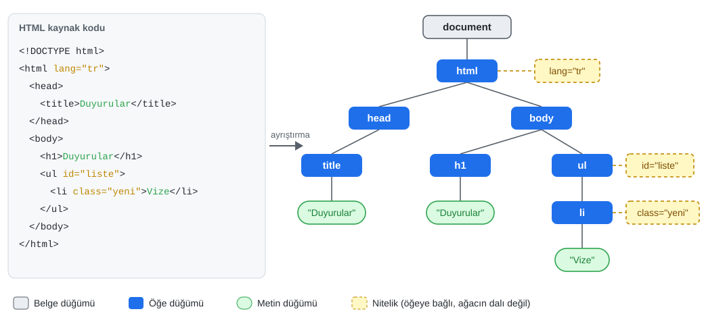

*Şekil 8.1. Bir HTML belgesi ve tarayıcının oluşturduğu DOM ağacı (okunabilirlik için etiketler arasındaki boşluk karakterlerinden oluşan metin düğümleri ve `<!DOCTYPE>` düğümü gösterilmemiştir).*

Bu bölüm açısından önemli düğüm türleri şunlardır [2], [3, Bl. 5]:

- **Belge düğümü** (`document`): Ağacın kökü ve DOM'a giriş noktasıdır. Sayfadaki her şeye bu nesne üzerinden ulaşılır.
- **Öğe düğümleri** (element nodes): `<html>`, `<body>`, `<h1>`, `<ul>` gibi HTML öğelerine karşılık gelir. Seçme ve değiştirme işlemlerinin büyük çoğunluğu öğe düğümleri üzerinde yapılır.
- **Metin düğümleri** (text nodes): Öğelerin içindeki metni taşır. Metin düğümlerinin çocuğu olamaz; ağacın yapraklarıdır.
- **Nitelikler** (attributes): `id="liste"`, `class="yeni"` gibi nitelikler ilgili öğeye bağlıdır. Güncel DOM standardında nitelikler (`Attr`) ağacın çocuk düğümü sayılmaz; öğenin bir özelliği olarak tutulur. Bu nedenle Şekil 8.1'de kesikli kutularla, ağacın dalları dışında gösterilmiştir.

> [!NOTE]
> **Tarihsel not:** DOM'un ilk standart sürümü olan *DOM Level 1*, 1998'de W3C tarafından yayımlanmış; Level 2 ve Level 3 sürümleri olay modeli, stil erişimi gibi eklemeler getirmiştir. Bugün bu numaralı sürümler yerine WHATWG'nin sürekli güncellenen *DOM Living Standard* belgesi esas alınmaktadır [2]. Eski kitaplarda geçen “DOM Level 2 olayları” ifadesi, bu bölümde anlatılan `addEventListener` modelini ifade eder [4, s. 433].

### 8.2.3 `window`, `document` ve BOM–DOM ayrımı

Tarayıcıda çalışan her betiğin en üstünde **`window`** nesnesi bulunur. `window`, tarayıcı penceresini (ya da sekmesini) temsil eder ve aynı zamanda istemci tarafı JavaScript'in **küresel nesnesidir** (global object) [1, s. 341]. Küresel düzeyde tanımlanan `alert()`, `setTimeout()` ve `fetch()` gibi fonksiyonlar aslında `window` nesnesinin yöntemleridir; bu nedenle `window.alert()` yerine kısaca `alert()` yazılabilir.

`window` nesnesinin altında iki farklı grup yer alır (Şekil 8.2):

- **DOM:** `window.document` özelliğiyle erişilen belge ve onun ağacı. Sayfanın *içeriğini* temsil eder.
- **BOM (Browser Object Model, tarayıcı nesne modeli):** `navigator`, `location`, `history`, `screen`, `localStorage` gibi, belgenin değil *tarayıcının* özelliklerine erişim sağlayan nesneler. Vodnik ve Gosselin BOM'u, tarayıcı içindeki nesneler arasındaki ilişkiyi tanımlayan ve en üstte `Window` nesnesinin yer aldığı bir hiyerarşi olarak tanımlar [5, s. 291].

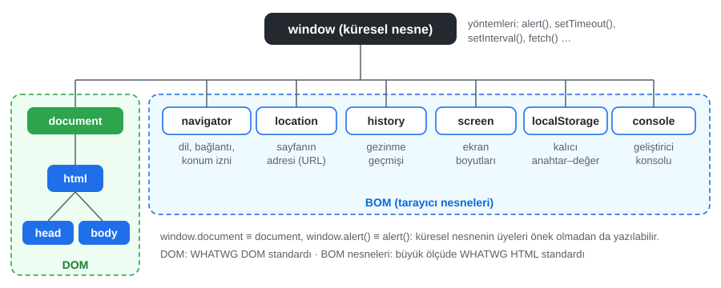

*Şekil 8.2. `window` nesnesi altında DOM ve BOM.*

DOM'un uzun süredir resmî bir standardı bulunmasına karşın BOM, Zakas'ın belirttiği gibi uzun yıllar boyunca JavaScript uygulamasının ilgili bir standardı olmayan tek parçası olarak kalmış; her tarayıcı `window` ve `navigator` gibi nesneleri kendi bildiği gibi gerçekleştirmiştir. Bu durum HTML5 ile değişmiş ve BOM'un büyük bölümü resmî bir belirtime kavuşmuştur [4, s. 9]. Bugün bu nesneler WHATWG *HTML Living Standard* içinde tanımlanmaktadır [6]. BOM nesneleri Bölüm 8.9'da ayrıntılı olarak ele alınmaktadır.

### 8.2.4 Betik ne zaman çalışır?

Bir betik, henüz ayrıştırılmamış bir öğeye erişmeye çalışırsa `document.getElementById(...)` çağrısı `null` döndürür ve bir sonraki satırda `TypeError` hatası oluşur. [Bölüm 7](07-javascript-temelleri.md)'de anlatıldığı gibi bu sorunun güncel çözümü, betiği `<head>` içinde `defer` niteliğiyle yüklemektir:

```html
<head>
  <script src="script.js" defer></script>
</head>
```

`defer` niteliği taşıyan betik, belge tamamen ayrıştırıldıktan sonra ve `DOMContentLoaded` olayından hemen önce çalışır [6]. Bu bölümdeki tüm örnekler bu yöntemi kullanır; dolayısıyla betik çalıştığında DOM ağacı hazırdır.

## 8.3 Öğe Seçme

DOM'u değiştirmenin ilk adımı, değiştirilecek öğeyi bulmaktır. Bunun için `document` nesnesinin (ve her öğenin) sunduğu seçim yöntemleri kullanılır.

### 8.3.1 `getElementById`

Benzersiz bir `id` niteliğine sahip öğeyi seçmenin en doğrudan yolu `getElementById` yöntemidir. Bir belgede aynı `id` değeri yalnızca bir kez kullanılabileceği için yöntem tek bir öğe (ya da bulunamazsa `null`) döndürür.

```html
<p id="mesaj">Merhaba!</p>
```

```js
const mesaj = document.getElementById("mesaj");
console.log(mesaj.textContent); // "Merhaba!"
```

> [!IMPORTANT]
> JavaScript büyük/küçük harfe duyarlıdır. `getElementByID` ya da büyük `I` yerine küçük `l` ile yazılmış `getElementByld` gibi yazımlar `TypeError: ... is not a function` hatasına yol açar. Ayrıca `id` değeri yöntemde `#` işareti **olmadan** yazılır: `getElementById("mesaj")`.

### 8.3.2 `querySelector` ve `querySelectorAll`

`querySelector` yöntemi, [Bölüm 4](04-css-temelleri.md)'te öğrenilen CSS seçicilerini kabul eder ve seçiciye uyan **ilk** öğeyi döndürür. `querySelectorAll` ise uyan **tüm** öğeleri bir `NodeList` içinde verir [1, Bl. 15], [4, Bl. 11].

```js
document.querySelector("#mesaj");                 // id ile
document.querySelector(".kart");                  // ilk .kart öğesi
document.querySelector("nav a[aria-current]");    // nitelik seçicisiyle
document.querySelector("form input[type='email']");

const kartlar = document.querySelectorAll(".kart"); // tüm .kart öğeleri
kartlar.forEach((kart) => kart.classList.add("vurgulu"));
```

`NodeList` bir dizi (Array) değildir. `length` özelliği, `forEach` yöntemi ve `for...of` döngüsü ile kullanılabilir; ancak `map` ve `filter` gibi dizi yöntemlerine sahip değildir. Bu yöntemler gerekiyorsa liste önce diziye çevrilir:

```js
const basliklar = document.querySelectorAll("h2");
const metinler = Array.from(basliklar).map((h) => h.textContent); // veya [...basliklar]
```

Seçim yöntemleri yalnızca `document` üzerinde değil, herhangi bir öğe üzerinde de çağrılabilir. Bu durumda arama yalnızca o öğenin alt ağacında yapılır. Örneğin `form.querySelector("input")` yalnızca o formun içindeki ilk `input` öğesini bulur.

### 8.3.3 Eski yöntemler ve canlı koleksiyonlar

`getElementsByClassName` ve `getElementsByTagName` yöntemleri hâlâ geçerlidir ve sık karşılaşılır. Önemli farkları, **canlı** (live) bir `HTMLCollection` döndürmeleridir: Sayfaya sonradan aynı sınıfta bir öğe eklenirse koleksiyon kendiliğinden güncellenir. `querySelectorAll` ise çağrıldığı andaki durumun **durağan** (static) bir kopyasını verir [2]. Canlı koleksiyon üzerinde döngüyle öğe silmek ya da eklemek, döngü sırasında koleksiyonun boyutu değiştiği için beklenmedik sonuçlar doğurabilir; bu nedenle yeni kodda `querySelectorAll` tercih edilir.

*Tablo 8.1. Öğe seçme yöntemlerinin karşılaştırması.*

| Yöntem | Argüman | Dönen değer | Bulunamazsa |
| --- | --- | --- | --- |
| `getElementById("x")` | `id` değeri (`#` olmadan) | Tek öğe | `null` |
| `querySelector("…")` | CSS seçicisi | İlk eşleşen öğe | `null` |
| `querySelectorAll("…")` | CSS seçicisi | Durağan `NodeList` | Boş `NodeList` |
| `getElementsByClassName("x")` | Sınıf adı (`.` olmadan) | Canlı `HTMLCollection` | Boş koleksiyon |
| `getElementsByTagName("li")` | Etiket adı | Canlı `HTMLCollection` | Boş koleksiyon |

### 8.3.4 Ağaçta gezinme

Bir öğe bulunduktan sonra ağaçta komşu öğelere geçmek için öğe tabanlı gezinme özellikleri kullanılır: `parentElement` (ebeveyn), `children` (çocuk öğeler), `firstElementChild`, `lastElementChild`, `nextElementSibling` ve `previousElementSibling`. Bunlara ek olarak `closest(seçici)` yöntemi, öğenin kendisinden başlayarak yukarı doğru seçiciye uyan ilk ataya ulaşır. Bu yöntem, Bölüm 8.6.5'te anlatılacak olay delegasyonunda sıkça kullanılır.

```js
const sil = document.querySelector(".sil");
const satir = sil.closest("li");  // düğmeyi içeren liste maddesi
const liste = satir.parentElement; // <ul>
```

## 8.4 İçerik ve Nitelikleri Değiştirme

### 8.4.1 `textContent` ve `innerHTML`

Bir öğenin metin içeriğini okumak ya da değiştirmek için `textContent` özelliği kullanılır. `textContent`'e atanan değer her zaman **düz metin** olarak işlenir; içinde `<` ve `>` karakterleri olsa bile tarayıcı bunları etiket olarak yorumlamaz.

`innerHTML` özelliği ise öğenin içeriğini HTML kaynak metni olarak okur ve yazar. Atanan dize HTML olarak ayrıştırılır ve yeni öğeler oluşturulur:

```js
const kutu = document.querySelector("#kutu");

kutu.textContent = "<strong>Kalın</strong>"; // ekranda etiketleriyle birlikte düz metin görünür
kutu.innerHTML = "<strong>Kalın</strong>";   // ekranda kalın yazılmış "Kalın" görünür
```

`innerHTML`, sabit ve geliştiricinin kendisinin yazdığı küçük HTML parçaları için kullanılabilir. Ancak kullanıcıdan, bir formdan, URL'den veya bir sunucudan gelen veri söz konusu olduğunda ciddi bir güvenlik açığına yol açar.

> [!WARNING]
> **Kullanıcı verisini asla `innerHTML` ile sayfaya basmayınız.** Kullanıcının yazdığı bir yorum `innerHTML` ile sayfaya eklenirse, yoruma gizlenmiş HTML ve JavaScript kodu tarayıcıda çalışır. Bu saldırı türüne **siteler arası betik çalıştırma** (Cross-Site Scripting, **XSS**) denir. Saldırgan bu yolla oturum bilgilerini çalabilir, kullanıcı adına işlem yapabilir veya sayfa içeriğini değiştirebilir [3, Bl. 5], [7]. Kullanıcı verisi her zaman `textContent` ile ya da `createElement` ile oluşturulan öğelerin `textContent` özelliğine yazılmalıdır.

Şekil 8.3'te aynı kullanıcı girdisinin iki farklı yöntemle sayfaya yazılmasının sonucu gösterilmektedir. Girdide yer alan `` ifadesi, `innerHTML` ile yazıldığında gerçek bir `` öğesine dönüşür; `x` adresinde görsel bulunamadığı için `error` olayı tetiklenir ve `onerror` niteliğindeki kod çalışır. Dikkat edilirse burada bir `<script>` etiketi bile kullanılmamıştır: HTML standardı `innerHTML` ile eklenen `<script>` öğelerini çalıştırmaz, ancak olay niteliklerini engellemez. Bu nedenle “`<script>` kelimesini filtrelemek” yeterli bir önlem değildir.

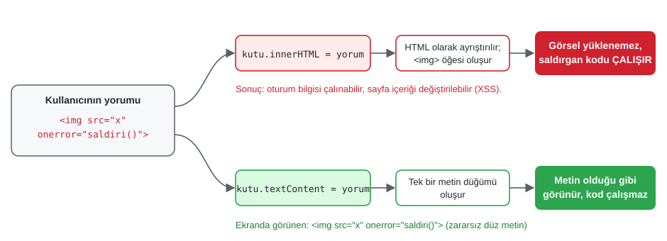

*Şekil 8.3. `innerHTML` ile XSS saldırısı ve `textContent` ile güvenli yazım.*

Okuma yönünde de fark vardır: `textContent` öğenin içindeki tüm metni (gizli öğelerinki dâhil) birleştirerek döndürür. Benzer bir özellik olan `innerText` ise CSS'i hesaba katarak yalnızca ekranda görünen metni verir ve bu nedenle daha yavaştır. Bu bölümdeki örneklerde `textContent` kullanılmaktadır.

> [!TIP]
> **Güncel hayattan:** Yorum, değerlendirme ve mesajlaşma alanı olan her site (e-ticaret ürün yorumları, forumlar, sosyal medya) XSS saldırılarının olası hedefidir. Bu nedenle React, Vue ve Angular gibi güncel arayüz kütüphaneleri, veriyi varsayılan olarak metin şeklinde yazar; HTML yazmak için `dangerouslySetInnerHTML` gibi bilinçli olarak “tehlikeli” diye adlandırılmış ayrı bir yol sunar.

### 8.4.2 Form alanlarının değeri: `value`

`<input>`, `<textarea>` ve `<select>` öğelerinde kullanıcının girdiği değer `value` özelliğiyle okunur ve yazılır. `value` her zaman bir **dizedir** (string); `type="number"` olan bir alandan okunan değer bile `"75"` biçiminde gelir. Sayıya çevirme ve doğrulama Bölüm 8.7'de ele alınmaktadır. Onay kutuları ve radyo düğmeleri için ise işaretli olup olmadığını gösteren `checked` özelliği kullanılır.

```js
const ad = document.querySelector("#ad").value;             // "Ayşe"
const kabul = document.querySelector("#sozlesme").checked;  // true / false
document.querySelector("#ad").value = "";                   // alanı temizle
```

### 8.4.3 Nitelikler, `dataset` ve `hidden`

Bir öğenin niteliklerine `getAttribute`, `setAttribute`, `removeAttribute` ve `hasAttribute` yöntemleriyle erişilir. Standart HTML niteliklerinin çoğu ayrıca aynı adlı JavaScript özellikleri olarak da sunulur:

```js
const resim = document.querySelector("#profil");
resim.getAttribute("alt");                 // nitelik değerini oku
resim.setAttribute("alt", "Profil fotoğrafı");
resim.src = "img/yeni.jpg";                // özellik üzerinden kısa yol
const baglanti = document.querySelector("a");
baglanti.setAttribute("aria-current", "page");
```

Nitelik ile özellik her zaman aynı değeri vermez. Örneğin `<a href="iletisim.html">` için `getAttribute("href")` yazıldığı biçimiyle `"iletisim.html"` değerini, `a.href` özelliği ise tam adresi (`"https://ornek.edu.tr/iletisim.html"`) döndürür. Benzer şekilde bir metin kutusunun `value` *niteliği* başlangıç değerini, `value` *özelliği* ise kullanıcının o an yazmış olduğu değeri tutar.

HTML5 ile gelen `data-*` nitelikleri, öğelere sayfaya özgü veri eklemek için kullanılır. Bu nitelikler JavaScript'te `dataset` nesnesi üzerinden okunur; nitelik adındaki tireler büyük harfe dönüştürülür (`data-urun-id` → `dataset.urunId`):

```html
<button class="sepete-ekle" data-urun-id="1042" data-fiyat="249.90">Sepete ekle</button>
```

```js
const dugme = document.querySelector(".sepete-ekle");
const urunId = dugme.dataset.urunId;        // "1042" (dize)
const fiyat = Number(dugme.dataset.fiyat);  // 249.9
```

Bir öğeyi gizlemek veya göstermek için HTML'in **`hidden`** niteliği kullanılabilir. JavaScript'te `oge.hidden = true` yazmak, öğeyi hem görsel olarak hem de ekran okuyuculardan gizler. Bu yöntem, `style.display = "none"` atamasına göre daha anlamlı (semantik) ve okunaklıdır.

### 8.4.4 Görünümü değiştirme: `classList` ve `style`

Bir öğenin görünümünü JavaScript ile değiştirmenin iki yolu vardır. Birincisi `style` özelliği üzerinden satır içi CSS yazmaktır. CSS'teki tireli özellik adları burada deve hörgücü (camelCase) biçiminde yazılır (`background-color` → `backgroundColor`):

```js
kutu.style.backgroundColor = "#fff8c5";
kutu.style.fontSize = "1.25rem";
```

İkinci ve **önerilen** yol, görünümü CSS dosyasında bir sınıf olarak tanımlamak ve JavaScript ile yalnızca sınıfı eklemek ya da çıkarmaktır. Böylece görünüm CSS'te, davranış JavaScript'te kalır (kaygıların ayrılması); tasarım değiştiğinde JavaScript koduna dokunmak gerekmez [1, Bl. 16]. Sınıf işlemleri `classList` nesnesiyle yapılır:

```css
.hata {
  border-color: #cf222e;
  background: #ffebe9;
}
```

```js
alan.classList.add("hata");          // sınıf ekle
alan.classList.remove("hata");       // sınıf çıkar
alan.classList.toggle("secili");     // varsa çıkar, yoksa ekle
alan.classList.toggle("hata", gecersizMi); // ikinci argüman true ise ekle, false ise çıkar
alan.classList.contains("hata");     // true / false
```

`toggle` yönteminin ikinci argümanlı biçimi, “koşul doğruysa sınıfı ekle, değilse çıkar” mantığını tek satırda ifade ettiği için bu bölümdeki uygulamalarda sıkça kullanılmaktadır.

## 8.5 Öğe Oluşturma, Ekleme ve Silme

### 8.5.1 `createElement` ve ekleme yöntemleri

Sayfaya yeni bir öğe eklemek iki adımda yapılır: önce `document.createElement` ile bellekte öğe oluşturulur ve içeriği doldurulur, ardından ağaçta istenen konuma eklenir. Öğe ağaca eklenene kadar ekranda görünmez.

```js
const liste = document.querySelector("#duyurular");

const madde = document.createElement("li");
madde.textContent = "Vize sınav yerleri açıklandı"; // kullanıcı verisi olsa da güvenli
madde.classList.add("yeni");

liste.append(madde); // listenin sonuna ekle
```

*Tablo 8.2. Güncel DOM ekleme ve silme yöntemleri.*

| Yöntem | Etkisi |
| --- | --- |
| `ebeveyn.append(a, b, "metin")` | Bir veya daha fazla düğümü/metni ebeveynin **sonuna** ekler. |
| `ebeveyn.prepend(…)` | Ebeveynin **başına** ekler. |
| `oge.before(…)` / `oge.after(…)` | Öğenin hemen **önüne** / **arkasına** (kardeş olarak) ekler. |
| `oge.replaceWith(yeni)` | Öğeyi başka bir düğümle değiştirir. |
| `ebeveyn.replaceChildren(…)` | Ebeveynin tüm çocuklarını verilenlerle değiştirir; argümansız çağrılırsa içini boşaltır. |
| `oge.remove()` | Öğeyi ağaçtan kaldırır. |
| `oge.cloneNode(true)` | Öğenin alt ağacıyla birlikte bir kopyasını üretir. |

Eski kodlarda sık görülen `appendChild`, `insertBefore` ve `removeChild` yöntemleri de hâlâ çalışır; ancak yukarıdaki yöntemler daha kısadır ve dizeleri doğrudan metin düğümü olarak kabul eder [2].

> [!IMPORTANT]
> Bir DOM düğümü aynı anda yalnızca bir yerde bulunabilir. Zaten ağaçta olan bir düğüm `append` veya `prepend` ile başka bir konuma eklenirse **kopyalanmaz, taşınır**. İki ayrı kopya isteniyorsa ikinci bir öğe oluşturulmalı veya `cloneNode(true)` kullanılmalıdır.

### 8.5.2 Çok sayıda öğe: `DocumentFragment` ve `<template>`

Bir döngüyle yüzlerce öğe eklenecekse, her `append` çağrısının tarayıcıyı yeniden hesaplamaya zorlamaması için öğeler önce bir **`DocumentFragment`** (belge parçası) içinde toplanabilir. Parça, ağaca eklendiğinde kendisi kaybolur ve yalnızca içindeki düğümler aktarılır. Güncel tarayıcılarda `append(...dizi)` biçimiyle tek seferde ekleme de aynı amaca hizmet eder.

Tekrarlayan bir yapı (ör. her ürün kartı ya da her liste satırı) için HTML'in **`<template>`** öğesi kullanılabilir. `<template>` içindeki işaretleme sayfada görüntülenmez; JavaScript ile `kalip.content.cloneNode(true)` yazılarak kopyalanır ve içi doldurulur. Uygulama 8.3'teki yapılacaklar listesi bu yöntemi kullanmaktadır. Böylece HTML yapısı JavaScript dizeleri içinde değil, HTML dosyasında kalır ve `innerHTML` kullanma ihtiyacı ortadan kalkar.

### 8.5.3 Örnek: güvenli metin arama ve vurgulama

Eski ders notlarında yer alan “metin arama ve vurgulama” uygulaması, bu bölümde öğrenilen yöntemleri bir araya getiren iyi bir örnektir. Kullanıcı bir kelime yazar; sayfadaki paragrafta bu kelimenin geçtiği yerler `<mark>` öğesiyle vurgulanır (Şekil 8.4). Yaygın ama hatalı çözüm, paragrafın HTML'ini `innerHTML.replace(...)` ile değiştirmektir; bu yaklaşım hem XSS açığı oluşturur hem de kullanıcı `<` gibi özel karakterler aradığında sayfayı bozar. Aşağıdaki çözümde metin parçalara ayrılır ve parçalar metin düğümü ya da `<mark>` öğesi olarak yeniden kurulur:

*Kod 8.1. Kullanıcı metnini HTML olarak yorumlamadan vurgulama (`ornek-8-2-metin-arama/script.js`, kısaltılmış).*

```js
const ifade = new RegExp(regexKacir(aranan), "gi");  // özel karakterler kaçırılmış
const eslesmeler = [...ozgunMetin.matchAll(ifade)];

const parca = document.createDocumentFragment();
let sonIndeks = 0;
for (const eslesme of eslesmeler) {
  parca.append(ozgunMetin.slice(sonIndeks, eslesme.index)); // düz metin
  const vurgu = document.createElement("mark");
  vurgu.textContent = eslesme[0];                           // eşleşen kelime
  parca.append(vurgu);
  sonIndeks = eslesme.index + eslesme[0].length;
}
parca.append(ozgunMetin.slice(sonIndeks));
icerik.replaceChildren(parca); // eski içerik tek adımda değiştirilir
```

Kullanıcının yazdığı metin bir düzenli ifadeye (RegExp) dönüştürülmeden önce `regexKacir` fonksiyonuyla `.`, `*`, `(` gibi özel karakterlerden arındırılır; aksi hâlde `(` aramak `SyntaxError` hatasına yol açar. Tam kod: [`codes/08-javascript-dom-olaylar/ornek-8-2-metin-arama/`](../codes/08-javascript-dom-olaylar/ornek-8-2-metin-arama/index.html)

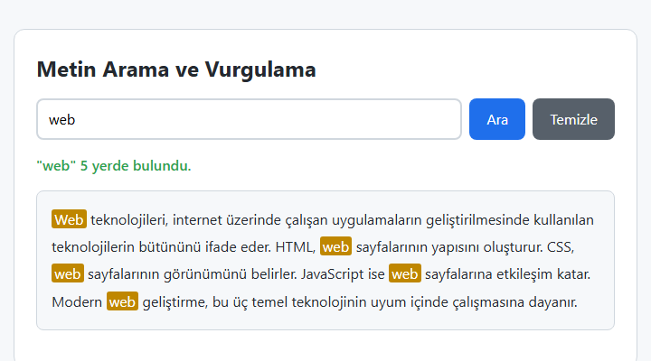

*Şekil 8.4. Metin arama ve vurgulama örneğinin çıktısı.*

## 8.6 Olaylar

### 8.6.1 Olay güdümlü programlama ve olay döngüsü

[Bölüm 7](07-javascript-temelleri.md)'deki programlar yukarıdan aşağıya bir kez çalışıp sona eriyordu. Tarayıcıdaki bir arayüz ise böyle çalışmaz: Sayfa yüklendikten sonra kod, kullanıcının bir şey yapmasını **bekler** ve bir şey olduğunda **yanıt verir**. Bu yaklaşıma **olay güdümlü programlama** (event-driven programming) denir. Flanagan, istemci tarafı JavaScript'in eşzamansız (asynchronous) ve olay güdümlü bir programlama modeli kullandığını belirtir ve bunun web'e özgü olmadığını vurgular: Grafik kullanıcı arayüzüne sahip tüm uygulamalar “bir şeyin olmasını bekleyecek, sonra da yanıt verecek” biçimde tasarlanır [1, s. 445].

**Olay** (event), tarayıcının programa bildirdiği herhangi bir gelişmedir: bir düğmeye tıklanması, bir tuşa basılması, bir form alanının değişmesi, sayfanın yüklenmesinin bitmesi, bir zamanlayıcının süresinin dolması ya da sunucudan yanıt gelmesi. Her olayın bir **türü** (`"click"`, `"keydown"`, `"submit"` …) ve bir **hedefi** (olayın gerçekleştiği nesne) vardır. Olay gerçekleştiğinde çalıştırılmak üzere kaydedilen fonksiyona **olay dinleyicisi** (event listener) denir [1, s. 445], [4, s. 434].

Tarayıcıda JavaScript tek bir iş parçacığında (thread) çalışır; yani aynı anda yalnızca bir kod parçası yürütülür. Olaylar ise her an gelebilir. Bu uyumu sağlayan yapı, HTML standardında tanımlanan **olay döngüsüdür** (event loop) [6]. Sezgisel olarak şöyle özetlenebilir (Şekil 8.5): Gerçekleşen her olay için çalışacak dinleyiciler bir **görev kuyruğuna** (task queue) eklenir. Olay döngüsü, o an çalışan kod bittiğinde kuyruktaki sıradaki görevi alır ve çalıştırır; ardından `Promise` gibi yapılardan doğan **mikro görevleri** (microtasks) işler ve gerekiyorsa sayfayı yeniden çizer. Sonra bir sonraki göreve geçer.

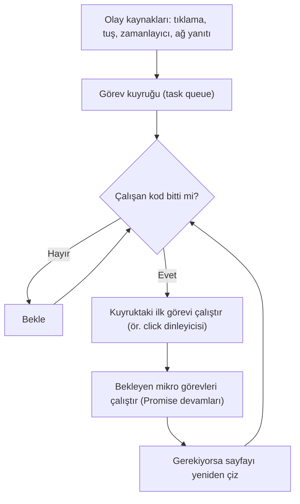

*Şekil 8.5. Olay döngüsünün sezgisel modeli.*

Bu modelin pratik bir sonucu vardır: Bir dinleyici uzun süren bir hesaplama yaparsa (ör. milyonlarca adımlık bir döngü), o süre boyunca başka hiçbir olay işlenemez ve sayfa yeniden çizilemez; kullanıcı sayfanın “donduğunu” görür. Bu nedenle dinleyiciler kısa tutulmalı, uzun süren işler (ağ istekleri gibi) Bölüm 8.10'da anlatılacak eşzamansız yöntemlerle yapılmalıdır.

### 8.6.2 `addEventListener` ve `removeEventListener`

Ders sunumunda (slayt 190) belirtildiği gibi `addEventListener()` yöntemi, belirtilen öğeye bir olay dinleyicisi ekler; bu yöntemle eklenmiş bir dinleyiciyi kaldırmak için `removeEventListener()` yöntemi kullanılır. Sunumda verilen söz dizimi şöyledir:

```js
element.addEventListener(event, function, useCapture);
```

Bu söz diziminde `event` olay türünü (ör. `"click"`; başında `on` olmadan), `function` olay gerçekleştiğinde çağrılacak dinleyiciyi, `useCapture` ise dinleyicinin olay yayılımının hangi aşamasında çalışacağını belirtir (Bölüm 8.6.4). Yöntemin adı büyük/küçük harfe duyarlıdır ve küçük harfle başlar: `addEventListener`.

Slayt 191'deki örnek, düğmeye tıklandığında bir paragrafın içeriğini değiştirmektedir:

*Kod 8.2. Ders sunumundaki örnek (slayt 191).*

```html
<button id="myBtn">Tıkla Dene</button>
<p id="demo">
  <script>
    document.getElementById("myBtn").addEventListener("click", myFunction);

    function myFunction() {
      document.getElementById("demo").innerHTML = "Hello World";
    }
  </script>
```

Örnekte dikkat edilmesi gereken üç ayrıntı vardır. Birincisi, dinleyici olarak fonksiyonun **adı** verilmiştir: `myFunction()` değil `myFunction` yazılır. Parantez yazılsaydı fonksiyon dinleyici eklenirken hemen bir kez çalışır ve dönüş değeri (`undefined`) dinleyici olarak verilmiş olurdu. İkincisi, `myFunction` fonksiyonu `addEventListener` satırından sonra tanımlanmış olmasına karşın çalışmaktadır; çünkü fonksiyon bildirimleri kapsamın başına “yükseltilir” (hoisting, bkz. [Bölüm 7](07-javascript-temelleri.md)). Üçüncüsü, `<script>` öğesi kapatılmamış bir `<p>` öğesinin içine yerleştirilmiştir. Tarayıcı bu yapıyı hata vermeden işler; ancak `innerHTML` ataması paragrafın içindeki betik öğesini de siler, ayrıca yapı (HTML) ile davranış (JavaScript) birbirine karışır. Aynı örneğin bu bölümün kurallarına uygun hâli Kod 8.3'te verilmiştir; sabit bir metin yazıldığı için `innerHTML` burada güvenlik açığı oluşturmasa da, alışkanlık olarak `textContent` tercih edilmiştir.

*Kod 8.3. Slayt örneğinin düzeltilmiş ve `removeEventListener` ile genişletilmiş hâli (`ornek-8-1-addeventlistener`).*

```html
<button type="button" id="denemeDugmesi">Tıkla Dene</button>
<button type="button" id="kaldirDugmesi">Dinleyiciyi kaldır</button>
<p id="demo">Henüz tıklanmadı.</p>
```

```js
const denemeDugmesi = document.getElementById("denemeDugmesi");
const demo = document.getElementById("demo");

function mesajGoster() {
  demo.textContent = "Merhaba Dünya";
}

denemeDugmesi.addEventListener("click", mesajGoster);

document.getElementById("kaldirDugmesi").addEventListener("click", () => {
  denemeDugmesi.removeEventListener("click", mesajGoster); // AYNI fonksiyon referansı
});
```

Tam kod: [`codes/08-javascript-dom-olaylar/ornek-8-1-addeventlistener/`](../codes/08-javascript-dom-olaylar/ornek-8-1-addeventlistener/index.html)

> [!IMPORTANT]
> `removeEventListener` yalnızca **aynı olay türü, aynı fonksiyon referansı ve aynı yakalama (`capture`) ayarı** ile çağrıldığında dinleyiciyi kaldırır [8]. Aşağıdaki kod hiçbir şeyi kaldırmaz, çünkü iki ok fonksiyonu görünüşte aynı olsa da bellekte iki ayrı fonksiyon nesnesidir:
>
> ```js
> dugme.addEventListener("click", () => console.log("tık"));
> dugme.removeEventListener("click", () => console.log("tık")); // etkisiz!
> ```
>
> Daha sonra kaldırılacak dinleyiciler bu nedenle adlandırılmış bir fonksiyon ya da bir değişkende saklanan fonksiyon olarak tanımlanmalıdır.

**Üçüncü parametre: `useCapture`'dan seçenek nesnesine.** Sunumdaki `useCapture` parametresi tarihsel olarak bir mantıksal (boolean) değerdi ve bazı eski tarayıcılarda yazılması zorunluydu; bu nedenle eski kodlarda `addEventListener("click", f, false)` biçimine sık rastlanır. Güncel DOM standardında üçüncü parametre, mantıksal değer yerine bir **seçenek nesnesi** de olabilir [2], [8]:

```js
dugme.addEventListener("click", tamamla, { once: true });          // bir kez çalışıp kendini kaldırır
sayfa.addEventListener("touchmove", izle, { passive: true });      // preventDefault çağırmayacağını bildirir
kapsayici.addEventListener("click", kaydet, { capture: true });    // useCapture = true ile aynı
```

*Tablo 8.3. `addEventListener` seçenekleri.*

| Seçenek | Varsayılan | Anlamı |
| --- | --- | --- |
| `capture` | `false` | `true` ise dinleyici yakalama aşamasında çalışır (eski `useCapture`). |
| `once` | `false` | `true` ise dinleyici ilk çalışmadan sonra otomatik olarak kaldırılır. |
| `passive` | `false` | `true` ise dinleyicinin `preventDefault()` çağırmayacağı bildirilir; kaydırma (scroll) ve dokunma olaylarında tarayıcının akıcı çalışmasına yardım eder. |
| `signal` | — | Bir `AbortController` sinyali verilirse, `controller.abort()` çağrısı dinleyiciyi kaldırır. |

`addEventListener` ile aynı öğenin aynı olayına birden fazla dinleyici eklenebilir; dinleyiciler eklenme sırasıyla çalışır [1, s. 463]. Bu, aynı düğmeye hem bir istatistik kaydı hem de asıl işlemi bağlamak gibi durumlarda yararlıdır.

#### 🛠 Uygulama 8.1: Tıklama Sayacı

**Amaç:** `addEventListener`, `textContent` ve `classList.toggle` ile durum (state) tutan küçük bir bileşen yazmak.  
**Tahmini süre:** 15 dk

1. VS Code'da `calismalar/bolum-08/sayac/` klasörünü oluşturunuz; içinde `index.html`, `style.css` ve `script.js` dosyalarını açınız.
2. `index.html` içinde Emmet ile (`!` + `Tab`) iskeleti oluşturunuz, `lang="tr"` yapınız ve `<head>` içine `<link rel="stylesheet" href="style.css">` ile `<script src="script.js" defer></script>` satırlarını ekleyiniz.
3. Gövdeye bir başlık, sayıyı gösterecek `<p id="deger">0</p>` ve `azalt`, `sifirla`, `artir` kimlikli üç düğme (`type="button"`) ekleyiniz.
4. `script.js` içinde `let sayac = 0;` değişkenini ve ekranı güncelleyen bir `ekraniGuncelle()` fonksiyonu yazınız. Fonksiyon `textContent` ile sayıyı yazsın, `classList.toggle("hedef", sayac >= 10)` ile 10 ve üzerinde rengi değiştirsin, sayı 0 iken “−” düğmesini `disabled` yapsın.
5. Üç düğmeye `addEventListener("click", …)` ile dinleyici ekleyiniz; her dinleyici `sayac` değerini değiştirip `ekraniGuncelle()` fonksiyonunu çağırsın.
6. Sayfayı **Live Server** ile açınız (sağ tık → *Open with Live Server*) ve sonucu Şekil 8.6 ile karşılaştırınız.

**Beklenen çıktı:**

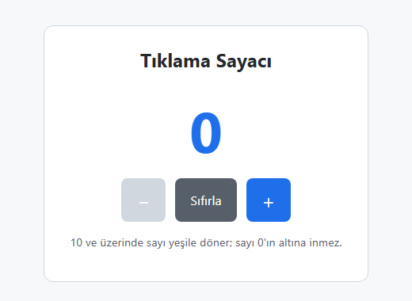

*Şekil 8.6. Uygulama 8.1'in beklenen ekran görüntüsü (ilk durum).*

**Kendinizi sınayın:** (1) Klavyede `+` ve `-` tuşlarına basıldığında da sayacın değişmesini sağlayınız (ipucu: `document` üzerinde `keydown` olayı ve `event.key`). (2) Sayacın değerini `<p>` yerine bir `<output>` öğesinde gösteriniz.

<details><summary>Örnek çözüm</summary>

Çözüm dosyası: [`codes/08-javascript-dom-olaylar/uygulama-8-1-sayac/index.html`](../codes/08-javascript-dom-olaylar/uygulama-8-1-sayac/index.html)

</details>

### 8.6.3 Olay nesnesi

Bir olay gerçekleştiğinde tarayıcı, dinleyici fonksiyonu çağırırken ona olayla ilgili bilgileri taşıyan bir **olay nesnesi** (event object) argüman olarak verir. Bu parametreye genellikle `event`, `e` ya da Türkçe adlandırmayla `olay` denir:

```js
document.querySelector("#liste").addEventListener("click", (olay) => {
  console.log(olay.type);          // "click"
  console.log(olay.target);        // tıklanan asıl öğe (ör. <li> içindeki <span>)
  console.log(olay.currentTarget); // dinleyicinin bağlı olduğu öğe (<ul id="liste">)
});
```

*Tablo 8.4. Olay nesnesinin sık kullanılan özellik ve yöntemleri.*

| Üye | Açıklama |
| --- | --- |
| `type` | Olay türü (`"click"`, `"input"` …). |
| `target` | Olayın **asıl gerçekleştiği** öğe (ör. tıklanan en içteki öğe). |
| `currentTarget` | O an çalışan dinleyicinin **bağlı olduğu** öğe. |
| `key` | Klavye olaylarında basılan tuşun değeri (`"Enter"`, `"Escape"`, `"a"`, `"ArrowLeft"` …). |
| `clientX`, `clientY` | Fare/işaretçi olaylarında görüntü alanına göre konum. |
| `eventPhase` | Olayın bulunduğu aşama: 1 yakalama, 2 hedef, 3 kabarma. |
| `preventDefault()` | Tarayıcının bu olaya ilişkin **varsayılan davranışını** engeller. |
| `stopPropagation()` | Olayın DOM ağacında diğer öğelere **yayılmasını** durdurur. |

`target` ile `currentTarget` arasındaki fark özellikle önemlidir: Bir `<ul>` öğesine bağlı dinleyici, bir `<li>` içindeki düğmeye tıklandığında da çalışır; bu durumda `currentTarget` her zaman `<ul>`, `target` ise tıklanan düğmedir. Bu fark, Bölüm 8.6.5'teki olay delegasyonunun temelidir.

**Varsayılan davranışı engelleme.** Bazı olayların tarayıcı tarafından tanımlanmış bir varsayılan davranışı vardır: Bir bağlantıya tıklanınca başka sayfaya gidilir, bir form gönderilince sayfa yeniden yüklenir, bir onay kutusuna tıklanınca işareti değişir. `preventDefault()` bu davranışı iptal eder:

```js
document.querySelector("#formum").addEventListener("submit", (olay) => {
  olay.preventDefault(); // sayfa yeniden yüklenmez; veriler JavaScript ile işlenir
});
```

### 8.6.4 Olay yayılımı: yakalama, hedef ve kabarma

Bir düğmeye tıklandığında yalnızca düğmeye değil, onu içeren kutuya, `<body>` öğesine ve bütün sayfaya da tıklanmış olur. Zakas'ın verdiği benzetmeyle, iç içe çizilmiş çemberlerin ortasına parmak koyan kişi yalnızca en içteki çemberin değil, hepsinin içindedir [4, s. 432]. Tarayıcıların ilk dönemlerinde bu soruya iki rakip firma ters yanıtlar vermiştir: Internet Explorer olayın en içteki öğeden dışarıya doğru ilerlediği **kabarma** (event bubbling) modelini, Netscape ise dıştan içe doğru ilerleyen **yakalama** (event capturing) modelini uygulamıştır [4, ss. 432–433]. Standart DOM olay modeli bu iki yaklaşımı birleştirerek olay akışını üç aşamaya ayırır (Şekil 8.7) [2], [4, s. 433], [1, s. 463]:

1. **Yakalama aşaması** (capture phase): Olay `window` nesnesinden başlayarak `document`, `<html>`, `<body>` … üzerinden hedefe doğru **iner**.
2. **Hedef aşaması** (target phase): Olay, gerçekleştiği öğede (`event.target`) işlenir.
3. **Kabarma aşaması** (bubble phase): Olay aynı yoldan geriye, `window` nesnesine doğru **yükselir**.

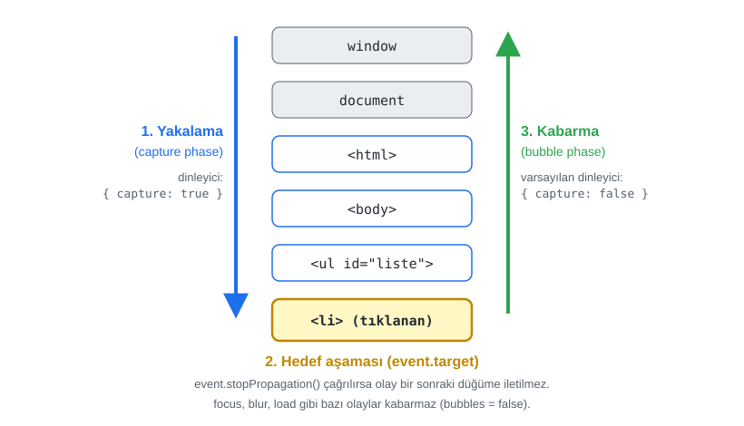

*Şekil 8.7. Olay yayılımının üç aşaması.*

`addEventListener` ile varsayılan olarak eklenen dinleyiciler **kabarma** aşamasında çalışır. Üçüncü parametre `true` ya da `{ capture: true }` verilirse dinleyici **yakalama** aşamasında çalışır. Uygulamada dinleyicilerin büyük çoğunluğu kabarma aşamasında çalıştırılır; yakalama, olayı hedefe ulaşmadan önce durdurmak gibi özel durumlar için kullanılır [4, s. 433].

Olayların çoğu kabarır; ancak `focus`, `blur`, `mouseenter`, `mouseleave` ve öğelerdeki `load` gibi bazı olaylar kabarmaz [1, s. 463]. Kabaran karşılıkları gereken durumlar için `focusin` ve `focusout` olayları tanımlanmıştır.

Olay akışını uygulamalı olarak görmek için iç içe üç öğenin her birine hem yakalama hem kabarma aşamasında dinleyici eklenmiş bir örnek hazırlanmıştır (Şekil 8.8). İçteki düğmeye tıklandığında kayıtta önce dıştan içe yakalama, sonra hedef, ardından içten dışa kabarma satırları görülür. “`stopPropagation()` çağırsın” seçeneği işaretlendiğinde orta kutu kabarma aşamasında olayı durdurur ve dış kutunun kabarma dinleyicisi çalışmaz.

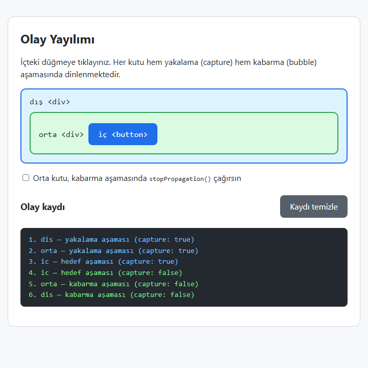

*Şekil 8.8. Yakalama ve kabarma aşamalarını kaydeden örnek. Tam kod: [`ornek-8-3-olay-yayilimi`](../codes/08-javascript-dom-olaylar/ornek-8-3-olay-yayilimi/index.html).*

> [!IMPORTANT]
> `stopPropagation()` ile `preventDefault()` farklı işler yapar. `stopPropagation()` olayın **diğer öğelere iletilmesini** durdurur ama tarayıcının varsayılan davranışına dokunmaz; `preventDefault()` ise **varsayılan davranışı** iptal eder ama olayın yayılmasını durdurmaz. `stopPropagation()` gereksiz yere kullanıldığında sayfadaki başka bileşenlerin (ör. açılır menüyü dışarı tıklanınca kapatan bir dinleyicinin) çalışmasını engelleyebileceği için dikkatli kullanılmalıdır.

### 8.6.5 Olay delegasyonu

Bir listede yüzlerce satır ve her satırda bir “Sil” düğmesi olduğunu düşünelim. Her düğmeye ayrı dinleyici eklemek hem bellek kullanımını artırır hem de sonradan eklenen satırlar için dinleyici eklemeyi unutma riskini doğurur. Kabarma mekanizması bu soruna zarif bir çözüm sunar: Dinleyici, tüm satırları kapsayan **ortak ebeveyne** bir kez eklenir; olay hangi satırda gerçekleşirse gerçekleşsin ebeveyne kadar kabarır ve dinleyici `event.target` üzerinden olayın nerede gerçekleştiğini bulur. Bu yönteme **olay delegasyonu** (event delegation) denir [3, Bl. 6], [1, s. 463].

```js
liste.addEventListener("click", (olay) => {
  const dugme = olay.target.closest("[data-islem='sil']");
  if (dugme) {                          // tıklama bir Sil düğmesinde (veya içinde) mi?
    dugme.closest("li").remove();       // düğmenin ait olduğu satırı sil
  }
});
```

`closest` yönteminin kullanılmasının nedeni, kullanıcının düğmenin kendisine değil içindeki bir simgeye ya da `<span>` öğesine tıklamış olabilmesidir; `closest`, `target`'tan başlayarak yukarı doğru uygun öğeyi arar. Akış Şekil 8.9'da özetlenmiştir.

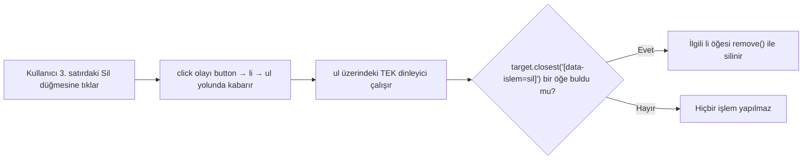

*Şekil 8.9. Olay delegasyonuyla satır silme.*

Duckett, çok sayıda dinleyicinin bellek kullanımını artırıp sayfayı yavaşlatabileceğini belirttikten sonra delegasyonun ek yararlarını şöyle sıralar: sonradan eklenen öğelerle de kendiliğinden çalışır, daha az fonksiyon yazılmasını sağlar ve DOM ile kod arasındaki bağı azaltarak bakımı kolaylaştırır [3, Bl. 6]. Uygulama 8.3 ve Uygulama 8.4 bu yöntemi kullanmaktadır.

### 8.6.6 Sık kullanılan olaylar

*Tablo 8.5. Sık kullanılan olay türleri.*

| Grup | Olay | Ne zaman gerçekleşir? |
| --- | --- | --- |
| Fare / işaretçi | `click`, `dblclick` | Tıklama, çift tıklama (klavyeyle `Enter`/`Space` ile düğmeye basılması da `click` üretir) |
| | `mouseover`, `mouseout` | İşaretçi öğenin (veya bir çocuğunun) üzerine gelir / ayrılır; kabarır |
| | `mouseenter`, `mouseleave` | İşaretçi öğeye girer / öğeden çıkar; kabarmaz, çocuklarda tekrar tetiklenmez |
| | `pointerdown`, `pointerup`, `pointermove` | Fare, dokunmatik ekran ve kalem için ortak işaretçi olayları |
| Klavye | `keydown`, `keyup` | Tuşa basılır / tuş bırakılır |
| Form | `input` | Alanın değeri her değiştiğinde (yazma, silme, yapıştırma) |
| | `change` | Değer kesinleştiğinde (seçim yapıldığında, alandan çıkıldığında) |
| | `submit` | Form gönderilmek istendiğinde (form öğesinde) |
| | `focus`, `blur` | Alan odak kazanır / kaybeder (kabarmaz; kabaran karşılıkları `focusin`, `focusout`) |
| Belge / pencere | `DOMContentLoaded` | HTML ayrıştırıldı ve DOM hazır (görseller beklenmez) |
| | `load` | Sayfa tüm görsel ve stil dosyalarıyla birlikte yüklendi (`window` üzerinde) |
| | `resize`, `scroll` | Pencere boyutu değişti / sayfa kaydırıldı |

**Fare olayları ve işaretçi olayları.** `mouseover` ve `mouseout` kabarır; içinde başka öğeler bulunan bir kutuda işaretçi iç öğelerin üzerinde gezinirken olaylar tekrar tekrar tetiklenir. Yalnızca kutuya giriş ve kutudan çıkışta bir kez çalışması istenen işlemler için `mouseenter` ve `mouseleave` tercih edilir. Akıllı telefon ve tabletlerin yaygınlaşmasıyla birlikte fare, dokunma ve kalem girişini tek bir modelde birleştiren **işaretçi olayları** (pointer events) tüm güncel tarayıcılarda desteklenmektedir; `pointerdown`, `pointerup`, `pointermove`, `pointerenter` ve `pointerleave` olayları farenin yanı sıra dokunmatik ekranlarda da çalışır ve olay nesnesinin `pointerType` özelliği girişin türünü (`"mouse"`, `"touch"`, `"pen"`) bildirir [9]. Yalnızca görsel bir vurgulama için ise JavaScript yerine CSS'in `:hover` sözde sınıfı yeterlidir.

**Klavye olayları.** Klavye için `keydown` ve `keyup` olayları kullanılır; basılan tuş `event.key` özelliğiyle okunur:

```js
aramaKutusu.addEventListener("keydown", (olay) => {
  if (olay.key === "Escape") {
    aramaKutusu.value = "";
  }
});
```

> [!NOTE]
> **Tarihsel not:** Eski kodlarda karakter üreten tuşlar için `keypress` olayı ve tuş kodunu sayı olarak veren `keyCode`/`which` özellikleri kullanılırdı. `keypress` olayı kullanımdan kaldırılmıştır (deprecated); yerine `keydown` (veya metin girişini izlemek için `input`) kullanılmalıdır [10]. Aynı şekilde `event.keyCode === 13` yerine okunaklı `event.key === "Enter"` karşılaştırması tercih edilir.

**`input` ve `change` farkı.** Bir metin kutusunda `input` olayı her tuş vuruşunda, `change` olayı ise kullanıcı alanı terk ettiğinde (değer kesinleştiğinde) bir kez gerçekleşir. Canlı arama, karakter sayacı ya da anlık doğrulama için `input`; açılır listeler, onay kutuları ve radyo düğmeleri için ise genellikle `change` kullanılır. Klavye olayları yerine `input` olayını izlemenin bir üstünlüğü de fareyle yapıştırma, sesli yazma ya da otomatik doldurma gibi klavye dışı değişiklikleri de yakalamasıdır.

**`DOMContentLoaded` ve `load`.** `DOMContentLoaded`, HTML ayrıştırılıp DOM ağacı hazır olduğunda; `load` ise görseller, stil dosyaları ve diğer kaynaklar dâhil her şey yüklendiğinde gerçekleşir. Betikler `defer` ile yüklendiğinde ayrıca `DOMContentLoaded` beklemeye gerek kalmaz. Bir görselin boyutlarını ölçmek gibi tüm kaynakların inmesini gerektiren işler için `window` üzerinde `load` olayı dinlenir.

#### 🛠 Uygulama 8.2: Canlı Karakter Sayacı

**Amaç:** `input` olayını kullanarak kullanıcı yazdıkça güncellenen bir sayaç geliştirmek.  
**Tahmini süre:** 15 dk

1. `calismalar/bolum-08/karakter-sayaci/` klasöründe `index.html`, `style.css` ve `script.js` dosyalarını oluşturunuz.
2. Sayfaya bir `<label for="yorum">` ile `<textarea id="yorum" maxlength="280" rows="5">` ekleyiniz. Altına sayaç için `<p id="sayac" aria-live="polite">` ve kelime sayısı için `<p id="kelime">` yerleştiriniz. (`aria-live` niteliği, ekran okuyucuların güncellenen sayıyı duyurmasını sağlar.)
3. `script.js` içinde sınırı HTML'den okuyunuz: `const SINIR = Number(yorum.maxLength);`
4. `sayaciGuncelle()` fonksiyonunu yazınız: `yorum.value.length` ile uzunluğu bulup `"122 / 280 (kalan 158)"` biçiminde yazsın; uzunluk sınırın %80'ini geçince `uyari`, sınıra ulaşınca `dolu` sınıfını `classList.toggle` ile eklesin.
5. Kelime sayısını `yorum.value.trim().split(/\s+/).filter(Boolean).length` ifadesiyle hesaplayınız.
6. Fonksiyonu `yorum.addEventListener("input", sayaciGuncelle);` ile bağlayınız ve sayfa açılırken bir kez çağırınız. Sonucu Şekil 8.10 ile karşılaştırınız.

**Beklenen çıktı:**

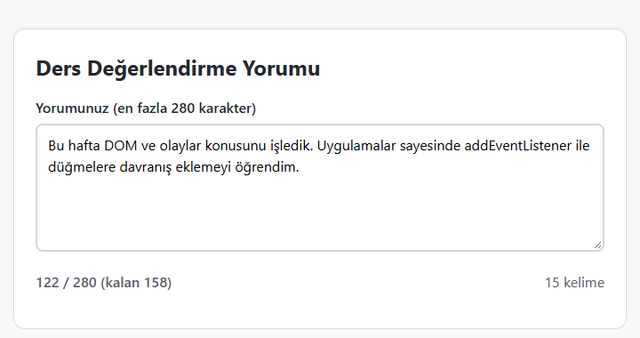

*Şekil 8.10. Uygulama 8.2'nin beklenen ekran görüntüsü.*

**Kendinizi sınayın:** (1) Aynı sayacı `keyup` olayıyla yazıp fareyle metin yapıştırıldığında ne olduğunu gözlemleyiniz. (2) Sayaç rengi değiştiğinde yalnızca renge güvenmemek için (erişilebilirlik) “Sınıra ulaşıldı” yazısını da ekleyiniz.

<details><summary>Örnek çözüm</summary>

Çözüm dosyası: [`codes/08-javascript-dom-olaylar/uygulama-8-2-karakter-sayaci/index.html`](../codes/08-javascript-dom-olaylar/uygulama-8-2-karakter-sayaci/index.html)

</details>

### 8.6.7 Diğer olay kayıt yöntemleri ve çift dinleyici tuzağı

`addEventListener` dışında, eski kodlarda sık karşılaşılan iki yöntem daha vardır. HTML standardı bunlara **olay işleyicisi** (event handler) adını verir; `addEventListener` ile eklenenler ise **olay dinleyicisi** olarak adlandırılır [6].

```html
<!-- 1) HTML niteliği olarak (satır içi) -->
<button onclick="selamVer()">Selam</button>
```

```js
// 2) DOM özelliğine fonksiyon atayarak
dugme.onclick = selamVer;
dugme.onclick = baskaFonksiyon; // öncekinin YERİNE geçer; selamVer artık çalışmaz
```

> [!NOTE]
> **Tarihsel not:** Satır içi `onclick="…"` nitelikleri JavaScript'in ilk yıllarından kalmadır. Bu yöntem HTML ile JavaScript'i birbirine karıştırır, nitelik değeri bir kod dizesi olduğu için hata ayıklamayı zorlaştırır ve sayfa henüz tam yüklenmeden kullanıcı tıklarsa fonksiyon tanımlanmamış olabilir [4, s. 436]. Ayrıca İçerik Güvenlik Politikası (Content Security Policy, CSP) kullanan sitelerde satır içi betikler varsayılan olarak engellenir. `element.onclick = …` biçimi ise bir öğenin bir olayına yalnızca **tek** işleyici bağlanmasına izin verir. Bu nedenler yüzünden yeni kodda `addEventListener` kullanılır.

`addEventListener` ile ilgili sık yapılan bir hata ise bunun tersidir: Dinleyici **eklenir**, öncekinin yerine geçmez. Örneğin her “Göster” tıklamasında bir başka düğmeye yeniden dinleyici ekleyen bir kod yazılırsa, ikinci düğme beşinci tıklamada aynı işi beş kez yapar.

```js
// HATALI: her "Göster" tıklamasında kaydet düğmesine YENİ bir dinleyici eklenir
goster.addEventListener("click", () => {
  panel.hidden = false;
  kaydet.addEventListener("click", () => kaydiGonder()); // her seferinde yeni bir ok fonksiyonu
});

// DOĞRU: dinleyiciler sayfa yüklenirken bir kez ve birbirinden bağımsız eklenir
goster.addEventListener("click", () => { panel.hidden = false; });
kaydet.addEventListener("click", kaydiGonder);
```

Aynı **fonksiyon referansı** aynı olay ve aynı `capture` ayarıyla ikinci kez eklenirse tarayıcı onu yok sayar; ancak hatalı örnekte olduğu gibi her seferinde yeni bir ok fonksiyonu (`() => …`) yazılıyorsa her biri ayrı bir dinleyici sayılır ve birikerek çalışır [8]. Bu tür bir hata, örneğin bir ödeme formunun aynı siparişi birden fazla kez göndermesi gibi ciddi sonuçlar doğurabilir. Bu nedenle dinleyiciler, mümkünse sayfa yüklenirken bir kez ve başka bir dinleyicinin içinde değil, ayrı olarak eklenmelidir.

#### 🛠 Uygulama 8.3: Yapılacaklar Listesi

**Amaç:** `<template>`, `createElement`/`cloneNode` ve olay delegasyonuyla eleman ekleyip silinebilen bir liste oluşturmak.  
**Tahmini süre:** 20 dk

1. `calismalar/bolum-08/yapilacaklar/` klasöründe üç dosyayı oluşturunuz.
2. HTML'e bir form (`id="ekleFormu"`), içinde `required` ve `maxlength="80"` nitelikli bir metin kutusu ve “Ekle” düğmesi koyunuz. Formun altına boş bir `<ul id="liste">`, “Listede iş yok” yazan ve `hidden` nitelikli bir `<p id="bosMesaj">` ve özet için `<p id="ozet">` ekleyiniz.
3. Sayfanın sonuna bir `<template id="satirKalibi">` ekleyiniz. İçinde bir `<li>`; onun içinde onay kutusu (`data-islem="tamamla"`), metin için `<span class="metin">` ve “Sil” düğmesi (`data-islem="sil"`) bulunsun.
4. `script.js` içinde `isEkle(metin)` fonksiyonunu yazınız: `kalip.content.firstElementChild.cloneNode(true)` ile satırı kopyalasın, `.metin` öğesine kullanıcı metnini **`textContent`** ile yazsın ve `liste.append(...)` ile eklesin.
5. Formun `submit` olayında `preventDefault()` çağırıp metni `trim()` ile temizleyiniz; boş değilse `isEkle` fonksiyonunu çağırıp `form.reset()` ile alanı boşaltınız.
6. **Delegasyon:** `liste` öğesine tek bir `click` dinleyicisi ekleyiniz; `olay.target.closest("[data-islem='sil']")` bir düğme bulursa ilgili `<li>` öğesini `remove()` ile siliniz. Ayrıca `change` dinleyicisiyle onay kutusu işaretlendiğinde satıra `tamam` sınıfını ekleyiniz.
7. Her değişiklikte “3 işten 2 tanesi bekliyor.” biçiminde özeti güncelleyiniz ve liste boşsa `bosMesaj.hidden = false` yapınız. Sonucu Şekil 8.11 ile karşılaştırınız.

**Beklenen çıktı:**

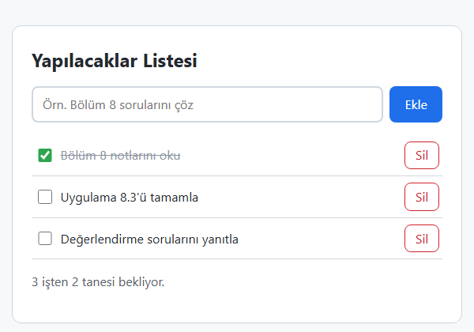

*Şekil 8.11. Uygulama 8.3'ün beklenen ekran görüntüsü.*

**Kendinizi sınayın:** (1) Metin kutusuna `<b>deneme</b>` yazıp ekleyiniz; etiketlerin metin olarak göründüğünü doğrulayınız. Aynı satırı `innerHTML` ile yazsaydınız ne olurdu? (2) Listeyi Bölüm 8.9.6'daki `localStorage` ile kalıcı hâle getiriniz.

<details><summary>Örnek çözüm</summary>

Çözüm dosyası: [`codes/08-javascript-dom-olaylar/uygulama-8-3-yapilacaklar/index.html`](../codes/08-javascript-dom-olaylar/uygulama-8-3-yapilacaklar/index.html)

</details>

### 8.6.8 Örnek bileşen: erişilebilir sekmeler

Sekmeler (tabs), web arayüzlerinin en yaygın bileşenlerinden biridir: Bir ürün sayfasındaki “Açıklama / Özellikler / Yorumlar” bölümleri ya da bir bankacılık uygulamasındaki “Hesaplarım / Kartlarım” ayrımı bu kalıpla yapılır [3, Bl. 11]. Bir sekme bileşeni yalnızca görsel değil, erişilebilir de olmalıdır. W3C'nin *ARIA Authoring Practices Guide* belgesindeki sekme kalıbına göre [11]:

- Sekme düğmelerini kapsayan öğe `role="tablist"`, her düğme `role="tab"`, her içerik bölmesi `role="tabpanel"` rolünü taşır.
- Seçili sekmede `aria-selected="true"`, diğerlerinde `"false"` bulunur; her sekme `aria-controls` ile kendi bölmesine bağlanır.
- Seçili olmayan bölmeler `hidden` niteliğiyle gizlenir.
- Klavye ile **sol/sağ ok** tuşları sekmeler arasında, **Home/End** tuşları ilk/son sekmeye geçirir. Seçili olmayan sekmeler `tabindex="-1"` ile `Tab` sırasından çıkarılır.

Bu davranış; olay delegasyonu (`click` dinleyicisi `tablist` üzerinde), `keydown` olayı ve `event.key`, `setAttribute` ve `hidden` özelliği bir arada kullanılarak gerçekleştirilir.

#### 🛠 Uygulama 8.4: Sekme (Tabs) Bileşeni

**Amaç:** ARIA rolleri, `hidden` niteliği ve klavye olaylarıyla erişilebilir bir sekme bileşeni yazmak.  
**Tahmini süre:** 20 dk

1. `calismalar/bolum-08/sekmeler/` klasöründe üç dosyayı oluşturunuz.
2. HTML'de `role="tablist"` ve `aria-label="Ders bilgileri"` nitelikli bir `<div id="sekmeListesi">` içine “Genel”, “Değerlendirme” ve “Konular” adlı üç `<button type="button" role="tab">` ekleyiniz. Her birine `id` (ör. `sekme-genel`) ve `aria-controls` (ör. `panel-genel`) veriniz; yalnızca ilkinde `aria-selected="true"` olsun, diğerlerinde `aria-selected="false"` ve `tabindex="-1"` bulunsun.
3. Her sekme için `role="tabpanel"`, `aria-labelledby` nitelikli bir `<section>` oluşturunuz; ilki hariç hepsine `hidden` ekleyiniz.
4. `script.js` içinde `sekmeSec(secilen)` fonksiyonunu yazınız: Tüm sekmeleri dolaşıp seçili olana `aria-selected="true"` ve `tabIndex = 0`, diğerlerine `"false"` ve `-1` versin; `aria-controls` ile bulunan bölmenin `hidden` değerini ayarlasın ve seçilen sekmeye `focus()` yapsın.
5. `sekmeListesi` üzerine tek bir `click` dinleyicisi ekleyip `olay.target.closest("[role='tab']")` ile tıklanan sekmeyi bulunuz.
6. Aynı öğeye bir `keydown` dinleyicisi ekleyerek `ArrowRight`, `ArrowLeft`, `Home` ve `End` tuşlarını işleyiniz; bu tuşlarda `preventDefault()` ile sayfanın kaymasını engelleyiniz. Sonucu Şekil 8.12 ile karşılaştırınız.

**Beklenen çıktı:**

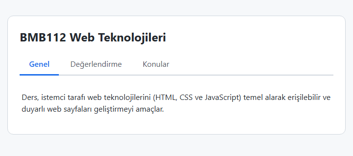

*Şekil 8.12. Uygulama 8.4'ün beklenen ekran görüntüsü.*

**Kendinizi sınayın:** (1) Bileşeni yalnızca klavyeyle (`Tab` ve ok tuşları) kullanmayı deneyiniz. (2) Seçili sekmenin adını URL'nin `#` kısmına yazarak (`location.hash`) sayfa yenilendiğinde aynı sekmenin açık gelmesini sağlayınız.

<details><summary>Örnek çözüm</summary>

Çözüm dosyası: [`codes/08-javascript-dom-olaylar/uygulama-8-4-sekmeler/index.html`](../codes/08-javascript-dom-olaylar/uygulama-8-4-sekmeler/index.html)

</details>

## 8.7 Formlarla Çalışma

[Bölüm 3](03-html-tablo-form-medya.md)'te formların HTML yapısı (`<form>`, `<label>`, `<input>` türleri, `required`, `min`, `max` gibi nitelikler) ele alınmıştı. Bu bölümde form verisinin JavaScript ile okunması, doğrulanması ve işlenmesi anlatılmaktadır [4, Bl. 14], [5, Bl. 6], [3, Bl. 13].

### 8.7.1 `submit` olayı ve `preventDefault`

Bir form, içindeki `type="submit"` düğmeye tıklanarak ya da bir metin kutusundayken `Enter` tuşuna basılarak gönderilir. Bu anda **form öğesinde** `submit` olayı gerçekleşir. Formun varsayılan davranışı verileri `action` niteliğindeki adrese göndermek ve sayfayı yeniden yüklemektir. Hesaplama gibi işlemlerin tarayıcıda yapılması isteniyorsa `preventDefault()` ile bu davranış engellenir:

```js
const form = document.querySelector("#notFormu");
form.addEventListener("submit", (olay) => {
  olay.preventDefault();
  // değerleri oku, doğrula, sonucu yaz
});
```

Dinleyicinin düğmenin `click` olayına değil, formun `submit` olayına bağlanması önemlidir: Böylece kullanıcı ister düğmeye tıklasın ister `Enter` tuşuna bassın, aynı kod çalışır. Formun JavaScript ile gönderilmesi gerektiğinde `form.requestSubmit()` yöntemi kullanılır; bu yöntem yerleşik doğrulamayı çalıştırır ve `submit` olayını tetikler. Eski `form.submit()` yöntemi ise ikisini de atlar.

> [!IMPORTANT]
> Form değerleri, bir olay gerçekleştiği anda (gönderme, yazma, seçme) okunmalıdır. Değerleri okuyan satırlar doğrudan betiğin en üstüne yazılırsa sayfa yüklenirken **bir kez** çalışır; o anda kullanıcı henüz bir şey yazmadığı için tüm değişkenler boş kalır.

### 8.7.2 `FormData` ile değerleri okuma

Her alanı tek tek `getElementById(...).value` ile okumak yerine `FormData` nesnesi kullanılabilir. `FormData`, formdaki `name` niteliği olan tüm etkin alanların değerlerini toplar:

```js
const veri = new FormData(form);
const vize = veri.get("vize");   // "75" (dize) — <input name="vize">
const ogrenim = veri.get("ogrenim"); // seçili radyo düğmesinin value değeri
```

`FormData`'nın iki özelliği akılda tutulmalıdır: `disabled` (pasif) alanlar ve işaretlenmemiş onay kutuları veriye **dâhil edilmez**; değerler her zaman **dize** olarak gelir. Ayrıca form öğeleri `form.elements.vize` biçiminde `name` değerleriyle de erişilebilir.

### 8.7.3 Sayıya çevirme ve doğrulama

Formdan gelen dize sayıya çevrilmeden aritmetik işlem yapılırsa beklenmedik sonuçlar oluşur: `"40" + 30` ifadesi `70` değil `"4030"` verir. Dönüşüm için `Number()` fonksiyonu kullanılır (ayrıntılar için bkz. [Bölüm 7](07-javascript-temelleri.md)). Dönüşüm sonrası üç durum denetlenmelidir:

1. **Boşluk:** `Number("")` sonucu `0`'dır. Bu nedenle boş alan, dönüşümden **önce** `metin.trim() === ""` ile ayrıca denetlenmelidir; aksi hâlde boş bırakılan not 0 kabul edilir.
2. **Sayı olmama:** `Number("abc")` sonucu `NaN`'dır. `NaN` kendisi dâhil hiçbir değere eşit olmadığından `x === NaN` karşılaştırması her zaman `false` verir; denetim `Number.isNaN(x)` (veya `isNaN(x)`) ile yapılır.
3. **Aralık:** Not gibi değerler için `x < 0 || x > 100` denetimi yapılır.

```js
function notOku(metin) {
  if (metin.trim() === "") return { hata: "Bu alan boş bırakılamaz." };
  const sayi = Number(metin);
  if (Number.isNaN(sayi)) return { hata: "Lütfen yalnızca sayı giriniz." };
  if (sayi < 0 || sayi > 100) return { hata: "Not 0 ile 100 arasında olmalıdır." };
  return { deger: sayi };
}
```

### 8.7.4 Yerleşik kısıt doğrulama API'si

HTML'in `required`, `min`, `max`, `step`, `pattern`, `type="email"` gibi nitelikleri, tarayıcının yerleşik **kısıt doğrulamasını** (constraint validation) çalıştırır. Bu doğrulamanın sonucu JavaScript'ten de okunabilir ve özelleştirilebilir [6]:

*Tablo 8.6. Kısıt doğrulama API'sinin temel üyeleri.*

| Üye | Açıklama |
| --- | --- |
| `form.checkValidity()` / `alan.checkValidity()` | Tüm kısıtlar sağlanıyorsa `true` döndürür; kullanıcıya bir şey göstermez. |
| `form.reportValidity()` | Denetler ve geçersiz alanlarda tarayıcının uyarı balonunu gösterir. |
| `alan.validity` | Ayrıntılı durum: `valueMissing`, `rangeUnderflow`, `rangeOverflow`, `typeMismatch`, `badInput` … |
| `alan.setCustomValidity(mesaj)` | Alanı özel bir mesajla geçersiz yapar; boş dize (`""`) verilince geçerli hâle döner. |
| `:invalid`, `:user-invalid` | Geçersiz alanları CSS ile biçimlendirmek için sözde sınıflar. |

Formun `novalidate` niteliği taşıması durumunda tarayıcı gönderimi kendisi durdurmaz; doğrulama tamamen JavaScript'e bırakılır. Uygulama 8.5 bu yaklaşımı kullanır: Mesajlar alanların altındaki paragraflara `textContent` ile yazılır, `setCustomValidity` ile alan geçersiz işaretlenir ve `aria-invalid` niteliğiyle durum yardımcı teknolojilere bildirilir. Pasif (`disabled`) alanların kısıt doğrulamasına hiç katılmadığı da unutulmamalıdır.

> [!WARNING]
> **İstemci doğrulaması sunucu doğrulamasının yerini tutmaz.** Tarayıcıda yapılan doğrulama yalnızca kullanıcıya hatasını anında göstermek içindir; güvenlik sağlamaz. Kullanıcı JavaScript'i kapatabilir, geliştirici araçlarıyla `max="100"` niteliğini silebilir ya da isteği tarayıcı kullanmadan doğrudan sunucuya gönderebilir. Aynı kontroller **sunucu tarafında mutlaka yeniden yapılmalıdır** [12]. Parola gibi hassas veri içeren formlar `method="post"` ile ve yalnızca HTTPS üzerinden gönderilmelidir.

Form gönderimindeki adımlar Şekil 8.13'te özetlenmiştir.

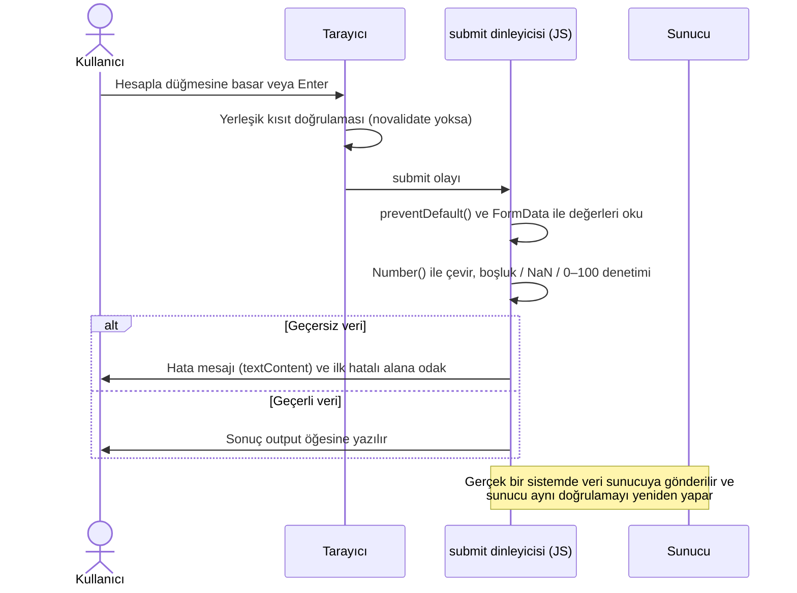

*Şekil 8.13. JavaScript ile işlenen bir formun gönderim akışı.*

### 8.7.5 Sonucu yazma: `<output>` öğesi

Hesaplama sonucunu göstermek için HTML'in `<output>` öğesi anlamsal olarak en uygun seçenektir. `for` niteliğiyle sonucun hangi alanlardan hesaplandığı belirtilir; içeriği `value` ya da `textContent` özelliğiyle yazılır. Sonucun ekran okuyucular tarafından duyurulması için kapsayıcıya `aria-live="polite"` eklenebilir.

```html
<p>Ortalama: <output id="ortalama" for="vize final"></output></p>
```

Ondalık sayıları göstermek için `toFixed(2)` yöntemi iki ondalık basamaklı bir **dize** üretir (`63` → `"63.00"`). Türkçe yazımda ondalık ayırıcı virgül olduğundan `Intl.NumberFormat("tr-TR", { minimumFractionDigits: 2, maximumFractionDigits: 2 })` tercih edilebilir (`"63,00"`).

### 8.7.6 Örnek: “Ödev var mı?” sorusuna göre alanları pasifleştirme

Eski ders notlarındaki bir örnekte, öğrencinin finalden en az kaç alması gerektiği hesaplanıyor ve “Ödev var mı?” sorusuna “Yok” yanıtı verildiğinde ödev notu alanlarının pasifleşmesi isteniyordu. Güncel yöntemle bu davranış, radyo düğmelerinin `change` olayı ve alanların `disabled` özelliğiyle sağlanır. `change` olayı kabardığı için iki radyo düğmesine ayrı ayrı değil, forma tek bir dinleyici eklemek yeterlidir:

*Kod 8.4. Ödev alanlarını koşula bağlı pasifleştirme (`ornek-8-4-final-hedefi/script.js`, kısaltılmış).*

```js
function odevAlanlariniAyarla() {
  const odevYok = form.elements.odevVar.value === "hayir"; // seçili radyo düğmesinin değeri
  odevAlani.disabled = odevYok;
  odevOraniAlani.disabled = odevYok;
}

form.addEventListener("change", (olay) => {
  if (olay.target.name === "odevVar") {
    odevAlanlariniAyarla();
  }
});
```

Pasif (`disabled`) alanlar hem kullanıcı tarafından düzenlenemez hem de `FormData`'ya ve kısıt doğrulamasına dâhil edilmez; bu nedenle boş kalan ödev notu bir hata üretmez. Hesaplamada ağırlıklı ortalamanın geçme sınırına eşit olduğu final notu bulunur:

```text
gerekli final = (60 − vize × vizeOranı − ödev × ödevOranı) / finalOranı
```

Vize ve ödev katkısı tek başına 60'a ulaşıyorsa hesaplanan değer sıfır ya da negatif çıkar; bu durumda 0 gösterilir ve finalden 0 alınsa da dersin geçileceği belirtilir. Değer 100'ü aşıyorsa öğrencinin bu notlarla dersi geçmesinin mümkün olmadığı bildirilir (Şekil 8.14). Bölmeden doğan kayan nokta artıkları (ör. `60.00000000000001`) yukarı yuvarlamayı bozmasın diye sonuç önce `toFixed(6)` ile sadeleştirilip sonra `Math.ceil` ile yuvarlanır.

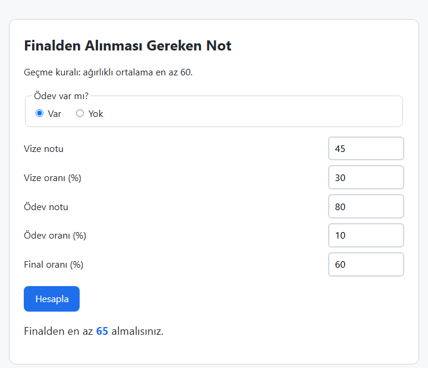

*Şekil 8.14. “Ödev var mı?” seçimine bağlı alan pasifleştirme örneği. Tam kod: [`ornek-8-4-final-hedefi`](../codes/08-javascript-dom-olaylar/ornek-8-4-final-hedefi/index.html).*

#### 🛠 Uygulama 8.5: Not Hesaplayıcı Formu

**Amaç:** `submit` olayı, `preventDefault`, sayı dönüşümü, aralık doğrulaması ve `<output>` ile tam bir not hesaplama formu geliştirmek.  
**Tahmini süre:** 20 dk

Hesaplama kuralı: **Ağırlıklı ortalama = vize × 0,4 + final × 0,6**. Öğrenci, **ortalama ≥ 60** ise “Geçti”, aksi hâlde “Kaldı” olarak değerlendirilir. Ortalama iki ondalık basamakla gösterilir.

1. `calismalar/bolum-08/not-hesaplayici/` klasöründe üç dosyayı oluşturunuz.
2. `novalidate` nitelikli bir `<form id="notFormu">` içine `vize` ve `final` adlı iki alan ekleyiniz: `type="number" min="0" max="100" step="0.01" required`. Her alanın `<label>` öğesi ve altında `aria-describedby` ile bağlanmış bir hata paragrafı (`<p id="vize-hata">`) bulunsun.
3. Sonuç bölümü olarak `hidden` nitelikli bir `<section id="sonucKutusu" aria-live="polite">` ekleyiniz; içinde ortalama, (isteğe bağlı) harf notu ve durum için üç `<output>` öğesi olsun.
4. `script.js` içinde Bölüm 8.7.3'teki gibi bir `notOku(alan)` fonksiyonu yazınız. Fonksiyon boşluk, sayı olmama ve 0–100 aralığını denetlesin; hata varsa mesajı `textContent` ile yazıp `alan.setCustomValidity(mesaj)` çağırsın ve `null` döndürsün.
5. Formun `submit` olayında `preventDefault()` çağırınız. Her iki not geçerliyse ortalamayı hesaplayınız: `Math.round((vize * 0.4 + final * 0.6) * 100) / 100`. Geçme durumunu `ortalama >= 60` koşuluyla belirleyiniz.
6. Ortalamayı `Intl.NumberFormat("tr-TR", { minimumFractionDigits: 2, maximumFractionDigits: 2 })` ile, durumu “Geçti”/“Kaldı” olarak yazınız; `classList.toggle` ile sonuç kutusuna `gecti` veya `kaldi` sınıfını ekleyiniz. Sonucun gerekçesini açıklayan bir cümle de yazınız (ör. “Ortalama 60'ın altındadır.”).
7. **İsteğe bağlı:** Bir onay kutusu işaretliyse harf notunu da gösteriniz (örnek ölçek: 90 AA, 85 BA, 80 BB, 75 CB, 70 CC, 65 DC, 60 DD, 50 FD, altı FF). Harf notu yalnızca ortalamaya göre belirlenir; 60'ın altındaki ortalamalara karşılık gelen FD ve FF başarısız notlardır ve “Kaldı” durumuyla örtüşür. Geçerli ölçek üniversitenin yönetmeliğinde belirlenir..
8. Geçme sınırının çevresini sınayınız: Vize 50, final 65 değerleriyle ortalama 59,00 olduğundan sonuç “Kaldı”, harf notu FD olmalıdır (Şekil 8.15). Ardından finali 66,67'ye yükseltiniz; ortalama 60,00'a ulaştığı için sonuç “Geçti”, harf notu DD olmalıdır.

**Beklenen çıktı:**

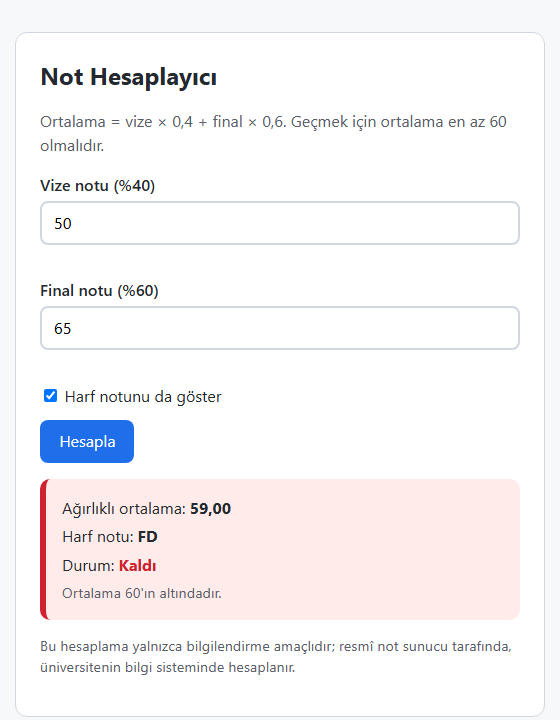

*Şekil 8.15. Uygulama 8.5'in beklenen ekran görüntüsü.*

**Kendinizi sınayın:** (1) Vize alanını boş bırakıp, ardından 120 yazıp “Hesapla” düğmesine basınız; iki farklı hata mesajı görmelisiniz. (2) Vize 40, final 73,34 için sonucun “Geçti” (ortalama 60,00) çıktığını doğrulayınız. (3) Geliştirici araçlarında `max="100"` niteliğini silip 150 girmeyi deneyiniz; JavaScript doğrulamanız yine çalışıyor mu? Sunucu doğrulaması neden gereklidir?

<details><summary>Örnek çözüm</summary>

Çözüm dosyası: [`codes/08-javascript-dom-olaylar/uygulama-8-5-not-hesaplayici/index.html`](../codes/08-javascript-dom-olaylar/uygulama-8-5-not-hesaplayici/index.html)

</details>

## 8.8 Tarih, Saat ve Zamanlayıcılar

### 8.8.1 `Date` nesnesi

JavaScript'in yerleşik `Date` nesnesi, 1 Ocak 1970 00:00:00 UTC'den bu yana geçen milisaniye sayısını tutan bir zaman değerini temsil eder [13], [14, Bl. 8].

```js
const simdi = new Date();                      // şu anki tarih ve saat
const yilBasi = new Date(2027, 0, 1);          // 1 Ocak 2027, yerel saatle 00:00 (ay 0'dan başlar!)
const sinav = new Date("2027-06-14T10:00");    // tarih + saat metni: yerel saat
const gunSonu = new Date("2027-06-14");        // yalnızca tarih metni: UTC 00:00 kabul edilir
```

> [!IMPORTANT]
> `Date` nesnesinde **aylar 0'dan başlar**: Ocak = 0, Şubat = 1, …, Aralık = 11. Günler (`getDate`) ise 1'den başlar. Ayrıca yalnızca tarih içeren ISO metni (`"2027-06-14"`) UTC gece yarısı olarak, saat içeren metin (`"2027-06-14T10:00"`) ise yerel saat olarak yorumlanır [13]. Türkiye UTC+3 diliminde olduğundan iki biçimin karıştırılması saat hesaplarında üç saatlik kaymalara yol açabilir. `<input type="date">` alanından gelen `"YYYY-AA-GG"` değeri bu nedenle parçalanarak `new Date(yil, ay - 1, gun)` biçiminde oluşturulmalıdır.

*Tablo 8.7. Sık kullanılan `Date` yöntemleri.*

| Yöntem | Döndürdüğü değer |
| --- | --- |
| `getFullYear()` | Yıl (ör. 2026) |
| `getMonth()` | Ay, **0–11** |
| `getDate()` | Ayın günü, 1–31 |
| `getDay()` | Haftanın günü, 0 (Pazar) – 6 (Cumartesi) |
| `getHours()`, `getMinutes()`, `getSeconds()` | Saat, dakika, saniye |
| `getTime()` / `Date.now()` | 1970'ten bu yana milisaniye |
| `setDate(g)`, `setMonth(a)`, `setFullYear(y)` | İlgili bileşeni değiştirir; taşmaları kendisi düzenler (ör. `setDate(32)` sonraki aya geçer) |
| `toLocaleDateString("tr-TR")` | `"2.11.2026"` |
| `toLocaleTimeString("tr-TR")` | `"15:19:43"` |
| `toISOString()` | `"2026-11-02T12:19:43.000Z"` (UTC) |

İki tarih arasındaki fark, tarihlerin birbirinden çıkarılmasıyla milisaniye cinsinden bulunur. Gün sayısına çevirmek için fark `1000 × 60 × 60 × 24` değerine bölünür. Yaz saati uygulanan ülkelerde bazı günler 23 ya da 25 saat sürdüğünden, takvim günü farkı hesaplanırken her iki tarihin de `Date.UTC(yil, ay, gun)` ile UTC gece yarısına çevrilmesi ve sonucun `Math.round` ile yuvarlanması güvenli bir yöntemdir.

**Yerel biçimlendirme: `Intl.DateTimeFormat`.** Eski kodlarda ay ve gün adları bir dizi içinde elle tutulurdu (`["Ocak", "Şubat", …]`). Güncel tarayıcılarda bu iş, uluslararasılaştırma (Intl) API'si ile yapılır [15]:

```js
const uzun = new Intl.DateTimeFormat("tr-TR", { dateStyle: "full" });
uzun.format(new Date(2026, 10, 2)); // "2 Kasım 2026 Pazartesi"

const saat = new Intl.DateTimeFormat("tr-TR", {
  hour: "2-digit", minute: "2-digit", second: "2-digit"
});
saat.format(new Date());            // "09:05:03" — sıfır doldurma kendiliğinden yapılır
```

Elle biçimlendirme gerektiğinde tek basamaklı sayılar `String(sayi).padStart(2, "0")` ifadesiyle iki basamağa tamamlanır.

### 8.8.2 `setTimeout` ve `setInterval`

`window` nesnesinin iki zamanlayıcı yöntemi, bir fonksiyonun ileride çalıştırılmasını sağlar [6], [1, s. 341]:

- `setTimeout(fonksiyon, ms)`: Fonksiyonu belirtilen süre geçtikten sonra **bir kez** çalıştırır.
- `setInterval(fonksiyon, ms)`: Fonksiyonu belirtilen aralıklarla **tekrar tekrar** çalıştırır.

Her iki yöntem de bir zamanlayıcı kimliği (sayı) döndürür. Bu kimlik `clearTimeout(kimlik)` ya da `clearInterval(kimlik)` fonksiyonuna verilerek zamanlayıcı iptal edilir.

```js
const bildirim = setTimeout(() => {
  ipucu.hidden = false;           // 3 saniye sonra ipucunu göster
}, 3000);

let kalan = 10;
const sayac = setInterval(() => {
  kalan--;
  ekran.textContent = kalan;
  if (kalan === 0) {
    clearInterval(sayac);         // sıfıra ulaşınca durdur
  }
}, 1000);
```

Zamanlayıcıların verilen süre için bir **alt sınır** belirttiği unutulmamalıdır: Süre dolduğunda dinleyici görev kuyruğuna eklenir ve olay döngüsü sırası geldiğinde çalıştırır (Şekil 8.5). O sırada başka bir kod çalışıyorsa bekleme uzar; tarayıcılar arka plandaki sekmelerde zamanlayıcıları ayrıca yavaşlatabilir. Bu nedenle bir geri sayım, “her saniye bir azalt” mantığıyla değil, her çalışmada **hedef zamandan şimdiki zaman çıkarılarak** hesaplanmalıdır; Uygulama 8.6 bu yöntemi kullanır.

> [!NOTE]
> **Tarihsel not:** Eski kodlarda `setTimeout("saatiGoster()", 1000)` gibi fonksiyon yerine kod **dizesi** veren kullanımlara rastlanır. Bu biçim, dizeyi `eval` benzeri bir yolla çalıştırdığı için güvenlik ve performans açısından önerilmez; her zaman fonksiyonun kendisi verilmelidir. Aynı şekilde kendini `setTimeout` ile yeniden çağıran bir saat fonksiyonu yerine `setInterval` kullanmak daha okunaklıdır.

### 8.8.3 Örnek: doğum günü hesaplayıcı

Eski notlardaki “doğum gününe kaç gün kaldı?” örneği, tarih hesaplarında yapılan tipik hataları göstermesi bakımından öğreticidir. Doğru çalışan bir sürüm şu noktalara dikkat etmelidir:

1. Bugünün tarihi **saatsiz** (gece 00:00) alınmalıdır. `new Date()` şu anki saati içerdiği için, doğum günü bugünse “bu yılki doğum günü geçti” sonucuna varılır ve yanlışlıkla yaklaşık 365 gün gösterilir.
2. `<input type="date">` değeri parçalanarak yerel tarihe çevrilmelidir (Bölüm 8.8.1).
3. 29 Şubat doğumlular için artık yıl olmayan yıllarda bir kural seçilmelidir. `new Date(2027, 1, 29)` ifadesi 1 Mart 2027 sonucunu verir; örnekte bu durumda 28 Şubat kabul edilmiştir.
4. Yaş, “bu yılki doğum günü geldi mi?” sorusuna göre hesaplanmalıdır; yalnızca yıl farkı almak doğum günü henüz gelmemiş kişiler için bir fazla yaş verir.

*Kod 8.5. Takvim günü farkı ve 29 Şubat kuralı (`ornek-8-5-dogum-gunu/script.js`, kısaltılmış).*

```js
function yildakiDogumGunu(yil, ay, gun) {
  if (ay === 1 && gun === 29 && !artikYilMi(yil)) {
    return new Date(yil, 1, 28);   // 29 Şubat → artık olmayan yıllarda 28 Şubat
  }
  return new Date(yil, ay, gun);
}

function gunFarki(baslangic, bitis) {
  const a = Date.UTC(baslangic.getFullYear(), baslangic.getMonth(), baslangic.getDate());
  const b = Date.UTC(bitis.getFullYear(), bitis.getMonth(), bitis.getDate());
  return Math.round((b - a) / (24 * 60 * 60 * 1000));
}

const simdi = new Date();
const bugun = new Date(simdi.getFullYear(), simdi.getMonth(), simdi.getDate()); // saatsiz
let sonraki = yildakiDogumGunu(bugun.getFullYear(), ay - 1, gun);
if (sonraki < bugun) {
  sonraki = yildakiDogumGunu(bugun.getFullYear() + 1, ay - 1, gun);
}
const kalanGun = gunFarki(bugun, sonraki); // doğum günü bugünse 0
```

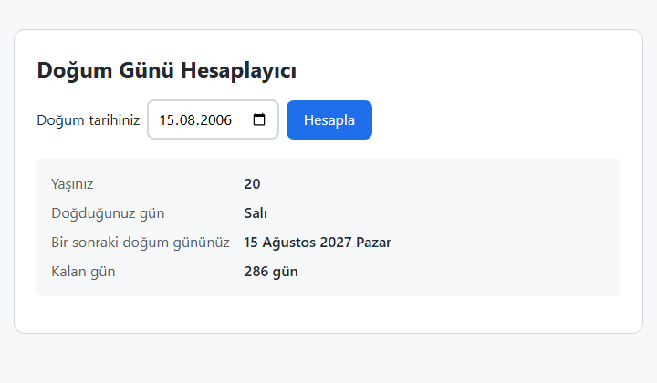

*Şekil 8.16. Doğum günü hesaplayıcı (2 Kasım 2026 tarihinde alınmış görüntü). Tam kod: [`ornek-8-5-dogum-gunu`](../codes/08-javascript-dom-olaylar/ornek-8-5-dogum-gunu/index.html).*

#### 🛠 Uygulama 8.6: Dijital Saat ve Final Sınavı Geri Sayımı

**Amaç:** `setInterval`, `clearInterval`, `Date` ve `Intl.DateTimeFormat` ile canlı güncellenen bir saat ve geri sayım yazmak.  
**Tahmini süre:** 20 dk

1. `calismalar/bolum-08/saat/` klasöründe üç dosyayı oluşturunuz.
2. HTML'de saat için `<p id="saat">`, tarih için `<p id="tarih">` ekleyiniz. Altına “Final Sınavına Kalan Süre” başlığı, `<input type="datetime-local" id="sinavZamani" value="2027-06-14T10:00">` ve gün/saat/dakika/saniye değerlerini gösterecek dört kutu yerleştiriniz.
3. `saatiGuncelle()` fonksiyonunda `Intl.DateTimeFormat("tr-TR", { hour: "2-digit", minute: "2-digit", second: "2-digit" })` ile saati, `{ dateStyle: "full" }` ile tarihi yazınız. Fonksiyonu önce bir kez çağırıp sonra `setInterval(saatiGuncelle, 1000)` ile her saniye çalıştırınız. (İlk çağrı yapılmazsa saat bir saniye boyunca boş görünür.)
4. `geriSayimiBaslat()` fonksiyonunda önceki zamanlayıcıyı `clearInterval` ile durdurunuz, `new Date(sinavGirdisi.value)` ile hedefi oluşturup `Number.isNaN(hedef.getTime())` ile geçerliliğini denetleyiniz.
5. Her saniye `hedef - Date.now()` farkını hesaplayıp gün (`86400` saniye), saat, dakika ve saniyeye ayırınız. Fark sıfır veya negatif olduğunda zamanlayıcıyı durdurup “Sınav zamanı geldi.” mesajını yazınız.
6. Tarih alanının `change` olayına `geriSayimiBaslat` fonksiyonunu bağlayınız. Sonucu Şekil 8.17 ile karşılaştırınız.

**Beklenen çıktı:**

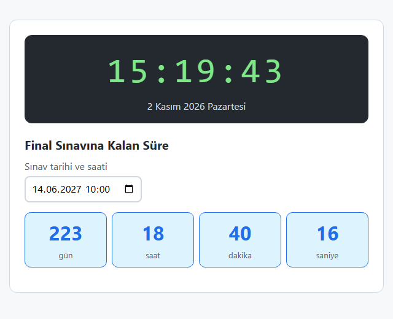

*Şekil 8.17. Uygulama 8.6'nın beklenen ekran görüntüsü (değerler çalıştırıldığı ana göre değişir).*

**Kendinizi sınayın:** (1) Saate, saat 12'den önce “Günaydın”, sonra “İyi günler” yazan bir selamlama satırı ekleyiniz. (2) Hedef tarihi geçmiş bir tarih seçtiğinizde zamanlayıcının gerçekten durduğunu geliştirici araçlarında bir `console.log` satırıyla doğrulayınız.

<details><summary>Örnek çözüm</summary>

Çözüm dosyası: [`codes/08-javascript-dom-olaylar/uygulama-8-6-saat-geri-sayim/index.html`](../codes/08-javascript-dom-olaylar/uygulama-8-6-saat-geri-sayim/index.html)

</details>

## 8.9 Tarayıcı Nesneleri (BOM)

Bu başlıkta Şekil 8.2'de gösterilen BOM nesneleri sırasıyla ele alınmaktadır [1, Bl. 14], [4, Bl. 8], [14, Bl. 9].

### 8.9.1 `window`: pencere boyutları ve iletişim kutuları

`window.innerWidth` ve `window.innerHeight` özellikleri tarayıcının görüntü alanının (viewport) piksel cinsinden boyutlarını verir; pencere boyutu değiştiğinde `window` üzerinde `resize` olayı gerçekleşir. Ancak sayfa düzenini ekran genişliğine göre değiştirmek için JavaScript yerine CSS ortam sorguları (media queries) kullanılır; bu konu [Bölüm 9](09-duyarli-tasarim.md)'da işlenmektedir. JavaScript'te bir ortam sorgusunun sonucu gerekiyorsa `window.matchMedia("(max-width: 600px)").matches` ifadesi kullanılabilir.

`window` nesnesinin üç basit iletişim kutusu (dialog) yöntemi vardır:

```js
alert("Kaydınız tamamlandı.");                         // yalnızca "Tamam" düğmesi
const onay = confirm("Bu dersi silmek istiyor musunuz?"); // Tamam → true, İptal → false
const ad = prompt("Adınız:", "Misafir");               // girilen metin; İptal → null
```

Bu kutular, kullanıcı yanıt verene kadar sayfadaki tüm JavaScript'i durdurur ve sayfayla etkileşimi engeller (modal). Görünümleri tarayıcıya göre değişir ve CSS ile biçimlendirilemez; ayrıca bazı tarayıcılar art arda açılan kutular için “bu sayfanın başka iletişim kutusu açmasını engelle” seçeneği sunar. Bu nedenlerle öğrenme ve hızlı deneme amaçlı kullanımlar dışında **sınırlı kullanılmaları** önerilir. Bilgi mesajları sayfa içinde bir öğeye `textContent` ile yazılmalı, onay gerektiren işlemler için HTML'in `<dialog>` öğesi (`dialog.showModal()`) tercih edilmelidir.

### 8.9.2 `location`: sayfanın adresi

`location` nesnesi, geçerli sayfanın URL'sini parçalarına ayrılmış olarak sunar ve başka bir sayfaya geçmeyi sağlar:

```js
// Adres: https://kargo.example.com/takip?kod=TR12345#gecmis
location.href;      // tam adres
location.protocol;  // "https:"
location.hostname;  // "kargo.example.com"
location.pathname;  // "/takip"
location.search;    // "?kod=TR12345"
location.hash;      // "#gecmis"

const kod = new URLSearchParams(location.search).get("kod"); // "TR12345"

location.href = "https://www.example.com/";     // yeni sayfaya git (Geri düğmesiyle dönülebilir)
location.replace("https://www.example.com/");   // geçmişe kayıt eklemeden git
location.reload();                              // sayfayı yenile
```

Kargo takip, arama sonuçları veya filtrelenmiş ürün listesi gibi sayfaların durumu çoğunlukla URL'nin sorgu dizgesinde (`?kod=…`) taşınır. Böylece bağlantı paylaşıldığında karşı taraf aynı sonucu görür. `URLSearchParams`, bu parametreleri elle bölmeye gerek kalmadan okumayı sağlar.

### 8.9.3 `history`: gezinme geçmişi

`history` nesnesi, tarayıcının Geri ve İleri düğmelerinin programla kullanılmasını sağlar: `history.back()`, `history.forward()` ve `history.go(-2)`. Güvenlik nedeniyle geçmişteki adreslerin listesi okunamaz; yalnızca kayıt sayısı (`history.length`) bilinir. Sayfayı yeniden yüklemeden adres çubuğunu değiştiren `history.pushState()` yöntemi ise tek sayfalık uygulamaların (single-page application) temelini oluşturur.

### 8.9.4 `navigator`: tarayıcı ve cihaz bilgileri

`navigator` nesnesi, tarayıcı ve çalıştığı ortam hakkında bilgi verir:

```js
navigator.language;   // "tr-TR" — tarayıcının arayüz dili
navigator.languages;  // ["tr-TR", "tr", "en-US", "en"] — tercih sırasıyla
navigator.onLine;     // true / false
window.addEventListener("offline", () => uyari.hidden = false); // bağlantı koptuğunda
```

**Özellik tespiti.** Eski kodlarda `navigator.userAgent` dizesine bakarak tarayıcının adı ve sürümü bulunmaya, buna göre farklı kod çalıştırılmaya çalışılırdı. Bu yöntem güvenilir değildir: Kullanıcı aracısı dizeleri birbirini taklit eder (ör. Edge ve Opera'nın dizesinde “Chrome” sözcüğü geçer), kullanıcılar tarafından değiştirilebilir ve tarayıcılar gizlilik gerekçesiyle bu dizeyi giderek sadeleştirmektedir [4, Bl. 9]. Doğru yaklaşım, tarayıcının **adına** değil, kullanılmak istenen **özelliğin varlığına** bakmaktır (feature detection):

```js
if ("geolocation" in navigator) {
  // konum özelliği var; kullanılabilir
} else {
  // alternatif yol: kullanıcıdan şehir seçmesini iste
}
```

**İzin isteyen özellikler.** Konum, pano, kamera ve bildirim gibi kişisel veriye dokunan özellikler, tarayıcının **izin modeline** tabidir. Bu özellikler yalnızca güvenli bağlamda (HTTPS veya `localhost`) çalışır ve ilk kullanımda tarayıcı kullanıcıya izin sorar:

```js
// Konum: kullanıcı izin verirse geri çağırma fonksiyonu çalışır
navigator.geolocation.getCurrentPosition(
  (konum) => console.log(konum.coords.latitude, konum.coords.longitude),
  (hata) => console.log("Konum alınamadı:", hata.message)
);

// Pano: Promise döndürür (bkz. Bölüm 8.10)
await navigator.clipboard.writeText("TR12345");
```

Harita ve hava durumu uygulamalarının “Konumumu kullan” düğmesi bu modelle çalışır; kullanıcı izni reddederse uygulama elle şehir seçimi gibi bir alternatif sunmalıdır. İzin istekleri, sayfa açılır açılmaz değil, kullanıcı ilgili düğmeye bastığında yapılmalıdır.

### 8.9.5 `screen`

`screen` nesnesi, sayfanın değil cihaz ekranının boyutlarını verir (`screen.width`, `screen.height`, `screen.availWidth`). Tarayıcı penceresi ekranı kaplamak zorunda olmadığından tasarım kararları için `screen` yerine görüntü alanı (`innerWidth`) ve CSS ortam sorguları esas alınmalıdır. Bu bölümde görülen `navigator`, `window`, `screen`, `location` ve `history` bilgilerini bir arada gösteren örnek panel Şekil 8.18'dedir; panel tüm bilgileri `createElement` ve `textContent` ile yazmaktadır.


*Şekil 8.18. Tarayıcı bilgi paneli örneği. Tam kod: [`ornek-8-6-tarayici-bilgileri`](../codes/08-javascript-dom-olaylar/ornek-8-6-tarayici-bilgileri/index.html).*

### 8.9.6 `localStorage` ve `sessionStorage`

Web depolama (Web Storage) API'si, tarayıcıda küçük miktarda veriyi **anahtar–değer** çiftleri olarak saklamayı sağlar [6], [16]. İki türü vardır:

- **`localStorage`:** Veri, tarayıcı kapatılıp açılsa bile kalıcıdır; kullanıcı tarayıcı verilerini temizleyene kadar korunur.
- **`sessionStorage`:** Veri yalnızca o sekme açık kaldığı sürece yaşar; sekme kapanınca silinir.

```js
localStorage.setItem("tema", "koyu");     // yaz
const tema = localStorage.getItem("tema"); // oku → "koyu" (yoksa null)
localStorage.removeItem("tema");           // sil

// Yalnızca dize saklanır; nesne ve diziler JSON'a çevrilir
const isler = ["Bölüm 8'i oku", "Uygulama 8.3"];
localStorage.setItem("isler", JSON.stringify(isler));
const geriOkunan = JSON.parse(localStorage.getItem("isler") ?? "[]");
```

Depolama **köken** (origin: protokol + alan adı + bağlantı noktası) bazında ayrıdır; bir sitenin kaydettiği veriyi başka bir site okuyamaz. Kapasite tarayıcıya göre değişmekle birlikte birkaç megabaytla sınırlıdır. Gizli pencerede veya site verilerinin engellendiği durumlarda `localStorage` erişimi hata verebileceği için okuma ve yazma işlemleri `try...catch` içine alınmalıdır.

> [!WARNING]
> `localStorage` şifrelenmez ve sayfadaki **her** betik tarafından okunabilir. Bir XSS açığı (Bölüm 8.4.1) varsa saldırganın betiği de bu veriye ulaşır. Bu nedenle parola, kimlik doğrulama belirteci (token), kimlik numarası gibi hassas veriler `localStorage`'da saklanmamalıdır. Tema tercihi, dil seçimi, yarım kalmış bir form taslağı gibi hassas olmayan tercihler için uygundur.

#### 🛠 Uygulama 8.7: Tema Değiştirici

**Amaç:** `classList`, CSS özel özellikleri ve `localStorage` ile kalıcı bir açık/koyu tema seçeneği oluşturmak.  
**Tahmini süre:** 15 dk

1. `calismalar/bolum-08/tema/` klasöründe üç dosyayı oluşturunuz. Sayfaya bir üst bant, içinde `aria-pressed="false"` nitelikli bir “Koyu temaya geç” düğmesi ve birkaç duyuru kartı ekleyiniz.
2. `style.css` içinde renkleri `:root` üzerinde özel özellikler olarak tanımlayınız (`--zemin`, `--yuzey`, `--metin`, `--vurgu` …) ve tüm kurallarda `var(--zemin)` gibi kullanınız (bkz. [Bölüm 5](05-css-metin-renk-arka-plan.md)). `:root.koyu` seçicisinde aynı özelliklere koyu renk değerleri veriniz.
3. `script.js` içinde `temayiUygula(koyuMu)` fonksiyonunu yazınız: `document.documentElement.classList.toggle("koyu", koyuMu)` çağırsın, düğmenin `aria-pressed` niteliğini ve metnini güncellesin.
4. `localStorage` okuma ve yazma işlemlerini `try...catch` içeren iki küçük fonksiyonla yapınız (anahtar: `"bmb112-tema"`).
5. Sayfa açılışında kayıtlı tercih varsa onu, yoksa `matchMedia("(prefers-color-scheme: dark)").matches` ile işletim sisteminin tercihini uygulayınız.
6. Düğmeye tıklandığında temayı tersine çevirip yeni tercihi kaydediniz. Sayfayı yenileyerek tercihin korunduğunu doğrulayınız ve sonucu Şekil 8.19 ile karşılaştırınız.

**Beklenen çıktı:**

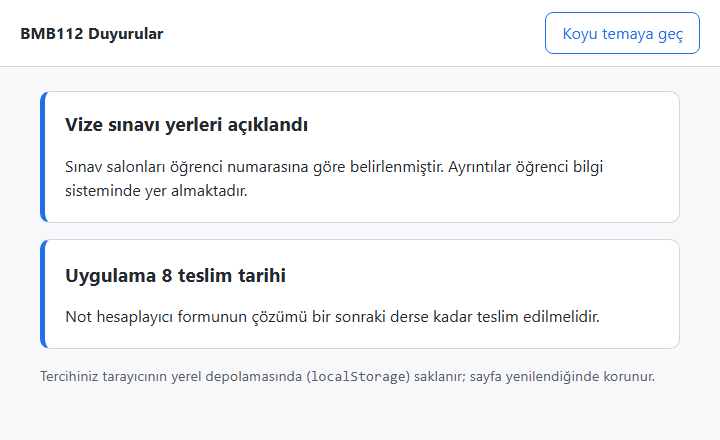

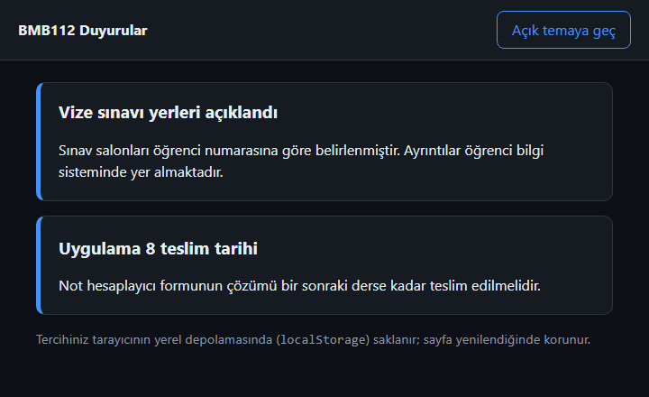

*Şekil 8.19. Uygulama 8.7'nin beklenen ekran görüntüleri: (a) açık tema, (b) koyu tema.*

**Kendinizi sınayın:** (1) Tercihi `sessionStorage`'a kaydedip sekmeyi kapatıp açtığınızda ne olduğunu gözlemleyiniz. (2) Geliştirici araçlarında *Application → Local Storage* bölümünden kaydedilen değeri bulunuz ve elle silerek sayfayı yenileyiniz.

<details><summary>Örnek çözüm</summary>

Çözüm dosyası: [`codes/08-javascript-dom-olaylar/uygulama-8-7-tema/index.html`](../codes/08-javascript-dom-olaylar/uygulama-8-7-tema/index.html)

</details>

*Tablo 8.8. BOM nesnelerinin özeti.*

| İhtiyaç | Nesne | Örnek |
| --- | --- | --- |
| Görüntü alanı boyutu, zamanlayıcı | `window` | `innerWidth`, `setTimeout()`, `matchMedia()` |
| Basit iletişim kutusu (sınırlı kullanım) | `window` | `alert()`, `confirm()`, `prompt()` |
| Adresi okuma, yönlendirme | `location` | `href`, `search`, `replace()`, `reload()` |
| Geri / ileri gitme | `history` | `back()`, `forward()`, `go()` |
| Dil, bağlantı, izinli özellikler | `navigator` | `language`, `onLine`, `geolocation`, `clipboard` |
| Cihaz ekranı | `screen` | `width`, `height` |
| Tarayıcıda küçük veri saklama | `localStorage`, `sessionStorage` | `setItem()`, `getItem()` |

## 8.10 Ağ İstekleri: `fetch`, `async/await` ve JSON

### 8.10.1 Sayfayı yenilemeden veri almak

Bir hava durumu uygulaması yalnızca sıcaklık değerlerini, bir e-ticaret sitesi yalnızca “daha fazla ürün” listesini, bir kargo takip sayfası yalnızca gönderinin son durumunu sunucudan ister; sayfanın tamamı yeniden yüklenmez. Bu verinin taşınmasında en yaygın biçim **JSON**'dur (JavaScript Object Notation): JavaScript nesne ve dizi yazımına benzeyen, insan tarafından okunabilir bir metin biçimidir (bkz. [Bölüm 7](07-javascript-temelleri.md)).

Güncel tarayıcılarda ağ istekleri, WHATWG *Fetch Standard* belgesinde tanımlanan `fetch()` fonksiyonuyla yapılır [17]. `fetch`, isteği başlatır ve hemen bir **`Promise`** (söz) döndürür; yanıt geldiğinde söz yerine getirilir. Bu sırada olay döngüsü çalışmaya devam ettiği için sayfa donmaz. Sözün sonucunu beklemek için **`async/await`** sözdizimi kullanılır: `async` ile işaretlenmiş bir fonksiyon içinde `await` yazılan satır, söz yerine gelene kadar fonksiyonun devamını bekletir; ancak tarayıcının geri kalanını engellemez [13], [14, s. 353].

*Kod 8.6. `fetch` ile yerel bir JSON dosyasını okuma (`uygulama-8-8-urun-kartlari/script.js`, kısaltılmış).*

```js
async function urunleriYukle() {
  try {
    const yanit = await fetch("veri.json");    // 1) isteği gönder, yanıtı bekle
    if (!yanit.ok) {                            // 2) HTTP durum kodunu denetle (ör. 404)
      throw new Error(`Sunucu yanıtı: ${yanit.status}`);
    }
    const urunler = await yanit.json();         // 3) gövdeyi JSON olarak çözümle
    urunAlani.replaceChildren(...urunler.map(kartOlustur)); // 4) DOM'u güncelle
  } catch (hata) {
    durum.textContent = `Ürünler yüklenemedi (${hata.message}).`;
  }
}
```

Bu kodda iki ayrıntı önemlidir. Birincisi, `fetch` yalnızca ağ hatasında (sunucuya hiç ulaşılamazsa) hata fırlatır; sunucunun `404 Not Found` ya da `500` gibi bir hata koduyla yanıt vermesi `fetch` açısından başarılı bir yanıttır. Bu nedenle `yanit.ok` özelliği (durum kodu 200–299 aralığında mı?) ayrıca denetlenmelidir [18]. İkincisi, sunucudan gelen veri de güvenilmeyen veri sayılır ve sayfaya `textContent`/`createElement` ile yazılır. İstek–yanıt akışı Şekil 8.20'de gösterilmiştir.

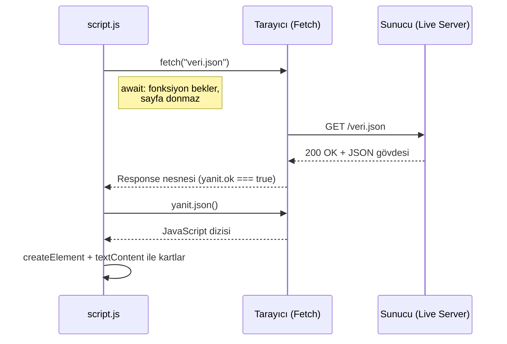

*Şekil 8.20. `fetch` ve `async/await` ile JSON verisi okuma akışı.*

> [!IMPORTANT]
> `fetch` ile çalışan sayfalar **bir web sunucusu üzerinden** açılmalıdır. `index.html` dosyası Dosya Gezgini'nden çift tıklanarak `file://` protokolüyle açılırsa, tarayıcılar güvenlik gereği yerel dosyalara yapılan istekleri engeller; Chrome'un konsolunda “*... has been blocked by CORS policy: Cross origin requests are only supported for protocol schemes: http, ...*” biçiminde bir CORS (Cross-Origin Resource Sharing) hatası görülür ve `fetch` “Failed to fetch” hatasıyla sonuçlanır (Şekil 8.22). VS Code'da **Live Server** eklentisi sayfayı `http://127.0.0.1:5500` gibi bir adresten sunarak bu sorunu ortadan kaldırır.

#### 🛠 Uygulama 8.8: `fetch` ile JSON'dan Ürün Kartları

**Amaç:** Yerel bir JSON dosyasını `fetch` ve `async/await` ile okuyup DOM'da ürün kartları oluşturmak.  
**Tahmini süre:** 20 dk

1. `calismalar/bolum-08/urunler/` klasöründe `index.html`, `style.css`, `script.js` ve `veri.json` dosyalarını oluşturunuz.
2. `veri.json` dosyasına `id`, `ad`, `kategori`, `fiyat` ve `stok` alanlarına sahip 5–6 ürün içeren bir dizi yazınız. JSON'da anahtarların ve dizelerin **çift tırnak** içinde yazılması, son öğeden sonra virgül konmaması gerektiğini unutmayınız.
3. HTML'e bir kategori seçimi (`<select id="kategori" disabled>` içinde “Tümü” seçeneği), durum mesajı için `<p id="durum" aria-live="polite">Ürünler yükleniyor…</p>` ve kartlar için boş bir `<div id="urunler">` ekleyiniz.
4. `kartOlustur(urun)` fonksiyonunu yazınız: `<article>` içinde kategori etiketi, `<h2>` ürün adı, fiyat ve stok durumu oluştursun; tüm metinler `textContent` ile yazılsın. Fiyatı `Intl.NumberFormat("tr-TR", { style: "currency", currency: "TRY" })` ile biçimlendiriniz.
5. Kod 8.6'daki gibi `async function urunleriYukle()` yazınız; veri geldikten sonra kategorileri `new Set(...)` ile tekilleştirip `new Option(ad, ad)` ile seçim listesine ekleyiniz ve listeyi etkinleştiriniz.
6. Seçim listesinin `change` olayında ürünleri `filter` ile süzüp yeniden çiziniz.
7. Sayfayı önce **Live Server** ile açınız (Şekil 8.21), ardından `index.html` dosyasını doğrudan çift tıklayarak açıp hata mesajını gözlemleyiniz (Şekil 8.22).

**Beklenen çıktı:**

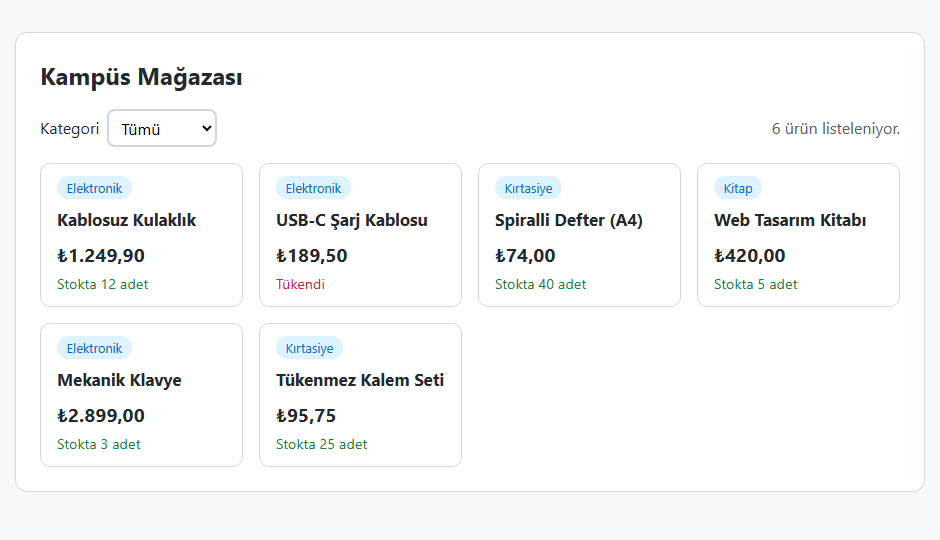

*Şekil 8.21. Uygulama 8.8'in Live Server ile açıldığında beklenen ekran görüntüsü.*

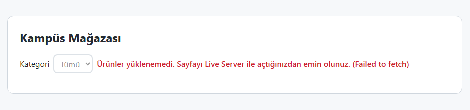

*Şekil 8.22. Sayfa `file://` ile açıldığında `fetch` isteğinin engellenmesi.*

**Kendinizi sınayın:** (1) `fetch("veri.json")` satırındaki dosya adını bilerek yanlış yazınız; `yanit.ok` denetimi sayesinde hangi mesajı gördüğünüzü inceleyiniz. (2) Geliştirici araçlarının *Network* sekmesinde `veri.json` isteğini bulup durum kodunu ve yanıt gövdesini inceleyiniz.

<details><summary>Örnek çözüm</summary>

Çözüm dosyası: [`codes/08-javascript-dom-olaylar/uygulama-8-8-urun-kartlari/index.html`](../codes/08-javascript-dom-olaylar/uygulama-8-8-urun-kartlari/index.html)

</details>

### 8.10.2 Tarihsel not: AJAX ve XMLHttpRequest

> [!NOTE]
> **Tarihsel not:** Sayfayı yenilemeden sunucuyla veri alışverişi yapma tekniği, 2005 yılında Jesse James Garrett'ın yazdığı bir makaleyle **Ajax** (Asynchronous JavaScript and XML) adını almıştır. Tekniği mümkün kılan `XMLHttpRequest` (XHR) nesnesi ilk olarak Microsoft tarafından geliştirilmiş, ardından diğer tarayıcılar tarafından da uygulanmıştır [4, s. 701], [5, Bl. 11]. Adında XML geçmesine karşın Ajax veri biçiminden bağımsızdır ve günümüzde XML yerine çoğunlukla JSON kullanılır. XHR'nin olay ve geri çağırma (callback) tabanlı arayüzü kullanımı zor olduğundan uzun yıllar jQuery'nin `$.ajax()` gibi yardımcı fonksiyonları tercih edilmiştir. Bugün aynı iş, `Promise` tabanlı `fetch()` ve ES2017 ile dile eklenen `async/await` ile yapılmaktadır.

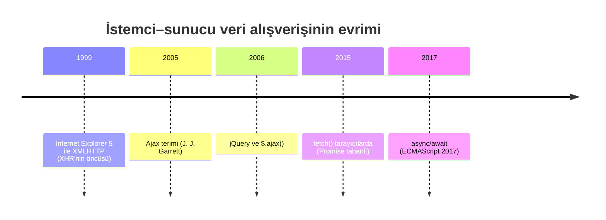

*Şekil 8.23. Sayfayı yenilemeden veri almanın tarihsel gelişimi.*

### 8.10.3 Tarihsel not: jQuery

> [!NOTE]
> **Tarihsel not:** 2006'da yayımlanan **jQuery** kütüphanesi, uzun yıllar istemci tarafı JavaScript'in fiilî standardı olmuştur. O dönemde tarayıcıların DOM ve olay arayüzleri birbirinden farklıydı (ör. Internet Explorer 8 ve öncesi `addEventListener` yerine `attachEvent` kullanıyordu) ve CSS seçicileriyle öğe seçen yerel bir yöntem yoktu. jQuery, `$()` fonksiyonuyla CSS seçicisine göre öğe seçmeyi, zincirleme yöntem çağrılarını ve tüm tarayıcılarda aynı biçimde çalışan olay ve Ajax yardımcılarını sunarak bu farkları gizledi [1, Bl. 19], [3, Bl. 7]. Bu bölümde anlatılan `querySelector`, `classList`, `addEventListener` ve `fetch` gibi yerel API'ler büyük ölçüde jQuery'nin yaygınlaştırdığı fikirlerin standartlaşmış hâlidir. Güncel tarayıcıların hepsi bu API'leri desteklediği için yeni projelerde yalnızca bu işler için jQuery eklenmesine gerek yoktur; ancak eski projelerin bakımında jQuery kodu ile karşılaşılması olasıdır.

*Tablo 8.9. Sık kullanılan jQuery ifadeleri ve yerel DOM karşılıkları.*

| jQuery | Yerel JavaScript |
| --- | --- |
| `$("#x")` | `document.querySelector("#x")` |
| `$(".kart")` | `document.querySelectorAll(".kart")` |
| `$(oge).text("Merhaba")` | `oge.textContent = "Merhaba"` |
| `$(oge).addClass("aktif")` | `oge.classList.add("aktif")` |
| `$(oge).toggleClass("aktif")` | `oge.classList.toggle("aktif")` |
| `$(oge).attr("href", url)` | `oge.setAttribute("href", url)` |
| `$(oge).on("click", f)` | `oge.addEventListener("click", f)` |
| `$(liste).on("click", "li", f)` | `liste.addEventListener("click", (e) => { if (e.target.closest("li")) f(e); })` |
| `$(oge).hide()` / `.show()` | `oge.hidden = true` / `false` |
| `$(document).ready(f)` | `<script defer>` veya `DOMContentLoaded` |
| `$.ajax({ url: "veri.json" })` | `await fetch("veri.json")` |

## 8.11 Bölüm Özeti

- **DOM**, tarayıcının HTML belgesinden bellekte oluşturduğu nesne ağacı ve bu ağaca erişim arayüzüdür; güncel tanımı WHATWG DOM standardındadır. Ağaç belge, öğe ve metin düğümlerinden oluşur; nitelikler öğelere bağlıdır. `window` küresel nesnesi altında DOM (`document`) ve tarayıcıya ilişkin BOM nesneleri (`navigator`, `location`, `history`, `screen`, `localStorage`) bulunur.
- Öğeler `getElementById`, `querySelector` ve `querySelectorAll` ile seçilir. `querySelectorAll` durağan bir `NodeList`, eski `getElementsBy…` yöntemleri ise canlı bir `HTMLCollection` döndürür.
- İçerik `textContent`, form değerleri `value`/`checked`, nitelikler `setAttribute` ve `dataset`, görünüm ise CSS'te tanımlı sınıfların `classList` ile eklenip çıkarılmasıyla değiştirilir. **Kullanıcı verisi asla `innerHTML` ile yazılmaz**; aksi hâlde XSS saldırısına kapı açılır.
- Yeni öğeler `createElement` ile oluşturulup `append`, `prepend`, `before`, `after` ile eklenir, `remove` ile silinir. Tekrarlayan yapılar için `<template>` kullanılabilir.
- Tarayıcı JavaScript'i **olay güdümlüdür**; olaylar görev kuyruğuna alınır ve olay döngüsü tarafından sırayla işlenir. Dinleyiciler `addEventListener(tür, dinleyici, seçenekler)` ile eklenir; üçüncü parametre tarihsel `useCapture` mantıksal değeri ya da `{ capture, once, passive }` seçenek nesnesidir. `removeEventListener` aynı fonksiyon referansını gerektirir.
- Olay nesnesi `type`, `target`, `currentTarget`, `key` gibi bilgileri ve `preventDefault()`, `stopPropagation()` yöntemlerini sunar. Olaylar **yakalama → hedef → kabarma** aşamalarında yayılır; kabarma sayesinde **olay delegasyonu** ile tek dinleyici çok sayıda öğeyi yönetebilir.
- Formlarda `submit` olayı dinlenir, `preventDefault()` ile sayfa yenilemesi engellenir, değerler `FormData` ile okunup `Number()` ile çevrilir; boşluk, `NaN` ve aralık denetimi yapılır. Not hesaplayıcı örneğinde **ortalama = vize × 0,4 + final × 0,6** ve **ortalama ≥ 60 ise “Geçti”** kuralı uygulanmıştır. İstemci doğrulaması sunucu doğrulamasının yerini tutmaz.
- `Date` nesnesinde aylar 0'dan başlar; yerel biçimlendirme için `Intl.DateTimeFormat` kullanılır. `setTimeout` bir kez, `setInterval` tekrar tekrar çalışır; `clearTimeout`/`clearInterval` ile durdurulur.
- `fetch` + `async/await` ile sayfa yenilenmeden JSON verisi alınabilir; `yanit.ok` denetlenmeli ve sayfa bir web sunucusu (Live Server) üzerinden açılmalıdır. Satır içi `onclick`, `keypress`, `document.write`, kullanıcı aracısıyla tarayıcı tespiti ve jQuery tarihsel yaklaşımlardır.

## 8.12 Değerlendirme Soruları

1. DOM'un “canlı” olması ne anlama gelir? Tarayıcının “Sayfa kaynağını görüntüle” komutu ile geliştirici araçlarının *Elements* sekmesi neden farklı içerik gösterebilir?
2. DOM ile BOM arasındaki farkı birer örnek nesneyle açıklayınız. `alert()` fonksiyonu neden `window.` öneki olmadan çağrılabilir?
3. `querySelectorAll(".kart")` ile `getElementsByClassName("kart")` arasındaki fark nedir? Sayfaya sonradan yeni bir `.kart` öğesi eklendiğinde iki sonuç nasıl davranır?
4. Bir yorum kutusuna yazılan metnin `kutu.innerHTML = yorum;` ile sayfaya eklenmesi hangi saldırıya yol açar? Saldırının nasıl gerçekleştiğini ve güvenli alternatifi açıklayınız.
5. Aşağıdaki kod çalıştırıldığında düğmeye tıklanınca konsolda ne görülür? Neden?
   ```js
   function selam() { console.log("Merhaba"); }
   dugme.addEventListener("click", selam());
   ```
6. Aşağıdaki `removeEventListener` çağrısı neden dinleyiciyi kaldırmaz? Kodu düzeltiniz.
   ```js
   kutu.addEventListener("click", () => kutu.classList.toggle("acik"));
   kutu.removeEventListener("click", () => kutu.classList.toggle("acik"));
   ```
7. `<div id="dis"><button id="ic">Tıkla</button></div>` yapısında her iki öğeye de varsayılan seçeneklerle `click` dinleyicisi eklenmiştir. Düğmeye tıklandığında dinleyiciler hangi sırayla çalışır? `dis` öğesinin dinleyicisi `{ capture: true }` ile eklenseydi sıra nasıl değişirdi? `event.target` ve `event.currentTarget` her durumda neyi gösterir?
8. Olay delegasyonu nedir? 500 satırlık bir tabloda her satırdaki “Sil” düğmesine ayrı dinleyici eklemek yerine delegasyonun tercih edilmesinin iki yararını yazınız.
9. Bir not alanı boş bırakıldığında `Number(alan.value)` hangi değeri verir? Bu durum not hesaplamasında nasıl bir hataya yol açar ve nasıl önlenir?
10. Vize 70 ve final 48 olan bir öğrencinin ağırlıklı ortalamasını hesaplayınız (vize %40, final %60). Bu bölümdeki geçme kuralına göre öğrenci geçer mi? Kuralı ifade eden JavaScript koşulunu yazınız.
11. `new Date(2027, 1, 30)` ifadesi hangi tarihi üretir? `getMonth()` yönteminin döndürdüğü değere neden 1 eklenerek gösterilir?
12. `fetch("veri.json")` içeren bir sayfa `file://` ile açıldığında neden çalışmaz? Sunucu `404` yanıtı döndürdüğünde `fetch` hata fırlatır mı; kodda bu durum nasıl denetlenir?

## Kaynaklar

[1] D. Flanagan, *JavaScript: The Definitive Guide*, 6th ed. Sebastopol, CA, USA: O'Reilly Media, 2011.

[2] WHATWG, "DOM Living Standard." [Çevrimiçi]. Erişim: https://dom.spec.whatwg.org/ (Erişim tarihi: 2 Kasım 2026).

[3] J. Duckett, *JavaScript and JQuery: Interactive Front-End Web Development*. Indianapolis, IN, USA: Wiley, 2014.

[4] N. C. Zakas, *Professional JavaScript for Web Developers*, 3rd ed. Indianapolis, IN, USA: Wiley, 2012.

[5] S. Vodnik and D. Gosselin, *JavaScript: The Web Warrior Series*, 6th ed. Boston, MA, USA: Cengage Learning, 2015.

[6] WHATWG, "HTML Living Standard." [Çevrimiçi]. Erişim: https://html.spec.whatwg.org/ (Erişim tarihi: 2 Kasım 2026).

[7] OWASP Foundation, "Cross Site Scripting Prevention Cheat Sheet," *OWASP Cheat Sheet Series*. [Çevrimiçi]. Erişim: https://cheatsheetseries.owasp.org/cheatsheets/Cross_Site_Scripting_Prevention_Cheat_Sheet.html (Erişim tarihi: 2 Kasım 2026).

[8] Mozilla, "EventTarget: addEventListener() method," *MDN Web Docs*. [Çevrimiçi]. Erişim: https://developer.mozilla.org/en-US/docs/Web/API/EventTarget/addEventListener (Erişim tarihi: 2 Kasım 2026).

[9] Mozilla, "Pointer events," *MDN Web Docs*. [Çevrimiçi]. Erişim: https://developer.mozilla.org/en-US/docs/Web/API/Pointer_events (Erişim tarihi: 2 Kasım 2026).

[10] Mozilla, "Element: keypress event," *MDN Web Docs*. [Çevrimiçi]. Erişim: https://developer.mozilla.org/en-US/docs/Web/API/Element/keypress_event (Erişim tarihi: 2 Kasım 2026).

[11] W3C Web Accessibility Initiative, "Tabs Pattern," *ARIA Authoring Practices Guide (APG)*. [Çevrimiçi]. Erişim: https://www.w3.org/WAI/ARIA/apg/patterns/tabs/ (Erişim tarihi: 2 Kasım 2026).

[12] OWASP Foundation, "Input Validation Cheat Sheet," *OWASP Cheat Sheet Series*. [Çevrimiçi]. Erişim: https://cheatsheetseries.owasp.org/cheatsheets/Input_Validation_Cheat_Sheet.html (Erişim tarihi: 2 Kasım 2026).

[13] Ecma International, *ECMAScript® 2026 Language Specification* (ECMA-262, 17th ed.), Jun. 2026. [Çevrimiçi]. Erişim: https://262.ecma-international.org/17.0/ (Erişim tarihi: 2 Kasım 2026).

[14] L. L. Svekis, M. van Putten, and R. Percival, *JavaScript from Beginner to Professional*. Birmingham, U.K.: Packt Publishing, 2021.

[15] Mozilla, "Intl.DateTimeFormat," *MDN Web Docs*. [Çevrimiçi]. Erişim: https://developer.mozilla.org/en-US/docs/Web/JavaScript/Reference/Global_Objects/Intl/DateTimeFormat (Erişim tarihi: 2 Kasım 2026).

[16] Mozilla, "Window: localStorage property," *MDN Web Docs*. [Çevrimiçi]. Erişim: https://developer.mozilla.org/en-US/docs/Web/API/Window/localStorage (Erişim tarihi: 2 Kasım 2026).

[17] WHATWG, "Fetch Living Standard." [Çevrimiçi]. Erişim: https://fetch.spec.whatwg.org/ (Erişim tarihi: 2 Kasım 2026).

[18] Mozilla, "Using the Fetch API," *MDN Web Docs*. [Çevrimiçi]. Erişim: https://developer.mozilla.org/en-US/docs/Web/API/Fetch_API/Using_Fetch (Erişim tarihi: 2 Kasım 2026).

---

[← Önceki bölüm](07-javascript-temelleri.md) · [İçindekiler](../README.md) · [Sonraki bölüm →](09-duyarli-tasarim.md)
