# Bölüm 9: Duyarlı Web Tasarımı ve Geliştirici Araçları

[← Önceki bölüm](08-javascript-dom-olaylar.md) · [İçindekiler](../README.md)

> **Öğrenme Hedefleri** — Bu bölümü tamamlayan öğrenci:
>
> 1. Duyarlı web tasarımının üç temel bileşenini (akışkan ızgara, esnek görseller, medya sorguları) ve mobil öncelikli yaklaşımın gerekçesini açıklar.
> 2. Görünüm alanı (viewport) meta etiketinin her parçasının anlamını açıklar; CSS pikseli ile cihaz pikseli arasındaki ilişkiyi cihaz piksel oranı (DPR) üzerinden hesaplar.
> 3. Yüzde, `vw`/`dvh` birimleri ve `clamp()` fonksiyonuyla akışkan düzen ve akışkan tipografi oluşturur.
> 4. `min-width` tabanlı kırılma noktalarıyla mobil öncelikli medya sorguları ve kullanıcı tercihlerine (koyu tema, azaltılmış hareket) duyarlı stiller yazar.
> 5. `srcset`/`sizes`, `<picture>` ve kapsayıcı sorgularını uygun durumlarda seçerek kullanır.
> 6. Chrome DevTools'un temel panellerini ve Device Toolbar'ı kullanarak bir sayfayı farklı cihaz koşullarında test eder ve duyarlılık hatalarını giderir.

## 9.1 Giriş

Web'in ilk yirmi yılında sayfalar büyük ölçüde masaüstü ekranlar için tasarlanırdı. Tasarımcılar, kullanıcıların çoğunun görebileceği 960–1000 piksel genişliğinde sabit sayfa düzenleri kurmayı bir kural olarak benimsemişti [1, s. 379]. Akıllı telefonlar ve tabletler yaygınlaştığında bu sabit genişlikli sayfalar küçük ekranlara sığmadı; mobil tarayıcılar da sayfayı bütünüyle gösterebilmek için küçültmeye başladı. Sonuç; okunamayacak kadar küçük metin, parmakla isabet ettirilemeyen bağlantılar ve sürekli yakınlaştırıp kaydırmayı gerektiren bir deneyimdi [2, s. 38].

Bu soruna ilk verilen yanıtlardan biri, `m.` ön ekiyle başlayan ayrı mobil siteler kurmaktı. Ancak aynı içeriğin iki ayrı sürümünü bakımda tutmak maliyetliydi ve tablet gibi ara boyutlar iki sürüme de tam uymuyordu [3, ss. 59–60]. 2010 yılında Ethan Marcotte, *A List Apart* dergisinde yayımladığı "Responsive Web Design" başlıklı makalesinde farklı bir yol önerdi: **tek bir HTML belgesi**, ekranın boyutuna göre kendiliğinden yeniden düzenlenen bir tasarımla bütün cihazlara sunulabilirdi [4]. Marcotte duyarlı tasarımın teknik bileşenlerini üç başlıkta toplar: akışkan ızgaralar (fluid grids), esnek görseller (flexible images) ve medya sorguları (media queries) [4], [3, s. 545].

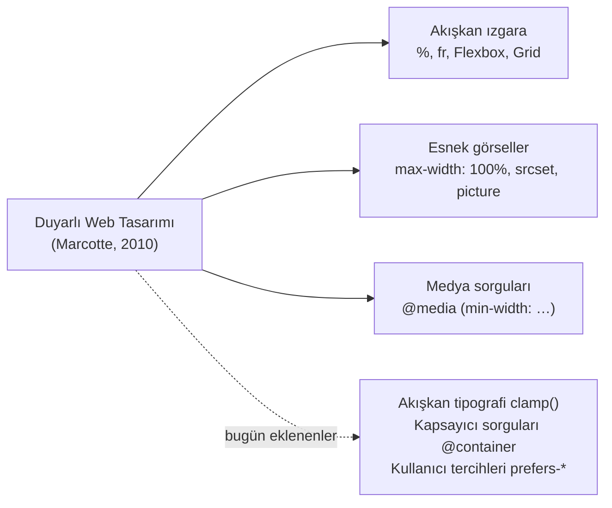

*Şekil 9.1. Duyarlı web tasarımının bileşenleri ve güncel ekler.*

Duyarlı tasarımın bugün bir tercih değil zorunluluk olmasının nedeni kullanım istatistiklerinde açıkça görülür. StatCounter verilerine göre Ekim 2026'da dünya genelindeki web sayfası görüntülemelerinin yaklaşık **%59,9'u mobil cihazlardan**, %38,5'i masaüstü bilgisayarlardan ve %1,6'sı tabletlerden gelmiştir [5]. Bu oranlar aydan aya birkaç puan değişebilmektedir; ancak mobil payın uzun süredir masaüstüyle başa baş ya da onun üzerinde seyrettiği açıktır.

> [!TIP]
> **Güncel hayattan:** e-Devlet Kapısı, banka siteleri, kargo takip sayfaları veya üniversite OBS'si gibi hizmetlerin çoğu, bilgisayarda çok sütunlu, telefonda ise tek sütunlu ve büyük düğmeli bir görünüm sunar. Adres çubuğundaki adres değişmez; değişen yalnızca aynı HTML'ye uygulanan CSS kurallarıdır.

**Mobil öncelikli (mobile-first) yaklaşım:** Luke Wroblewski'nin 2011 tarihli *Mobile First* kitabıyla yaygınlaşan bu yaklaşımda tasarım önce en küçük ekran için yapılır, ardından ekran büyüdükçe katmanlar eklenir [6]. Küçük ekranın kısıtları tasarımcıyı içeriğin en önemli kısmına odaklanmaya zorlar; CSS açısından ise önce sade temel stiller yazılır, daha geniş ekranlar için `min-width` medya sorgularıyla eklemeler yapılır [7, s. HTML 350]. Bu bölümdeki tüm örnekler bu yaklaşımı izlemektedir.

## 9.2 Görünüm Alanı (Viewport)

### 9.2.1 Görünüm Alanı Nedir?

Görünüm alanı (viewport), kullanıcının bir web sayfasının o an görebildiği alandır. Masaüstünde tarayıcı penceresinin içerik alanına eşittir; pencere daraltıldığında görünüm alanı da daralır. Mobil cihazlarda ise durum daha karmaşıktır: tarayıcı, sayfanın yerleşimini hesaplamak için kullandığı **düzen görünüm alanı** (layout viewport) ile ekranda fiilen görünen **görsel görünüm alanını** (visual viewport) birbirinden ayırır [7, s. HTML 352].

Akıllı telefonlar yaygınlaştığında web'deki sayfaların neredeyse tamamı masaüstü genişliği varsayılarak hazırlanmıştı. Mobil tarayıcılar bu sayfaları bozmadan gösterebilmek için, sayfa aksini belirtmedikçe düzen görünüm alanını yaklaşık **980 CSS pikseli** genişliğinde kabul eder ve sayfayı ekrana sığacak biçimde küçültür [8]. Bu geçici çözüm eski sayfaların "en azından bütünüyle görünmesini" sağlar; ancak metin okunamayacak kadar küçülür ve duyarlı tasarım için yazılan medya sorguları da hiç tetiklenmez, çünkü tarayıcı ekranı 980 piksel genişliğinde sanmaktadır (Şekil 9.2, sol).

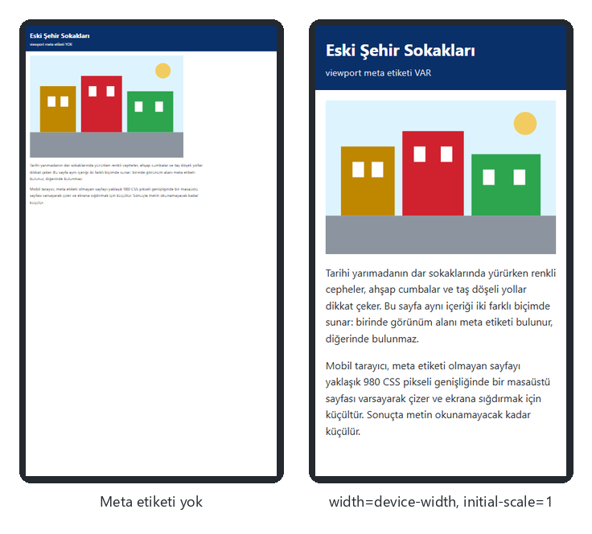

*Şekil 9.2. Aynı sayfa 390 CSS pikseli genişliğinde telefon öykünmesinde: viewport meta etiketi olmadan (solda) tarayıcı sayfayı 980 piksel varsayıp küçültür; etiketle (sağda) metin okunabilir boyutta kalır ([codes/09-duyarli-tasarim/uygulama-9-1-viewport-karsilastirma/](../codes/09-duyarli-tasarim/uygulama-9-1-viewport-karsilastirma/index.html)).*

### 9.2.2 `<meta name="viewport">` Etiketi

Tasarımcının görünüm alanını denetlemesini sağlayan yöntem, belgenin `<head>` bölümüne eklenen viewport meta etiketidir [9]. Duyarlı olması istenen her sayfaya şu satır eklenmelidir:

```html
<meta name="viewport" content="width=device-width, initial-scale=1">
```

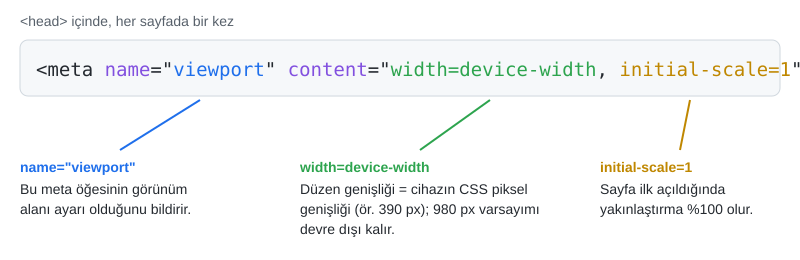

*Şekil 9.3. Viewport meta etiketinin parçaları.*

- `name="viewport"`: Bu meta öğesinin görünüm alanı ayarı taşıdığını bildirir.
- `width=device-width`: Düzen görünüm alanının genişliğini cihazın CSS piksel cinsinden genişliğine eşitler. Böylece 390 CSS pikseli genişliğindeki bir telefonda sayfa 980 değil 390 piksel genişliğinde düzenlenir ve `@media (min-width: 600px)` gibi sorgular doğru çalışır.
- `initial-scale=1`: Sayfa ilk yüklendiğinde yakınlaştırma düzeyini 1'e (yüzde yüz) ayarlar. Sunumdaki `initial-scale=1.0` yazımı aynı anlama gelir.

Masaüstü tarayıcılar bu etiketi dikkate almaz; etiketin etkisi yalnızca mobil tarayıcılarda (ve DevTools'un mobil öykünme modunda) görülür. Bu nedenle bir sayfanın masaüstünde pencere daraltılarak "düzgün" görünmesi, viewport etiketinin varlığını kanıtlamaz; test Device Toolbar ile yapılmalıdır (bkz. Bölüm 9.9).

> [!WARNING]
> **Erişilebilirlik:** Viewport etiketine `maximum-scale=1` veya `user-scalable=no` eklemek, kullanıcının iki parmakla yakınlaştırmasını engeller. Az gören kullanıcılar için bu, sayfanın kullanılamaz hâle gelmesi demektir. WCAG 2.2'nin 1.4.4 "Metni Yeniden Boyutlandırma" ölçütü, metnin yardımcı teknoloji olmadan %200'e kadar büyütülebilmesini şart koşar [10]; bazı mobil tarayıcılar da bu nedenle `user-scalable=no` ayarını yok saymaktadır. Yakınlaştırmayı engelleyen değerler kullanılmamalıdır.

### 9.2.3 CSS Pikseli ve Cihaz Pikseli

CSS'teki `px` birimi, ekrandaki fiziksel piksel (cihaz pikseli, device pixel) ile aynı şey değildir. CSS pikseli, farklı yoğunluktaki ekranlarda yaklaşık aynı fiziksel boyutta görünmesi amaçlanan **mantıksal bir birimdir** [11]. Bir CSS pikselinin kaç cihaz pikseline karşılık geldiğini **cihaz piksel oranı** (device pixel ratio, DPR) belirler. JavaScript'te `window.devicePixelRatio` özelliğiyle okunabilir.

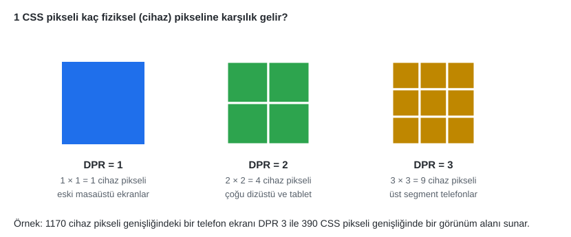

*Şekil 9.4. CSS pikseli ile cihaz pikseli ilişkisi.*

Örneğin fiziksel genişliği 1170 cihaz pikseli ve DPR değeri 3 olan bir telefon, sayfaya 1170 ÷ 3 = **390 CSS pikseli** genişliğinde bir görünüm alanı sunar. Medya sorguları ve tüm CSS ölçüleri bu 390 değerine göre çalışır. DPR, düzeni değil görsellerin keskinliğini etkiler: 390 CSS pikseli genişliğinde gösterilecek bir fotoğrafın DPR 3 ekranda net görünmesi için 1170 piksel genişliğinde bir kaynak dosya gerekir. Bu konu Bölüm 9.5'te duyarlı görsellerle ele alınmaktadır.

#### 🛠 Uygulama 9.1: Viewport Meta Etiketiyle ve Etiketsiz Karşılaştırma

**Amaç:** Viewport meta etiketinin mobil görünüme etkisini Device Toolbar ile gözlemlemek.  
**Tahmini süre:** 10 dk

1. `calismalar/bolum-09/viewport/` klasöründe `index.html`, `viewport-yok.html` ve ortak `style.css` dosyalarını oluşturunuz.
2. İki HTML dosyasına aynı içeriği (başlık, `max-width: 100%` stilli bir görsel, iki paragraf) yazınız. `index.html` dosyasına viewport meta etiketini ekleyiniz; `viewport-yok.html` dosyasında bu satırı silip yerine bir HTML yorumu bırakınız.
3. Her iki sayfayı Live Server ile açınız; pencereyi daraltınız. Masaüstünde iki sayfa arasında bir fark görülmediğine dikkat ediniz.
4. `F12` ile DevTools'u açıp `Ctrl+Shift+M` ile Device Toolbar'ı etkinleştiriniz; cihaz listesinden bir telefon seçiniz ve iki sayfayı sırayla yenileyiniz.
5. Sonucu Şekil 9.2 ile karşılaştırınız. Elements panelinde `<html>` öğesini seçip Computed sekmesinden genişliğini her iki sayfada okuyunuz.

**Beklenen çıktı:** Şekil 9.2'deki görünüm: etiketsiz sayfa küçültülmüş, etiketli sayfa okunabilir.

**Kendinizi sınayın:** (1) `index.html` sayfasına `user-scalable=no` ekleyip Device Toolbar'da yakınlaştırmayı deneyiniz; neden önerilmediğini bir cümleyle yazınız. (2) Konsolda `window.devicePixelRatio` ve `innerWidth` değerlerini seçtiğiniz cihaz için yazdırınız.

<details><summary>Örnek çözüm</summary>

Çözüm dosyaları: [`codes/09-duyarli-tasarim/uygulama-9-1-viewport-karsilastirma/index.html`](../codes/09-duyarli-tasarim/uygulama-9-1-viewport-karsilastirma/index.html) ve [`viewport-yok.html`](../codes/09-duyarli-tasarim/uygulama-9-1-viewport-karsilastirma/viewport-yok.html)

</details>

## 9.3 Akışkan Düzenler

### 9.3.1 Göreli Birimler ve Akışkan Görseller

Akışkan (fluid) düzende kutuların genişliği sabit piksel yerine kapsayıcıya veya görünüm alanına göre oransal birimlerle verilir; böylece düzen her ekran genişliğinde kesintisiz uzayıp kısalır [2, s. 377], [3, s. 549]. Sık kullanılan birimler Tablo 9.1'de özetlenmiştir ([Bölüm 5](05-css-metin-renk-arka-plan.md)'teki birim anlatımına da bakınız).

| Birim | Neye göre | Tipik kullanım |
|---|---|---|
| `%` | Kapsayıcı bloğun ilgili boyutu | Sütun genişlikleri |
| `rem` | Kök öğenin (`html`) yazı boyutu | Yazı boyutu, boşluklar |
| `em` | Öğenin yazı boyutu | Düğme dolgusu |
| `ch` | "0" karakterinin genişliği | Okunabilir satır uzunluğu (`max-width: 70ch`) |
| `vw` / `vh` | Görünüm alanı genişliğinin / yüksekliğinin %1'i | Tam ekran bölümler, akışkan yazı |
| `svh` / `lvh` / `dvh` | Küçük / büyük / dinamik görünüm alanı yüksekliğinin %1'i | Mobilde adres çubuğuna duyarlı tam yükseklik |
| `fr` | Grid'de kalan alanın payı | Izgara sütunları ([Bölüm 6](06-css-kutu-modeli-yerlesim.md)) |

*Tablo 9.1. Akışkan düzende kullanılan göreli birimler.*

Mobil tarayıcılarda adres çubuğu sayfa kaydırılırken gizlenip göründüğü için görünüm alanının yüksekliği değişir. Bu durumda `100vh` değeri ekranın görünen kısmından büyük olabilir ve tam ekran bir giriş bölümünün alt kısmı adres çubuğunun altında kalır. CSS Values and Units Level 4 ile gelen `dvh` (dinamik), `svh` (araç çubukları görünürkenki küçük yükseklik) ve `lvh` (büyük yükseklik) birimleri bu sorunu çözer [11]:

```css
.giris {
  min-height: 100vh;    /* eski tarayıcılar için yedek */
  min-height: 100dvh;   /* destekleyen tarayıcılarda dinamik yükseklik */
}
```

> [!IMPORTANT]
> `width: 100vw` değeri masaüstü tarayıcılarda dikey kaydırma çubuğunun genişliğini de kapsar. Sayfa kaydırılabilir uzunluktaysa `100vw` genişliğindeki öğe kaydırma çubuğu kadar taşar ve yatay kaydırma çubuğu belirir. Tam genişlik için çoğu zaman `width: 100%` doğru tercihtir.

Duyarlı tasarımın ikinci bileşeni olan esnek görseller için temel kural kısadır: görsel, kapsayıcısından hiçbir zaman geniş olmamalı ve en-boy oranı korunmalıdır [4]:

```css
img,
video {
  max-width: 100%;
  height: auto;
}
```

### 9.3.2 `clamp()` ile Akışkan Tipografi

Yazı boyutunu yalnızca `vw` ile vermek (`font-size: 4vw`) dar ekranda okunamayacak kadar küçük, çok geniş ekranda ise gereksiz büyük yazıya yol açar. `clamp(EN_AZ, TERCİH, EN_ÇOK)` fonksiyonu, tercih edilen akışkan değeri iki sınır arasında tutar [11]:

```css
:root {
  --boyut-govde: clamp(1rem, 0.9rem + 0.4vw, 1.2rem);
  --boyut-h1: clamp(1.6rem, 1rem + 3vw, 3.2rem);
}
h1 { font-size: var(--boyut-h1); }
```

Tercih edilen değerde `rem` ile `vw` toplamının kullanılması (`1rem + 3vw`) bilinçli bir seçimdir: yalnızca `vw` kullanılsaydı kullanıcının tarayıcı ayarlarından yazı boyutunu büyütmesi etkisiz kalırdı. `rem` bileşeni bu büyütmenin yazıya yansımasını sağlar ve WCAG 1.4.4 ölçütüne uyumu kolaylaştırır [10]. 390 piksellik bir ekranda `1rem + 3vw` yaklaşık 16 + 11,7 = 27,7 piksele, yani alt sınır olan `1.6rem` (25,6 px) değerinin biraz üzerine; 1280 piksellik ekranda ise 16 + 38,4 = 54,4 piksele, yani üst sınır olan `3.2rem` (51,2 px) değerine sınırlanır. Aynı mantıkla `min()` ve `max()` fonksiyonları da yalnızca bir sınır gerektiğinde kullanılabilir (ör. `width: min(100%, 960px)`).

#### 🛠 Uygulama 9.2: `clamp()` ile Akışkan Tipografi

**Amaç:** Medya sorgusu yazmadan ekran genişliğiyle orantılı büyüyen, ancak sınırları aşmayan bir başlık ve gövde metni oluşturmak.  
**Tahmini süre:** 15 dk

1. `calismalar/bolum-09/tipografi/` klasöründe `index.html` ve `style.css` oluşturunuz; viewport meta etiketini unutmayınız.
2. Bir kampüs haberi yazınız: üst başlık (`<p class="ust-baslik">`), `<h1>`, özet paragrafı ve gövde paragrafı.
3. `:root` içinde `--boyut-govde`, `--boyut-ozet` ve `--boyut-h1` özel özelliklerini `clamp()` ile tanımlayınız (değerler için yukarıdaki kod parçasından yararlanınız).
4. `<main>` öğesine `max-width: 70ch; margin: 0 auto;` ve `padding: clamp(16px, 4vw, 48px);` veriniz.
5. Device Toolbar'ı **Responsive** moduna alınız; genişliği 320, 768 ve 1440 piksele getirerek `<h1>` öğesinin hesaplanan `font-size` değerini Computed sekmesinden okuyunuz ve bir tabloya yazınız.

**Beklenen çıktı:**

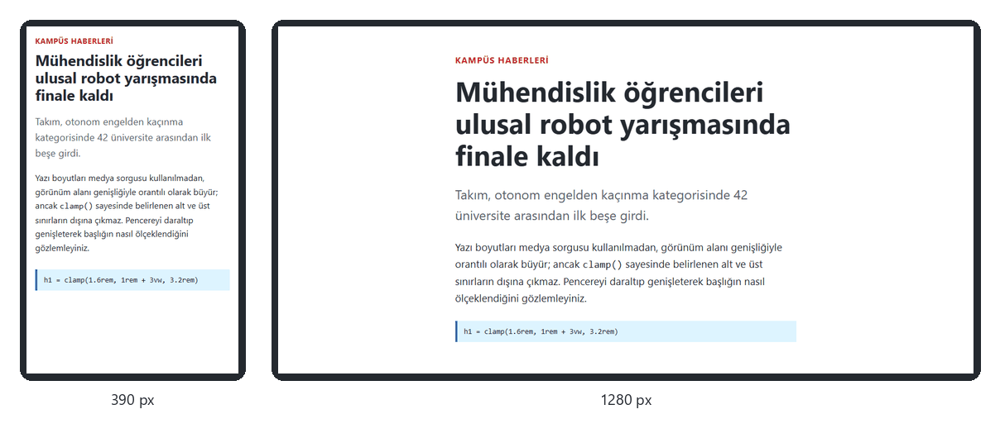

*Şekil 9.5. Uygulama 9.2: başlık 390 pikselde yaklaşık 28 piksel, 1280 pikselde üst sınır olan 51,2 pikseldir.*

**Kendinizi sınayın:** (1) Tarayıcı ayarlarından varsayılan yazı boyutunu "Çok büyük" yapınız; başlık büyüdü mü? `1rem + 3vw` yerine yalnızca `5vw` yazıp aynı denemeyi tekrarlayınız. (2) `max-width: 70ch` neden tercih edilmiştir?

<details><summary>Örnek çözüm</summary>

Çözüm dosyası: [`codes/09-duyarli-tasarim/uygulama-9-2-akiskan-tipografi/index.html`](../codes/09-duyarli-tasarim/uygulama-9-2-akiskan-tipografi/index.html)

</details>

## 9.4 Medya Sorguları

### 9.4.1 Sözdizimi

Medya sorgusu (media query), bir grup CSS kuralının yalnızca belirli koşullar sağlandığında uygulanmasını sağlar [12], [7, s. HTML 345]. Sorgu; isteğe bağlı bir **medya türü** (`screen`, `print`, `all`) ile parantez içinde yazılan bir veya daha fazla **medya özelliğinden** (media feature) oluşur. Koşullar `and`, `not`, `or` (ya da virgül) ile birleştirilir:

```css
/* Ekran ve genişlik en az 600 CSS pikseli */
@media screen and (min-width: 600px) {
  .izgara { grid-template-columns: repeat(2, 1fr); }
}

/* Yazdırırken gezinme menüsünü gizle */
@media print {
  nav { display: none; }
}
```

Medya sorgusu ayrıca `<link>` öğesinin `media` niteliğinde de kullanılabilir: `<link rel="stylesheet" href="yazdir.css" media="print">`. Medya sorgusu özgüllüğü (specificity) değiştirmez; koşul sağlandığında içindeki kurallar sıradan kurallar gibi basamaklamaya katılır. Bu nedenle medya sorguları genellikle stil dosyasının **sonuna** yazılır ki aynı özgüllükteki temel kuralları ezebilsin.

### 9.4.2 Mobil Öncelikli Kırılma Noktaları

Düzenin değiştiği genişlik değerlerine **kırılma noktası** (breakpoint) denir [3, s. 545]. Mobil öncelikli yaklaşımda temel stiller en dar ekran içindir; her kırılma noktası `min-width` ile bir öncekinin üzerine ekleme yapar:

```css
/* Temel: telefon, tek sütun */
.izgara { display: grid; grid-template-columns: 1fr; gap: 12px; }

/* 600 px ve üzeri: iki sütun */
@media (min-width: 600px) {
  .izgara { grid-template-columns: repeat(2, 1fr); }
}

/* 900 px ve üzeri: üç sütun */
@media (min-width: 900px) {
  .izgara { grid-template-columns: repeat(3, 1fr); }
}

/* 1200 px ve üzeri: dört sütun */
@media (min-width: 1200px) {
  .izgara { grid-template-columns: repeat(4, 1fr); }
}
```

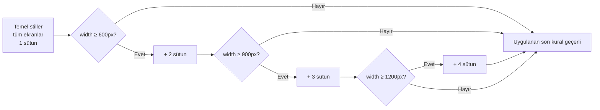

*Şekil 9.6. Mobil öncelikli medya sorgularında kuralların birikerek uygulanması.*

Ters yöndeki "masaüstü öncelikli" yaklaşımda ise temel stiller geniş ekran içindir ve `max-width` sorgularıyla küçük ekranlar için geri alma yapılır. Mobil öncelikli yazımın üstünlükleri şunlardır: temel stiller sade kalır, en kısıtlı cihaz en az CSS'i işler, büyük ekran için yazılan karmaşık düzen eski veya küçük cihazlara "sızmaz".

**Kırılma noktaları cihaza göre değil, içeriğe göre seçilmelidir.** Belirli telefon veya tablet modellerinin genişliğini hedeflemek kısa ömürlüdür; her yıl yeni ekran boyutları çıkmaktadır. Doğru yöntem, Device Toolbar'ın Responsive modunda pencereyi yavaşça genişletmek ve düzenin "bozulduğu" (satırların aşırı uzadığı, kartların gereksiz gerildiği) noktaya bir kırılma noktası koymaktır [3, ss. 548–549]. 600, 900, 1200 gibi yuvarlak değerler başlangıç için makul bir rehberdir, standart değildir.

Sunumda cihaz türlerine göre beklenen görünüm şöyle özetlenmektedir:

| Cihaz türü | Tipik görünüm alanı genişliği | Düzen | Gezinme ve etkileşim |
|---|---|---|---|
| Masaüstü | ≥ 1024 px | Geniş ekran, çok sütunlu düzen, büyük görseller | Tam menü çubuğu, fareyle üzerine gelme (hover) efektleri |
| Tablet | ≈ 600–1024 px | Orta genişlik, genellikle 2 sütun | Dokunmatik uyumlu düğmeler, uyarlanmış menü |
| Mobil (akıllı telefon) | < 600 px | Tek sütun, küçültülmüş görseller | Hamburger menü, büyük dokunma alanları |

*Tablo 9.2. Cihaz türlerine göre tipik duyarlı düzen (genişlik aralıkları yaklaşık değerlerdir).*

Şekil 9.7, bu bölümün mobil öncelikli kart ızgarası uygulamasının üç farklı genişlikte gerçek görünümünü göstermektedir.

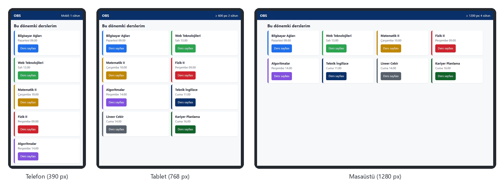

*Şekil 9.7. Aynı HTML'nin 390 px (1 sütun), 768 px (2 sütun) ve 1280 px (4 sütun) genişlikteki görünümü; sağ üstteki etiket etkin kırılma noktasını gösterir ([codes/09-duyarli-tasarim/uygulama-9-3-mobil-oncelikli-izgara/](../codes/09-duyarli-tasarim/uygulama-9-3-mobil-oncelikli-izgara/index.html)).*

### 9.4.3 Media Queries Level 4 Aralık Sözdizimi

Media Queries Level 4 belirtimi, `min-` ve `max-` önekleri yerine matematiksel karşılaştırma işleçleriyle yazılan bir **aralık sözdizimi** (range syntax) getirmiştir [12]. Bu sözdizimi güncel tarayıcıların tamamında desteklenmektedir ve okunması daha kolaydır:

| Klasik yazım | Aralık sözdizimi |
|---|---|
| `(min-width: 768px)` | `(width >= 768px)` |
| `(max-width: 767.98px)` | `(width < 768px)` |
| `(min-width: 600px) and (max-width: 899.98px)` | `(600px <= width < 900px)` |

*Tablo 9.3. Klasik ve aralık sözdizimi karşılaştırması.*

Klasik yazımda `max-width: 768px` ile `min-width: 768px` sorgularının ikisi de tam 768 piksel genişlikte eşleştiği için iki kural çakışabilir; bu yüzden eski kodlarda `767.98px` gibi değerler görülür. Aralık sözdizimindeki `<` işleci bu belirsizliği ortadan kaldırır.

### 9.4.4 Diğer Medya Özellikleri ve Kullanıcı Tercihleri

Medya sorguları yalnızca genişliği değil, cihazın ve kullanıcının pek çok özelliğini sorgulayabilir [12], [13]:

| Özellik | Örnek | Ne zaman eşleşir? |
|---|---|---|
| `orientation` | `(orientation: landscape)` | Görünüm alanının genişliği yüksekliğinden büyükse (yatay) |
| `hover` | `(hover: hover)` | Birincil giriş aygıtı öğenin üzerine gelebiliyorsa (fare) |
| `pointer` | `(pointer: coarse)` | Birincil giriş aygıtı hassas değilse (parmak) |
| `prefers-color-scheme` | `(prefers-color-scheme: dark)` | Kullanıcı işletim sisteminde koyu temayı seçmişse |
| `prefers-reduced-motion` | `(prefers-reduced-motion: reduce)` | Kullanıcı animasyonların azaltılmasını istemişse |
| `resolution` | `(resolution >= 2dppx)` | DPR 2 ve üzeri ekranlarda |

*Tablo 9.4. Sık kullanılan medya özellikleri.*

`hover` ve `pointer` özellikleri, dokunmatik ekranlarda var olmayan "fareyle üzerine gelme" etkileşimine dayanan arayüzlerden kaçınmayı sağlar. Örneğin bir kartın ayrıntıları yalnızca `:hover` durumunda gösteriliyorsa, telefon kullanıcısı bu bilgiye hiç ulaşamaz. `prefers-reduced-motion` ise baş dönmesi veya vestibüler bozukluğu olan kullanıcılar için büyük önem taşır; hareketli geçişler bu sorgu ile kapatılmalıdır:

```css
@media (prefers-reduced-motion: reduce) {
  *,
  *::before,
  *::after {
    animation-duration: 0.01ms !important;
    transition-duration: 0.01ms !important;
    scroll-behavior: auto !important;
  }
}
```

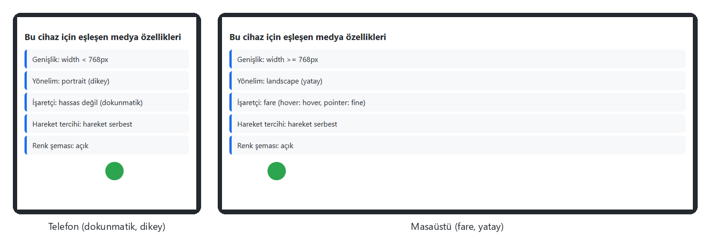

*Şekil 9.8. Örnek 9.1: aynı sayfa, CSS medya özelliklerine göre telefonda "dikey, dokunmatik", masaüstünde "yatay, fare" sonucunu gösterir ([codes/09-duyarli-tasarim/ornek-9-1-medya-ozellikleri/](../codes/09-duyarli-tasarim/ornek-9-1-medya-ozellikleri/index.html)).*

#### 🛠 Uygulama 9.3: Mobil Öncelikli Kart Izgarası

**Amaç:** Üç kırılma noktasıyla 1, 2, 3 ve 4 sütuna geçen, mobil öncelikli bir kart ızgarası kurmak.  
**Tahmini süre:** 20 dk

1. `calismalar/bolum-09/kartlar/` klasöründe `index.html` ve `style.css` oluşturunuz.
2. Bir üst çubuk (`<header>`), bir `<h1>` ve `<section class="izgara">` içinde sekiz ders kartı (`<article class="kart">`: ders adı, gün–saat ve "Ders sayfası" bağlantısı) yazınız.
3. CSS'i **önce telefon için** yazınız: `.izgara { display: grid; grid-template-columns: 1fr; gap: 12px; }`. Kart bağlantılarına en az 44 piksel yükseklik veriniz.
4. Dosyanın sonuna `min-width: 600px`, `900px` ve `1200px` kırılma noktaları için üç medya sorgusu ekleyiniz; sütun sayısını sırasıyla 2, 3 ve 4 yapınız.
5. Hangi sorgunun etkin olduğunu görmek için üst çubuktaki boş bir öğeye `::after { content: "…"; }` ile her sorguda farklı bir metin yazdırınız.
6. Device Toolbar'da 390, 768 ve 1280 piksel genişlikleri deneyerek sonucu Şekil 9.7 ile karşılaştırınız.

**Beklenen çıktı:** Şekil 9.7'deki üç görünüm.

**Kendinizi sınayın:** (1) Aynı sonucu hiç medya sorgusu yazmadan `repeat(auto-fit, minmax(240px, 1fr))` ile elde ediniz; iki yöntemin farkı nedir? (2) Medya sorgularını dosyanın başına taşıyınız; ne oldu, neden?

<details><summary>Örnek çözüm</summary>

Çözüm dosyası: [`codes/09-duyarli-tasarim/uygulama-9-3-mobil-oncelikli-izgara/index.html`](../codes/09-duyarli-tasarim/uygulama-9-3-mobil-oncelikli-izgara/index.html)

</details>

#### 🛠 Uygulama 9.4: `prefers-color-scheme` ile Koyu Tema

**Amaç:** Renkleri CSS özel özellikleriyle tanımlayıp işletim sisteminin koyu tema tercihine kendiliğinden uyan bir arayüz yapmak.  
**Tahmini süre:** 15 dk

1. `calismalar/bolum-09/tema/` klasöründe bir banka "Hesap Özeti" kartı hazırlayınız: bakiye, hesap bilgisi, üç hareket satırı ve "Para transferi" düğmesi.
2. `:root` içinde `--zemin`, `--yuzey`, `--metin`, `--ikincil`, `--cizgi`, `--vurgu` gibi renk değişkenleri tanımlayınız ve tüm kurallarda yalnızca bu değişkenleri kullanınız.
3. `@media (prefers-color-scheme: dark) { :root { … } }` bloğunda yalnızca değişkenlerin koyu tema değerlerini yeniden tanımlayınız.
4. `<head>` içine `<meta name="color-scheme" content="light dark">` ekleyiniz; böylece kaydırma çubukları ve form denetimleri de temaya uyar.
5. DevTools'ta `Ctrl+Shift+P` ile komut menüsünü açıp "Rendering" yazınız; **Emulate CSS media feature prefers-color-scheme** seçeneğini `dark` yapınız.
6. Koyu temada düğme yazısının kontrastını DevTools'un renk seçicisindeki kontrast oranı göstergesiyle denetleyiniz (en az 4,5:1).

**Beklenen çıktı:**

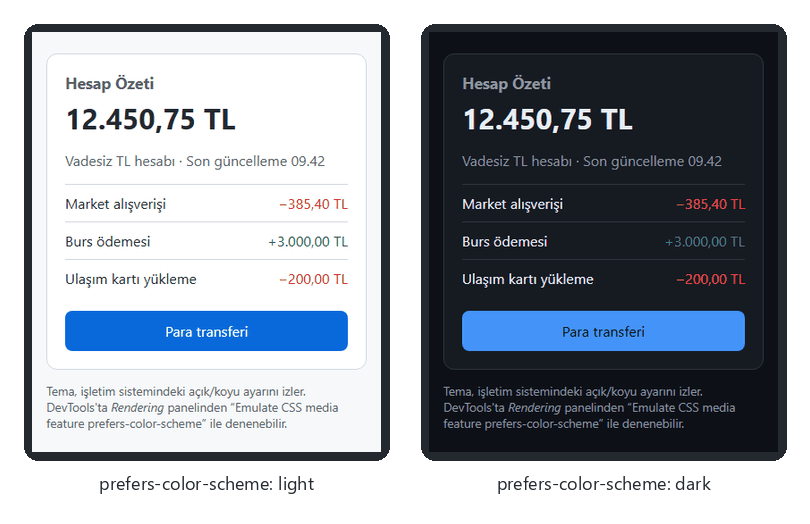

*Şekil 9.9. Uygulama 9.4'ün açık (solda) ve koyu (sağda) tema görünümü.*

**Kendinizi sınayın:** (1) Koyu temada saf siyah (`#000`) zemin yerine neden koyu gri tercih edilir? (2) Sayfaya bir animasyon ekleyip `prefers-reduced-motion: reduce` durumunda durdurunuz.

<details><summary>Örnek çözüm</summary>

Çözüm dosyası: [`codes/09-duyarli-tasarim/uygulama-9-4-koyu-tema/index.html`](../codes/09-duyarli-tasarim/uygulama-9-4-koyu-tema/index.html)

</details>

## 9.5 Duyarlı Görseller

`max-width: 100%` görselin kutuya sığmasını sağlar; ancak telefonda 390 piksel genişliğinde gösterilecek bir görsel için masaüstüne yönelik 2400 piksellik dosyayı indirmek mobil veriyi ve yükleme süresini boşa harcar. HTML, tarayıcının **ekran koşullarına uygun dosyayı kendisinin seçmesi** için iki araç sunar [14].

### 9.5.1 `srcset` ve `sizes`: Çözünürlük Değiştirme

`srcset` niteliği aynı görselin farklı genişlikteki sürümlerini, `w` tanımlayıcısıyla (dosyanın gerçek piksel genişliği) listeler. `sizes` niteliği ise görselin sayfada **kaç CSS pikseli genişliğinde gösterileceğini** medya koşullarıyla bildirir. Tarayıcı bu iki bilgiyi ve cihazın DPR değerini birleştirerek en uygun dosyayı seçer:

```html

```

Bu örnekte `sizes`, görselin 900 pikselden geniş ekranlarda görünüm alanının yarısını, daha dar ekranlarda tamamını kaplayacağını söyler. 390 piksellik DPR 1 bir telefonda gereken genişlik 390 piksel olduğundan `400w`; aynı genişlikte DPR 3 bir telefonda 390 × 3 = 1170 piksel gerektiğinden `1600w`; 1280 piksellik masaüstünde 640 piksel gerektiğinden `800w` dosyası seçilir (Şekil 9.10). Görselin boyutu değişmeyen küçük öğeler (logo, simge) için `w` yerine `x` tanımlayıcısı da kullanılabilir: `srcset="logo.png 1x, logo@2x.png 2x"`.

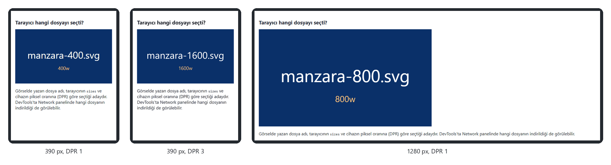

*Şekil 9.10. Örnek 9.2: tarayıcının seçtiği dosya, görselin üzerinde yazmaktadır ([codes/09-duyarli-tasarim/ornek-9-2-srcset-sizes/](../codes/09-duyarli-tasarim/ornek-9-2-srcset-sizes/index.html)).*

> [!IMPORTANT]
> `srcset` bir **öneridir**; seçimi tarayıcı yapar ve önbellekte daha büyük bir sürüm varsa onu kullanabilir. Tasarımcı hangi dosyanın kesin olarak gösterileceğini denetlemek istiyorsa (aşağıdaki sanat yönetimi durumu) `<picture>` kullanmalıdır. Ayrıca `width` ve `height` nitelikleri her zaman yazılmalıdır: tarayıcı bu oran sayesinde görsel inmeden yerini ayırır ve sayfanın yüklenirken zıplaması (layout shift) önlenir.

### 9.5.2 `<picture>` ile Sanat Yönetimi

Bazen dar ekranda aynı görselin küçültülmüş hâli değil, **farklı kırpılmış** bir sürümü gerekir: geniş bir manzara fotoğrafında telefon ekranında konu kaybolur, yakın kadraj daha anlamlıdır. Buna sanat yönetimi (art direction) denir ve `<picture>` öğesiyle yapılır [14]:

```html
<picture>
  <source media="(min-width: 800px)" srcset="genis.jpg" width="1200" height="500">
  
</picture>
```

Tarayıcı `<source>` öğelerini sırayla dener ve `media` koşulu sağlanan **ilkini** kullanır; hiçbiri sağlanmazsa `` öğesine düşer. `` öğesi zorunludur: `alt` metni, boyutlar ve `loading` gibi nitelikler her durumda ondan okunur. `<source>` öğesinin `type` niteliğiyle (`type="image/avif"`, `type="image/webp"`) yeni görsel biçimlerini destekleyen tarayıcılara daha küçük dosyalar sunulabilir; desteklemeyenler `` öğesindeki JPEG'i kullanır.

**Tembel yükleme:** Ekranın altında kalan görseller için `loading="lazy"` niteliği, görsel kullanıcı o bölgeye yaklaşana kadar indirilmesini erteler [14]. Sayfanın en üstündeki büyük görsele (ör. ana afiş) `loading="lazy"` verilmemelidir; aksi hâlde sayfanın ana içeriği geç görünür.

> [!TIP]
> **Güncel hayattan:** Haber sitelerinin manşet fotoğrafları masaüstünde geniş, telefonda ise kare veya dikey kırpılmış olarak gösterilir. E-ticaret sitelerindeki ürün listeleri ise yüzlerce küçük görseli `loading="lazy"` ile yalnızca kaydırıldıkça indirir.

#### 🛠 Uygulama 9.5: `<picture>` ile Sanat Yönetimi

**Amaç:** Geniş ekranda geniş kadraj, dar ekranda yakın kadraj gösteren bir görsel hazırlamak.  
**Tahmini süre:** 15 dk

1. `calismalar/bolum-09/picture/` klasörüne biri yatay (ör. 1200×500), biri kare (ör. 600×600) iki görsel koyunuz. Fotoğraf yoksa basit SVG çizimleri kullanabilirsiniz; her görselin üzerine dosya adını yazınız.
2. `<picture>` içinde `media="(min-width: 800px)"` koşullu bir `<source>` ve yedek bir `` yazınız; her ikisine kendi `width`/`height` değerlerini veriniz.
3. CSS'te görsele `display: block; width: 100%; height: auto;` uygulayınız.
4. Device Toolbar'da genişliği 799 ve 800 piksel arasında değiştirerek görselin değiştiği anı yakalayınız. Network panelinde hangi dosyaların indirildiğini inceleyiniz.

**Beklenen çıktı:**

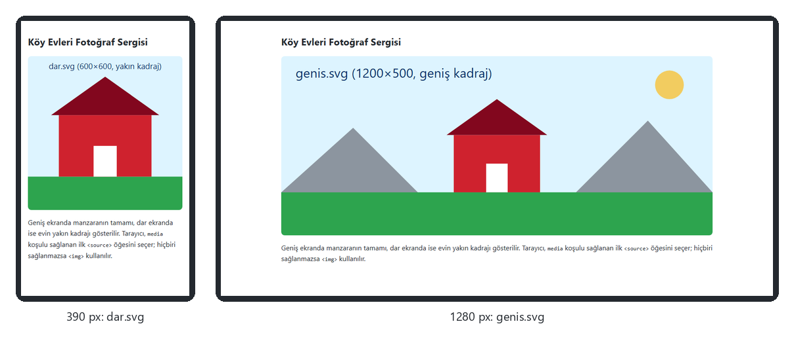

*Şekil 9.11. Uygulama 9.5: 390 pikselde `dar.svg`, 1280 pikselde `genis.svg` gösterilir.*

**Kendinizi sınayın:** (1) `<source>` ile `` öğelerinin sırasını değiştirirseniz ne olur? (2) `alt` metnini `<source>` öğesine yazmak neden işe yaramaz?

<details><summary>Örnek çözüm</summary>

Çözüm dosyası: [`codes/09-duyarli-tasarim/uygulama-9-5-picture-sanat-yonetimi/index.html`](../codes/09-duyarli-tasarim/uygulama-9-5-picture-sanat-yonetimi/index.html)

</details>

## 9.6 Kapsayıcı Sorguları (Container Queries)

Medya sorguları *görünüm alanının* boyutunu sorgular. Oysa bileşen tabanlı tasarımda aynı kart bileşeni bir sayfada geniş ana sütunda, başka bir yerde dar bir yan sütunda kullanılır; kartın düzeni ekranın değil **içinde bulunduğu kapsayıcının** genişliğine göre değişmelidir. Kapsayıcı sorguları (container queries) bu ihtiyacı karşılar ve 2023 itibarıyla tüm büyük tarayıcılarda kullanılabilmektedir [15], [8].

Kullanımı iki adımlıdır: önce bir öğe `container-type` ile sorgulanabilir kapsayıcı yapılır, ardından `@container` kuralıyla bu kapsayıcının boyutuna göre stil yazılır:

```css
.kap {
  container-type: inline-size;   /* yatay boyutu sorgulanabilir */
}

/* Varsayılan: dar düzen, görsel üstte */
.haber { display: grid; gap: 10px; }

/* Kapsayıcı 400 px'ten genişse görsel solda, metin sağda */
@container (width > 400px) {
  .haber { grid-template-columns: 160px 1fr; align-items: center; }
}
```

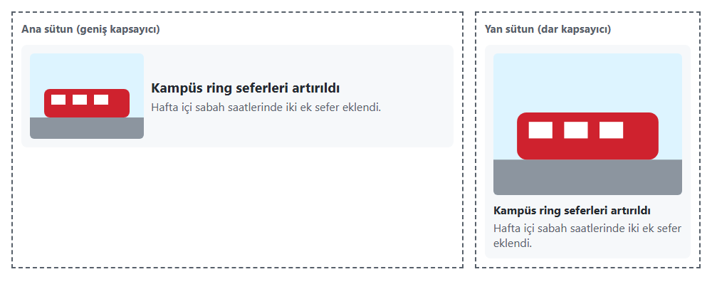

*Şekil 9.12. Örnek 9.3: aynı HTML ve aynı CSS ile yazılmış iki kart, bulundukları kapsayıcının genişliğine göre farklı düzen alır ([codes/09-duyarli-tasarim/ornek-9-3-kapsayici-sorgusu/](../codes/09-duyarli-tasarim/ornek-9-3-kapsayici-sorgusu/index.html)).*

Kapsayıcı sorguları başlangıçta CSS Containment Level 3 taslağında tanımlanmış, daha sonra CSS Conditional Rules Level 5 belirtimine taşınmıştır [15]. Medya sorgularının yerini almazlar: sayfa iskeleti için medya sorguları, yeniden kullanılan bileşenler için kapsayıcı sorguları uygundur. Kapsayıcı genişliğine göre ölçeklenen `cqi` birimi (kapsayıcının satır yönündeki boyutunun %1'i) de bileşen içi akışkan yazı boyutları için kullanılabilir.

## 9.7 Flexbox ve Grid ile Duyarlı Düzen

[Bölüm 6](06-css-kutu-modeli-yerlesim.md)'da anlatılan Flexbox ve Grid, doğaları gereği akışkandır ve çoğu durumda medya sorgusuna gerek bırakmaz:

- **`flex-wrap: wrap`** ile esnek öğeler sığmadıklarında kendiliğinden alt satıra geçer; `flex: 1 1 240px` gibi bir `flex-basis` ile her öğenin en az ne genişlikte kalacağı belirlenir.
- **`repeat(auto-fit, minmax(240px, 1fr))`** kalıbı, kapsayıcıya en az 240 piksellik kaç sütun sığıyorsa o kadar sütun oluşturur. Sütun sayısı genişliğe göre kendiliğinden 1, 2, 3, 4… olur.
- **`grid-template-areas`** bir medya sorgusu içinde yeniden tanımlanarak, HTML'ye dokunmadan sayfa iskeleti telefonda tek sütuna, masaüstünde çok sütuna çevrilir (Bölüm 6, Uygulama 6.6).

```css
.urunler {
  display: grid;
  grid-template-columns: repeat(auto-fit, minmax(min(240px, 100%), 1fr));
  gap: 16px;
}
```

Bu örnekteki `min(240px, 100%)` ifadesi, kapsayıcı 240 pikselden dar olduğunda bile sütunun taşmasını engeller. WCAG 2.2'nin 1.4.10 "Yeniden Akış" (Reflow) ölçütü, içeriğin 320 CSS pikseli genişliğinde (masaüstünde %400 yakınlaştırmaya karşılık gelir) iki yönlü kaydırma gerektirmeden kullanılabilmesini ister [10]. Akışkan ızgaralar bu ölçütü karşılamanın en doğal yoludur; veri tabloları ve haritalar gibi iki boyutlu içerik bu kuralın istisnasıdır ve kendi kapsayıcısında yatay kaydırılabilir.

## 9.8 Duyarlı Gezinme (Hamburger Menü)

Geniş ekranda yatay bir satırda duran gezinme bağlantıları dar ekrana sığmaz. Yaygın çözüm, bağlantıları üç çizgili bir simgeyle (☰, "hamburger") temsil edilen bir düğmenin arkasına saklamaktır [3, s. 547]. Erişilebilir bir hamburger menünün dört gereği vardır: gerçek bir `<button>` öğesi kullanılması, düğmede görünür bir metin etiketi ("Menü") bulunması, menünün açık/kapalı durumunun `aria-expanded` niteliğiyle bildirilmesi ve geniş ekranda düğmenin gizlenip bağlantıların doğrudan gösterilmesi.

Durumu değiştirmek için birkaç satır JavaScript yeterlidir ([Bölüm 8](08-javascript-dom-olaylar.md)'deki `addEventListener` ve `classList` anlatımına bakınız):

```js
const dugme = document.querySelector('.menu-dugmesi');
const menu = document.querySelector('#ana-menu');

dugme.addEventListener('click', () => {
  const acikMi = dugme.getAttribute('aria-expanded') === 'true';
  dugme.setAttribute('aria-expanded', String(!acikMi));
  menu.classList.toggle('acik', !acikMi);
});
```

```css
.menu { display: none; }            /* mobil: kapalı başlar */
.menu.acik { display: block; }

@media (width >= 768px) {
  .menu-dugmesi { display: none; }  /* geniş ekranda düğme yok */
  .menu, .menu.acik { display: flex; gap: 4px; }
}
```

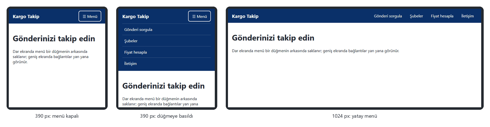

*Şekil 9.13. Örnek 9.4: 390 pikselde kapalı menü, düğmeye basıldıktan sonra açılan menü ve 1024 pikselde yatay menü ([codes/09-duyarli-tasarim/ornek-9-4-duyarli-menu/](../codes/09-duyarli-tasarim/ornek-9-4-duyarli-menu/index.html)).*

JavaScript kullanılmak istenmiyorsa `<details>` ve `<summary>` öğeleri de açılır–kapanır bir menü sağlar: `<summary>` tıklandığında `<details>` içindeki `<nav>` görünür ve tarayıcı durum bilgisini yardımcı teknolojilere kendisi iletir. Ancak geniş ekranda menünün her zaman açık görünmesi için ek CSS veya `open` niteliğinin yönetilmesi gerektiğinden, bu bölümde düğme + JavaScript yaklaşımı tercih edilmiştir.

> [!NOTE]
> **Tarihsel not:** Uzun süre yaygın kullanılan "onay kutusu hilesi" (gizli bir `<input type="checkbox">` ve `:checked` seçicisiyle menüyü açıp kapatmak) yalnızca CSS ile çalışsa da ekran okuyuculara yanlış rol (onay kutusu) bildirdiği için önerilmemektedir.

## 9.9 Chrome Geliştirici Araçları (DevTools)

### 9.9.1 DevTools'u Açma ve Temel Paneller

Tarayıcı geliştirici araçları, sayfanın HTML, CSS ve JavaScript'ini canlı olarak incelemeyi, düzenlemeyi ve hata ayıklamayı sağlar. Chrome'da DevTools `F12` tuşuyla, `Ctrl+Shift+I` (macOS'ta `Cmd+Option+I`) kısayoluyla veya sayfada sağ tıklayıp **İncele** (Inspect) seçilerek açılır. Belirli bir öğeye sağ tıklanarak açıldığında Elements paneli doğrudan o öğeyi seçili gösterir.

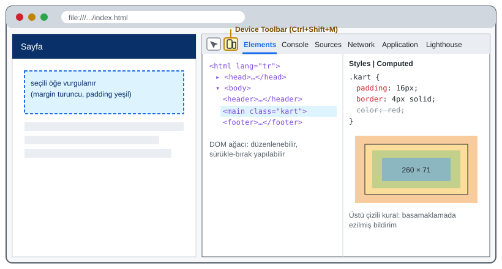

*Şekil 9.14. Chrome DevTools'un ana bölümleri (şematik çizim; sürüme göre görünüm farklılık gösterebilir).*

| Panel | Ne işe yarar? | Bu derste kullanıldığı yer |
|---|---|---|
| **Elements** | DOM ağacını ve her öğeye uygulanan CSS kurallarını canlı gösterir; değerler yerinde düzenlenebilir. Styles bölmesinde ezilen kurallar üstü çizili görünür; Computed sekmesinde kutu modeli çizimi yer alır. Flex ve Grid kapsayıcılarının yanındaki rozetler yerleşim çizgilerini sayfa üzerinde gösterir. | Bölüm 4 (basamaklama), Bölüm 6 (kutu modeli, Grid) |
| **Console** | JavaScript hatalarını ve `console.log` çıktılarını gösterir; komut yazılıp çalıştırılabilir. | Bölüm 7–8 |
| **Sources** | Sayfanın kaynak dosyalarını dosya bazında listeler; JavaScript'te kesme noktası (breakpoint) koyup adım adım çalıştırmayı sağlar. | Bölüm 7–8 |
| **Network** | Sayfa yüklenirken yapılan tüm istekleri (HTML, CSS, JS, görsel, yazı tipi) boyut, süre ve durum koduyla listeler; ağ yavaşlatma burada da ayarlanabilir. | Bölüm 1 (HTTP), Bölüm 9.5 (hangi görsel indirildi) |
| **Application** | `localStorage`, çerezler (cookies) ve önbellek gibi tarayıcı depolama alanlarını gösterir. | Bölüm 8 (`localStorage`) |
| **Lighthouse** | Sayfayı performans, erişilebilirlik, en iyi uygulamalar ve arama motoru uygunluğu açısından otomatik denetler ve puanlı bir rapor üretir. | Bölüm 9.9.3 |

*Tablo 9.5. Chrome DevTools'un temel panelleri.*

> [!TIP]
> **Güncel hayattan:** Bir alışveriş sitesinde "Sepete ekle" düğmesi çalışmıyorsa Console panelindeki kırmızı hata satırı nedeni gösterir; sayfa yavaş açılıyorsa Network panelinde hangi görselin megabaytlarca yer kapladığı görülür. Web geliştiricilerinin günlük işinin önemli bir kısmı bu iki panelde geçer.

### 9.9.2 Device Toolbar ile Cihaz Öykünmesi

Device Toolbar (cihaz araç çubuğu), sayfanın farklı ekran boyutlarında ve cihaz koşullarında nasıl görüneceğini bilgisayardan çıkmadan test etmeyi sağlar [16], [7, ss. HTML 359–362]. DevTools açıkken sol üstteki telefon–tablet simgesine tıklanarak veya `Ctrl+Shift+M` (macOS'ta `Cmd+Shift+M`) kısayoluyla açılır.

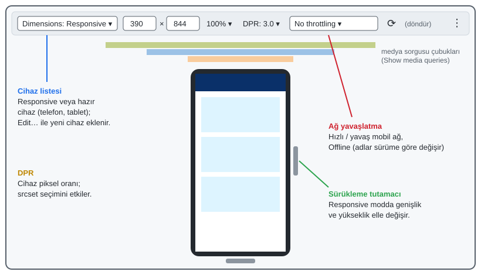

*Şekil 9.15. Device Toolbar'ın bölümleri (şematik çizim).*

- **Cihaz listesi (Dimensions):** Açılır listeden hazır telefon ve tablet profilleri (ör. iPhone, Samsung Galaxy, iPad Air modelleri; liste Chrome sürümleriyle güncellenir) seçilebilir. Bu sayede "Sayfam bu telefonda nasıl görünüyor?" sorusu fiziksel cihaz olmadan yanıtlanabilir. Seçilen cihazın CSS piksel genişliği, yüksekliği ve DPR değeri otomatik uygulanır, tarayıcı mobil kullanıcı aracısı (user agent) ve dokunma olaylarıyla öykünme yapar. Listede olmayan bir cihaz **Edit…** ile eklenebilir.
- **Responsive modu:** Varsayılan moddur; genişlik ve yükseklik kutulara yazılarak veya görünüm alanının kenarındaki tutamaçlar sürüklenerek serbestçe değiştirilir. Kırılma noktalarını içeriğe göre bulmak için en uygun moddur.
- **DPR:** Cihaz piksel oranı ayrıca seçilebilir; `srcset` seçiminin testinde kullanılır (Şekil 9.10).
- **Ağ yavaşlatma (throttling):** Yavaş mobil bağlantı veya çevrimdışı durum öykünülerek sayfanın zayıf bağlantıda nasıl yüklendiği görülür. Hazır ayarların adları Chrome sürümüne göre değişebilir.
- **Döndürme:** Dikey ve yatay yönelim arasında geçiş yapar; `orientation` sorgularını test eder.
- **Medya sorgusu çubukları:** Araç çubuğunun sağındaki menüden **Show media queries** seçildiğinde, stil dosyasındaki kırılma noktaları renkli çubuklar olarak gösterilir; bir çubuğa tıklanınca görünüm alanı o genişliğe ayarlanır.

> [!IMPORTANT]
> Device Toolbar bir **öykünmedir** (emulation), gerçek cihaz değildir. Sayfa yine bilgisayarın işlemcisi ve tarayıcı motoruyla çalışır; mobil işlemcinin yavaşlığı, gerçek dokunmatik ekranın davranışı ve özellikle iOS'taki Safari motoruna özgü farklılıklar birebir yansıtılamaz [16]. Yayına alınacak bir sitenin en az bir gerçek Android ve bir gerçek iOS cihazda da denenmesi gerekir.

### 9.9.3 Duyarlılık Test Kontrol Listesi

Bir sayfayı yayına almadan önce Device Toolbar ile aşağıdaki denetimlerin yapılması önerilir:

1. **Viewport etiketi:** `<head>` içinde `width=device-width, initial-scale=1` var mı; yakınlaştırmayı engelleyen değer yok mu?
2. **Yatay taşma:** 320 ve 390 piksel genişlikte yatay kaydırma çubuğu oluşuyor mu? Taşmaya neden olan öğe, Elements panelinde öğelerin üzerine gelerek veya Console'da genişliği görünüm alanını aşan öğeleri listeleyerek bulunabilir.
3. **Görseller:** Tüm görseller `max-width: 100%` ile kapsayıcısına sığıyor mu; `width`/`height` nitelikleri yazılmış mı?
4. **Dokunma hedefleri:** Bağlantılar ve düğmeler parmakla rahat dokunulabilecek boyutta mı (en az 24×24, tercihen 44×44 CSS pikseli)?
5. **Metin:** Gövde metni telefonda en az 16 piksel mi; satır uzunluğu masaüstünde aşırı uzun değil mi?
6. **Kırılma noktaları:** Responsive modunda genişlik yavaşça artırılırken düzenin bozulduğu bir ara genişlik var mı?
7. **Yönelim ve tercih:** Yatay yönelim, koyu tema ve azaltılmış hareket (Rendering paneli) denendi mi?
8. **Ağ:** Yavaş mobil ağ öykünmesinde sayfanın ilk görünür içeriği makul sürede geliyor mu? Lighthouse raporunda erişilebilirlik ve performans önerileri incelendi mi?

#### 🛠 Uygulama 9.6: DevTools Device Toolbar ile Hata Avı

**Amaç:** Kasıtlı olarak hatalı yazılmış bir etkinlik sayfasındaki duyarlılık sorunlarını Device Toolbar ve Elements paneliyle bulup düzeltmek.  
**Tahmini süre:** 20 dk

1. Örnek çözüm klasöründeki `baslangic.html`, `hatali.css` ve `afis.svg` dosyalarını `calismalar/bolum-09/hata-avi/` klasörüne kopyalayınız ve `baslangic.html` dosyasını Live Server ile açınız.
2. `F12` → `Ctrl+Shift+M` ile Device Toolbar'ı açınız, 390 piksel genişliğinde bir telefon seçiniz. Sayfanın sağa taştığını gözlemleyiniz (Şekil 9.16, solda).
3. Yukarıdaki kontrol listesini sırayla uygulayınız. Her bulduğunuz sorunu Elements → Styles bölmesinde değeri değiştirerek canlı deneyiniz; işe yarayan düzeltmeyi CSS dosyasına aktarınız.
4. Bulmanız beklenen sorunlar: yakınlaştırmayı engelleyen viewport değerleri, sabit `width: 960px` kapsayıcı, sabit genişlikli görsel, dar ekranda sayfayı genişleten tablo, satır sonunda kırılmayan uzun adres ve çok küçük dokunma hedefleri.
5. Düzelttiğiniz sayfada Lighthouse panelinden **Mobile** cihaz için yalnızca **Accessibility** kategorisinde bir rapor üretiniz ve kalan önerileri not ediniz.

**Beklenen çıktı:**

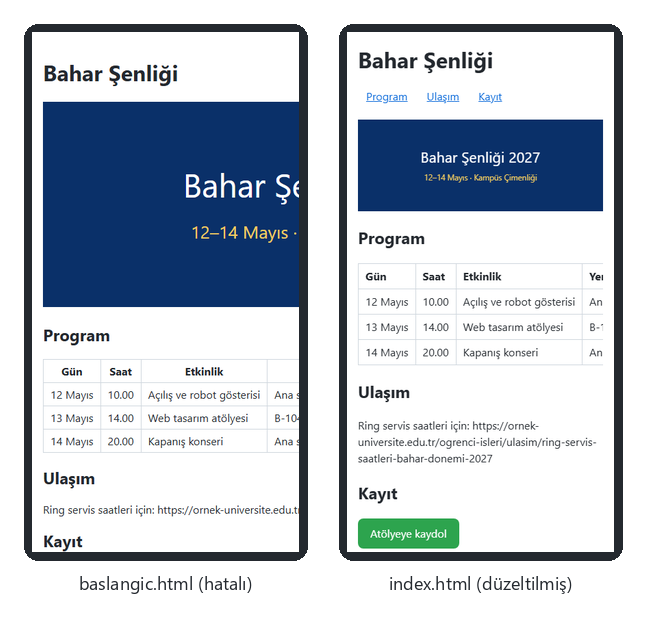

*Şekil 9.16. Uygulama 9.6: düzeltme öncesi (solda) içerik ekranın sağından taşmakta ve menü görünmemektedir; düzeltme sonrası (sağda) sayfa 390 piksele sığmakta, tablo kendi kutusunda kaydırılmaktadır.*

**Kendinizi sınayın:** (1) Geniş tabloyu `overflow-x: auto` ile saran öğeye klavye kullanıcılarının da ulaşabilmesi için hangi nitelik eklenebilir? (2) Network panelinde ağ yavaşlatmayı en yavaş mobil ayara getirip sayfanın yüklenme süresini karşılaştırınız.

<details><summary>Örnek çözüm</summary>

Başlangıç dosyası: [`codes/09-duyarli-tasarim/uygulama-9-6-devtools-test/baslangic.html`](../codes/09-duyarli-tasarim/uygulama-9-6-devtools-test/baslangic.html) · Düzeltilmiş sürüm: [`codes/09-duyarli-tasarim/uygulama-9-6-devtools-test/index.html`](../codes/09-duyarli-tasarim/uygulama-9-6-devtools-test/index.html)

</details>

## 9.10 Bölüm Özeti

- Duyarlı web tasarımı, tek bir HTML belgesinin ekran boyutuna göre yeniden düzenlenmesidir. Marcotte'un (2010) tanımladığı üç bileşen akışkan ızgara, esnek görseller ve medya sorgularıdır; bugün bunlara akışkan tipografi, kapsayıcı sorguları ve kullanıcı tercihi sorguları eklenmiştir.
- Ekim 2026 itibarıyla dünya genelinde sayfa görüntülemelerinin yaklaşık %60'ı mobil cihazlardan gelmektedir; bu nedenle tasarıma en küçük ekrandan başlanması (mobil öncelikli yaklaşım) önerilir.
- Viewport meta etiketi (`width=device-width, initial-scale=1`) olmadan mobil tarayıcı sayfayı yaklaşık 980 piksel varsayıp küçültür ve medya sorguları çalışmaz. Yakınlaştırmayı engelleyen `user-scalable=no` ve `maximum-scale` erişilebilirliği bozar.
- CSS pikseli mantıksal bir birimdir; DPR, bir CSS pikselinin kaç cihaz pikseline karşılık geldiğini belirler ve görsellerin keskinliğini etkiler.
- Akışkan düzen `%`, `fr`, `rem`, `vw`/`dvh` ve `max-width: 100%` görsellerle kurulur; `clamp()` yazı boyutunu medya sorgusu olmadan sınırlar içinde ölçekler.
- Mobil öncelikli medya sorguları `min-width` (veya `width >=`) ile yazılır; kırılma noktaları cihaz modellerine göre değil içeriğin bozulduğu genişliğe göre seçilir. `prefers-color-scheme`, `prefers-reduced-motion`, `hover` ve `pointer` gibi özellikler kullanıcı tercihlerine ve giriş aygıtına uyum sağlar.
- `srcset`/`sizes` tarayıcının uygun çözünürlüğü seçmesini, `<picture>` ise farklı kırpılmış görsellerin (sanat yönetimi) gösterilmesini sağlar; `loading="lazy"` ekran dışı görsellerin yüklenmesini erteler.
- Kapsayıcı sorguları bileşenin düzenini ekrana değil kapsayıcısına göre değiştirir.
- Chrome DevTools'un Elements, Console, Sources, Network, Application ve Lighthouse panelleri ile Device Toolbar, duyarlı sayfaların geliştirilmesinde ve test edilmesinde temel araçlardır; ancak gerçek cihaz testinin yerini tutmaz.

## 9.11 Değerlendirme Soruları

1. Marcotte'un duyarlı web tasarımı için tanımladığı üç teknik bileşeni yazınız ve her birinin CSS/HTML'deki bir karşılığını örnekleyiniz.
2. Viewport meta etiketi olmayan bir sayfada `@media (max-width: 600px)` sorgusu 390 CSS pikseli genişliğindeki bir telefonda neden çalışmaz? Açıklayınız.
3. Fiziksel genişliği 1080 cihaz pikseli ve DPR değeri 2,75 olan bir telefonun görünüm alanı kaç CSS pikselidir? Bu telefonda 360 CSS pikseli genişliğinde gösterilecek bir fotoğraf için `srcset="a-480.jpg 480w, a-960.jpg 960w, a-1440.jpg 1440w"` ve `sizes="100vw"` verildiğinde tarayıcının hangi dosyayı seçmesi beklenir?
4. Aşağıdaki iki yaklaşımdan hangisi mobil önceliklidir? Gerekçesiyle açıklayınız.
   ```css
   /* A */ .x { width: 33%; } @media (max-width: 600px) { .x { width: 100%; } }
   /* B */ .x { width: 100%; } @media (min-width: 600px) { .x { width: 33%; } }
   ```
5. `font-size: clamp(1.25rem, 1rem + 2vw, 2.5rem);` bildirimi 320, 800 ve 1600 piksel genişliğindeki görünüm alanlarında kaç piksel yazı boyutu üretir? (Kök yazı boyutunu 16 piksel kabul ediniz.)
6. `(min-width: 768px) and (max-width: 1023.98px)` sorgusunu Media Queries Level 4 aralık sözdizimiyle yazınız. Klasik yazımda neden `.98` gibi değerlere ihtiyaç duyulduğunu açıklayınız.
7. `srcset` ile `<picture>` arasındaki fark nedir? Hangi durumda hangisi kullanılmalıdır? Birer örnek veriniz.
8. Medya sorgusu ile kapsayıcı sorgusu arasındaki farkı, bir haber kartının hem ana sütunda hem yan sütunda kullanıldığı bir sayfa üzerinden açıklayınız.
9. `prefers-reduced-motion` ve `user-scalable=no` konularını erişilebilirlik açısından değerlendiriniz; hangisi kullanıcının tercihine saygı gösterir, hangisi kısıtlar?
10. Device Toolbar ile yapılan testin gerçek cihaz testinin yerini tutamamasının üç nedenini yazınız.
11. Bir öğrenci sayfasının telefonda sağa taştığını bildirmektedir. DevTools kullanarak sorunun kaynağını bulmak için izleyeceğiniz adımları sıralayınız.

## Kaynaklar

[1] J. Duckett, *HTML and CSS: Design and Build Websites*. Indianapolis, IN, USA: Wiley, 2011.

[2] J. N. Robbins, *Learning Web Design: A Beginner's Guide to HTML, CSS, JavaScript, and Web Graphics*, 4th ed. Sebastopol, CA, USA: O'Reilly Media, 2012.

[3] J. Sklar, *Principles of Web Design: The Web Warrior Series*, 6th ed. Boston, MA, USA: Cengage Learning, 2015.

[4] E. Marcotte, "Responsive Web Design," *A List Apart*, no. 306, May 2010. [Çevrimiçi]. Erişim: https://alistapart.com/article/responsive-web-design/

[5] StatCounter, "Desktop vs Mobile vs Tablet Market Share Worldwide," *StatCounter Global Stats*. [Çevrimiçi]. Erişim: https://gs.statcounter.com/platform-market-share/desktop-mobile-tablet (Erişim tarihi: 2 Kasım 2026).

[6] L. Wroblewski, *Mobile First*. New York, NY, USA: A Book Apart, 2011.

[7] P. Carey, *New Perspectives on HTML5 and CSS3: Comprehensive*, 7th ed. Boston, MA, USA: Cengage Learning, 2017.

[8] Mozilla, *MDN Web Docs*. [Çevrimiçi]. Erişim: https://developer.mozilla.org/ (Erişim tarihi: 2 Kasım 2026).

[9] W3C, "CSS Viewport Module Level 1." [Çevrimiçi]. Erişim: https://www.w3.org/TR/css-viewport-1/ (Erişim tarihi: 2 Kasım 2026).

[10] W3C, *Web Content Accessibility Guidelines (WCAG) 2.2*, W3C Recommendation, Oct. 2023. [Çevrimiçi]. Erişim: https://www.w3.org/TR/WCAG22/

[11] W3C, "CSS Values and Units Module Level 4." [Çevrimiçi]. Erişim: https://www.w3.org/TR/css-values-4/ (Erişim tarihi: 2 Kasım 2026).

[12] W3C, "Media Queries Level 4." [Çevrimiçi]. Erişim: https://www.w3.org/TR/mediaqueries-4/ (Erişim tarihi: 2 Kasım 2026).

[13] W3C, "Media Queries Level 5." [Çevrimiçi]. Erişim: https://www.w3.org/TR/mediaqueries-5/ (Erişim tarihi: 2 Kasım 2026).

[14] WHATWG, "HTML Living Standard." [Çevrimiçi]. Erişim: https://html.spec.whatwg.org/ (Erişim tarihi: 2 Kasım 2026).

[15] W3C, "CSS Conditional Rules Module Level 5." [Çevrimiçi]. Erişim: https://www.w3.org/TR/css-conditional-5/ (Erişim tarihi: 2 Kasım 2026).

[16] Google, "Device mode," *Chrome DevTools Documentation*. [Çevrimiçi]. Erişim: https://developer.chrome.com/docs/devtools/device-mode (Erişim tarihi: 2 Kasım 2026).

---

[← Önceki bölüm](08-javascript-dom-olaylar.md) · [İçindekiler](../README.md)
